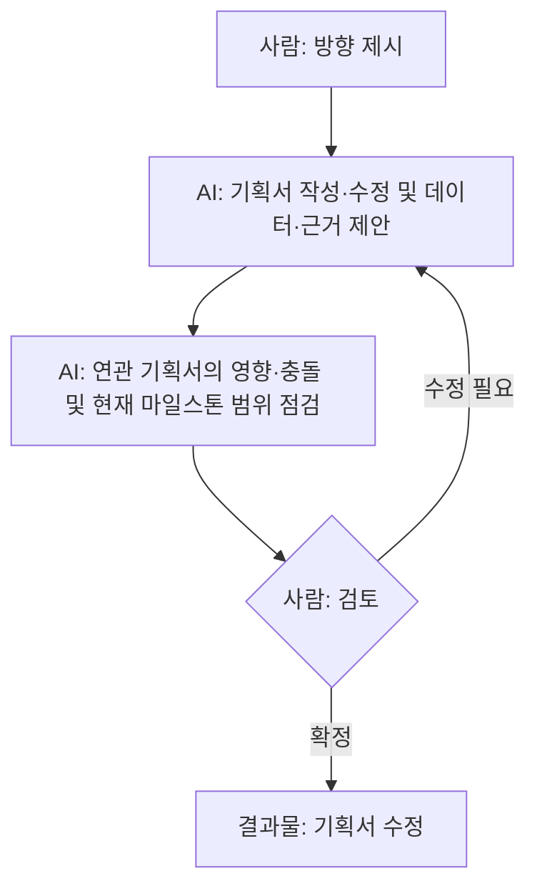
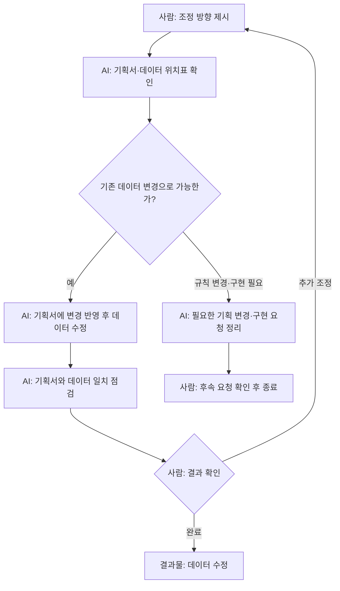
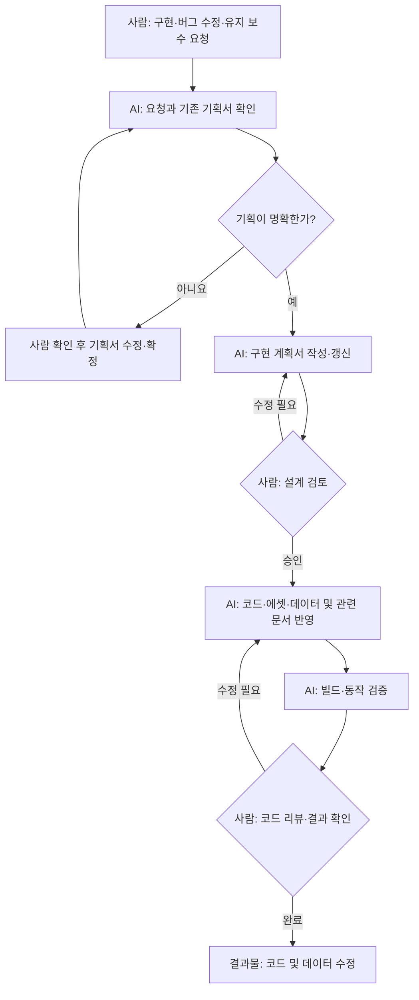
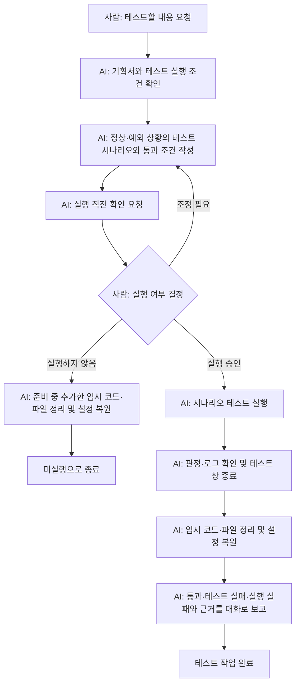

# AI 워크플로우

기획자와 프로그래머가 각자 AI를 쓰며 효율적으로 일하기 위한 규칙입니다.

## 책임

- 공통
  - 사람은 디렉터이고, AI가 실무자입니다. 기획서·데이터·에셋·코드 작업은 AI가 하고, 사람은 판단하고 승인합니다.
  - AI의 작업 결과물은 지시한 사람이 확인하고 책임집니다.
- 기획자
  - 기획서를 명확하게 유지하고 최신화
  - 수치 밸런싱 방향 결정
  - 결과물이 기획 의도에 맞는지 판단
- 프로그래머
  - 기획서대로 동작하도록 구현
  - 코드 유지 보수
  - 프로젝트가 항상 빌드되고 실행되도록 유지

## 진행 순서

각 작업은 필요한 작업부터 독립적으로 시작하고, 해당 결과물을 확인하면 완료합니다. 각 작업은 요청받은 범위까지 수행합니다. 다른 작업이 필요하면 결과 보고에서 알립니다. 작업에 필요한 기존 기획서·데이터·코드는 확인하고, 변경에 따른 문서 동기화는 '협업 규칙'을 따릅니다.

| 작업 | 담당자 | 사람이 할 일 | AI에게 맡기는 일 |
| - | - | - | - |
| 기획 | 기획자 | 방향을 정하고, AI가 제안한 데이터와 기획서를 검토해 확정합니다. | 기획서 작성·수정, 데이터와 근거 제안, 연관 기획서의 영향·충돌 및 현재 마일스톤 범위 점검 |
| 데이터 | 기획자 또는 프로그래머 | 조정 방향을 정하고, 수정 결과를 확인합니다. | 기획서·데이터 위치표 확인, 데이터 수정, 기획서 동기화 |
| 구현 | 프로그래머 | 구현 설계를 승인하고, 코드를 리뷰하고, 결과를 확인합니다. | 구현 계획서 작성, 코드와 데이터·에셋 작업, 동작 테스트 |
| 테스트 | 기획자 또는 프로그래머 | 테스트할 내용을 정하고, 실행을 승인하고, 결과를 확인합니다. | 시나리오 준비·실행, 판정과 로그 확인, 테스트 결과 보고 |

### 기획 작업

### 데이터 작업

데이터 작업은 직접 요청하거나 다른 작업의 후속 요청으로 시작합니다. 기획서와 데이터의 동기화는 '협업 규칙'을 따릅니다.

### 구현 작업

동작 검증은 '협업 규칙'에서 참조하는 '동작 테스트 실행'을 따릅니다.

### 테스트 작업

테스트 작업은 시나리오 테스트를 실행해 기획서대로 동작하는지 확인하는 작업입니다. 실행 절차는 [시나리오 테스트 README](<../Scripts/ScenarioTest/README.md>), 실행 직전 확인과 종료 후 정리는 [개발 도구와 검증](<Program/개발 도구와 검증.md>)의 '동작 테스트 실행'을 따릅니다.

테스트는 기획서의 정상 동작과 관련된 경계·예외 상황을 함께 다룹니다. 통과 조건은 기획서와 기술 규칙에 근거합니다.

테스트 작업은 결과와 근거를 대화로 보고하면 완료합니다.

## 협업 규칙

- 기획서
  - 기획서에 적지 않은 기능은 만들지 않습니다.
  - 기획서를 수정하면 변경 내용과 연관된 기획서도 점검하고, 함께 바뀌어야 하는 내용은 반영합니다.
  - 사람이 확정한 답이나 변경 요청으로 기획이 바뀌면, 데이터·코드를 수정하기 전에 기획서에 반영합니다.
- 데이터
  - 데이터는 기획서에 적은 수치(스탯, 대미지 배율), 설정값(가드 가능 여부), 에셋(모션, VFX)을 말합니다.
  - 기획 데이터와 UE 에셋의 관리 기준은 [AGENTS.md](<../AGENTS.md>)의 코딩 규칙을 따릅니다.
  - 데이터를 바꾸면 기획서도 함께 고칩니다.
  - 각 데이터가 어느 파일(JSON 데이터 파일, 에셋)에 들어 있는지는 [데이터 위치표](<Program/데이터 위치표.md>)에 정리합니다.
  - 기획자는 데이터 작업으로 게임을 조정합니다. 규칙을 바꾸는 변경은 프로그래머에게 요청합니다.
- 구현
  - 구현은 기획서 본문을 따릅니다. 첨부 그림은 이해를 돕는 참고용이며, 좌표·크기·색을 그대로 옮기지 않습니다.
  - 게임 로직의 구현 언어, BP 에셋의 사용 범위, 기획 데이터의 단일 원본은 [AGENTS.md](<../AGENTS.md>)의 코딩 규칙을 따릅니다.
  - AI의 동작 테스트는 [개발 도구와 검증](<Program/개발 도구와 검증.md>)의 '동작 테스트 실행'을 따릅니다.

## 문서 위치

| 폴더 | 내용 |
| - | - |
| `Docs/Design` | 기획서 |
| `Docs/Program` | 구현 계획서 |
| `Docs/Art` | 에셋 조사 |
| `Scripts/MotionImages` | 기획서 모션 그림을 만드는 스크립트와 그림 정의. 쓰는 법은 폴더의 README를 따릅니다. |
| `Scripts/ScenarioTest` | AI가 동작 테스트 창을 띄워 시나리오를 실행하는 스크립트. 쓰는 법은 폴더의 README를 따릅니다. |
| `.agents/skills` | AI가 되풀이하는 작업의 절차와 도구 요령(스킬). 규칙과 결정은 적지 않고 그것을 정한 문서를 가리킵니다. Claude Code는 `.claude/skills`를 이 폴더에 연결해 읽습니다(만드는 법은 `.gitignore`의 주석). |

## 문서 작성 규칙

- SSoT(Single Source of Truth)를 지킵니다. 수치, 규칙 같은 사실은 그것을 정의하는 문서의 한 곳에만 적고, 다른 곳에서는 '~를 따릅니다', '~ 참고'로 가리킵니다.
  - 용어는 [용어집](<용어집.md>)을 따릅니다.
  - 결정한 내용은 저장소의 문서에 적습니다. 개인 AI의 메모리나 대화는 출처가 될 수 없습니다.
- 기획서에는 플레이해서 확인할 수 있는 것(규칙, 수치, 화면 배치)을 적습니다. 플레이로 구분할 수 없는 것(코드 구조, 에셋 구성, 엔진 기능 선택)은 구현 계획서에서 정합니다.
- 기획서에는 현재 마일스톤의 내용만 적습니다. 다음 마일스톤에 대한 언급이나 '나중에 검토' 같은 문구는 쓰지 않습니다.
