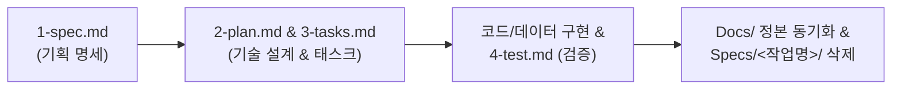

# AI 워크플로우

기획자와 프로그래머가 각자 AI를 쓰며 효율적으로 일하기 위한 규칙입니다. 본 프로젝트는 **Spec-Driven Development (SDD)** 방식을 따릅니다.

## 책임

사람은 방향을 정하고 승인하며, AI는 기획서·스펙·데이터·에셋·코드 작업을 수행합니다. 결과는 지시한 사람이 확인하고 책임집니다.

| 담당자 | git 이름 | 책임 |
| - | - | - |
| 기획자 | uru241, baksakong(benjaminseok) | 기획서 최신화, 아트 표현 결정, 수치 밸런싱 방향, 결과의 기획 의도 충족 여부 |
| 프로그래머 | Woogle | 기술 설계 승인, 기획에 따른 구현, 코드 유지 보수, 빌드·실행 가능 상태 유지 |

AI는 `git config user.name`으로 지시한 사람의 역할을 판단하며, 표에 없는 이름이면 사람에게 묻습니다.

---

## SDD 진행 순서 (작업 라이프사이클)

새로운 기능을 추가하거나 시스템을 변경할 때는 `Specs/<작업명>/`에 작업 폴더를 생성하고 [SDD 템플릿](<../Specs/TEMPLATE.md>)에 따라 4단계로 진행합니다.

수치 조정, 버그 수정, 문서 수정처럼 기존 기획과 구조 안에서 끝나는 작은 변경은 `Specs` 폴더 없이 해당 기획서와 데이터·코드를 함께 고치고, 사람이 확인하면 완료합니다. 어느 쪽인지 애매하면 사람에게 묻습니다.

### 1단계: 작업 기획 명세 (`1-spec.md`)
- 사람이 요청한 기능의 플레이 규칙, 수치, 판정, 완료 조건(Acceptance Criteria)을 명확히 작성합니다.
- 기획이 불명확하면 사람에게 질문하여 먼저 확정합니다.
- AI는 기존 기획서·코드·데이터와 맞춰 보고, 어긋나거나 정하지 않은 항목을 사람에게 묻습니다.

### 2단계: 기술 설계 및 작업 분할 (`2-plan.md`, `3-tasks.md`)
- 2단계부터는 프로그래머가 진행합니다.
- [기본 방침](<Architecture/기본 방침.md>), [캐릭터 기반 구조와 GAS](<Architecture/캐릭터 기반 구조와 GAS.md>), [데이터 로딩과 스키마](<Architecture/데이터 로딩과 스키마.md>)의 공통 아키텍처 규칙을 준수하여 C++ 클래스, GAS 태그/어빌리티, JSON 스키마를 설계합니다.
- 작업을 독립적인 실행 단위로 쪼개 `3-tasks.md` 체크리스트를 구성하고, **프로그래머의 설계 승인**을 받습니다.

### 3단계: 구현 및 검증 (`C++`, `JSON`, `4-test.md`)
- 승인된 설계와 체크리스트에 따라 코드, JSON 데이터, 에셋을 반영합니다.
- 정상 동작 및 예외 상황에 대한 시나리오 테스트를 실행하고, 통과 결과와 로그를 `4-test.md`에 기록합니다.

### 4단계: 정본 동기화 및 작업대 정리 (Sync & Clean)
- 검증을 마치고 사람이 결과를 확인하면 확정된 기획은 `Docs/Design/`의 기획서에 반영하고, 공통 기술 규약이 바뀌었으면 `Docs/Architecture/`의 구현 문서에도 반영합니다. 수정 요청이 있으면 3단계로 돌아갑니다.
- 반영을 마치면 `Specs/<작업명>/` 폴더를 삭제합니다.

---

## 테스트 작업 수칙

정상 동작과 경계·예외 상황의 시나리오를 준비하며, 통과 조건은 기획서와 기술 규칙에 근거합니다.

- 테스트 창, PIE, 패키지 게임을 띄우기 직전에 무엇을, 창 몇 개로, 얼마나 확인할지 사람에게 묻고 확인을 받은 뒤 시작합니다. 작업 계획이나 `3-tasks.md`를 승인받은 것은 이 확인을 대신하지 않습니다.
- 테스트 때문에 `DesignData` JSON을 수정해야 하면 먼저 확인을 받습니다.
- 테스트 방식은 [개발 도구와 검증](<Architecture/개발 도구와 검증.md>)의 '동작 테스트 실행', 실행 방법은 [시나리오 테스트 README](<../Scripts/ScenarioTest/README.md>)를 따릅니다.
- 테스트가 끝나면 창을 닫고, 임시 코드·시나리오 파일 정리 및 설정을 복원한 뒤 판정 결과와 로그를 보고합니다. (공용 도구 `Scripts/ScenarioTest`는 유지) 실행을 취소하거나 테스트가 실패해도 같은 정리를 합니다.

---

## 협업 및 문서 작성 규칙

- **SSoT (Single Source of Truth)**: 
  - `Docs/`는 항상 "현재 빌드에서 정상 동작하는 기준 상태"를 보존하는 단일 정본입니다.
  - 수치와 규칙 같은 사실은 그것을 정의하는 문서 한 곳에만 적고 다른 곳에서는 참조 링크로 가리킵니다. 용어는 [용어집](<용어집.md>)을 따릅니다.
  - 결정한 내용은 개인 메모리가 아닌 저장소 문서에만 기록합니다.
- **문서 위치 및 관리**:
  - `Docs/Design/System/`, `Docs/Design/Content/`, `Docs/Design/Level/`: 기획서. 플레이해서 확인할 수 있는 규칙, 수치, 화면 구성만 적습니다. 클래스, 함수, 엔진 기능, 태그, 코드 흐름 같은 구현 내용은 적지 않습니다.
  - `Docs/Art/`: 아트 문서. 외형, VFX·효과음, 리소스 선택과 조사를 적습니다. 기획서에는 효과가 전할 의도만 적습니다.
  - `Docs/Architecture/`: 구현 문서. 여러 기능에 걸친 공통 기술 규약과 그 클래스 구조만 적고, 주제별 구현 문서는 두지 않습니다.
  - `Docs/Milestone/`: 정식 채택된 마일스톤의 목표, 일정, 개발 범위, 담당 과제를 관리합니다.
  - `Docs/Meeting/`: 회의 자료와 검토 초안. 정본이 아니며, 채택된 마일스톤 계획은 `Docs/Milestone/`에 반영하고 세부 규칙은 SDD 절차에 따라 검증 뒤 해당 기획서·구현 문서에 반영합니다.
  - `Specs/<작업명>/`: 현재 진행 중인 작업 단위의 임시 SDD 작업대 (작업 완료 시 삭제).
  - 문서를 추가·이동·삭제하면 [문서 인덱스](<인덱스.md>)도 함께 갱신합니다.
- **작업 범위**: 요청받은 범위까지만 작업하고, 범위 밖 후속 작업은 결과 보고에서 알립니다.
- **기획서나 `1-spec.md`에 적지 않은 기능은 만들지 않습니다**: 기획이 변경되면 데이터나 코드를 수정하기 전에 `1-spec.md`에 먼저 반영하고, 기획서에는 검증 뒤 4단계에서 반영합니다. `Specs` 없이 하는 작은 변경은 기획서와 데이터·코드를 한 작업에서 함께 고칩니다.
- **기획서 변경**: 연관 기획서와의 영향·충돌을 함께 점검합니다. 기획서에는 현재 마일스톤의 내용만 적으며, 다음 마일스톤 언급이나 '나중에 검토' 같은 문구는 쓰지 않습니다.
- **데이터 작업**: 기획 데이터(JSON) 수정은 기획자와 프로그래머 누구나 수행할 수 있으며, 기획서와 데이터를 한 묶음으로 일치시킵니다. C++ 코드 변경이 필요한 규칙 수정만 바뀔 규칙을 `Specs/<작업명>/1-spec.md`에 적어 프로그래머에게 구현 요청으로 넘깁니다.
- **구현 기준**: 구현은 기획서나 `1-spec.md` 본문을 따릅니다. 첨부 그림은 참고용이며 좌표·크기·색을 그대로 옮기지 않습니다.
- **클래스 구조 갱신**: 클래스를 추가·삭제하거나 관계를 변경하면 그 클래스를 다루는 `Docs/Architecture/` 문서의 '클래스 구조'도 함께 수정합니다.
- **현재 상태만 기록**: 지난 상태나 변경 경위는 남기지 않고 git 기록에 맡깁니다.
