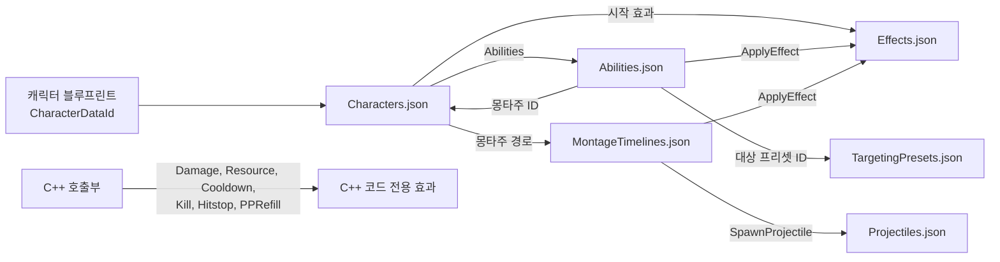
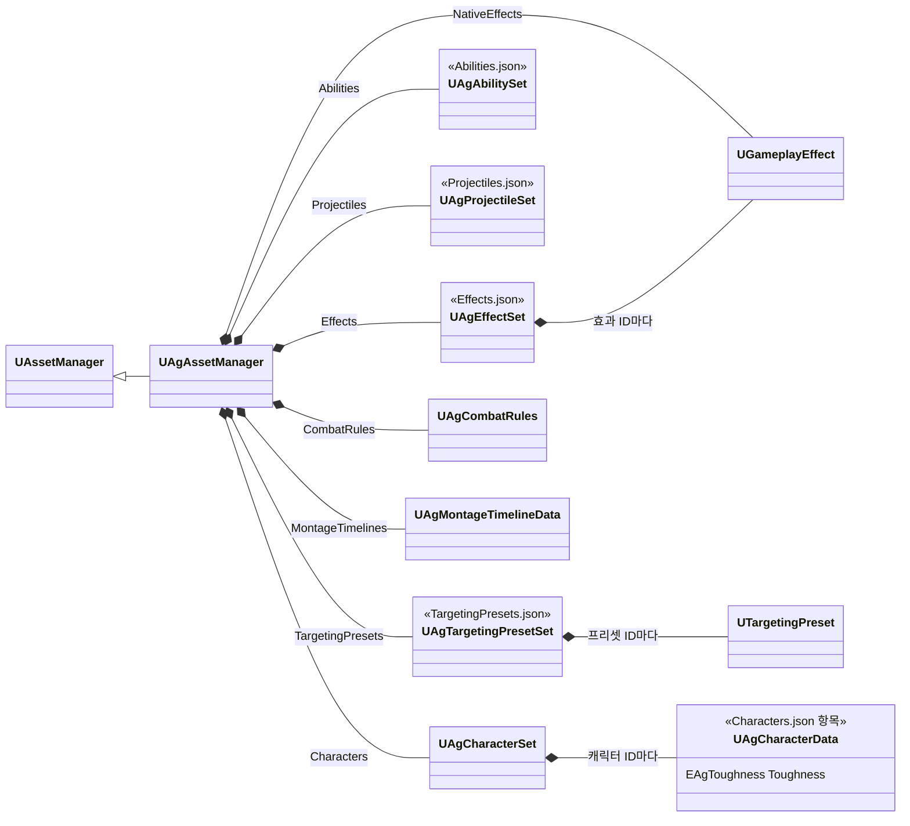

# 데이터 로딩과 스키마

기획서의 데이터(수치, 설정, 쓰는 에셋)는 주인이 분명한 곳에 둡니다. JSON 파일 외부에 존재하는 데이터 위치는 아래 'JSON 외부 데이터 위치'를 따릅니다.

어빌리티 정의의 형식은 아래 '어빌리티'에 둡니다. 몽타주 안의 구간과 Task의 Params는 [몽타주 타임라인과 구간 판정](<몽타주 타임라인과 구간 판정.md>)을 따릅니다.

## 기술 결정

| 항목 | 결정 | 이유 |
| - | - | - |
| 형식 | 기획 데이터와 구현용 참조의 구분은 [AGENTS.md](<../../AGENTS.md>) 코딩 규칙을 따릅니다. 코드 전용 효과의 내부 구성은 [캐릭터 기반 구조와 GAS](<캐릭터 기반 구조와 GAS.md>) '코드가 효과를 쓰는 방법'에 따라 C++에서만 관리합니다. 전투 데이터를 담는 UE 에셋(DataAsset, DataTable, GE 블루프린트, TargetingPreset)과 GE C++ 클래스는 두지 않습니다. | 에셋 선택을 포함한 데이터 변경을 텍스트로 검토하고 병합합니다. |
| 파일 구성 | 종류마다 파일 하나를 둡니다(아래 '파일 구성'). JSON 밖의 제작 설정은 아래 'JSON 외부 데이터 위치'에서 찾습니다. | 같은 종류의 정의를 한 파일에서 보고, 여러 캐릭터가 같은 어빌리티·효과 정의를 함께 씁니다. |
| 어빌리티 정의 | `Abilities.json`의 항목 하나가 어빌리티 하나의 정의입니다(아래 '어빌리티'). 모든 어빌리티(플레이어 액션, 보스 패턴 등)가 어빌리티 클래스 하나(`UAgGameplayAbility`)로 실행되므로 정의에 클래스 경로가 없습니다. Task 항목은 Task 이름(`Task`)과 그 Params의 필드로 적고, 선택 블록·선택 필드는 적었는지로 쓰는지를 구분합니다. | 있는 Task를 조합한 새 액션·패턴은 어빌리티 클래스를 더하지 않고 JSON과 몽타주로 더하고, 클래스·구조체 타입 문자열을 데이터에 중복하지 않습니다. |
| 읽는 방법 | `UAgAssetManager`가 엔진 초기화(`StartInitialLoading`) 때 아래 '파일 구성'의 파일들을 같은 타입의 새 객체에 한 묶음으로 읽고, 모두 통과하면 기존 데이터 객체에 값을 복사합니다(처음 읽기는 아래 '오류 검사'를 따릅니다). ID로 가리켜지는 정의 파일을 먼저 읽습니다. JSON 효과와 대상 프리셋은 읽은 정의로 매번 새 객체(GE, TargetingPreset)를 만듭니다. 데이터가 가리키는 에셋(몽타주, 투사체 블루프린트)도 이때 읽혀, 패키지 게임은 타이틀 화면부터 두 캐릭터의 에셋을 메모리에 둡니다. | 기존 데이터 객체를 참조하는 코드가 새 값을 볼 수 있습니다. |
| 로더의 객체 이름 | `UAgAssetManager`가 만드는 로딩 후보 데이터, 효과(JSON·코드 전용), 대상 프리셋과 그 안의 Task는 이름을 지정하지 않고 엔진의 고유 이름을 사용합니다. 조회는 ID와 객체 참조로 하며, 자동 이름에 의존하지 않습니다. 생성자의 기본 서브오브젝트는 `CombatRules`, `Effects`처럼 고정된 역할 이름을 사용합니다. 이 규칙은 이 로더의 객체 생성에 적용합니다. | 종류가 다른 객체의 이름 충돌을 막고, 재로딩할 때 기존 GE를 같은 이름으로 다시 만들어 적용 중인 효과를 훼손하지 않습니다. |
| 검증 시점 | 검증은 읽기와 함께 합니다. 쿡에서도 등록된 파일 전체의 최신 내용을 읽어, 하나라도 읽기 오류가 있으면 쿡과 패키징을 실패시킵니다. 검증한 JSON과 배포하는 JSON은 같아야 합니다. 정의 ID 검사는 에디터 전용 메타데이터를 쓰므로 패키징된 게임에서는 하지 않습니다. | 배포 전에 데이터 오류를 차단합니다. |
| 오류 검사 | 읽기 검사와 오류 출력은 JSON을 리플렉션으로 읽는 리더 하나(`FAgJsonReader`)가 맡고, 데이터 클래스와 Task에는 두지 않습니다. 검사 대상은 문법, 모르는 키, 엔진 변환(`FJsonObjectConverter`)이 받지 못한 값(형식, enum 이름), 없는 에셋·클래스·어트리뷰트, 등록되지 않은 태그, 없는 정의 ID, 적중 충전량(`HitReward`, 아래 '효과에 두는 값')의 범위입니다. 정의 ID 검사는 `DataId` 메타데이터가 있는 필드에 명시한 값만 해당 파일의 최상위 키와 대조합니다. 누락·null 처리는 아래 '기본값 작성'을 따릅니다. 오류는 파일명과 필드 경로로 로그·화면에 표시합니다. 읽지 못한 에셋·클래스·정의 ID·Task는 비우고, 그 값이 배열 원소나 맵 항목이면 원소를 뺍니다. 다시 읽기에 오류가 있으면 이전 데이터 전체를 유지하고, 처음 읽기는 오류가 있어도 나머지 값으로 시작합니다. 리다이렉터를 거쳐 읽힌 에셋 경로는 그 값을 쓰되 새 경로로 고치도록 경고합니다. 경고는 읽기 오류가 아니어서 다시 읽기와 쿡을 막지 않습니다. | 데이터 오류 하나로 에디터나 게임이 멈추지 않고, 데이터를 쓰는 코드는 없는 항목만 다룹니다. 다시 읽기는 플레이 중에 저장한 실수가 진행 중인 플레이의 데이터를 빼지 않게 이전 데이터를 유지합니다. 에디터는 JSON의 경로를 참조로 알지 못해, 이름을 바꾼 에셋의 리다이렉터를 지우면 그 경로가 깨집니다. 적중 충전량 밖의 값 범위나 필드 조합, 캐릭터별 몽타주 ID·섹션명과 실제 에셋의 대조까지 검사하지 않습니다. 읽기 성공이 모든 작성 규칙의 충족을 뜻하지는 않으며, 이런 항목은 데이터 검토와 플레이로 확인합니다. |
| 다시 읽기 | 에디터의 `UAgDataReloadSubsystem`이 `DesignData` 폴더 바로 아래 JSON의 변경을 감지해 등록된 파일 전체를 다시 읽습니다. 마지막 읽기에 오류가 있었으면 게임 월드(PIE, 테스트 창의 맵)를 시작할 때 에셋 매니저가 한 번 더 다시 읽습니다. 성공한 뒤 게임에서 사용하는 시점은 아래 '재로딩 반영 시점'을 따릅니다. 배열·맵 원소의 포인터·참조는 함수 안에서만 사용하고, 이후에는 ID로 다시 조회하거나 실행에 필요한 값을 복사합니다. 패키징 빌드와 커맨드렛은 파일을 감시하지 않고, 패키징 빌드는 게임 월드를 시작할 때도 다시 읽지 않습니다. | 에디터 재시작이나 C++ 빌드 없이 JSON을 고쳐 다시 플레이할 수 있습니다. 에셋 쪽에서 고친 오류는 JSON이 바뀌지 않아 파일 감시로는 다시 읽지 않으므로 플레이를 시작할 때 다시 읽고, 남은 오류는 플레이 화면에 다시 보입니다. |
| 패키징 | `Ag.Build.cs`의 `RuntimeDependencies`가 `DesignData/*.json`을 UFS에 넣습니다. 검증과 실패 처리는 '검증 시점'을 따릅니다. `ModifyCook`은 모든 데이터 객체의 객체 참조(Transient 포함)가 속한 패키지를 쿡 목록에 추가하고, 읽으면서 만든 객체(캐릭터 데이터, GE, 대상 프리셋과 그 Task)는 그 클래스와 그 객체가 가리키는 것까지 따라갑니다. `/Script/`와 `/Engine/Transient` 패키지는 제외합니다. | JSON 문자열과 Transient 참조는 저장된 에셋 의존성이 아니므로 쿡 단계에 직접 전달해야 합니다. |
| 데이터를 찾는 방법 | 파일 이름과 그 파일을 읽는 클래스는 에셋 매니저에 정해 둡니다. 캐릭터 항목은 모두 같은 데이터 클래스(`UAgCharacterData`)이며, 플레이어는 적 전용 값을 적지 않습니다. 캐릭터 블루프린트는 `CharacterDataId`를 `Characters.json`의 ID 목록에서 고릅니다. 캐릭터는 컴포넌트를 초기화하기 전(`PreInitializeComponents`)에 한 번 확인하고(없으면 멈춤), 그 밖의 코드는 있다고 보고 씁니다. | 코드에 에셋 경로를 쓰지 않습니다. 확인을 한 곳에서 해, 쓰는 곳마다 데이터가 있는지 묻지 않습니다. 파일마다 그 파일을 읽는 클래스가 정해져 있어 이름을 바꿀 일이 없습니다. |
| 어빌리티의 데이터 | 부여는 [캐릭터 기반 구조와 GAS](<캐릭터 기반 구조와 GAS.md>) '어빌리티 목록'을 따릅니다. 각 스펙 인스턴스는 자기 ID의 정의와 재생하는 몽타주의 시간표를 복사하고, 발동 Task와 시간표 Task는 그 사본으로 만듭니다. 복사 시점과 ID로 참조하는 효과·투사체·프리셋의 조회 시점은 아래 '재로딩 반영 시점'을 따릅니다. | 어빌리티 정의와 각 재생의 시간표가 사용 도중 바뀌지 않고, 클래스 CDO를 어빌리티별 설정으로 덮지 않습니다. |

## 파일 구성

| 파일 | 내용 | 최상위 키 |
| - | - | - |
| `Characters.json` | 캐릭터마다 스탯, 쓰는 어빌리티 ID 목록(부여 순서), 시작할 때 거는 효과 ID 목록, 몽타주 ID별 에셋, 캐릭터 종류별 값(적의 시야·AI·페이즈 값) | 캐릭터 ID(`Player`, `Boss`) |
| `Abilities.json` | 어빌리티 정의(아래 '어빌리티'). 두 캐릭터가 함께 쓰는 정의(`KnockDown`, `KnockUp`, `Juggle`)는 하나입니다. | 어빌리티 ID |
| `Effects.json` | 기획자가 조정하는 GameplayEffect 정의 | 효과 ID |
| `Projectiles.json` | 투사체 클래스, 비행 값, 공격 값 | 투사체 ID |
| `MontageTimelines.json` | 몽타주 타임라인([몽타주 타임라인과 구간 판정](<몽타주 타임라인과 구간 판정.md>)) | 몽타주 경로 |
| `TargetingPresets.json` | 대상 프리셋 정의. 프리셋마다 Targeting System Task 배열(`{"Class": 경로, 바꾼 속성}`, 적은 순서로 실행)입니다. 어빌리티의 `TargetRequiredTags`·`TargetBlockedTags`는 `AgTargetingFilterTask_TagRequirements`가 든 프리셋에서만 적용됩니다. | 프리셋 ID |
| `CombatRules.json` | 모든 캐릭터에 공통인 전투 규칙(히트스톱 시간, 가드의 SP 소모, 적의 시야 상실 대기 `TargetLostTime` 포함) | 속성 이름 |

- 파일을 추가할 때는 `UAgAssetManager`에 담는 객체 속성과 조회 함수를 두고, `AgAssetManager.cpp`의 파일 목록(`JsonFiles`)에 한 줄로 등록합니다. 생성, 읽기, 복사, 쿡 전달이 모두 이 목록을 따르고, 목록 순서가 읽는 순서입니다. `DesignData` 폴더에 JSON을 두는 것만으로 로딩·검증 대상이 되지는 않습니다.
- 에셋은 전체 객체 경로(`/Game/폴더/에셋.에셋`)로, 클래스는 네이티브 클래스 경로(`/Script/Ag.클래스`)나 생성 클래스 경로(`/Game/폴더/BP_Name.BP_Name_C`)로 적습니다.
- 빠진 키는 그 속성의 기본값입니다. 기본값의 명시·생략은 아래 '기본값 작성'을 따릅니다. 쓰지 않는 필드 몇 개 때문에 구조체를 나누지 않습니다.
- UPROPERTY는 맵 값으로 배열을 담지 못해, 배열이나 맵 하나만 가진 구조체로 감쌉니다. 이런 구조체는 감싸는 키 없이 그 배열이나 맵을 바로 적습니다(시간표의 섹션 맵, 대상 프리셋의 Task 배열).
- 단일 게임플레이 태그 필드는 문자열로 적습니다. 빈 문자열은 빈 태그이고, null은 기본값입니다. 숫자·배열·객체·불리언은 형식 오류입니다.
- 태그 목록(`Tags`, `GrantedTags` 등)은 등록된 태그 문자열의 배열입니다. 빈 목록은 `[]`로 적으며, 배열 원소에 빈 문자열이나 null을 넣으면 오류입니다.
- 효과와 대상 프리셋의 ID는 파일별로 독립적이며, 조회에는 각 맵의 ID를 씁니다.
- PlayMontage의 몽타주 ID(`Montage`)는 그 어빌리티를 쓰는 캐릭터의 `Montages`에서 찾습니다. 두 캐릭터가 같은 정의를 쓰면서 각자의 몽타주를 재생합니다.

## 기본값 작성

일반 필드는 기본값과 같은 값을 적거나 생략할 수 있습니다. 기획 의도를 드러내거나 항목을 비교하는 데 도움이 되면 기본값도 명시합니다.

- 읽을 때마다 새 객체·구조체의 기본값에서 시작합니다. 필드를 생략하거나 null로 적으면 그 기본값을 유지하며, 재로딩 전 값을 이어받는다는 뜻은 아닙니다. 모르는 키는 값이 null이어도 오류입니다. ID별 항목을 null로 적으면 그 항목이 없는 것과 같습니다.
- `TOptional` 필드는 생략하거나 null로 적으면 설정하지 않은 상태입니다. 반면 `0`, `false`, `{}`처럼 값을 적으면 설정한 상태가 됩니다. 예를 들어 `"Targeting": {}`는 기본값으로 채운 대상 설정을 사용하고, `"Targeting": null`은 대상 설정을 사용하지 않습니다.

다음 항목은 값이 기본값과 같아도 명시합니다.

| 항목 | 명시할 필드 | 이유 |
| - | - | - |
| 플레이어 시작 자원 | `Characters.json`의 `Player.Attributes.MP`, `UP` | 시작 자원량을 데이터에서 바로 확인합니다. |
| 보스 패턴의 최소 유효 거리 | `Abilities.json`의 `PatternSelection.Distance.Min` | 최소 거리가 0이어도 Min을 명시해 유효 거리 범위를 한눈에 확인합니다. |
| 공격의 가드 가능 여부 | `MontageTimelines.json`과 `Projectiles.json`의 모든 `Damage.bGuardable` | 매 타의 가드 가능·불가를 확인합니다. |
| RootMotion 추적 구간의 위치 보정 여부 | `MontageTimelines.json`에서 `Direction`이 Target인 RootMotion 구간의 `bWarpTranslation` | 위치 보정을 하는 구간과 회전만 하는 구간을 구분합니다. Direction의 기본값도 Target입니다. |

`ReleaseRange`, `TargetingRange`처럼 생략하면 상위 설정을 따르는 필드는 그 설정을 따를 때 계속 생략하고, 따로 정할 때만 명시합니다. `MaxDistance`처럼 생략이 제한 없음을 뜻하는 필드도 그 의미를 유지합니다. 위 명시 관례는 로딩 시 누락을 오류로 판정하는 조건이 아닙니다.

## 재로딩 반영 시점

묶음 읽기가 성공하면 보관 중인 데이터는 함께 바뀌지만, 이미 실행 중인 객체가 새 값을 사용하는 시점은 다음과 같습니다.

| 데이터 | 반영 시점 |
| - | - |
| 캐릭터의 강인도 | 다음 피격 결과 처리에서 캐릭터 데이터의 현재 값을 읽습니다. 진행 중인 피격 모션을 강제로 취소하지 않습니다. |
| 어빌리티 수치·대상 요청 조건·발동 Task | 다음 어빌리티 발동 때 정의를 복사합니다. 실행 중인 어빌리티는 기존 사본을 씁니다. |
| 캐릭터의 몽타주 ID별 에셋 | 새 PlayMontage Task가 시작하거나 캐릭터 코드가 몽타주 ID를 다시 조회할 때 적용합니다. 이미 재생 중인 몽타주를 강제로 교체하지 않습니다. |
| 몽타주 타임라인 | PlayMontage가 재생을 시작할 때마다 복사합니다. 같은 어빌리티 안에서도 BlendTime 전환으로 다시 재생하면 새 시간표를 씁니다. 같은 재생 안의 섹션 이동은 기존 시간표를 씁니다. |
| 대상 프리셋 | 다음 타겟팅 요청 때 ID로 다시 조회합니다. 실행 중인 어빌리티도 대상을 다시 찾을 때 새 프리셋을 쓸 수 있습니다. |
| 투사체 정의 | SpawnProjectile이 쏠 때 조회해 클래스·비행 값·공격 값을 투사체에 넘깁니다. 이미 쏜 투사체는 쏠 때의 값을 씁니다. |
| JSON 효과 | 다음에 효과를 걸 때 새 GE를 씁니다. 이미 걸린 효과는 제거될 때까지 이전 GE를 유지합니다. |
| 어빌리티 태그와 `Activation` | 캐릭터를 다시 만들 때 적용합니다. 현재 정의가 부여 당시 설정과 다르면 해당 어빌리티의 새 발동을 거부합니다. |
| 캐릭터의 어빌리티 목록 | 스펙을 새로 부여하려면 캐릭터를 다시 만들어야 합니다. 다만 목록에서 뺀 어빌리티는 정의 조회가 실패하므로 기존 캐릭터에서도 새로 발동할 수 없습니다. |
| 스탯·시작 효과 등 스폰 설정 | 캐릭터를 다시 만들 때 적용합니다. 다음 플레이 시작도 이에 해당합니다. |
| 적의 시야 값과 시야 상실 대기(`TargetLostTime`) | 적을 다시 만들 때 감각 설정에 적용합니다. |
| 코드 전용 효과 | JSON 재로딩으로 다시 만들거나 교체하지 않습니다. |
| HUD에 보이는 데이터 값(보스 이름, 스킬 코스트) | 다시 읽기가 끝나면 에셋 매니저가 `OnJsonDataReloaded`로 알리고, HUD가 그때 다시 그립니다. |

## 캐릭터 강인도

`Characters.json` 각 캐릭터의 `Toughness`는 `UAgCharacterData`의 `EAgToughness` 필드입니다. JSON 값은 `Small`, `Medium`, `Large`이며 기본값은 `Medium`입니다. 현재 캐릭터 항목에는 등급을 명시합니다. 소모 자원이 아니므로 `Attributes` 안에 넣지 않으며, 캐릭터 BP에 같은 값을 중복 저장하지 않습니다. 등급별 플레이 규칙은 [전투 시스템](<../Design/System/전투 시스템.md#강인도>)을 따릅니다.

## 어빌리티

`Abilities.json`의 항목은 `FAgAbilityData`입니다.

| 필드 | 뜻 | 엔진 |
| - | - | - |
| `Tags` | 어빌리티 태그. 입력 계층·HUD·취소가 이 태그로 어빌리티를 찾습니다. | 스펙의 `DynamicSpecSourceTags` |
| `Cooldown` | 쿨다운(초). 0이면 쿨다운 효과를 걸지 않습니다. | 쿨다운 효과(`Cooldown`)의 지속 시간 |
| `Activation` | 발동 조건: `RequiredTags`, `BlockedTags`, `OwnedTags`, `BlockTags`, `CancelTags`, `Triggers`, `bAllowRetrigger` | `ActivationRequiredTags`, `ActivationBlockedTags`, `ActivationOwnedTags`, `BlockAbilitiesWithTag`, `CancelAbilitiesWithTag`, 스펙의 `DynamicAbilityTriggers` |
| `Activation.Triggers` | `{"Tag", "Source"}`의 배열. `Source`는 `GameplayEvent`(기본, 그 이벤트를 받으면 발동)나 `OwnedTagPresent`(태그가 붙으면 발동하고, 떨어지면 엔진이 취소)입니다. | `FAbilityTriggerData` |
| `Cost` | 자원별 소모량: `SP`, `MP`, `UP`(예: `{"SP": 20}`). 적지 않은 자원은 소모하지 않습니다. | 자원 효과(`Resource`) |
| `Targeting` | 선택. 대상을 정하는 프리셋의 ID(`Preset`, `TargetingPresets.json`의 ID)와 요청 조건(`Range`, `TargetRequiredTags`, `TargetBlockedTags`, `bRequired`, `TargetSpacing`). `Range`를 뺀 조건은 선택입니다. | GameplayTargetingSystem |
| `End` | 어빌리티가 끝나는 때. `Tasks`(기본, 어빌리티의 Task가 모두 끝날 때)나 `TriggerTag`(`OwnedTagPresent` 트리거의 태그가 사라질 때) | |
| `Tasks` | 발동 동안 실행하는 Task의 배열. 항목은 `{"Task": 이름, Params의 필드}`입니다. 몽타주도 이 배열의 PlayMontage로 재생합니다. | `UAbilityTask` |
| `PatternSelection` | 선택. 적 AI가 패턴을 고르는 값: `Phases`(사용 가능한 페이즈 번호 목록), `Distance`(유효 거리 구간 Min·Max), `Weight`(선택 가중치), `ResponseChance`(반응 확률, [보스 캐릭터 - 커스터](<../Design/Content/보스 캐릭터 - 커스터.md>) 'Backstep'). `ResponseChance`가 있는 패턴이 반응 패턴이며, 적 AI는 기본 공격 시작 이벤트에서 그때 고를 수 있는 반응 패턴 중 하나를 각 패턴의 확률로 고릅니다. StateTree에는 패턴 ID를 적지 않습니다. 패턴 취소에 쓰는 `Tags`의 `Ability.Enemy.Pattern`과 함께 적습니다. | |
| `DeathMontage` | 선택. 이 어빌리티의 몽타주를 재생하는 중에 죽으면 같은 재생 위치에서 이어 재생할 몽타주 ID. 그 위치까지 원래 몽타주와 자세가 같아야 합니다. | |

- 선택 블록은 그 어빌리티가 쓸 때만 적습니다. `Targeting`의 `Range`는 기본 0이고, 0 이하이면 검색하지 않습니다. 후보 수집 범위도 이 값 하나로 정합니다. 공격 어빌리티(처형 제외)의 `Range`는 플레이어 락온의 해제 거리보다 넓게 두어, 락온 중에는 락온 대상이 늘 후보에 들게 합니다.
- `TargetSpacing`(cm, 기본 0)은 어빌리티 실행 동안 대상과 지키는 최소 간격이자, 추적 구간이 다가가 멈추는 간격과 Launch `Direction` Target의 착지 간격입니다.
- Task 이름과 Params 필드, 둘 수 있는 곳은 [몽타주 타임라인과 구간 판정](<몽타주 타임라인과 구간 판정.md>) '형식'을 따릅니다.

## 효과

기획 값은 JSON에서 조정하고, 호출 코드와 맞아야 하는 효과의 내부 연결은 코드가 보장합니다.

### 형식

| 필드 | 뜻 | 엔진 |
| - | - | - |
| `DurationPolicy` | `Instant`, `HasDuration`, `Infinite`. 기본 `Instant` | `DurationPolicy` |
| `Duration` | `HasDuration`의 시간(초). | `DurationMagnitude` |
| `Modifiers` | 모디파이어 객체의 배열입니다. 각 항목에 `Attribute`를 적고, 크기는 `Value`(더할 고정 값), `PerSecond`(더할 초당 값), `Multiplier`(곱할 배율), `FromAttribute`(더할 대상의 다른 어트리뷰트) 중 하나로 지정합니다. `FromAttribute`에는 선택 `Coefficient`를 곱합니다(기본 1). 선택 `RequiredTags`, `IgnoredTags`는 그 모디파이어가 적용되는 대상 태그 조건입니다. 어트리뷰트는 `UAgAttributeSet`의 속성 이름(`SP`)으로 적습니다. | `Modifiers`, 크기의 `Coefficient`, 모디파이어의 `TargetTags` |
| `GrantedTags` | 걸려 있는 동안 대상에 붙는 태그 | 대상 태그 컴포넌트 |
| `OngoingIgnoredTags` | 걸려 있는 동안 대상에 있으면 효과가 꺼지는 태그 | 대상 태그 조건 컴포넌트 |
| `RemovalTags` | 대상에 하나라도 붙으면 효과를 지우는 태그. 이미 붙어 있으면 걸리지 않습니다. | 대상 태그 조건 컴포넌트의 `RemovalTagRequirements` |
| `RegenDelay` | 선택. 회복 효과의 리젠 대기: `Effect`(대기 효과 ID) | 리젠 대기 컴포넌트([캐릭터 기반 구조와 GAS](<캐릭터 기반 구조와 GAS.md>) 'GameplayEffect') |
| `SlowMotionSpeed`, `SlowMotionDuration` | 선택. 실행될 때 거는 게임 전체 슬로우모션의 속도 배율(기본 1)과 실제 시간(초). Duration이 있을 때만 겁니다. 즉시 효과에 씁니다. | 슬로우모션 컴포넌트 |

- `PerSecond`가 있는 효과는 C++에서 주기 효과로 구성합니다. `AgEffectData.cpp`의 `PeriodicEffectInterval` 간격으로 실행하며, 적용 직후에는 실행하지 않고 중단됐다 재개되면 주기를 처음부터 셉니다(`ResetPeriod`). 이 실행 정책은 JSON에 노출하지 않습니다. 로더는 초당 값에 공통 간격을 곱해 한 번에 더할 값으로 넣습니다. 회복·소모량과 리젠 대기 시간은 JSON에서 관리합니다.
- 모디파이어의 태그 조건은 엔진이 즉시·주기 효과를 실행할 때마다 대상의 지금 태그로 판정합니다. 상태에 따라 양만 다른 회복(가드 중 SP 회복)은 효과를 나누지 않고 모디파이어 조건으로 나눕니다.
- 회복 효과는 대기 태그를 `OngoingIgnoredTags`에 두어 멈춥니다. `RegenDelay`가 대기를 다시 거는 동작은 [캐릭터 기반 구조와 GAS](<캐릭터 기반 구조와 GAS.md>)의 '리젠'을 따릅니다.
- `Multiplier`는 `PerSecond`와 한 효과에 두지 않습니다. 주기 효과의 모디파이어는 주기마다 기본값에 적용되므로 배율이 계속 곱해집니다.
- `Instant`에는 `PerSecond`, `GrantedTags`, 지속 조건을 쓰지 않습니다. `Duration`은 `HasDuration`에만 씁니다. 이 조합과 모디파이어 크기의 중복·누락은 작성할 때 확인하며, 로더가 검사하지 않습니다.
- 필드는 지금 효과들이 쓰는 것만 둡니다. 새 효과가 다른 GE 설정을 필요로 하면 그때 필드를 더합니다.
- GE 컴포넌트는 생성 코드가 `AddComponent<T>`로 붙입니다. JSON 효과의 리젠 대기·슬로우모션 컴포넌트는 클래스 경로 대신 `RegenDelay`·`SlowMotionDuration` 필드로 선택합니다. 대미지 계산기와 결과 처리 컴포넌트는 코드 전용 효과 생성부에서 직접 붙입니다.

### 효과에 두는 값

효과 정의에는 그 효과에서 하나로 정해진 값을 둡니다. 쓰는 곳마다 다른 값(공격 배율, 어빌리티 비용·쿨다운)은 시간표와 어빌리티 정의에 두고, 적용할 때 SetByCaller와 지속 시간으로 넘깁니다. 적중 충전량은 피해를 주는 Task의 `HitReward`(`MP`·`UP`. 생략한 자원은 0이며, 적어도 하나는 양수이고 모두 유한한 0 이상 값)에 둡니다. 충전은 `HitReward`가 있는 피해 Task마다 첫 적중에 한 번이므로, 한 타를 피해 Task 여럿으로 나누면 `HitReward`는 그중 하나에만 둡니다. 한 어빌리티만 쓰는 시간·보상·소모(패리 구간, 패리 보상과 공격자의 PP 감소 비율, 극한 회피, 회피 반격 기회, 가드 반격 기회, 그로기 시간, 달리기 소모)는 그 효과의 값이라 효과 정의에 둡니다.

## 몽타주 관리

몽타주 경로의 원본은 `Characters.json` 캐릭터 항목의 `Montages`입니다. PlayMontage의 `Montage`, 어빌리티의 `DeathMontage`, 코드가 직접 재생하는 모션(`Jump`, `GuardFlinch`)은 이 ID를 가리키고 에셋 경로를 다시 적지 않습니다. 한 어빌리티의 여러 모션은 ID를 나누지 않고 한 몽타주의 섹션으로 둡니다. 루트 모션을 쓰는 모션과 쓰지 않는 모션은 예외로 ID를 나눕니다(`Flinch`와 `FlinchAir`). 루트 모션 시퀀스가 하나라도 든 몽타주는 엔진이 몽타주 전체를 루트 모션으로 다루기 때문입니다. ID는 에셋 파일 이름이 아니라 모션을 고르는 키라, 같은 ID에 캐릭터마다 다른 에셋을 둘 수 있습니다. 에셋을 옮기거나 이름을 바꾸면 JSON 경로와 그 몽타주 타임라인의 키(몽타주 경로)도 함께 바꿉니다. 실제 ID와 에셋은 `Characters.json`에서 확인합니다.

## 투사체 정의

`Projectiles.json`의 항목은 `FAgProjectileDefinition`이고, `ProjectileClass`, `Params`(`FAgProjectileParams`: Speed·Range), `Damage`(`FAgDamage`: HPMultiplier·PPMultiplier·HitReaction·bGuardable·bFinisher·bAttackerHitstop)으로 구성합니다. 속도·사거리는 양수입니다. 같은 클래스라도 비행 설정이나 공격 값이 다르면 별도 ID를 사용합니다.

몽타주 타임라인의 SpawnProjectile 항목에는 발사 시각·투사체 ID·발사 소켓과 선택 `HitReward`만 둡니다.

## 클래스 구조

| 클래스 | 부모 | 역할 |
| - | - | - |
| `UAgAssetManager` | `UAssetManager` | 프로젝트의 에셋 매니저('읽는 방법'). 데이터 객체를 모두 들고, 모든 파일을 한 묶음으로 새 객체에 읽어 복사합니다. 코드 전용 GE를 별도 보관하고, 읽은 정의로 TargetingPreset을 만들며 읽은 참조를 쿡에 전달합니다. 엔진과 데이터 클래스만 알고 게임 코드는 include하지 않습니다. |
| `FAgJsonReader` | | JSON을 리플렉션으로 속성 값에 읽고 검사하는 리더('오류 검사'). 한 번 읽을 때마다 만들며, 정의 ID 검사에 쓰는 파일별 최상위 키를 읽는 동안만 들고 있습니다. 다시 읽은 값을 기존 객체에 복사할 속성도 이 리더의 기준(`IsField`)을 따릅니다. |
| `UAgCharacterSet` | `UObject` | `Characters.json`의 값. 캐릭터 ID마다 `UAgCharacterData` 객체이며, 다시 읽을 때 ID가 그대로인 항목은 기존 객체에 값만 복사합니다. |
| `UAgCharacterData` | `UObject` | `Characters.json` 캐릭터 항목의 값. 강인도는 `EAgToughness Toughness`입니다. 어빌리티·효과는 ID 목록이고, 어빌리티 정의 조회(`FindAbility`)는 그 캐릭터의 목록에 있는 ID만 `Abilities.json`에서 찾아 줍니다. 적만 쓰는 값은 `SightDistance`(cm), `SightAngle`(도), `PostPatternDelayTime`, `PhaseTransitionHPRatios`입니다. |
| `UAgAbilitySet` | `UObject` | `Abilities.json`의 값. ID마다 `FAgAbilityData`(위 '어빌리티') |
| `UAgEffectSet` | `UObject` | `Effects.json`의 정의(`FAgEffectDefinition`)와 그 정의로 만든 GE 객체. 효과 ID마다 하나입니다. |
| `UAgProjectileSet` | `UObject` | `Projectiles.json`의 값. ID마다 `FAgProjectileDefinition` |
| `UAgTargetingPresetSet` | `UObject` | `TargetingPresets.json`의 정의(Task 배열)와 그 정의로 만든 TargetingPreset. 프리셋 ID마다 하나입니다. |
| `UAgMontageTimelineData` | `UObject` | `MontageTimelines.json`의 값([몽타주 타임라인과 구간 판정](<몽타주 타임라인과 구간 판정.md>)) |
| `UAgCombatRules` | `UObject` | `CombatRules.json`의 값. 공통 전투 규칙 |

Task의 Params는 각 Task의 헤더에 있고, 공통 부모(`FAgTaskParams`)와 이름 규칙으로 찾기는 `AgTaskParams`가 맡습니다. 효과 정의로 GE를 만드는 일은 `AgEffectData`가 맡습니다. 스펙을 만들고 값을 넣는 곳은 [캐릭터 기반 구조와 GAS](<캐릭터 기반 구조와 GAS.md>) '코드가 효과를 쓰는 방법'을 따릅니다.

## JSON 외부 데이터 위치

기획 데이터 중 JSON 밖에 있는 것의 위치입니다. 값은 기획서를 따르며, 에셋 안에 있거나 에셋에서 덮어쓸 수 있어 검색만으로는 찾기 어려운 것만 적습니다.

| 항목 | 다루는 값 | 관리 위치 | 필드 / 에셋 / 식별자 |
| - | - | - | - |
| **정찰 지점** | 정찰 위치와 방문 순서 | 레벨의 `ATargetPoint`와 적 인스턴스 | `PatrolPoints` 배열 |
| **점프 및 공중 이동** | 점프 수직 속도, 중력 배율, 공중 제어 계수 | `BP_Player`, `BP_Boss` (CharacterMovement) | `JumpZVelocity`, `GravityScale`, `AirControl` |
| **회전 속도** | 기본 Yaw 회전 속도 | `BP_Player`, `BP_Boss` (CharacterMovement) | `RotationRate.Yaw` |
| **보스 외형 크기** | 플레이어 대비 크기 | `BP_Boss`의 `Mesh` | `RelativeScale3D` |
| **제자리 회전 모션** | 45° 및 90° 좌우 제자리 회전 모션, 몸과 캐릭터의 최대 각도 차이·재생 배율·블렌드 시간, 몸 방향을 되돌리는 시간, 상체 비틀기의 최대 각도와 따라가는 시간 | 회전 모션은 `ABP_Player`·`ABP_Boss` 기본값, 나머지는 `ABP_Character` 기본값 | `TurnAnimations`, `GuardTurnAnimations`, `MaxTurnAngle`, `PlayRateAtMaxAngle`, `PlayRateOnDirectionChange`, `TurnBlendTime`, `RootYawOffsetSmoothingTime`, `MaxUpperBodyTwist`, `UpperBodyTwistSmoothingTime` |
| **가드 전환 블렌드** | 가드 시작·해제 때 자세가 바뀌는 시간 | `ABP_Character`의 가드 전환 노드(`BlendListByBool`) | `BlendTime` 핀(True가 가드 시작, False가 해제) |
| **그로기 자세 전환 블렌드** | 피격 반응 뒤 그로기 자세로 바뀌고 풀리는 시간 | `ABP_Character`의 그로기 전환 노드(`BlendListByBool`) | `BlendTime` 핀(True가 그로기 시작, False가 해제) |
| **가드 모션 및 회전** | 가드 이동 블렌드스페이스 및 가드 회전 모션 | `ABP_Player` 기본값 | `GuardMoveBlendSpace`, `GuardTurnAnimations` |
| **넉다운 이동 거리** | 넉다운 시 뒤로 밀려나는 거리 | 피격 애니메이션 시퀀스 | 시퀀스 루트 모션 (`Enable Root Motion` 켬) |
| **자유 시점 카메라** | 카메라 거리, 회전 중심 높이, 위치 추적, 시야각 | `BP_Player`의 `CameraBoom`, `FollowCamera` | `TargetArmLength`, `RelativeLocation`의 Z, `bEnableCameraLag`·`CameraLagSpeed`(엔진 기본값), `FieldOfView`(엔진 기본값) |
| **락온 카메라** | 위아래 각도 제한, 더 내려다보는 각도, 회전 속도, 따라잡는 시간 | `BP_Player` 기본값 | `LockOnPitchMin`, `LockOnPitchMax`, `LockOnLookDown`, `LockOnRotationSpeed`, `LockOnSmoothingTime` |
| **무기 궤적 VFX** | 공격 모션별 무기 궤적 출력 구간 | 각 공격 몽타주 (`AM_...`) | `WeaponTrail` 트랙의 `GameplayCue.WeaponTrail` (Looping) 노티파이 |
| **보스 공격 예고** | 패리 예고 / 가드 불가 예고 VFX와 효과음 | 보스 공격 몽타주 (`AM_Boss_...`) | `Telegraph` 트랙의 `GameplayCue.ParryTelegraph` / `GameplayCue.UnblockableTelegraph` 노티파이 |
| **검기 공격 판정 크기** | 검기의 폭·높이·두께 | `BP_SwordWave`의 `HitBox`, `Mesh` | `HitBox`의 `BoxExtent`(절반 크기, X 두께·Y 폭·Z 높이), 상자를 덮는 `Mesh`의 `RelativeScale3D`·`RelativeLocation` |
| **보스 공격 템포** | 공격 패턴의 재생 속도 | 보스 공격 패턴 몽타주(`AM_Boss_...`) | `RateScale` |
| **처형 템포** | 처형 몽타주 재생 배속 | `AM_Player_Execute`, `AM_Boss_Executed`, `AM_Boss_ExecutedDeath` | `RateScale` (세 몽타주 동기화). 바꾸면 마지막 일격 시각이 달라지므로 `CM_Execution`의 `ReturnTime`도 함께 고칩니다. |
| **궁극기 컷신** | 카메라 구도, 컷신 길이 | 레벨 시퀀스 `LS_UltimateCutscene` | 시퀀스 트랙 및 재생 길이 |
| **궁극기 베기 선** | 베기 선의 개수, 나타나는 시점 | `AM_Player_Ultimate`의 `Judgment` 섹션 | `Judgment`를 덮는 GameplayCue 상태 노티파이와 `Slash` 트랙의 `GameplayCue.UltimateSlashes` 노티파이 |
| **궁극기 베기 선 배치** | 위치(방향, 거리, 높이), 각도 범위 | `GC_UltimateSlashes` 기본값 | `RecurringMeshYaw`(카메라가 보는 방향 기준), `RecurringMeshDistance`, `RecurringMeshHeight`, `RecurringMeshRoll` |
| **카메라 셰이크** | 셰이크 단계의 흔들림 | `/Game/Camera/CS_Small`·`CS_Medium`·`CS_Large` | `RootShakePattern` |
| **상황별 카메라 연출** | 상황마다 재생할 셰이크, 시야각 변화와 들어가기·유지·돌아오기 시간, 상대 쪽 회전 여부와 목표 각도 | `BP_Player` 기본값 | `CameraEffects`(`CameraShakes`, `FieldOfView`(`Offset`, `BlendInTime`, `HoldTime`, `BlendOutTime`), `bTurnToOpponent`, `TurnAngle`) |
| **모션 시점 카메라 연출** | 모션의 원하는 시점에 재생할 셰이크와 시야각 변화, 거리 감쇠(제 세기 반경·사라지는 반경) | 각 몽타주 (`AM_...`) | `AgAnimNotify_PlayCameraEffect` 노티파이의 `CameraShakes`, `FieldOfView`, `InnerRadius`, `OuterRadius` |
| **달리기 시야각** | 시야각 변화, 들어가기·돌아오기 시간 | `BP_Player` 기본값 | `SprintFieldOfView`(`Offset`, `BlendInTime`, `BlendOutTime`) |
| **처형 카메라** | 구도, 시야각과 줌인, 들어가기·돌아오기 시간, 돌아오기를 시작하는 시각 | `CM_Execution` 기본값 (`BP_Player`의 `ExecutionCameraClass`) | `Yaw`, `Distance`, `CameraHeight`, `Height`, `FieldOfView`, `ZoomFieldOfView`, `ZoomDuration`, `ReturnTime`, `AlphaInTime`, `AlphaOutTime` |
| **보스 처치 슬로우모션** | 속도, 실제 시간 | `BP_Boss` 기본값 | `KillSlowMotionSpeed`, `KillSlowMotionDuration` |
| **선입력 버퍼 시간** | 선입력 기억 시간 | `AAgPlayerCharacter` 기본값 | `InputBufferTime` |
| **피격 흔들림** | 미는 세기, 섞는 최대 비율 | `BP_Player`, `BP_Boss`의 `HitPhysics` 컴포넌트 | `PushSpeed`, `MaxBlendWeight` |
| **스테이지 결과 시간** | 승패 확정 후 전투 결과 UI를 띄우기까지의 시간 | `AAgGameMode` 기본값 | `StageResultPresentationTime` |
| **상태 바 감소 잔상** | 잔상의 기다리는 시간, 줄어드는 시간 | `WBP_StatBar` 기본값 | `TrailDelay`, `TrailShrinkTime` |
| **HUD 상태 바** | 바별 채움 색, 감소 잔상과 수치 표시 여부 | `WBP_HUD`의 `PlayerHPBar` 등 `WBP_StatBar` 인스턴스 | `FillColor`, `bShowTrail`, `bShowValue` |
| **HUD 스킬·궁극기 슬롯** | 흐린 슬롯의 투명도, 아이콘 이미지 | `WBP_HUD` 기본값 | `DisabledSlotOpacity`, `SkillIconImage`·`UltimateIconImage`의 브러시 이미지 |
| **조작 안내** | 줄 순서, 키, 조작 이름, 모양 | `WBP_ControlsGuide` (HUD와 조작 안내 팝업이 같이 씀) | `Keys`, `Actions`의 글자, 위젯 배치 |
| **전투 결과 UI 배경** | 전투 결과 UI가 화면을 어둡게 하는 정도 | `WBP_BattleResult` | `Background` 위젯의 색 |
| **버튼 효과음** | 마우스를 올릴 때, 실행할 때의 소리 | `ButtonStyle_Default` | `Hovered Sound`, `Clicked Sound` |
| **UI 해상도 기준** | 기준 해상도, 다른 해상도에서 UI 크기를 맞추는 기준 | 프로젝트 설정 'User Interface' | `DPI Scale Rule`, `DPI Curve`(엔진 기본값) |
| **입력 키 매핑** | 키보드·마우스 입력 바인딩 | `IMC_Default`, `Config/DefaultInput.ini` | Enhanced Input Context 및 Action 매핑 |
