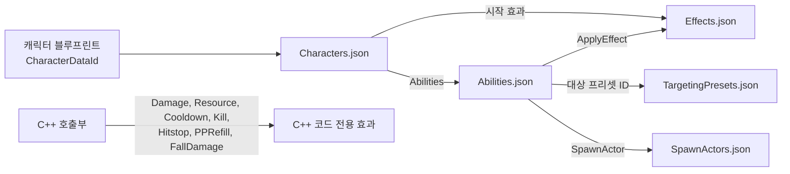
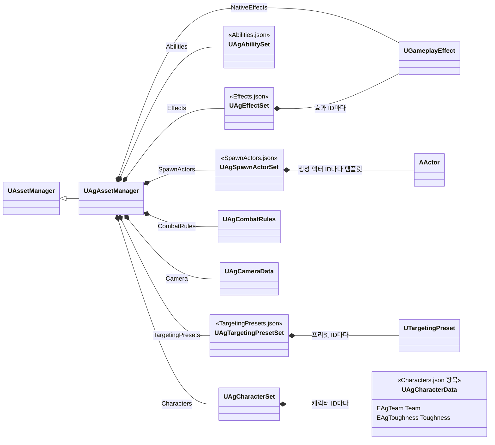

# 데이터 로딩과 스키마

기획서의 데이터(수치, 설정, 쓰는 에셋)는 주인이 분명한 곳에 둡니다. JSON 파일 외부에 존재하는 데이터 위치는 아래 'JSON 외부 데이터 위치'를 따릅니다.

어빌리티 정의의 형식은 아래 '어빌리티'에 둡니다. 몽타주 안의 구간과 Task의 Params는 [몽타주 타임라인과 구간 판정](<몽타주 타임라인과 구간 판정.md>)을 따릅니다.

## 기술 결정

| 항목 | 결정 | 이유 |
| - | - | - |
| 형식 | 기획 데이터와 구현용 참조의 구분은 [AGENTS.md](<../../AGENTS.md>) 코딩 규칙을 따릅니다. 코드 전용 효과의 내부 구성은 [캐릭터 기반 구조와 GAS](<캐릭터 기반 구조와 GAS.md>) '코드가 효과를 쓰는 방법'에 따라 C++에서만 관리합니다. 전투 데이터를 담는 UE 에셋(DataAsset, DataTable, GE 블루프린트, TargetingPreset)과 GE C++ 클래스는 두지 않습니다. | 에셋 선택을 포함한 데이터 변경을 텍스트로 검토하고 병합합니다. |
| 파일 구성 | 종류마다 파일 하나를 둡니다(아래 '파일 구성'). JSON 밖의 제작 설정은 아래 'JSON 외부 데이터 위치'에서 찾습니다. | 같은 종류의 정의를 한 파일에서 보고, 여러 캐릭터가 같은 어빌리티·효과 정의를 함께 씁니다. |
| 문구 | 현지화가 필요한 문구는 모두 문구 표 `Content/StringTables/StringTable.csv` 하나에서 관리합니다. 새로 더하는 문구도 여기에 적습니다. 엔진 스트링 테이블이며, 에셋 매니저가 JSON을 읽기 전에 엔진 매크로(`LOCTABLE_FROMFILE_GAME`)로 등록합니다. 표의 ID는 `StringTable`입니다. JSON의 글자 값은 `LOCTABLE(\"StringTable\", \"키\")`로, 블루프린트·위젯의 글자 속성은 Details 패널에서 표의 항목을 골라 가리킵니다. 키는 쓰는 곳을 앞에 붙여 적고(`Interaction.Execute`, `Character.Boss`), 여러 줄 문구는 줄바꿈을 `\n`으로 적습니다. 지금은 상호작용 안내의 행동 이름(`Interaction.`), 캐릭터 이름(`Character.`), 전투 결과 화면의 항목 이름(`BattleResult.`), 조작 안내의 키와 조작 이름(`Controls.`)이 있습니다. 문구를 위한 데이터 종류나 ID를 따로 만들지 않습니다. | 문구를 한 파일에서 모아 보고 에디터 없이 고칩니다. 엔진의 표준 현지화 경로라, 번역할 문구를 모으는 엔진 도구가 소스의 등록 매크로를 찾아 이 CSV를 읽습니다. 매크로는 `Content` 폴더 기준 경로만 받으므로 CSV는 `DesignData`가 아니라 `Content` 아래에 둡니다. 에디터에서는 엔진이 `Content` 폴더의 CSV 변경을 감시해 다시 읽습니다. |
| 어빌리티 정의 | `Abilities.json`의 항목 하나가 어빌리티 하나의 정의이고, 재생할 몽타주와 그 타임라인도 이 항목에 둡니다(아래 '어빌리티', '몽타주 관리'). 모든 어빌리티(플레이어 액션, 보스 패턴 등)가 어빌리티 클래스 하나(`UAgGameplayAbility`)로 실행되므로 정의에 클래스 경로가 없습니다. 태그·발동 필드는 엔진 `UGameplayAbility`의 속성 이름으로 적고, 트리거는 엔진 구조체(`FAbilityTriggerData`)를 그대로 읽습니다. Task 항목은 Task 이름(`Task`)과 그 Params의 필드로 적고, 선택 블록·선택 필드는 적었는지로 쓰는지를 구분합니다. | 어빌리티 하나가 항목 하나에서 다 보이고, GAS를 아는 사람과 AI가 매핑표 없이 읽습니다. 있는 Task를 조합한 새 액션·패턴은 어빌리티 클래스를 더하지 않고 JSON과 몽타주로 더하고, 클래스·구조체 타입 문자열을 데이터에 중복하지 않습니다. |
| 읽는 방법 | `UAgAssetManager`가 엔진 초기화(`StartInitialLoading`) 때 아래 '파일 구성'의 파일들을 같은 타입의 새 객체에 한 묶음으로 읽고, 모두 통과하면 기존 데이터 객체에 값을 복사합니다(처음 읽기는 아래 '오류 검사'를 따릅니다). ID로 가리켜지는 정의 파일을 먼저 읽습니다. JSON 효과와 대상 프리셋은 읽은 정의로 매번 새 객체(GE, TargetingPreset)를 만듭니다. 데이터가 가리키는 에셋(몽타주, 생성 액터 블루프린트)도 이때 읽혀, 패키지 게임은 타이틀 화면부터 모든 캐릭터의 에셋을 메모리에 둡니다. | 기존 데이터 객체를 참조하는 코드가 새 값을 볼 수 있습니다. |
| 로더의 객체 이름 | `UAgAssetManager`가 만드는 로딩 후보 데이터, 효과(JSON·코드 전용), 대상 프리셋과 그 안의 Task는 이름을 지정하지 않고 엔진의 고유 이름을 사용합니다. 조회는 ID와 객체 참조로 하며, 자동 이름에 의존하지 않습니다. 생성자의 기본 서브오브젝트는 `CombatRules`, `Effects`처럼 고정된 역할 이름을 사용합니다. 이 규칙은 이 로더의 객체 생성에 적용합니다. | 종류가 다른 객체의 이름 충돌을 막고, 재로딩할 때 기존 GE를 같은 이름으로 다시 만들어 적용 중인 효과를 훼손하지 않습니다. |
| 검증 시점 | 검증은 읽기와 함께 합니다. 쿡에서도 등록된 파일 전체의 최신 내용을 읽어, 하나라도 읽기 오류가 있으면 쿡과 패키징을 실패시킵니다. 검증한 JSON과 배포하는 JSON은 같아야 합니다. 정의 ID 검사는 에디터 전용 메타데이터를 쓰므로 패키징된 게임에서는 하지 않습니다. | 배포 전에 데이터 오류를 차단합니다. |
| 오류 검사 | 읽기 검사와 오류 출력은 JSON을 리플렉션으로 읽는 리더 하나(`FAgJsonReader`)가 맡고, 데이터 클래스와 Task에는 두지 않습니다. 검사 대상은 문법, 모르는 키, 엔진 변환(`FJsonObjectConverter`)이 받지 못한 값(형식, enum 이름), 없는 에셋·클래스·어트리뷰트, 등록되지 않은 태그, 없는 정의 ID, 적중 충전량(HitReward Task의 `Rewards`, 아래 '효과에 두는 값')의 범위입니다. 정의 ID 검사는 `DataId` 메타데이터가 있는 필드에 명시한 값만 해당 파일의 최상위 키와 대조합니다. 누락·null 처리는 아래 '기본값 작성'을 따릅니다. 오류는 파일명과 필드 경로로 로그·화면에 표시합니다. 읽지 못한 에셋·클래스·정의 ID·Task는 비우고, 그 값이 배열 원소나 맵 항목이면 원소를 뺍니다. 다시 읽기에 오류가 있으면 이전 데이터 전체를 유지하고, 처음 읽기는 오류가 있어도 나머지 값으로 시작합니다. 리다이렉터를 거쳐 읽힌 에셋 경로는 그 값을 쓰되 새 경로로 고치도록 경고합니다. 경고는 읽기 오류가 아니어서 다시 읽기와 쿡을 막지 않습니다. | 데이터 오류 하나로 에디터나 게임이 멈추지 않고, 데이터를 쓰는 코드는 없는 항목만 다룹니다. 다시 읽기는 플레이 중에 저장한 실수가 진행 중인 플레이의 데이터를 빼지 않게 이전 데이터를 유지합니다. 에디터는 JSON의 경로를 참조로 알지 못해, 이름을 바꾼 에셋의 리다이렉터를 지우면 그 경로가 깨집니다. 적중 충전량 밖의 값 범위나 필드 조합, 섹션 이름과 실제 몽타주의 대조까지 검사하지 않습니다. 읽기 성공이 모든 작성 규칙의 충족을 뜻하지는 않으며, 이런 항목은 데이터 검토와 플레이로 확인합니다. |
| 다시 읽기 | 에디터의 `UAgDataReloadSubsystem`이 `DesignData` 폴더 바로 아래 JSON의 변경을 감지해 등록된 파일 전체를 다시 읽습니다. 마지막 읽기에 오류가 있었으면 게임 월드(PIE, 테스트 창의 맵)를 시작할 때 에셋 매니저가 한 번 더 다시 읽습니다. 성공한 뒤 게임에서 사용하는 시점은 아래 '재로딩 반영 시점'을 따릅니다. 배열·맵 원소의 포인터·참조는 함수 안에서만 사용하고, 이후에는 ID로 다시 조회하거나 실행에 필요한 값을 복사합니다. 패키징 빌드와 커맨드렛은 파일을 감시하지 않고, 패키징 빌드는 게임 월드를 시작할 때도 다시 읽지 않습니다. | 에디터 재시작이나 C++ 빌드 없이 JSON을 고쳐 다시 플레이할 수 있습니다. 에셋 쪽에서 고친 오류는 JSON이 바뀌지 않아 파일 감시로는 다시 읽지 않으므로 플레이를 시작할 때 다시 읽고, 남은 오류는 플레이 화면에 다시 보입니다. |
| 패키징 | `Ag.Build.cs`의 `RuntimeDependencies`가 `DesignData/*.json`과 문구 표(`Content/StringTables/*.csv`)를 UFS에 넣습니다. 검증과 실패 처리는 '검증 시점'을 따릅니다. `ModifyCook`은 모든 데이터 객체의 객체 참조(Transient 포함)가 속한 패키지를 쿡 목록에 추가하고, 읽으면서 만든 객체(캐릭터 데이터, GE, 대상 프리셋과 그 Task)는 그 클래스와 그 객체가 가리키는 것까지 따라갑니다. `/Script/`와 `/Engine/Transient` 패키지는 제외합니다. | JSON 문자열과 Transient 참조는 저장된 에셋 의존성이 아니므로 쿡 단계에 직접 전달해야 합니다. |
| 데이터를 찾는 방법 | 파일 이름과 그 파일을 읽는 클래스는 에셋 매니저에 정해 둡니다. 캐릭터 항목은 모두 같은 데이터 클래스(`UAgCharacterData`)이며, 플레이어는 적 전용 값을 적지 않습니다. 캐릭터 블루프린트는 `CharacterDataId`를 `Characters.json`의 ID 목록에서 고릅니다. 게임 월드의 캐릭터는 컴포넌트를 초기화하기 전(`PreInitializeComponents`)에 한 번 확인하고, 없으면 오류를 남기고 그 캐릭터를 지웁니다. 그 밖의 코드는 있다고 보고 씁니다. 편집 중인 월드(에디터, 블루프린트 미리 보기)의 캐릭터는 데이터를 연결하지 않습니다. | 코드에 에셋 경로를 쓰지 않습니다. 확인을 한 곳에서 해, 쓰는 곳마다 데이터가 있는지 묻지 않습니다. 데이터를 아직 적지 않은 캐릭터 하나 때문에 에디터나 게임이 멈추지 않습니다. 파일마다 그 파일을 읽는 클래스가 정해져 있어 이름을 바꿀 일이 없습니다. |
| 어빌리티의 데이터 | 부여는 [캐릭터 기반 구조와 GAS](<캐릭터 기반 구조와 GAS.md>) '어빌리티 목록'을 따릅니다. 각 스펙 인스턴스는 발동할 때 자기 ID의 정의(몽타주와 타임라인 포함)를 복사하고, 발동 Task와 재생 Task, 타임라인 Task는 그 사본으로 만듭니다. 복사 시점과 ID로 참조하는 효과·생성 액터·프리셋의 조회 시점은 아래 '재로딩 반영 시점'을 따릅니다. | 한 발동 안에서 정의와 타임라인이 바뀌지 않고, 클래스 CDO를 어빌리티별 설정으로 덮지 않습니다. |

## 파일 구성

| 파일 | 내용 | 최상위 키 |
| - | - | - |
| `Characters.json` | 캐릭터마다 팀, 스탯, 쓰는 어빌리티 ID 목록(부여 순서), 시작할 때 거는 효과 ID 목록, 캐릭터 종류별 값(적의 시야·AI·페이즈 값) | 캐릭터 ID(`Player`, `Boss`, `Cutter`, `Gunner` 등) |
| `Abilities.json` | 어빌리티 정의(아래 '어빌리티'). 재생할 몽타주와 그 타임라인([몽타주 타임라인과 구간 판정](<몽타주 타임라인과 구간 판정.md>))을 함께 둡니다. 여러 캐릭터가 함께 쓰는 정의(`Flinch`, `KnockDown` 등)는 하나입니다. | 어빌리티 ID |
| `Effects.json` | 기획자가 조정하는 GameplayEffect 정의 | 효과 ID |
| `SpawnActors.json` | 어빌리티가 생성하는 액터(검기·탄환, GroundSlam 충격파, 페이즈 전환 밀어내기)의 클래스와 속성값(아래 '생성 액터 정의') | 생성 액터 ID |
| `TargetingPresets.json` | 대상 프리셋 정의. 프리셋마다 Targeting System Task 배열(`{"Class": 경로, 바꾼 속성}`, 적은 순서로 실행)입니다. 어빌리티의 `TargetRequiredTags`·`TargetBlockedTags`는 `AgTargetingFilterTask_TagRequirements`가 든 프리셋에서만 적용됩니다. | 프리셋 ID |
| `CombatRules.json` | 모든 캐릭터에 공통인 전투 규칙(히트스톱 시간, 보너스 대미지(`GroggyBonusDamage`·`BackAttackBonusDamage`·`AerialBonusDamage`), 패리 대미지의 HP·PP 배율(반사탄은 PP 배율만), 낙하 대미지 시작·사망 높이(cm), 적의 시야 상실 대기 `TargetLostTime`, 동시 공격 수 `MaxAttackers`와 재공격 대기 `ReattackWaitTime` 포함) | 속성 이름 |
| `Camera.json` | 락온 구도·회전(`LockOn`), 상황별 셰이크 콘텐츠·FOV·상대 쪽 회전(`ReactionsBySituation`), 달리기 FOV(`SprintFieldOfView`), 처형 구도·줌·시간·충돌(`Execution`) | 속성 이름 |

- 파일을 추가할 때는 `UAgAssetManager`에 담는 객체 속성과 조회 함수를 두고, `AgAssetManager.cpp`의 파일 목록(`JsonFiles`)에 한 줄로 등록합니다. 생성, 읽기, 복사, 쿡 전달이 모두 이 목록을 따르고, 목록 순서가 읽는 순서입니다. `DesignData` 폴더에 JSON을 두는 것만으로 로딩·검증 대상이 되지는 않습니다.
- 에셋은 전체 객체 경로(`/Game/폴더/에셋.에셋`)로, 클래스는 네이티브 클래스 경로(`/Script/Ag.클래스`)나 생성 클래스 경로(`/Game/폴더/BP_Name.BP_Name_C`)로 적습니다.
- 빠진 키는 그 속성의 기본값입니다. 기본값의 명시·생략은 아래 '기본값 작성'을 따릅니다. 쓰지 않는 필드 몇 개 때문에 구조체를 나누지 않습니다.
- UPROPERTY는 맵 값으로 배열을 담지 못해, 배열이나 맵 하나만 가진 구조체로 감쌉니다. 이런 구조체는 감싸는 키 없이 그 배열이나 맵을 바로 적습니다(타임라인 섹션의 항목 배열, 대상 프리셋의 Task 배열).
- 단일 게임플레이 태그 필드는 문자열로 적습니다. 빈 문자열은 빈 태그이고, null은 기본값입니다. 숫자·배열·객체·불리언은 형식 오류입니다.
- 태그 목록(`AbilityTags`, `GrantedTags` 등)은 등록된 태그 문자열의 배열입니다. 빈 목록은 `[]`로 적으며, 배열 원소에 빈 문자열이나 null을 넣으면 오류입니다.
- 효과와 대상 프리셋의 ID는 파일별로 독립적이며, 조회에는 각 맵의 ID를 씁니다.
- `Camera.json`의 `ReactionsBySituation` 안의 키는 `EAgCameraSituation` 이름입니다. 매니저와 모디파이어 클래스는 C++에서 고정하고, 재생할 셰이크 콘텐츠만 데이터에서 선택합니다. 달리기는 조건으로 유지하므로 `SprintFieldOfView.HoldTime`은 쓰지 않습니다. 처형의 `Execution.ReturnTime`은 마지막 일격 시각·배속과 함께 조정합니다.
- FOV 연출은 재생할 때 값을 복사하고 값이 같은 연출끼리 같은 연출로 봅니다. 에디터에서 JSON을 다시 읽으면 재생 중인 연출은 복사한 값으로 끝나고, 달리기 시야각은 달리기 조건이 다음에 바뀔 때 새 값으로 다시 잡습니다. 처형 카메라는 시작할 때 복사한 설정으로 끝내고 새 값은 다음 처형부터 적용합니다.

## 기본값 작성

일반 필드는 기본값과 같은 값을 적거나 생략할 수 있습니다. 기획 의도를 드러내거나 항목을 비교하는 데 도움이 되면 기본값도 명시합니다.

- 읽을 때마다 새 객체·구조체의 기본값에서 시작합니다. 필드를 생략하거나 null로 적으면 그 기본값을 유지하며, 재로딩 전 값을 이어받는다는 뜻은 아닙니다. 모르는 키는 값이 null이어도 오류입니다. ID별 항목을 null로 적으면 그 항목이 없는 것과 같습니다.
- `TOptional` 필드는 생략하거나 null로 적으면 설정하지 않은 상태입니다. 반면 `0`, `false`, `{}`처럼 값을 적으면 설정한 상태가 됩니다. 예를 들어 `"Targeting": {}`는 기본값으로 채운 대상 설정을 사용하고, `"Targeting": null`은 대상 설정을 사용하지 않습니다.

다음 항목은 값이 기본값과 같아도 명시합니다.

| 항목 | 명시할 필드 | 이유 |
| - | - | - |
| 플레이어 시작 자원 | `Characters.json`의 `Player.Attributes.MP`, `UP` | 시작 자원량을 데이터에서 바로 확인합니다. |
| 적 패턴의 최소 유효 거리 | `Abilities.json`의 `PatternSelection.Distance.Min` | 최소 거리가 0이어도 Min을 명시해 유효 거리 범위를 한눈에 확인합니다. |
| 공격의 가드 가능 여부 | `Abilities.json` 타임라인과 `SpawnActors.json`의 모든 `Damage.bGuardable` | 매 타의 가드 가능·불가를 확인합니다. |
| RootMotion 추적 구간의 위치 보정 여부 | `Abilities.json` 타임라인에서 `Direction`이 Target인 RootMotion 구간의 `bWarpTranslation` | 위치 보정을 하는 구간과 회전만 하는 구간을 구분합니다. Direction의 기본값도 Target입니다. |

`ReleaseRange`, `TargetingRange`처럼 생략하면 상위 설정을 따르는 필드는 그 설정을 따를 때 계속 생략하고, 따로 정할 때만 명시합니다. `MaxDistance`처럼 생략이 제한 없음을 뜻하는 필드도 그 의미를 유지합니다. 위 명시 관례는 로딩 시 누락을 오류로 판정하는 조건이 아닙니다.

## 재로딩 반영 시점

묶음 읽기가 성공하면 보관 중인 데이터는 함께 바뀌지만, 이미 실행 중인 객체가 새 값을 사용하는 시점은 다음과 같습니다.

| 데이터 | 반영 시점 |
| - | - |
| 캐릭터의 강인도 | 다음 피격 결과 처리에서 캐릭터 데이터의 현재 값을 읽습니다. 진행 중인 피격 모션을 강제로 취소하지 않습니다. |
| 어빌리티 수치·대상 요청 조건·발동 Task·몽타주와 타임라인 | 다음 어빌리티 발동 때 정의를 복사합니다. 실행 중인 어빌리티는 기존 사본을 쓰고, BlendTime 전환으로 다시 재생해도 그 사본을 씁니다. |
| `InputTag` | 입력 계층이 키를 누를 때마다 지금 데이터에서 읽습니다. |
| 대상 프리셋 | 다음 타겟팅 요청 때 ID로 다시 조회합니다. 실행 중인 어빌리티도 대상을 다시 찾을 때 새 프리셋을 쓸 수 있습니다. |
| 생성 액터 정의 | SpawnActor가 생성할 때 ID로 템플릿을 조회합니다. 이미 생성한 액터는 생성할 때의 값을 씁니다. |
| JSON 효과 | 다음에 효과를 걸 때 새 GE를 씁니다. 이미 걸린 효과는 제거될 때까지 이전 GE를 유지합니다. |
| 어빌리티 태그와 발동 조건(`AbilityTags`, 발동 태그 필드, `AbilityTriggers`, `bAllowRetrigger`) | 캐릭터를 다시 만들 때 적용합니다. 현재 정의가 부여 당시 설정과 다르면 해당 어빌리티의 새 발동을 거부합니다. |
| 캐릭터의 어빌리티 목록 | 스펙을 새로 부여하려면 캐릭터를 다시 만들어야 합니다. 다만 목록에서 뺀 어빌리티는 정의 조회가 실패하므로 기존 캐릭터에서도 새로 발동할 수 없습니다. |
| 스탯·시작 효과 등 스폰 설정 | 캐릭터를 다시 만들 때 적용합니다. 다음 플레이 시작도 이에 해당합니다. |
| 적의 시야 값과 시야 상실 대기(`TargetLostTime`) | 적을 다시 만들 때 감각 설정에 적용합니다. |
| 코드 전용 효과 | JSON 재로딩으로 다시 만들거나 교체하지 않습니다. |
| HUD에 보이는 데이터 값(보스 이름, 스킬 아이콘·코스트·최대 충전 수) | 다시 읽기가 끝나면 에셋 매니저가 `OnJsonDataReloaded`로 알리고, HUD가 그때 다시 그립니다. |

## 캐릭터 강인도와 팀

`Characters.json` 각 캐릭터의 `Toughness`는 `UAgCharacterData`의 `EAgToughness` 필드입니다. JSON 값은 `Small`, `Medium`, `Large`이며 기본값은 `Medium`입니다. 현재 캐릭터 항목에는 등급을 명시합니다. 소모 자원이 아니므로 `Attributes` 안에 넣지 않으며, 캐릭터 BP에 같은 값을 중복 저장하지 않습니다. 등급별 플레이 규칙은 [전투 시스템](<../Design/System/전투 시스템.md#강인도>)을 따릅니다.

`Team`은 `EAgTeam` 필드이고 JSON 값은 `Player`, `Enemy`, `Neutral`이며 기본값은 `Enemy`입니다. 현재 캐릭터 항목에는 팀을 명시합니다. 캐릭터 클래스는 팀을 정하지 않고, `AAgCharacterBase::GetGenericTeamId`가 이 값을 그대로 돌려줍니다.

## 어빌리티

`Abilities.json`의 항목은 `FAgAbilityData`입니다.

| 필드 | 뜻 | 엔진 |
| - | - | - |
| `AbilityTags` | 어빌리티 태그. 다른 어빌리티의 취소·차단과 코드가 이 태그로 어빌리티를 찾습니다. 다른 어빌리티의 태그를 복사하면 그 태그에 걸린 코드 규칙도 따라오므로, 새 행동은 `Ability.Action`만 답니다. | 스펙의 `DynamicSpecSourceTags` |
| `InputTag` | 선택. 이 어빌리티를 발동하는 입력(`Input.Attack` 등). 같은 입력의 어빌리티는 발동 조건이 서로 배타적이어야 합니다. 입력 계층은 [캐릭터 기반 구조와 GAS](<캐릭터 기반 구조와 GAS.md>) '입력'을 따릅니다. | |
| `DisplayName` | 선택. 플레이어에게 보이는 이름. `InputTag`가 `Input.Interact`인 어빌리티는 상호작용 안내의 행동 이름으로 쓰며, 문구 표(위 '문구')의 항목을 가리킵니다. | |
| `Icon` | 선택. 전투 HUD의 스킬·궁극기·회복병 칸에 표시할 아이콘 텍스처 경로. 없으면 칸에 아이콘을 그리지 않습니다. | |
| `ActivationRequiredTags`, `ActivationBlockedTags`, `ActivationOwnedTags`, `BlockAbilitiesWithTag`, `CancelAbilitiesWithTag`, `bAllowRetrigger` | 발동에 필요한 태그, 발동을 막는 태그, 실행 중 붙는 태그, 실행 중 막는 어빌리티, 발동할 때 취소하는 어빌리티, 실행 중 다시 발동 | 같은 이름의 속성 |
| `AbilityTriggers` | `{"TriggerTag", "TriggerSource"}`의 배열. `TriggerSource`는 `GameplayEvent`(기본, 그 이벤트를 받으면 발동)나 `OwnedTagPresent`(태그가 붙으면 발동하고, 떨어지면 엔진이 취소)입니다. 태그가 붙는 순간 발동이 막혔으면 엔진은 다시 시도하지 않습니다. | 스펙의 `DynamicAbilityTriggers`(`FAbilityTriggerData`) |
| `Cooldown` | 쿨다운(초). 0이면 쿨다운 효과를 걸지 않습니다. | 쿨다운 효과(`Cooldown`)의 지속 시간 |
| `MaxCharges` | 최대 충전 횟수(기본 1). 1 이상이면 `Cooldown`이 0일 때 영향이 없고, 0 이하이면 `Cooldown`과 관계없이 그 어빌리티는 발동하지 않습니다. | 동시에 걸릴 수 있는 쿨다운 효과의 수 |
| `Cost` | 자원별 소모량: `MP`, `UP`(예: `{"MP": 20}`). 적지 않은 자원은 소모하지 않습니다. | 자원 효과(`Resource`) |
| `ActivationAttributes` | 선택. 발동에 필요한 어트리뷰트 값 `{"Attribute", "AtLeast"}`의 배열(예: 회복병의 `Potion` 1 이상). 발동할 때 치르지 않습니다. `CheckCost`가 `Cost`와 함께 보므로 HUD 칸의 흐림도 따릅니다. | |
| `Targeting` | 선택. 대상을 정하는 프리셋의 ID(`Preset`, `TargetingPresets.json`의 ID)와 요청 조건(`Range`, `TargetRequiredTags`, `TargetBlockedTags`, `bRequired`, `TargetSpacing`). `Range`를 뺀 조건은 선택입니다. | GameplayTargetingSystem |
| `End` | 어빌리티가 끝나는 때. `Tasks`(기본, 발동 Task와 몽타주 재생이 모두 끝날 때), `TriggerTag`(`OwnedTagPresent` 트리거의 태그가 사라질 때), `InputReleased`(그 입력을 떼면 취소) | |
| `Tasks` | 발동할 때 시작하는 Task의 배열. 항목은 `{"Task": 이름, Params의 필드}`입니다. 어빌리티가 시작할 때 한 번 하거나 어빌리티 내내 이어지는 일을 두고, 몽타주 시각에 맞춘 일은 `Montage`의 타임라인에 둡니다. | `UAbilityTask` |
| `Montage` | 선택. 재생할 몽타주(아래). `Tasks`를 모두 시작한 뒤 재생합니다. | |
| `PatternSelection` | 선택. 적 AI가 패턴을 고르는 값: `Phases`(사용 가능한 페이즈 번호 목록), `Distance`(유효 거리 구간 Min·Max), `Weight`(선택 가중치), `ResponseChance`(반응 확률, [보스 캐릭터 - 커스터](<../Design/Content/보스 캐릭터 - 커스터.md>) 'Backstep'). `ResponseChance`가 있는 패턴이 반응형 패턴이며, 적 AI는 패턴 후딜레이 중 기본 공격 시작 이벤트에서 그때 고를 수 있는 반응형 패턴 중 하나를 각 패턴의 확률로 고릅니다. 반응형 패턴은 가중치 선택과 간격 지키기의 목표 거리에서 빠집니다. StateTree에는 패턴 ID를 적지 않습니다. 패턴 취소에 쓰는 `AbilityTags`의 `Ability.Enemy.Pattern`과 함께 적습니다. | |
| `DeathMontage` | 선택. 이 어빌리티의 몽타주를 재생하는 중에 죽으면 같은 재생 위치에서 이어 재생할 몽타주 에셋 경로. 그 위치까지 원래 몽타주와 자세가 같아야 합니다. | |

`Montage`의 필드는 다음과 같습니다.

| 필드 | 뜻 |
| - | - |
| `Asset` | 몽타주 에셋 경로 |
| `StartSections` | 선택. 시작 섹션 항목 `{"Section", "RequiredTags", "BlockedTags", "MoveDirection", "EventTag"}`의 배열. 없으면 첫 섹션부터 재생합니다. 있으면 조건이 맞는 항목의 섹션부터 재생하고, 맞는 항목이 없으면 재생하지 않습니다. 항목끼리는 조건이 서로 배타적이어야 하고, `Section`을 뺀 항목은 첫 섹션입니다. 조건은 지금 붙은 태그(`RequiredTags`, `BlockedTags`), 이동 입력 방향(`MoveDirection`, 행동 대상 쪽 기준 45°씩이며 대상이 없으면 정면 기준), 어빌리티를 발동시킨 이벤트 태그(`EventTag`)입니다. |
| `Sections` | 섹션 이름별 타임라인 항목 배열([몽타주 타임라인과 구간 판정](<몽타주 타임라인과 구간 판정.md>) '형식') |

- 몽타주 시각과 관계없는 일(발동 순간 돌기, 착지할 때까지 이어지는 Launch, 시작 섹션과 관계없이 한 번인 보상)은 `Tasks`에 둡니다.
- 선택 블록은 그 어빌리티가 쓸 때만 적습니다. `Targeting`의 `Range`는 기본 0이고, 0 이하이면 검색하지 않습니다. 후보 수집 범위도 이 값 하나로 정합니다. `Range`는 행동 대상을 고르는 반경이며, 기획서에 타겟팅 범위가 있는 행동은 그 값입니다. 한 행동 안에서 타마다 범위가 다르면(기본 공격) 가장 넓은 값을 적고, 더 좁은 타는 그 타 추적 구간(RootMotion)의 `TargetingRange`에 적습니다. 플레이어 공격(처형 제외)은 `UAgTargetingSelectionTask_LockOnTarget`이 든 프리셋(`Attack`, `Teleport`)을 써서, 락온 중에는 `Range`와 관계없이 락온 대상이 후보에 듭니다.
- 행동 대상은 발동할 때와 BlendTime 전환으로 다시 재생할 때마다 고릅니다. `bRequired`인 행동은 대상이 없으면 발동하지 않고, 다시 고를 때 후보가 없으면 지금 대상을 유지합니다. 그래서 조준을 시작한 경비 사수는 대상이 가려져도 그 대상의 예측 지점으로 쏩니다.
- `TargetSpacing`(cm, 기본 0)은 어빌리티 실행 동안 대상과 지키는 최소 간격이자, 추적 구간이 다가가 멈추는 간격과 Launch `Direction` Target의 착지 간격입니다.
- Task 이름과 Params 필드, 둘 수 있는 곳은 [몽타주 타임라인과 구간 판정](<몽타주 타임라인과 구간 판정.md>) '형식'을 따릅니다.

데이터만으로 더할 수 있는 것과 C++가 필요한 것은 다음과 같습니다.

| 구분 | 범위 |
| - | - |
| 데이터만으로 더함 | 적 패턴, 이미 있는 이벤트로 발동하는 반응·패시브, 이미 있는 키에 묶이는 플레이어 행동(발동 조건으로 구분), 캐릭터마다 다른 모션(어빌리티를 복제). 새 모션이면 몽타주 에셋은 만듭니다. |
| C++가 필요함 | 새 키, 새 이벤트(예: 적중했을 때 공격자에게 가는 이벤트), 새 Task 기능, 새 카메라 상황, 새 취소·차단 관계에 쓰는 태그 |

## 효과

기획 값은 JSON에서 조정하고, 호출 코드와 맞아야 하는 효과의 내부 연결은 코드가 보장합니다.

### 형식

| 필드 | 뜻 | 엔진 |
| - | - | - |
| `DurationPolicy` | `Instant`, `HasDuration`, `Infinite`. 기본 `Instant` | `DurationPolicy` |
| `Duration` | `HasDuration`의 시간(초). | `DurationMagnitude` |
| `Modifiers` | 모디파이어 객체의 배열입니다. 각 항목에 `Attribute`를 적고, 크기는 `Value`(더할 고정 값), `PerSecond`(더할 초당 값), `Multiplier`(곱할 배율), `Coefficient`(대상의 `BackingAttribute`에 곱해 더할 비율, 엔진 `FAttributeBasedFloat`) 중 하나로 지정합니다. 어트리뷰트는 `UAgAttributeSet`의 속성 이름(`PP`)으로 적습니다. | `Modifiers` |
| `GrantedTags` | 걸려 있는 동안 대상에 붙는 태그 | 대상 태그 컴포넌트 |
| `OngoingIgnoredTags` | 걸려 있는 동안 대상에 있으면 효과가 꺼지는 태그 | 대상 태그 조건 컴포넌트 |
| `RemovalTags` | 대상에 하나라도 붙으면 효과를 지우는 태그. 이미 붙어 있으면 걸리지 않습니다. | 대상 태그 조건 컴포넌트의 `RemovalTagRequirements` |
| `RegenDelay` | 선택. 회복 효과의 리젠 대기: `Effect`(대기 효과 ID) | 리젠 대기 컴포넌트([캐릭터 기반 구조와 GAS](<캐릭터 기반 구조와 GAS.md>) 'GameplayEffect') |
| `SlowMotionSpeed`, `SlowMotionDuration` | 선택. 실행될 때 거는 게임 전체 슬로우모션의 속도 배율(기본 1)과 실제 시간(초). Duration이 있을 때만 겁니다. 즉시 효과에 씁니다. | 슬로우모션 컴포넌트 |

- `PerSecond`가 있는 효과는 C++에서 주기 효과로 구성합니다. `AgEffectData.cpp`의 `PeriodicEffectInterval` 간격으로 실행하며, 적용 직후에는 실행하지 않고 중단됐다 재개되면 주기를 처음부터 셉니다(`ResetPeriod`). 이 실행 정책은 JSON에 노출하지 않습니다. 로더는 초당 값에 공통 간격을 곱해 한 번에 더할 값으로 넣습니다. 회복·소모량과 리젠 대기 시간은 JSON에서 관리합니다.
- 회복 효과는 대기 태그를 `OngoingIgnoredTags`에 두어 멈춥니다. `RegenDelay`가 대기를 다시 거는 동작은 [캐릭터 기반 구조와 GAS](<캐릭터 기반 구조와 GAS.md>)의 '리젠'을 따릅니다.
- `Multiplier`는 `PerSecond`와 한 효과에 두지 않습니다. 주기 효과의 모디파이어는 주기마다 기본값에 적용되므로 배율이 계속 곱해집니다.
- `Instant`에는 `PerSecond`, `GrantedTags`, 지속 조건을 쓰지 않습니다. `Duration`은 `HasDuration`에만 씁니다. 이 조합과 모디파이어 크기의 중복·누락은 작성할 때 확인하며, 로더가 검사하지 않습니다.
- 필드는 지금 효과들이 쓰는 것만 둡니다. 새 효과가 다른 GE 설정을 필요로 하면 그때 필드를 더합니다.
- GE 컴포넌트는 생성 코드가 `AddComponent<T>`로 붙입니다. JSON 효과의 리젠 대기·슬로우모션 컴포넌트는 클래스 경로 대신 `RegenDelay`·`SlowMotionDuration` 필드로 선택합니다. 대미지 계산기와 결과 처리 컴포넌트는 코드 전용 효과 생성부에서 직접 붙입니다.

### 효과에 두는 값

효과 정의에는 그 효과에서 하나로 정해진 값을 둡니다. 쓰는 곳마다 다른 값(공격 배율, 어빌리티 비용·쿨다운)은 시간표와 어빌리티 정의에 두고, 적용할 때 SetByCaller와 지속 시간으로 넘깁니다. 적중 충전량은 공격 쪽에 두지 않고, 충전하는 캐릭터의 적중 보상 어빌리티(`HitReward`)가 가진 HitReward Task의 `Rewards`에 모읍니다. 줄마다 공격한 어빌리티의 태그(`AbilityTag`), 선택 섹션(`Section`. 적중한 순간 공격자가 재생 중인 몽타주 섹션이며, 비우면 가리지 않음), `MP`·`UP`(생략한 자원은 0이며, 적어도 하나는 양수이고 모두 유한한 0 이상 값)을 두고, 맞는 줄은 모두 충전합니다. 충전은 피해 Task마다 첫 적중에 한 번이므로, 충전하는 공격의 한 타는 피해 Task 하나로 둡니다. 한 어빌리티만 쓰는 시간·보상·소모(패리 구간, 패리 보상, 극한 회피 보상, 회피 반격 기회, 가드 반격 기회, 그로기 시간)는 그 효과의 값이라 효과 정의에 둡니다. 모션 시간을 따르는 구간(무적, Busy, 극한 회피 구간)의 길이는 타임라인 구간이 정합니다.

## 몽타주 관리

몽타주는 그 몽타주를 재생하는 어빌리티 항목의 `Montage.Asset`에 에셋 경로로 적습니다. 어빌리티 하나는 몽타주 하나를 재생하고, 한 어빌리티의 여러 모션은 한 몽타주의 섹션으로 두어 `StartSections`로 고릅니다. 여러 어빌리티가 같은 몽타주를 쓸 때와 캐릭터마다 모션이 다를 때는 [몽타주 타임라인과 구간 판정](<몽타주 타임라인과 구간 판정.md>) '같은 몽타주를 쓰는 어빌리티'를 따릅니다. 루트 모션을 쓰는 모션과 쓰지 않는 모션은 어빌리티를 나눕니다(`Flinch`와 `FlinchAir`). 루트 모션 시퀀스가 하나라도 든 몽타주는 엔진이 몽타주 전체를 루트 모션으로 다루기 때문입니다. 에셋을 옮기거나 이름을 바꾸면 JSON의 경로도 함께 바꿉니다.

점프·낙하·착지 모션은 몽타주가 아니라 애님 그래프가 재생합니다([ABP와 로코모션](<../Art/ABP와 로코모션.md>) '공중').

## 생성 액터 정의

`SpawnActors.json`의 항목은 어빌리티가 생성하는 액터의 템플릿입니다. 형식은 대상 프리셋의 Task와 같이 `{"Class": 액터 클래스 경로, 그 클래스의 속성...}`이고, 리더가 그 클래스의 객체를 만들어 속성을 채웁니다. 속성은 그 액터 클래스가 정합니다. 직진 투사체(`AAgProjectile`: 검기·탄환)는 `Speed`·`Range`·`Damage`·`bDestroyOnHit`, 충격파(`AAgShockwave`)는 `Speed`·`MaxRadius`·`Height`·`Width`·`Damage`입니다. `Width`를 적지 않으면 가장자리가 지나간 구간만 판정합니다. `Damage`는 `FAgDamage`(HPMultiplier·PPMultiplier·HitReaction·bIgnoreToughness·bGuardable·bFinisher)입니다. 같은 클래스라도 값이 다르면 별도 ID를 사용합니다. 페이즈 전환 밀어내기는 외형이 없는 `BP_RoarShockwave`에 속도를 크게 주어 첫 틱에 최대 반경까지 판정합니다. 충격파를 쓰는 것은 범위 공격(AreaHit)과 달리 쏜 캐릭터에게 히트스톱을 걸지 않기 때문입니다.

| 항목 | 결정 | 이유 |
| - | - | - |
| 생성 | SpawnActor Task가 템플릿의 클래스를 엔진 액터 템플릿 스폰(`FActorSpawnParameters::Template`)으로 지연 생성합니다. 위치는 소켓 또는 캐릭터 위치, 방향은 몸 정면 수평이며 생성 회전으로 줍니다. 항목의 `Roll`(도)이 있으면 그 방향을 축으로 기울여 생성합니다(스킬 3 장풍). 액터가 `IAgAbilitySpawnedActor`를 구현하면 생성을 마치기 전에 어빌리티를 넘기고, 공격 액터는 여기서 자기 `Damage`로 어빌리티의 대미지 스펙을 만듭니다. | Task가 액터 종류를 모르므로, 새 액터는 Task를 더하지 않고 클래스와 데이터만으로 더합니다. 스펙을 어빌리티에서 만들어 적중 보상 상태와 어빌리티 태그가 다른 공격과 같이 실립니다. |
| 값의 자리 | 액터의 데이터 속성은 `EditInstanceOnly`입니다. 리더는 인스턴스에서 편집할 수 있는 속성만 채우고, 블루프린트 클래스 기본값에서는 이 속성을 고칠 수 없습니다. 판정 모양 컴포넌트(검기의 상자, 탄환의 캡슐)와 외형은 블루프린트에 둡니다. | 기획 값이 JSON 한 곳에만 있고, 블루프린트에 같은 값이 겹치지 않습니다. |
| 템플릿 객체 | 리더는 액터 클래스의 객체를 아키타입(`RF_ArchetypeObject`)으로 만듭니다. 엔진의 자식 액터 템플릿과 같은 방식입니다. 에디터에서는 엔진의 다시 인스턴스화 알림(`FCoreUObjectDelegates::OnObjectsReinstanced`) 때 옛 클래스로 남은 템플릿이 있으면 JSON을 다시 읽습니다. | 엔진은 블루프린트를 다시 컴파일할 때 템플릿(아키타입)을 새 클래스로 바꾸지 않으므로(자식 액터 템플릿만 예외), 그대로 두면 옛 클래스로 생성되어 컴포넌트가 등록되지 않습니다. |

몽타주 타임라인의 SpawnActor 항목에는 생성 시각·생성 액터 ID(`Actor`)·생성 소켓(`SocketName`)·생성 기울기(`Roll`, 도, 뒤에서 볼 때 시계 방향이 +)만 둡니다. 기울기는 같은 액터를 어느 동작이 생성하느냐에 따라 달라 템플릿이 아니라 항목에 둡니다.

투사체의 처리는 다음과 같습니다.

| 항목 | 결정 | 이유 |
| - | - | - |
| 예측 조준 | 생성을 마칠 때(`BeginPlay`) 어빌리티의 행동 대상을 향해 방향을 바꿉니다. 대상이 그 순간의 수평 속도로 움직인다고 보고, 자기 위치에서 `Speed`로 곧게 날아가 닿는 위치를 이차식의 근으로 구합니다. 근이 없으면(대상이 더 빠름) 지금 거리로 셉니다. 행동 대상이 없으면 생성 방향 그대로입니다. 패리 반사(`Reflect`)는 예측하지 않습니다. 방향을 바꿀 때(예측 조준, 반사) 생성 회전의 Roll은 유지합니다. | 예측에는 투사체 속도가 필요한데, SpawnActor는 액터 종류를 모르는 범용 Task라 속도를 가진 투사체가 정합니다. 위치를 생성 뒤에 읽는 것은 판정 모양과 루트가 BP 컴포넌트라 생성을 마쳐야 자리가 정해지기 때문입니다. |
| 피해 뒤 소멸 | `bDestroyOnHit`이면 피격 결과 처리 컴포넌트가 적중·가드를 처리한 끝에 부르는 `OnDamageApplied`에서 사라집니다. 꺼져 있으면 대상을 뚫고 지나갑니다. 극한 회피와 무적은 결과가 없어 부르지 않으므로 지나갑니다. 반사된 뒤에도 같은 값을 씁니다. | 피격 결과는 대미지 실행이 정하므로, 결과를 아는 컴포넌트가 알리고 사라질지는 투사체가 정합니다. 투사체 Tick은 적중 처리 뒤 소멸 여부를 보고 그 틱의 남은 대상을 맞히지 않습니다. |

판정 모양과 표시 메시는 투사체 BP에 둡니다. `AAgProjectile`은 BP의 `UShapeComponent`를 모두 찾아 자체 충돌을 끄고, 매 틱 모양마다 제 모양·위치·회전으로 같은 거리만큼 캐릭터를 스윕하여 닿은 순서대로 맞힙니다. 상자와 캡슐을 여러 개 섞어 하나의 판정으로 쓸 수 있습니다. 벽은 각 모양 중심의 이동선을 `WorldStatic`으로 검사하여 스치는 바닥이나 낮은 턱을 벽으로 취급하지 않고, 가장 먼저 벽에 닿는 모양까지만 이동한 뒤 사라집니다. 박스 판정의 검기와 캡슐 판정의 탄환은 같은 클래스를 씁니다.

## 대상의 시야 필터

`TargetingPresets.json`의 `Shooting`은 구 겹침 후보에서 적대 대상·생존 태그 조건·시야와 총구 가림을 검사하고 거리순으로 정렬합니다. `Teleport`(스킬 1)는 락온 대상을 더한 구 겹침 후보에서 적대 대상·생존 태그 조건·락온 대상만 남기기·지형 가림을 검사하고 거리순으로 정렬합니다. `LockOn`은 구 겹침 후보에서 적대 대상·생존 태그 조건·화면 안·지형 가림을 검사하고 화면 중앙에 가까운 순으로 정렬하며, 락온을 유지하는 `TrackTarget`은 가림을 보지 않습니다. `UAgTargetingFilterTask_LineOfSight`의 `Socket`은 출처 캐릭터 메시의 소켓 이름입니다. AI 출처는 현재 활성 시야 자극이 있어야 합니다. 소켓을 지정하면 그 소켓에서, 생략하면 출처 액터 위치(캡슐 중심)에서 대상 액터 위치까지 `WorldStatic` 가림이 없어야 하며, 지정한 소켓이 메시에 없으면 후보를 제외합니다. `UAgTargetingFilterTask_LockOnTarget`은 출처에게 락온 대상이 있으면 그 대상만 남기고, 락온 중이 아니면 거르지 않습니다. 같은 프리셋의 시야 필터가 가려진 락온 대상을 거르면 후보가 없으므로, 락온 중에는 다른 적을 고르지 않습니다.

패턴 선택의 수평 거리(`PatternSelection.Distance`), 대상 수집의 구 겹침 반경(`Targeting.Range`), AI 시야 거리(`AI.SightDistance`)는 서로 다른 조건입니다. 시야 필터가 필요한 프리셋에만 LineOfSight Task를 넣으며, 게임 카메라(조종하는 폰의 카메라 컴포넌트. 처형 카메라·컷신 중에도 그 연출이 아닌 이 시야) 화면 안 조건을 검사하는 OnScreen 필터와 구분합니다.

## 클래스 구조

| 클래스 | 부모 | 역할 |
| - | - | - |
| `UAgAssetManager` | `UAssetManager` | 프로젝트의 에셋 매니저('읽는 방법'). 데이터 객체를 모두 들고, 모든 파일을 한 묶음으로 새 객체에 읽어 복사합니다. 코드 전용 GE를 별도 보관하고, 읽은 정의로 TargetingPreset을 만들며 읽은 참조를 쿡에 전달합니다. 엔진과 데이터 클래스만 알고 게임 코드는 include하지 않습니다. |
| `FAgJsonReader` | | JSON을 리플렉션으로 속성 값에 읽고 검사하는 리더('오류 검사'). 한 번 읽을 때마다 만들며, 정의 ID 검사에 쓰는 파일별 최상위 키를 읽는 동안만 들고 있습니다. 다시 읽은 값을 기존 객체에 복사할 속성도 이 리더의 기준(`IsField`)을 따릅니다. |
| `UAgCharacterSet` | `UObject` | `Characters.json`의 값. 캐릭터 ID마다 `UAgCharacterData` 객체이며, 다시 읽을 때 ID가 그대로인 항목은 기존 객체에 값만 복사합니다. |
| `UAgCharacterData` | `UObject` | `Characters.json` 캐릭터 항목의 값. 팀은 `EAgTeam Team`, 강인도는 `EAgToughness Toughness`입니다. 어빌리티·효과는 ID 목록이고, 어빌리티 정의 조회(`FindAbility`)는 그 캐릭터의 목록에 있는 ID만 `Abilities.json`에서 찾아 줍니다. 적 AI(컨트롤러의 시야 설정과 StateTree Task)가 읽는 값은 `AI`(`FAgEnemyAIData`: `SightDistance`(cm), `SightAngle`(도), `PostPatternDelayTime`, `PreferredDistance`(적정 거리, cm), `WaitMovement`)에 묶습니다. `PreferredDistance`는 모든 적이 적습니다. 빠뜨리면 0~0이 되어 늘 다가가는 것으로 바로 드러납니다. 적만 쓰지만 적 캐릭터가 읽는 페이즈 전환 HP 비율 `PhaseTransitionHPRatios`는 밖에 둡니다. |
| `UAgAbilitySet` | `UObject` | `Abilities.json`의 값. ID마다 `FAgAbilityData`(위 '어빌리티') |
| `UAgEffectSet` | `UObject` | `Effects.json`의 정의(`FAgEffectDefinition`)와 그 정의로 만든 GE 객체. 효과 ID마다 하나입니다. |
| `UAgSpawnActorSet` | `UObject` | `SpawnActors.json`의 값. ID마다 액터 템플릿(아래 '생성 액터 정의') |
| `UAgTargetingPresetSet` | `UObject` | `TargetingPresets.json`의 정의(Task 배열)와 그 정의로 만든 TargetingPreset. 프리셋 ID마다 하나입니다. |
| `UAgTargetingSelectionTask_LockOnTarget` | `USimpleTargetingSelectionTask` | 출처의 락온 대상을 거리와 관계없이 후보에 더합니다(위 '어빌리티'의 `Targeting`). |
| `UAgTargetingFilterTask_LineOfSight` | `UTargetingFilterTask_BasicFilterTemplate` | 위 '대상의 시야 필터'를 적용합니다. |
| `UAgTargetingFilterTask_LockOnTarget` | `UTargetingFilterTask_BasicFilterTemplate` | 출처에게 락온 대상이 있으면 그 대상만 남깁니다(위 '대상의 시야 필터'). |
| `AAgProjectile` | `AActor` | 투사체 BP의 판정 모양으로 이동·적중·벽 소멸을 처리하고, 발사 때 받은 비행 값과 공격 값을 유지합니다. 생성 때 행동 대상의 예측 지점으로 방향을 정하고, 피해를 준 뒤 사라질지(`bDestroyOnHit`)를 정합니다. 패리 반사는 방향·피해 출처·이동 거리·적중 대상 기록을 갱신합니다. |
| `UAgCombatRules` | `UObject` | `CombatRules.json`의 값. 공통 전투 규칙 |
| `UAgCameraData` | `UObject` | `Camera.json`의 값. `FAgLockOnCameraSettings`, 상황별 `FAgCameraReactionSettings` 맵(`ReactionsBySituation`), 달리기 `FAgFieldOfViewEffect`, `FAgExecutionCameraSettings`를 보관합니다. |

Task의 Params는 각 Task의 헤더에 있고, 공통 부모(`FAgTaskParams`)와 이름 규칙으로 찾기는 `AgTaskParams`가 맡습니다. 효과 정의로 GE를 만드는 일은 `AgEffectData`가 맡습니다. 스펙을 만들고 값을 넣는 곳은 [캐릭터 기반 구조와 GAS](<캐릭터 기반 구조와 GAS.md>) '코드가 효과를 쓰는 방법'을 따릅니다.

## JSON 외부 데이터 위치

기획 데이터 중 JSON 밖에 있는 것의 위치입니다. 값은 기획서를 따르며, 에셋 안에 있거나 에셋에서 덮어쓸 수 있어 검색만으로는 찾기 어려운 것만 적습니다.

| 항목 | 다루는 값 | 관리 위치 | 필드 / 에셋 / 식별자 |
| - | - | - | - |
| **정찰 지점** | 정찰 위치와 방문 순서 | 레벨의 `AAgPatrolRoute`(스플라인 점)와 적 인스턴스 | `Spline` 점, 적의 `PatrolRoute` |
| **점프 및 공중 이동** | 점프 수직 속도, 중력 배율, 공중 제어 계수 | `BP_Player`, `BP_Boss` (CharacterMovement) | `JumpZVelocity`, `GravityScale`, `AirControl` |
| **회전 속도** | 기본 Yaw 회전 속도 | `BP_Player`, `BP_Boss` (CharacterMovement) | `RotationRate.Yaw` |
| **보스 크기** | 플레이어 대비 크기. 캡슐도 메시와 같은 배율로 키웁니다. | `BP_Boss`의 `Mesh`, `CapsuleComponent` | `Mesh`의 `RelativeScale3D`·`RelativeLocation.Z`(캡슐 반높이의 음수), `CapsuleComponent`의 `CapsuleRadius`·`CapsuleHalfHeight` |
| **제자리 회전 모션** | 45° 및 90° 좌우 제자리 회전 모션, 몸과 캐릭터의 최대 각도 차이·재생 배율·블렌드 시간, 몸 방향을 되돌리는 시간, 상체 비틀기의 최대 각도와 따라가는 시간 | 회전 모션은 `ABP_Player`·`ABP_Boss` 기본값, 나머지는 `ABP_Character` 기본값 | `TurnAnimations`, `GuardTurnAnimations`, `MaxTurnAngle`, `PlayRateAtMaxAngle`, `PlayRateOnDirectionChange`, `TurnBlendTime`, `RootYawOffsetSmoothingTime`, `MaxUpperBodyTwist`, `UpperBodyTwistSmoothingTime` |
| **대상 바라보기** | 락온 대상이 없을 때 쳐다볼 상대를 찾는 대상 프리셋과 반경, 목·머리를 돌리는 한도와 목이 맡는 몫, 쳐다보지 않는 뒤쪽 각도, 따라잡는 시간 | 한도와 몫은 `ABP_Character`의 `Look At` 노드(`neck_01`, `head`), 나머지는 `ABP_Character` 기본값(자식 ABP도 같은 값) | `LookAtTargeting`(`Preset`, `Range`), 노드의 `LookAtClamp`, `neck_01` 노드의 `AlphaScaleBias`, `LookAtBackAngle`, `LookAtSmoothingTime` |
| **상하 조준** | 경비 사수의 상하 조준 모션과 더하는 구간 | 모션은 `ABP_Gunner` 기본값, 구간은 `AM_Gunner_PistolShot` 커브 | `AimOffset`(기본값과 커브 이름이 같음) |
| **가드 전환 블렌드** | 가드 시작·해제 때 자세가 바뀌는 시간 | `ABP_Character`의 가드 전환 노드(`BlendListByBool`) | `BlendTime` 핀(True가 가드 시작, False가 해제) |
| **그로기 자세 전환 블렌드** | 피격 반응 뒤 그로기 자세로 바뀌고 풀리는 시간 | `ABP_Character`의 그로기 전환 노드(`BlendListByBool`) | `BlendTime` 핀(True가 그로기 시작, False가 해제) |
| **가드 모션 및 회전** | 가드 이동 블렌드스페이스 및 가드 회전 모션 | `ABP_Player` 기본값 | `GuardMoveBlendSpace`, `GuardTurnAnimations` |
| **넉다운 이동 거리** | 넉다운 시 뒤로 밀려나는 거리 | 피격 애니메이션 시퀀스 | 시퀀스 루트 모션 (`Enable Root Motion` 켬) |
| **자유 시점 카메라** | 카메라 거리, 회전 중심 높이, 위치 추적, 시야각 | `BP_Player`의 `CameraBoom`, `FollowCamera` | `TargetArmLength`, `RelativeLocation`의 Z, `bEnableCameraLag`·`CameraLagSpeed`(엔진 기본값), `FieldOfView`(엔진 기본값) |
| **무기 궤적 VFX** | 공격 모션별 무기 궤적 출력 구간 | 각 공격 몽타주 (`AM_...`) | `WeaponTrail` 트랙의 `GameplayCue.WeaponTrail` (Looping) 노티파이 |
| **스킬 1 모션 템포** | 칼을 당긴 멈칫과 찌르기의 재생 속도 | `AM_Player_Skill1` | 몽타주 조각(`Attack09` 구간별)의 재생 배율. 바꾸면 `Abilities.json` `Skill1`의 구간 시각도 함께 고칩니다. |
| **스킬 1 순간이동 VFX** | 모양·색, 사라지는 시각, 배치 | 모양은 `NS_Teleport`(색은 사용자 파라미터 `User.Color`), 큐는 `GC_Teleport`(배치 `pelvis` 소켓, 회전 고정), 사라지는 시각은 `AM_Player_Skill1` | `Teleport` 트랙의 `GameplayCue.Teleport` 노티파이. 나타나는 효과는 `Abilities.json` `Skill1`의 Teleport 구간이 실행합니다. |
| **스킬 1 찌르기 섬광 VFX** | 모양·색, 칼끝 자리, 실행 시각 | 모양과 칼끝 자리는 `NS_BlinkRushThrust`(이미터의 위치 오프셋, 색은 `User.Color`), 큐는 `GC_BlinkRushThrust`(배치 `root` 소켓), 시각은 `AM_Player_Skill1` | `Thrust` 트랙의 `GameplayCue.BlinkRushThrust` 노티파이 |
| **회복병 병** | 메시·머티리얼·손 안의 자리, 보이는 구간 | 메시와 자리는 `NS_PotionBottle`(메시 렌더러, Initialize Particle의 `Position Offset`·`Mesh Scale`), 큐는 `GC_PotionBottle`(배치 `hand_l` 소켓), 구간은 `AM_Player_Potion` | `Bottle` 트랙의 `GameplayCue.PotionBottle` (Looping) 노티파이 |
| **회복병 회복 효과** | 모양·색, 실행 시각 | 모양은 `NS_PotionHeal`(색은 `User.Color`), 큐는 `GC_PotionHeal`(배치 `root` 소켓), 시각은 `AM_Player_Potion` | `Heal` 트랙의 `GameplayCue.PotionHeal` 노티파이. 시각은 `Abilities.json` `Potion`의 `PotionHeal` 구간과 맞춥니다. |
| **스킬 2 칼 VFX** | 모양·색, 재생 구간 | 모양은 `NS_UpperSlashBlade`(칼날 길이는 사용자 파라미터 `User.BladeLength`), 큐는 `GC_UpperSlashBlade`, 구간은 `AM_Player_Skill` | `UpperSlashBlade` 트랙의 `GameplayCue.UpperSlashBlade` (Looping) 노티파이 |
| **보스 공격 예고** | 패리 예고 / 가드 불가 예고 VFX와 효과음 | 보스 공격 몽타주 (`AM_Boss_...`) | `Telegraph` 트랙의 `GameplayCue.ParryTelegraph` / `GameplayCue.UnblockableTelegraph` 노티파이 |
| **검기 공격 판정 크기** | 검기의 폭·높이·두께 | `BP_SwordWave`의 `HitBox`, `Mesh` | `HitBox`의 `BoxExtent`(절반 크기, X 두께·Y 폭·Z 높이), 상자를 덮는 `Mesh`의 `RelativeScale3D`·`RelativeLocation` |
| **보스 공격 템포** | 공격 패턴의 재생 속도 | 보스 공격 패턴 몽타주(`AM_Boss_...`) | `RateScale` |
| **처형 템포** | 처형 몽타주 재생 배속 | `AM_Player_Execute`, `AM_Boss_Executed`, `AM_Boss_ExecutedDeath` | `RateScale` (세 몽타주 동기화). 바꾸면 마지막 일격 시각이 달라지므로 `Camera.json`의 `Execution.ReturnTime`도 함께 고칩니다. |
| **궁극기 컷신** | 카메라 구도, 컷신 길이 | 레벨 시퀀스 `LS_UltimateCutscene` | 시퀀스 트랙 및 재생 길이 |
| **궁극기 베기 선** | 베기 선의 개수, 나타나는 시점 | `AM_Player_Ultimate`의 `Judgment` 섹션 | `Judgment`를 덮는 GameplayCue 상태 노티파이와 `Slash` 트랙의 `GameplayCue.UltimateSlashes` 노티파이 |
| **스킬 4 내려찍기 VFX** | 모양·시간·색, 실행 시각과 퍼지는 거리 | 모양은 `NS_PunishingEdge`(퍼지는 거리는 사용자 파라미터 `User.Radius`), 큐는 `GC_PunishingEdge`, 실행 시각과 거리는 `Abilities.json` `Skill4`의 AreaHit | `GC_PunishingEdge`의 `BurstEffects`·`MagnitudeNiagaraParameter`, AreaHit의 `Cue`와 `Area.Range` |
| **궁극기 베기 선 배치** | 위치(방향, 거리, 높이), 각도 범위 | `GC_UltimateSlashes` 기본값 | `RecurringMeshYaw`(카메라가 보는 방향 기준), `RecurringMeshDistance`, `RecurringMeshHeight`, `RecurringMeshRoll` |
| **카메라 셰이크** | 셰이크 단계의 흔들림 | `/Game/Camera/CS_Small`·`CS_Medium`·`CS_Large` | `RootShakePattern` |
| **모션 시점 카메라 연출** | 모션의 원하는 시점에 재생할 셰이크와 시야각 변화, 거리 감쇠(제 세기 반경·사라지는 반경) | 각 몽타주 (`AM_...`) | `AgAnimNotify_PlayCameraEffect` 노티파이의 `CameraShakes`, `FieldOfView`, `InnerRadius`, `OuterRadius` |
| **대상 비추기** | 모션 주인을 비추는 구간, 당기는 거리, 들어가기·돌아오기 시간, 비추는 거리 | 각 몽타주 (`AM_...`) | `AgAnimNotifyState_CameraLookAt` 노티파이 상태의 구간, `LookAt`(`Distance`, `BlendInTime`, `BlendOutTime`), `Radius` |
| **보스 처치 슬로우모션** | 속도, 실제 시간 | `BP_Boss` 기본값 | `KillSlowMotionSpeed`, `KillSlowMotionDuration` |
| **선입력 버퍼 시간** | 선입력 기억 시간 | `AAgPlayerCharacter` 기본값 | `InputBufferTime` |
| **피격 흔들림** | 미는 세기, 섞는 최대 비율 | `BP_Player`, `BP_Boss`의 `HitPhysics` 컴포넌트 | `PushSpeed`, `MaxBlendWeight` |
| **스테이지 결과 시간** | 승패 확정 후 전투 결과 UI를 띄우기까지의 시간 | `AAgGameMode` 기본값 | `StageResultPresentationTime` |
| **대미지 숫자** | 떠오르는 시간과 높이 | `WBP_DamageFloater` | `FadeAnimation`의 길이, `RiseHeight` 기본값 |
| **상태 바 감소 잔상** | 잔상의 기다리는 시간, 줄어드는 시간 | `WBP_StatBar` 기본값 | `TrailDelay`, `TrailShrinkTime` |
| **적 네임플레이트** | 바 크기·간격·머리 위 여백, 최근 감소 뒤 표시 시간 | `WBP_Nameplate` | 위젯 배치, `RecentDropShowTime` 기본값 |
| **HUD 상태 바** | 바별 채움 색, 감소 잔상과 수치 표시 여부 | `WBP_HUD`의 `PlayerHPBar` 등 `WBP_StatBar` 인스턴스 | `FillColor`, `bShowTrail`, `bShowValue` |
| **상호작용 안내** | 키 표시와 행동 이름의 모양·배치, 안내 지점과의 간격 | `WBP_InteractionPrompt`, 글자 스타일 `TS_MediumBold`·`TS_LargeOutline` | 위젯 배치 (행동 이름의 문구는 문구 표) |
| **성문** | 열리는 시간과 높이, 막는 범위, 상호작용 범위, 안내 지점, 행동 이름의 문구 키 | `BP_Gate` 기본값 | `OpenMovement`의 `Duration`·`ControlPoints`, `Blocker`·`InteractionRange`의 상자 크기, `PromptPoint` 위치, `InteractionText`(문구 표의 항목) |
| **HUD 스킬·궁극기 슬롯** | 흐린 슬롯의 투명도, 슬롯 모양, 슬롯·키 표시 배치 | `WBP_SkillSlot` 기본값, `WBP_HUD` | `DisabledOpacity`, 위젯 배치 (아이콘은 `Abilities.json`의 `Icon`) |
| **조작 안내** | 줄 순서, 키, 조작 이름, 모양, 줄 간격 | `WBP_ControlsGuide` (`WBP_ControlsPopup` 안), 글자 스타일 `TS_ControlsKey`·`TS_ControlsAction` | 위젯 배치, 스타일의 `LineHeightPercentage` (`Keys`, `Actions`의 글자는 문구 표의 `Controls.Keys`, `Controls.Actions`) |
| **전투 결과 UI 배경** | 전투 결과 UI가 화면을 어둡게 하는 정도 | `WBP_BattleResult` | `Background` 위젯의 색 |
| **스테이지 목록** | 스테이지 선택 화면의 스테이지 순서, 이름, 레벨 | `BP_FrontEndGameMode` 기본값 | `Stages` |
| **시뮬레이션 룸 후보** | 적 선택 화면에서 고를 수 있는 적과 순서 | `BP_SimulationRoomGameMode` 기본값 | `EnemyClasses` |
| **시뮬레이션 룸 배치 자리** | 적 배치 자리의 위치와 번호 | `LV_SimulationRoom`의 `AAgEnemySpawnPoint` 액터 | 액터 위치, `Slot` |
| **적 선택 화면 흐린 버튼** | Start 버튼을 흐리게 표시하는 정도 | `WBP_EnemySelect` 기본값 | `LockedButtonOpacity` |
| **드롭다운 모양** | 드롭다운과 목록 항목의 모양, 기본 크기 | `WBP_Dropdown`(스테이지 선택 화면), `WBP_EnemySlot`(적 선택 화면, 닫힌 칸은 `WBP_EnemyCard`), `WBP_DropdownOption`(두 화면의 목록 항목) | `ComboBox`의 스타일, `DropdownBox` 크기, `NameText` 스타일 |
| **버튼 효과음** | 마우스를 올릴 때, 실행할 때의 소리 | `ButtonStyle_Default` | `Hovered Sound`, `Clicked Sound` |
| **UI 해상도 기준** | 기준 해상도, 다른 해상도에서 UI 크기를 맞추는 기준 | 프로젝트 설정 'User Interface' | `DPI Scale Rule`, `DPI Curve`(엔진 기본값) |
| **입력 키 매핑** | 키보드·마우스 입력 바인딩 | `IMC_Default`, `Config/DefaultInput.ini` | Enhanced Input Context 및 Action 매핑 |
