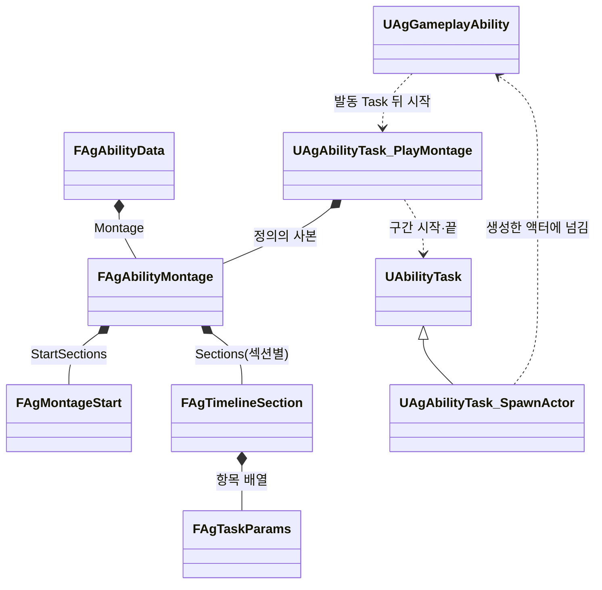

# 몽타주 타임라인과 구간 판정

몽타주 안에서 Task를 실행하는 시각(판정 구간·무적 구간·이동 구간·전환 구간·추적 구간 등)과 그 값을 어떻게 관리하고 실행하는지 정합니다.

## 기술 결정

| 항목 | 결정 | 이유 |
| - | - | - |
| 원본 | 몽타주 안에서 실행하는 Task의 시각과 값은 그 몽타주를 재생하는 어빌리티 항목(`Abilities.json`)의 타임라인(`Montage.Sections`)이 유일한 원본입니다. 항목은 값을 직접 가집니다. | 시각과 값을 에디터 없이 텍스트로 고치고 diff로 리뷰합니다. 어빌리티가 하는 일이 항목 하나에 모입니다. 새 기능은 Task 하나만 더하면 됩니다. |
| 몽타주에 남는 노티파이 | 연출(공격 예고·무기 궤적·궁극기 포스트프로세스·회복병 병의 엔진 `AnimNotify_GameplayCueState`, 궁극기 베기 선의 엔진 `AnimNotify_GameplayCue`와 `AnimNotify_GameplayCueState`, 스킬 1의 사라지는 효과와 찌르기 섬광·회복병 회복 효과의 엔진 `AnimNotify_GameplayCue`, 내려찍기 착지·궁극기 마무리·페이즈 전환 포효의 카메라 연출을 재생하는 프로젝트 `AgAnimNotify_PlayCameraEffect`, 페이즈 전환 포효 동안 보스를 비추는 프로젝트 `AgAnimNotifyState_CameraLookAt`, 페이즈 전환 포효 VFX를 재생하는 엔진 `AnimNotify_PlayNiagaraEffect`)만 몽타주에 둡니다. 섹션 시작의 노티파이는 시작보다 0.0001초 뒤에 둡니다. 엔진은 지나간 재생 위치의 노티파이만 실행하고 섹션 시작에 정확히 둔 노티파이는 앞 섹션 끝으로 당기므로, 시작에 두면 섹션 이동 뒤에는 울리지 않고 앞 섹션이 반복할 때마다 울립니다. BlendTime 전환으로 끊긴 앞 재생은 그때부터 노티파이를 보내지 않으므로, 앞 섹션에서 전환 시각 뒤로 이어지는 노티파이 상태는 전환과 함께 끝납니다. 이음매를 걸쳐야 하는 노티파이 상태(공격 예고 등)는 앞 섹션의 전환 시각 전부터 그 섹션의 남은 부분을 건너 뒤 섹션까지 하나로 둡니다. 엔진은 새 재생이 같은 노티파이 상태 안에 있으면 끄지 않고 이어 가고, 둘로 나누면 큐가 꺼졌다 다시 켜집니다. 노티파이는 몽타주 시간을 따르므로 히트스톱 동안 멈춥니다. 게임 규칙을 실행하는 프로젝트 노티파이와 엔진 워핑 노티파이는 두지 않고, Dash의 루트 모션 소스나 Launch의 엔진 띄우기(`LaunchCharacter`)가 움직이는 동안과 DisableRootMotion 구간 동안 몽타주 루트 모션을 끄는 일은 그 Task가 캐릭터(`AAgCharacterBase`)에 요청하고, 그동안 새로 시작한 재생도 캐릭터가 끕니다. Plunge는 몽타주 루트 모션을 끄지 않으므로, Plunge를 쓰는 몽타주는 모든 시퀀스의 루트 모션을 꺼 둡니다. 예외로, 판정 값을 보여 줘야 하는 연출(스킬 4 내려찍기 VFX)은 그 판정 Task가 실행합니다. AreaHit의 `Cue`는 판정하는 순간 발밑에서 큐를 실행하고 `RawMagnitude`에 판정 반경을 싣습니다. 자리를 정하는 Task의 연출(스킬 1의 나타나는 효과)도 그 Task가 정한 자리에서 실행합니다(Teleport의 `GameplayCue.Teleport`). | 연출은 기획 데이터가 아니라 모션의 제작 정보입니다. 같은 일을 노티파이와 타임라인이 함께 하면 두 번 일어납니다. 판정 범위를 보여 주는 연출을 노티파이로 두면 반경을 에셋에도 적어야 해 판정과 어긋날 수 있습니다. 같은 프레임의 몽타주 노티파이는 타임라인 판정보다 먼저 울려, 순간이동하기 전 자리에서 재생됩니다. |
| 판정 | 몽타주를 재생하는 Task(`UAgAbilityTask_PlayMontage`, 어빌리티가 정의의 `Montage`로 시작)가 자기 재생의 위치로 판정합니다([기본 방침](<기본 방침.md>) '구조 선택'의 예외). 판정한 뒤에는 Task와 엔진 Motion Warping을 씁니다. 캐릭터는 ASC가 메시 다음에 틱하게 묶어, 판정이 몽타주가 나아가고 포즈가 갱신된 뒤에 일어나게 합니다. Task가 각자 자기 시각을 판정하지 않고, 판정기를 재생과 떼어 두지 않습니다. | 재생 위치는 히트스톱, 재생 배율, 반복 섹션, 섹션 이동, 몽타주 멈춤을 그대로 반영합니다. 판정하는 곳이 하나여야 한 프레임에 지난 항목들의 실행 순서와, 몽타주가 진행된 뒤·공격 판정 전이라는 판정 시점을 지킵니다. Task마다 판정하면 결과가 Task의 틱 순서에 달립니다. 판정기만 재생과 떼면 코드는 그대로 옮겨지고 재생과의 연결(재생 바뀜, 섹션 이동 알림)만 늘어나므로, 재생과 판정을 한 Task에 둡니다. 그래서 어빌리티 클래스는 정의의 `Montage`로 재생 Task를 시작할 뿐 섹션·타임라인을 다루지 않습니다. ASC는 `TG_DuringPhysics`에 틱하지만 메시는 포즈 평가를 물리 뒤까지 미뤄 끝내기도 하므로(`tick.AnimationDelaysEndGroup`), 묶지 않으면 몽타주는 나아갔는데 포즈는 갱신되기 전에 판정해 재생 위치와 자세가 한 프레임 어긋납니다. |
| 같은 몽타주를 쓰는 어빌리티 | 어빌리티마다 자기 타임라인을 적습니다(`AM_KnockUp`을 쓰는 `KnockUp`과 `Juggle`). 캐릭터마다 다른 모션이 필요하면 어빌리티를 복제합니다. | 타임라인은 그 어빌리티가 몽타주의 어느 때에 무엇을 하는지입니다. |
| 흐름 | 시작 섹션 고르기, 기다림, 다음 동작은 섹션과 Transition으로 적습니다. 시작 섹션은 정의 `Montage`의 `StartSections`로 고릅니다([데이터 로딩과 스키마](<데이터 로딩과 스키마.md>) '어빌리티'). 기다림은 반복 섹션과 그 섹션을 덮는 Transition 구간입니다. Transition은 넘어갈 섹션을 `ToSection`에, 기다리는 일을 `Event`(그 이벤트가 오면)나 `TagRemoved`(그 태그가 빠지면)에 적습니다. `TagRemoved` 구간은 그 태그를 붙이는 Task보다 먼저 시작하지 않습니다. 넘어가는 것이 새 발동과 같아 비용·충전을 다시 치러야 하면(스킬 3의 연속 발동) `bCommitAbility`를 켭니다. 그러면 옮기기 전에 어빌리티를 다시 커밋하고, 커밋하지 못하면 옮기지 않고 구간 끝까지 계속 기다립니다. 섹션을 바꾸는 항목은 Transition뿐입니다. 바로 이어지는 동작은 섹션 링크로 잇고, 다른 동작으로 넘어갈 때는 Transition에 BlendTime을 적어 그 섹션부터 다시 재생합니다. 적 패턴은 모션마다 섹션을 두고 모든 이음매를 이렇게 넘어갑니다. 이때 섹션에는 모션을 끝까지 넣고 전환은 연결 시점에 두어, 앞 모션이 블렌드 아웃 동안 이어 재생됩니다. 연결 시점이 모션 끝이면 섹션 끝에 그 모션의 마지막 프레임에 머무는 조각을 붙이고, 그 길이는 엔진의 자동 블렌드 아웃(다음 섹션이 없는 섹션의 끝에서 블렌드 아웃 시간 전에 시작)이 연결 시점보다 늦게 오도록 둡니다. 반복 섹션은 같은 모션이므로 링크로 반복합니다. 여러 섹션에 걸친 판정 구간이 있으면 BlendTime 없이 옮깁니다. | 몽타주의 흐름이 데이터에 드러나고, 재생 Task는 Transition이 요청한 전환만 합니다. 적 패턴은 여러 모션을 섞어 씁니다. `TagRemoved` 구간은 시작할 때 태그가 없으면 다음 틱에 한 번 더 보고 바로 넘어갑니다. 같은 재생 안의 섹션 이동은 블렌드가 없어 자세가 튀고, 다시 재생하면 판정 구간이 새로 열려 같은 대상을 두 번 칠 수 있습니다. |
| 다시 읽기 | 로딩 실패 처리와 재생별 반영 시점은 [데이터 로딩의 기술 결정](<데이터 로딩과 스키마.md#기술-결정>) 중 '오류 검사'와 [재로딩 반영 시점](<데이터 로딩과 스키마.md#재로딩-반영-시점>)을 따릅니다. | 진행 중인 구간의 값이 중간에 바뀌지 않습니다. |

## 형식

타임라인은 어빌리티 항목의 `Montage.Sections`에 섹션 이름을 키로 한 항목 배열로 둡니다(`"Sections": {"섹션": [항목, ...]}`). 섹션이 하나인 몽타주는 엔진 기본 섹션 이름(`Default`)을 씁니다. Task가 없는 섹션은 적지 않습니다.

항목은 모두 구간이며 형식은 `{"Task": 이름, "Start": 초, "End": 초(선택), "EndSection": 섹션(선택), Params 필드...}`입니다. 시작하자마자 스스로 끝나는 Task(투사체 발사, 범위 공격, 이벤트, 바로 넘어가는 전환, 즉시 효과)도 같은 형식으로 Start만 적습니다.

- Task 이름 X의 Params 필드는 그 Task 헤더의 `FAgXParams`를 따릅니다. TrackTarget과 HitReward는 발동(`Tasks`)에만, ApplyEffect, RootMotion, Launch, SendGameplayEvent는 발동과 타임라인 모두에, 나머지는 타임라인에만 둡니다. 몽타주 재생은 Task로 적지 않고 어빌리티의 `Montage`로 적습니다. 추적 구간은 `Direction`이 Target(기본값)인 RootMotion 구간입니다. 추적 구간의 `TargetingRange`는 그 구간만 어빌리티 `Targeting.Range`보다 좁힐 때 적고, 생략하면 `Range`를 따릅니다([데이터 로딩과 스키마](<데이터 로딩과 스키마.md>) '어빌리티'). 발동에 둔 RootMotion은 구간이 없어 그 자리에서 몸만 돌리고 끝나므로, `Direction`(Target은 행동 대상 쪽, MoveInput은 이동 입력 쪽, Back은 돌지 않음), `bKeepBack`(Target에서 대상이 등 쪽 90° 안이면 돌지 않음)만 쓰고 `bWarpTranslation`, `TargetingRange`, `RotationMethod`, `Distance`는 읽지 않습니다.
- 기본값의 명시와 선택 필드의 생략은 [기본값 작성](<데이터 로딩과 스키마.md#기본값-작성>)을 따릅니다.
- Start는 그 섹션의 시작 기준 초이며, 몽타주 Rate Scale을 적용하기 전의 값입니다. Rate Scale이 아니라 몽타주에 넣은 모션의 재생 속도를 바꾸면 그 시각도 함께 고칩니다. 항목마다 시작 시각이 보이도록 Start는 0이어도 적습니다. 섹션의 배열 안에서는 항목을 Start 순서로 적습니다.
- 구간이 끝나는 섹션은 `EndSection`이고 생략하면 자기 섹션입니다. End는 그 섹션의 시작 기준 초이고, 생략하면 그 섹션 끝까지입니다. 구간은 몽타주 타임라인에서 Start부터 End까지라, 그 사이의 반복이나 섹션 이동도 구간 안이면 한 실행으로 이어집니다.

실제 시각과 값은 [Abilities.json](<../../DesignData/Abilities.json>)의 각 어빌리티 `Montage.Sections`에서 확인합니다.

## 판정 규칙

| 규칙 | 내용 |
| - | - |
| 기준 | 몽타주 재생 인스턴스의 재생 위치. 히트스톱이나 몽타주 멈춤으로 위치가 그대로면 아무 일도 일어나지 않습니다. |
| 구간 | Start ≤ 위치 < End인 동안 켜집니다. 재생을 시작한 위치에 걸친 구간은 시작과 함께 켜집니다. 한 번의 판정에서 구간 전체를 지나면 열고 바로 닫습니다. 스스로 끝나는 Task는 Start에 한 번 실행되고 End 전에 끝납니다. |
| 순서 | 시각 순서로만 실행합니다. 같은 때 시작하는 항목과 발동 Task 사이에는 순서도 우선순위도 두지 않습니다. 그래서 Task는 어떤 순서로 돌아도 결과가 같게 만들고, 결과가 한 주인 상태에 모여 순서에 따라 달라지면 그 주인이 합칩니다(게임 전체 시간 배율은 시간 서브시스템). |
| 무기 판정 구간 | WeaponHit은 프레임이 구간 경계를 건너뛰어도 Start부터 End까지 날이 지난 길을 모두 스윕합니다. 구간에 들어선 프레임은 앞 프레임 자세(엔진이 남긴 앞 프레임 뼈 변환)와 지금 자세 사이에서 Start의 자세를 보간해 시작하고, End를 지난 프레임은 재생 Task가 구간을 닫을 때 End까지 남은 움직임을 스윕한 뒤 끝납니다. 재생이 바뀌었거나 행동이 끝나 닫히면 남은 움직임은 보지 않습니다. 판정 구간이 프레임 한두 개보다 짧으면(기본 공격 1타 0.03초) 경계 프레임만 보는 스윕은 그 사이에 몸을 지나간 날을 놓칩니다. |
| 반복 섹션 | 위치가 뒤로 가면 그 위치에 걸치지 않는 구간은 끝나고, 다시 Start를 지나면 새로 시작합니다. 그래서 반복 섹션 안에는 스스로 끝나는 구간과 추적 구간을 두지 않습니다. |
| RootMotion 구간 | 서로 겹치지 않게 둡니다. 겹치면 워핑이 두 번 걸립니다. 보정 목표는 구간을 시작할 때 정하므로, 한 동작 안에서 목표를 다시 정하려면 구간을 나눕니다(JumpCleave의 정점). 같은 이유로 순간이동(Teleport) 뒤에 쓸 추적 구간은 Teleport보다 늦게 시작합니다(스킬 1). 같은 시각이면 옮기기 전 자리로 목표를 정할 수 있습니다. 즉시 회전, 몽타주 루트 모션이 없거나 DisableRootMotion 구간일 때의 RootMotion, Dash의 유도처럼 회전을 직접 쓰는 Task도 같은 때 겹치지 않게 둡니다. 엔진이 회전을 합치지 않아 틱 순서가 결과를 정합니다. |
| 전환 | 판정 중에 항목이 위치를 바꾸면 그 판정의 남은 항목은 실행하지 않습니다(옮긴 위치로 다시 판정). 같은 시각의 순서가 없으므로 전환과 같은 시각에 시작하는 항목은 실행될지 정해지지 않아 두지 않습니다. 섹션을 옮기면 건너뛴 구간은 시작하지 않습니다. 재생이 끝나며 닫히는 구간이 요청한 전환은 받지 않습니다. |
| 재생 바뀜 | 다시 재생하면 이전 재생의 구간을 끝냅니다. |
| 재생 끝 | 완료, 다른 몽타주에 끊김, 어빌리티 종료에서 켜진 구간을 모두 끕니다. 완료와 끊김에는 재생 Task도 끝나며, 재생 인스턴스가 사라진 것도 끊김으로 봅니다. Task는 어빌리티를 끝내지 않으므로, 끊겨서 끝났으면(`WasInterrupted`) 어빌리티가 끝난 재생 Task를 보고 스스로 취소합니다. |

## 클래스 구조

| 클래스 | 부모 | 역할 |
| - | - | - |
| `FAgAbilityMontage` | | 어빌리티 정의의 `Montage`. 몽타주 에셋, 시작 섹션 목록, 섹션 이름별 타임라인을 들고, 재생 Task를 만듭니다(`MakeTask`). |
| `FAgMontageStart` | | 시작 섹션 하나와 그 조건 |
| `FAgTimelineSection` | | 섹션 하나의 항목(Task Params) 배열. 항목의 시각은 Params의 공통 부모(`FAgTaskParams`)에 있습니다. |
| `UAgAbilityTask_PlayMontage` | `UAbilityTask` | 발동할 때 복사한 정의의 `Montage` 사본으로 시작 섹션을 고르고 재생하며, 그 사본의 타임라인으로 판정해 구간 Task를 시작·종료합니다. 추적 구간도 다른 구간처럼 Task(RootMotion)로 실행합니다. |
| `UAgAbilityTask_SpawnActor` | `UAbilityTask` | `FAgSpawnActorParams`의 생성 액터 ID와 소켓으로 액터를 캐릭터 정면의 수평 방향으로, `Roll`만큼 기울여 생성합니다. 투사체는 생성을 마칠 때 스스로 방향을 바꿉니다([데이터 로딩과 스키마](<데이터 로딩과 스키마.md>) '생성 액터 정의'). |

사격 패턴의 조준 중 몸 회전은 발사 시각까지 이어지는 RootMotion 회전 구간입니다. 상하 조준의 목표 높이는 `ApplyEffect`로 `State.Aiming`을 유지하는 구간에만 갱신합니다.

