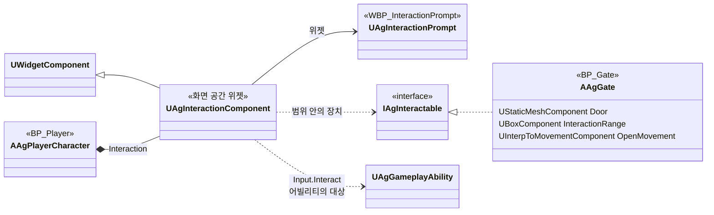

# 상호작용

상호작용 키로 하는 행동(처형, 성문 열기 등)의 대상을 어떻게 고르고 안내하고 실행하는지와, 새 상호작용을 더하는 방법을 정합니다. 플레이 규칙은 [플레이어 시스템](<../Design/System/플레이어 시스템.md>)의 '상호작용'과 [UI 시스템](<../Design/System/UI 시스템.md>)의 '상호작용 안내'를 따릅니다. 장치 하나하나의 동작은 이 문서에 적지 않고 코드와 그 장치의 기획서에 둡니다.

## 기술 결정

| 항목 | 결정 | 이유 |
| - | - | - |
| 주인 | 상호작용 키(`Input.Interact`)는 플레이어의 `UAgInteractionComponent`가 받습니다. 이 컴포넌트는 지금 상호작용할 대상을 고르는 함수 하나로 안내도 그리고 입력도 처리하며, 고른 결과를 저장하지 않고 그때마다 다시 구합니다. 입력할 수 있는 상태인지는 다른 행동 키처럼 입력 계층의 막힘 검사가 먼저 거릅니다([캐릭터 기반 구조와 GAS](<캐릭터 기반 구조와 GAS.md>) '입력'). | 안내가 가리키는 대상과 키가 닿는 대상이 어긋나지 않습니다. 현재 상태를 보는 함수 하나라, 놓친 알림으로 안내가 남거나 빠지는 일이 없습니다. 입력 규칙은 상호작용의 종류와 관계없이 하나입니다. |
| 대상을 찾는 순서 | 두 갈래에서 차례로 찾습니다. 먼저 `InputTag`가 `Input.Interact`인 플레이어 어빌리티마다 그 어빌리티의 `Targeting`으로 대상을 찾고, 찾으면 그것이 상호작용입니다. 없으면 플레이어 캡슐 중심에서 `AgInteraction` 채널로 겹침 검사를 해, 겹친 도형의 주인 가운데 `IAgInteractable`을 구현한 장치를 모으고 안내 지점이 가장 가까운 것을 고릅니다. | 액션(처형)이 장치보다 우선한다는 기획 규칙이 찾는 순서에 그대로 있습니다. |
| 액션으로 하는 상호작용 | 린이 모션을 재생하는 상호작용은 어빌리티입니다. 대상의 범위와 조건은 그 어빌리티 항목의 `Targeting`에만 있고, 안내의 행동 이름은 그 항목의 `DisplayName`, 안내 지점은 대상의 엔진 `AActor::GetTargetLocation`(적은 락온 지점)입니다. 실행은 그 어빌리티의 발동입니다. 대상이 되는 캐릭터는 인터페이스를 구현하지 않습니다. | 처형의 범위·조건·락온 우선이 한 곳에만 있어 안내와 발동이 어긋나지 않습니다. 대상 캐릭터가 인터페이스를 구현하면 그 함수는 플레이어의 어빌리티를 대신 발동시키는 중계가 되고, 대상을 후보로 찾기 위한 범위를 한 번 더 정해야 합니다. |
| 장치에 하는 상호작용 | 문, 아이템, 레버 같은 장치는 `IAgInteractable`을 구현해 행동 이름, 안내 지점, 상호작용했을 때 할 일을 답합니다. 행동 이름과 안내 지점은 물을 때마다 장치가 지금 상태로 답합니다. | 누가 상호작용 대상인지 클래스 선언에서 보이고, 호출이 장치의 함수로 바로 이어집니다. 상태에 따라 글자와 기능이 바뀌는 장치(문 열기와 문 닫기)도 따로 알리지 않고 같은 함수 안에서 처리합니다. |
| 장치의 범위와 쓸 수 있는 상태 | 장치가 가진 도형 컴포넌트에 충돌 프로파일 `AgInteractionRange`(`DefaultEngine.ini`, `AgInteraction` 채널에만 겹침)를 주면 그 도형이 상호작용 범위입니다. 플레이어 캡슐 중심이 그 안에 있을 때 후보가 됩니다. 쓸 수 없는 동안에는 장치가 그 도형의 충돌을 끕니다. | 범위가 에디터에서 보이고 모양을 가리지 않습니다. 충돌 설정을 여러 도형이 함께 쓰는 엔진의 방식이라 장치마다 응답을 다시 적지 않습니다. 쓸 수 있는지를 따로 묻는 함수와 상태가 없습니다. |
| 안내 | 안내 위젯은 하나입니다. `UAgInteractionComponent`가 화면 공간 위젯 컴포넌트이며, 매 틱 고른 대상의 안내 지점으로 옮겨 가고 행동 이름을 넣습니다. 대상이 없거나 플레이어 사망, 컷신(`State.Cutscene`), 스테이지 결과가 정해진 뒤에는 숨깁니다. 지금 하는 행동 때문에 키를 받지 않는 동안에도 표시하므로 입력 제한은 보지 않습니다. 틱 그룹은 엔진 기본값입니다. | 대상마다 위젯을 두지 않습니다. 위젯 컴포넌트는 화면 배치 때문에 이미 매 틱 돕니다. 엔진 기본 틱 그룹에서는 뼈를 따라가는 대상(적의 락온 지점)의 안내가 한 프레임 늦게 따라옵니다. 이 차이가 문제가 되면 틱 그룹을 바꾸지 않고 안내를 대상의 안내 지점 컴포넌트에 붙입니다. |
| 문구와 장치의 값 | 안내에 적는 행동 이름은 모두 문구 표 `Content/StringTables/StringTable.csv`(엔진 스트링 테이블)에 두고, 쓰는 쪽은 표의 항목을 가리킵니다. 어빌리티는 항목의 `DisplayName`에, 장치는 BP의 글자 속성에서 고릅니다([데이터 로딩과 스키마](<데이터 로딩과 스키마.md>) '문구'). 장치의 나머지 값(열리는 시간, 범위 도형의 크기, 안내 지점의 위치)은 그 장치 BP의 기본값과 컴포넌트에 두며, 위치는 [데이터 로딩과 스키마](<데이터 로딩과 스키마.md>) 'JSON 외부 데이터 위치'에 적습니다. | 문구는 한 파일에서 모아 보고 에디터 없이 고치며, 엔진의 표준 방식이라 번역에도 그대로 씁니다. 글자를 위해 데이터 종류와 ID를 따로 만들지 않습니다. 장치의 수치는 엔진 컴포넌트의 설정이거나 메시에 맞춰 눈으로 놓는 값입니다. |
| 움직이는 장치 | 정해진 경로를 한 번 움직이는 장치(성문)는 엔진 `UInterpToMovementComponent`를 씁니다. 자동 시작을 끄고 상호작용할 때 켜며, 움직일 컴포넌트는 이 컴포넌트의 BeginPlay 전에 정합니다. 막는 것은 움직이는 문의 충돌 그대로이고, 다 움직인 뒤에 따로 하는 처리는 없습니다. 쓸면서 움직이는 설정(`bSweep`)은 끕니다. | 이 컴포넌트는 BeginPlay에서 움직일 컴포넌트의 자리를 출발점으로 기록하고, 따로 정하지 않으면 루트를 움직입니다. 문이 비킨 자리는 저절로 열리므로 막힘을 푸는 상태와 알림이 없습니다. 쓸면서 움직이면 충돌이 있는 문이 위의 벽에 닿는 순간 멈춥니다. |

## 새 상호작용을 더하는 방법

| 종류 | 할 일 |
| - | - |
| 액션 (린이 모션을 재생) | 문구 표에 문구를 더하고(키는 `Interaction.`으로 시작), `Abilities.json`에 어빌리티 항목을 더해 `InputTag`를 `Input.Interact`, `DisplayName`을 그 문구(`LOCTABLE(\"StringTable\", \"키\")`)로, `Targeting`을 대상의 범위와 조건으로 적습니다. 같은 키의 어빌리티는 대상 조건이 서로 배타적이어야 합니다([캐릭터 기반 구조와 GAS](<캐릭터 기반 구조와 GAS.md>) '입력'). C++는 고치지 않습니다. |
| 장치 (문, 아이템, 레버) | `IAgInteractable`을 구현한 액터 클래스를 더합니다. 범위가 될 도형 컴포넌트에 `AgCollision::InteractionRangeProfile`을 주고, 쓸 수 없게 되면 그 도형의 충돌을 끕니다. 행동 이름은 문구 표에 문구를 더하고(키는 `Interaction.`으로 시작) 장치의 글자 속성에서 그 항목을 고릅니다. 플레이어 쪽 코드와 안내 위젯은 고치지 않습니다. |

## 클래스 구조

| 클래스 | 부모 | 역할 |
| - | - | - |
| `UAgInteractionComponent` | `UWidgetComponent` | 플레이어 캐릭터의 컴포넌트. 대상 고르기, 상호작용 키 실행(`Interact`), 매 틱 안내의 위치·행동 이름·표시 여부 갱신. 위젯 클래스는 `BP_Player` 기본값(`WBP_InteractionPrompt`) |
| `UAgInteractionPrompt` | `UCommonUserWidget` | 상호작용 안내 위젯. 행동 이름 글자를 바꾸는 함수 하나이고, 키 표시와 배치·안내 지점과의 간격은 WBP가 정합니다. |
| `IAgInteractable` | 인터페이스 | 상호작용 키로 쓸 수 있는 장치가 구현합니다. 행동 이름(`GetInteractionText`), 안내 지점(`GetInteractionLocation`), 실행(`Interact`) |
| `AAgGate` | `AActor`, `IAgInteractable` | 상호작용하면 위로 올라가 열리는 성문(`BP_Gate`). 이동·시선·탄환을 막는 문(`Door`, 내비게이션에는 영향 없음), 상호작용 범위 상자(`InteractionRange`), 안내 지점(`PromptPoint`), 문을 올리는 이동 컴포넌트(`OpenMovement`), 행동 이름(`InteractionText`) |

