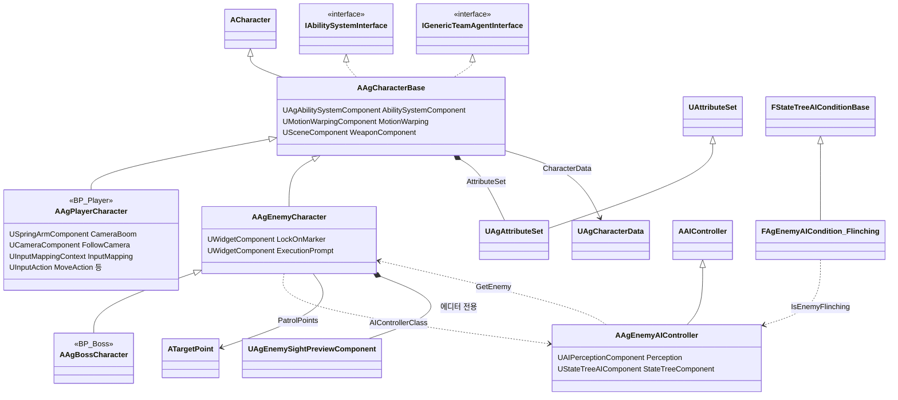
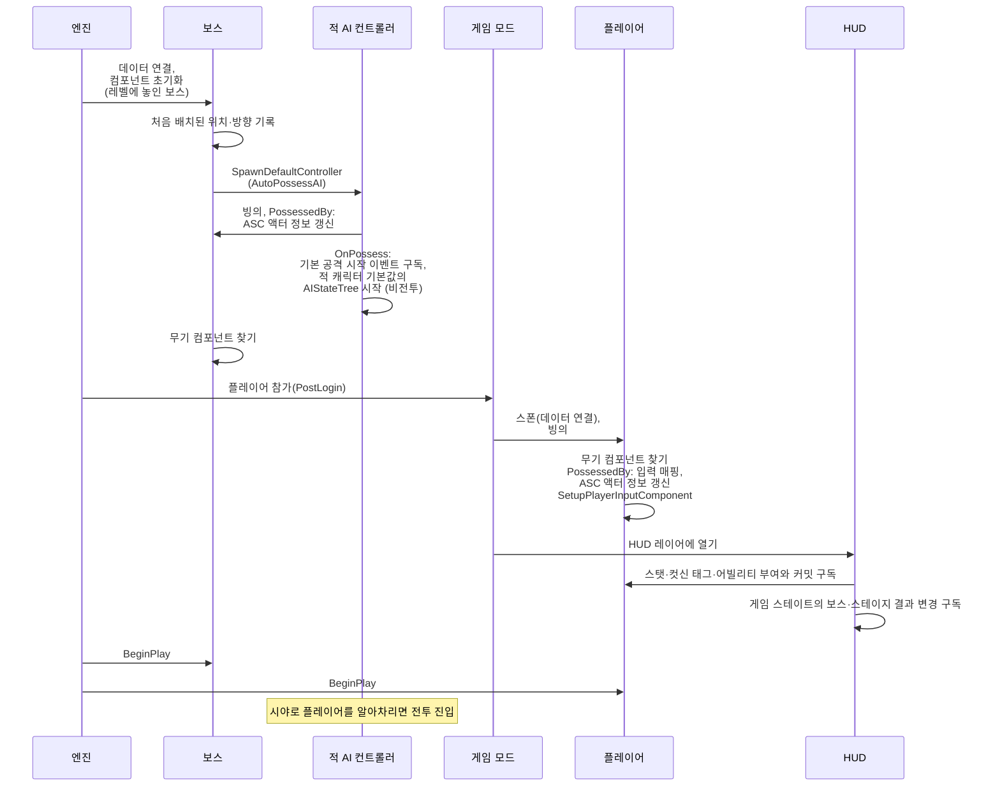
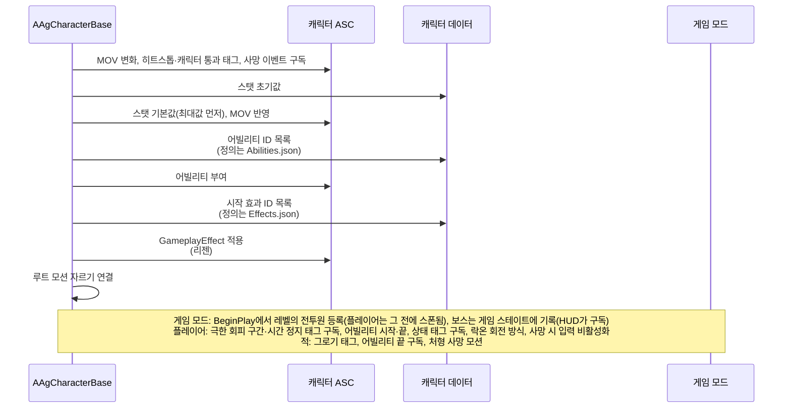
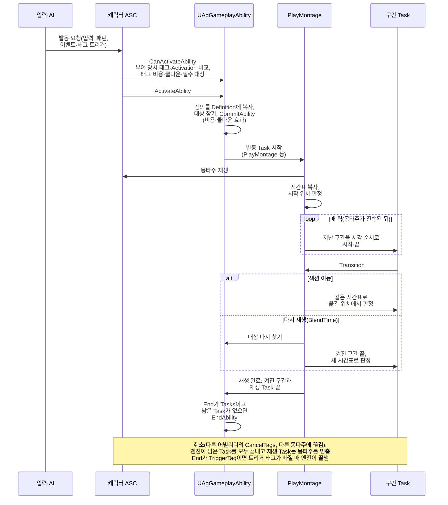
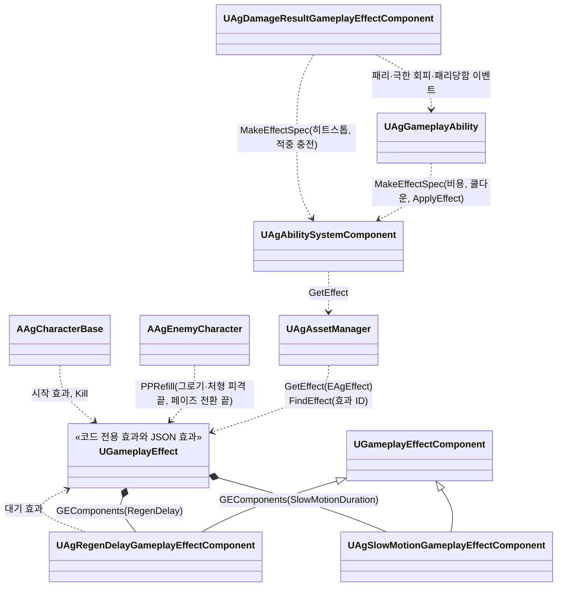

# 캐릭터 기반 구조와 GAS

캐릭터 기반 구조와 GAS, 그리고 캐릭터가 레벨에 나타나 싸울 준비를 마치기까지(데이터, 빙의, 어빌리티 시스템, AI, 입력, HUD 연결)를 어떻게 구현할지 정합니다.

## 기술 결정

| 항목 | 결정 | 이유 |
| - | - | - |
| ASC 위치 | 캐릭터에 둡니다. | 싱글플레이라 PlayerState에 둘 이유가 없습니다. |
| 게임 모드와 게임 스테이트 | 게임 모드 클래스는 `AAgGameMode` 하나이고, 타이틀(`BP_FrontEndGameMode`)과 스테이지(`BP_StageGameMode`)는 BP 기본값(시작 화면, 스테이지 맵, 폰)으로만 나뉩니다. 스테이지의 보스는 최대 한 명이며, 게임 모드가 등록한 보스와 정한 스테이지 결과를 `AAgGameState`가 들고, HUD와 전투 결과 화면은 게임 스테이트를 읽습니다. 플레이어 컨트롤러는 레이어에 화면을 여는 UI 명령만 전달합니다. | 게임 모드는 규칙, 게임 스테이트는 UI도 읽는 상태라는 엔진의 역할 구분을 따릅니다. 게임 스테이트는 플레이어 로그인보다 먼저 생기므로, HUD는 로그인과 `BeginPlay`의 순서와 관계없이 현재 보스를 읽고 이후 변경을 구독합니다. |
| 진영과 대상 판정 | `AAgCharacterBase`의 `EAgTeam`과 `GetTeamAttitudeTowards`가 진영 태도를 정하고, AI 컨트롤러는 빙의한 캐릭터의 태도를 전달합니다. 적은 중립을 `Neutral`로 보며 대상 선택과 지각은 `Hostile`만 받습니다. 적중은 죽지 않았고 `Friendly`가 아닌 상대에게 적용하며, 이 판정은 `AAgCharacterBase::CanBeHitBy` 하나를 무기·투사체와 범위 적중용 `Hit` 프리셋(`AgTargetingFilterTask_Hittable`)이 함께 씁니다. | 공격 대상 선택과 공격 판정에 휘말리는 대상을 구분하면서 진영 태도는 한곳에서 정합니다. 맞는 대상이 공격 방식마다 갈리지 않습니다. |
| 어트리뷰트 | 세트 하나에 기획서 스탯을 기획서 이름 그대로 둡니다. HP, MaxHP, SP, MaxSP, MP, MaxMP, UP, MaxUP, PP, MaxPP, ATK, DEF, MOV. 보스가 쓰지 않는 SP·MP·UP는 0입니다. 기본값이 바뀌기 전에 범위(0 ~ 최대값)로 고정합니다. PP를 더하기 모디파이어로 줄일 때는 `PreGameplayEffectExecute`에서 감소량의 절댓값을 반올림한 뒤 음수로 적용합니다. 반올림 규칙은 [전투 시스템](<../Design/System/전투 시스템.md>) '대미지'를 따릅니다. | 기획서, 데이터 위치표, 코드의 이름이 같아 대조하기 쉽습니다. 최대값에서 리젠이 더해져도 기본값이 넘치지 않아야 다음 감소가 바로 보입니다. PP 감소량을 적용 직전에 반올림하면 패리도 같은 규칙을 따르고, 리젠으로 생긴 남은 PP의 소수부는 보존됩니다. |
| 어빌리티 목록 | 캐릭터 데이터(`Characters.json`)의 `Abilities`에 적힌 어빌리티 ID마다 단일 `UAgGameplayAbility`를 독립 스펙으로 부여합니다. 정의는 `Abilities.json`에 있고, 어빌리티 태그와 트리거는 스펙에 넣습니다. | 같은 클래스라도 조건·이벤트·재발동·쿨다운·GE 출처가 어빌리티마다 구분됩니다. |
| 어빌리티 구조 | 모든 어빌리티(플레이어 액션, 보스 패턴, 피격 반응 등)를 어빌리티 클래스 하나(`UAgGameplayAbility`)와 범용 Task로 실행하고, 어빌리티가 아닌 규칙은 주인 객체가 맡습니다. | 어빌리티 하나는 `Abilities.json` 항목과 그 몽타주의 시간표만 읽으면 파악되고, 있는 Task를 조합한 새 액션·패턴은 JSON과 몽타주만으로 더합니다. 그래서 새 Task는 둘 이상의 어빌리티가 쓸 수 있는 기능 하나일 때만 더하고, 한 어빌리티만 쓰는 규칙은 값은 효과 데이터에, 규칙은 주인 객체에 둡니다. 흐름 Task, 자식 어빌리티, 필드로 두 가지 일 중 하나를 고르는 Task는 만들지 않으며, 어빌리티와 재생 Task는 Task 종류나 어빌리티·몽타주 ID로 분기하지 않습니다. 플레이어 입력으로 발동하는 액션만은 `AAgPlayerCharacter`의 입력 계층(입력 액션 바인딩과 `RunInput`의 입력 태그 처리)에도 연결해야 키에 반응합니다. |
| 상태 | 움찔·넉업과 저글·넉다운·가드 밀림·가드 브레이크, 그로기, 처형 피격, 페이즈 전환은 이벤트로 발동하는 어빌리티(GameplayEvent 트리거)로 만듭니다. 발동·중단 관계는 태그로 나타내며, 기획 규칙은 [전투 시스템](<../Design/System/전투 시스템.md>)을 따릅니다. 공통 피격 어빌리티는 `Ability.Reaction.HitReaction` 아래에 두어 상위 상태가 부모 태그 하나로 취소합니다. 세부 상태 구분은 아래 '피격 상태와 AI 조건'을 따릅니다. 사망은 어빌리티가 아니라 캐릭터가 사망 이벤트를 받아 처리합니다. 그로기는 지속 효과(`Groggy`)가 상태 태그를 부여하고, 그 태그가 떨어지면 적 캐릭터가 그로기 어빌리티를 취소합니다. 그로기 몽타주는 반복 섹션에서 끝 섹션으로 미리 넘어가(Transition의 `bSectionEndsWithTag`), 효과가 끝나는 때에 끝 섹션을 마칩니다. 그로기 어빌리티의 OwnedTags에는 `State.Groggy`를 넣지 않습니다(넣으면 효과가 끝나도 태그가 남아 그로기가 끝나지 않습니다). 그 밖에 어빌리티가 붙이는 상태 태그는, 어빌리티 내내 붙으면 ActivationOwnedTags에 두고, 일부 구간에만 붙으면(회피의 무적 구간, 후딜 전의 Busy 등) 시간표의 ApplyEffect 구간으로 그 태그를 주는 효과를 겁니다. | 어빌리티와 같은 방식이라 규칙이 한곳에 모입니다. 두 방식 모두 어빌리티가 끝나면 태그가 떨어지므로, 어빌리티마다 태그를 떼는 코드를 두지 않습니다. |
| 강인도·슈퍼아머 | 강인도는 `UAgCharacterData::Toughness`이며 어트리뷰트로 만들지 않습니다. 슈퍼아머는 JSON 효과 `SuperArmor`가 `State.SuperArmor`를 부여합니다. 반응 선택은 대미지 결과 처리 컴포넌트, 가드의 SP 부족 결과는 대미지 실행 계산이 맡습니다. | 캐릭터 등급과 일시적인 상태를 구분하고, 반응 억제가 피해량·적중 연출·보상 전체를 건너뛰지 않게 합니다. |
| 쿨다운 | 어빌리티(플레이어 액션, 보스 패턴)의 쿨다운은 쿨다운 효과(`Cooldown`) 하나로 셉니다. 어빌리티마다 태그를 두지 않고, 효과의 에셋 태그(`Effect.Cooldown`)와 걸 때 넣은 출처(그 스펙의 어빌리티 인스턴스)로 어빌리티를 구분합니다. 시간은 어빌리티 항목의 `Cooldown`이며 0이면 쿨다운이 없습니다. 플레이어와 보스가 이 길 하나를 씁니다. | 엔진의 쿨다운 GE는 클래스(`CooldownGameplayEffectClass`)로만 받아, 코드에서 만든 GE 객체로 쿨다운을 확인·적용하는 함수를 재정의합니다. 시간은 어빌리티 정의에 두고, 공통 효과의 구성은 아래 '코드가 효과를 쓰는 방법'을 따릅니다. 어빌리티마다 태그를 두지 않아 어빌리티를 더해도 태그가 늘지 않습니다. 쿨다운 유무를 시간 하나로 정해, 쿨다운 효과가 있는지와 시간이 어긋나지 않습니다. |
| 자원 변화 | 자원이 바뀌는 일마다 그 규칙을 가진 효과를 적용합니다. 어빌리티 비용은 GAS의 비용 흐름(`CheckCost`·`ApplyCost`)에서 자원 효과(`Resource`)를 음수로 걸어 치르고, 적중의 MP·UP 충전도 같은 자원 효과에 얻는 양을 넣습니다. 적중 보상은 `HitReward`가 있는 피해 Task마다 첫 적중에 한 번만 줍니다. 달리기의 지속 소모는 주기 효과(`SprintDrain`)로, PP 회복(그로기·처형 피격이 끝날 때, 페이즈 전환)은 PP를 최대로 덮어쓰는 효과(`PPRefill`)로, 패리로 공격자가 잃는 PP는 공격자의 MaxPP에 비율을 곱하는 효과(`ParryPPLoss`)로 처리합니다. | 자원 변경은 GameplayEffect로 적용하고 고정 기획 값은 JSON을 사용합니다. 엔진의 비용 GE는 클래스(`CostGameplayEffectClass`)로만 받아 쓰지 않고, 비용과 얻기가 자원 효과 하나를 함께 씁니다. |
| 리젠 | SP·PP 리젠은 자원마다 회복 효과 하나(`SPRegen`, `PPRegen`)로 처리합니다. 회복은 주기 효과입니다([데이터 로딩과 스키마](<데이터 로딩과 스키마.md>) '효과'). 리젠 대기는 태그를 주는 지속 효과(`SPRegenDelay`, `PPRegenDelay`)이고, 회복 효과는 대기 태그가 있는 동안 멈춥니다. 회복 효과의 `RegenDelay`가 자원이 줄 때마다 대기 효과를 다시 걸어 처음부터 다시 셉니다. 회복 효과는 캐릭터 데이터의 시작 효과 목록(`Effects`)에 두어 캐릭터가 시작할 때 겁니다. | 자원 변화를 모두 GameplayEffect로 처리하는 GAS 표준 방식입니다. 회복량, 대기 시간, 대기를 다시 거는 규칙이 효과 정의에 있어 한곳에서 고칩니다. GameplayEffect 타이머는 게임 시간으로 흘러, 히트스톱 중에도 리젠이 계속되는 기획서 규칙과 맞습니다. |
| PP 감소와 그로기 | PP를 잃을 수 있는지(`CanLosePP`)는 적 캐릭터가 정합니다. 적이 아닌 캐릭터(플레이어)는 PP를 잃지 않고, 적은 `State.Groggy`, `State.Execution`, `State.Invincible` 중 하나가 있으면 잃지 않습니다. PP 감소는 어트리뷰트 세트가 기본값이 바뀌기 전에 이 조건으로 막고, 그로기 판정도 같은 조건을 봅니다. | PP와 그로기는 적의 규칙이라 적 캐릭터에 둡니다. 그로기·처형·무적 중에 PP를 잃지 않는 규칙을 한곳에서 확인하고, PP를 줄이는 효과(대미지, 패리로 잃는 PP)마다 조건을 두지 않아 새 효과도 이 규칙을 따릅니다. |

## 클래스 구조

### 캐릭터

플레이어·적·보스 캐릭터와 컴포넌트, 적 공통 AI 컨트롤러입니다.

| 클래스 | 부모 | 역할 |
| - | - | - |
| `AAgCharacterBase` | `ACharacter`, `IAbilitySystemInterface`, `IGenericTeamAgentInterface` | 플레이어·적 공통. 캐릭터 데이터 연결(BP 기본값 `CharacterDataId`로 `Characters.json` 로드), ASC, 어트리뷰트, 팀(적대 판정)과 적중 가능 판정(`CanBeHitBy`), 어빌리티 부여와 스펙의 어빌리티 항목 찾기(`FindAbility`, `FindAbilitySpec`), 무기 리소스, 공중 상태(`State.Airborne`)와 이동 사건(`Event.Landed`, Launch가 띄울 때마다 켜는 엔진 정점 알림으로 보내는 `Event.Apex`), 재생 중인 어빌리티의 대상과 간격으로 루트 모션 자르기(최소 간격), 상태 태그 처리(캐릭터 통과, 넉업으로 떠 있는 동안 캡슐도 무기에 맞음), 락온 대상 조회(`GetLockOnTarget`), 이동 입력 방향(`GetMoveInputDirection`), 피격 흔들림 컴포넌트(`UAgHitPhysicsComponent`, 래그돌 전에 멈춤), 히트스톱 중의 시간 배율, 기본 래그돌 사망 처리 |
| `UAgCharacterMovementComponent` | `UCharacterMovementComponent` | 플레이어와 보스의 회전. 엔진 회전을 쓰고, 사망·방향 고정 중에는 돌지 않습니다. 서 있을 때 발을 붙여 두는 것은 애님 인스턴스가 루트 뼈를 반대로 돌려서 합니다. |
| `AAgPlayerCharacter` | `AAgCharacterBase` | 카메라와 락온 카메라, 입력 매핑, 입력 계층(어빌리티 태그로 스펙 찾기, 가드·달리기·락온의 발동과 취소, 이동 입력 태그, 선입력, 점프와 점프 모션), 극한 회피 구간의 회피를 시작한 자리 캡슐(`PerfectDodgeCapsule`), 궁극기 시간 정지 요청, 사망 시 플레이어 입력 비활성화, 전투 카메라 연출(상황별 연출 재생, 상대 쪽 회전, 처형 카메라 모디파이어의 시작·끝, 시야각 연출 모디파이어 `UAgFieldOfViewCameraModifier` 붙이기, 달리기 시야각) |
| `AAgEnemyCharacter` | `AAgCharacterBase` | 적 공통. 정찰 지점·처음 위치와 방향, 시야 기준점, `AIStateTree`, 페이즈와 페이즈 전환(시작한 전환의 기록 포함), 패턴 발동 가능 여부(`CanActivatePattern`)와 지금 고를 수 있는 패턴 모으기(`GatherPatterns`), PP 감소 허용 여부(`CanLosePP`), 그로기·처형 피격·페이즈 전환 종료 시 PP 회복, 처형 피격 중 전용 사망 모션, 락온 지점(`GetTargetLocation`), 월드 위치 HUD(락온 마커, 처형 안내) |
| `AAgBossCharacter` | `AAgEnemyCharacter` | 보스 전용. 시야 상실에 따른 비전투 복귀 금지(`CanReturnToNonCombat`), 보스 처치 슬로우모션 값 |
| `AAgEnemyAIController` | `AAIController` | 적 공통 StateTree 실행, 전체 반응(`IsEnemyReacting`)과 움찔(`IsEnemyFlinching`) 조회, AI 지각의 시야·대미지 감각(놓친 뒤 잊는 시간은 감각의 최대 나이), 팀 태도 전달, 자기 캐릭터가 받은 기본 공격 시작 이벤트를 StateTree에 전달 |
| `FAgEnemyAICondition_Flinching` | `FStateTreeAIConditionBase` | 공통 조건 인스턴스 데이터의 Controller로 `IsEnemyFlinching`을 조회합니다. `bInvert`로 반대 조건을 표현합니다. |
| `UAgAttributeSet` | `UAttributeSet` | 기획서 스탯 13개, PP 감소량 반올림과 감소 허용 조건 적용, 사망·그로기 판정 |

### 게임 모드와 게임 스테이트

| 클래스 | 부모 | 역할 |
| - | - | - |
| `AAgGameMode` | `AGameModeBase` | 시작 화면(타이틀 또는 HUD) 열기, 전투원 등록과 보스 기록, 승패 판정과 전투 결과 화면 열기, 보스 처치로 승리가 정해질 때 죽은 보스의 값으로 슬로우모션과 보스 처치 카메라 연출 발동, 맵 이동(타이틀, 스테이지, 다시 시작, 종료) |
| `AAgGameState` | `AGameStateBase` | 스테이지의 보스와 스테이지 결과(`EAgStageResult`, 먼저 정해진 것으로 한 번만 정함), 각각의 변경 알림(`OnBossChanged`, `OnStageResultChanged`) |

### 피격 상태와 AI 조건

공통 피격은 `State.HitReaction`의 하위 태그를 부여합니다. 입력·이동·패턴의 공통 차단은 부모 태그를 조회하며, 반응별 예외는 하위 태그로 구분합니다. 모든 태그는 `AgGameplayTags.h`·`.cpp`에 네이티브로 선언합니다.

| 어빌리티 | 부여하는 상태 |
| - | - |
| `Flinch` | `State.HitReaction.Flinch` |
| `KnockUp`, `Juggle` | `State.HitReaction.KnockUp` |
| `KnockDown` | `State.HitReaction.KnockDown` |
| `GuardPushback` | `State.HitReaction.GuardPushback` |
| `GuardBreak` | `State.HitReaction.GuardBreak` |

- 공격 데이터의 `Flinch`는 결과 처리에서 행동 중단용 `Event.Hit.Stagger` 또는 저글용 `Event.Hit.Flinch`로 나뉩니다. 저글은 `State.Airborne`과 넉업 하위 상태를 함께 요구합니다. `Stagger`는 새 공격 반응 종류가 아닌 내부 이벤트입니다.
- 결과 처리는 `Stagger`를 맞은 곳의 하위 태그(`Event.Hit.Stagger.Back`·`Head`·`ArmRight`·`ArmLeft`·`Body`)로 보냅니다. 공격자(투사체면 투사체) 쪽이 피격자 등 쪽 45° 안이면 `Back`, 아니면 이펙트 컨텍스트 HitResult의 뼈에서 부모를 따라 처음 만나는 기준 뼈(`neck_01`·`spine_04` → `Head`, `clavicle_r`·`clavicle_l` → 팔, `pelvis` → `Body`)로 정하고, 뼈가 없으면 `Body`입니다. 사람형 캐릭터가 모두 `SK_Mannequin`이라 기준 뼈는 코드 상수입니다. 엔진은 이벤트 태그의 부모를 따라 트리거를 찾으므로 `Flinch`의 트리거는 `Event.Hit.Stagger` 하나입니다.
- `Flinch`는 PlayMontage Task를 섹션마다 두고 `bAllowRetrigger`로 다시 시작합니다. 지상 섹션은 `EventTag`(어빌리티를 발동시킨 이벤트 태그와 맞을 때만 재생)로, 공중은 `State.Airborne`으로 고릅니다. 공중 움찔은 별도 몽타주 ID(`FlinchAir`)인데, 루트 모션 시퀀스가 하나라도 든 몽타주는 엔진이 몽타주 전체를 루트 모션으로 다뤄 낙하 중 수평 속도를 덮어쓰기 때문입니다. 행동 제한은 블렌드아웃 시작이 아닌 몽타주 종료까지 유지하고, 별도 피격 시간값이나 전용 실행 클래스는 없습니다.
- 움찔은 넉업·넉다운·가드 피격 중에 발동하지 않습니다.
- 그로기 효과는 Groggy 어빌리티가 끝나도 지속 시간 동안 남고(`bRemoveOnEnd: false`), 처형·사망 태그가 붙으면 효과 정의의 `RemovalTags`로 지워집니다. 피격 반응 몽타주가 그로기 몽타주를 끊어 어빌리티가 취소돼도 그로기는 이어지며, 피격 반응 뒤의 그로기 자세는 ABP가 보여 줍니다.
- 플레이어는 공중 공격의 입력 예외보다 부모 피격 상태를 먼저 확인합니다. 선입력은 상태가 해제된 다음 틱에 재검사해, 재발동 중 태그가 잠시 빠지는 순간에 실행하지 않습니다.
- `ST_Enemy`는 전체 반응보다 움찔 전환을 먼저 검사하고, 두 상태 모두 기존 `WaitReaction` Task로 종료를 기다립니다. 움찔만 끝나면 패턴 실행으로, `Reacting && !Flinching`이면 기존 피격 반응 상태로 전환합니다. 페이즈 전환 조건은 패턴 실행보다 먼저 확인합니다.

### 레벨 시작에서 BeginPlay까지

### 캐릭터 BeginPlay

### 어빌리티 실행

### GameplayEffect

효과 정의의 JSON 형식은 [데이터 로딩과 스키마](<데이터 로딩과 스키마.md>) '효과'를 따릅니다. 이 절에서는 효과를 거는 객체의 역할과, 코드가 효과를 만들고 쓰는 방법(아래 '코드가 효과를 쓰는 방법')을 정리합니다. 대미지 효과의 계산과 결과 처리는 `UAgDamageExecution`과 `UAgDamageResultGameplayEffectComponent`가 맡습니다. 어빌리티 비용·쿨다운은 어빌리티가, 어빌리티가 거는 효과(패리 구간, 극한 회피 구간, 그로기 시간, 달리기 소모, 패리·극한 회피의 보상과 회피 반격 기회, 패리로 잃는 PP)는 ApplyEffect가, 히트스톱·적중 충전과 가드 반격 기회(가드·패리 결과)는 피격 결과 처리 컴포넌트가, PP 회복(그로기·처형 피격·페이즈 전환이 끝날 때)은 적 캐릭터가, 시작 효과와 Kill은 캐릭터가, 리젠 대기는 회복 효과의 리젠 대기 컴포넌트가, 슬로우모션은 슬로우모션 효과의 컴포넌트가 겁니다.

| 클래스 | 부모 | 역할 |
| - | - | - |
| `UAgDamageExecution` | `UGameplayEffectExecutionCalculation` | 피해·가드 자원 계산과 결과 태그 생성. 슈퍼아머 가드에서는 SP 부족과 가드 브레이크를 구분하고, SP 소모를 보유량 이내로 제한합니다. |
| `UAgDamageResultGameplayEffectComponent` | `UGameplayEffectComponent` | 강인도·슈퍼아머·현재 상태에 따른 반응 이벤트 선택, 물리 피격, 연출·히트스톱·적중 보상. 반응 억제와 다른 적중 처리를 분리합니다. |
| `UAgRegenDelayGameplayEffectComponent` | `UGameplayEffectComponent` | 회복 효과의 `RegenDelay`([데이터 로딩과 스키마](<데이터 로딩과 스키마.md>) '효과'). 효과가 걸릴 때 회복하는 어트리뷰트의 변경을 구독하고 지워질 때 풉니다(엔진의 대상 태그 조건 컴포넌트가 태그 변경을 구독하는 방식). |
| `UAgSlowMotionGameplayEffectComponent` | `UGameplayEffectComponent` | 효과의 `SlowMotionSpeed`·`SlowMotionDuration`. 효과가 실행될 때 시간 서브시스템에 슬로우모션을 겁니다. |

#### 코드가 효과를 쓰는 방법

- `EAgEffect`는 코드가 지정해 사용하는 효과(`Damage`, `Resource`, `Cooldown`, `Kill`, `Hitstop`, `PPRefill`)입니다. 에셋 매니저가 `StartInitialLoading`에서 값마다 `AgEffectData::MakeNativeEffect`로 한 번 만들어 `NativeEffects`에 UPROPERTY로 보관하며, JSON 재로딩 대상에서 제외합니다. 효과별 GE 클래스는 만들지 않습니다.
- `GetEffect(EAgEffect)`는 `NativeEffects`에서 찾습니다.
- `FindEffect(FName)`와 `DataId = "Effects"` 검증은 JSON 효과만 대상으로 합니다. 두 저장소는 서로 덮어쓰지 않습니다. 어빌리티가 아닌 코드가 JSON 효과를 거는 곳(피격 결과 처리 컴포넌트의 `GuardCounterChance`)은 효과 ID를 그 파일의 상수로 둡니다.
- 코드 전용 효과의 구성은 아래 표를 따릅니다. 구성 뒤 `OnGameplayEffectChanged`로 컴포넌트의 태그를 모읍니다. 적용할 때마다 새 스펙을 만들고, 스펙에만 공격 값·비용·쿨다운 시간·히트스톱 시간을 넣습니다.

| 효과 | 코드에서 고정하는 구성 |
| - | - |
| `Damage` | 즉시 효과. `Effect.Damage`, `State.Dead` 대상 제외, `UAgDamageExecution`과 `UAgDamageResultGameplayEffectComponent` |
| `Resource` | 즉시 효과. SP·MP·UP 각각에 대응하는 SetByCaller 값을 더함. 바꾸지 않는 자원도 스펙에 0을 넣음 |
| `Cooldown` | 지속 효과와 `Effect.Cooldown`. 지속 시간과 어빌리티별 출처는 적용할 스펙에 지정 |
| `Kill` | 즉시 효과. HP를 0으로 덮어씀 |
| `Hitstop` | 지속 효과와 `State.Hitstop` 부여. 지속 시간은 `CombatRules.json`의 `HitstopDuration`을 적용할 스펙에 지정 |
| `PPRefill` | 즉시 효과. 대상의 MaxPP를 스냅샷 없이 읽어 PP에 덮어씀 |

- 걸 효과의 수와 종류를 데이터가 정하는 자리는 데이터의 효과 ID 목록으로 둡니다. 거는 때를 코드가 정하면, 코드는 그때 이벤트를 보내고 그 이벤트로 발동하는 어빌리티의 `ApplyEffect`가 겁니다(패리 보상은 Parry, 극한 회피 보상은 PerfectDodge, 패리로 잃는 PP는 Parried).
- 걸 효과를 GE 클래스로만 받는 엔진 기능(추가 효과 컴포넌트, 실행의 조건부 효과)은 쓰지 않고 효과 ID 필드로 대신합니다. 엔진의 다른 효과 지우기 컴포넌트는 자기 자신을 GE 클래스의 기본 객체와 비교해 가려 내 실행 중에 만든 GE에서는 자기 자신을 가려 내지 못하고, 스택 방식은 정하는 함수가 에디터 전용이라, 리젠 대기는 걸린 대기 효과를 태그로 지우고 다시 겁니다.
- 데이터가 거는 효과(어빌리티 정의와 시간표의 ApplyEffect)는 효과 ID로 적습니다. 구간에 두는 효과는 `Infinite`입니다. 구간의 길이는 시간표가 정하기 때문입니다.
- `SuperArmor`는 `Infinite`와 `State.SuperArmor`만 가진 JSON 효과입니다. 현재 캐릭터의 시작 효과나 스킬·패턴에는 연결하지 않습니다. 여러 효과가 같은 상태를 부여할 때는 태그를 직접 지우지 않고 각각의 효과 핸들을 제거해 나머지 효과의 보호를 유지합니다.
- 스펙은 GE 객체로 만듭니다(ASC와 어빌리티의 `MakeEffectSpec`). 넘길 값이 없는 효과는 ASC의 `ApplyGameplayEffectToSelf`에 GE 객체를 넘깁니다. 어빌리티의 `ApplyGameplayEffectToOwner`는 받은 GE의 클래스 기본 객체로 스펙을 만들어 쓰지 않습니다.
- 스펙에 값을 넣는 일은 그 값을 가진 구조체가 맡습니다(`AddToSpec`).
- 실행 중에 만든 GE는 모두 같은 클래스라, 걸린 효과는 엔진의 GE 클래스 기준 조회 대신 효과의 `AssetTags`나 부여 태그로 찾습니다.
