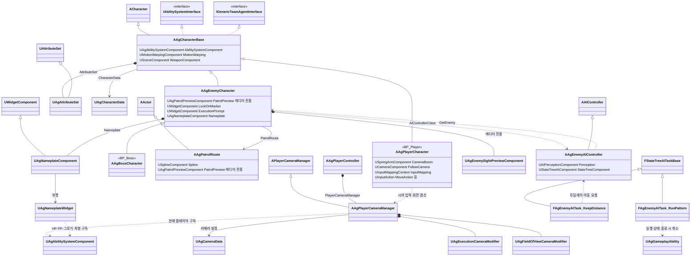
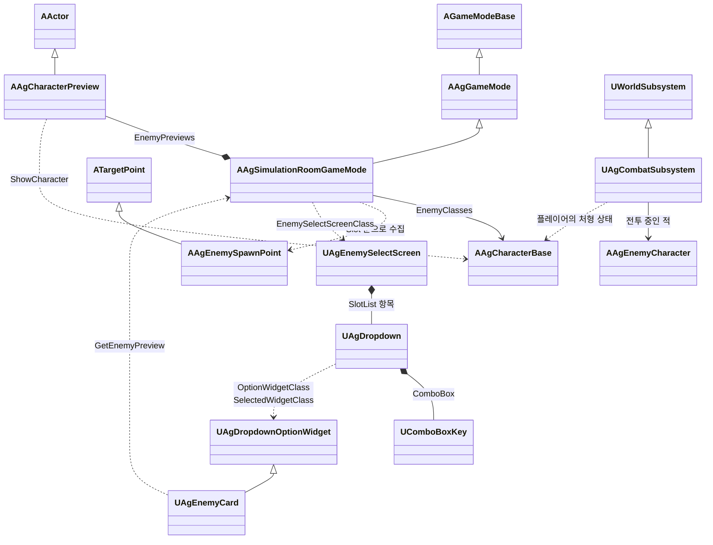
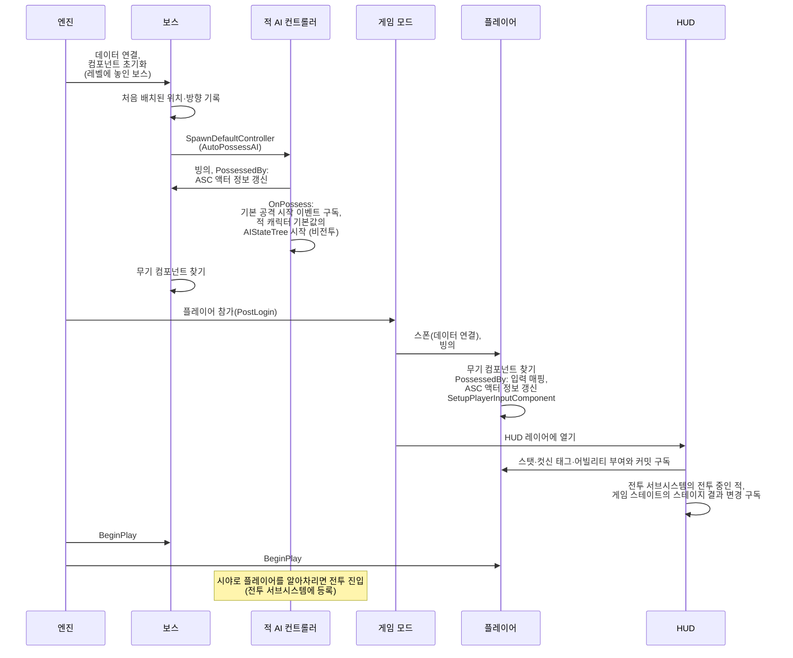
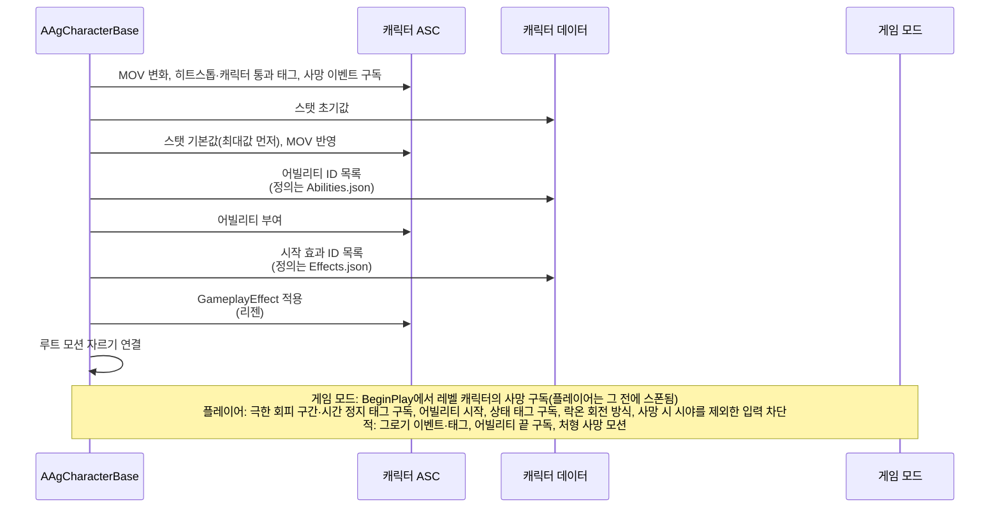
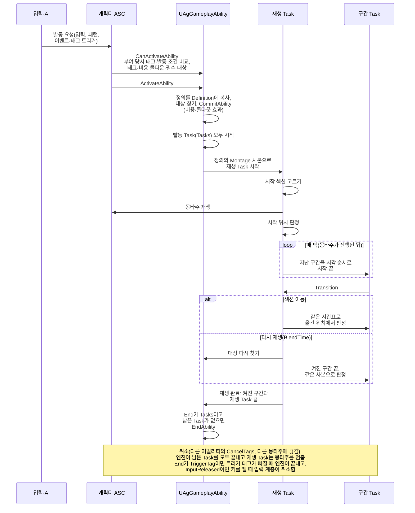
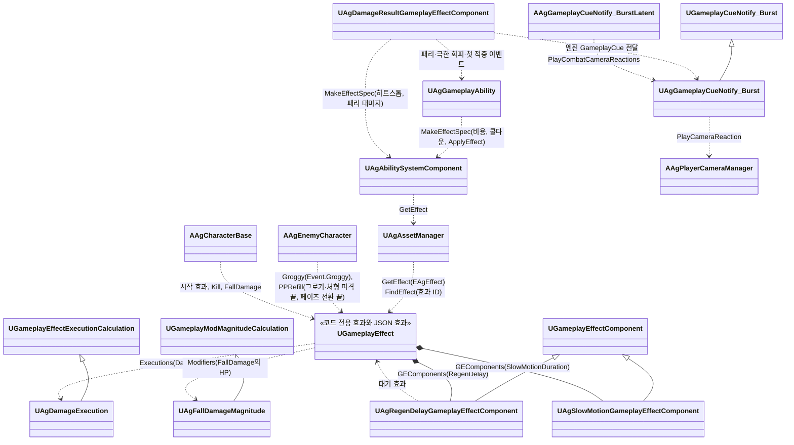

# 캐릭터 기반 구조와 GAS

캐릭터 기반 구조와 GAS, 그리고 캐릭터가 레벨에 나타나 싸울 준비를 마치기까지(데이터, 빙의, 어빌리티 시스템, AI, 입력, HUD 연결)를 어떻게 구현할지 정합니다.

## 기술 결정

| 항목 | 결정 | 이유 |
| - | - | - |
| ASC 위치 | 캐릭터에 둡니다. | 싱글플레이라 PlayerState에 둘 이유가 없습니다. |
| 게임 모드와 게임 스테이트 | 게임 모드 클래스는 `AAgGameMode`이고, 타이틀(`BP_FrontEndGameMode`)과 스테이지(`BP_StageGameMode`)는 BP 기본값(시작 화면, 스테이지 목록, 폰)으로만 나뉩니다. 시뮬레이션 룸만 하위 클래스 `AAgSimulationRoomGameMode`를 두고, `LV_SimulationRoom`의 월드 설정에서 게임 모드를 `BP_SimulationRoomGameMode`로 재정의합니다. 스테이지의 보스는 최대 한 명입니다. 게임 모드가 정한 스테이지 결과는 `AAgGameState`가 들고 HUD와 전투 결과 화면이 읽으며, HUD의 보스 상태는 전투 서브시스템(`UAgCombatSubsystem`)이 전투 중인 적 가운데서 찾은 보스를 보여 줍니다. 플레이어 컨트롤러는 레이어에 화면을 여는 UI 명령만 전달합니다. | 게임 모드는 규칙, 게임 스테이트는 UI도 읽는 상태라는 엔진의 역할 구분을 따릅니다. 게임 스테이트와 월드 서브시스템은 플레이어 로그인보다 먼저 생기므로, HUD는 로그인과 `BeginPlay`의 순서와 관계없이 현재 값을 읽고 이후 변경을 구독합니다. 보스 상태는 보스가 전투 중일 때만 보이므로, 전투 중인 적 목록을 가진 서브시스템에서 찾습니다. 시뮬레이션 룸은 배치, 선택 화면, 클리어 조건이 달라 레벨마다 규칙을 바꾸는 엔진의 방식(게임 모드 재정의)을 씁니다. |
| 동시 공격 수 | 전투 중인 적 목록과 공격 차례는 월드 서브시스템 `UAgCombatSubsystem`이 맡습니다. 적은 `ST_Enemy`의 '전투' 상태에 들어갈 때 등록하고 나갈 때 빠집니다(사망, 플레이어 사망 대기, 비전투 복귀가 모두 '전투' 밖입니다). 간격 지키기와 패턴 실행은 패턴을 시작해도 되는지(`CanStartPattern`: 패턴 금지, 패턴 후딜레이, 차례 순으로 확인하고 반응형 패턴은 패턴 금지만 확인)를 묻고, 패턴 실행이 공격의 시작과 끝을 알리며, 끝을 알리면 재공격 대기가 시작됩니다. 차례는 물을 때마다 목록에서 셉니다. 패턴 금지(`ArePatternsBlocked`)는 플레이어가 처형하는 동안이며, 실행 중인 패턴은 `ST_Enemy`의 패턴 실행 상태에 둔 '패턴 금지' 전환(`FAgEnemyAICondition_PatternsBlocked`)으로 멈춥니다. | 차례는 여러 적 사이의 규칙이라 한 적의 컨트롤러가 아니라 전투 전체의 주인이 맡고, 재공격 대기도 차례에만 쓰는 값이라 함께 둡니다. 등록 지점이 상태 하나라 모든 액터를 훑지 않습니다. 앞 순서의 적은 패턴을 시작했든 아직 기다리든 한 자리로 세므로, 같은 프레임에서 적들이 묻는 순서와 관계없이 결과가 같습니다. |
| 팀과 대상 판정 | 캐릭터 데이터의 팀(`Team`)으로 `AAgCharacterBase::GetTeamAttitudeTowards`가 팀 태도를 정하고, AI 컨트롤러는 빙의한 캐릭터의 태도를 전달합니다. 적 팀과 중립 팀(샌드백)은 서로를 `Neutral`로 보며 대상 선택과 지각은 `Hostile`만 받습니다. 적중은 죽지 않았고 `Friendly`가 아닌 상대에게 적용하며, 이 판정은 `AAgCharacterBase::CanBeHitBy` 하나를 무기·투사체·충격파와 범위 적중용 `Hit` 프리셋(`AgTargetingFilterTask_Hittable`)이 함께 씁니다. | 공격 대상 선택과 공격 판정에 휘말리는 대상을 구분하면서 팀 태도는 한곳에서 정합니다. 맞는 대상이 공격 방식마다 갈리지 않습니다. |
| 어트리뷰트 | 세트 하나에 기획서 스탯을 기획서 이름 그대로 둡니다. HP, MaxHP, SP, MaxSP, MP, MaxMP, UP, MaxUP, PP, MaxPP, ATK, DEF, MOV, Potion, MaxPotion. 보스가 쓰지 않는 SP·MP·UP와 플레이어만 쓰는 Potion·MaxPotion은 쓰지 않는 캐릭터에서 0입니다. 기본값이 바뀌기 전에 범위(0 ~ 최대값)로 고정합니다. PP 감소량은 대미지 실행 계산(`UAgDamageExecution`)이 반올림한 정수로 줄입니다. 반올림 규칙은 [전투 시스템](<../Design/System/전투 시스템.md>) '대미지'를 따릅니다. | 기획서, JSON, 코드의 이름이 같아 대조하기 쉽습니다. 최대값에서 리젠이 더해져도 기본값이 넘치지 않아야 다음 감소가 바로 보입니다. PP 감소량을 계산하는 곳에서 반올림하면 패리 대미지도 같은 계산을 거쳐 같은 규칙을 따르고, 리젠으로 생긴 남은 PP의 소수부는 보존됩니다. |
| 어빌리티 목록 | 캐릭터 데이터(`Characters.json`)의 `Abilities`에 적힌 어빌리티 ID마다 단일 `UAgGameplayAbility`를 독립 스펙으로 부여합니다. 정의는 `Abilities.json`에 있고, 어빌리티 태그와 트리거는 스펙에 넣습니다. | 같은 클래스라도 조건·이벤트·재발동·쿨다운·GE 출처가 어빌리티마다 구분됩니다. |
| 어빌리티 구조 | 모든 어빌리티(플레이어 액션, 보스 패턴, 피격 반응 등)를 어빌리티 클래스 하나(`UAgGameplayAbility`)와 범용 Task로 실행하고, 어빌리티가 아닌 규칙은 주인 객체가 맡습니다. | 어빌리티 하나는 `Abilities.json` 항목 하나(몽타주와 타임라인 포함)만 읽으면 파악되고, 있는 Task를 조합한 새 액션·패턴은 JSON과 몽타주만으로 더합니다. 그래서 새 Task는 둘 이상의 어빌리티가 쓸 수 있는 기능 하나일 때만 더하고, 한 어빌리티만 쓰는 규칙은 값은 효과 데이터에, 규칙은 주인 객체에 둡니다. 흐름 Task, 자식 어빌리티, 필드로 두 가지 일 중 하나를 고르는 Task는 만들지 않으며, 어빌리티와 재생 Task는 Task 종류나 어빌리티 ID로 분기하지 않습니다. |
| 입력 | 키로 발동하는 어빌리티는 정의에 `InputTag`를 적습니다. 키를 누르면 입력 계층(`AAgPlayerCharacter`)이 그 입력의 어빌리티를 모두 발동해 보고, 하나도 발동하지 않으면 그 입력 태그로 자기에게 게임플레이 이벤트를 보냅니다(기본 공격의 다음 타). 같은 키의 어빌리티는 발동 조건이 서로 배타적이어야 합니다. 막힘 검사와 선입력은 입력 태그 단위입니다. `End`가 `InputReleased`인 어빌리티(가드)는 키를 떼면 취소합니다. 누르고 있는 동안 입력 제한이 풀려도 다시 발동하지 않으며, 선입력한 그런 입력은 아직 누르고 있을 때만 실행합니다. 입력 계층에 남는 규칙은 점프(엔진 `Jump`를 거쳐 공중 태그 트리거로 발동), 공중 입력 제한(`State.Airborne` 동안 기본 공격 키만 받음. 점프 행동은 공중 태그가 붙는 순간에만 발동을 시도해 다른 행동·피격 반응 도중 뜨면 실행되지 않으므로, 점프 행동이 아니라 공중 태그로 봄), 락온 켜고 끄기와 대상 전환(카메라 매니저의 튕김 판정을 받아 락온 어빌리티의 대상을 바꿈), 후딜 이동 캔슬(`State.MoveCancel`인 행동의 후딜에 이동 입력이 있으면 행동을 취소하고, 회피 키를 누르고 있으면 대신 달리기를 시작), 가드 중 패리 모션을 끝내 가드 자세로 돌아오기, 처형·회복병 입력과 공중 점프 입력을 선입력하지 않기입니다. HUD의 스킬·궁극기·회복병 칸(`UAgSkillSlot`)도 `InputTag`(`Input.Skill1`~`Input.Skill4`, `Input.Ultimate`, `Input.Potion`)로 어빌리티를 찾아 그 정의의 아이콘·코스트와 쿨다운, 남은 충전 수(최대 충전 2회 이상)를 그립니다. | 키 하나로 발동하는 행동은 입력 계층과 HUD를 고치지 않고 더합니다. 같은 시각의 일에 순서를 두지 않는 원칙에 따라 목록 순서로 고르지 않습니다. 새 키나 위의 남는 규칙 같은 동작은 C++가 필요합니다. |
| 상태 | 움찔·넉업과 저글·넉다운·가드 밀림·가드 브레이크, 처형 피격, 페이즈 전환은 이벤트로 발동하는 어빌리티(GameplayEvent 트리거)로, 그로기 모션은 그로기 태그로 발동하는 어빌리티(OwnedTagPresent 트리거)로 만듭니다. 발동·중단 관계는 태그로 나타내며, 기획 규칙은 [전투 시스템](<../Design/System/전투 시스템.md>)을 따릅니다. 공통 피격 어빌리티는 `Ability.Reaction.HitReaction` 아래에 두어 상위 상태가 부모 태그 하나로 취소합니다. 세부 상태 구분은 아래 '피격 상태와 AI 조건'을 따릅니다. 사망은 어빌리티가 아니라 캐릭터가 사망 이벤트를 받아 처리합니다. 그로기는 적 캐릭터가 `Event.Groggy`를 받아 거는 지속 효과(`Groggy`)가 상태 태그를 부여하고, 그로기 어빌리티는 그 태그가 붙으면 발동하고 떨어지면 엔진이 끝내며(`End: TriggerTag`) 모션만 맡습니다. 그로기 몽타주는 반복 섹션에서 끝 섹션으로 미리 넘어가(Transition의 `bSectionEndsWithTag`), 효과가 끝나는 때에 끝 섹션을 마칩니다. 그로기 어빌리티의 OwnedTags에는 `State.Groggy`를 넣지 않습니다(넣으면 효과가 끝나도 태그가 남아 그로기가 끝나지 않습니다). 그 밖에 어빌리티가 붙이는 상태 태그는, 어빌리티 내내 붙으면 ActivationOwnedTags에 두고, 일부 구간에만 붙으면(회피의 무적 구간, 후딜 전의 Busy 등) 시간표의 ApplyEffect 구간으로 그 태그를 주는 효과를 겁니다. | 어빌리티와 같은 방식이라 규칙이 한곳에 모입니다. 두 방식 모두 어빌리티가 끝나면 태그가 떨어지므로, 어빌리티마다 태그를 떼는 코드를 두지 않습니다. 그로기의 시작(효과)과 끝(PP 회복)은 PP·그로기 규칙의 주인인 적 캐릭터가 맡고, 그로기 어빌리티가 끝나는 때는 엔진 트리거가 정합니다. |
| 강인도·슈퍼아머 | 강인도는 `UAgCharacterData::Toughness`이며 어트리뷰트로 만들지 않습니다. 슈퍼아머는 JSON 효과 `SuperArmor`가 `State.SuperArmor`를 부여합니다. 반응 선택은 대미지 결과 처리 컴포넌트, 가드의 SP 부족 결과는 대미지 실행 계산이 맡습니다. | 캐릭터 등급과 일시적인 상태를 구분하고, 반응 억제가 피해량·적중 연출·보상 전체를 건너뛰지 않게 합니다. |
| 쿨다운 | 어빌리티(플레이어 액션, 보스 패턴)의 쿨다운은 쿨다운 효과(`Cooldown`) 하나로 셉니다. 어빌리티마다 태그를 두지 않고, 효과의 에셋 태그(`Effect.Cooldown`)와 걸 때 넣은 출처(그 스펙의 어빌리티 인스턴스)로 어빌리티를 구분합니다. 시간은 어빌리티 항목의 `Cooldown`이며 0이면 쿨다운이 없습니다. 충전은 걸린 쿨다운 효과 하나가 쓴 충전 하나이고, 걸린 효과가 `MaxCharges`보다 적으면 발동합니다. 새 효과는 걸린 효과 중 가장 늦게 끝나는 것의 남은 시간에 `Cooldown`을 더한 시간으로 걸어, 효과들이 `Cooldown` 간격으로 줄지어 끝나게 합니다. 남은 쿨다운 조회(HUD)는 충전이 남았으면 0, 없으면 가장 먼저 끝나는 효과의 남은 시간과 `Cooldown`입니다. 남은 충전 수 조회(`GetCharges`)는 `MaxCharges`에서 걸린 효과 수를 뺀 값이고, HUD는 충전이 최대보다 적은 동안 매 틱 다시 그립니다. 플레이어와 보스가 이 길 하나를 씁니다. | 엔진의 쿨다운 GE는 클래스(`CooldownGameplayEffectClass`)로만 받아, 코드에서 만든 GE 객체로 쿨다운을 확인·적용하는 함수를 재정의합니다. 시간은 어빌리티 정의에 두고, 공통 효과의 구성은 아래 '코드가 효과를 쓰는 방법'을 따릅니다. 어빌리티마다 태그를 두지 않아 어빌리티를 더해도 태그가 늘지 않습니다. 쿨다운 유무를 시간 하나로 정해, 쿨다운 효과가 있는지와 시간이 어긋나지 않습니다. 충전을 효과의 줄로 세어 한 번에 하나씩 충전되고 쓸 때 흐르던 쿨다운이 다시 시작하지 않으며, 충전 수를 따로 두지 않아 쿨다운 효과를 지우면(치트) 충전도 최대가 됩니다. 엔진 GE 스택은 상한이 GE 정의의 값이라 어빌리티마다 쿨다운 GE가 필요하고, 실행 중에 만든 GE의 스택 방식을 정하는 함수가 에디터 전용이라 쓰지 않습니다. |
| 자원 변화 | 자원이 바뀌는 일마다 그 규칙을 가진 효과를 적용합니다. 어빌리티 비용은 GAS의 비용 흐름(`CheckCost`·`ApplyCost`)에서 자원 효과(`Resource`)를 음수로 걸어 치르고, 적중의 MP·UP 충전도 같은 자원 효과에 얻는 양을 넣습니다. 적중 보상은 피해 Task마다 첫 적중에 한 번, 피격 결과 처리가 공격자에게 보내는 `Event.AttackHit`으로 발동하는 적중 보상 어빌리티(`HitReward`)가 주며, 충전량은 이 어빌리티가 공격한 어빌리티의 태그와 섹션으로 고릅니다. 회복병은 타임라인의 즉시 효과(`PotionHeal`) 하나가 HP 회복과 횟수 차감을 함께 적용하므로, 삼키기 전에 끊기면 아무것도 바뀌지 않습니다. 달리기의 지속 소모는 주기 효과(`SprintDrain`)로, PP 회복(그로기·처형 피격이 끝날 때, 페이즈 전환)은 PP를 최대로 덮어쓰는 효과(`PPRefill`)로로 처리합니다. | 자원 변경은 GameplayEffect로 적용하고 고정 기획 값은 JSON을 사용합니다. 엔진의 비용 GE는 클래스(`CostGameplayEffectClass`)로만 받아 쓰지 않고, 비용과 얻기가 자원 효과 하나를 함께 씁니다. |
| 리젠 | SP·PP 리젠은 자원마다 회복 효과 하나(`SPRegen`, `PPRegen`)로 처리합니다. 회복은 주기 효과입니다([데이터 로딩과 스키마](<데이터 로딩과 스키마.md>) '효과'). 리젠 대기는 태그를 주는 지속 효과(`SPRegenDelay`, `PPRegenDelay`)이고, 회복 효과는 대기 태그가 있는 동안 멈춥니다. 회복 효과의 `RegenDelay`가 자원이 줄 때마다 대기 효과를 다시 걸어 처음부터 다시 셉니다. 회복 효과는 캐릭터 데이터의 시작 효과 목록(`Effects`)에 두어 캐릭터가 시작할 때 겁니다. | 자원 변화를 모두 GameplayEffect로 처리하는 GAS 표준 방식입니다. 회복량, 대기 시간, 대기를 다시 거는 규칙이 효과 정의에 있어 한곳에서 고칩니다. GameplayEffect 타이머는 게임 시간으로 흘러, 히트스톱 중에도 리젠이 계속되는 기획서 규칙과 맞습니다. |
| PP 감소와 그로기 | PP를 잃을 수 있는지(`CanLosePP`)는 적 캐릭터가 정합니다. 적이 아닌 캐릭터(플레이어)는 PP를 잃지 않고, 적은 `State.Groggy`, `State.Execution`, `State.Invincible`(하위 태그 제외) 중 하나가 있으면 잃지 않습니다. PP 감소는 어트리뷰트 세트가 기본값이 바뀌기 전에 이 조건으로 막고, 그로기 판정도 같은 조건을 봅니다. | PP와 그로기는 적의 규칙이라 적 캐릭터에 둡니다. 그로기·처형·무적 중에 PP를 잃지 않는 규칙을 한곳에서 확인하고, PP를 줄이는 효과(대미지, 패리로 잃는 PP)마다 조건을 두지 않아 새 효과도 이 규칙을 따릅니다. |
| 누워 있는 동안의 무적 | 넉업·넉다운으로 누워 있는 동안의 무적은 `State.Invincible`의 하위 태그 `State.Invincible.Downed`(효과 `DownedInvincible`)입니다. 대미지 실행(`UAgDamageExecution`)은 `State.Invincible`을 직접 가진 효과가 없으면 대상이 플레이어 팀일 때만 무적으로 보고, `CanLosePP`는 정확히 `State.Invincible`만 봅니다. | 부모 태그를 보는 다른 검사는 그대로 무적으로 다루고, 플레이어만 지키는 예외는 이 두 곳에만 둡니다. |

## 클래스 구조

### 캐릭터

플레이어·적·보스 캐릭터와 컴포넌트, 적 공통 AI 컨트롤러입니다.

| 클래스 | 부모 | 역할 |
| - | - | - |
| `AAgCharacterBase` | `ACharacter`, `IAbilitySystemInterface`, `IGenericTeamAgentInterface` | 플레이어·적 공통. 캐릭터 데이터 연결(BP 기본값 `CharacterDataId`로 `Characters.json` 로드), ASC, 어트리뷰트, 팀(적대 판정)과 적중 가능 판정(`CanBeHitBy`), 어빌리티 부여와 스펙의 어빌리티 항목 찾기(`FindAbility`, `FindAbilitySpec`), 무기 리소스, 공중 상태(`State.Airborne`)와 이동 사건(`Event.Landed`, Launch가 띄울 때마다 켜는 엔진 정점 알림으로 보내는 `Event.Apex`), 재생 중인 어빌리티의 대상과 간격으로 루트 모션 자르기(최소 간격), 상태 태그 처리(캐릭터 통과, 넉업으로 떠 있는 동안 캡슐도 무기에 맞음, `State.Hidden` 동안 무기까지 숨김), 락온 대상 조회(`GetLockOnTarget`), 이동 입력 방향(`GetMoveInputDirection`), 피격 흔들림 컴포넌트(`UAgHitPhysicsComponent`, 래그돌 전에 멈춤), 가드 움찔 몽타주(`GuardFlinchMontage`), 히트스톱 중의 시간 배율, 기본 래그돌 사망 처리 |
| `UAgCharacterMovementComponent` | `UCharacterMovementComponent` | 모든 캐릭터의 회전과 낙하 높이. 엔진 회전을 쓰고, 사망·방향 고정 중에는 돌지 않습니다. 방향 고정(`IsFacingFixed`)은 `DefaultSlot`을 쓰는 어빌리티 몽타주를 재생하는 동안과 그로기이며, 상체 슬롯만 쓰는 몽타주(회복병)는 재생 중에도 돕니다. 서 있을 때 발을 붙여 두는 것은 애님 인스턴스가 루트 뼈를 반대로 돌려서 합니다. 낙하 높이는 공중에서 마지막으로 발이 가장 높았던 지점(걸어 나가 떨어지면 딛고 있던 바닥)부터 착지한 바닥까지 잽니다. |
| `AAgPlayerCharacter` | `AAgCharacterBase` | 카메라 리그(`CameraBoom`, `FollowCamera`), 입력 매핑, 입력 계층(위 '입력': 입력 태그로 어빌리티 찾기 `FindInputAbilities`, 눌림 상태, 선입력, 입력 제한 검사, 키를 떼면 끝나는 어빌리티의 취소), 달리기·락온 발동과 취소, 락온 대상 전환, 몸 회전, 점프와 착지(`JumpMontage`), 극한 회피 캡슐(`PerfectDodgeCapsule`), 궁극기 시간 정지 요청, 사망 시 시야를 제외한 입력 차단. |
| `AAgPlayerCameraManager` | `APlayerCameraManager` | BP 파생 클래스 없이 생성합니다. 락온 보간·시야 입력(자유 시점 회전, 락온 중에는 대상 전환 튕김 판정)·상대 쪽 회전·요청받은 상황의 연출 재생·달리기 시야각·처형 카메라 시작과 종료·컷신 진입 정리를 맡고, 설정은 `UAgCameraData`에서 읽습니다. 엔진 점유 알림으로 플레이어 ASC에 연결합니다. 기본 모디파이어 클래스는 C++ 생성자의 `DefaultModifiers`에서 지정하고 엔진이 생성합니다. |
| `UAgExecutionCameraModifier` | `UCameraModifier` | 처형 시작 시 `UAgCameraData.Execution`을 복사해 구도·줌·복귀를 계산하는 네이티브 모디파이어 |
| `UAgFieldOfViewCameraModifier` | `UCameraModifier` | 상황별 연출과 달리기의 FOV 변화·중첩·복귀를 처리하는 네이티브 모디파이어 |
| `AAgEnemyCharacter` | `AAgCharacterBase` | 적 공통. 정찰 경로(`PatrolRoute`, 레벨 인스턴스 값)·처음 위치와 방향, 시야 기준점, `AIStateTree`, 페이즈와 페이즈 전환(시작한 전환의 기록 포함), 패턴 발동 가능 여부(`CanActivatePattern`)와 지금 고를 수 있는 패턴 모으기(`GatherPatterns`)와 쿨다운이 끝난 패턴의 발동 가능 거리 모으기(`GatherReadyPatternRanges`), PP 감소 허용 여부(`CanLosePP`), `Event.Groggy`를 받아 그로기 효과 걸기, 그로기·처형 피격·페이즈 전환 종료 시 PP 회복, 재생 중인 어빌리티 정의의 사망 모션(`DeathMontage`, 처형 피격), 락온 지점(`GetTargetLocation`), 월드 위치 HUD(락온 마커, 락온 지점 오른쪽의 처형 안내, 머리 위 네임플레이트)와 그 표시 조건(생존·화면 안·`WorldStatic` 가림·락온·전투, 최근 감소는 위젯이 더함). 엔진 `bCanWalkOffLedges`를 꺼서 걷기 상태의 이동(이동 입력, 경로 따라가기, 몽타주 루트 모션)이 낭떠러지를 넘지 않습니다. 공중 상태(Launch의 넉업·저글, 도약)는 해당하지 않습니다. 보스 예외는 가상 함수 `HasNameplate`. 샌드백 2종(`BP_Sandbag`, 자식 `BP_AttackSandbag`)도 이 클래스와 `ST_Enemy`를 쓰며, 패턴이 없거나 하나뿐이고 MOV가 0인 데이터로 구분합니다. 일반 샌드백은 락온 어빌리티가 없어 전투 중에도 대상을 바라보지 않습니다. |
| `AAgBossCharacter` | `AAgEnemyCharacter` | 보스 전용. 시야 상실에 따른 비전투 복귀 금지(`CanReturnToNonCombat`), 머리 위 네임플레이트 없음(`HasNameplate`, HUD 보스 상태로 표시), 보스 처치 슬로우모션 값 |
| `UAgNameplateComponent` | `UWidgetComponent` | 적 머리 위 네임플레이트(화면 공간 위젯, `head` 뼈). 락온 대상일 때 엔진 화면 레이어를 바로 위 레이어로 바꿔 다시 등록(`SetFrontmost`) |
| `UAgNameplateWidget` | `UCommonUserWidget` | HP·PP 바 묶음(`WBP_Nameplate`, HUD 보스 상태 `WBP_BossStatus`가 함께 씀). 대상 ASC 구독, 그로기 중 남은 시간으로 PP 바 채우기·처형 피격 중 정지, 최대 PP 0이면 PP 영역 접기, 네임플레이트의 최근 감소 표시 시간과 다시 표시할 때 잔상 정리(`Update`) |
| `AAgEnemyAIController` | `AAIController` | 적 공통 StateTree 실행, 전체 반응(`IsEnemyReacting`)과 움찔(`IsEnemyFlinching`) 조회, 패턴 후딜레이(끝나는 월드 시각 하나, 아래 '패턴 후딜레이를 거는 곳'), AI 지각의 시야·대미지 감각(놓친 뒤 잊는 시간은 감각의 최대 나이), 팀 태도 전달, 자기 캐릭터가 받은 기본 공격 시작 이벤트를 StateTree에 전달 |
| `AAgPatrolRoute` | `AActor` | 레벨에 놓는 정찰 경로. 정찰 지점은 루트 스플라인(`Spline`, 닫힌 고리, 직선 점)의 점이고, 게임에서는 점 개수·월드 위치와 수평 거리로 가장 가까운 점(`FindNearestPoint`)만 제공합니다. 여러 적이 하나를 함께 쓰고, 적을 옮겨도 경로는 그대로입니다. 에디터 기능(바닥 스냅, 경로 확인과 경고, `SetPointLocations`)은 [개발 도구와 검증](<개발 도구와 검증.md>) '정찰 경로 미리 보기'를 따릅니다. |
| `FAgEnemyAITask_Patrol` | `FStateTreeAITaskBase` | 가장 가까운 정찰 지점부터 순서대로 이동을 요청합니다. 부분 경로를 허용하지 않아 요청이 실패한 점은 갈 수 없는 점으로 보고 경고 로그를 남긴 뒤 같은 틱에 다음 점을 요청하며, 연달아 모든 점에 실패하면 처음 자리로 갑니다. |
| `FAgEnemyAITask_KeepDistance` | `FStateTreeAITaskBase` | '간격 지키기'. 첫 틱, 패턴 후딜레이가 끝난 틱, 그 뒤 0.5초마다 패턴을 시작해도 되면(`UAgCombatSubsystem::CanStartPattern`) 쓸 수 있는 패턴을 찾고, 있으면 완료해 패턴 실행으로 넘깁니다. 없는 동안은 목표 거리(공격할 차례면 `GatherReadyPatternRanges`, 기다리는 중이면 `AI.PreferredDistance`)에 따라 경로 이동·뒤로 걷기·좌우 걷기·제자리를 고릅니다. 나갈 때 경로만 끊고 속도는 감속에 맡깁니다. |
| `FAgEnemyAICondition_ResponseReady` | `FStateTreeAIConditionBase` | 패턴 후딜레이 중에만 참입니다. 평가할 때마다 반응형 패턴의 발동 확률을 굴리므로, 한 번만 평가하는 이벤트 전환(기본 공격 시작)에만 둡니다. |
| `FAgEnemyAICondition_PatternsBlocked` | `FStateTreeAIConditionBase` | '패턴 금지'. `UAgCombatSubsystem::ArePatternsBlocked`를 그대로 묻습니다. 패턴 실행 상태에서 간격 지키기로 가는 전환에 둡니다. |
| `FAgEnemyAITask_RunPattern` | `FStateTreeAITaskBase` | 후보 패턴을 가중치로 선택해 실행하고, 어빌리티가 끝나면 완료합니다. 패턴을 시작하면 안 되면(`UAgCombatSubsystem::CanStartPattern`) 실패하고(반응형 패턴 상태가 끝나면 간격 지키기를 거치지 않고 이리로 옵니다), 발동하면 공격 시작을 서브시스템에 알립니다. 끝난 뒤의 처리는 끝난 까닭(완료, 피격 반응·패턴 금지·플레이어 사망 등의 전환)과 관계없이 상태를 나갈 때 한 곳에서 합니다. 실행 중이면 어빌리티를 취소하고, 피격 반응 중이 아니면 패턴 후딜레이를 걸고(반응형이면 지움), 공격 끝을 알립니다. |
| `UAgAttributeSet` | `UAttributeSet` | 기획서 스탯 15개, 범위 고정과 PP 감소 허용 조건 적용, 사망·그로기 판정 |

- 일반 적 `BP_Cutter`·`BP_Gunner`는 `AAgEnemyCharacter`를 바로 상속하고 `ST_Enemy`를 공유합니다. 캐릭터별 스탯·시야·후딜레이·적정 거리·어빌리티 구성은 `Characters.json`의 `Cutter`·`Gunner`로 선택하며, 전용 C++ 캐릭터 클래스는 없습니다.
- 패턴 후딜레이는 행동을 끝낸 Task가 겁니다. 피격 반응 상태 하나가 움찔과 다른 반응을 함께 다루므로, 끝난 뒤를 트리 상태로 나누지 않고 반응을 지켜본 Task가 정합니다. 반응형 패턴은 후딜레이 중에 써야 해서 어빌리티 발동 차단으로 막을 수 없고 고르는 쪽(AI)만 보는 값이라, GAS 효과로 두지 않습니다.

| 패턴 후딜레이를 거는 때 | 거는 곳 |
| - | - |
| 전투에 들어갈 때 | `FAgEnemyAITask_Combat` 들어갈 때 |
| 공격 패턴을 끝까지 마쳤을 때 | `FAgEnemyAITask_RunPattern` 나갈 때. 피격 반응 중이 아니면 겁니다(패턴 금지로 멈춘 패턴 포함). 피격 반응으로 끊겼으면 그 반응이 맡습니다. |
| 넉업·넉다운·그로기·처형 피격이 끝날 때 | `FAgEnemyAITask_WaitReaction` 나갈 때. 머무는 동안 움찔이 아닌 반응이 한 번이라도 있었으면 겁니다. |
| 페이즈 전환이 끝날 때 | `FAgEnemyAITask_PhaseTransition` |
| (지움) 반응형 패턴을 끝까지 마쳤을 때 | 반응형 `FAgEnemyAITask_RunPattern` 나갈 때. 피격 반응 중이 아니면 지웁니다. |

- AI 빙의 시 감각 설정 뒤 `RequestStimuliListenerUpdate`로 청취자의 팀을 다시 읽습니다. 레벨에 놓인 적과 실행 중 생성한 적 모두 현재 캐릭터의 팀으로 지각합니다.

### 게임 모드와 게임 스테이트

| 클래스 | 부모 | 역할 |
| - | - | - |
| `AAgGameMode` | `AGameModeBase` | 시작 화면(타이틀 또는 HUD) 열기, 전투원 사망 구독, 승패 판정(Stage Clear 조건은 가상 함수 `IsStageCleared`, 기본은 죽은 캐릭터가 보스)과 전투 결과 화면 열기, 결과가 정해지기 전에 보스가 죽으면 그 보스의 값으로 슬로우모션과 보스 처치 카메라 연출 발동, 스테이지 목록(`Stages`: 이름과 레벨)과 레벨이 게임에 있는지 확인(`IsStageAvailable`), 맵 이동(타이틀, 목록의 스테이지, 다시 시작, 종료) |
| `AAgGameState` | `AGameStateBase` | 스테이지 결과(`EAgStageResult`, 먼저 정해진 것으로 한 번만 정함)와 변경 알림(`OnStageResultChanged`) |
| `UAgCombatSubsystem` | `UWorldSubsystem` | 전투 중인 적 목록(`FAgEnemyAITask_Combat`이 등록·해제)과 변경 알림(`OnCombatantsChanged`), 목록의 보스(`FindBoss`), 플레이어가 처형하는 동안의 패턴 금지(`ArePatternsBlocked`), 패턴 시작 허가(`CanStartPattern`: 패턴 금지, 패턴 후딜레이, 동시 공격 수의 차례)와 공격 시작·끝(`StartAttack`, `EndAttack`, 끝나면 재공격 대기) |
| `AAgSimulationRoomGameMode` | `AAgGameMode` | 후보 적 클래스(`EnemyClasses`), 레벨의 배치 지점을 `Slot` 순으로 수집, 레벨 주소 옵션 `Enemies`(자리 번호 순서의 캐릭터 데이터 ID)로 받은 구성을 플레이어 참가 처리에서 배치하고 놓은 캐릭터마다 플레이어에게 맞은 것과 같은 엔진 대미지 감각 자극(`ReportDamageEvent`)을 보내 시야와 관계없이 전투 진입, 구성이 비었으면 적 선택 화면 열기, 어느 적을 어느 자리에 둘 수 있는지(`CanPlace`), 같은 맵을 구성 옵션으로 다시 열기, 후보 적마다 표시 액터(`EnemyPreviewClass`)를 처음 쓸 때 하나 띄워 두고 그 렌더 타깃을 돌려줌(`GetEnemyPreview`). Stage Clear 조건은 적 팀 캐릭터가 모두 사망 |
| `AAgEnemySpawnPoint` | `ATargetPoint` | 레벨에 놓는 배치 자리 표시. 자리 번호 `Slot`만 가짐 |
| `AAgCharacterPreview` | `AActor` | 캐릭터 클래스 하나를 AI 빙의 없이 스폰해 정면의 씬 캡처(`Capture`)로 렌더 타깃에 그림. 띄운 캐릭터는 씬 캡처에만 보이고, 자기 조명(`Light`)과 함께 라이팅 채널 1에만 두어 레벨의 조명·그림자와 섞이지 않음. 게임이 멈춘 동안에도 메시와 캡처가 틱하며, 메시 범위로 캡처 높이와 거리를 맞춤 |
| `UAgEnemySelectScreen` | `UCommonActivatableWidget` | 적 선택 화면. 배치 자리 수만큼 드롭다운을 만들고, 자리의 선택이 바뀌면 모든 자리의 목록과 Start 잠금을 갱신 |
| `UAgDropdown` | `UCommonUserWidget` | 메뉴 화면(적 선택, 스테이지 선택)이 함께 쓰는 드롭다운. 엔진 `UComboBoxKey`를 감싸 모양을 위젯 블루프린트(`WBP_Dropdown`, 적 선택의 `WBP_EnemySlot`)에 두고, 화면이 키와 표시 글자로 목록을 채우며, 사람이 고른 변경만 알림. 닫힌 칸 위젯(`SelectedWidgetClass`)을 목록 항목(`OptionWidgetClass`)과 따로 둘 수 있음 |
| `UAgDropdownOptionWidget` | `UCommonUserWidget` | 드롭다운의 닫힌 칸과 목록 항목 하나. 받은 키와 글자 가운데 글자를 표시(`SetOption`) |
| `UAgEnemyCard` | `UAgDropdownOptionWidget` | 적 드롭다운의 닫힌 칸(적 카드). 키로 게임 모드에서 적 클래스와 렌더 타깃을 받아 모델을 표시하고, 후보 적이 아니면(Empty) 빈 자리 표시 |

- 구성은 같은 맵을 주소 옵션으로 다시 여는 엔진의 기본 경로로 전합니다. `RestartLevel`은 상대 이동이라 옵션이 남아 Restart가 같은 구성을 유지하고, 타이틀 이동은 절대 이동이라 옵션이 버려집니다.
- `UComboBoxKey`를 상속하지 않고 사용자 위젯으로 감싼 것은 모양을 위젯 블루프린트 기본값에 두고, 사용자 위젯만 받는 `UDynamicEntryBox`(적 선택 화면의 자리 줄)의 항목으로 만들기 위해서입니다. CommonUI 버튼이 엔진 버튼을 감싸는 것과 같은 구조입니다.
- 표시용 캐릭터는 그 적의 클래스 그대로 스폰합니다. 블루프린트에서 소켓에 붙인 무기와 ABP를 엔진의 생성 과정이 그대로 만들어 카드의 모습이 게임과 같습니다. UMG의 3D 뷰포트 위젯(`UViewport`)은 엔진에서 Experimental이라 쓰지 않습니다.
- 표시 액터는 카드 위젯이 아니라 게임 모드가 적 종류마다 하나를 레벨 수명 동안 가집니다. `UComboBoxKey`는 목록을 다시 채울 때마다 닫힌 칸 위젯을 새로 만들어, 카드가 가지면 캐릭터를 다시 스폰하고 대기 모션도 처음부터 다시 시작되기 때문입니다.

### 피격 상태와 AI 조건

공통 피격은 `State.HitReaction`의 하위 태그를 부여합니다. 입력·이동·패턴의 공통 차단은 부모 태그를 조회하며, 반응별 예외는 하위 태그로 구분합니다. 모든 태그는 `AgGameplayTags.h`·`.cpp`에 네이티브로 선언합니다.

| 어빌리티 | 부여하는 상태 |
| - | - |
| `Flinch`, `FlinchAir` | `State.HitReaction.Flinch` |
| `KnockUp`, `Juggle` | `State.HitReaction.KnockUp` |
| `KnockDown` | `State.HitReaction.KnockDown` |
| `GuardPushback` | `State.HitReaction.GuardPushback` |
| `GuardBreak` | `State.HitReaction.GuardBreak` |

- 공격 데이터의 `Flinch`는 결과 처리에서 행동 중단용 `Event.Hit.Stagger` 또는 저글용 `Event.Hit.Flinch`로 나뉩니다. 저글은 `State.Airborne`과 넉업 하위 상태를 함께 요구하며, 강인도로 정한 반응이 움찔일 때만 보냅니다. `Effect.Damage.IgnoreToughness`가 붙은 공격은 강인도를 소형으로 보고 판정합니다. `Stagger`는 새 공격 반응 종류가 아닌 내부 이벤트입니다.
- 결과 처리는 `Stagger`를 맞은 곳의 하위 태그(`Event.Hit.Stagger.Back`·`Left`·`Right`·`Head`·`ArmRight`·`ArmLeft`·`Body`)로 보냅니다. 피격자 정면에서 공격자(투사체·충격파면 그 액터)까지의 각도(엔진 `UKismetAnimationLibrary::CalculateDirection`, 오른쪽이 +)가 135° 이상이면 `Back`, 45°를 넘으면 그쪽의 `Left`·`Right`, 그 안이면 이펙트 컨텍스트 HitResult의 뼈에서 부모를 따라 처음 만나는 기준 뼈(`neck_01`·`spine_04` → `Head`, `clavicle_r`·`clavicle_l` → 팔, `pelvis` → `Body`)로 정하고, 뼈가 없으면 `Body`입니다. 사람형 캐릭터가 모두 `SK_Mannequin`이라 기준 뼈는 코드 상수입니다. 엔진은 이벤트 태그의 부모를 따라 트리거를 찾으므로 `Flinch`의 트리거는 `Event.Hit.Stagger` 하나입니다.
- 지상 움찔 `Flinch`와 공중 움찔 `FlinchAir`는 태그와 트리거가 같고 `State.Airborne`으로 발동이 갈리며, `bAllowRetrigger`로 다시 시작합니다. 지상 움찔은 `StartSections`의 `EventTag`(어빌리티를 발동시킨 이벤트 태그와 맞을 때만 그 섹션)로 섹션을 고릅니다. 공중 움찔은 루트 모션이 없는 몽타주라 어빌리티를 나눕니다([데이터 로딩과 스키마](<데이터 로딩과 스키마.md>) '몽타주 관리'). 루트 모션 몽타주로는 낙하 중 수평 속도를 덮어씁니다. 행동 제한은 블렌드아웃 시작이 아닌 몽타주 종료까지 유지하고, 별도 피격 시간값이나 전용 실행 클래스는 없습니다.
- 움찔은 넉업·넉다운·가드 피격 중에 발동하지 않습니다.
- 그로기 효과는 Groggy 어빌리티와 따로 지속 시간 동안 남고, 처형·사망 태그가 붙으면 효과 정의의 `RemovalTags`로 지워집니다. Groggy 어빌리티는 움찔을 끊고 그로기 모션을 재생하지만, 다른 피격 반응(넉다운·넉업·가드 밀림·가드 브레이크) 중에는 발동이 막히고 엔진은 막혔던 태그 트리거를 다시 시도하지 않습니다. 이때와 피격 반응 몽타주가 그로기 몽타주를 끊어 어빌리티가 취소된 때에도 그로기는 이어지며, 피격 반응 뒤의 그로기 자세는 ABP가 보여 줍니다.
- 플레이어 입력은 부모 피격 상태가 있으면 공중의 기본 공격까지 막습니다. 선입력은 상태가 해제된 다음 틱에 재검사해, 재발동 중 태그가 잠시 빠지는 순간에 실행하지 않습니다.
- `ST_Enemy`의 피격 반응 상태는 움찔과 다른 반응을 함께 다루며 `WaitReaction` Task로 종료를 기다린 뒤 간격 지키기로 갑니다. 움찔만 끝났고 후딜레이가 없으며 쓸 수 있는 패턴이 있으면, 간격 지키기가 첫 틱에 바로 패턴 실행으로 넘깁니다. 페이즈 전환 조건은 패턴 실행보다 먼저 확인합니다. 패턴 실행 상태(일반·반응형)는 '패턴 금지'면 간격 지키기로 가며, 피격 반응·사망처럼 상위 상태에 둔 전환보다 우선순위가 낮습니다.

### 레벨 시작에서 BeginPlay까지

### 캐릭터 BeginPlay

### 어빌리티 실행

### GameplayEffect

효과 정의의 JSON 형식은 [데이터 로딩과 스키마](<데이터 로딩과 스키마.md>) '효과'를 따릅니다. 이 절에서는 효과를 거는 객체의 역할과, 코드가 효과를 만들고 쓰는 방법(아래 '코드가 효과를 쓰는 방법')을 정리합니다. 대미지 효과의 계산과 결과 처리는 `UAgDamageExecution`과 `UAgDamageResultGameplayEffectComponent`가, 낙하 대미지 계산은 `UAgFallDamageMagnitude`가 맡습니다. 어빌리티 비용·쿨다운은 어빌리티가, 어빌리티가 거는 효과(패리 구간, 극한 회피 구간, 달리기 소모, 패리·극한 회피의 보상과 회피 반격 기회)는 ApplyEffect가, 적중 충전은 HitReward Task가, 히트스톱, 가드 반격 기회(가드·패리 결과), 가드 뒤 이동 잠금과 패리 대미지는 피격 결과 처리 컴포넌트가, 그로기 효과와 PP 회복(그로기·처형 피격·페이즈 전환이 끝날 때)은 적 캐릭터가, 시작 효과, Kill과 낙하 대미지는 캐릭터가, 리젠 대기는 회복 효과의 리젠 대기 컴포넌트가, 슬로우모션은 슬로우모션 효과의 컴포넌트가 겁니다.

| 클래스 | 부모 | 역할 |
| - | - | - |
| `UAgDamageExecution` | `UGameplayEffectExecutionCalculation` | 피해(보너스 대미지 포함)·가드 자원 계산과 결과 태그 생성. 슈퍼아머 가드에서는 SP 부족과 가드 브레이크를 구분하고, SP 소모를 보유량 이내로 제한합니다. |
| `UAgFallDamageMagnitude` | `UGameplayModMagnitudeCalculation` | 스펙의 떨어진 높이, `CombatRules.json`의 두 높이, 대상의 MaxHP로 낙하 대미지의 HP 감소량을 계산합니다. |
| `UAgDamageResultGameplayEffectComponent` | `UGameplayEffectComponent` | 강인도·슈퍼아머·현재 상태에 따른 반응 이벤트 선택, 물리 피격, 전투 결과와 실제 반응의 GameplayCue 전달·히트스톱·타의 첫 적중 알림(`Event.AttackHit`), 패리한 공격자에게 패리 대미지(`CombatRules.json`의 배율로 만든 `Damage` 스펙, 결과 연출과 대미지 숫자 없음), 가드한 쪽의 이동 잠금(`MoveLock`). 반응 억제와 다른 적중 처리를 분리합니다. |
| `UAgGameplayCueNotify_Burst` | `UGameplayCueNotify_Burst` | 일회성 효과 재생 뒤 전투 카메라 연출을 요청합니다. 공통 정적 함수는 네 전투 태그만 처리하며 BurstLatent에서도 호출합니다. `MagnitudeNiagaraParameter`를 두면 큐의 `RawMagnitude`(예: 판정 반경)를 생성한 나이아가라의 그 파라미터에 넣습니다. |
| `UAgRegenDelayGameplayEffectComponent` | `UGameplayEffectComponent` | 회복 효과의 `RegenDelay`([데이터 로딩과 스키마](<데이터 로딩과 스키마.md>) '효과'). 효과가 걸릴 때 회복하는 어트리뷰트의 변경을 구독하고 지워질 때 풉니다(엔진의 대상 태그 조건 컴포넌트가 태그 변경을 구독하는 방식). |
| `UAgSlowMotionGameplayEffectComponent` | `UGameplayEffectComponent` | 효과의 `SlowMotionSpeed`·`SlowMotionDuration`. 효과가 실행될 때 시간 서브시스템에 슬로우모션을 겁니다. |

전투 연출은 `GameplayCue.Hit`·`GameplayCue.Guard`·`GameplayCue.Parry`·`GameplayCue.PerfectDodge`로 전달합니다. `GC_Hit`·`GC_Guard`·`GC_PerfectDodge`는 `UAgGameplayCueNotify_Burst`, `GC_Parry`는 `AAgGameplayCueNotify_BurstLatent`를 사용합니다. 각 Cue가 기존 이펙트·소리·포스트프로세스 실행 뒤 공통 `PlayCombatCameraReactions`를 호출하고, `OriginalTag`로 결과를 구분합니다. `IsOverride=true`이며 부모 Cue 전파는 사용하지 않습니다. 스펙 태그는 `AggregatedSourceTags`, 이번 타격의 실제 반응은 `AggregatedTargetTags`로 전달해 이전 타격의 상태와 구별합니다. 카메라 수치와 셰이크 참조는 `Camera.json`에서 읽습니다.

#### 코드가 효과를 쓰는 방법

- `EAgEffect`는 코드가 지정해 사용하는 효과(`Damage`, `Resource`, `Cooldown`, `Kill`, `Hitstop`, `PPRefill`, `FallDamage`)입니다. 에셋 매니저가 `StartInitialLoading`에서 값마다 `AgEffectData::MakeNativeEffect`로 한 번 만들어 `NativeEffects`에 UPROPERTY로 보관하며, JSON 재로딩 대상에서 제외합니다. 효과별 GE 클래스는 만들지 않습니다.
- `GetEffect(EAgEffect)`는 `NativeEffects`에서 찾습니다.
- `FindEffect(FName)`와 `DataId = "Effects"` 검증은 JSON 효과만 대상으로 합니다. 두 저장소는 서로 덮어쓰지 않습니다. 어빌리티가 아닌 코드가 JSON 효과를 거는 곳(피격 결과 처리 컴포넌트의 `GuardCounterChance`·`MoveLock`, 적 캐릭터의 `Groggy`)은 효과 ID를 그 파일의 상수로 둡니다.
- 코드 전용 효과의 구성은 아래 표를 따릅니다. 구성 뒤 `OnGameplayEffectChanged`로 컴포넌트의 태그를 모읍니다. 적용할 때마다 새 스펙을 만들고, 스펙에만 공격 값·비용·쿨다운 시간·히트스톱 시간을 넣습니다.

| 효과 | 코드에서 고정하는 구성 |
| - | - |
| `Damage` | 즉시 효과. `Effect.Damage`, `State.Dead` 대상 제외, `UAgDamageExecution`과 `UAgDamageResultGameplayEffectComponent` |
| `Resource` | 즉시 효과. SP·MP·UP 각각에 대응하는 SetByCaller 값을 더함. 바꾸지 않는 자원도 스펙에 0을 넣음 |
| `Cooldown` | 지속 효과와 `Effect.Cooldown`. 지속 시간과 어빌리티별 출처는 적용할 스펙에 지정 |
| `Kill` | 즉시 효과. HP를 0으로 덮어씀 |
| `Hitstop` | 지속 효과와 `State.Hitstop` 부여. 지속 시간은 `CombatRules.json`의 `HitstopDuration`을 적용할 스펙에 지정 |
| `PPRefill` | 즉시 효과. 대상의 MaxPP를 스냅샷 없이 읽어 PP에 덮어씀 |
| `FallDamage` | 즉시 효과. `State.Dead` 대상 제외, HP에 `UAgFallDamageMagnitude`가 계산한 값을 더함. 캐릭터가 착지할 때마다 무브먼트 컴포넌트가 잰 떨어진 높이를 스펙에 넣어 겁니다 |

- 걸 효과의 수와 종류를 데이터가 정하는 자리는 데이터의 효과 ID 목록으로 둡니다. 거는 때를 코드가 정하면, 코드는 그때 이벤트를 보내고 그 이벤트로 발동하는 어빌리티의 `ApplyEffect`가 겁니다(패리 보상은 Parry, 극한 회피 보상은 PerfectDodge). 적중 보상은 충전량을 공격마다 골라야 해서, HitReward 어빌리티의 HitReward Task가 고른 양을 자원 효과에 넣어 겁니다. 그로기 효과는 PP·그로기 규칙의 주인인 적 캐릭터가 `Event.Groggy`를 받아 직접 겁니다.
- 걸 효과를 GE 클래스로만 받는 엔진 기능(추가 효과 컴포넌트, 실행의 조건부 효과)은 쓰지 않고 효과 ID 필드로 대신합니다. 엔진의 다른 효과 지우기 컴포넌트는 자기 자신을 GE 클래스의 기본 객체와 비교해 가려 내 실행 중에 만든 GE에서는 자기 자신을 가려 내지 못하고, 스택 방식은 정하는 함수가 에디터 전용이라, 리젠 대기는 걸린 대기 효과를 태그로 지우고 다시 겁니다.
- 데이터가 거는 효과(어빌리티 정의와 시간표의 ApplyEffect)는 효과 ID로 적습니다. 구간에 두는 효과는 `Infinite`입니다. 구간의 길이는 시간표가 정하기 때문입니다.
- `SuperArmor`는 `Infinite`와 `State.SuperArmor`만 가진 JSON 효과입니다. 현재 캐릭터의 시작 효과나 스킬·패턴에는 연결하지 않습니다. 여러 효과가 같은 상태를 부여할 때는 태그를 직접 지우지 않고 각각의 효과 핸들을 제거해 나머지 효과의 보호를 유지합니다.
- 스펙은 GE 객체로 만듭니다(ASC와 어빌리티의 `MakeEffectSpec`). 넘길 값이 없는 효과는 ASC의 `ApplyGameplayEffectToSelf`에 GE 객체를 넘깁니다. 어빌리티의 `ApplyGameplayEffectToOwner`는 받은 GE의 클래스 기본 객체로 스펙을 만들어 쓰지 않습니다.
- 스펙에 값을 넣는 일은 그 값을 가진 구조체가 맡습니다(`AddToSpec`).
- 실행 중에 만든 GE는 모두 같은 클래스라, 걸린 효과는 엔진의 GE 클래스 기준 조회 대신 효과의 `AssetTags`나 부여 태그로 찾습니다.
