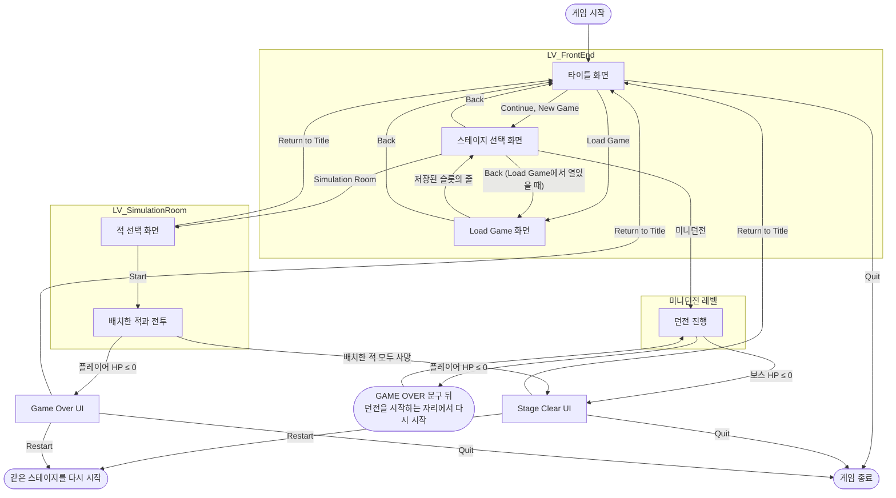

# 게임 플로우

게임 시작부터 각 스테이지(미니던전, 시뮬레이션 룸)의 끝까지 레벨 전환 규칙, 스테이지의 시작과 일시정지, 체크포인트, 결과, 저장, 전투 통계를 정의합니다.

각 화면의 배치·표시·UI 조작은 [UI 시스템](<UI 시스템.md>)의 '메뉴 UI'를 따릅니다.

용어는 [용어집](<../../용어집.md>)을 따릅니다.

## 1. Front End

LV_FrontEnd는 게임을 실행하면 처음 열리는 레벨입니다.

타이틀 화면의 버튼은 레벨을 바꾸지 않고 아래와 같이 동작합니다. 저장 슬롯은 '저장'을, 버튼을 표시하는 조건은 [UI 시스템](<UI 시스템.md>)의 '타이틀 화면'을 따릅니다.

| 버튼 | 실행 결과 |
| - | - |
| Continue | 저장한 시각이 가장 늦은 슬롯을 불러와 스테이지 선택 화면을 엽니다. |
| New Game | 빈 슬롯 중 번호가 가장 작은 슬롯에 새 게임을 만들어 저장하고 스테이지 선택 화면을 엽니다. |
| Load Game | Load Game 화면을 엽니다. |
| Settings | Settings 화면을 엽니다. 화면의 배치와 조작은 [UI 시스템](<UI 시스템.md>)의 'Settings 화면'을 따릅니다. |
| Quit | 게임을 종료합니다. |

- 새 게임은 아이템마다 시작 보유 수를 가지고([아이템 시스템](<아이템 시스템.md>)), 던전 진행과 마지막 스테이지가 없으며, 플레이 시간은 0입니다.

### Load Game

Load Game 화면에서 저장 슬롯을 골라 불러오거나 지웁니다. 화면의 배치와 조작은 [UI 시스템](<UI 시스템.md>)의 'Load Game 화면'을 따릅니다.

| 조작 | 실행 결과 |
| - | - |
| 저장된 슬롯의 줄 실행 | 그 슬롯을 불러와 스테이지 선택 화면을 엽니다. |
| Delete | 삭제 확인 창을 엽니다. 창에서 Yes를 실행하면 그 슬롯의 저장을 지웁니다. 지운 저장은 되돌릴 수 없습니다. |
| Back | 화면을 닫고 타이틀 화면으로 돌아갑니다. |

### 스테이지 선택

스테이지 선택 화면에서 고른 스테이지로 들어갑니다. 화면의 배치와 조작은 [UI 시스템](<UI 시스템.md>)의 '스테이지 선택 화면'을 따릅니다.

- 목록에는 Content/Maps 폴더(하위 폴더 포함)의 레벨이 모두 나옵니다. 게임을 실행하면 처음 열리는 LV_FrontEnd만 넣지 않습니다. 폴더에 레벨을 만들거나 지우면 목록에도 그대로 반영됩니다.
- 목록은 레벨 이름순입니다. 표시 이름은 레벨 이름에서 앞의 LV_를 빼고 단어마다 띄어 씁니다. (예: LV_FortressBreach → Fortress Breach)
- 잠금이나 해금 조건은 없습니다. 게임을 처음 실행했을 때부터 모든 스테이지를 고를 수 있습니다.

| 레벨 | 들어간 뒤의 규칙 |
| - | - |
| LV_SimulationRoom | 'Simulation Room' |
| LV_FortressBreach | 'Dungeon'. 미니던전의 구성은 [요새 돌파](<../Level/스테이지 - 미니던전 요새 돌파.md>) 기획서를 따릅니다. |

| 버튼 | 실행 결과 |
| - | - |
| Start | 고른 스테이지의 레벨로 이동합니다. |
| Back | 스테이지 선택 화면을 닫고, 이 화면을 연 화면(타이틀 화면, 또는 Load Game 화면)으로 돌아갑니다. 불러온 슬롯은 내려놓습니다. |

- 스테이지에서 Return to Title로 돌아오면 타이틀 화면이 열리며, 스테이지 선택 화면은 닫힌 상태입니다.

## 2. 스테이지 공통

미니던전과 시뮬레이션 룸에 공통으로 적용하는 규칙입니다.

전투할 수 있게 되면 마우스 커서를 숨기고, 입력은 게임만 받습니다.

스테이지의 결과는 먼저 처리된 사망으로 정해집니다. 결과가 정해진 뒤 상대가 사망하면 사망 연출은 재생하지만, 결과와 전투 결과 UI는 바뀌지 않습니다.

스테이지를 다시 시작하면 레벨을 다시 열며, 플레이어와 적의 모든 상태(스탯, 페이즈 등)를 초기화합니다. 저장 슬롯에 저장하는 것('저장')은 초기화하지 않습니다.

### 일시정지

Esc를 누르면 게임을 멈추고 일시정지 메뉴를 엽니다. 메뉴의 배치와 조작은 [UI 시스템](<UI 시스템.md>)의 '일시정지 메뉴'를 따릅니다.

- 전투 결과 UI가 뜨기 전이면 언제든 열 수 있습니다. 궁극기 컷신과 스테이지 결과 연출 중에도 열립니다. 로딩 화면, 적 선택 화면, 전투 결과 UI가 떠 있는 동안에는 Esc를 무시합니다.
- 메뉴가 열려 있는 동안 게임은 완전히 멈춥니다. 캐릭터, 보스, VFX, 스테이지 결과 연출이 모두 멈추고, 메뉴를 닫으면 멈춘 자리에서 이어집니다.
- System 탭의 Resume 버튼을 실행하거나 Esc를 누르면 메뉴를 닫고 게임을 이어 갑니다.
- Restart, Return to Title, Quit 버튼은 'Stage Clear'의 같은 버튼과 같습니다.

## 3. Dungeon

미니던전 레벨에 공통으로 적용하는 흐름입니다.

레벨이 열리면 레벨에 배치된 적이 모두 등장할 때까지 로딩 화면을 보여 줍니다. 로딩 화면이 닫히면 플레이어는 '던전을 시작하는 자리'에서 조작할 수 있습니다. 던전의 시작 지점과 적 배치는 미니던전별 레벨디자인 기획서를 따릅니다. 마우스 커서와 입력은 '스테이지 공통'을 따르고, 전투 HUD를 표시합니다.

- 로딩 화면은 화면 전체를 검은색으로 덮습니다. 문구와 진행 표시는 없습니다.
- 로딩 화면이 떠 있는 동안에는 조작을 받지 않습니다.
- Restart로 다시 시작할 때도 같습니다.

던전 최종 목적지의 보스(모든 미니던전에서 커스터)가 사망하면 Stage Clear, 플레이어의 HP가 0 이하가 되면 Game Over입니다. 일반 적이 남아 있어도 보스가 사망하면 Stage Clear입니다. 스테이지 결과 연출과 그 뒤의 흐름은 'Stage Clear', 'Game Over'를 따릅니다.

결과와 결과가 정해진 뒤의 사망, 일시정지는 '스테이지 공통'을 따릅니다.

| 버튼 | 실행 결과 |
| - | - |
| Restart (Stage Clear UI) | 지금 있는 던전 레벨을 다시 시작해('스테이지 공통') '던전을 시작하는 자리'에서 시작합니다. |
| Return to Title, Quit | 'Stage Clear'의 같은 버튼과 같습니다. |

### 던전을 시작하는 자리

던전 레벨을 열 때마다 아래 자리에서 시작합니다. 스테이지 선택 화면의 Start로 들어올 때, Stage Clear UI의 Restart, 'Game Over'의 다시 시작이 모두 같습니다.

| 그 던전의 던전 진행 ('저장') | 시작하는 자리 |
| - | - |
| 휴식한 체크포인트가 있음 | 마지막으로 휴식한 체크포인트의 정면 1.5m 바닥에서 체크포인트를 바라보고 섭니다. |
| 휴식한 체크포인트가 없음 | 던전의 시작 지점 |

- 연 성문은 처음부터 열려 있습니다. 여는 움직임은 재생하지 않습니다.
- 던전의 결과가 Stage Clear로 정해지면 그 던전의 던전 진행을 지웁니다. 그 뒤에는 던전의 시작 지점에서 시작하고 성문도 닫혀 있습니다.

### 체크포인트

던전 안에 체크포인트를 놓아 전투 구간을 나눕니다. 플레이어는 체크포인트에서 휴식해 HP와 회복병을 채웁니다. 휴식하면 처치한 적도 모두 되살아나므로, 회복을 얻는 대신 구간을 다시 정리해야 합니다.

체크포인트는 상호작용 장치입니다. 장치에 공통으로 적용하는 범위, 대상 선택, 입력 규칙은 [플레이어 시스템](<플레이어 시스템.md>)의 '상호작용'을 따릅니다.

- 안내에 적는 행동은 '휴식'입니다.
- 안내 지점은 체크포인트 중심의 바닥에서 1.2m 높이입니다. 상호작용 범위는 안내 지점을 중심으로 한 반지름 2m의 구입니다.
- 체크포인트는 항상 쓸 수 있는 상태이며, 같은 체크포인트에서 몇 번이든 휴식할 수 있습니다.
- 휴식은 F 상호작용으로만 일어납니다. 범위에 닿기만 해서는 아무 일도 일어나지 않습니다.
- 체크포인트는 전투 공간에 두지 않습니다. 놓는 자리는 미니던전별 레벨디자인 기획서에서 정합니다. 정면 1.5m 자리는 비어 있고 바닥이 있게 놓습니다.
- 휴식한 체크포인트는 그 던전을 시작하는 자리가 됩니다. ('던전을 시작하는 자리')
- 체크포인트의 외형은 휴식 전후로 바뀌지 않으며, 휴식할 때 따로 재생하는 연출은 없습니다.

F를 누르면 아래 일이 한 번에 일어납니다.

| 항목 | 휴식할 때 |
| - | - |
| HP | MaxHP까지 채웁니다. |
| 회복병 | 최대 보유 수까지 채웁니다. |
| 쿨다운 | 모든 행동의 남은 쿨다운을 없앱니다. |
| MP, UP | 그대로 둡니다. |
| 적 | 레벨에 처음 배치된 모든 적을 처음 상태로 되돌립니다. |
| 열어 둔 성문 같은 장치 | 그대로 둡니다. |

- 처치한 적은 되살아나고, 살아 있던 적도 다쳤거나 자리를 옮겼는지와 관계없이 되돌립니다.
- 처음 상태는 레벨을 처음 열었을 때와 같습니다. HP는 MaxHP, PP와 그로기는 처음 값, 페이즈는 첫 페이즈, 남은 쿨다운은 없으며, 처음 배치된 자리에서 처음 배치된 방향을 보고 비전투 상태입니다.
- 보스가 사망하면 Stage Clear이므로, 보스는 언제나 살아 있는 채로 되돌립니다.
- 플레이어가 락온한 적이 되돌려지면 락온이 풀리고, 날아가던 그 적의 탄환은 사라집니다.

## 4. Simulation Room

LV_SimulationRoom은 플레이어가 고른 적과 싸우는 전투 연습장입니다. 전투 밸런싱과 디버깅에 쓰며, 고른 구성으로 같은 상황을 반복할 수 있습니다. 레벨 구성과 적 배치 자리는 [스테이지 - 시뮬레이션 룸](<../Level/스테이지 - 시뮬레이션 룸.md>)을 따릅니다.

### 적 선택

- 스테이지 선택 화면에서 LV_SimulationRoom에 들어오면 적 선택 화면을 바로 한 번 엽니다. 이때 아레나에는 플레이어만 있습니다. 화면의 배치와 조작은 [UI 시스템](<UI 시스템.md>)의 '적 선택 화면'을 따릅니다.
- 그 밖에는 열지 않습니다. 구성을 바꾸려면 타이틀로 돌아가 다시 들어옵니다.

| 버튼 | 실행 결과 |
| - | - |
| Start | LV_SimulationRoom을 다시 시작하고, 각 자리에서 고른 적을 배치합니다. 모든 자리가 Empty이면 실행되지 않습니다. |
| Return to Title | 'Stage Clear'의 같은 버튼과 같습니다. |

### 배치

- 다시 시작은 '스테이지 공통'을 따릅니다. 플레이어는 시작 지점에서 시작합니다.
- 각 배치 자리에서 고른 적을 그 자리에 놓습니다. 적은 플레이어를 바라보고 놓입니다.
- 보스, 일반 적, 샌드백은 놓이자마자 시야와 관계없이 전투에 들어갑니다. 그 뒤의 행동은 [적 시스템](<적 시스템.md>)과 [보스 시스템](<보스 시스템.md>)을 따릅니다. 샌드백의 행동은 [샌드백](<../Content/샌드백.md>)을 따릅니다.
- 고른 적을 배치한 뒤 마우스 커서와 입력은 '스테이지 공통'을 따르고, 전투 HUD를 표시합니다.

### 결과

- 배치한 적이 모두 사망하면 Stage Clear, 플레이어의 HP가 0 이하가 되면 Game Over입니다. 스테이지 결과 연출과 전투 결과 UI는 'Stage Clear', 'Game Over'와 같습니다.
- 샌드백(중립 팀)은 Stage Clear 조건에서 뺍니다. 보스나 일반 적을 하나도 배치하지 않았으면 Stage Clear가 없습니다.
- 결과와 결과가 정해진 뒤의 사망은 '스테이지 공통'을 따릅니다.
- 전투 결과 UI에는 그 결과로 끝난 전투의 '전투 통계'를 함께 표시합니다. 표시는 [UI 시스템](<UI 시스템.md>)의 'Stage Clear UI / Game Over UI'를 따릅니다.

### 일시정지와 레벨 이동

일시정지는 '스테이지 공통'의 '일시정지'를 따릅니다.

| 버튼 | 실행 결과 |
| - | - |
| Restart (일시정지 메뉴, 전투 결과 UI) | 지금 배치된 구성 그대로 LV_SimulationRoom을 다시 시작합니다. |
| Return to Title, Quit | 'Stage Clear'의 같은 버튼과 같습니다. |

- 고른 구성은 Return to Title로 타이틀로 돌아가거나 게임을 종료하면 비웁니다.

## 5. Stage Clear

스테이지의 클리어 조건('Dungeon', 'Simulation Room')을 채우면, 스테이지 결과 연출이 재생되고 Stage Clear UI 창이 출력됩니다. 이미 결과가 정해진 뒤에 사망한 경우는 '스테이지 공통'을 따릅니다.

Restart 버튼을 누르면 지금 스테이지를 다시 시작합니다. 다시 시작하는 방식은 'Dungeon'과 'Simulation Room'의 Restart를 따릅니다.

Return to Title 버튼을 누르면 LV_FrontEnd 레벨로 돌아갑니다.

Quit 버튼을 누르면 게임을 종료합니다.

## 6. Game Over

플레이어 캐릭터의 HP가 0 이하가 되면 스테이지 결과 연출이 재생됩니다. 이미 결과가 정해진 뒤에 사망한 경우는 '스테이지 공통'을 따릅니다.

시뮬레이션 룸에서는 연출이 끝나면 Game Over UI 창이 출력됩니다. 버튼은 'Stage Clear'와 같습니다.

던전에서는 Game Over UI 대신 아래 순서로 다시 시작합니다.

1. 연출이 끝나면 0.5초 동안 화면을 서서히 어둡게 하면서 GAME OVER 제목 문구를 서서히 표시합니다. 버튼은 없습니다. 표시는 [UI 시스템](<UI 시스템.md>)의 'Stage Clear UI / Game Over UI'를 따릅니다.
2. 표시가 끝나고 1.5초 뒤에 지금 던전 레벨을 다시 시작해('스테이지 공통') '던전을 시작하는 자리'에서 시작합니다.

- GAME OVER 문구가 떠 있는 동안에는 입력을 받지 않습니다.
- 1.5초의 시간 기준은 전투 결과 UI의 페이드와 같습니다. ([시간 규칙](<시간 규칙.md>)의 '시간 연출의 영향')

## 저장

게임을 끄고 다시 켜도, 던전에서 사망해도 진행이 이어지도록 저장 슬롯에 저장합니다. 수동 저장은 없고, 저장하는 것이 바뀌는 순간마다 자동으로 저장합니다.

### 저장 슬롯

저장 슬롯은 6개이고, 슬롯 하나가 게임 하나의 진행입니다. 슬롯끼리는 서로 영향을 주지 않습니다.

| 저장하는 것 | 내용 |
| - | - |
| 보유 아이템 | 아이템마다의 보유 수 |
| 던전 진행 | 던전마다 마지막으로 휴식한 체크포인트와 연 성문 |
| 마지막 스테이지 | 스테이지 선택 화면의 Start로 마지막에 들어간 스테이지 |
| 플레이 시간 | 이 슬롯으로 플레이한 시간의 합 |
| 저장한 시각 | 마지막으로 저장한 날짜와 시각. 게임을 실행한 컴퓨터의 시각을 따릅니다. |

- 플레이 시간은 슬롯을 만들거나 불러온 순간부터 슬롯을 내려놓거나(스테이지 선택 화면의 Back, Return to Title) 게임을 끌 때까지의 실제 시간입니다. 스테이지 선택 화면과 일시정지 메뉴가 떠 있는 동안도 셉니다.
- Settings의 내용은 슬롯에 저장하지 않으며, 슬롯을 바꾸거나 지워도 그대로입니다.

### 저장하는 순간

아래 순간마다 지금 슬롯에 바로 저장합니다.

| 순간 | 저장으로 남는 것 |
| - | - |
| New Game으로 슬롯을 만듦 | 새 게임 |
| 아이템의 보유 수가 바뀜 | 바뀐 보유 수 |
| 체크포인트에서 휴식 | 그 던전의 마지막으로 휴식한 체크포인트 |
| 성문을 엶 | 그 던전의 연 성문 |
| 스테이지 선택 화면에서 Start | 마지막 스테이지 |
| 던전의 결과가 Stage Clear로 정해짐 | 그 던전의 던전 진행을 지움 |
| Return to Title, Quit, 스테이지 선택 화면의 Back | 플레이 시간 |

- 저장할 때마다 플레이 시간과 저장한 시각도 함께 저장합니다.
- 저장하는 동안 화면에 따로 표시하는 것은 없습니다.

### 예외 처리

- 읽을 수 없는 저장은 불러올 수 없고 지울 수만 있습니다. Continue가 고르는 슬롯에서 빼며, 빈 슬롯으로도 저장된 슬롯으로도 세지 않습니다. 표시는 [UI 시스템](<UI 시스템.md>)의 'Load Game 화면'을 따릅니다.
- 저장에 있는데 지금 게임에 없는 것은 버립니다. 없는 아이템의 보유 수는 버리고, 최대 보유 수를 넘는 보유 수는 최대 보유 수로 줄입니다. 휴식한 체크포인트가 레벨에 없으면 던전의 시작 지점에서 시작하고, 연 성문이 레벨에 없으면 무시합니다.
- 에디터에서 타이틀 화면을 거치지 않고 스테이지 레벨을 바로 플레이하면 슬롯 없이 진행합니다. 아이템은 시작 보유 수로 시작하고 아무것도 저장하지 않으며, '던전을 시작하는 자리'와 'Game Over'의 규칙은 그 플레이 안에서 같습니다.

### 저장 파일

- 저장 경로의 `SaveGames` 폴더에 슬롯마다 파일 하나(`Slot1.sav` ~ `Slot6.sav`)를 둡니다. 저장 경로는 '전투 통계'의 '저장'과 같습니다.

## 전투 통계

플레이어가 치른 전투마다 통계를 기록해 파일로 남깁니다. 외부 플레이테스트와 밸런싱에서 전투마다 얼마나 걸렸고, 얼마나 막고 피하고 맞았는지 확인하는 데 씁니다. 시뮬레이션 룸에서는 전투 결과 UI에도 표시합니다('Simulation Room'의 '결과').

### 기록하는 전투

- 플레이어와 전투 중인 적이 하나도 없다가 생기는 순간 기록을 시작합니다. 보스, 일반 적, 샌드백 모두 셉니다. 적이 전투에 들어가는 규칙은 [적 시스템](<적 시스템.md>)을 따릅니다.
- 아래 표의 순간 중 먼저 온 때에 기록을 끝내고 저장합니다.

| 결과 | 기록을 끝내는 순간 |
| - | - |
| 처치 | 스테이지 결과가 Stage Clear로 정해진 순간. 전투 중인 다른 적이 남아 있어도 끝냅니다. |
| 처치 | 전투 중인 적이 하나도 남지 않은 순간, 이 전투에서 상대한 적이 모두 사망했으면 처치입니다. |
| 사망 | 전투 중인 적이 하나도 남지 않은 순간, 플레이어가 사망해 있으면 사망입니다. 플레이어가 사망하면 적은 모두 대기에 들어가 전투에서 빠집니다. |
| 이탈 | 전투 중인 적이 하나도 남지 않은 순간, 위의 두 경우가 아니면 이탈입니다. (시야에서 놓친 적이 비전투로 돌아가 전투가 끝난 경우) |

- 스테이지 결과가 정해진 뒤에는 새 전투 기록을 시작하지 않습니다.
- 기록 중에 Restart, Return to Title, Quit로 레벨을 떠나거나 게임이 꺼지면 그 전투는 저장하지 않습니다.

### 기록 항목

| 항목 | 파일의 키 | 기록 내용 |
| - | - | - |
| 레벨 | `Level` | 전투한 레벨의 이름 (예: LV_SimulationRoom) |
| 끝난 시각 | `EndedAt` | 기록을 끝낸 날짜와 시각. 게임을 실행한 컴퓨터의 시각을 따릅니다. |
| 결과 | `Result` | 처치 `Victory`, 사망 `Death`, 이탈 `Disengage` ('기록하는 전투') |
| 상대한 적 | `Enemies` | 기록하는 동안 한 번이라도 플레이어와 전투에 들어간 적마다 종류(`Id`)와 배치 좌표(`Location`)를 적습니다. 처음 전투에 들어간 순서이며, 같은 적이 비전투로 돌아갔다가 다시 들어와도 한 번만 적습니다. |
| 전투 시간 | `Duration` | 기록을 시작한 순간부터 끝낸 순간까지의 실제 시간을 초 단위로 밀리초(소수점 아래 세 자리)까지 적습니다. (예: 48.312) 일시정지 메뉴가 열려 있던 동안은 세지 않습니다. 슬로우모션과 궁극기 시간 정지 동안은 셉니다. |
| 패리 성공 | `ParryCount` | 패리가 성공한 횟수. 투사체 패리도 셉니다. |
| 회피 성공 | `PerfectDodgeCount` | 극한 회피가 발동한 횟수. ([플레이어 캐릭터 - 린](<../Content/플레이어 캐릭터 - 린.md>)의 '극한 회피') |
| 피격 횟수 | `HitCount` | 플레이어가 공격에 맞아 피격으로 처리된 횟수. 한 공격이 여러 번 맞히면 맞힌 만큼 셉니다. 가드로 막은 공격, 패리, 극한 회피, 무적으로 받지 않은 공격, 낙하 대미지는 세지 않습니다. 플레이어를 쓰러뜨린 공격도 셉니다. |

- 적의 종류는 캐릭터 데이터의 ID입니다. (예: Boss, Cutter, Gunner, Sandbag, AttackSandbag)
- 배치 좌표는 그 적이 레벨에 처음 놓인 자리의 레벨 좌표로, 언리얼 에디터의 위치 값과 같은 단위(cm)의 정수 `X`, `Y`, `Z`입니다. 시뮬레이션 룸에서는 배치 자리에 놓인 위치입니다.
- 패리 성공, 회피 성공, 피격 횟수는 기록하는 동안 일어난 것만 셉니다.

### 저장

- 게임을 실행한 뒤 처음으로 전투 기록을 끝낼 때 저장 경로의 `CombatStats` 폴더에 파일 하나를 만듭니다. 파일 이름은 게임을 실행한 날짜와 시각입니다. (예: `2026-11-23_14-00-12.json`)
- 그 뒤로 전투 기록을 끝낼 때마다 같은 파일의 `Records`에 끝난 순서대로 덧붙여 바로 저장합니다. 게임이 비정상 종료되어도 그전에 끝난 기록은 파일에 남습니다.
- 게임을 다시 실행하면 새 파일을 만듭니다. 이전 파일은 지우지 않습니다.
- 저장 경로는 엔진의 Saved 폴더입니다. 에디터에서는 프로젝트의 `Saved`, Development 패키지는 패키지 폴더의 `Ag/Saved`, Shipping 패키지는 `%LOCALAPPDATA%/Ag/Saved`입니다.
- 파일은 사람이 읽을 수 있는 JSON 텍스트입니다.

## 플로우 차트

