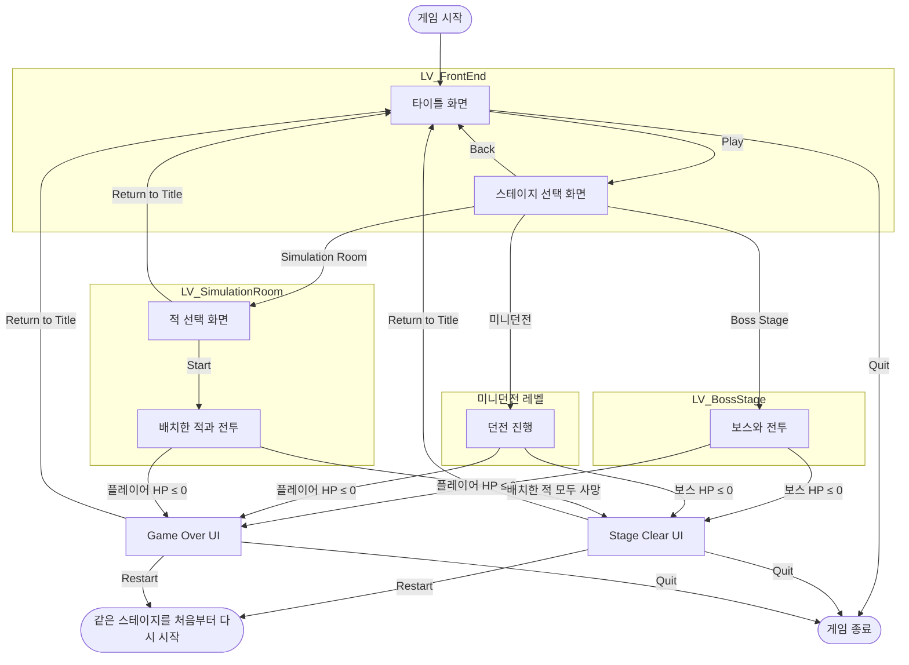

# 게임 플로우

게임 시작부터 각 스테이지(보스전, 미니던전, 시뮬레이션 룸)의 끝까지 레벨 전환 규칙, 스테이지의 시작과 일시정지, 결과를 정의합니다.

각 화면의 배치·표시·UI 조작은 [UI 시스템](<UI 시스템.md>)의 '메뉴 UI'를 따릅니다.

용어는 [용어집](<../../용어집.md>)을 따릅니다.

## 1. Front End

LV_FrontEnd는 게임을 실행하면 처음 열리는 레벨입니다.

Play 버튼을 누르면 레벨 전환 없이 스테이지 선택 화면을 엽니다.

Controls 버튼의 팝업 동작은 [UI 시스템](<UI 시스템.md>)의 '조작 안내 팝업'을 따릅니다.

Quit 버튼을 누르면 게임을 종료합니다.

### 스테이지 선택

스테이지 선택 화면에서 고른 스테이지로 들어갑니다. 화면의 배치와 조작은 [UI 시스템](<UI 시스템.md>)의 '스테이지 선택 화면'을 따릅니다.

| 순서 | 이름 | 레벨 | 들어간 뒤의 규칙 |
| - | - | - | - |
| 1 | Simulation Room | LV_SimulationRoom | 'Simulation Room' |
| 2 | Boss Stage | LV_BossStage | 'Boss Stage' |
| 3 | Duel Corridor | LV_DuelCorridor | 'Dungeon' |
| 4 | Fortress Breach | LV_FortressBreach | 'Dungeon' |
| 5 | Temp Dungeon 3 | LV_TempDungeon03 | 'Dungeon' |

- 미니던전의 구성은 [결투 회랑](<../Level/스테이지 - 미니던전 결투 회랑.md>), [요새 돌파](<../Level/스테이지 - 미니던전 요새 돌파.md>), [폐허 성곽길](<../Level/스테이지 - 미니던전 폐허 성곽길.md>) 기획서를 따릅니다.
- 세 번째 미니던전의 이름과 레벨 이름은 임시입니다.
- 잠금이나 해금 조건은 없습니다. 게임을 처음 실행했을 때부터 모든 스테이지를 고를 수 있습니다.
- 레벨이 아직 게임에 없는 스테이지는 목록에 넣지 않으며, 그 레벨을 만들면 목록에 나옵니다.

| 버튼 | 실행 결과 |
| - | - |
| Start | 고른 스테이지의 레벨로 이동합니다. |
| Back | 스테이지 선택 화면을 닫고 타이틀 화면으로 돌아갑니다. 타이틀 화면에서는 Play 버튼이 선택됩니다. |

- 스테이지에서 Return to Title로 돌아오면 타이틀 화면이 열리며, 스테이지 선택 화면은 닫힌 상태입니다.

## 2. Boss Stage

LV_BossStage는 보스전이 진행되는 레벨입니다. 구성은 [스테이지 - 보스 전장](<../Level/스테이지 - 보스 전장.md>)을 따릅니다.

레벨이 열리면 바로 보스전이 시작되며, 플레이어는 시작 지점에서 바로 조작할 수 있습니다. 플레이어 시작 지점을 보스 시야 안에 배치하여 보스가 플레이어를 발견하면 전투에 들어갑니다. 시야 규칙은 [적 시스템](<적 시스템.md>)의 '공격 대상과 시야'를 따릅니다.

레벨이 열리면 마우스 커서를 숨기고, 입력은 게임만 받습니다.

보스전의 결과는 먼저 처리된 사망으로 정해집니다. 결과가 정해진 뒤 상대가 사망하면 사망 연출은 재생하지만, 결과와 전투 결과 UI는 바뀌지 않습니다.

LV_BossStage를 다시 시작하면 레벨을 처음부터 다시 로드하며, 플레이어와 보스의 모든 상태(스탯, 페이즈 등)를 초기화합니다.

### 일시정지

Esc를 누르면 게임을 멈추고 일시정지 메뉴를 엽니다. 메뉴의 배치와 조작은 [UI 시스템](<UI 시스템.md>)의 '일시정지 메뉴'를 따릅니다.

- 전투 결과 UI가 뜨기 전이면 언제든 열 수 있습니다. 궁극기 컷신과 스테이지 결과 연출 중에도 열립니다. 전투 결과 UI가 떠 있는 동안에는 Esc를 무시합니다.
- 메뉴가 열려 있는 동안 게임은 완전히 멈춥니다. 캐릭터, 보스, VFX, 스테이지 결과 연출이 모두 멈추고, 메뉴를 닫으면 멈춘 자리에서 이어집니다.
- Resume 버튼을 실행하거나 Esc를 누르면 메뉴를 닫고 게임을 이어 갑니다.
- Restart, Return to Title, Quit 버튼은 'Stage Clear'의 같은 버튼과 같습니다.

## 3. Dungeon

미니던전 레벨(LV_DuelCorridor, LV_FortressBreach, LV_TempDungeon03)에 공통으로 적용하는 흐름입니다.

레벨이 열리면 플레이어는 던전의 시작 지점에서 바로 조작할 수 있습니다. 시작 지점과 적 배치는 미니던전별 레벨디자인 기획서를 따릅니다. 마우스 커서와 입력은 'Boss Stage'와 같고, 전투 HUD는 보스전과 같습니다.

던전 최종 목적지의 보스(모든 미니던전에서 커스터)가 사망하면 Stage Clear, 플레이어의 HP가 0 이하가 되면 Game Over입니다. 일반 적이 남아 있어도 보스가 사망하면 Stage Clear입니다. 스테이지 결과 연출과 전투 결과 UI는 'Stage Clear', 'Game Over'와 같습니다.

결과는 먼저 처리된 사망으로 정해지며, 결과가 정해진 뒤의 사망은 'Boss Stage'와 같이 처리합니다.

일시정지는 'Boss Stage'의 '일시정지'를 따릅니다.

| 버튼 | 실행 결과 |
| - | - |
| Restart (일시정지 메뉴, 전투 결과 UI) | 지금 있는 던전 레벨을 처음부터 다시 로드하고, 플레이어와 모든 적의 상태를 초기화합니다. |
| Return to Title, Quit | 'Stage Clear'의 같은 버튼과 같습니다. |

## 4. Simulation Room

LV_SimulationRoom은 플레이어가 고른 적과 싸우는 전투 연습장입니다. 전투 밸런싱과 디버깅에 쓰며, 고른 구성으로 같은 상황을 반복할 수 있습니다. 레벨 구성과 적 배치 자리는 [스테이지 - 시뮬레이션 룸](<../Level/스테이지 - 시뮬레이션 룸.md>)을 따릅니다.

### 적 선택

- 스테이지 선택 화면에서 LV_SimulationRoom에 들어오면 적 선택 화면을 바로 한 번 엽니다. 이때 아레나에는 플레이어만 있습니다. 화면의 배치와 조작은 [UI 시스템](<UI 시스템.md>)의 '적 선택 화면'을 따릅니다.
- 그 밖에는 열지 않습니다. 구성을 바꾸려면 타이틀로 돌아가 다시 들어옵니다.

| 버튼 | 실행 결과 |
| - | - |
| Start | LV_SimulationRoom을 다시 시작하고, 각 자리에서 고른 적을 배치합니다. 모든 자리가 Empty이면 실행되지 않습니다. |
| Return to Title | 'Stage Clear'의 같은 버튼과 같습니다. |

### 배치

- 다시 시작은 'Boss Stage'의 다시 시작과 같이 레벨을 처음부터 다시 로드하며, 플레이어와 적의 모든 상태를 초기화합니다. 플레이어는 시작 지점에서 시작합니다.
- 각 배치 자리에서 고른 적을 그 자리에 놓습니다. 적은 플레이어를 바라보고 놓입니다.
- 보스, 일반 적, 샌드백은 놓이자마자 시야와 관계없이 전투에 들어갑니다. 그 뒤의 행동은 [적 시스템](<적 시스템.md>)과 [보스 시스템](<보스 시스템.md>)을 따릅니다. 샌드백의 행동은 [샌드백](<../Content/샌드백.md>)을 따릅니다.
- 고른 적을 배치한 뒤 마우스 커서와 입력은 'Boss Stage'와 같습니다. 전투 HUD는 보스전과 같습니다.

### 결과

- 배치한 적이 모두 사망하면 Stage Clear, 플레이어의 HP가 0 이하가 되면 Game Over입니다. 스테이지 결과 연출과 전투 결과 UI는 'Stage Clear', 'Game Over'와 같습니다.
- 샌드백(중립 팀)은 Stage Clear 조건에서 뺍니다. 보스나 일반 적을 하나도 배치하지 않았으면 Stage Clear가 없습니다.
- 결과는 먼저 처리된 사망으로 정해집니다. 마지막 적과 플레이어의 사망이 겹칠 때도 같으며, 결과가 정해진 뒤의 사망은 'Boss Stage'와 같이 처리합니다.

### 일시정지와 레벨 이동

일시정지는 'Boss Stage'의 '일시정지'를 따릅니다.

| 버튼 | 실행 결과 |
| - | - |
| Restart (일시정지 메뉴, 전투 결과 UI) | 지금 배치된 구성 그대로 LV_SimulationRoom을 다시 시작합니다. 적 선택 화면은 열지 않습니다. |
| Return to Title, Quit | 'Stage Clear'의 같은 버튼과 같습니다. |

- 고른 구성은 Return to Title로 타이틀로 돌아가거나 게임을 종료하면 비웁니다.

## 5. Stage Clear

보스의 HP가 0 이하가 되면, 스테이지 결과 연출이 재생되고 Stage Clear UI 창이 출력됩니다. 이미 결과가 정해진 뒤에 사망한 경우는 'Boss Stage'를 따릅니다.

Restart 버튼을 누르면 LV_BossStage를 다시 시작합니다.

Return to Title 버튼을 누르면 LV_FrontEnd 레벨로 돌아갑니다.

Quit 버튼을 누르면 게임을 종료합니다.

## 6. Game Over

플레이어 캐릭터의 HP가 0 이하가 되면, 스테이지 결과 연출이 재생되고 Game Over UI 창이 출력됩니다. 이미 결과가 정해진 뒤에 사망한 경우는 'Boss Stage'를 따릅니다.

버튼은 'Stage Clear'와 같습니다.

## 플로우 차트

