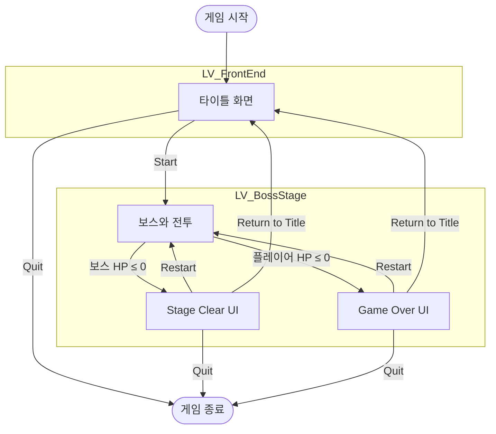

# 게임 플로우

게임 시작부터 보스전의 끝까지 레벨 전환 규칙, 보스전의 시작과 일시정지, 결과를 정의합니다.

각 화면의 배치·표시·UI 조작은 [UI 시스템](<UI 시스템.md>)의 '메뉴 UI'를 따릅니다.

용어는 [용어집](<../../용어집.md>)을 따릅니다.

## 1. Front End

LV_FrontEnd는 게임을 실행하면 처음 열리는 레벨입니다.

Start 버튼을 누르면 보스전 스테이지(LV_BossStage)로 이동합니다.

Controls 버튼의 팝업 동작은 [UI 시스템](<UI 시스템.md>)의 '조작 안내 팝업'을 따릅니다.

Quit 버튼을 누르면 게임을 종료합니다.

## 2. Boss Stage

LV_BossStage는 보스전이 진행되는 레벨입니다. 구성은 [스테이지 - 보스 전장](<../Level/스테이지 - 보스 전장.md>)을 따릅니다.

레벨이 열리면 바로 보스전이 시작되며, 플레이어는 시작 지점에서 바로 조작할 수 있습니다. 플레이어 시작 지점을 보스 시야 안에 배치하여 보스가 플레이어를 발견하면 전투에 들어갑니다. 시야 규칙은 [적 시스템](<적 시스템.md>)의 '공격 대상과 시야'를 따릅니다.

레벨이 열리면 마우스 커서를 숨기고, 입력은 게임만 받습니다.

보스전의 결과는 먼저 처리된 사망으로 정해집니다. 결과가 정해진 뒤 상대가 사망하면 사망 연출은 재생하지만, 결과와 전투 결과 UI는 바뀌지 않습니다.

LV_BossStage를 다시 시작하면 레벨을 처음부터 다시 로드하며, 플레이어와 보스의 모든 상태(스탯, 페이즈 등)를 초기화합니다.

### 일시정지

Esc를 누르면 게임을 멈추고 일시정지 메뉴를 엽니다. 메뉴의 배치와 조작은 [UI 시스템](<UI 시스템.md>)의 '일시정지 메뉴'를 따릅니다.

- 전투 결과 UI가 뜨기 전이면 언제든 열 수 있습니다. 궁극기 컷신과 스테이지 결과 연출 중에도 열립니다. 전투 결과 UI가 떠 있는 동안에는 Esc를 무시합니다.
- 메뉴가 열려 있는 동안 게임은 완전히 멈춥니다. 캐릭터, 보스, VFX, 스테이지 결과 연출이 모두 멈추고, 메뉴를 닫으면 멈춘 자리에서 이어집니다.
- Resume 버튼을 실행하거나 Esc를 누르면 메뉴를 닫고 게임을 이어 갑니다.
- Restart, Return to Title, Quit 버튼은 'Stage Clear'의 같은 버튼과 같습니다.

## 3. Stage Clear

보스의 HP가 0 이하가 되면, 스테이지 결과 연출이 재생되고 Stage Clear UI 창이 출력됩니다. 이미 결과가 정해진 뒤에 사망한 경우는 'Boss Stage'를 따릅니다.

Restart 버튼을 누르면 LV_BossStage를 다시 시작합니다.

Return to Title 버튼을 누르면 LV_FrontEnd 레벨로 돌아갑니다.

Quit 버튼을 누르면 게임을 종료합니다.

## 4. Game Over

플레이어 캐릭터의 HP가 0 이하가 되면, 스테이지 결과 연출이 재생되고 Game Over UI 창이 출력됩니다. 이미 결과가 정해진 뒤에 사망한 경우는 'Boss Stage'를 따릅니다.

버튼은 'Stage Clear'와 같습니다.

## 플로우 차트

