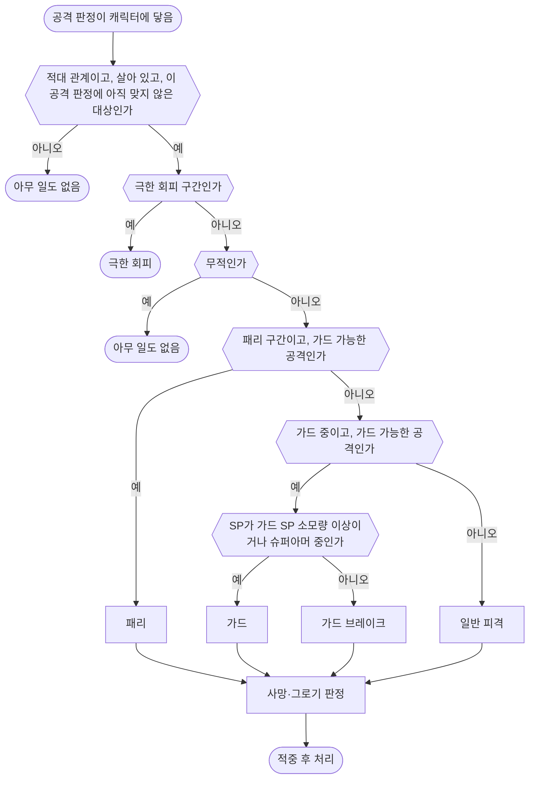

# 전투 시스템

모든 캐릭터에 공통적으로 적용되는 전투 규칙을 서술합니다.

별도로 정의하지 않은 모션의 길이·이동 거리·타이밍(선딜, 판정 구간, 후딜 등)은 해당 모션을 따릅니다.

용어는 [용어집](<../../용어집.md>)을 따릅니다.

## 전투 설계 원칙

배우기 쉽고 직관적인 전투를 지향합니다.

- **명확한 전조와 판정**: 적의 공격 타이밍과 범위, 가드 가능 여부(패리 예고, 가드 불가 예고 등)를 시각·청각적으로 명확하게 전달하여 불합리한 피격을 방지합니다.
- **보고 반응하는 공방**: 복잡한 조작 암기보다는 패턴의 전조를 보고 직관적으로 대응(패리, 가드, 회피)하며 전투의 리듬을 체득할 수 있게 합니다.
- **직관적인 피드백**: 공격 적중, 패리 성공, 그로기, 피격 등의 결과가 히트스톱·카메라 셰이크·VFX·사운드를 통해 플레이어에게 즉시 명확하게 전달됩니다.

## 점프와 공중 이동

모든 캐릭터는 점프 초기 수직 속도 500cm/s, 중력 배율 1.75, 공중 제어 계수 0.2를 사용합니다.

## 목표 방향 회전

캐릭터 기획서에 정한 목표 방향이 있으면, 캐릭터는 서 있을 때도 그 방향을 정면으로 유지합니다. 이 절에서 '캐릭터 정면'은 공격 방향·회피 방향·시야처럼 판정에 쓰는 방향이고, '몸의 방향'은 화면에 보이는 캐릭터의 발과 골반이 향하는 방향입니다.

- 캐릭터 정면은 서 있을 때도 목표 방향을 향해 캐릭터의 회전 속도로 돕니다. 각도 차이가 크든 작든 같습니다.
- 판정은 몸의 방향이 아니라 캐릭터 정면을 씁니다. 공격 방향의 '캐릭터 정면', 락온 중 회피 방향의 기준, 움찔의 등 쪽 90° 판정, 적의 시야 정면 각도가 여기에 해당합니다. 가드와 패리는 공격이 들어온 방향을 따지지 않으므로, 몸이 뒤처져 보여도 막는 결과는 같습니다.
- 서 있는 동안 몸은 발을 바닥에 붙인 채 그 방향을 유지합니다. 상체와 머리는 몸의 방향과 목표 방향의 차이만큼 목표 쪽으로 비틀어 대상을 보며, 비트는 각도는 최대치를 넘지 않습니다.
- 몸의 방향과 목표 방향의 차이가 발을 옮기기 시작하는 각도(가장 작은 제자리 회전 모션의 회전량)보다 커지면, 제자리 회전 모션으로 발을 옮겨 돌아섭니다. 모션은 회전량이 그때의 차이에 가장 가까운 것을 고르고, 그 모션의 회전량(45° 또는 90°)만큼만 돕니다. 모션을 마친 뒤에도 차이가 발을 옮기기 시작하는 각도보다 크면 다시 발을 옮기고, 그보다 작으면 상체와 머리의 비틀기가 남은 차이를 맡습니다.
- 몸의 방향과 캐릭터 정면의 차이는 최대 각도를 넘지 않습니다. 넘는 만큼은 발을 옮기지 않고 몸이 바로 따라 돕니다.
- 이동을 시작하면 몸은 걸음과 함께 캐릭터 정면으로 맞춰집니다. 행동, 피격 반응, 그로기, 공중 자세로 넘어가면 그 모션이 섞여 들어오는 동안 몸이 캐릭터 정면으로 돌아서고 상체와 머리의 비틀기도 풀립니다.
- 이 회전을 하지 않는 행동과 상태는 캐릭터 기획서에 정합니다. 그 모션이 끝나 이동 자세로 섞여 돌아가기 시작할 때(블렌드 아웃)부터 다시 돕니다.
- 목표 방향, 회전 속도, 제자리 회전 모션은 [플레이어 캐릭터 - 린](<../Content/플레이어 캐릭터 - 린.md>)의 '이동'과 [보스 캐릭터 - 커스터](<../Content/보스 캐릭터 - 커스터.md>)의 '회전'을 따릅니다. 발을 옮기기 시작하는 각도, 최대 각도, 비트는 최대 각도는 [ABP와 로코모션](<../../Art/ABP와 로코모션.md>)의 '제자리 회전'을 따릅니다.

## 스탯

각 캐릭터가 가지는 스탯입니다.

| 스탯 | 명칭 | 최소값 | 최대값 | 설명 |
| - | - | - | - | - |
| HP | 체력 | 0 | MaxHP | 0 이하면 사망 |
| MaxHP | 최대 체력 | 0 | ∞ | |
| SP | 스태미나 | 0 | MaxSP | 회피, 달리기, 가드로 막은 공격의 코스트 |
| MaxSP | 최대 스태미나 | 0 | ∞ | |
| MP | 마나 | 0 | MaxMP | 스킬 발동의 코스트 |
| MaxMP | 최대 마나 | 0 | ∞ | |
| UP | 궁극기 포인트 | 0 | MaxUP | 궁극기 발동의 코스트 |
| MaxUP | 최대 궁극기 포인트 | 0 | ∞ | |
| PP | 균형 | 0 | MaxPP | 0 이하면 그로기 |
| MaxPP | 최대 균형 | 0 | ∞ | |
| ATK | 공격력 | 0 | ∞ | 대미지 계산 시 사용 |
| DEF | 방어력 | 0 | ∞ | 대미지 계산 시 사용 |
| MOV | 이동속도 | 0 | ∞ | 캐릭터 이동 속도 |

캐릭터별 스탯 값은 [플레이어 캐릭터 - 린](<../Content/플레이어 캐릭터 - 린.md>), [보스 캐릭터 - 커스터](<../Content/보스 캐릭터 - 커스터.md>) 문서에 정의합니다.

## 쿨다운

- 쿨다운은 행동(보스는 패턴)을 시작한 순간부터 셉니다. 쿨다운 중에는 그 행동을 사용할 수 없습니다.
- 처음 전투에 들어갈 때는 모든 쿨다운이 끝난 상태입니다.
- 쿨다운 값은 각 캐릭터 기획서를 따르며, 적혀 있지 않은 행동은 쿨다운이 없습니다.

## 공격 판정

공격 판정(무기, 투사체, 공격 범위 등)이 캐릭터에 닿으면 '피격 처리 순서'에 따라 처리합니다.

1타는 공격 판정 하나입니다.

### 공격 판정 세부 규칙

- 하나의 공격 판정(1타)은 공격 범위 안의 대상마다 각각 1회씩 적중할 수 있으며, 같은 대상에게는 한 번만 적중합니다. 여러 번 타격하는 공격은 타마다 별도의 공격 판정으로 정의합니다.
- 무기 공격은 대상의 몸에 닿으면 적중합니다. 넉업으로 떠 있는 대상은 몸뿐 아니라 캐릭터의 캡슐에 닿아도 적중합니다. 공중에서 맞는 모션으로 자세가 뒤집히고 저글로 높이 떠올라도, 이어지는 기본 공격이 닿게 합니다.
- 무적 상태인 대상에게 공격 판정이 닿으면 아무 일도 일어나지 않습니다. 대미지, PP 감소, 피격 반응, 히트스톱, 피격 VFX, 카메라 연출과 셰이크, 대미지 숫자, MP·UP 충전이 모두 없습니다. 단, 회피의 극한 회피 구간에 닿은 공격은 극한 회피를 발동합니다. ([플레이어 캐릭터 - 린](<../Content/플레이어 캐릭터 - 린.md>) 참고)
- 무적일 때 닿은 공격 판정은 무적이 끝난 뒤 계속 닿아 있어도 그 대상에게 적중하지 않습니다.
- 캐릭터는 아군·적군·중립 진영 중 하나에 속합니다. 플레이어는 아군, 적과 보스는 적군, 샌드백은 중립입니다. 서로 다른 진영에는 공격이 적중하고 같은 진영 간에는 팀킬이 발생하지 않습니다. 중립의 공격은 아군·적군 모두에게 맞습니다.
- 적의 공격 대상 선택과 중립 피격에 따른 전투 진입 여부는 [적 시스템](<적 시스템.md>)의 '공격 대상과 시야'를 따릅니다.
- 가드와 패리는 공격이 들어온 방향을 따지지 않습니다.
- 피격 방향은 공격자의 캡슐 중심에서 피격자의 캡슐 중심을 향하는 수평 방향입니다. 투사체는 투사체의 위치를 기준으로 합니다.
- 가드 불가 공격은 가드 중이어도 가드 경감 배율을 적용하지 않고 일반 피격으로 처리합니다.
- 패리 규칙은 [플레이어 캐릭터 - 린](<../Content/플레이어 캐릭터 - 린.md>) 문서에 정의합니다.

### 공격 데이터

모든 공격 판정(1타)은 아래 값을 가집니다. 공격별 값은 각 캐릭터 기획서에 정의합니다.

| 항목 | 설명 | 기본값 |
| - | - | - |
| HP 배율 (HPMultiplier) | HP 감소량 계산식의 배율 | 0 |
| PP 배율 (PPMultiplier) | PP 감소량 계산식의 배율 | 0 |
| 피격 반응 | 피격 시 재생할 반응 (피격 반응 항목 참고) | 없음 |
| 가드 가능 | 불가면 가드와 패리로 막을 수 없습니다. | 가능 |

## 공격 중 위치·회전 보정

공격 중 대상을 향해 몸을 돌리고 거리를 맞추도록 위치와 회전을 자동으로 보정합니다.

추적 구간 안에서 대상이 타겟팅 범위 안에 있으면 캐릭터의 회전 속도로 대상을 향해 몸을 돌립니다. 회전 속도는 [플레이어 캐릭터 - 린](<../Content/플레이어 캐릭터 - 린.md>)의 '이동'과 [보스 캐릭터 - 커스터](<../Content/보스 캐릭터 - 커스터.md>)의 '회전'을 따릅니다. 회피 반격과 가드 반격의 회전은 [플레이어 캐릭터 - 린](<../Content/플레이어 캐릭터 - 린.md>)의 '회피 반격'·'가드 반격'에 정한 예외를 따릅니다. 구간이 끝나면 공격 방향을 고정하며, 다음 추적 구간 전까지 갱신하지 않습니다. 추적 구간의 시작과 종료는 플레이어와 보스의 개별 규칙을 따릅니다. 구간은 모션에 배치하므로 재생 속도를 바꾸면 실제 길이도 함께 달라집니다.

이동은 공격 모션을 따르며, 대상과의 최소 간격 이내에서는 더 다가가지 않습니다. 이 제한은 타겟팅 범위 밖의 대상에게도 적용합니다. 간격은 두 캐릭터의 캡슐 중심 사이 수평 거리로 잽니다.

위치 보정을 하는 추적 구간에서는 대상이 타겟팅 범위 안에 있으면 그 구간 동안 수평 이동도 보정합니다. 보정 목표는 구간 시작 시점의 대상을 향하는 직선상에서 대상과의 최소 간격을 둔 위치로 한 번 정하고, 구간 동안 대상이 움직여도 바꾸지 않습니다. 대상이 피하면 피한 만큼 빗나갑니다.

추적 구간을 시작할 때 공격 대상이 없거나 타겟팅 범위 밖에 있어도, 락온 대상이 있으면 그쪽으로 회전만 보정합니다. 이 규칙은 플레이어와 보스에 공통으로 적용합니다.

회전 정지 전에 추적하던 공격 대상이 타겟팅 범위를 벗어나면 해당 타의 회전과 위치 보정을 중단하고, 마지막으로 바라보던 방향으로 공격을 계속합니다.

타겟팅 범위, 대상과의 최소 간격, 회전 정지 시점, 위치 보정을 하는 추적 구간은 [플레이어 캐릭터 - 린](<../Content/플레이어 캐릭터 - 린.md>)과 [보스 캐릭터 - 커스터](<../Content/보스 캐릭터 - 커스터.md>)를 따릅니다.

## 피격 처리 순서

공격 판정이 캐릭터에 닿으면 아래 순서로 처리합니다.

피격 결과별 처리는 아래와 같습니다. HP, PP, SP는 피격자의 값입니다. 단, 투사체가 아닌 공격의 패리는 공격자의 PP를 감소시킵니다. 투사체 패리는 즉시 대미지를 주지 않고 반사하며, 반사 후 적중 처리는 [플레이어 캐릭터 - 린](<../Content/플레이어 캐릭터 - 린.md>)의 '투사체 반사'를 따릅니다.

| 결과 | HP | PP | SP | 반응 |
| - | - | - | - | - |
| 패리 | 감소 없음 | 투사체가 아닌 공격만 공격자의 PP 즉시 감소 | 소모 없음 | 패리 모션 |
| 가드 | HP 감소량 × 가드 경감 배율 | 감소 없음 | 보유 SP 이내에서 가드 SP 소모량만큼 소모 | 가드 반응 |
| 가드 브레이크 | HP 감소량 × 가드 경감 배율 | 감소 없음 | 0이 됨 | 가드 브레이크 모션 |
| 일반 피격 | HP 감소량 | PP 감소량 | 소모 없음 | 피격 반응 |

- 사망·그로기 판정: HP가 0 이하면 사망, 그로기 면역이 아닌 대상의 PP가 0 이하면 그로기가 됩니다. 패리로 줄어든 PP는 공격자를 기준으로 판정합니다.
- 같은 타격에서 사망 판정을 먼저 적용합니다. 살아 있는 대상에게 넉업·넉다운 공격을 맞혀 PP를 0으로 만들면 그로기가 시작되고 해당 피격 반응도 적용됩니다.
- 적중 후 처리: 히트스톱, VFX, 효과음, 카메라 연출과 셰이크, 대미지 숫자, MP·UP 충전입니다. 각 항목은 히트스톱([시간 규칙](<시간 규칙.md>)), 카메라 연출과 셰이크([카메라와 타겟팅](<카메라와 타겟팅.md>)의 '상황별 연출'), 대미지 숫자('대미지 숫자'), MP·UP 충전([플레이어 캐릭터 - 린](<../Content/플레이어 캐릭터 - 린.md>))을 따릅니다.
- 적중 후 처리의 VFX는 피격 VFX입니다. 패리는 피격 VFX 대신 [플레이어 캐릭터 - 린](<../Content/플레이어 캐릭터 - 린.md>)의 패리 전용 VFX를 재생하며, 패리 VFX는 피격 VFX와 한눈에 구분되어야 합니다. 쓰는 에셋은 [아트 표현 사양](<../../Art/아트 표현 사양.md>)을 따릅니다.
- 적중 후 처리의 효과음은 결과마다 다릅니다. 일반 피격은 피격 효과음, 가드와 가드 브레이크는 가드 효과음, 패리는 패리 효과음을 재생하며, 패리 효과음은 가드 효과음과 들어서 구분되어야 합니다. 쓰는 사운드는 [아트 표현 사양](<../../Art/아트 표현 사양.md>)을 따릅니다.
- 극한 회피, 패리, 가드, 가드 브레이크의 세부 규칙은 [플레이어 캐릭터 - 린](<../Content/플레이어 캐릭터 - 린.md>)을 따릅니다.
- 사망과 그로기 조건 만족 시의 처리는 각각 '사망'과 '그로기'를 따릅니다.

## 대미지

공격이 적중했을 때 HP와 PP를 감소시키는 효과입니다. 줄어드는 양은 HP 감소량과 PP 감소량이라 하며, 각각 아래 'HP 감소량 계산식'과 'PP 감소량 계산식'을 따릅니다.

HP 감소량과 PP 감소량은 계산식으로 구한 값(가드 경감 배율 포함)의 소수점 아래를 반올림한 정수로 적용합니다.

### HP 감소량 계산식

$$
\text{HP 감소량} = \text{ATK}_{\text{source}} \times \text{HPMultiplier} \times \frac{\text{DefenseConstant}}{\text{DefenseConstant} + \text{DEF}_{\text{target}}}
$$

| 항 | 뜻 |
| - | - |
| ATK_source × HPMultiplier | 공격자의 ATK에 공격마다 정한 HP 배율을 곱한 값 |
| DefenseConstant / (DefenseConstant + DEF_target) | 피격자의 DEF에 따른 감소 비율. DEF가 높을수록 작아지며, DEF가 방어 상수와 같으면 0.5입니다. |

방어 상수(DefenseConstant)는 100입니다.

가드로 막으면(가드 브레이크 포함) HP 감소량에 가드 경감 배율(GuardReduction) 0.5를 곱합니다.

무적 상태의 처리는 '공격 판정 세부 규칙'을 따릅니다.

### PP 감소량 계산식

$$
\text{PP 감소량} = \text{ATK}_{\text{source}} \times \text{PPMultiplier} \times \frac{\text{DefenseConstant}}{\text{DefenseConstant} + \text{DEF}_{\text{target}}}
$$

| 항 | 뜻 |
| - | - |
| ATK_source × PPMultiplier | 공격자의 ATK에 공격마다 정한 PP 배율을 곱한 값. PP 배율은 HP 배율과 따로 정하며, 두 배율은 서로 영향을 주지 않습니다. |
| DefenseConstant / (DefenseConstant + DEF_target) | HP 감소량 계산식과 같습니다. |

- 가드로 막은 공격은 PP를 감소시키지 않으므로 GuardReduction이 없습니다. 가드 시의 자원 소모는 [플레이어 캐릭터 - 린](<../Content/플레이어 캐릭터 - 린.md>)을 따릅니다.
- 무적, 그로기, 처형 상태와 그로기 면역 대상은 PP가 감소하지 않습니다. 그로기 면역 대상은 PP 값과 관계없이 그로기에 빠지지 않습니다. 플레이어의 적용 여부는 [플레이어 캐릭터 - 린](<../Content/플레이어 캐릭터 - 린.md>)을 따릅니다.
- 패리의 PP 감소량과 투사체 반사 시의 대미지는 [플레이어 캐릭터 - 린](<../Content/플레이어 캐릭터 - 린.md>)의 '패리'를 따릅니다.

### PP 리젠

마지막으로 PP가 감소한 뒤 '리젠 대기 시간'(6초)이 지나면 매초 '초당 회복량'만큼 MaxPP까지 회복합니다.

리젠 대기 중이나 리젠 중에 PP가 다시 감소하면 리젠 대기 시간을 처음부터 다시 셉니다.

PP의 리젠 대기 시간은 모든 캐릭터가 같으며, 초당 회복량은 각 캐릭터 기획서에 정의합니다.

### 대미지 숫자

- 플레이어의 공격이 보스에게 적중하면 'HP 감소량 계산식'과 반올림 규칙으로 구한 HP 감소량을 숫자로 표시합니다. 보스의 남은 HP로 제한하지 않습니다. 예를 들어 남은 HP가 20이고 계산 대미지가 150이면 150을 표시합니다.
- 표시 위치는 공격 판정이 보스에게 닿은 위치입니다. 처형과 궁극기 마무리는 보스의 캡슐 중심에 표시합니다.
- 대미지 숫자는 전용 글자([UI 시스템](<UI 시스템.md>)의 'UI 스타일' 참고) Size 33으로 표시합니다. 공격 종류와 관계없이 크기가 같습니다.
- 0.8초 동안 일정한 속도로 0.5m 떠오르면서 점점 투명해져 사라집니다. 같은 자리에 연달아 나와 겹쳐도 따로 흩지 않습니다.
- 이동·페이드의 시간 기준은 [시간 규칙](<시간 규칙.md>)의 '시간 연출의 영향'을 따릅니다.
- 나타난 대미지 숫자는 [UI 시스템](<UI 시스템.md>)의 '상황별 표시 규칙'과 관계없이 끝까지 재생합니다. 마지막 일격의 대미지 숫자도 표시합니다.
- 일시정지 메뉴가 열려 있는 동안에는 멈췄다가, 메뉴를 닫으면 이어서 재생합니다.
- 플레이어가 받은 대미지는 숫자로 표시하지 않습니다.

## 강인도

강인도는 공격에 지정된 일반 피격 반응을 캐릭터가 얼마나 버티는지 정하는 등급입니다. 소모하거나 회복하는 자원이 아니며, 캐릭터별 등급은 각 캐릭터 기획서의 '개요'에 정의합니다. 표의 칸은 캐릭터에게 적용되는 피격 반응입니다.

| 공격의 피격 반응 | 소형 | 중형 | 대형 |
| - | - | - | - |
| 없음 | 없음 | 없음 | 없음 |
| 움찔 | 움찔 | 버팀 | 버팀 |
| 넉업·넉다운 | 넉업·넉다운 | 움찔 | 버팀 |

- 그로기 중에는 강인도가 한 단계 낮아집니다. 중형은 소형, 대형은 중형의 규칙을 따릅니다. 그로기를 시작시킨 타격부터 낮아진 강인도를 적용합니다.
- 버티면 맞은 부위만 잠깐 흔들리고 진행 중인 행동을 계속합니다. 반응이 '없음'인 공격은 이 흔들림도 적용하지 않습니다.
- 강인도는 HP·PP 감소량을 바꾸지 않습니다. 사망·그로기·처형도 강인도로 막지 않습니다.
- 이미 진행 중인 피격과의 관계는 아래 '피격 모션'과 '넉업'을 따릅니다.

## 슈퍼아머

슈퍼아머는 강인도보다 우선하는 버프입니다.

- 일반 피격 반응에 의한 행동 중단을 막습니다. 맞은 부위만 흔들리고 진행 중인 행동을 계속합니다.
- HP·PP 감소량은 바꾸지 않으며, 그로기·처형·사망은 막지 않습니다.
- 가드 중에는 가드 밀림과 가드 브레이크가 발생하지 않습니다. 반응이 있는 공격은 가드 움찔과 맞은 부위 흔들림으로 표현합니다.
- 가드 SP는 기존 비용만큼 소모하되 부족하면 0이 됩니다. SP가 0이어도 슈퍼아머 중에는 가드를 계속할 수 있고, 가드 가능한 공격의 HP 경감과 PP 보호를 유지합니다.
- 가드 불가 공격에는 가드의 피해 경감을 적용하지 않습니다. 일반 피격 반응에 의한 행동 중단만 막습니다.
- 슈퍼아머가 끝났다는 이유로 지난 공격의 가드 브레이크가 뒤늦게 발생하지 않습니다. 이후 공격부터 일반 판정을 적용합니다.

## 피격 반응

공격에 맞거나 가드로 막았을 때 재생하는 피격 모션과 가드 반응, 그리고 이와 관련된 규칙을 다룹니다.

넉업, 넉다운, 가드 밀림, 가드 브레이크, 패리 모션은 공격이 들어온 쪽으로 몸을 돌린 뒤 재생합니다. 그래서 어느 방향에서 공격을 받아도 공격 반대쪽으로 밀려나거나 쓰러집니다. 공격이 들어온 방향은 '공격 판정 세부 규칙'의 피격 방향을 따릅니다.

### 피격 모션

위 '강인도'·'슈퍼아머' 규칙으로 정한 피격 반응의 모션은 아래와 같습니다.

| 피격 반응 | 피격 모션 | 비고 |
| - | - | - |
| 없음 | 없음 | 행동을 계속함 |
| 움찔 | 맞은 곳에 따라 다른 짧은 피격 모션 (아래 '움찔') | 모션이 끝나면 다시 행동 가능 |
| 넉업 | 공중으로 떠올랐다가 떨어진 뒤 일어남 | 바닥에 누워 있는 동안 무적 |
| 넉다운 | 뒤로 크게 밀려나며 쓰러졌다가 일어남 | 바닥에 누워 있는 동안 무적 |

- 반응이 있는 타격은 맞은 부위 근처의 흔들림을 하던 동작이나 피격 모션 위에 섞어 재생합니다.
- 움찔·넉업·넉다운으로 행동이 중단되면 피격 모션이 끝날 때까지 이동, 공격, 회피, 가드 등 모든 행동을 할 수 없습니다. 회피·가드로 모션을 중간에 끝낼 수 없습니다.
- 넉업·넉다운 중에 새 공격의 넉업·넉다운이 적용되면 새 피격 모션을 처음부터 재생합니다. 움찔은 이 모션을 바꾸지 않습니다. 소형도 넉다운에서 일어나는 중에는 흔들림만 적용하며 기상 시간을 늘리지 않습니다.
- 넉업으로 떠 있는 동안의 움찔은 아래 저글 규칙을 따릅니다. 이미 넉업된 중형도 저글할 수 있으며, 슈퍼아머 중에는 저글도 적용하지 않습니다. 일반 점프·낙하 중의 움찔은 저글이 아니라 아래 '움찔'의 공중 움찔입니다.
- 모든 캐릭터가 같은 움찔·넉업·넉다운 모션을 씁니다. 사용하는 모션은 [아트 표현 사양](<../../Art/아트 표현 사양.md#피격-모션>)을 따릅니다.
- 플레이어의 피격 중 입력은 [플레이어 시스템](<플레이어 시스템.md>)의 '선입력'을, 적의 움찔 종료 후 행동은 [적 시스템](<적 시스템.md>)의 '전투 시작과 상태 전환'을 따릅니다.

#### 움찔

맞은 곳에 따라 아래 모션 중 하나를 처음부터 재생합니다. 공격이 들어온 쪽으로 몸을 돌리지 않으며, 맞은 순간 바라보던 방향을 기준으로 움직입니다.

| 맞은 곳 | 모션 | 이동 |
| - | - | - |
| 등 (뒤에서 맞음) | 앞으로 쏠림 | 앞으로 0.31m |
| 머리·가슴 | 머리와 상체가 뒤로 젖혀짐 | 뒤로 0.59m |
| 오른쪽 어깨·팔 | 오른팔이 들리며 상체가 비틀림 | 뒤로 0.64m |
| 왼쪽 어깨·팔 | 왼팔이 들리며 상체가 비틀림 | 뒤로 0.64m |
| 배·골반·다리 | 앞으로 웅크림 | 없음 |

- 피격 방향이 맞은 캐릭터의 등 쪽 90°(바로 뒤에서 좌우 45°) 안이면 맞은 부위와 관계없이 등 모션입니다. 그 밖에는 무기의 날이 닿은 몸의 부위로 정합니다.
- 투사체·범위 공격처럼 닿은 부위가 없는 공격은 뒤에서 맞으면 등, 그 밖에는 배·골반·다리 모션입니다.
- 행동 불가 시간은 맞은 곳과 관계없이 0.55초입니다. 움찔 도중 다시 움찔을 맞으면 새로 맞은 곳의 모션을 처음부터 재생하며, 계속 맞으면 행동을 계속 막을 수 있습니다.
- **공중 움찔**: 일반 점프·낙하 중에 움찔이 적용되면 맞은 곳과 관계없이 공중에서 맞는 모션을 재생하고, 0.40초 동안 행동할 수 없습니다. 높이와 수평 속도는 그대로 이어지며, 맞아도 떠오르거나 멈추지 않습니다. 0.40초 뒤에는 공중 이동을 할 수 있고, 모션 도중 착지하면 모션을 끝까지 재생합니다.

#### 넉업

| 항목 | 규칙 |
| - | - |
| 방향 | 공격이 들어온 반대쪽으로 수평 1.9m 밀려나며 떠오릅니다. 공중에서 맞으면 그 높이에서 떠오릅니다. |
| 최고 높이 | 떠오른 자리에서 0.7m. 점프와 같은 중력('점프와 공중 이동')으로 포물선을 그리며 떠올랐다가 떨어지므로, 땅에서 맞으면 떨어질 때까지 약 0.57초입니다. 땅에서 맞으면 정점을 지나 공중의 적에게 기본 공격이 닿도록 0.15초의 블렌딩을 거쳐 떨어지는 자세로 바뀝니다. 공중에서 맞으면 공중에서 맞는 모션을 끝까지 재생한 뒤 그 자세로 떨어집니다. |
| 떨어진 뒤 | 떨어진 자리에 등으로 떨어져 누웠다가 상체를 일으켜 일어납니다. 밀려나지 않습니다. |
| 저글 | 넉업으로 떠 있는 동안 움찔 공격에 맞으면 공중에서 맞는 모션을 처음부터 재생하며, 그 높이에서 공격이 들어온 반대쪽으로 0.5m 밀려나며 다시 포물선을 그리며 떠오릅니다. 넉업의 최고 높이와 같은 땅에서 0.7m 높이까지 떠오르되, 그보다 높은 곳에서 맞아도 적어도 0.15m는 떠오릅니다. 오르내리는 동안 점프와 같은 중력을 따르므로, 공격을 이어 맞히는 동안 그 높이 근처에 머뭅니다. |

### 가드 반응

가드로 공격을 막으면 피격 모션 대신 가드 반응이 적용됩니다. 슈퍼아머 중의 예외는 위 '슈퍼아머'를 따릅니다.

| 막은 공격의 피격 반응 | 가드 반응 | 행동 제한 |
| - | - | - |
| 없음 | 없음 | 없음 |
| 움찔 | 가드 움찔 | 없음. 가드 자세 위에 모션을 덧입혀 재생 |
| 넉업, 넉다운 | 가드 밀림 | 모션이 끝날 때까지 가드 자세를 유지하며 다른 행동 불가 |

- 가드 움찔과 가드 밀림에도 맞았을 때의 흔들림이 함께 나옵니다.
- 가드 밀림 중에 받은 공격도 가드로 막습니다.

## 시간 연출

히트스톱, 슬로우모션, 궁극기 시간 정지와 각 기능의 시간 기준은 [시간 규칙](<시간 규칙.md>)을 따릅니다.

## 그로기

그로기 발생 조건과 면역은 위 '사망·그로기 판정'과 'PP 감소량 계산식'을 따릅니다.

- 발생 조건을 만족한 순간 공중·지상 구분 없이 즉시 시작하며, 게임 시간으로 5초간 지속됩니다. 움찔·넉업·넉다운 중에도 즉시 시작합니다. 착지해도 시간을 다시 세지 않습니다.
- 지속 시간의 진행은 [시간 규칙](<시간 규칙.md>)의 '시간 연출의 영향'을 따릅니다. 낙하·착지·복귀 모션 때문에 그로기 종료가 늦어지지 않습니다.
- 그로기가 시작되면 진행 중인 모든 행동(패턴 등)을 즉시 중단합니다.
- 그로기 중에는 어떤 행동도 할 수 없습니다.
- 그로기 중에도 HP는 정상적으로 감소하며, '강인도'의 그로기 규칙과 슈퍼아머·무적 규칙에 따라 움찔·넉업·넉다운을 당할 수 있습니다. 넉업으로 떠 있는 동안에는 기존 저글 규칙을 적용합니다.
- 움찔·넉업·넉다운·저글 중에도 그로기 시간은 계속 흐르며 갱신되지 않습니다. 이 피격 모션은 그로기와 관계없이 끝까지 재생하고, 끝났을 때 그로기가 남아 있으면 그로기 반복 모션으로 이어집니다. 이 반복 모션에서 그로기가 끝나면 복귀 모션 없이 대기 자세로 돌아갑니다.
- 그로기 중 HP가 0 이하가 되면 즉시 사망합니다.
- 지속 시간이 끝나면 그로기와 그로기에 의한 행동 제한을 즉시 해제하고 PP를 MaxPP로 회복합니다. 그로기 복귀 모션이 남아 있어도 다음 행동으로 전환할 수 있지만, 넉업·넉다운 중이면 해당 피격 반응과 그에 따른 행동 제한은 끝날 때까지 유지합니다. 히트스톱 중에 종료되면 히트스톱은 남은 시간 동안 유지합니다.
- 그로기 상태인 적은 플레이어에게 처형당할 수 있습니다. 발동 조건은 [플레이어 캐릭터 - 린](<../Content/플레이어 캐릭터 - 린.md>)의 '처형'을 따릅니다. 처형이 시작되면 남은 시간과 관계없이 그로기와 진행 중인 피격 반응을 종료하고 처형 상태로 전환하며, 이때 PP를 즉시 회복하지 않습니다. 처형 피격이 끝나거나 중단될 때 살아 있으면 PP를 MaxPP로 회복합니다. 사망한 경우에는 회복하지 않습니다.
- 처형당한 적은 처형 피격 모션이 끝날 때까지 행동할 수 없습니다. 그동안 HP는 정상적으로 감소하고, 넉업·넉다운으로 처형 피격 모션이 중단되지 않습니다. HP가 0 이하가 되면 사망하며, 살아 있으면 처형 피격 모션이 끝날 때 처형 상태를 해제합니다.
- 플레이어는 그로기에 빠지지 않습니다. ([플레이어 캐릭터 - 린](<../Content/플레이어 캐릭터 - 린.md>)의 스탯 참고)

## 사망

HP가 0 이하가 되면 사망합니다. 레벨의 Kill Z 아래로 떨어진 캐릭터는 HP를 즉시 0으로 만들어 사망 처리합니다.

### 사망 처리

사망하는 즉시 아래 내용을 순서대로 처리합니다.

1. 진행 중인 모든 행동을 중단합니다.
2. 이후 이 캐릭터에 닿는 공격 판정은 아무 일도 일으키지 않습니다. ('피격 처리 순서' 참고)
3. 입력(플레이어) 또는 AI(적)를 정지합니다.
4. 사망한 캐릭터의 공격 판정을 모두 제거합니다. 이미 발사된 투사체는 제외합니다.
5. 캐릭터 간 충돌을 해제하여 상대 캐릭터의 이동을 막지 않게 합니다.
6. 사망하는 순간 래그돌로 바꾸고, 마지막 공격이 들어온 방향으로 밀려납니다. 쓰러진 몸은 그대로 남습니다. 처형으로 사망한 적은 처형 사망 모션을 끝까지 재생한 뒤 래그돌로 바꿉니다.

### 사망 및 결과 연출

사망 시의 세부 처리는 각 캐릭터 기획서를 따릅니다.

스테이지 결과(Stage Clear, Game Over)로 이어지는 결과 연출 시간은 4초입니다. HP가 0이 되어 사망 처리한 순간부터 게임 시간으로 세며, 시간 연출의 영향은 [시간 규칙](<시간 규칙.md>)을 따릅니다.

처형으로 사망한 경우에는 정해진 결과 연출 시간이 지나고 처형 사망 모션도 끝났을 때 연출을 종료합니다.

스테이지 결과 연출이 끝나면 [게임 플로우](<게임 플로우.md>)에 따라 Stage Clear 또는 Game Over UI를 출력합니다.
