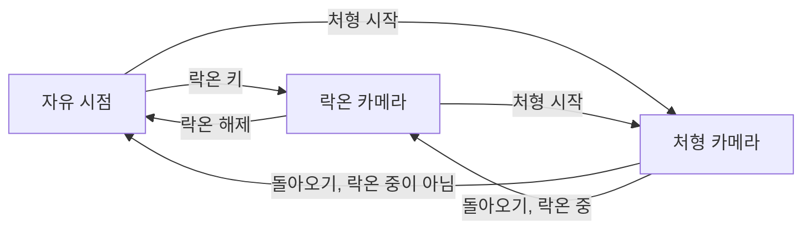

# 카메라와 타겟팅

플레이어 시점 카메라의 기본 설정, 락온, 처형 카메라, 궁극기 컷신, 카메라 연출, 달리기 시야각과 셰이크를 정의합니다.

용어는 [용어집](<../../용어집.md>)을 따릅니다.

## 개요

| 항목 | 내용 |
| - | - |
| 방식 | 플레이어 캐릭터 뒤에서 따라가는 3인칭 카메라 |
| 조작 | 마우스 이동으로 회전합니다. ([플레이어 시스템](<플레이어 시스템.md>)의 키 배치 참고) |
| 카메라 모드 | 자유 시점, 락온 카메라, 처형 카메라 |

## 카메라 모드

| 모드 | 사용 상황 | 시야 입력 |
| - | - | - |
| 자유 시점 | 기본 상태 | 받음 |
| 락온 카메라 | 락온 중 | 무시 |
| 처형 카메라 | 처형 중 | 무시 |

## 자유 시점

| 항목 | 값 |
| - | - |
| 카메라 거리 | 400cm |
| 회전 중심 | 캐릭터 캡슐 중심에서 위로 60cm |
| 화면 속 캐릭터 위치 | 화면 가로 가운데 (어깨 너머 시점이 아님) |
| 시야각 (FOV) | 90° |
| 위치 추적 | 캐릭터를 약간 늦게 따라가 이동 중의 화면 떨림을 줄입니다. (따라잡는 시간 약 0.1초) |
| 회전 반응 | 마우스 입력을 지연 없이 바로 반영합니다. |

## 카메라 충돌

- 회전 중심과 카메라 사이에 지형이 있으면 카메라 거리를 줄여 캐릭터가 가려지지 않게 합니다.
- 가로막던 지형이 사라지면 원래 거리로 돌아갑니다.
- 플레이어, 보스, 투사체, 보이지 않는 벽은 카메라를 가로막지 않습니다.

## 락온

- 락온 타겟팅 범위: 플레이어 캡슐 중심에서 반경 20m 안에 적의 캡슐이 닿는 범위입니다.
- 락온 대상: 락온 타겟팅 범위 안에 있고 화면 안에 있는 생존한 적 가운데 화면 중앙에 가장 가까운 적입니다.
- 락온 해제 조건: 락온 키 재입력, 대상의 캡슐이 플레이어 캡슐 중심에서 반경 30m 밖으로 벗어남, 대상 사망, 플레이어 사망.
- 락온 중 캐릭터의 방향은 [플레이어 캐릭터 - 린](<../Content/플레이어 캐릭터 - 린.md>)의 '이동'을, 카메라의 움직임은 '락온 카메라'를 따릅니다.
- 락온 마커 표시는 [UI 시스템](<UI 시스템.md>)의 '락온 마커'를 따릅니다.

## 락온 카메라

락온 중에는 플레이어와 보스가 함께 화면에 들어오도록 카메라가 자동으로 움직입니다. 락온 타겟팅 범위, 대상 조건과 해제 조건은 '락온'을 따릅니다.

### 구도

- 카메라는 플레이어 뒤쪽에 위치하며, 회전 중심에서 보스의 락온 지점(가슴 높이)을 바라보는 방향을 기준으로 향합니다.
- 위아래 각도는 이 기준 방향의 각도를 아래로 10°에서 위로 35°까지로 제한한 뒤, 15° 더 내려다보게 합니다.
- 그 결과 보스는 화면 가운데 위쪽에, 플레이어는 화면 가운데 아래쪽에 보입니다.
- 카메라 거리는 자유 시점과 같습니다.

### 회전

- 목표 방향으로 천천히 가속했다가 감속하며 부드럽게 따라 회전합니다. 따라잡는 시간은 약 0.2초이고, 회전 속도는 초당 최대 360°입니다. 보스가 돌진하거나 플레이어 머리 위로 도약해도 화면이 튀지 않게 합니다.
- 락온을 걸 때도 같은 방식으로 대상 쪽으로 돌아갑니다.
- 락온을 해제하면 해제한 시점의 방향에서 자유 시점을 이어 갑니다.
- 회피와 달리기 중에도 락온 카메라를 유지합니다.

## 처형 카메라

처형하는 동안 플레이어와 처형 대상을 영화의 한 장면처럼 비추는 카메라입니다. 락온 중에도 처형을 시작하면 처형 카메라로 바뀝니다. 처형의 진행은 [플레이어 캐릭터 - 린](<../Content/플레이어 캐릭터 - 린.md>)의 '처형'을 따릅니다.

| 항목 | 값 |
| - | - |
| 구도 | 플레이어의 오른쪽 뒤 옆에서 봅니다. 플레이어가 대상을 바라보는 방향에서 오른쪽으로 약 135° 방향, 바라보는 지점에서 수평으로 약 4.8m 떨어진 같은 높이에서 바라보는 지점을 수평으로 봅니다. 플레이어는 화면 왼쪽 앞에, 대상은 화면 오른쪽 안쪽에 보입니다. |
| 바라보는 지점 | 플레이어의 캡슐 중심과, 처형을 시작할 때 대상의 캡슐 중심 사이 가운데에서 위로 약 0.3m. 대상이 걷어차여 밀려나도 따라가지 않습니다. |
| 시야각과 줌인 | 망원 화면인 50°에서 시작해, 처형을 시작한 뒤 1.8초 동안 40°까지 천천히 좁혀 다가가듯 보입니다. 처음에 빠르게 좁히다가 끝에서 느려집니다. |
| 방향 고정 | 구도의 방향은 처형을 시작할 때 플레이어에서 대상 쪽으로 향하는 방향으로 정하고, 처형이 끝날 때까지 바꾸지 않습니다. 위치는 바라보는 지점을 따라 움직입니다. |
| 들어가기 | 처형을 시작하면 0.8초에 걸쳐 게임 카메라에서 처형 카메라로 부드럽게 옮겨 갑니다. |
| 돌아오기 | 마지막 일격이 들어가고 0.2초 뒤(처형을 시작하고 약 1.53초)부터 0.8초에 걸쳐 게임 카메라로 부드럽게 돌아옵니다. 그 전에 처형이 끝나거나 끊기면 그때부터 돌아옵니다. 자유 시점이면 처형 직전의 방향으로, 락온 중이면 락온 카메라의 방향으로 돌아옵니다. |
| 시야 입력 | 들어가기부터 돌아오기가 끝날 때까지 무시합니다. |

- 처형을 시작할 때 오른쪽 구도의 카메라 위치가 바라보는 지점에서 지형에 가려지면, 왼쪽에서 좌우를 뒤집은 구도로 봅니다. 양쪽 모두 가려지면 오른쪽 구도에 '카메라 충돌'을 적용합니다.
- 처형 카메라 중에도 '카메라 연출'의 시야각 변화와 셰이크를 더합니다.

## 궁극기 컷신

궁극기를 시작할 때 게임 카메라 대신 재생하는 카메라 연출입니다. 재생 시점과 길이, 컷신 동안 플레이어의 자세는 [플레이어 캐릭터 - 린](<../Content/플레이어 캐릭터 - 린.md>)의 '궁극기'를 따릅니다.

| 항목 | 값 |
| - | - |
| 구도 | 플레이어 왼쪽 옆 약 2.4m, 허리보다 조금 낮은 높이(바닥에서 약 0.8m)에서 옆모습을 비춥니다. 처음에는 머리를 보다가, 플레이어가 자세를 낮추는 0.8초 동안 낮춘 머리를 따라 내려갑니다. 컷신 동안 뒤쪽으로 조금 돌며 약 2.1m까지 다가갑니다. |
| 시야각 | 약 33° (게임 카메라보다 좁은 망원 화면) |
| 전환 | 시작할 때 컷신 카메라로 바로 바뀌고, 끝나면 컷신 직전의 게임 카메라로 바로 돌아옵니다. |

- 컷신 동안에는 시야 입력을 무시합니다. HUD 표시는 [UI 시스템](<UI 시스템.md>)의 '상황별 표시 규칙'을 따릅니다.
- 화면은 [플레이어 캐릭터 - 린](<../Content/플레이어 캐릭터 - 린.md>)의 '궁극기 포스트프로세스'를 따릅니다.

## 카메라 연출

패리, 극한 회피, 처형, 보스 처치 같은 순간을 강조하는 카메라의 변화입니다. 지금 쓰는 카메라(자유 시점, 락온 카메라, 처형 카메라)에 아래 변화를 잠깐 더했다가 되돌립니다. 연출 중에도 시야 입력은 그대로 받습니다.

| 항목 | 내용 |
| - | - |
| 시야각 변화 | 시야각에 더하는 값입니다. 음수면 화면이 좁아져 다가간 것처럼, 양수면 넓어져 물러난 것처럼 보입니다. |
| 시간 | 들어가기 동안 0에서 변화량까지 부드럽게 커지고, 유지 동안 그대로 있다가, 돌아오기 동안 0으로 부드럽게 줄어듭니다. |
| 셰이크 | 연출을 시작할 때 '카메라 셰이크'의 '셰이크 단계' 가운데 하나를 재생합니다. 셰이크가 없는 연출도 있습니다. |
| 상대 쪽 회전 | 연출을 일으킨 상대가 화면에 들어오도록 카메라를 가로로 돌립니다. (아래 '상대 쪽 회전' 참고) |

### 공통 규칙

- 카메라 연출, 상대 쪽 회전, 처형 카메라로 바뀌고 돌아오는 시간은 셰이크와 같이 게임 시간으로 흐릅니다. 슬로우모션 중에는 느려지고, 히트스톱으로는 멈추지 않으며, 일시정지 메뉴가 열려 있는 동안에는 멈춥니다. ([시간 규칙](<시간 규칙.md>)의 '시간 연출의 영향' 참고)
- 여러 연출이 겹치면 시야각 변화를 모두 더합니다.
- 같은 연출의 시야각 변화는 서로 더하지 않습니다. 재생 중에 다시 일어나면 그 연출을 다시 재생합니다. 셰이크는 겹쳐서 재생합니다.
- 연출과 셰이크는 일어난 위치에서 멀수록 약해지고, 일정 거리 밖에서는 재생하지 않습니다. 적의 모션 시점에 붙인 연출은 그 적의 위치에서, 그 밖의 연출은 플레이어 위치에서 일어나므로 늘 제 세기로 재생합니다.
- 궁극기 컷신이 시작되면 진행 중인 카메라 연출과 상대 쪽 회전은 모두 끝납니다.

### 상대 쪽 회전

| 항목 | 규칙 |
| - | - |
| 상대 | 극한 회피의 공격한 적입니다. |
| 하지 않는 경우 | 락온 중이거나 처형 카메라 중이면 돌지 않습니다. |
| 방향 | 가로로만 돌고, 위아래 각도는 그대로 둡니다. |
| 목표 | 카메라가 보는 방향과 상대의 캡슐 중심 쪽 방향 사이의 가로 각도가 연출마다 정한 각도 이하가 될 때까지 돕니다. 시작할 때 이미 그 각도 안이면 돌지 않습니다. |
| 속도 | '락온 카메라'의 '회전'처럼 부드럽게 가속했다가 감속합니다. 따라잡는 시간은 약 0.2초이고, 회전 속도는 초당 최대 360°입니다. |
| 끝 | 목표 각도에 닿거나, 시야 입력이 들어오거나, 락온을 걸면 끝납니다. 시야 입력이 들어오면 그 순간부터 입력을 따릅니다. |

- 상대 쪽 회전은 한 번에 하나만 합니다. 새 회전이 시작되면 진행 중인 회전은 끝납니다. 같은 순간에 여러 회전이 시작되면 플레이어와 가장 가까운 상대 쪽으로 돕니다.

### 상황별 연출

시간 열은 들어가기 / 유지 / 돌아오기(초)이며, 빈칸은 변화나 회전이 없음을 뜻합니다.

| 상황 | 셰이크 | 시야각 변화 | 시간 | 상대 쪽 회전 목표 | 의도 |
| - | - | - | - | - | - |
| 플레이어의 공격 적중 (피격 반응 움찔) | 작음 | | | | |
| 플레이어의 공격 적중 (피격 반응 넉업·넉다운) | 보통 | | | | |
| 패리 성공 | 보통 | -9° | 0.05 / 0.25 / 0.5 | | 쳐내는 순간 화면이 날카롭게 튕기며 조여 들어, 가드로 막았을 때와 달리 쳐냈음을 느낍니다. 히트스톱이 끝나 움직임이 다시 시작된 뒤에도 잠깐 정점에 머물렀다가 천천히 풀려 여운을 남깁니다. |
| 극한 회피 | | -8° | 0.03 / 0.12 / 0.3 | 0° (화면 가운데) | 느려진 시간 동안 피한 공격과 반격할 적을 보여 줍니다. |
| 회피 반격 적중 | | -6° | 0.04 / 0.08 / 0.25 | | 반격의 손맛을 줍니다. |
| 가드 반격 적중 | | -6° | 0.04 / 0.08 / 0.25 | | 반격의 손맛을 줍니다. |
| 플레이어 피격 (움찔) | 작음 | | | | |
| 플레이어 피격 (넉업·넉다운) | 큼 | | | | |
| 가드로 막음 (가드 움찔) | 작음 | | | | |
| 가드로 막음 (가드 밀림) | 보통 | | | | |
| 가드 브레이크 | 큼 | | | | |
| 처형 시작 | | | | | '처형 카메라'로 바뀝니다. |
| 처형의 찌르기 | 작음 | -3° | 0.05 / 0.1 / 0.3 | | 칼이 박히는 무게를 줍니다. |
| 처형의 마지막 일격 | 큼 | -6° | 0.05 / 0.2 / 0.5 | | 마무리의 쾌감을 줍니다. |
| 보스 처치 | | -12° | 0.2 / 0.5 / 0.8 | | 보스 처치 슬로우모션([시간 규칙](<시간 규칙.md>)의 '슬로우모션') 동안 천천히 다가가듯 화면이 조여 들어 마지막 일격의 여운을 줍니다. |
| 보스 페이즈 전환 포효 | 보통 | +6° | 0.1 / 0.4 / 0.5 | | 포효 모션에서 기합을 터뜨리는 순간에 재생해, 화면이 밀려나는 압박을 줍니다. 보스 위치에서 일어납니다. |
| 궁극기 마무리 | 큼 | | | | |
| 보스 GroundSlam 착지 | 보통 | | | | |

- 극한 회피와 보스 처치의 시간은 슬로우모션 중의 게임 시간이라 실제로는 슬로우모션 동안 늘어납니다. 극한 회피는 유지가 슬로우모션과 함께 끝나고, 보스 처치는 들어가기가 슬로우모션의 처음 1초 동안 천천히 이어진 뒤 유지합니다.
- 가드 브레이크는 '가드로 막음' 대신 적용합니다.
- 회피 반격 적중과 가드 반격 적중은 적중할 때마다 재생하며, '공통 규칙'의 같은 연출 규칙에 따라 여러 적을 맞혀도 조임이 더해지지 않습니다. 셰이크는 '플레이어의 공격 적중'의 셰이크를 함께 재생합니다.
- 보스 처치는 보스의 HP가 0 이하가 되어 사망하는 순간, 처치한 공격과 관계없이 재생합니다. 스테이지 결과가 이미 정해진 뒤의 사망([게임 플로우](<게임 플로우.md>)의 Boss Stage)에는 재생하지 않습니다.
- 궁극기 마무리 셰이크는 적중 여부와 관계없이 한 번 재생합니다. 여러 적에게 동시에 적중해도 한 번만 재생합니다.

## 달리기 시야각

달리는 동안 시야각을 넓혀 속도감을 줍니다.

| 항목 | 내용 |
| - | - |
| 적용 조건 | 달리기 중이고 이동 입력이 있는 동안에만 적용합니다. Shift를 누른 채 이동 입력을 멈춰 제자리에 서 있으면 적용하지 않습니다. |
| 시야각 변화 | +6° (넓어져 물러난 것처럼 보입니다) |
| 들어가기 | 적용 조건을 만족하면 0.6초 동안 0에서 변화량까지 부드럽게 커집니다. |
| 돌아오기 | 적용 조건을 벗어나면 0.5초 동안 0으로 부드럽게 줄어듭니다. 들어가는 도중에 벗어나면 그때의 크기에서 줄어듭니다. |
| 적용 카메라 | 자유 시점과 락온 카메라에 더합니다. |

- 시간과 겹침은 '카메라 연출'의 '공통 규칙'을 따릅니다. 게임 시간으로 흐르고, 다른 연출의 시야각 변화와 더해지며, 궁극기 컷신이 시작되면 끝납니다.

## 카메라 셰이크

카메라 셰이크는 작음, 보통, 큼 세 단계로 나타냅니다. 상황마다 재생하는 단계는 '카메라 연출'의 '상황별 연출'을 따릅니다.

### 셰이크 단계

| 단계 | 연출 의도 |
| - | - |
| 작음 | 타격감만 느껴지는 짧은 떨림 |
| 보통 | 분명히 느껴지는 흔들림 |
| 큼 | 화면이 크게 흔들리는 충격 |

- 셰이크는 시작할 때 가장 세고, 끝날 때까지 점점 약해집니다.
