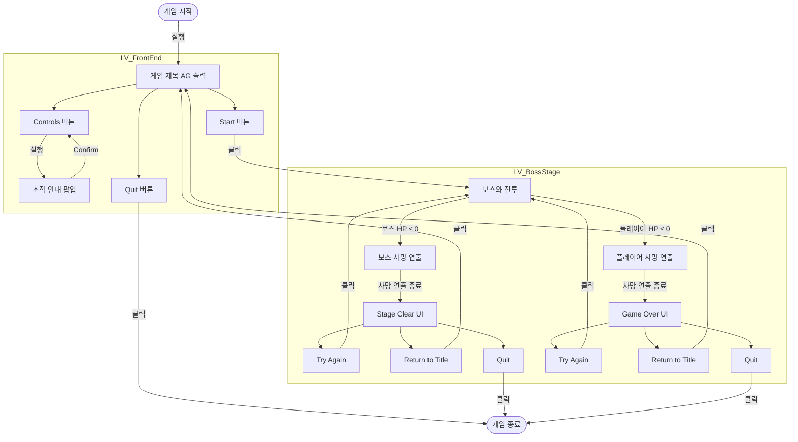

# 게임 플로우

게임 시작부터 보스전의 끝까지 레벨 전환 규칙, 보스전의 시작과 결과를 정의합니다.

각 화면의 배치·표시·UI 조작은 [화면 UI](<화면 UI.md>)를 따릅니다.

용어는 [용어집](<../용어집.md>)을 따릅니다.

## 1. Front End

LV_FrontEnd는 게임을 실행하면 처음 열리는 레벨입니다.

Start 버튼을 누르면 보스전 스테이지(LV_BossStage)로 이동합니다.

Controls 버튼의 팝업 동작은 [화면 UI](<화면 UI.md>)의 조작 안내를 따릅니다.

Quit 버튼을 누르면 게임을 종료합니다.

## 2. Boss Stage

LV_BossStage는 보스전이 진행되는 레벨입니다. 구성은 [보스 스테이지](<보스 스테이지.md>)를 따릅니다.

레벨이 열리면 바로 보스전이 시작되며, 플레이어는 시작 지점에서 바로 조작할 수 있습니다. 보스가 전투를 시작하는 방식은 [보스 사양](<보스 사양.md>)의 '전투 시작과 행동 전환'을 따릅니다.

레벨이 열리면 마우스 커서를 숨기고, 입력은 게임만 받습니다.

보스전의 결과는 먼저 처리된 사망으로 정해집니다. 결과가 정해진 뒤 상대가 사망하면 사망 연출은 재생하지만, 결과와 결과 UI는 바뀌지 않습니다.

LV_BossStage를 다시 시작하면 레벨을 처음부터 다시 로드하며, 플레이어와 보스의 모든 상태(스탯, 페이즈 등)를 초기화합니다.

## 3. Stage Clear

보스의 HP가 0 이하가 되면, 보스의 사망 연출이 재생되고 Stage Clear UI 창이 출력됩니다. 이미 결과가 정해진 뒤에 사망한 경우는 'Boss Stage'를 따릅니다.

Try Again 버튼을 누르면 LV_BossStage를 다시 시작합니다.

Return to Title 버튼을 누르면 LV_FrontEnd 레벨로 돌아갑니다.

Quit 버튼을 누르면 게임을 종료합니다.

## 4. Game Over

플레이어 캐릭터의 HP가 0 이하가 되면, 플레이어 캐릭터의 사망 연출이 재생되고 Game Over UI 창이 출력됩니다. 이미 결과가 정해진 뒤에 사망한 경우는 'Boss Stage'를 따릅니다.

버튼은 'Stage Clear'와 같습니다.

## 플로우 차트

