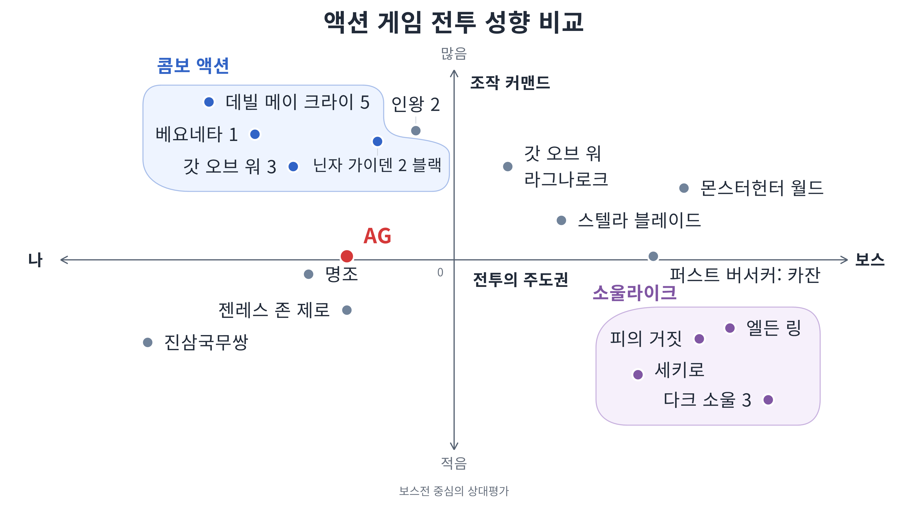

다양한 액션 게임들을 분석하고 AG에 맞는 방향성을 제시합니다. 

# 타 액션 게임 분석

나와 보스 중에 누가 강하냐에 따라 전투 설계의 뱡향이 갈린다.

자연스레 강한 쪽이 전투 주도권을 갖게 된다.

## 콤보 액션 게임

예시: 데빌메이크라이5, 베요네타, 갓오브워3

* 내가 보스보다 강함
* 전투 주도권이 내게 있음

## 소울라이크 액션 게임

예시: 엘든링, 세키로, 갓오브워 라크나로크

* 나보다 보스가 강함
* 전투 주도권이 보스에게 있음

## 콤보 액션

### 플레이어의 특징
* 취할 수 있는 액션과 커맨드가 다양함
* 보스가 패턴 쓰는 순간만 대응하면, 그 외에는 상시 딜타임

### 보스의 특징
* 플레이어의 공격을 맞아주는 역할
* 긴장감을 부여하기 위해 강제 기믹 발동하기도 함

→ 긴장감과 스트레스는 낮게, 쾌감이 극대화되도록 설계

## 소울라이크

### 플레이어의 특징
* 취할 수 있는 액션 가짓수가 적음 (구르기, 평타)
* 별도의 딜타임 없음. 보스의 빈틈을 직접 찾아내야함

### 보스의 특징
* 패턴 대응법을 모르는 플레이어를 죽이는 역할
* 플레이어가 학습하고 대응할 수 있도록 패턴이 느림

→ 긴장감과 스트레스가 높지만, 성취감이 극대화되도록 전투 설계

## 도표로 보기

---

# AG의 전투 방향성

* 플레이어가 전투 주도권을 잡으면, 보스는 상대적으로 샌드백이 될 수 밖에 없다.
* 보스가 전투 주도권을 잡으면, 플레이어는 수비적인 플레이를 할 수 밖에 없다.
* AG는 콤보 액션과 소울라이크 사이에서 적절한 균형점을 유지한다.

## 균형점 맞추기
보스의 그로기 유무에 따라 전투 주도권이 전환되는 방식으로 전투의 균형을 맞춘다.
* 그로기 전에는 소울라이크처럼 긴장감 있는 공방
* 그로기 후에는 스킬 콤보로 극딜

적의 종류에 따라 콤보 액션과 소울라이크 간의 비율의 차이가 있다.
* 일반 적: 콤보 액션(70%), 소울라이크(30%). 강인도나 MaxPP가 낮아서 큰 부담없이 선공과 콤보를 먹일 수 있다.
* 보스: 콤보 액션(30%), 소울라이크(70%). 패링&회피 위주의 전투. 빈틈에 평타나 스킬을 가할 수도 있다.
* 엘리트: 콤보 액션(50%), 소울라이크(50%). 보스전과 필드전 사이의 중간

## 전투 밸런싱 맞추기

### 플레이어
* 현재 플레이어의 스탯을 밸런싱 기준점으로 고정한다. (HP 1000, MP 100, UP 100, ATK 100, DEF 100)
* 패링 판정 시간은 0.3초, 극한회피 판정 시간은 0.5초로 널널하게 한다.
* 평타, 스킬, 궁극기를 밸런싱한다. (코스트, 쿨다운, 대미지 배율, 자원 수급량, 후딜레이 등)
* 보스전에서 플레이어 측이 전투 주도권을 무한히 빼앗아 일방적으로 패는 전투는 원치 않음

### 적
* 보스전 난이도는 초보자도 5회 트라이 내에 깰 수 있는 수준.
* 너무 불합리하거나 직관성이 떨어지는 패턴은 모션이나 연출을 교체한다.
* 그로기 유지 시간을 8초 정도로 늘리고, TTK 및 보너스 대미지를 고려해서 체력 수치를 정한다.
* 콤보 액션의 맛을 살리기 위해 TTK는 충분히 길었으면 함