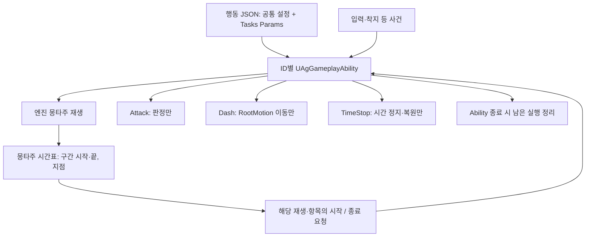

# AbilityTask 기반 어빌리티 설계안

2026-10-16 구현. 모든 행동이 단일 `UAgGameplayAbility`와 기능별 고정 Params를 씁니다. 2026-10-17 몽타주 안의 구간과 사건을 몽타주 노티파이에서 [몽타주 시간표](<몽타주 시간표.md>)로 옮겼습니다. 아래는 지금 구조의 규칙입니다.

## 결정과 목표

**모든 어빌리티는 구체 클래스 `UAgGameplayAbility` 하나를 사용합니다. 행동 JSON의 `Tasks`에는 기능별 고정 Params를 적고, 각 Task는 자기 기능만 수행합니다. 모션 구간 동안 실행할 기능은 몽타주 시간표의 구간 시작·끝으로 시작·종료합니다. 행동 전체의 흐름을 감싸는 Task는 만들지 않습니다.**

State.Busy는 후딜 전 다른 행동의 발동을 제한하는 태그입니다. State.Acting은 두지 않고, 후딜을 포함한 이동 입력 제한은 공통 Ability의 행동 모션 실행 기록을 조회합니다. 플레이어 입력 기획의 허용 구간은 그대로입니다.

Attack은 공격 판정을, Dash는 RootMotion 이동을, MotionWarping은 애니메이션의 루트 이동·회전 보정을, TimeStop은 시간 정지와 복원을 맡습니다. 다른 기능의 존재·내부 상태를 요구하거나 다른 Task를 생성·종료하지 않습니다. 필요한 Params와 실행 입력은 호출할 때 전달합니다. MotionWarping은 공격 없이도 사용하며 엔진 워핑 경로를 직접 활용합니다.

플레이어 행동·피격·상태 반응·보스 패턴을 모두 포함하며, 게임별 GameplayAbility 자식과 중간 실행 클래스를 두지 않습니다. 행동 ID별 GAS 스펙·인스턴스는 독립적으로 유지합니다. 하나의 전역 Ability 인스턴스에 모든 행동을 합치는 뜻은 아닙니다.

게임 규칙과 수치는 [플레이어 사양](<../Design/플레이어 사양.md>), [플레이어 입력](<../Design/플레이어 입력.md>), [보스 사양](<../Design/보스 사양.md>), [전투 시스템](<../Design/전투 시스템.md>)을 따릅니다. 규칙이 요구하는 입력·착지·컷신 완료 등 모션 밖의 사건은 해당 C++ 처리에 남깁니다. 새로운 연동 가능성을 가정해 델리게이트나 범용 연결 장치를 준비하지 않습니다.

## 설계에서 줄이는 것

- DashAttack·UltimateSequence·Combo·DirectionalDodge·PlungeAttack·ExecuteTarget 등 행동 전체를 관리하는 Task를 도입하지 않습니다. Guard·피격·그로기·사망도 Ability 코드를 그대로 옮긴 흐름 Task로 만들지 않습니다.
- Task끼리 부모·자식 관계를 만들거나 다른 Task의 완료를 기다리는 실행 계층을 두지 않습니다.
- 별도 Execution·Kind·TaskSlot 선택 필드, 범용 Bindings·이벤트 그래프·TaskClass 팩토리·설정 인터페이스·다형 Params를 두지 않습니다.
- 몽타주 재생·시간 대기·비용·쿨다운·GE·Cue 등 엔진 기능은 직접 사용합니다. 엔진 기능을 감싸기 위한 게임 Task를 만들지 않습니다.
- 기존 기능의 조합마다 새 Task를 만들거나 이름 쌍의 허용 목록을 추가하지 않습니다.

행동 수치는 행동 JSON, 모션 구간의 시각과 값은 몽타주 시간표, 연출 노티파이는 애니메이션 에셋, 기능 구현은 해당 C++ Task 또는 직접 사용하는 엔진 기능의 연결부에서 찾을 수 있어야 합니다.

## 클래스와 책임

| 구성 | 책임 |
| - | - |
| UAgGameplayAbility | 정의·실행 입력 제공, 공통 GAS 검사·커밋과 행동 제한, 구체 Task 생성·종료, 실행 기록과 Ability 종료 정리 |
| FAgAbilityData | 공통 설정과 Tasks의 고정 Params |
| 기능 AbilityTask | 자기 기능 수행과 자기 태그·핸들·RootMotion·구독 등의 정리 |
| 몽타주 시간표(`UAgMontageTimelineComponent`) | 재생 위치로 시간표를 판정해, 재생을 소유한 Ability에 구간 시작·끝과 지점을 알리고 워핑 구간을 엔진에 등록 |
| 엔진 Task·캐릭터·컴포넌트·GE·Cue | 재생·대기·이동·피격·입력·연출의 처리 |
| 엔진 Motion Warping·게임 Modifier | 시간표 항목의 값과 전달받은 목표로 루트 이동·회전 보정. 공격 데이터나 Attack 실행 조회 없음 |
| UAgAbilitySystemComponent | 같은 Ability 클래스의 행동을 스펙 기준으로 조회·차단·취소하는 최소 보완 |

UAgGameplayAbility는 InstancedPerActor·LocalOnly입니다. 모든 Task를 미리 생성하지 않고 요청받은 실행만 생성합니다. 게임 Task는 UAbilityTask 또는 필요한 엔진 Task를 상속하며, 실행 객체를 UAbilityTask 포인터로 보관하는 엔진 다형성은 그대로 사용합니다.

일반 조회·계산 함수까지 Task로 만들지 않습니다. 이동 방향·대상 위치 같은 실행 입력은 실제 요청 시점에 결정합니다. Dash 안에서 이동 거리를 계산하는 일은 이동 기능의 범위이며, Dash가 공격 판정이나 몽타주를 제어하는 근거가 되지는 않습니다.

### 캐릭터와 실행 기능의 책임 경계

캐릭터는 메시·캡슐·ASC·MotionWarpingComponent와 무기 리소스를 유지하고, 무기 스윕의 실행 상태와 틱은 Attack Task가 소유합니다. 구체 Task의 목록, 처형 전용 워핑 상태, 몽타주 시간표의 해석은 캐릭터 클래스에 두지 않습니다. 시간표 판정은 캐릭터에 붙은 별도 컴포넌트가 합니다.

- 공통 Ability는 실제 재생에 일반 공격 대상과 회전 제어 여부를 연결합니다. 대상은 모션 시작과 실제 워핑 구간 진입에서 정하며, 캐릭터 Tick에서 구간 시각을 검색하지 않습니다. 처형 대상과 정렬 간격도 Ability의 실행 사본에서 Modifier에 전달합니다.
- 캐릭터에는 대상·최소 간격·일반 회전 제한·물리 속도 기반 루트 이동이라는 최종 이동 제약만 전달합니다. 제약은 요청 소유자를 구분하며, 모션 교체·완료·취소에서 자기 제약만 해제합니다. 워핑 구간 종료나 자연 블렌드 아웃 시작만으로 모션 전체의 제약을 해제하지 않습니다.
- 충돌 응답 Task가 이전 채널 응답을 저장하고 적용·복원합니다. 별도 컴포넌트나 실행 등록부는 두지 않습니다. 같은 대상·채널은 이전 Task가 종료된 뒤 변경하는 계약입니다. 같은 몽타주 안의 중복 구간은 시간표 검증에서 거부하고, 행동 전환은 Ability 차단·취소와 모션 정리 순서를 따릅니다. 적용 중 동기 콜백으로 Task나 Ability가 끝나도 저장한 응답을 한 번 복원하며, `ReadyForActivation`의 표준 시작 계약을 유지합니다.



## 실행과 수명

### 설정과 실행 시점의 구분

Tasks는 순서대로 실행하는 명령 목록도, 설정된 모든 Task를 즉시 생성하는 목록도 아닙니다. **기능 설정이 존재하는 것과 실행이 요청된 것은 다릅니다.**

| 설정 | 실행 요청 | 종료 |
| - | - | - |
| PlayMontageAndWait | 발동 시 엔진 Task로 재생 | 재생 완료·중단·취소 |
| DrainResource | 커밋 성공 후 발동 시 주기적 GE 적용 | 소유 Ability의 종료·취소 시 해당 GE 제거 |
| TimedTag | 신규 가드·극한 회피 성공 등 구체 사건에서 GE 적용 | GE 만료 또는 그 효과를 소유한 사건 처리에서 제거 |
| GrantResources | 패리·극한 회피 보상 사건에서 즉시 GE 적용 | 즉시 적용 완료 |
| SlowMotion | 극한 회피 성공 사건에서 시간 서브시스템 호출 | 실제 시간 만료·다음 슬로우모션 또는 시간 정지로 대체 |
| LaunchVertical | 내리꽂기 사건에서 LaunchCharacter 호출 | 초기 수직 속도 적용 완료 |
| LaunchToTarget | 도약 시작 사건에서 초기 발사 속도 계산·적용 | 초기 속도 적용 완료. 실제 착지는 이동 상태 사건으로 처리 |
| TargetQuery | 발동 검사·HUD·궁극기 마무리·착지 사건의 읽기 전용 조회 | 해당 조회 완료 |
| Attack | 궁극기 마무리·처형 타격·도약 착지의 명시적 단발 판정 | 한 번 판정한 뒤 완료 |
| HoldTag·SetCollisionResponseToChannel | 가드 유지·넉백/넉업 접지·처형 피격처럼 현재 기획이 정한 사건의 명시적 요청 | 요청자가 종료 |
| TimeStop | 궁극기 시작 사건의 명시적 요청 | 궁극기 마무리 또는 Ability 종료 |
| LockOn | 락온 입력 처리에서 대상 선택 후 명시적 호출 | 락온 해제 요청·대상 상실·Ability 종료 |
| PlayCutscene | 궁극기의 컷신 시작 처리에서 명시적 호출 | 시퀀스 완료·취소·Ability 종료 |
| 빈 Tasks | 추가 기능 실행 없음 | 입력·상태의 외부 종료 요청 |
| 몽타주 시간표 항목 | 재생 위치가 Attack·HoldTag·SetCollisionResponseToChannel·Dash·MotionWarping 구간의 시작이나 GameplayEvent·SpawnProjectile 지점에 이름 | 구간 끝, 자기 기능의 완료, 모션 교체·종료 |

PlayMontageAndWait·DrainResource처럼 발동 시 사용하는 엔진 기능은 함께 설정하면 모두 시작합니다. 나머지 Tasks 설정은 JSON에 있다는 이유만으로 발동 시 시작하지 않고, 위 표의 사건에서 호출합니다. 이 시작 규약은 고정 C++ 연결에 두며 새 실행 선택 필드를 만들지 않습니다.

Task가 다른 Task를 요구하지 않습니다. 같은 모션에서 공격과 이동이 필요하면 시간표에 두 구간을 둡니다. 한 구간의 종료가 다른 구간의 실행을 자동 종료하지 않습니다(돌진 찌르기의 돌진 종료는 '현재 기획에 필요한 연결'을 따릅니다). 실행 시 필요한 입력이 없으면 그 요청을 실패로 처리하며 다른 Task나 임의 대상에서 보충하지 않습니다.

### 시간표 항목 연결

몽타주 안의 구간과 사건은 [몽타주 시간표](<몽타주 시간표.md>)가 재생 위치로 판정해 알립니다. 판정 규칙과 항목별 실행은 그 문서를 따르고, Ability 쪽 연결은 다음과 같습니다.

1. 공통 Ability가 엔진 Task로 몽타주를 재생하고 **그 실제 재생 인스턴스**를 기록합니다. 재생 직후 시간표 판정에 재생 시작을, 섹션을 옮긴 직후 새 위치를 알립니다.
2. 구간 시작 알림에서 공통 Ability가 항목의 값으로 해당 기능 Task를 만듭니다. 기능별 고정 C++ 호출을 사용하며 런타임 TaskClass 팩토리나 다형 Params를 도입하지 않습니다.
3. 시작한 실행을 재생 인스턴스와 항목(기능·배열 번호)으로 기록합니다. 구간 끝은 그 기록의 실행만 종료합니다.
4. 해당 Task가 먼저 종료했으면 뒤의 구간 끝은 추가 실행이나 중복 정리를 일으키지 않습니다. 다른 실행을 타입 이름만으로 찾아 종료하지 않습니다.
5. 모션 교체·중단·Ability 종료에서는 해당 범위의 실행을 정리합니다. 구간 끝 알림이 모든 중단 상황에서 반드시 온다고 가정하지 않습니다.

항목은 값을 직접 가지므로 같은 값이라도 구간마다 독립적인 실행을 만듭니다. 시간표 판정은 Ability를 찾지 않고 알림만 보내며, 재생을 소유한 Ability만 자기 재생 ID의 알림을 처리합니다. 이전 재생의 늦은 알림이나 다른 캐릭터의 재생은 새 실행에 붙지 않습니다. 같은 알림을 ASC GameplayEvent로 다시 보내거나 행동별 순서 관리 Task를 만들지 않습니다.

동적 재생인 BasicAttack·Dodge·Guard·Jump·KnockUp·Groggy·Death는 고정 시작 모션을 뜻하는 Tasks.PlayMontageAndWait를 억지로 넣지 않습니다. 구체 입력·물리·재생 사건에서 Montages의 명시적 ID를 선택해 엔진 기능을 호출합니다. 동적으로 시작한 모션의 완료가 Ability를 끝내는지는 아래 '행동별 호출·종료 연결'을 따릅니다. 새 Execution·Kind·StartPolicy 필드는 만들지 않습니다.

### Ability 종료와 Task 종료

Task 종료는 자기 기능의 종료입니다. 구간 Task가 끝났다는 이유로 Ability 전체를 끝내거나 다른 Task를 취소하지 않습니다.

- 모션 완료로 끝나는 행동은 공통 Ability가 **현재 행동 모션의 실제 재생**을 기록하고, 그 모션의 정상 완료에서 Ability를 종료합니다. 여러 Task의 완료를 모아 기다리는 범용 집계는 두지 않습니다.
- 시간표 구간에서 시작한 Attack·Dash·HoldTag·충돌 응답은 동시에 실행할 수 있으며 각 구간의 수명을 따릅니다. 몽타주가 구간을 진행하고, 모션 종료 시 남은 구간 실행도 정리합니다.
- TimedTag·GrantResources·SlowMotion·LaunchVertical·LaunchToTarget·TargetQuery의 호출 완료로 행동을 끝내지 않습니다. TimedTag가 만드는 대상 ASC의 효과 수명과 SlowMotion의 월드 수명은 아래 기능별 계약을 따릅니다.
- DrainResource의 주기적 GE는 모션의 정상 완료를 막지 않으며, Ability가 끝날 때 자기 GE를 제거합니다.
- 입력·상태의 외부 사건으로 끝나는 행동은 그 종료 요청까지 유지합니다. Sprint는 DrainResource의 GE를 유지하면서 입력 해제·이동 입력 소실·SP 소진에 따른 종료를 기다립니다.
- 실제 기획에 따라 같은 발동에서 모션을 교체하는 경우 이전 재생 완료를 Ability 완료로 오인하지 않도록 그 전환 처리에서 실행 기록을 갱신합니다. 현재 Task가 0개라는 이유로 자동 종료하지 않습니다.
- 각 실행의 기록과 콜백을 연결한 뒤 활성화합니다. 재생 실패나 동기 콜백으로 Ability가 끝나면 남은 시작 호출을 중단합니다. 별도의 복수 완료 집합이나 시작 장벽은 만들지 않습니다.
- 엔진은 Task의 Activate가 반환된 뒤 소유 Ability의 활성 목록에 등록합니다. 태그·시간 정지·충돌을 적용하는 중의 콜백이 Ability를 취소하면 해당 Task가 즉시 자기 적용 상태를 복원하고 종료합니다. 이 경계에서 소유자의 일괄 정리만 기다리지 않습니다.
- 시작 실패·외부 취소·사망·제거에서는 공통 종료 경로로 모든 남은 실행을 정리합니다. 각 Task는 자기 자원만 복원하며 취소 중 성공 완료를 방송하지 않습니다. 이미 대상 ASC에 부여한 회피 반격 기회와 월드 슬로우모션은 Ability의 소유 실행이 아니므로 회피 종료 때 함께 제거하지 않습니다.

별도 Tick 스케줄러·실행 그래프·복합 Task 완료 계층은 만들지 않습니다. 필요한 기본 완료·실패 통지는 엔진 계약에 맞추며, 아직 소비자가 없는 Hit·Blocked·Finished 등의 게임 연동 델리게이트를 모든 Task에 일괄 추가하지 않습니다.

### 상태 소유권과 실제 충돌

독립 Task는 자기 태그·판정·충돌 변경·RootMotion·구독을 획득하고 반납합니다. 하나가 끝날 때 같은 Ability의 다른 실행까지 지우지 않습니다. Busy도 요청자별로 관리하며 자기 후딜·종료에서 자기 요청만 반납합니다. 신규 Ability의 차단은 ASC에 합산된 상태를 봅니다.

**후딜 전 행동 제한은 공통 규칙이며, 행동별 설정으로 선택하지 않습니다.** [플레이어 입력](<../Design/플레이어 입력.md>)의 규칙을 단일 UAgGameplayAbility의 공통 행동 시작·후딜·종료 처리에 둡니다. 행동을 시작할 때 모션 재생 전에 Busy를 획득하고, 해당 재생의 후딜 시작 사건(시간표의 `Event.RecoveryStarted`)에서 자기 Busy를 반납합니다. 후딜 사건이 없는 행동은 행동 종료까지 유지합니다. 취소·재생 실패·Ability 종료에서도 같은 소유권으로 정리합니다. 태그의 실제 획득·반납에는 HoldTag를 재사용할 수 있으며 별도 흐름 Task는 만들지 않습니다.

모션마다 달라지는 **후딜 시작 시점만 시간표의 `Event.RecoveryStarted` 지점으로 표시**합니다. Busy 전용 구간이나 행동 JSON의 선택 필드는 두지 않습니다. 사건은 실제 재생 인스턴스에 연결하여 이전 모션의 늦은 사건이 새 행동의 Busy를 해제하지 않게 합니다. 콤보의 다음 타와 가드 중 패리 모션처럼 같은 Ability 안에서 새 행동을 시작할 때도 공통 처리를 사용합니다. 한 행동 안의 섹션 이동·컷신 전환만으로 Busy를 해제하거나 다시 획득하지 않습니다.

적용 범위는 플레이어 입력 사양의 행동 구분을 따릅니다. 행동 시작 지점에서 공통 처리를 호출하며, 가드 유지·달리기·보스 패턴의 몽타주 재생을 근거로 플레이어의 후딜 입력 제한을 추가하지 않습니다. 이를 행동별 bool이나 Task 조합으로 다시 설정하지 않습니다. 착지 등 모션 밖의 사건에 달린 상태는 구체 처리로 관리합니다. WaitDelay나 다른 구간 Task가 남의 Busy를 변경하지 않습니다. 보호·충돌처럼 독립 기능의 모션 구간은 시간표 구간으로 연결합니다.

같은 몽타주 채널이나 동일 이동 제어를 서로 덮어쓰는 요청은 실제 충돌로 검사합니다. 같은 종류라는 이유만으로 전체 조합을 금지하지 않고, 읽기 전용 Params를 함께 쓰는 것도 허용합니다. 엔진·컴포넌트의 소유권을 우선 사용하며 자동 우선순위·교체·대기열을 추가하지 않습니다.

사건 처리에서 내부적으로 사용하는 엔진 WaitDelay는 월드 게임 시간을 따릅니다. 시간 정지나 슬로우모션의 영향을 받으며 실시간 대기로 해석하지 않습니다.

### 처형 상태 통합과 행동 제한

처형하는 캐릭터와 처형당하는 캐릭터 모두 자기 처형 상태 동안 **`State.Execution` 하나**를 보유하며, 공통 입력·발동 제한은 이 태그만 검사합니다. 두 캐릭터의 종료 시점은 각각 유지하고, 한쪽 종료가 다른 쪽의 태그를 제거하지 않습니다.

역할이 필요한 처리는 처형 요청의 Instigator/Target과 현재 처형·피격 처리에서 구분합니다. 공통 태그만으로 처형자와 피격자를 판별하지 않습니다. 처형자의 무적, 처형 대상 선택, 처형 피해에 의한 사망 연출은 역할·피해 출처 조건을 따릅니다. 이를 위한 새 역할 선택 필드나 관리 Task는 만들지 않습니다.

**State.Busy를 쓰고 State.Acting은 두지 않습니다.** [플레이어 입력](<../Design/플레이어 입력.md>)의 '상태별 허용 입력'과 '모션 캔슬'을 그대로 구현하되, 모션의 수명을 별도 태그로 중복 관리하지 않습니다. 다음 표는 후딜 캔슬이 가능한 플레이어 행동에 대한 대응입니다.

| 구간 | State.Busy | 행동 모션 실행 기록 | 이동 입력 적용 |
| - | - | - | - |
| 후딜 전 | 보유 | 유지 | 안 함 |
| 후딜 | 해제 | 유지 | 안 함 |
| 행동 종료·취소 | 자기 태그 반납 | 자기 기록 정리 | 다른 이동 제한도 없으면 허용 |

Busy는 다음 행동의 발동 제한과 선입력·가드 자동 재개 시점을 나타냅니다. 그 수명은 위 공통 행동 처리에서 관리합니다. 이동 입력의 적용 여부는 캐릭터의 CanMove가 활성 스펙의 공통 Ability에 읽기 전용으로 조회합니다. 조회 대상은 공통 행동 시작 경로에서 등록한 **이동 입력을 제한하는 플레이어 행동 모션의 실행 기록**입니다. 별도 Acting 태그·bActing 플래그·이동 잠금 카운터를 복제하지 않습니다. 행동 분류는 플레이어 입력의 구체 처리에서 정하며, JSON에 이동 제한 선택 필드를 두지 않습니다.

일반 이동을 제한하는 기록은 평타·점프 공격·스킬·궁극기·회피 반격·패리 모션·회피의 실제 행동 재생에 연결합니다. 모든 활성 Ability나 모든 몽타주를 근거로 이동을 막지 않습니다. 가드 유지·Sprint·락온·일반 점프 및 착지 모션은 이 기록을 근거로 새 제한을 받지 않습니다. 가드 시작 후에는 State.ParryWindow가 있는 동안 이동을 막고, 별도 이동 잠금 태그는 두지 않습니다. 피격·그로기·처형·사망은 상태 조건을 따릅니다. 패리 모션 중 가드 키를 떼어도 패리 모션의 기록은 남고, 가드로 복귀하면서 패리 모션을 취소하면 그 기록을 정리합니다.

실행 기록은 모션 재생 전에 등록하고, 재생 실패·실제 모션 완료·취소·Ability 종료에서 해당 활성화·재생의 기록만 정리합니다. **자연스러운 블렌드 아웃 시작이나 후딜 시작 사건만으로 이동 제한 기록을 지우지 않습니다.** 취소로 새 행동에 전환하면 새 행동의 기록과 상태 조건으로 판단하며, 이전 재생의 늦은 콜백이 새 기록을 지우지 않아야 합니다. 같은 행동 안의 섹션 이동·컷신 전환에서 제한이 끊기지 않도록 실행 수명 연결을 유지합니다.

애니메이션 RootMotion이 적용되는 동안에는 엔진이 일반 이동 속도 계산을 대신하지만, 모션이 끝나기 전에 RootMotion이 먼저 종료되는 구간이 있습니다. 따라서 HasAnimRootMotion만으로 기획상의 이동 허용 여부를 판정하지 않습니다. 이동 제한 중에도 회피 방향 선택 등에 쓰는 이동 입력 방향은 계속 갱신하고, AddMovementInput 적용만 막는 입력 처리를 유지합니다. 후딜에도 이동 입력으로 행동을 캔슬하거나 캐릭터를 움직일 수 없다는 기획은 그대로입니다.

## 현재 기획에 필요한 연결

**독립 Task는 다른 Task를 모르지만, 이미 기획에 있는 입력·물리·재생 사건은 남습니다.** 해당 사건을 처리하는 공통 Ability의 구체 함수 또는 캐릭터·컴포넌트가 필요한 최소 호출을 합니다. 행동 ID별로 ActivateAbility 전체를 복제하지 않고, 실제 입력·이벤트의 의미를 처리합니다.

| 현재 기획 | 남겨야 하는 처리 |
| - | - |
| 콤보 | 후딜 중 다음 공격 입력에 따라 현재 타와 모션을 전환. Attack은 선택된 타의 판정 데이터만 받음 |
| 회피 | 입력 방향에 따라 모션·방향 선택. 보호 구간과 극한 회피 보상은 각 구간·전투 사건에서 처리 |
| 가드 | 신규 가드·자동 재개·입력 해제와 패리 사건 구분. 패리 모션·보상·이동 제한을 하나의 Guard Task에 몰아넣지 않음 |
| 점프·점프 공격·도약 | 실제 착지 사건, 공중/접지 조건, 섹션 전환과 이동 복원. 고정 시간표 시각으로 착지를 대신하지 않음 |
| 궁극기 | 컷신 완료에 따른 재생 단계 전환, 마무리에서 시간 정지 해제 후 범위 피해. 같은 시각 사건을 놓는 것만으로 순서가 보장된다고 가정하지 않음 |
| 처형·피격·그로기·사망·페이즈 전환 | 대상·입력·상태 사건에 따른 모션/태그/GE 연결. 새 행동 전체 Task로 이식하지 않음 |
| 돌진 찌르기 | 보스 사양의 막힘·거리 완료, 돌진 중 판정·충돌 해제, 종료 후 자세 유지 해제와 모션 재개 |

보스 사양 'DashThrust'에는 **벽·가드·패리에 막히면 정지**하는 규칙이 있습니다. 고정 시간표 구간만으로 거리 완료·조기 정지·멈춘 모션의 재개가 처리되지 않으므로, 돌진 Task의 완료 통지를 소유 Ability가 받아 남은 판정·이동·충돌 구간을 닫고 자세 유지를 풉니다. Dash 안에 Attack이나 몽타주 제어를 넣지 않습니다.

이 표는 새 조합 시스템의 요구 사항이 아닙니다. 기획에 없는 연동이나 가능한 모든 예외를 위한 공통 API는 만들지 않습니다.

### 행동별 호출·종료 연결

다음 표는 현재 기획의 구체 사건 연결입니다. JSON을 순서대로 해석하는 실행 목록이 아니며, 새로운 조합마다 행동 클래스를 추가하는 표도 아닙니다. 공통 Ability의 짧은 사건 처리와 입력·캐릭터·전투 코드가 이 연결을 담당합니다. 몽타주 구간의 값은 몽타주 시간표에, 아래에서 이름으로 부르는 설정은 행동 `Tasks`에 있습니다.

| 행동 | 설정을 사용하는 사건 | 정상 종료·특별 수명 |
| - | - | - |
| Player.BasicAttack | BasicAttackMontageIds에서 현재 타의 모션 선택. 각 모션의 시간표에 판정·워핑 구간과 후딜 사건 | 현재 타 모션의 실제 재생을 기록. 후딜 입력으로 다음 타 전환 시 이전 기록을 교체하고 재커밋하지 않음. 다음 입력 없이 모션 완료 시 종료 |
| Player.Jump | CanJump 검사·Jump 호출·Jump 모션, 실제 착지 구독 | 착지에서 Ability 종료. 정지 착지 때 선택하는 Land 모션의 완료를 기다리지 않으며 이동 입력으로 중단 가능. Sprint는 취소하지 않음 |
| Player.JumpAttack | 고정 모션 시작, 시간표의 내리꽂기 사건에서 LaunchVertical. 판정 구간 하나와 회전 워핑은 시간표 | 실제 착지에서 Land 섹션 이동. 모션 완료 시 종료·물리 속도 기반 루트 이동 설정 복원 |
| Player.Dodge | 방향 입력에 따라 Roll/Backstep 재생. 두 모션의 시간표에 무적·극한 회피 구간. 극한 회피 사건은 아래 '행동별 조합'의 회피를 따름 | 선택한 모션의 실제 재생을 기록. 자연 완료 시 종료. CounterChance·월드 슬로우모션은 남음 |
| Player.DodgeCounter | 고정 모션, 시간표의 판정·워핑·무적 구간 | 모션 완료. 활성화 시 반격 기회 소비는 입력 알림 처리 유지 |
| Player.Guard | 신규 가드와 패리/가드 밀림 복귀에서 Guarding. 신규 가드에만 TimedTag.ParryWindow 적용. 이동 가능 검사는 같은 State.ParryWindow를 사용. Event.Parry에서 Parry 보상·공격자의 PP 감소·Parry 모션 | 가드 유지는 입력으로 종료. 패리 모션 완료는 가드 종료로 직결하지 않으며 키 유지/해제·후딜 재입력 규칙 적용 |
| Player.Skill | 고정 모션, 시간표의 판정·워핑 구간 | 모션 완료 |
| Player.Ultimate | 시작에서 TimeStop·UltimateCamera, 컷신 완료에서 Judgment 섹션으로 옮기고 베기 선 Cue를 붙임(선 하나하나는 몽타주의 엔진 GameplayCue 노티파이가 실행). 마무리 사건에서 Cue 제거·TimeStop 종료 후 TargetQuery.Finish 조회·Attack.Finish 단발 판정 | 컷신 완료는 재생 단계만 전환. 후딜을 포함한 모션 완료 시 Ability 종료. 중단 때 남은 컷신·Cue·시간 정지 정리 |
| Player.Execution | TargetQuery.Execution으로 지정 대상 확보. 대상에게 Executed 사건 전달 후 자기 모션. 정렬 워핑은 시간표 구간에서 지정 대상·간격 사용. 시간표의 두 ExecutionBlow 사건을 첫 타 Stab, 둘째 타 Finish에 연결 | 모션 완료. 단계는 두 타의 의미로 선택하며 맵 순서 사용 없음. 둘째 타에만 마지막 일격 실행 입력 전달 |
| Player.Sprint | 발동 후 DrainResource. UpdateSprint가 이동·키·SP 소진 검사 | 입력/상태 종료에서 소모 GE 제거. 점프 중에는 유지 |
| Player.LockOn | 대상 선택 후 LockOn 요청 | 락온 해제·대상 상실 때 종료 요청. 후보/해제 범위는 Player 원본 유지 |
| Player/Boss.KnockBack | 고정 모션. 시간표의 DownGrounded 사건에서 HoldTag.Downed | 모션 완료 때 종료하고 무적 해제. 발동 전체를 무적으로 만들지 않음 |
| Player/Boss.KnockUp | 공통 KnockUpAirTime·KnockUpHeight로 엔진 물리 Task 실행. 상승/낙하/착지 사건에서 KnockUp·KnockUpFall·GetUp 모션. 접지(시간표의 DownGrounded) 이후 Downed | 상승·낙하 모션의 끝을 Ability 완료로 보지 않음. 최종 GetUp 완료로 정상 종료 |
| Player.GuardPushback | 고정 모션, Activation.OwnedTags의 HitReaction·Guarding | 모션 완료. 키 유지 시 캐릭터가 Event.Guard.Resume 요청 |
| Player.GuardBreak | 고정 모션과 HitReaction | 모션 완료 |
| Boss.DoubleStrike·Sweep·QuintupleStrike·JumpSlam | 고정 모션. 시간표의 판정·워핑 구간 | 모션 완료. 회전만 하는 워핑은 최대 워핑 거리 0 |
| Boss.DashThrust | 고정 모션. 시간표의 회전 워핑, 돌진·판정·충돌 해제 구간, 자세 유지 사건 | 돌진이 끝나면(거리 완료·막힘) 소유 Ability가 남은 판정·이동·충돌 구간을 닫고 자세 유지를 풂. 재개 뒤 모션 완료 |
| Boss.LeapSlam | 고정 모션·시간표의 회전 워핑. 시작에서 LaunchToTarget 함수 호출. 실제 착지에서 End 섹션 이동·카메라 처리와 TargetQuery.Landing 조회 후 LandingHit 단발 판정 | 초기 속도 적용으로 행동 종료하지 않음. 착지 이후 모션 완료 시 물리 속도 기반 루트 이동 설정 복원 |
| Boss.SwordWave | 고정 모션·시간표의 회전 워핑과 발사 지점 세 곳. 매 발 항목의 공격 값을 투사체에 전달 | 모션 완료. 생성된 투사체는 이후에도 자기 수명 유지 |
| Boss.Backstep | PatternSelection으로 선택, RootMotionDistance를 적용한 고정 모션 | 모션 완료. 공격 배율 PatternPlayRate 미적용 |
| Boss.Groggy | 공중이면 착지 대기 후 Groggy 모션·그로기 시간 시작. Executed 사건에서 HoldTag.Executed·PassThroughPawn, 시간 대기 취소 후 Executed 모션으로 교체 | 정상 그로기 또는 처형 피격 모션 완료 때 PPRefill 후 종료. 취소·사망에서 PP를 채우지 않음. 처형 대상에게 무적을 추가하지 않음 |
| Boss.PhaseTransition | 고정 모션, OwnedTags의 Invincible·Boss.RotationLocked | 정상 완료에서 PPRefill→EnterPhase2→종료. 취소 시 성공 처리를 하지 않음 |
| Player/Boss.Death | 사망 처리에서 래그돌 또는 처형 사망 모션 이어 재생 | State.Dead는 캐릭터가 지속 소유하며 Activation.OwnedTags에 넣지 않음. 결과 화면 대기는 GameMode 책임 |

가드의 패리 재생·그로기 End 섹션 대기·넉업의 중간 모션처럼 **사건의 다음 처리를 위한 엔진 Task는 해당 사건의 콜백으로 처리합니다.** 중간 실행의 완료로 Ability를 끝내지 않으며, 최종 모션이나 외부 사건에서 종료합니다. Groggy는 CombatRules.GroggyDuration과 현재 모션의 End 섹션 길이로 계산한 엔진 WaitDelay를 내부에서 사용하고, 대기 완료에서 End 섹션으로 이동합니다. 공개 Tasks.WaitDelay 설정이나 새 완료 정책 필드는 두지 않습니다.

고정 시작 모션이 있는 행동도 실행 입력·구독을 준비한 뒤 재생합니다. 공통 커밋 성공 후 Busy·대상·필요한 시작 상태를 준비하고, 콜백·재생 기록을 연결한 다음 엔진 기능을 활성화합니다. 궁극기는 TimeStop을 먼저 획득하고 모션·컷신을 시작합니다. 처형은 유효한 대상 스냅샷과 대상의 Executed 사건 처리가 먼저입니다. 도약은 재생이 성공해 Ability가 살아 있는 것을 확인한 뒤 초기 발사 속도를 적용하며, 실패한 재생 뒤에 캐릭터를 발사하지 않습니다. 시작 도중 취소되면 뒤의 호출을 중단하고 확보한 상태만 정리합니다.

JumpAttack의 State.Jumping 요구는 PreActivate 이전 검사입니다. 같은 발동의 CancelTags가 Jump를 끝내면서 그 태그가 없어지는 것은 정상이며 커밋에서 다시 요구하지 않습니다. 커밋 직전에는 실제 공중 상태·현재 비용 등 여전히 필요한 읽기 전용 조건을 검사합니다. Death는 처형 피격 모션의 재생 위치를 먼저 보존하고 캐릭터 사망 처리로 다른 Ability를 취소하므로, 전체 취소를 단순 CancelTags 배열로 앞당기지 않습니다.

### 코드 호출 검증

몽타주 구간의 시각과 값은 [몽타주 시간표](<몽타주 시간표.md>)의 '검증'을 따릅니다. BasicAttack의 타별 모션 목록은 JSON 배열로 검증합니다. KnockBack/KnockUp의 접지 무적과 Groggy의 처형 상태는 모션 전체 구간으로 대체하지 않고 실제 상태 사건에서 해당 이름의 기능을 호출합니다.

C++이 이름으로 부르는 Tasks 설정도 데이터 검증 대상입니다. 예를 들어 Guard를 부여하면서 TimedTag.ParryWindow가 없거나 Execution의 두 타 설정 중 하나가 없으면 로드 시 전체 경로를 포함한 오류를 냅니다. 이를 위해 별도 런타임 등록 체계는 만들지 않으며, 기능별 스키마 검사와 현재 사건 연결의 명시적 필수 참조 검사를 사용합니다. 명시적 호출이 없는 일반 기능 조합에 Guard·Execution의 필수 항목을 강제하지 않습니다.

## 데이터 형식과 검증

### 공통 필드

| 필드 | 형식과 규칙 |
| - | - |
| Id, Tags, Cooldown | 행동 ID, 스펙 식별·분류 태그, 쿨다운 |
| Activation | RequiredTags, BlockedTags, OwnedTags, BlockTags, CancelTags, TriggerEvents, bAllowRetrigger |
| Cost | Resource·Amount만 갖는 FAgResourceCostParams 객체. 시작 비용이 없으면 null |
| Tasks | 기능 이름을 고정 필드로 가진 구조체. 각 기능의 고정 스키마에 따라 단일 Params 객체 또는 설정 이름별 Params 맵 사용. 실행 시점은 위 '설정과 실행 시점의 구분'을 따름 |
| PatternSelection | 보스 패턴에만 있는 Phases·거리별 Weight·ResponseRange·ResponseChance |

모든 어빌리티는 공통 CommitAbility 경로를 사용합니다. 비용·쿨다운의 적용 여부는 Cost·Cooldown 값으로 결정하며 별도 정책 선택 필드를 두지 않습니다. 구체 처리 순서는 아래 '비용·발동 조건의 보존'을 따릅니다.

Tags는 Ability의 식별이고 OwnedTags는 활성화 중의 상태입니다. 공통 행동 처리에서 획득·반납하는 Busy를 OwnedTags에 중복 고정하지 않습니다.

Cost의 Resource는 현재 SP·MP·UP를 해당 FGameplayAttribute에 대응시킵니다. Amount는 0 이상의 유한한 고정 소모량입니다. 현재 자원이 Amount 이상일 때만 발동하고 같은 양을 소모합니다. Rule·음수 특수값·현재 자원 전량 소모 같은 대체 의미는 없습니다.

### 기능별 고정 Params

| Tasks 필드 | 값의 형식 | 고정 Params 타입 | Params 필수 필드 |
| - | - | - | - |
| PlayMontageAndWait | Params 객체 | FAgPlayMontageAndWaitParams | MontageId. RootMotionDistance는 선택 필드 |
| DrainResource | Params 객체 | FAgDrainResourceParams | Resource, AmountPerSecond |
| TimedTag | 설정 이름 → Params 맵 | FAgTimedTagParams | Tag, Duration |
| GrantResources | 설정 이름 → Params 맵 | FAgGrantResourcesParams | SP, MP, UP |
| SlowMotion | 설정 이름 → Params 맵 | FAgSlowMotionParams | Speed, RealDuration |
| LaunchVertical | Params 객체 | FAgLaunchVerticalParams | VelocityZ |
| LaunchToTarget | Params 객체 | FAgLaunchToTargetParams | AirTime, TargetOffset, MaxDistance |
| TargetQuery | 설정 이름 → Params 맵 | FAgTargetQueryParams | Range |
| Attack | 설정 이름 → Params 맵 | FAgAttackParams | DamageMultiplier, PoiseMultiplier, HitReaction, bGuardable, MPCharge, UPCharge |
| HoldTag | 설정 이름 → Params 맵 | FAgHoldTagParams | Tag |
| SetCollisionResponseToChannel | 설정 이름 → Params 맵 | FAgCollisionResponseParams | Channel, Response |
| TimeStop | 단일 빈 객체 | 추가 Params 없음 | {}로 사용 여부만 표시 |
| LockOn | 단일 빈 객체 | 추가 Params 없음 | {}로 사용 여부만 표시 |
| PlayCutscene | 설정 이름 → Params 맵 | FAgPlayCutsceneParams | Sequence |

Tasks의 Attack·HoldTag·SetCollisionResponseToChannel에는 C++이 이름으로 부르는 설정만 둡니다. 몽타주 구간과 지점의 값은 [몽타주 시간표](<몽타주 시간표.md>) 항목이 직접 가지며, 항목의 값 필드는 같은 고정 Params 구조체(FAgAttackParams, FAgHoldTagParams, FAgCollisionResponseParams, FAgDashParams, FAgMotionWarpingParams)를 씁니다.

**Attack Params 하나는 한 타의 판정 데이터**입니다. 시간표 Attack 구간은 그 값을 직접 갖고 구간마다 무기 스윕 실행을 하나 만듭니다. 궁극기·착지·처형의 명시적 단발 요청은 Tasks.Attack의 이름 항목으로 전달받은 대상 목록에 한 번 판정한 뒤 끝납니다. 이 두 호출은 고정 C++ 진입점으로 구분하며 JSON에 Kind·Mode를 추가하지 않습니다. Attack은 전달받은 Params로 스윕·적중·피해 처리와 자기 판정의 수명만 맡으며 이동이나 모션을 시작하지 않습니다. 단발 판정에서 같은 대상을 중복 처리하지 않으며, 타격 위치·마지막 일격 여부·피해 출처는 사건의 실행 입력으로 전달합니다.

무기 스윕의 이전 위치·적중 대상 집합은 각 UAgAbilityTask_Attack이 직접 보관합니다. CharacterBase에는 판정 배열·핸들·시작/종료 API를 두지 않습니다. Task는 무기 캡슐을 조회하고 진입 위치를 즉시 판정한 뒤, 자기 메시의 틱을 선행 조건으로 둔 FTickFunction을 TG_PostPhysics에 등록해 물리와 무기 포즈 갱신 뒤 TickTask에서 스윕합니다. 기본 GameplayTask 틱은 ASC의 TG_DuringPhysics를 공유하므로 공격 Task만 이 틱 함수를 사용하며 ASC와 다른 Task의 틱 순서는 바꾸지 않습니다. 종료·취소·소유자 사망 시 Task가 자기 틱을 해제하고 참조와 적중 기록을 정리합니다. 피해 적용 중 동기 취소되면 같은 스윕의 나머지 대상도 처리하지 않습니다.

이름으로 부르는 기능의 맵은 TMap<FName, FAgAttackParams>·TMap<FName, FAgHoldTagParams>처럼 기능마다 타입이 고정됩니다. 설정 이름은 같은 Ability·Task 안에서 유일하며 배열 순서에 의존하지 않고, 실행 객체나 실행 순서를 뜻하지 않습니다. 새 Task를 추가할 때는 그 Task의 Params 타입과 호출 연결을 추가합니다. PlayMontageAndWait·DrainResource·LaunchVertical·LaunchToTarget은 단일 Params 객체로 둡니다. TimeStop·LockOn은 단일 빈 객체로 사용 여부만 표시합니다. 단일 객체인지 이름별 맵인지는 기능별 스키마로 고정하며, 항목 개수에 따라 JSON 형식을 바꾸거나 두 형식을 동시에 허용하지 않습니다.

SetCollisionResponseToChannel은 소유 캐릭터의 캡슐을 대상으로 요청한 채널 응답을 적용·복원합니다. 대상 컴포넌트는 실행 입력이며, 예시의 Pawn·Ignore는 해당 UE 채널·응답에 대응합니다. 동일 대상·채널의 순차 실행 계약은 위 ‘캐릭터와 실행 기능의 책임 경계’를 따릅니다.

몽타주 재생 배율은 공통 재생 호출부가 현재 행동의 실행 입력으로 전달합니다. 보스 공격 패턴은 Boss.json의 PatternPlayRate를 읽고, Backstep·피격 등 그 배율을 사용하지 않는 모션은 그대로 재생합니다. 보스 캐릭터이거나 Ability.Boss.Pattern 태그가 있다는 이유만으로 모든 모션에 공격 배율을 적용하지 않습니다. Params에 배율 출처 선택 필드나 공통 배율 수치를 중복 기록하지 않으며, 엔진 몽타주 Task를 새 게임 Task로 감싸지 않습니다.

보호 설정도 몽타주 재생 Params에 넣지 않습니다. 구간 보호는 시간표 HoldTag 구간으로, Ability 전체 보호는 Activation.OwnedTags로 표현합니다.

이 표의 기능과 몽타주 시간표가 Player/Boss Ability의 모든 전용 Params 위치입니다. 콤보·가드·회피 전체 Params는 두지 않습니다. 입력 순서, 공통 전투·이동 수치, 순수 연출의 원본은 실제 소비 위치에 두며 Tasks에 복제하지 않습니다([데이터 위치표](<데이터 위치표.md>)). FAgAbilityData·FAgAbilityTasks와 기능별 고정 Params 선언은 각각 Source/Ag/Data/AgAbilityData.h·AgAbilityTaskParams.h에 모읍니다. 게임 Task는 이 타입을 입력으로 받고, GE·엔진 함수·서브시스템의 직접 호출에도 같은 고정 타입을 사용합니다.

### 설정 여부·참조·검증

- Id·Tags·Cooldown·Activation·Cost·Tasks는 항상 적습니다. Cost가 없으면 null, Task 설정이 없으면 Tasks를 빈 객체로 적습니다.
- 사용하지 않는 Tasks 기능 블록은 생략합니다. 이름별 맵 형식의 기능 블록에는 항목을 하나 이상 적고, 각 항목에 해당 고정 Params의 필수 필드를 모두 적습니다. TimeStop·LockOn은 단일 빈 객체로 사용 여부만 표시합니다.
- 로더는 구체 Params의 설정 여부를 별도로 보존합니다. 0·빈 객체·C++ 초기값으로 설정 여부를 추측하지 않습니다.
- C++ 타입은 컴파일 시 고정합니다. IAgConfiguredAbilityTask·TaskClass·CDO 팩토리·FInstancedStruct·TInstancedStruct와 어빌리티별 Params 상속은 사용하지 않습니다.
- 캐릭터 최상위 Montages가 에셋 경로 원본입니다. MontageId는 이를 직접 참조하며, Ability 안에 별도 모션 맵을 만들거나 ID로 누락 값을 추측하지 않습니다.
- 몽타주 구간의 시각과 값은 몽타주 시간표에 둡니다. 애니메이션 에셋에는 연출과 루트 모션 노티파이만 둡니다([몽타주 시간표](<몽타주 시간표.md>) '기술 결정').
- 알 수 없는 기능·Params 필드, 중복 키·잘못된 타입·enum·태그·없는 에셋 ID·필수값 누락은 오류입니다. 이름별 맵의 키는 설정 이름으로 허용하되 같은 맵의 이름 중복은 금지합니다. 게임플레이 태그는 네이티브 선언만 사용합니다.
- 각 Params 항목에는 명시적인 C++ 호출 또는 다른 기능의 읽기 전용 데이터 참조가 있어야 합니다. 다른 기능이 데이터만 참조한다고 해당 Task를 생성하지 않습니다. 실행도 참조도 없는 항목은 사용되는 설정으로 간주하지 않습니다.
- PlayCutscene의 Sequence는 유효한 Level Sequence 참조여야 하며 패키지에 포함되는지 확인합니다. 시간표 발사 항목의 ProjectileId 검사는 [몽타주 시간표](<몽타주 시간표.md>) '검증'을 따릅니다.
- DrainResource의 Resource는 Cost와 같은 SP·MP·UP 매핑을 사용하고, AmountPerSecond는 0보다 큰 유한한 수입니다. 지속 소모가 없으면 블록을 생략합니다. Period·소진 시 행동·GE 클래스 선택 같은 필드는 추가하지 않습니다.
- TimedTag.Duration은 양수 게임 시간, SlowMotion.Speed는 0보다 크고 1 이하이며 RealDuration은 양수 실제 시간입니다. GrantResources의 세 수치는 0 이상이고 합계는 양수입니다. 모든 수치는 유한해야 합니다. Cost와 보상 수치는 서로 다른 필드이며 시작 비용을 보상 설정에서 추정하지 않습니다.
- LaunchVertical.VelocityZ는 유한한 부호 있는 cm/s입니다. LaunchToTarget.AirTime은 양수, TargetOffset·MaxDistance와 TargetQuery.Range는 0 이상의 유한한 cm 값입니다.
- PlayMontageAndWait.RootMotionDistance를 쓰면 양수의 총 수평 이동 거리(cm)여야 하고 원본 모션에 유효한 수평 루트 이동이 있어야 합니다. 생략은 엔진 기본 이동 배율 1을 뜻합니다. 다른 필수 필드 누락을 이 선택 필드와 같은 방식으로 허용하지 않습니다.
- BasicAttackMontageIds는 비어 있지 않은 순서 있는 모션 ID 배열이며 각 ID가 Montages에 있어야 합니다. 맵 순서나 ID 접미사로 타 수·다음 모션을 추측하지 않습니다. 각 모션의 구간은 몽타주 시간표 검증을 따릅니다.
- 같은 모션·이동 제어의 실제 충돌을 확인합니다. Task 조합 이름에 따른 허용 목록은 만들지 않습니다.

## 기능별 설정과 실행

이 절은 행동 `Tasks`에 적는 기능의 부분 예시와, 몽타주 시간표 항목으로 실행하는 기능의 설명입니다. 실제 데이터는 `Data/Player.json`·`Data/Boss.json`과 `Data/MontageTimelines.json`에 있습니다. 실제 대상·방향·컴포넌트·재생 인스턴스 등은 호출 시 전달하며, 설정 항목이 있다는 이유만으로 실행하지 않습니다.

### PlayMontageAndWait

Skill 몽타주를 재생하는 엔진 Task 설정입니다.

```json
{
  "Tasks": {
    "PlayMontageAndWait": {
      "MontageId": "Skill"
    }
  }
}
```

발동 시 공통 Ability가 엔진 Task를 시작합니다. MontageId는 캐릭터 최상위 Montages를 참조합니다. 재생 배율은 공통 재생 규칙에서 전달하고, Busy는 공통 행동 처리를 따릅니다. 몽타주 재생 자체를 시간표로 시작하지 않습니다. 완료·실패·취소는 위 'Ability 종료와 Task 종료'를 따릅니다.

Backstep처럼 모션의 총 이동 거리를 지정해야 할 때만 RootMotionDistance를 추가합니다.

```json
{
  "Tasks": {
    "PlayMontageAndWait": {
      "MontageId": "Backstep",
      "RootMotionDistance": 500
    }
  }
}
```

재생 호출부가 원본 몽타주의 전체 수평 루트 이동량을 읽고, 지정 거리 ÷ 원본 이동량을 엔진 Task의 AnimRootMotionTranslationScale에 전달합니다. 엔진의 블렌드 아웃·중단 시 배율 복원 수명을 따릅니다. 별도의 이동 Task나 Dash로 대체하지 않으며 다른 모션에는 이 선택 필드를 넣지 않습니다.

### DrainResource

지속적으로 자원을 소모하는 독립 기능입니다. **Tasks에는 설정을 두고 실제 소모는 주기적 GameplayEffect로 처리**합니다. 별도 UAgAbilityTask_DrainResource나 프레임별 Tick은 만들지 않습니다.

```json
{
  "Tasks": {
    "DrainResource": {
      "Resource": "SP",
      "AmountPerSecond": 12
    }
  }
}
```

Resource는 소모할 자원, AmountPerSecond는 초당 소모량입니다. 예시 값은 [플레이어 사양](<../Design/플레이어 사양.md>)의 'SP 소모'를 따릅니다. 이 기능은 발동 시 시작하므로 단일 고정 Params 객체를 사용하며 설정 이름이나 시간표 항목은 필요하지 않습니다. 시작 비용은 공통 Cost에 별도로 적습니다.

공통 Ability가 커밋 성공 후 UAgEffect_ResourceDrain의 Spec을 만들고 자신에게 적용합니다. 이 GE는 무한 지속의 주기 효과이며, 적용 간격 0.1초와 적용 직후에는 소모하지 않는 규칙을 따릅니다. 주기마다 AmountPerSecond × Spec의 Period만큼 감소시킵니다. UAgEffect_Resource의 SetByCaller 방식처럼 선택된 자원의 수정량만 음수로 전달하고 나머지는 0으로 둡니다. 클래스별 기획 수치나 JSON의 GEClass 선택 필드는 두지 않습니다. 주기는 구현 간격이며 기획 수치의 추가 원본으로 사용하지 않습니다.

자원 변경은 ASC·AttributeSet을 거치므로 범위 제한과 SP 감소에 따른 리젠 대기 처리를 유지합니다. 한 주기 소모량보다 적게 남아도 마지막 잔량을 소모해 0이 되며 음수가 되지 않습니다. 시작 시 한 주기분을 선결제하거나 종료 시 남은 부분 주기를 추가 정산하지 않습니다. GE의 월드 게임 시간 기준을 유지하며 몽타주·캐릭터 Tick에 소모 시간을 연결하지 않습니다.

적용한 FActiveGameplayEffectHandle은 해당 Ability 활성화가 소유합니다. GE는 다른 활성화의 효과와 합쳐지지 않게 두고, 종료·취소·시작 실패 정리에서 자기 핸들만 제거합니다. 다른 GE를 클래스 이름으로 일괄 제거하지 않습니다. GE 자체는 Ability를 종료하지 않습니다. Sprint의 SP 소진에 따른 종료는 UpdateSprint가 요청하므로 별도 OnDepleted 델리게이트나 종료 정책 필드를 만들지 않습니다. 달리기 속도·방향·입력·점프 처리는 이 기능에 넣지 않습니다. 활성화 시 Params 사본으로 만든 Spec을 사용하고, 데이터 재로드는 다음 발동부터 적용합니다.

### TimedTag

UAgEffect_TimedTag에 전달할 설정입니다. 가드의 패리 판정과 그동안의 이동 제한은 하나의 ParryWindow를 함께 사용합니다.

```json
{
  "Tasks": {
    "TimedTag": {
      "ParryWindow": {
        "Tag": "State.ParryWindow",
        "Duration": 0.3
      }
    }
  }
}
```

신규 가드 시작에서 ParryWindow GE 하나를 적용합니다. 새 입력·선입력뿐 아니라 다른 행동의 후딜/종료에 키를 누른 채 가드를 시작하는 경우도 신규 가드입니다. 시간 태그를 다시 열지 않는 경우는 키를 유지한 패리 모션 후딜 복귀와 가드 밀림 종료의 Event.Guard.Resume뿐입니다. CanMove는 State.ParryWindow가 있는 동안 이동 입력 적용을 막습니다. 패리 성공·가드 종료·취소에서 자기 GE를 제거하고, 이후 이동 제한은 패리 모션 등 현재 상태의 규칙을 따릅니다. 가드 이동 제한용 구간·HoldTag·GE·별도 시간 필드는 만들지 않습니다.

Dodge의 CounterChance도 같은 고정 타입을 사용하지만 극한 회피 성공 때 대상 ASC에 부여하며, 회피가 끝난 뒤에도 만료 또는 반격 소비까지 유지됩니다. 종료 정책 선택 필드는 추가하지 않습니다. 각 사건 처리에서 효과의 실제 소유자와 제거 시점을 정합니다.

### GrantResources

UAgEffect_Resource를 한 번 적용하는 고정 보상 설정입니다.

```json
{
  "Tasks": {
    "GrantResources": {
      "Parry": {
        "SP": 0,
        "MP": 15,
        "UP": 10
      }
    }
  }
}
```

SP·MP·UP는 각각 지급할 고정 양이며 적용 대상 ASC는 호출 시 전달합니다. 패리 성공에서 Parry 항목을 적용합니다. 극한 회피의 고정 보상은 아래 '행동별 조합'의 회피를 따릅니다. 이미 지급한 자원을 Ability 종료 때 회수하지 않습니다.

극한 회피의 SP 환급은 실제 커밋 차감량 SPSpent를 실행 입력으로 자원 GE에 별도로 전달합니다. Cost.Amount를 복제하거나 GrantResources의 SP를 덮어쓰지 않습니다. 비용 산출식·AmountSource·Rule 같은 데이터 표현을 추가하지 않습니다.

### SlowMotion

```json
{
  "Tasks": {
    "SlowMotion": {
      "PerfectDodge": {
        "Speed": 0.3,
        "RealDuration": 0.3
      }
    }
  }
}
```

극한 회피 성공에서 UAgTimeSubsystem::StartSlowMotion을 직접 호출합니다. RealDuration은 실제 시간이고, 재호출 시 새 배율·시간으로 갱신합니다. 회피 종료는 월드 슬로우모션을 종료하지 않습니다. 궁극기의 적중 슬로우모션은 피해 결과 처리의 공통 Player 데이터 원본을 사용합니다.

### LaunchVertical

```json
{
  "Tasks": {
    "LaunchVertical": {
      "VelocityZ": -1000
    }
  }
}
```

내리꽂기 사건에서 실제 공중 상태를 확인한 뒤 LaunchCharacter의 수직 속도를 한 번 지정합니다. XY는 보존하고 Z만 교체하며 이후 엔진 중력이 적용됩니다. 한 번의 엔진 호출이므로 AbilityTask 래퍼를 만들지 않습니다. 음수 값은 하강을 뜻합니다. 몽타주 전환·공격 판정·착지 대기를 이 기능에 넣지 않습니다.

### LaunchToTarget

```json
{
  "Tasks": {
    "LaunchToTarget": {
      "AirTime": 1.35,
      "TargetOffset": 150,
      "MaxDistance": 1200
    }
  }
}
```

LaunchToTarget은 FAgLaunchToTargetParams와 실행 입력을 받는 일반 재사용 C++ 함수입니다. 새 AbilityTask 클래스는 만들지 않습니다. 시작 위치와 전달받은 대상 위치로 착지점을 한 번 정하고 초기 속도만 적용합니다. 수평 이동 거리는 clamp(대상까지 수평 거리 − TargetOffset, 0, MaxDistance)입니다. 수평 속도는 그 이동량 ÷ AirTime, 수직 속도는 현재 엔진 중력 크기 × AirTime ÷ 2로 계산하여 LaunchCharacter에 전달하고 반환합니다. 함수 반환 시 적용한 물리 속도를 되돌리지 않습니다.

추적 중 목표 갱신, 공격·카메라·모션 전환을 하지 않습니다. AirTime에 PatternPlayRate를 곱하지 않습니다. 실제 착지는 이동 상태 사건에서 받습니다. JumpAttack·LeapSlam의 애니메이션 루트 이동을 물리 속도로 대체하는 설정은 해당 행동의 공통 시작·종료 함수가 소유하며, 착지 뒤에도 모션으로 밀리지 않게 유지 범위를 보존합니다.

### TargetQuery

타겟팅·거리 검사 함수가 읽는 범위 설정입니다. 일반 조회 함수까지 Task 객체로 만들지 않습니다.

```json
{
  "Tasks": {
    "TargetQuery": {
      "Execution": {
        "Range": 300
      }
    }
  }
}
```

Range는 캡슐 중심 사이의 수평 거리(cm)입니다. 후보·조건과 원점은 호출부가 제공합니다. Execution은 그로기·미처형·접지 조건을 만족하는 가장 가까운 적을 발동 검사·HUD·실제 시작에서 조회합니다. Ultimate/Finish는 적 검색 결과 중 범위 안의 적을, LeapSlam/Landing은 AI 대상 한 명이 지상에 있고 범위 안에 있는지를 확인합니다. 착지 판정을 모든 주변 액터에 대한 광역 공격으로 확장하지 않습니다.

조회 결과는 실행 입력으로 넘깁니다. TargetQuery 설정이 다른 Task를 실행하지 않으며, 조회 함수도 Attack을 호출하지 않습니다. 궁극기·착지·처형의 구체 사건 처리에서 조회 후 Attack의 명시적 단발 판정을 별도로 요청합니다.

### MotionWarping

공격과 독립적으로 대상에 맞춰 애니메이션의 루트 이동·회전을 보정합니다. 값은 몽타주 시간표의 MotionWarping 구간이 가지며, Attack Params나 Attack 실행을 참조하지 않습니다. 다음은 평타 1타의 워핑 구간입니다.

```json
{"Start": 0, "End": 0.22, "TargetingRange": 200, "MaxWarpDistance": 110, "RotationMethod": "ConstantRate"}
```

#### 설정·실행 입력·에셋의 책임

- TargetingRange는 전달받은 대상에 보정을 허용하는 수평 거리(cm)이며 null은 거리 제한 없음입니다. MaxWarpDistance는 **워핑 구간 시작 위치에서 보정 목표까지의 최대 수평 거리(cm)**이며, null은 이 상한 없음입니다. 0은 이동 목표를 시작 위치에 제한하는 값으로, 위치 보정 없이 회전만 합니다. 처형 정렬은 지정 대상·간격 규칙을 쓰므로 두 값 모두 null입니다. 회전 방법(RotationMethod)도 항목에 둡니다.
- 호출부는 실제 활성화·재생·구간에 연결된 실행 입력으로 대상 Actor와 필요한 최소 간격을 제공합니다. Modifier는 해당 구간이 시작되는 실제 캐릭터 위치를 원점으로 한 번 기록하며, 대상을 추적할 때 이 원점을 갱신하지 않습니다. 일반 공격의 타 시작 대상 선택, 범위 밖의 회전 대상 선택, 처형의 지정 대상·간격은 구체 처리에서 준비합니다. 대상이 사라지거나 허용 범위를 이탈하면 해당 구간의 추적을 종료하고 새 대상을 임의 선택하지 않습니다.
- 범위 밖에서 회전만 허용하는 규칙은 호출부가 회전 전용 실행 입력으로 전달하며, 접근 보정과 접근 대상의 거리 제한을 적용하지 않습니다. 허용 범위 안의 대상을 추적하다 이탈한 경우에 이 입력으로 자동 전환하지 않습니다.
- 엔진의 보정 목표 이름은 실행마다 고유하게 만듭니다. 실제 목표와 Modifier의 소유권은 활성화·재생·워핑 구간별로 구분하며, 다른 실행이 쓰는 목표를 덮거나 종료 시 제거하지 않습니다.

#### 절대 거리 상한

대상과의 간격을 반영한 수평 목표 위치를 구한 뒤, 구간 시작 원점에서 MaxWarpDistance 반경 안으로 제한합니다. 원본 모션 이동량을 이 상한에 더하지 않습니다. 엔진의 기본 루트 모션 변형 계산은 사용하지만, 게임에서 별도로 판정 전 이동량을 추출하거나 판정·발사 시점을 조회하지 않습니다. 구간 밖의 원래 RootMotion과 몽타주 전체 누적 경로 길이는 이 값의 제한 대상이 아닙니다.

값은 [플레이어 사양](<../Design/플레이어 사양.md>)·[보스 사양](<../Design/보스 사양.md>)을 따릅니다. 산정에 사용한 측정 자료는 [Samurai 애니메이션 조사](<../Art/Samurai 애니메이션 조사.md>)의 '접근 거리 이관에 사용한 측정 자료'를 참고합니다.

대상 선택, 최소 간격, 범위 이탈 시 중단, 모션의 이동·회전 방식은 유지합니다. 일반 공격의 최소 간격과 회전 제한은 Ability가 모션 수명에 연결하여 캐릭터에 전달합니다. 워핑 종료가 해당 제약까지 해제하지 않습니다. 책임 경계는 위 '캐릭터와 실행 기능의 책임 경계'를 따릅니다.

#### 실행과 종료

몽타주 시간표가 엔진이 워핑 노티파이를 찾는 때와 같은 조건으로 Modifier를 등록하고([몽타주 시간표](<몽타주 시간표.md>) '항목별 실행'), 이후 구간 갱신·루트 모션 변형은 엔진 경로를 따릅니다. 구간이 시작되면 Modifier가 재생을 소유한 Ability에게 대상과 간격을 받습니다. 소유 재생을 찾지 못하면 그 구간을 끄며 현재 Ability나 다른 대상으로 대체하지 않습니다. 재로드가 진행 중인 워핑의 값을 바꾸지 않습니다.

워핑은 별도 AbilityTask로 다시 시작·종료하지 않습니다. 엔진 구간 종료·비활성화 및 모션 교체·중단·Ability 종료에서 자기 Modifier와 목표만 정리합니다. 같은 값의 구간을 반복해도 실행은 각각 독립적이며 이전 재생의 종료가 다음 실행을 정리하지 않아야 합니다. 워핑 종료는 Attack이나 Ability의 종료 조건이 아닙니다.

### Attack

한 번의 공격 판정에 사용할 데이터입니다. 모션 구간의 판정은 시간표 Attack 항목이, 명시적 단발 판정은 Tasks.Attack의 이름 항목이 값을 가집니다.

```json
{"Start": 0.4333, "End": 0.4833, "DamageMultiplier": 3, "PoiseMultiplier": 6, "HitReaction": "KnockBack", "bGuardable": true, "MPCharge": 0, "UPCharge": 25}
```

```json
{
  "Tasks": {
    "Attack": {
      "Finish": {
        "DamageMultiplier": 5,
        "PoiseMultiplier": 5,
        "HitReaction": "KnockUp",
        "bGuardable": true,
        "MPCharge": 0,
        "UPCharge": 0
      }
    }
  }
}
```

구간 시작에서 항목의 값으로 새 Attack 실행을 만들고 구간 끝에서 그 실행만 종료합니다. 같은 값의 구간이 여러 개여도 실행과 적중 기록은 각각 독립적입니다. 궁극기 마무리의 Finish처럼 이름 항목은 사건 처리가 대상 목록과 함께 단발 판정을 요청합니다.

### Dash

돌진 찌르기의 RootMotion 이동 설정입니다. 값은 시간표 Dash 구간이 가집니다.

```json
{"Start": 0.9166667, "End": 1.8, "Speed": 2000, "HomingTurnRate": 90, "Overshoot": 200, "MaxDistance": 2000}
```

Dash의 네 수치는 이동 자체의 설정입니다. 구간 시작에서 방향·대상 위치를 실행 입력으로 받아 이동 거리를 정하고 RootMotion을 적용합니다. Overshoot·MaxDistance를 별도 DashAttack Params로 나누지 않습니다. 방향·대상·계산된 거리·실제 Task 포인터는 실행 입력·상태로서 JSON에 저장하지 않습니다. Dash는 자기 이동만 수행하며 구간 끝 또는 거리 완료·막힘으로 종료합니다. 공격 판정·충돌 응답·몽타주를 직접 제어하지 않습니다. 돌진 찌르기의 종료 연결은 '현재 기획에 필요한 연결'을 따릅니다.

### HoldTag

구간 동안 태그를 유지하는 설정입니다. 모션 구간의 보호는 시간표 HoldTag 항목이, 사건으로 시작하는 태그(가드 유지 Guarding, 넉백·넉업 접지 Downed, 처형 피격 Executed)는 Tasks.HoldTag의 이름 항목이 값을 가집니다.

```json
{"Start": 0, "End": 0.3, "Tag": "State.Invincible"}
```

```json
{
  "Tasks": {
    "HoldTag": {
      "Guarding": {
        "Tag": "State.Guarding"
      }
    }
  }
}
```

구간 시작은 지정한 태그를 획득하고 구간 끝은 자기 요청만 반납합니다. 취소·Ability 종료에서도 반납하며, 공통 규칙으로 관리하는 Busy를 이 기능으로 중복 부여하지 않습니다.

### SetCollisionResponseToChannel

자기 캡슐의 채널 응답을 바꾸는 설정입니다. 돌진 찌르기는 시간표 구간이, 처형 피격은 그로기 Tasks의 PassThroughPawn 이름 항목이 값을 가집니다.

```json
{"Start": 0.9166667, "End": 1.8, "Channel": "Pawn", "Response": "Ignore"}
```

대상 캡슐은 호출 시 전달합니다. 시작에서 Pawn 응답을 Ignore로 바꾸고 구간 끝·취소·Ability 종료에서 자기 변경을 복원합니다. Channel·Response는 각각 UE 채널·응답 값에 대응합니다. 컴포넌트 이름이나 대상을 JSON에 중복 지정하지 않습니다.

### TimeStop

시간 정지에는 별도 기획 Params가 없으므로 단일 빈 객체로 사용 여부만 표시합니다.

```json
{
  "Tasks": {
    "TimeStop": {}
  }
}
```

궁극기의 시작 사건에서 시간 정지를 획득하고 마무리 사건에서 반납합니다. 소유자·월드 등 실행 대상은 호출 문맥에서 전달합니다. 시간표 구간으로는 쓰지 않습니다. 궁극기 마무리의 시간 정지 해제와 범위 피해 순서는 '현재 기획에 필요한 연결'을 따릅니다.

### LockOn

선택된 락온 대상을 추적하는 Task입니다. 추가 기획 Params는 없습니다.

```json
{
  "Tasks": {
    "LockOn": {}
  }
}
```

락온 입력 처리에서 UAgAbilityTask_LockOn의 읽기 전용 대상 조회로 대상을 선택하고 Task에 전달합니다. 대상 보관·상실 검사·락온 지점 계산·카메라 추적은 이 Task가 맡으며, 종료 시 대상과 회전 상태를 정리합니다. Ability는 실행 Task만 참조하고 Player.GetLockOnTarget은 해당 Task의 대상을 읽습니다. 입력·이동 회전·공격 보조 방향·보스 마커는 이 조회를 사용하며 별도 대상 저장소를 두지 않습니다. 모션 구간에 종속된 기능이 아니므로 시간표 항목으로 쓰지 않습니다. 대상 선택·해제 거리와 카메라 수치는 Player.json·Camera.json 원본을 사용합니다. 키 재입력·대상 상실 시 락온 종료 처리가 Ability와 Task를 정리합니다.

### PlayCutscene

궁극기 Level Sequence 참조를 컷신 Task의 고정 Params로 둔 예시입니다.

```json
{
  "Tasks": {
    "PlayCutscene": {
      "UltimateCamera": {
        "Sequence": "/Game/Cinematics/LS_UltimateCutscene.LS_UltimateCutscene"
      }
    }
  }
}
```

궁극기의 시작 처리에서 PlayCutscene/UltimateCamera를 명시적으로 호출하며, 기준 액터 Origin은 실행 입력으로 전달합니다. 컷신 완료 통지는 궁극기 모션 전환에 연결하고 Ability 전체의 완료로 해석하지 않습니다. 시간표 항목으로 쓰지 않습니다. 재생·취소 시 카메라와 시네마틱 모드 복원은 Task 책임입니다.

### SpawnProjectile

SwordWave 발사 예시입니다. 시간표 SpawnProjectile 지점이 투사체 ID, 발사 위치, 그 발의 공격 값을 직접 가집니다.

```json
{"Time": 0.75, "ProjectileId": "SwordWave", "Origin": "CharacterFeetForward", "Attack": {"DamageMultiplier": 1.2, "PoiseMultiplier": 1, "HitReaction": "KnockBack", "bGuardable": true, "MPCharge": 0, "UPCharge": 0}}
```

지점에 이르면 재생을 소유한 Ability가 항목의 공격 값을 그대로 투사체에 전달하므로 SpawnProjectile은 Attack Task를 찾거나 실행하지 않습니다. ProjectileId는 캐릭터 최상위 Projectiles.SwordWave를 참조하며, 투사체 클래스·속도·사거리는 그 원본에 둡니다. Origin은 캡슐 앞 바닥과 수평 정면을 쓰는 CharacterFeetForward와, SocketName의 메시 소켓을 쓰는 MeshSocket입니다.

생성 완료·실패·취소로 발사 실행을 정리하며, 생성 완료된 투사체는 이후 자기 수명에 따라 비행합니다. 이 항목만으로 근접 Attack 실행을 만들지 않습니다.

### 별도 JSON 설정이 없는 내부 Task

WaitGameplayEvent·WaitMovementModeChange·WaitVelocityChange·Groggy의 WaitDelay 등은 실제 재생·이벤트·이동 상태에 연결하는 C++ 내부 실행입니다. 별도의 기획 Params가 없는 연결을 보여 주려고 Tasks 키나 설정 JSON을 만들지 않습니다.

## 행동별 조합

여러 기능을 함께 쓰는 행동의 연결입니다. 완전한 항목은 `Data/Player.json`·`Data/Boss.json`과 `Data/MontageTimelines.json`에 있습니다.

### 스킬: 모션과 공격 구간

발동 시 공통 행동 처리에서 Busy를 획득하고 이동 입력 제한에 사용할 행동 모션 실행 기록을 등록한 뒤 엔진 몽타주 Task를 시작합니다. 시간표의 Attack 구간이 판정을, MotionWarping 구간이 준비 구간의 이동·회전 보정을 맡습니다. 워핑은 Attack의 구간과 값을 읽지 않습니다. 후딜 시작 사건은 공통 처리에서 해당 행동의 Busy를 반납합니다. Attack 종료가 Ability를 끝내지는 않으며, 재생 완료가 종료 조건입니다.

### 돌진 찌르기: 이동·판정·충돌을 각각 구성

시간표에 Dash, Attack, SetCollisionResponseToChannel 구간을 각각 둡니다. 구간 시작·끝은 해당 값으로 만든 실행만 시작·종료합니다. Dash가 Attack을 만들거나 Attack이 Dash를 조작하지 않습니다.

준비 중 워핑 구간은 최대 워핑 거리 0으로 회전만 하며, TargetingRange null은 보스의 무제한 추적입니다. 이 회전 구간은 돌진 출발 전에 끝나며, 이후 RootMotion 이동은 Dash가 처리합니다. MotionWarping이 Dash나 Attack을 호출하지 않습니다. 거리 완료·막힘에 따른 조기 종료와 자세 유지 해제는 '현재 기획에 필요한 연결'을 따릅니다.

### 달리기: 지속 자원 소모

시작 비용이 없으므로 Cost는 null이고 Tasks에는 DrainResource만 둡니다. 발동 시 DrainResource의 주기적 GE를 적용하고, State.Sprinting과 캐릭터 코드가 이동 속도·방향을 처리합니다. 입력 해제·이동 입력 소실·SP 소진에 따른 외부 종료까지 유지하며, 종료 시 소유 GE를 제거합니다. 점프는 Sprint를 취소하지 않으므로 공중에서도 같은 GE로 소모가 이어집니다. 자원 소모 기능에 이동이나 입력의 전체 흐름을 넣지 않습니다.

### 가드: 유지 태그·패리 구간·성공 보상

Guard Task나 Guard 전용 Params는 없습니다. Tasks에는 HoldTag.Guarding, TimedTag.ParryWindow, GrantResources.Parry를 둡니다.

신규 가드는 Guarding을 시작하고 ParryWindow GE 하나를 적용합니다. State.ParryWindow를 패리 판정과 CanMove의 이동 제한에 함께 사용하여 같은 구간을 따르게 합니다. 별도 이동 잠금 태그·시간·구간은 없습니다. 다른 행동의 후딜/종료나 GuardBreak 종료 때 키를 유지해 시작하는 가드도 여기에 포함됩니다. 키 유지 상태의 패리 모션 후딜 복귀·가드 밀림 종료의 Event.Guard.Resume은 남은 ParryWindow를 정리하고 Guarding만 유지하며, 새 패리 구간이나 이동 제한을 만들지 않습니다.

패리 성공은 고정 자원 보상과 공격자 PP 감소를 각각 적용하고 ParryWindow를 닫습니다. 이어지는 패리 모션의 공통 행동 실행 기록이 이동을 제한합니다. 이를 위해 가드 Start 몽타주나 이동 제한 구간을 추가할 필요가 없습니다. 가드 전환은 ABP 구성을 따릅니다.

패리 모션 중 키를 떼면 Guarding만 종료하고 모션은 계속합니다. 키 유지 상태에서 후딜에 진입하면 패리 모션을 정리하고 시간 태그를 다시 열지 않는 가드로 돌아갑니다. 후딜에 새로 누르면 신규 가드로 시작합니다. 패리 재생·입력 구독·ParryWindow GE 핸들은 소유 Ability가 관리하고 종료 시 자기 것만 정리합니다.

### 회피: 비용·구간 보호·극한 회피 보상

Cost(SP)와 Tasks의 GrantResources.PerfectDodge, TimedTag.CounterChance, SlowMotion.PerfectDodge를 둡니다. 무적과 극한 회피 구간은 Roll·Backstep 시간표의 HoldTag 구간입니다.

이동 입력이 있으면 Roll, 없으면 Backstep을 입력 처리에서 선택합니다. Event.PerfectDodge는 Ability당 한 번만 처리하여 실제 사용 SP를 환급하고, GrantResources.PerfectDodge·TimedTag.CounterChance·SlowMotion.PerfectDodge를 각각 호출합니다. 이 이벤트는 새 Ability를 발동하는 TriggerEvents가 아니라 현재 회피의 구독입니다. 회피 모션 종료는 반격 기회나 월드 슬로우모션을 제거하지 않습니다.

## GAS를 그대로 활용하기 위한 연결

### 스펙별 부여와 초기화

UE 5.8 소스를 기준으로 다음 경로를 사용합니다.

1. ID마다 `FGameplayAbilitySpec(UAgGameplayAbility::StaticClass())`을 만듭니다. 같은 클래스여도 서로 다른 스펙과 `InstancedPerActor` 인스턴스를 사용합니다.
2. **GiveAbility 전에** 생성된 Spec.Handle과 ID를 연결하고, `GetDynamicSpecSourceTags()`에 정의의 Tags를, `DynamicAbilityTriggers`에 발동 이벤트를 설정합니다. GiveAbility 반환 뒤에 처음 ID를 기록하면 OnGiveAbility에서 정의를 읽을 수 없습니다. 부여 실패 시 사전 연결을 정리합니다.
3. 인스턴스의 `OnGiveAbility`에서 정의를 찾아 ActivationRequired/Blocked/OwnedTags, Block/Cancel 태그를 초기화합니다. CDO는 수정하지 않습니다.
4. 입력·AI는 ID로 찾은 핸들에 `TryActivateAbility`를 호출합니다. 이벤트 발동은 엔진의 스펙별 `DynamicAbilityTriggers` 등록·해제 경로를 사용합니다.
5. 스펙 제거 시 ID 연결과 부여 당시 설정을 함께 정리합니다. 이벤트 발동을 위한 별도 ASC 이벤트 등록 시스템은 만들지 않습니다.

행동별 설정은 PreActivate보다 먼저 준비되어야 합니다. ActivateAbility 안에서 뒤늦게 OwnedTags나 CancelTags를 설정하지 않습니다. 회피 반격 기회를 소비하는 활성화 알림의 시점도 유지합니다.

### 태그 검색과 취소

엔진의 `GetAssetTags`·`SetAssetTags`를 런타임 데이터용 가상 접근자처럼 사용할 수는 없습니다. 특히 `TryActivateAbilitiesByTag`, `CancelAbilities`는 클래스 태그를 검색하므로, DynamicSpecSourceTags만 설정해서 기존 호출부가 모두 동작한다고 가정하지 않습니다.

- 개별 행동 조회는 ID→스펙 핸들 경로로 통일합니다. HUD·플레이어의 활성화/종료 알림·보스 상태 검사도 핸들 또는 스펙의 유효 Tags를 사용합니다.
- `DoesAbilitySatisfyTagRequirements`는 초기화된 인스턴스의 엔진 Required/Blocked 검사에 더해, **스펙 Tags에 대한 ASC의 어빌리티 차단 상태**를 확인합니다. UI 등에서도 ID로 찾은 실제 인스턴스에 검사합니다.
- `UAgAbilitySystemComponent::ApplyAbilityBlockAndCancelTags`를 재정의합니다. Block 태그의 횟수 관리는 부모 GAS에 맡기고, Cancel 대상 선택만 활성 스펙의 Tags 기준으로 수행한 뒤 엔진의 핸들 취소 함수를 호출합니다. 부모의 클래스 태그 취소를 중복 실행하지 않습니다.
- 프로젝트의 직접 `CancelAbilities(태그)` 호출도 같은 스펙 검색 함수를 사용합니다. 무조건 전체 취소 등 태그 검색과 관계없는 엔진 기능은 그대로 씁니다.
- GE 출처 태그는 엔진 `ApplyAbilityTagsToGameplayEffectSpec`가 DynamicSpecSourceTags를 포함하는 경로를 사용합니다. 궁극기·처형의 피해 식별을 보존합니다.

이는 GAS를 대체하는 새 발동 시스템이 아니라, 행동별 정보를 클래스에서 스펙으로 옮기기 위한 연결입니다. 엔진 소스는 수정하지 않습니다.

### ASC와 몽타주 시간표의 책임 경계

ASC는 스펙 태그에 따른 차단·취소 보완만 맡습니다. 시간표 판정, 시작 구간 동기화, 기능 Task 실행은 ASC에 두지 않습니다. 몽타주 재생·완료·취소 연결은 엔진 `UAbilityTask_PlayMontageAndWait`를 그대로 사용합니다.

공통 Ability가 엔진 Task의 활성화 반환 뒤 같은 Task·Ability가 유효한지 확인하고 실제 재생 인스턴스 ID를 연결합니다. 재생을 소유한 Ability가 시간표 판정 컴포넌트의 알림을 구독하고, 모션 교체·완료·취소에서 해제합니다. 알림의 재생 ID를 현재 실행과 대조하므로 이전 재생의 늦은 알림은 새 실행에 전달되지 않습니다. 컴포넌트는 Ability나 ASC를 찾지 않고 알림만 보내므로 별도 알림 대기 Task·중계 ASC·실행 레지스트리를 두지 않습니다.

재생을 시작한 위치에 걸친 구간과 그 위치의 지점은 재생을 시작한 직후 시간표 판정이 실행합니다([몽타주 시간표](<몽타주 시간표.md>) '판정 규칙'). 이 판정은 엔진 Task의 취소·종료 연결이 끝난 뒤 실행하며, 알림마다 소유권과 실제 인스턴스 생존을 확인합니다. 알림 뒤 폐기될 수 있는 원래 인스턴스 참조를 다시 읽지 않습니다.

### 재발동

UE 5.8의 재발동 판단은 CDO의 `bRetriggerInstancedAbility`를 읽습니다. 인스턴스에 행동별 값을 넣는 것만으로는 처리되지 않습니다.

공통 클래스는 엔진 재발동을 허용하고, 실제 `CanActivateAbility(Handle, ...)`에서 활성 스펙의 정의가 재발동을 허용하는지 검사합니다. 허용하지 않는 행동은 실행 중인 활성화를 끝내기 전에 거부합니다. 허용하는 회피·피격 반응도 Busy·상태 조건을 통과한 경우에만 엔진의 종료 후 재발동 경로를 탑니다. 콤보 진행과 가드 입력은 같은 발동 안의 입력·재생 사건입니다.

### 비용·발동 조건의 보존

공통 Ability는 발동에 필요한 읽기 전용 검사를 통과한 뒤, 기능 실행을 시작하기 전에 CommitAbility를 발동당 한 번 호출합니다. 커밋에 실패하면 기능을 실행하지 않고 Ability를 종료합니다. 시작 비용·쿨다운이 없는 행동과 이벤트로 발동하는 상태 반응도 같은 경로를 사용하며, 개별 Task나 같은 발동 안의 모션 전환에서 다시 커밋하지 않습니다.

Cost는 기획서에 명시된 시작 비용입니다. 공통 Ability가 Resource의 현재 값이 Amount 이상인지 검사하고, 커밋할 때 같은 Amount를 소모합니다. Ability ID나 Task 종류에 따라 비용 규칙을 바꾸지 않습니다.

| 행동 | Cost 설정 예시와 공통 처리 |
| - | - |
| Dodge | `{"Resource":"SP","Amount":20}`. SP가 Amount 이상일 때만 발동하고 Amount 소모 |
| Skill | `{"Resource":"MP","Amount":30}`. MP가 Amount 이상일 때만 발동하고 Amount 소모 |
| Ultimate | `{"Resource":"UP","Amount":100}`. UP가 Amount 이상일 때만 발동하고 Amount 소모. MaxUP와 무관 |
| Sprint | `null`. 시작 비용은 없으며 Tasks.DrainResource 설정의 주기적 GE가 지속 소모를 담당 |

위 수치는 플레이어 사양의 비용입니다. DirectionalDodge·UltimateSequence 같은 별도 비용 검사·계산 함수는 두지 않습니다.

발동 시 DrainResource를 시작하는 경우에는 **설정된 Resource가 소모 시작 시점에 0보다 커야 합니다.** CanActivateAbility와 커밋 직전의 읽기 전용 검사에서 확인합니다. 시작 Cost도 같은 자원을 사용한다면 그 Amount를 차감한 예상 잔량으로 검사하며, 실제 차감은 커밋에서만 합니다. Sprint는 Cost가 null이므로 SP > 0 조건이고, AmountPerSecond나 한 주기 소모량 이상의 SP를 요구하지 않습니다. State.Sprinting 태그나 Ability ID로 별도 자원 규칙을 고르는 경로는 두지 않습니다. 입력 이외의 핸들 발동과 UI 검사에도 같은 조건이 적용됩니다.

UpdateSprint는 이동·Shift·가드 입력과 회피 후딜 전환 조건을 담당하며 발동 요청은 위 공통 검사를 통과합니다. 입력 해제·이동 입력 소실·SP 소진에 따른 종료도 캐릭터 코드가 맡습니다. 소모 GE는 이 입력 조건을 알지 못합니다.

비용 검사는 게임 상태를 바꾸지 않고 Task 객체도 생성하지 않습니다. CanActivateAbility에서 현재 자원을 검사하고, 실제 커밋 직전에 다시 확인합니다. Cost는 Ability에 한 번만 정의하며 여러 독립 Task를 구성해도 중복 소모하지 않습니다. Task별 동적 비용 산출·합산 경로를 만들지 않습니다.

Cost의 Resource·Amount는 공통 CheckCost에서 검사하고 CommitAbility의 ApplyCost에서 한 번 적용합니다. UAgEffect_Cost는 UAgEffect_Resource의 즉시 자원 Modifier를 재사용하며 SetCost가 해당 자원에 음수 Amount, 나머지 자원에 0을 Spec의 SetByCaller 값으로 넣습니다. 별도 비용 Execution 계산 클래스나 GE에서 Ability를 역조회하는 경로는 두지 않습니다. ApplyCost는 실행 사본의 Cost로 Spec을 구성하고 엔진의 ApplyGameplayEffectSpecToOwner를 사용합니다. CheckCost는 활성 스펙의 재발동 사전 검사에도 쓰이므로 현재 정의를 확인합니다. 실행 진입에서는 CheckResources가 실행 사본을 커밋 전에 검사하고, ApplyCost는 그 사본만 적용합니다. SetByCaller가 채워지지 않은 기본 GE 정의로 중복 검사하지 않습니다. Cost가 null이거나 Amount가 0이면 비용 GE 적용을 생략합니다. 부여 시점에 비용 GE 유무를 고정하지 않습니다. HUD와 비활성 발동 검사도 해당 ID의 스펙 인스턴스와 정의를 사용합니다.

Cooldown이 0이면 쿨다운 GE 적용을 생략하고, 양수이면 설정한 시간으로 적용합니다. Cost가 null이고 Cooldown이 0인 행동도 커밋 경로는 유지하되 비용·쿨다운 GE를 적용하지 않습니다. 비용·쿨다운 유무와 관계없이 해당 행동의 시작 조건 검사는 유지합니다.

점프 가능·공중 여부·가드 입력 유지·처형/락온 대상 등은 구체 입력·상태 처리의 읽기 전용 검사로 확인합니다. Tasks가 비어 있는 Jump도 이 검사를 생략하지 않습니다. 후속 Task의 조건을 발동 시점에 모두 만족시키도록 요구하지 않습니다.

회피 반격 기회는 활성화 알림에서 소비되므로 커밋 비용 검사에서 다시 요구하지 않습니다. 회피의 실제 SP 소모량은 커밋 전후 차이로 기록하여 PerfectDodge 보상에 사용합니다. 쿨다운은 같은 클래스라도 각 스펙 인스턴스를 출처로 유지합니다. 커밋 뒤 재생 실패에 새로운 환불 규칙은 추가하지 않습니다.

## 몽타주 수명·입력·재로드

실행 사본에는 원본 정의와 필요한 에셋 참조를 보관하고 GC가 추적하게 합니다. 재로드는 실행 중인 사본에 섞지 않고 다음 발동부터 적용합니다. 원본 데이터 내부 포인터를 재로드 이후까지 보관하지 않습니다. 몽타주 시간표는 재생을 시작할 때 복사하므로 다시 읽어도 진행 중인 재생의 값은 바뀌지 않습니다.

시간표 알림은 실제 재생 인스턴스 ID와 항목을 기준으로 처리합니다. 출처를 모르면 현재 재생에 붙여 처리하지 않습니다. 반복 재생·다른 캐릭터·늦은 구간 끝이 다른 실행을 닫지 않아야 합니다. 재생 교체 시 이전 재생의 구독·실행을 정리한 뒤 다음 재생에 연결합니다.

태그·판정·RootMotion·충돌·시간 정지의 정리는 해당 기능의 OnDestroy 또는 소유자 정리 경로가 담당합니다. Ability 종료에서는 모든 남은 실행을 정리하며, 구간 끝에서는 그 구간의 실행만 정리합니다. 시간표나 Task가 Ability 전체를 직접 종료하지 않습니다.

Attack의 값은 시간표 구간에서, 단발 판정이면 Ability의 Tasks.Attack 이름 항목에서 옵니다. 같은 몽타주를 여러 행동이 써도 시간표는 몽타주 단위이므로 같은 값을 씁니다([몽타주 시간표](<몽타주 시간표.md>) '기술 결정'). 실행 중 Task에는 그 Params 사본을 전달합니다. MotionWarping은 시간표 항목의 값을 쓰며 공격 데이터에 의존하지 않습니다.

보스 AI는 Params 상속 타입 대신 스펙 분류와 PatternSelection을 사용합니다. Backstep의 반응 선택 값은 PatternSelection에, 이동 수치는 해당 이동 기능에 둡니다. 패턴 후보 목록을 별도 배열로 복제하지 않습니다.

ID·Tags·TriggerEvents·Required/Blocked/Owned/Block/Cancel·재발동 정책처럼 부여 시 연결된 값은 재부여 또는 캐릭터 재생성 후 적용합니다. 변경 후 재초기화 전 새 발동은 거부하고 이유를 남깁니다. 로드는 임시 객체 변환·검증 성공 후 한 번에 교체합니다.
