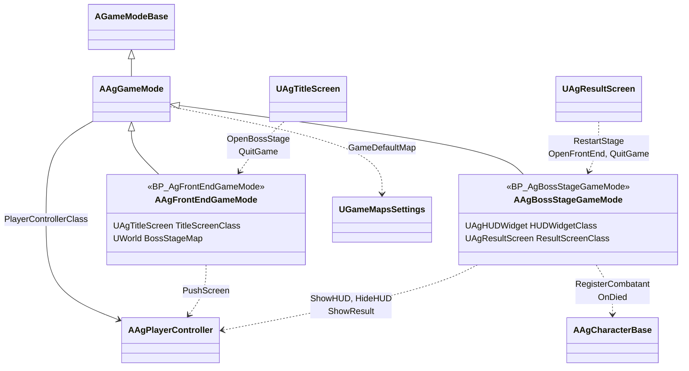
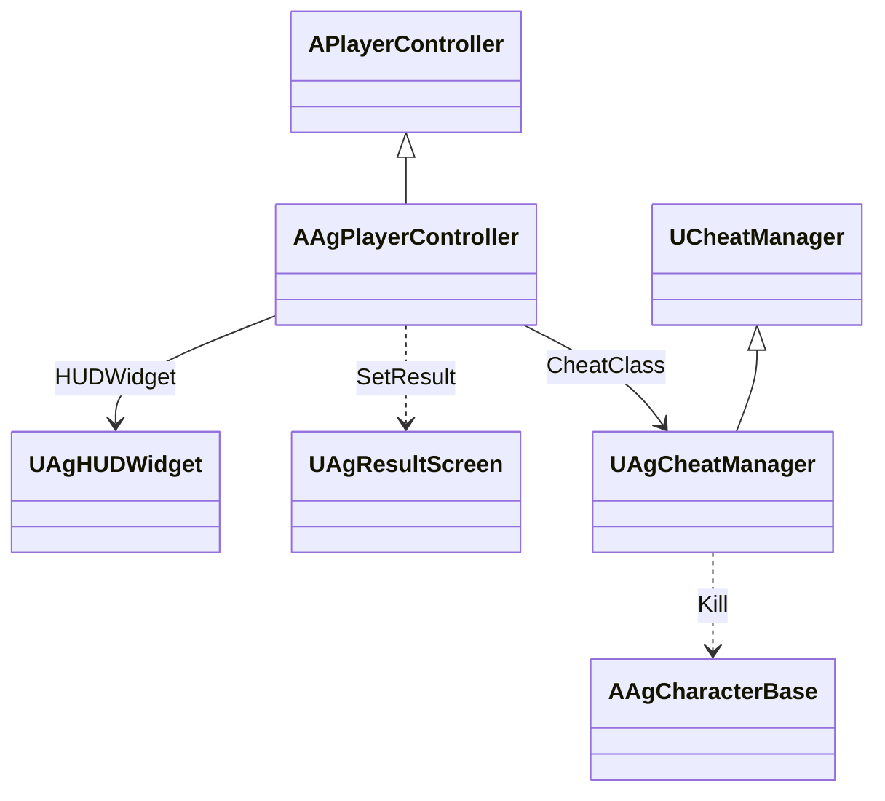
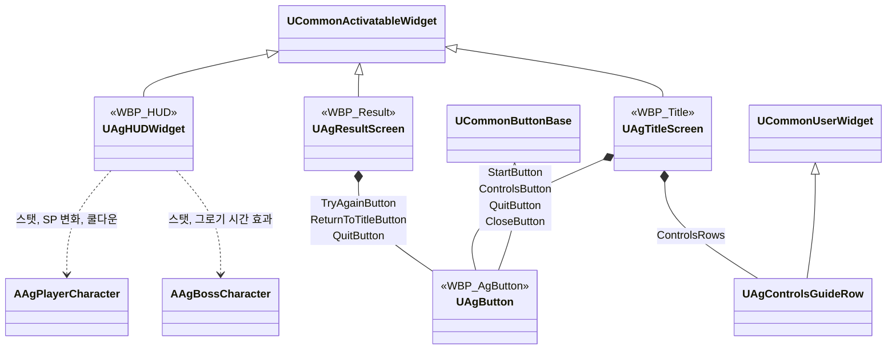
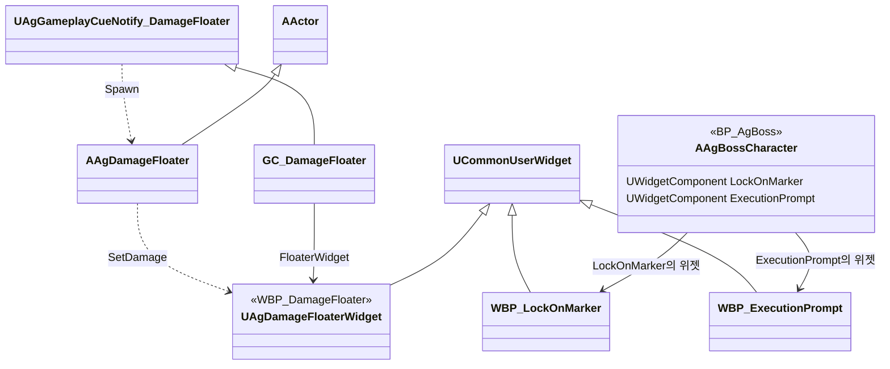

# HUD, 화면 UI, 게임 플로우

HUD, 화면 UI, 게임 플로우를 어떻게 구현할지 정합니다. 카메라와 화면 후처리는 [카메라와 화면 효과](<카메라와 화면 효과.md>)를 따릅니다.

## 기술 결정

| 항목 | 결정 | 이유 |
| - | - | - |
| HUD | `WBP_HUD`의 배치는 디자이너에서, 동작은 C++ 부모 클래스(BindWidget)에서 처리합니다. 감소 잔상은 HP 바, 플레이어 SP 바, 보스 PP 바 뒤의 잔상 바이고, 대기·줄어드는 시간은 `WBP_HUD` 기본값입니다([데이터 위치표](<데이터 위치표.md>)). SP 잔상은 HUD가 플레이어 ASC의 SP 변화 델리게이트를 듣다가 대미지 GE가 줄인 SP(가드·가드 브레이크)에만 세우고, 다른 감소는 잔상이 바를 바로 따라갑니다. 잔상은 게임 시간으로 흘러 슬로우모션에 맞춰 느려집니다. 조작 안내는 `WBP_HUD`의 글자에 키와 행동 이름을 그대로 적습니다. 플레이어나 보스의 사망 연출에는 상태 요소(플레이어 상태, 슬롯, 보스 상태)와 조작 안내를 담은 패널을 숨기고, 궁극기 컷신 동안(플레이어 컨트롤러의 시네마틱 모드)에도 숨겼다가 끝나면 되돌립니다. | 모양은 에셋이 정하고 코드는 값만 맡습니다. SP는 회피·달리기로도 줄어 바 값만으로는 가드 피격을 가릴 수 없고, 델리게이트가 넘기는 GE 정보로 가립니다. 조작 안내는 바뀌지 않는 문구라 화면 UI의 다른 문구처럼 위젯에 둡니다. 키 배치를 바꾸면 `IMC_Ag`와 함께 두 화면의 안내 문구도 고칩니다. |
| 슬롯 흐림, 쿨다운 표시 | 슬롯 흐림은 행동 태그(`Ability.Action.Skill`, `Ability.Action.Ultimate`)로 찾은 스펙의 독립 인스턴스에서 공통 비용 확인을 불러 정하고, 스킬 슬롯의 비용 숫자도 어빌리티의 비용(`GetCost`)을 씁니다. 스펙은 입력 계층과 같은 함수(`UAgAbilitySystemComponent::FindSpecByTag`)로 찾습니다. 쿨다운 표시는 해당 스펙 인스턴스가 출처인 쿨다운 GameplayEffect에서 남은 시간과 전체 시간을 읽어, 숫자는 위젯에 쓰고 원형 표시 머티리얼에는 남은 비율만 넘깁니다. | 사용 조건과 쿨다운을 어빌리티 한 곳에만 둡니다. 덮는 모양은 머티리얼이 정합니다. |
| 그로기·처형 중 PP 바 | `State.Groggy`를 주는 효과의 지난 시간 ÷ 지속 시간만큼 채웁니다. 공중에서도 같은 효과의 시간을 쓰고, 감소 잔상도 이 채운 값을 따라갑니다. 보스에게 `State.Execution`이 있으면 PP 바와 감소 잔상 갱신을 건너뛰어 마지막 표시값을 유지합니다. 처형 상태가 끝나면 실제 PP 표시로 돌아갑니다. 처형 없이 그로기가 끝날 때도 실제 PP를 표시합니다. | 처형 전환으로 그로기 효과가 제거되어도 바가 0으로 떨어지지 않도록 기존 표시를 유지합니다. 실제 PP 회복은 [보스](<보스.md>) '그로기와 처형 피격'을 따릅니다. |
| 월드 위치 HUD | 락온 마커, 처형 안내, 대미지 숫자는 화면 공간 위젯 컴포넌트로 표시합니다. 락온 마커와 처형 안내는 보스의 락온 지점과 머리 본에 붙이고(락온 마커와 카메라가 쓰는 `LockOnBone`, 처형 안내를 붙이는 `ExecutionPromptBone`은 `AgBossCharacter.cpp`의 상수로만 둡니다. 락온 본이 없으면 보스의 액터 위치를 씁니다), 보스가 매 프레임 표시 여부를 정하며, 플레이어 컨트롤러가 시네마틱 모드(궁극기 컷신)이면 숨깁니다. 처형 안내는 보스가 그로기 중일 때 플레이어 처형 행동의 Targeting을 읽기 전용으로 평가해 이 보스가 그 대상이면 표시합니다. 대미지 숫자는 대미지 GameplayEffect가 실행하는 큐(`GC_DamageFloater`)가 플레이어가 준 대미지일 때 맞은 위치(처형 타격은 대상의 캡슐 중심)에 액터를 생성하고, 액터가 떠오르는 동안 투명해지는 것은 위젯 애니메이션이 맡습니다. 표시 시간(애니메이션 길이)과 떠오르는 높이는 위젯에 둡니다. 대미지 숫자는 실제 시간으로 흘러 슬로우모션의 영향을 받지 않습니다. | 대미지 숫자는 HUD가 숨은 뒤에도 끝까지 재생해야 해 HUD와 따로 둡니다. 위젯 애니메이션은 실제 시간으로 재생되므로, 떠오르는 것도 실제 시간으로 세면 둘을 맞추려고 게임 속도를 넘길 필요가 없습니다. |
| UP 게이지 | 텍스처 없는 기능용 UI 머티리얼로 슬롯 테두리를 채웁니다. 채우는 모양은 머티리얼이 정하고, 코드는 UP 비율만 머티리얼 파라미터로 넘깁니다. 채우는 수식은 머티리얼의 Custom 노드(HLSL) 하나에 넣어 그래프를 작게 둡니다. | 코드가 아트를 직접 그리지 않고 모양은 에셋이 맡습니다. 수식이 텍스트라 AI도 고칠 수 있습니다. |
| 화면 UI | 타이틀과 결과 UI는 CommonUI 화면으로 만듭니다. 화면마다 입력 모드(화면 UI는 UI 전용 입력과 커서 표시, HUD는 게임 입력과 커서 숨김)와 첫 선택 버튼을 정합니다. 화면의 버튼은 모두 공용 버튼 `WBP_AgButton`을 쓰고, 상태별 모양과 효과음은 표준 버튼 스타일 `ButtonStyle_Ag`가 정합니다. 실행 키(좌클릭, Enter, Space)는 Slate 버튼의 기본 처리로 동작하므로 CommonUI 입력 데이터(확인·뒤로 액션)는 만들지 않고, CommonUI 설정 `CommonButtonAcceptKeyHandling`을 `TriggerClick`으로 둡니다. 결과 UI가 화면을 어둡게 하며 나타나는 페이드 인은 위젯 애니메이션(`FadeInAnimation`)이 맡고, 코드는 그것을 재생하고 끝나면 버튼을 켭니다. | 새 화면의 버튼도 같은 모양이 되도록 모양을 한 에셋에서 관리합니다. 페이드의 길이와 모양은 대미지 숫자처럼 위젯에서 바꿉니다. 조작 안내는 Confirm 버튼으로 닫으며 별도 CommonUI 입력 데이터가 필요하지 않습니다. 이 설정의 기본값(`Ignore`)은 Enter와 Space를 버튼에 넘기지 않습니다. |
| 타이틀 조작 안내 | `WBP_Title`에 `ControlsButton`, `ControlsPanel`, `CloseButton`, `ControlsRows`를 둡니다. `UAgTitleScreen`이 패널을 열고 닫으며, 열려 있는 동안 타이틀 버튼 각각을 비활성화합니다. Confirm 버튼으로 닫은 뒤 `ControlsButton`에 포커스를 돌립니다. 패널 배경은 화면 전체에서 마우스 입력을 가로막고, Confirm 버튼의 방향 탐색은 모두 Stop입니다. 타이틀 버튼은 위·아래 연결만 명시합니다. | 배경 클릭과 키보드로 팝업 뒤 버튼이 실행되는 일을 막습니다. |
| 팝업의 조작 안내 | `WBP_Title`의 `ControlsRows`에 `WBP_ControlsGuideRow`를 항목마다 하나씩 놓고, 행 위젯의 `Keys`, `Action`, `Description`에 문구를 적습니다. 행 위젯은 설명이 비어 있으면 설명 줄을 숨깁니다. | 문구를 디자이너에서 보며 고칩니다. 행의 배치와 글자 크기는 행 위젯이 정합니다. |
| 결과 처리 | 보스전 게임 모드가 플레이어와 보스의 사망 가운데 먼저 처리된 것으로 결과(보스는 Stage Clear, 플레이어는 Game Over)를 정하고, 사망 연출 시간이 지나면 결과 UI를 띄웁니다([사망 처리](<사망 처리.md>) '사망에서 결과 UI까지'). 그 밖의 캐릭터가 사망해도 결과와 HUD는 바뀌지 않습니다. Try Again은 레벨을 다시 로드합니다. | 게임 플로우의 Stage Clear와 Game Over는 보스와 플레이어의 사망으로만 정해집니다. |

## 클래스 구조

### 게임 모드

레벨마다 하나씩 있습니다. 타이틀로 돌아가기와 게임 종료는 부모 `AAgGameMode`가, 보스전 열기는 타이틀용이, 다시 시작은 보스전용이 맡습니다.

| 클래스 | 부모 | 역할 |
| - | - | - |
| `AAgGameMode` | `AGameModeBase` | 타이틀로 돌아가기와 게임 종료. 타이틀용·보스전용 게임 모드의 부모 |
| `AAgFrontEndGameMode` | `AAgGameMode` | 타이틀 레벨의 흐름, 보스전 열기 |
| `AAgBossStageGameMode` | `AAgGameMode` | 보스전 레벨의 흐름, 결과 판정, 다시 시작(레벨 다시 열기) |

### 플레이어 컨트롤러

화면 UI를 만들고, 테스트용 콘솔 명령을 붙입니다.

| 클래스 | 부모 | 역할 |
| - | - | - |
| `AAgPlayerController` | `APlayerController` | HUD와 화면 UI 생성, 테스트용 콘솔 명령 연결 |
| `UAgCheatManager` | `UCheatManager` | 테스트용 콘솔 명령 (개발 빌드) |

### 화면 UI와 HUD

| 클래스 | 부모 | 역할 |
| - | - | - |
| `UAgHUDWidget` | `UCommonActivatableWidget` | `WBP_HUD`의 부모. 플레이어 상태, 슬롯, 보스 상태, 조작 안내. 보스전의 게임 입력 모드를 정합니다. |
| `UAgTitleScreen` | `UCommonActivatableWidget` | 타이틀 화면, 조작 안내 팝업과 포커스 전환 |
| `UAgControlsGuideRow` | `UCommonUserWidget` | 팝업의 키·행동·설명 한 항목. `WBP_ControlsGuideRow`의 부모 |
| `UAgResultScreen` | `UCommonActivatableWidget` | Stage Clear UI, Game Over UI |
| `UAgButton` | `UCommonButtonBase` | 화면 UI 버튼 |

### 월드 위치 HUD

보스에 붙어 월드 위치에 표시하는 위젯과, 대미지 숫자 큐가 맞은 위치에 띄우는 대미지 숫자입니다.

| 클래스 | 부모 | 역할 |
| - | - | - |
| 락온 마커·처형 안내 위젯 | `UCommonUserWidget` | 배치만 있어 C++ 부모 없이 바로 상속합니다. |
| `UAgDamageFloaterWidget` | `UCommonUserWidget` | `WBP_DamageFloater`의 부모. 숫자, 표시 시간과 떠오르는 높이 |
| `AAgDamageFloater` | `AActor` | 대미지 숫자를 맞은 위치에 띄우고, 떠오르며 투명해진 뒤 사라집니다. |

