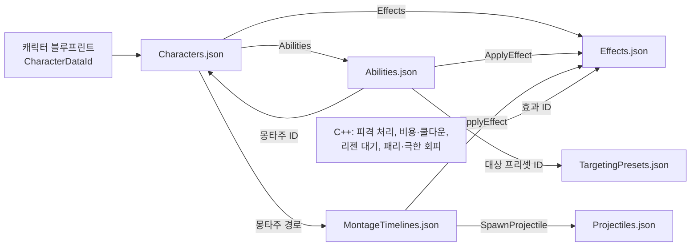

# JSON 데이터

기획서의 데이터(수치, 설정, 쓰는 에셋)는 주인이 분명한 곳에 둡니다. 각 데이터의 위치는 [데이터 위치표](<데이터 위치표.md>)에 정리합니다.

행동 정의의 형식은 아래 '행동'에 둡니다. 행동이 실행되는 구조와 Task 목록은 [어빌리티와 AbilityTask](<어빌리티와 AbilityTask.md>)를, 몽타주 안의 구간과 지점은 [몽타주 시간표](<몽타주 시간표.md>)를 따릅니다.

## 기술 결정

| 항목 | 결정 | 이유 |
| - | - | - |
| 형식 | 전투 데이터의 수치·설정·구현 값·클래스 연결·에셋 경로는 모두 `Data` 폴더의 JSON을 유일한 원본으로 둡니다. 전투 데이터를 담는 UE 에셋(DataAsset, DataTable, GE 블루프린트, TargetingPreset)과 GE C++ 클래스는 두지 않습니다. 엔진 컴포넌트·애님 그래프·몽타주의 연출 노티파이 등 개별 에셋의 제작 데이터와 공통 C++ 구현 상수는 그 에셋과 코드에 둡니다. 이동·가드 이동·공중 반복 모션의 선택은 ABP 멤버 기본값에 둡니다([애니메이션과 이동](<애니메이션과 이동.md>)). | 에셋 선택을 포함한 데이터 변경을 텍스트로 검토하고 병합합니다. |
| 파일 구성 | 종류마다 파일 하나를 둡니다(아래 '파일 구성'). 셰이크 단계별 값과 공통 진동수는 `Camera.json`에, GameplayCue의 모든 제작 설정(베기 선 거리·높이 범위, VFX·효과음·배치·모양과 숫자 위젯)은 JSON에 두지 않고 큐 블루프린트에, 공격 예고가 켜지는 구간은 보스 패턴 몽타주의 노티파이에, 화면의 크기·배치와 위젯 애니메이션의 재생 길이는 위젯에, 글자 크기 단계는 CommonUI 글자 스타일에 둡니다. | 같은 종류의 정의를 한 파일에서 보고, 여러 캐릭터가 같은 어빌리티·효과 정의를 함께 씁니다. |
| 어빌리티 정의 | `Abilities.json`의 항목 하나가 행동 하나의 정의입니다(아래 '행동'). 모든 행동이 단일 Runner(`UAgGameplayAbility`)로 실행되므로 정의에 클래스 경로가 없습니다. Task 항목은 Task 이름(`Task`)과 그 Params의 필드로 적고, 선택 블록·선택 필드는 적었는지로 쓰는지를 구분합니다. | 있는 Task를 조합한 새 행동은 C++ 없이 JSON과 몽타주로 더하고, 클래스·구조체 타입 문자열을 데이터에 중복하지 않습니다. |
| 효과 정의 | `Effects.json`의 항목 하나가 GameplayEffect 하나입니다(아래 '효과'). 에셋 매니저가 읽을 때 GE 객체를 만들고, 코드와 데이터는 효과 ID로 가리킵니다. 대미지·패리 PP 계산과 피격 결과 처리처럼 로직이 있는 클래스는 C++로 두고 효과 정의가 클래스 경로로 가리킵니다. | GE의 지속 방식·주기·태그·값을 텍스트로 고치고, 계산이 같은 새 효과는 C++ 없이 더합니다. |
| 대상 프리셋 | `TargetingPresets.json`의 항목 하나가 TargetingPreset 하나입니다(아래 '대상 프리셋'). 에셋 매니저가 읽을 때 프리셋 객체를 만들고, 행동은 프리셋 ID로 가리킵니다. Task는 클래스 경로와 바꿀 속성만 적고, 적지 않은 속성은 그 클래스의 기본값입니다. | Task 순서와 값을 텍스트로 고치고 검토합니다. 여러 행동이 같은 프리셋을 함께 씁니다. 엔진 Task는 속성이 많아, 모두 적게 하면 바꾼 값이 묻힙니다. |
| 읽는 방법 | `UAgAssetManager`가 엔진 초기화(`StartInitialLoading`) 때 모든 파일을 같은 타입의 새 객체에 한 묶음으로 읽고, 모두 통과하면 지금 객체에 한꺼번에 복사합니다. ID로 가리켜지는 정의 파일을 먼저 읽습니다. 효과와 대상 프리셋은 읽은 정의로 읽을 때마다 새 객체(GE, TargetingPreset)를 만듭니다. 데이터가 가리키는 에셋(몽타주, 투사체 블루프린트, `ST_Boss`)도 이때 읽혀, 패키지 게임은 타이틀 화면부터 두 캐릭터의 에셋을 메모리에 둡니다. | 잘못된 파일이 기존 정상 값의 일부를 덮지 않습니다. GE를 같은 이름으로 다시 만들면 엔진이 기존 객체를 그 자리에서 다시 만들어 걸려 있는 효과가 망가집니다. |
| 검증 시점 | 검증은 읽기와 함께 합니다. 쿡에서는 배포할 모든 JSON의 최신 내용을 읽어, 하나라도 오류가 있으면 쿡과 패키징을 실패시킵니다. 검증한 JSON과 배포하는 JSON은 같아야 합니다. 정의 ID 검사는 에디터 전용 메타데이터를 쓰므로 패키징된 게임에서는 하지 않습니다. | 배포 전에 데이터 오류를 차단합니다. |
| 오류 검사 | 검사와 오류 출력은 JSON을 리플렉션으로 읽는 함수 하나(`UAgAssetManager::ReadJson`)가 맡고, 데이터 클래스와 Task에는 두지 않습니다. 어느 파일의 어느 필드가 틀렸는지 알 수 있는 정도만 검사합니다: 문법, 모르는 키, 엔진 변환(`FJsonObjectConverter`)이 받지 못한 값(형식, enum 이름), 없는 에셋·클래스, 등록되지 않은 태그, 없는 정의 ID(`DataId` 메타데이터가 가리키는 파일의 최상위 키). 빠진 키와 null은 기본값입니다. 오류는 찾는 즉시 파일명과 필드 경로로 로그·화면에 표시하고, 이전 정상 데이터 전체를 유지합니다. 캐릭터 데이터의 최초 로딩에 실패하면 전투를 시작하지 않습니다. | 오타는 모르는 키·변환 실패·없는 ID로 드러납니다. 값의 범위나 필드 조합, 몽타주 에셋과의 대조까지 검사하면 검사 코드가 데이터 구조마다 늘어나므로, 그런 실수는 플레이에서 찾습니다. |
| 다시 읽기 | 에디터는 Data 폴더의 JSON 저장을 감지해 모든 파일을 함께 다시 읽고, 모두 통과해야 바꿉니다. 파일 사이에 참조가 있어, 한 파일이라도 오류가 있으면 다른 파일의 변경도 반영되지 않습니다. 행동의 수치·대상·몽타주·Task와 시간표는 다음 발동부터, 행동 태그와 `Activation`(태그 조건, 트리거, 재발동 정책)은 캐릭터를 다시 만든 뒤부터 적용됩니다. 스탯·시작 효과·AI 트리 등 스폰 때 설정하는 값은 다음 플레이부터 적용됩니다. 코드가 거는 효과는 다음에 걸 때부터 새 정의를 쓰고, 걸려 있는 효과는 끝날 때까지 이전 GE로 동작합니다. 이미 재생 중인 몽타주를 강제로 교체하지 않습니다. 패키징 빌드는 파일을 감시하지 않습니다. 배열 원소 포인터·참조는 함수 안에서만 사용하고, 이후에는 ID로 다시 조회합니다. | 에디터 재시작이나 C++ 빌드 없이 JSON을 고쳐 다시 플레이할 수 있습니다. 다시 읽기에 실패하면 기존 정상 값을 유지합니다. |
| 패키징 | JSON 파일은 `RuntimeDependencies`로 UFS에 넣습니다. 전체 JSON의 검증과 실패 처리는 '검증 시점'을 따릅니다. `UAgAssetManager::ModifyCook`은 같은 묶음 읽기로 모든 파일을 검사하고, 읽은 객체의 참조(Transient 포함)가 속한 패키지를 쿡 목록에 추가합니다. 네이티브 클래스의 /Script 패키지는 제외합니다. | JSON 문자열과 Transient 참조는 저장된 에셋 의존성이 아니므로 쿡 단계에 직접 전달해야 합니다. |
| 데이터를 찾는 방법 | 파일 이름과 그 파일을 읽는 클래스는 에셋 매니저에 정해 둡니다. 캐릭터 블루프린트는 `CharacterDataId`를 목록에서 고르며, 목록에는 그 캐릭터 클래스의 데이터 클래스에 맞는 ID만 나옵니다. 캐릭터는 컴포넌트를 초기화하기 전(`PreInitializeComponents`)에 한 번 확인하고(없거나 맞지 않으면 멈춤), 그 밖의 코드는 있다고 보고 씁니다. | 코드에 에셋 경로를 쓰지 않습니다. 확인을 한 곳에서 해, 쓰는 곳마다 데이터가 있는지 묻지 않습니다. 파일마다 그 파일을 읽는 클래스가 정해져 있어 이름을 바꿀 일이 없습니다. |
| 어빌리티의 데이터 | 캐릭터는 어빌리티 목록의 ID마다 단일 Runner를 독립 스펙으로 부여하고, 각 스펙 인스턴스가 자기 ID의 정의를 씁니다. 발동할 때 정의와 몽타주를, 재생을 시작할 때 그 몽타주의 시간표를 복사하고, 발동 Task와 시간표 Task는 그 사본으로 만듭니다. 부여할 때 연결한 행동 태그와 `Activation`이 바뀌면 캐릭터를 다시 만들 때까지 발동을 거부합니다. | 진행 중인 실행에 새 파일의 일부가 섞이지 않고, 클래스 CDO를 행동별 설정으로 덮지 않습니다. |

## 파일 구성

| 파일 | 내용 | 최상위 키 |
| - | - | - |
| `Characters.json` | 캐릭터마다 스탯, 쓰는 어빌리티 ID 목록(부여 순서), 시작할 때 거는 효과 ID 목록, 몽타주 ID별 에셋, 캐릭터 종류별 값(플레이어의 입력·가드·락온 값, 보스의 AI·페이즈 값) | 캐릭터 ID(`Player`, `Boss`) |
| `Abilities.json` | 행동 정의(아래 '행동'). 두 캐릭터가 함께 쓰는 정의(`KnockBack`, `KnockUp`)는 하나입니다. | 어빌리티 ID |
| `Effects.json` | GameplayEffect 정의 | 효과 ID |
| `Projectiles.json` | 투사체 클래스, 비행 값, 공격 값 | 투사체 ID |
| `MontageTimelines.json` | 몽타주 시간표([몽타주 시간표](<몽타주 시간표.md>)) | 몽타주 경로 |
| `TargetingPresets.json` | 대상 프리셋 정의(아래 '대상 프리셋') | 프리셋 ID |
| `CombatRules.json` | 모든 캐릭터에 공통인 전투 규칙과 HUD 감소 잔상의 대기·감소 시간 | 속성 이름 |
| `Camera.json` | 락온 카메라와 셰이크의 상황별 단계 | 속성 이름 |

- 정의 파일 다섯은 최상위가 ID를 키로 하는 객체입니다.
- 에셋은 전체 객체 경로(`/Game/폴더/에셋.에셋`)로, 클래스는 네이티브 클래스 경로(`/Script/Ag.클래스`)나 생성 클래스 경로(`/Game/폴더/BP_Name.BP_Name_C`)로 적습니다.
- 빠진 키는 그 속성의 기본값입니다. 쓰지 않는 필드 몇 개 때문에 구조체를 나누지 않습니다. 적었는지로 쓰는지가 정해지는 선택 블록과 선택 필드(아래 '행동')는 엔진 `TOptional` 속성이라, 쓰지 않으면 적지 않습니다.
- UPROPERTY는 맵 값으로 배열을 담지 못해, 배열이나 맵 하나만 가진 구조체로 감쌉니다. 이런 구조체는 감싸는 키 없이 그 배열이나 맵을 바로 적습니다(시간표의 섹션별 항목 배열, 대상 프리셋의 Task 배열).
- 캐릭터 ID와 데이터 클래스의 짝(`Player`는 `UAgPlayerData`, `Boss`는 `UAgBossData`)은 에셋 매니저 생성자에 적습니다. 항목의 형식을 데이터 클래스가 정하기 때문입니다. 캐릭터를 더할 때는 이 짝을 하나 더합니다.
- 행동의 몽타주 ID(`Montage.MontageId`)는 그 행동을 쓰는 캐릭터의 `Montages`에서 찾습니다. 두 캐릭터가 같은 정의를 쓰면서 각자의 몽타주를 재생합니다.

## 행동

`Abilities.json`의 항목은 `FAgAbilityData`입니다. 각 필드가 실행에서 하는 일은 [어빌리티와 AbilityTask](<어빌리티와 AbilityTask.md>)를 따릅니다.

| 필드 | 뜻 | 엔진 |
| - | - | - |
| `Tags` | 행동 태그. 입력 계층·HUD·취소가 이 태그로 행동을 찾습니다. | 스펙의 `DynamicSpecSourceTags` |
| `Cooldown` | 쿨다운(초). 0이면 쿨다운 효과를 걸지 않습니다. | 쿨다운 효과(`Cooldown`)의 지속 시간 |
| `Activation` | 발동 조건: `RequiredTags`, `BlockedTags`, `OwnedTags`, `BlockTags`, `CancelTags`, `Triggers`, `bAllowRetrigger` | `ActivationRequiredTags`, `ActivationBlockedTags`, `ActivationOwnedTags`, `BlockAbilitiesWithTag`, `CancelAbilitiesWithTag`, 스펙의 `DynamicAbilityTriggers` |
| `Activation.Triggers` | `{"Tag", "Source"}`의 배열. `Source`는 `GameplayEvent`(그 이벤트를 받으면 발동)나 `OwnedTagPresent`(태그가 붙으면 발동하고, 떨어지면 엔진이 취소)입니다. | `FAbilityTriggerData` |
| `Cost` | 선택. `{"Resource", "Amount"}`. `Resource`는 `SP`, `MP`, `UP` 가운데 하나입니다. | 자원 효과(`Resource`) |
| `Targeting` | 선택. 대상을 정하는 프리셋의 ID(`Preset`, `TargetingPresets.json`의 ID)와 요청 조건(`Range`, `TargetRequiredTags`, `TargetBlockedTags`, `bRequired`, `StopDistance`). `Preset` 밖의 필드는 선택입니다. | GameplayTargetingSystem |
| `Montage` | 선택. 재생할 몽타주(`MontageId`, 그 캐릭터 `Montages`의 ID) | |
| `End` | 행동이 끝나는 때. `Montage`(재생이 끝날 때)나 `TriggerTag`(`OwnedTagPresent` 트리거의 태그가 사라질 때) | |
| `Tasks` | 발동 동안 실행하는 Task의 배열. 항목은 `{"Task": 이름, Params의 필드}`입니다. | `UAbilityTask` |
| `PatternSelection` | 선택. 보스 AI가 패턴을 고르는 값: `Phases`(1·2), `WeightNear`, `WeightMid`, `WeightFar`, `ResponseRange`, `ResponseChance`([보스](<보스.md>) '패턴 선택') | |

- 선택 블록은 그 행동이 쓸 때만 적습니다. `Targeting`의 `Range`를 적지 않으면 거리 제한이 없고, `StopDistance`를 적지 않으면 캐릭터의 `StopDistance`입니다.
- Task 이름과 Params의 필드, 선택 필드, 둘 수 있는 곳은 [어빌리티와 AbilityTask](<어빌리티와 AbilityTask.md>)의 '스키마와 등록'과 'Task 목록'을 따릅니다. 같은 Task를 시간표에 두는 형식은 [몽타주 시간표](<몽타주 시간표.md>)를 따릅니다.

## 효과

### 형식

| 필드 | 뜻 | 엔진 |
| - | - | - |
| `DurationPolicy` | `Instant`, `HasDuration`, `Infinite` | `DurationPolicy` |
| `Duration` | `HasDuration`의 시간(초). 적지 않으면 거는 코드가 정합니다. | `DurationMagnitude` |
| `Period` | 주기(초) | `Period` |
| `ExecutePeriodicOnApplication` | 걸자마자 한 번 실행하는지 | `bExecutePeriodicEffectOnApplication` |
| `PeriodicInhibitionPolicy` | 꺼졌다 켜질 때 주기를 어떻게 하는지 | `PeriodicInhibitionPolicy` |
| `Modifiers` | `Attribute`, `Op`(`Add`, `Override`)와 크기 하나: `Value`(고정 값), `PerSecond`(초당 값), `SetByCaller`(코드가 넣는 값의 태그), `FromAttribute`(대상의 다른 어트리뷰트). 어트리뷰트는 엔진 필드 경로(`/Script/Ag.AgAttributeSet:SP`)로 적습니다. | `Modifiers` |
| `Executions` | 계산 클래스 경로 목록 | `Executions` |
| `AssetTags` | 효과를 알아보는 태그 | 에셋 태그 컴포넌트 |
| `GrantedTags` | 걸려 있는 동안 대상에 붙는 태그 | 대상 태그 컴포넌트 |
| `ApplicationIgnoredTags` | 대상에 있으면 걸지 않는 태그 | 대상 태그 조건 컴포넌트 |
| `OngoingRequiredTags`, `OngoingIgnoredTags` | 걸려 있는 동안 효과가 켜지는 조건 | 대상 태그 조건 컴포넌트 |
| `Components` | 프로젝트 GE 컴포넌트 클래스 경로 목록 | `GEComponents` |

- 적지 않은 필드는 엔진 기본값입니다.
- `PerSecond`는 주기가 있는 효과에만 씁니다. 로더가 `PerSecond × Period`를 한 번에 더할 값으로 넣습니다. 기획서의 초당 값을 그대로 적기 위해서입니다.
- `Instant`에는 `Period`, 주기 설정, `GrantedTags`, 지속 조건을 쓸 수 없습니다. `Duration`은 `HasDuration`에만 씁니다.
- 필드는 지금 효과들이 쓰는 것만 둡니다. 새 효과가 다른 GE 설정을 필요로 하면 그때 필드를 더합니다.
- 엔진의 GE 쪽 GameplayCue(`GameplayCues`)는 두지 않습니다. 엔진이 그 큐가 켜졌는지를 GE 클래스로 판단하기 때문입니다. 큐는 피격 처리와 노티파이가 실행합니다.
- 엔진은 컴포넌트 목록을 `AddComponent<T>`로만 열어 두므로, `Components`에 쓸 수 있는 프로젝트 컴포넌트는 로더가 아는 클래스(`UAgHitResultGameplayEffectComponent`)뿐입니다.

### 효과에 두는 값

효과 정의에는 그 효과에서 하나로 정해진 값을 둡니다. 쓰는 곳마다 다른 값(공격 배율과 적중 충전량, 행동의 비용·쿨다운)은 시간표와 행동 정의에 두고, 적용할 때 SetByCaller와 지속 시간으로 넘깁니다. 한 행동만 쓰는 시간·보상·소모(패리 구간, 극한 회피, 회피 반격 기회, 그로기 시간, 달리기 소모)는 그 효과의 값이라 효과 정의에 둡니다.

### 코드가 효과를 쓰는 방법

- 코드가 거는 효과는 `EAgEffect`의 값이고, 값 이름이 효과 ID입니다. 이 효과들은 `Effects.json`에 있어야 하고, 코드가 넘기는 SetByCaller 값을 받을 수 있어야 합니다.
- 데이터가 거는 효과(행동 정의와 시간표의 ApplyEffect)는 효과 ID로 적습니다. 구간에 두는 효과는 `Infinite`입니다. 구간의 길이는 시간표가 정하기 때문입니다.
- 스펙은 GE 객체로 만듭니다(ASC와 어빌리티의 `MakeEffectSpec`). 넘길 값이 없는 효과는 ASC의 `ApplyGameplayEffectToSelf`에 GE 객체를 넘깁니다. 어빌리티의 `ApplyGameplayEffectToOwner`는 받은 GE의 클래스 기본 객체로 스펙을 만들어 쓰지 않습니다.
- 스펙에 값을 넣는 일은 그 값을 가진 구조체가 맡습니다(`AddToSpec`).
- 실행 중에 만든 GE는 모두 같은 클래스라, 걸린 효과는 엔진의 GE 클래스 기준 조회 대신 효과의 `AssetTags`나 부여 태그로 찾습니다.

## 몽타주 관리

몽타주 경로의 원본은 `Characters.json` 캐릭터 항목의 `Montages`입니다. 행동 정의의 `Montage.MontageId`, 사망 모션(`DeathMotions`), 코드가 직접 재생하는 모션(`Jump`, `Flinch`, `GuardFlinch`)은 이 ID를 가리키고 에셋 경로를 다시 적지 않습니다. 한 행동의 여러 모션은 ID를 나누지 않고 한 몽타주의 섹션으로 둡니다. ID는 에셋 파일 이름이 아니라 모션을 고르는 키라, 같은 ID에 캐릭터마다 다른 에셋을 둘 수 있습니다. 에셋을 옮기거나 이름을 바꾸면 JSON 경로와 그 몽타주 시간표의 키(몽타주 경로)도 함께 바꿉니다. 실제 ID와 에셋은 [데이터 위치표](<데이터 위치표.md>)를 따릅니다.

## 투사체 정의

`Projectiles.json`의 항목은 `FAgProjectileDefinition`이고, `ProjectileClass`, `Params`(`FAgProjectileParams`: Speed·Range), `Attack`(`FAgPlayerAttackHit`: DamageMultiplier·PoiseMultiplier·HitReaction·bGuardable·MPCharge·UPCharge)으로 구성합니다. 속도·사거리는 양수입니다. 같은 클래스라도 비행 설정이나 공격 값이 다르면 별도 ID를 사용합니다.

발사 시각·투사체 ID·발사 기준과 소켓은 몽타주 시간표의 SpawnProjectile 항목에 둡니다. 클래스·속도·사거리·공격 값은 투사체가 가지므로 `Projectiles.json`에만 둡니다. 실제 데이터 위치는 [데이터 위치표](<데이터 위치표.md>), 생성 순서와 수명은 [전투 규칙](<전투 규칙.md>)을 따릅니다.

## 대상 프리셋

`TargetingPresets.json`의 항목은 프리셋 ID마다 GameplayTargetingSystem Task의 배열입니다. 로더가 이 순서대로 Task를 넣은 `UTargetingPreset`을 만들고, 행동은 `Targeting.Preset`에 ID를 적습니다. 프리셋마다 하는 일과 Task 순서는 [어빌리티와 AbilityTask](<어빌리티와 AbilityTask.md>) '대상'을 따릅니다.

- Task 항목은 `{"Class": Task 클래스 경로, 바꿀 속성}`입니다. 적지 않은 속성은 그 클래스의 기본값입니다. 에디터의 프리셋에서 고칠 수 있는 속성만 적을 수 있습니다. 구조체 속성도 바꿀 필드만 적습니다(예: `"Radius": {"Value": 5000}`).
- 오브젝트 타입 배열(AOE의 `CollisionObjectTypes`)은 에디터에 보이는 채널 이름(`Pawn`)으로 적습니다. 엔진 값(`ObjectTypeQuery3`)은 프로젝트 충돌 설정의 순서로 정해지기 때문입니다.
- 행동의 `Range`는 프리셋의 거리 필터(`UAgTargetingFilterTask_Distance`)가, 대상 태그는 태그 조건 필터(`UAgTargetingFilterTask_TagRequirements`)가 적용합니다. 그 필터가 없는 프리셋에서는 그 조건을 쓰지 않습니다.

## 클래스 구조

| 클래스 | 부모 | 역할 |
| - | - | - |
| `UAgAssetManager` | `UAssetManager` | 프로젝트의 에셋 매니저('읽는 방법'). 데이터 객체를 모두 들고, 모든 파일을 한 묶음으로 새 객체에 읽어(`ReadJson`) 복사합니다. 읽은 정의로 TargetingPreset을 만들고, 읽은 참조를 쿡에 전달합니다. 엔진과 데이터 클래스만 알고 게임 코드는 include하지 않습니다. |
| `UAgCharacterData`, `UAgPlayerData`, `UAgBossData` | `UObject` | `Characters.json` 캐릭터 항목의 값. 어빌리티·효과는 ID 목록이고, 어빌리티 정의 조회(`FindAbility`)는 그 캐릭터의 목록에 있는 ID만 `Abilities.json`에서 찾아 줍니다. |
| `UAgAbilitySet` | `UObject` | `Abilities.json`의 값. ID마다 `FAgAbilityData`(위 '행동') |
| `UAgEffectSet` | `UObject` | `Effects.json`의 정의(`FAgEffectDefinition`)와 그 정의로 만든 GE 객체. 효과 ID마다 하나입니다. |
| `UAgProjectileSet` | `UObject` | `Projectiles.json`의 값. ID마다 `FAgProjectileDefinition` |
| `UAgTargetingPresetSet` | `UObject` | `TargetingPresets.json`의 정의(Task 배열)와 그 정의로 만든 TargetingPreset. 프리셋 ID마다 하나입니다. |
| `UAgMontageTimelineData` | `UObject` | `MontageTimelines.json`의 값([몽타주 시간표](<몽타주 시간표.md>)) |
| `UAgCombatRules` | `UObject` | `CombatRules.json`의 값. 공통 전투 규칙과 HUD 감소 잔상 시간 |
| `UAgCameraData` | `UObject` | `Camera.json`의 값. 셰이크 단계에 해당하는 설정과 공통 진동수 |

Task의 Params는 각 Task의 헤더에 있고, 공통 부모(`FAgTaskParams`)와 이름 규칙으로 찾기는 `AgTaskParams`가 맡습니다([어빌리티와 AbilityTask](<어빌리티와 AbilityTask.md>) '스키마와 등록'). 효과 정의로 GE를 만드는 일은 `AgEffectData`가 맡습니다. 스펙을 만들고 값을 넣는 곳은 '코드가 효과를 쓰는 방법'을 따릅니다.

```mermaid
classDiagram
    direction LR
    class UAgEffectSet {
        <<Effects.json>>
    }
    class UAgAbilitySet {
        <<Abilities.json>>
    }
    class UAgProjectileSet {
        <<Projectiles.json>>
    }
    class UAgTargetingPresetSet {
        <<TargetingPresets.json>>
    }
    class UAgCharacterData {
        <<Characters.json 항목>>
    }
    UAssetManager <|-- UAgAssetManager
    UAgAssetManager *-- UAgCombatRules : CombatRules
    UAgAssetManager *-- UAgCameraData : CameraData
    UAgAssetManager *-- UAgEffectSet : Effects
    UAgAssetManager *-- UAgProjectileSet : Projectiles
    UAgAssetManager *-- UAgMontageTimelineData : MontageTimelines
    UAgAssetManager *-- UAgTargetingPresetSet : TargetingPresets
    UAgAssetManager *-- UAgAbilitySet : Abilities
    UAgAssetManager *-- UAgCharacterData : Characters
    UAgEffectSet *-- UGameplayEffect : 효과 ID마다
    UAgTargetingPresetSet *-- UTargetingPreset : 프리셋 ID마다
    UAgCharacterData <|-- UAgPlayerData
    UAgCharacterData <|-- UAgBossData
```

