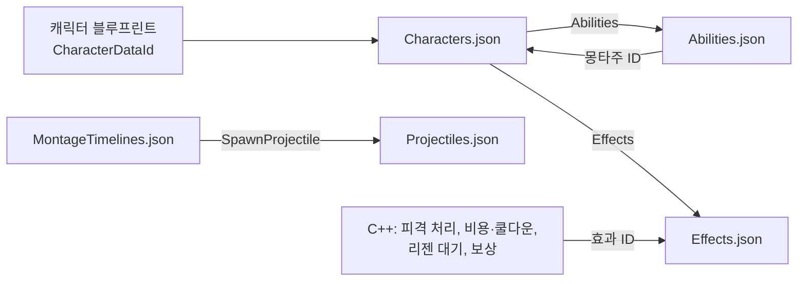
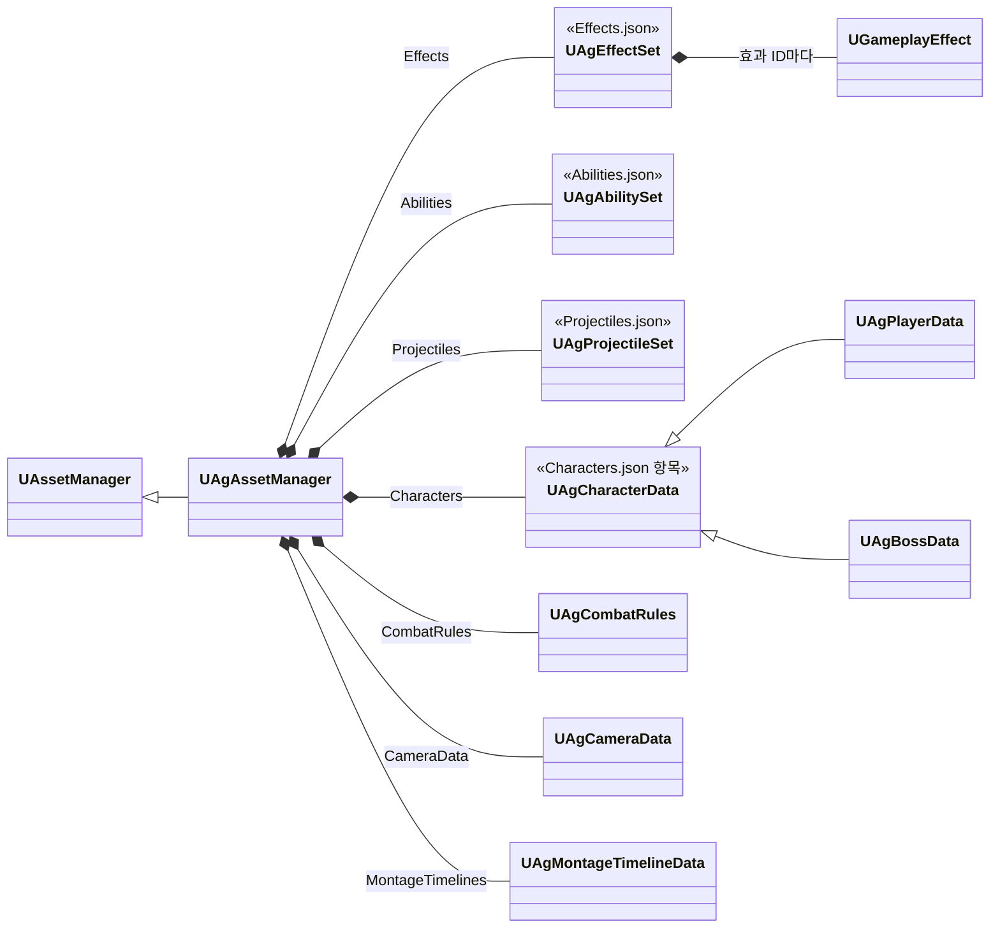

# JSON 데이터

기획서의 데이터(수치, 설정, 쓰는 에셋)는 주인이 분명한 곳에 둡니다. 각 데이터의 위치는 [데이터 위치표](<데이터 위치표.md>)에 정리합니다.

Ability의 고정 Tasks·선택 블록·명시적 null은 [AbilityTask 기반 어빌리티 설계안](<AbilityTask 기반 어빌리티 설계안.md>)을, 몽타주 안의 구간과 사건은 [몽타주 시간표](<몽타주 시간표.md>)를 따릅니다.

## 기술 결정

| 항목 | 결정 | 이유 |
| - | - | - |
| 형식 | 전투 데이터의 수치·설정·구현 값·클래스 연결·에셋 경로는 모두 `Data` 폴더의 JSON을 유일한 원본으로 둡니다. 전투 데이터를 담는 UE 에셋(DataAsset, DataTable, GE 블루프린트)과 GE C++ 클래스는 두지 않습니다. 엔진 컴포넌트·애님 그래프·몽타주의 연출 노티파이 등 개별 에셋의 제작 데이터와 공통 C++ 구현 상수는 그 에셋과 코드에 둡니다. 이동·가드 이동·공중 반복 모션의 선택은 ABP 멤버 기본값에 둡니다([애니메이션과 이동](<애니메이션과 이동.md>)). | 에셋 선택을 포함한 데이터 변경을 텍스트로 검토하고 병합합니다. |
| 파일 구성 | 종류마다 파일 하나를 둡니다(아래 '파일 구성'). 셰이크 단계별 값과 공통 진동수는 `Camera.json`에, GameplayCue의 VFX·효과음·배치·모양과 숫자 위젯은 큐 블루프린트에, 공격 예고가 켜지는 구간은 보스 패턴 몽타주의 노티파이에, 화면의 크기·배치와 위젯 애니메이션의 재생 길이는 위젯에, 글자 크기 단계는 CommonUI 글자 스타일에 둡니다. | 같은 종류의 정의를 한 파일에서 보고, 여러 캐릭터가 같은 어빌리티·효과 정의를 함께 씁니다. |
| 어빌리티 정의 | `Abilities.json` 항목에는 `Tags`, `Cooldown`, `Activation`, `Cost`, `Tasks`와 보스 선택 정보 `PatternSelection`을 기록합니다. `Tasks`는 기능별 고정 구조체이며 선택 블록의 존재와 0·null을 구분합니다. 이름별 맵·단일 객체 형식과 필수값은 [AbilityTask 기반 어빌리티 설계안](<AbilityTask 기반 어빌리티 설계안.md>)의 데이터 규약을 따릅니다. | 설정과 실행 요청을 분리하고 클래스·구조체 타입 문자열을 중복 관리하지 않습니다. |
| 효과 정의 | `Effects.json`의 항목 하나가 GameplayEffect 하나입니다(아래 '효과'). 에셋 매니저가 읽을 때 GE 객체를 만들고, 코드와 데이터는 효과 ID로 가리킵니다. 대미지·패리 PP 계산과 피격 결과 처리처럼 로직이 있는 클래스는 C++로 두고 효과 정의가 클래스 경로로 가리킵니다. | GE의 지속 방식·주기·태그·값을 텍스트로 고치고, 계산이 같은 새 효과는 C++ 없이 더합니다. |
| 읽는 방법 | `UAgAssetManager`가 엔진 초기화(`StartInitialLoading`) 때 모든 파일을 같은 타입의 새 객체에 한 묶음으로 읽습니다. 파일 사이의 참조까지 검사한 뒤 모두 통과하면 지금 객체에 한꺼번에 복사합니다. 순서는 참조되는 쪽이 먼저입니다: `CombatRules`, `Camera`, `Effects`, `Projectiles`, `MontageTimelines`, `Abilities`, `Characters`. 효과는 읽을 때마다 효과 ID에 읽은 횟수를 붙인 새 GE 객체로 만듭니다. 원본·임시 객체·실행 사본의 에셋은 GC가 추적합니다. 캐릭터 데이터가 가리키는 에셋(몽타주, 투사체 블루프린트, `ST_Boss`, `TP_Enemy`)도 이때 읽혀, 패키지 게임은 타이틀 화면부터 두 캐릭터의 에셋을 메모리에 둡니다. | 잘못된 파일이 기존 정상 값의 일부를 덮지 않습니다. GE를 같은 이름으로 다시 만들면 걸려 있는 효과가 망가집니다(아래 '엔진 제약'). |
| 검증 시점 | JSON 데이터의 검증은 에디터 로딩·재로드와 쿡에서 수행합니다. 쿡에서는 배포할 모든 JSON의 최신 내용을 검증하고, 하나라도 오류가 있으면 쿡과 패키징을 실패시킵니다. 검증한 JSON과 배포하는 JSON은 같아야 합니다. 패키징된 게임은 에디터 에셋 검사를 반복하지 않습니다. 고정 스키마 해석과 파일 사이 참조처럼 실행에 필수인 확인은 로딩 계약으로 유지합니다. 파일 읽기·JSON 파싱·값 변환·고정 스키마 해석·에셋 로딩과 이 과정의 실패 처리는 유지하며, 검증 전용 처리와 분리합니다. | 배포 전에 데이터 오류를 차단하고, 검증이 끝난 데이터를 게임 실행 중 다시 검사하지 않습니다. |
| 오류 검사 | 문법, 모르는 키, 빠진 키, 값 형식, 태그·열거형, 정수의 소수, 숫자의 유한성과 저장 타입 범위, 메타데이터의 허용 범위를 검사합니다. 맵의 빈 이름·중복 이름과 에셋 경로의 형식·존재·타입, 클래스의 부모 타입과 abstract 여부도 검사합니다. 리다이렉터를 거친 경로는 현재 경로로 고치도록 알립니다. 정의 ID의 빈 값·중복을 FName 기준으로 거부합니다. 파일 사이의 참조(캐릭터의 어빌리티·효과 ID, 어빌리티가 그 캐릭터에서 쓰는 몽타주 ID, 시간표의 투사체 ID), 기능별 필수값, C++ 사건이 요구하는 이름, 코드가 거는 효과의 모양을 검사합니다. 몽타주 시간표의 검사는 [몽타주 시간표](<몽타주 시간표.md>)의 '검증'을 따릅니다. 실패하면 파일명과 필드 경로를 로그·화면에 표시하고 이전 정상 데이터 전체를 유지합니다. 캐릭터 데이터의 최초 로딩에 실패하면 전투를 시작하지 않습니다. | 경로 오타나 잘못된 타입을 재생 시점 이전에 발견하고 부분 반영을 막습니다. 호출 코드가 요구하는 모션 ID의 누락은 아래 몽타주 관리의 조회 오류로도 알립니다. |
| 다시 읽기 | 에디터는 Data 폴더의 JSON 저장을 감지해 모든 파일을 함께 다시 읽고, 모두 통과해야 바꿉니다. 파일 사이에 참조가 있어, 한 파일이라도 오류가 있으면 다른 파일의 변경도 반영되지 않습니다. Ability의 수치·모션·투사체 설정은 다음 발동부터, 부여 태그·이벤트·재발동 정책은 재부여 또는 캐릭터 재생성 후 적용됩니다. 스탯·시작 효과·AI 트리 등 스폰 때 설정하는 값은 다음 플레이부터 적용됩니다. 코드가 거는 효과는 다음에 걸 때부터 새 정의를 쓰고, 걸려 있는 효과는 끝날 때까지 이전 GE로 동작합니다. 이미 재생 중인 몽타주를 강제로 교체하지 않습니다. 패키징 빌드는 파일을 감시하지 않습니다. 배열 원소 포인터·참조는 함수 안에서만 사용하고, 이후에는 ID로 다시 조회합니다. | 에디터 재시작이나 C++ 빌드 없이 JSON을 고쳐 다시 플레이할 수 있습니다. 다시 읽기에 실패하면 기존 정상 값을 유지합니다. |
| 패키징 | JSON 파일은 `RuntimeDependencies`로 UFS에 넣습니다. 전체 JSON의 검증과 실패 처리는 '검증 시점'을 따릅니다. 로더가 읽지 않는 JSON 파일과 쓰는 곳이 없는 정의(캐릭터가 쓰지 않는 어빌리티, 코드와 캐릭터가 쓰지 않는 효과, 시간표가 쏘지 않는 투사체, 캐릭터가 재생하지 않는 몽타주의 시간표)는 쿡 오류로 처리합니다. `UAgAssetManager::ModifyCook`은 같은 묶음 읽기로 모든 파일을 검사하고, 읽은 객체의 참조(Transient 포함)가 속한 패키지를 쿡 목록에 추가합니다. 네이티브 클래스의 /Script 패키지는 제외합니다. 별도의 수동 에셋 목록은 두지 않습니다. | JSON 문자열과 Transient 참조는 저장된 에셋 의존성이 아니므로 쿡 단계에 직접 전달해야 합니다. |
| 데이터를 찾는 방법 | 파일 이름과 그 파일을 읽는 클래스는 에셋 매니저에 정해 둡니다. 캐릭터 블루프린트는 `CharacterDataId`를 목록에서 고르며, 목록에는 그 캐릭터 클래스의 데이터 클래스에 맞는 ID만 나옵니다. 캐릭터는 컴포넌트를 초기화하기 전(`PreInitializeComponents`)에 한 번 확인하고(없거나 맞지 않으면 멈춤), 그 밖의 코드는 있다고 보고 씁니다([캐릭터 초기화](<캐릭터 초기화.md>)). 캐릭터 블루프린트에는 데이터만 넣고 이벤트 그래프는 쓰지 않습니다. | 코드에 에셋 경로를 쓰지 않습니다. 파일마다 그 파일을 읽는 클래스가 정해져 있어 이름을 바꿀 일이 없습니다. |
| 어빌리티의 데이터 | 단일 Ability의 각 스펙 인스턴스가 자기 ID의 정의를 사용합니다. 발동 시 필요한 정의·몽타주·투사체 설정을 복사하고 구간 기능은 그 사본을 읽습니다. 수치 재로드는 다음 발동부터 적용됩니다. 부여 시 연결한 태그·이벤트·재발동 정책이 바뀌면 캐릭터 재생성 또는 재부여 전 발동을 거부합니다. | 진행 중인 실행에 새 파일의 일부가 섞이지 않고, 클래스 CDO를 행동별 설정으로 덮지 않습니다. |

## 파일 구성

| 파일 | 내용 | 최상위 키 |
| - | - | - |
| `Characters.json` | 캐릭터마다 스탯, 쓰는 어빌리티 ID 목록(부여 순서), 시작할 때 거는 효과 ID 목록, 몽타주 ID별 에셋, 캐릭터 종류별 값(플레이어의 입력·가드·락온 값, 보스의 AI·페이즈 값) | 캐릭터 ID(`Player`, `Boss`) |
| `Abilities.json` | 어빌리티 정의. 두 캐릭터가 함께 쓰는 정의(`Death`, `KnockBack`, `KnockUp`)는 하나입니다. | 어빌리티 ID |
| `Effects.json` | GameplayEffect 정의 | 효과 ID |
| `Projectiles.json` | 투사체 클래스와 비행 값 | 투사체 ID |
| `MontageTimelines.json` | 몽타주 시간표([몽타주 시간표](<몽타주 시간표.md>)) | 몽타주 경로 |
| `CombatRules.json` | 모든 캐릭터에 공통인 전투 규칙과 HUD 감소 잔상의 대기·감소 시간 | 속성 이름 |
| `Camera.json` | 락온 카메라와 셰이크의 상황별 단계 | 속성 이름 |

- 정의 파일 넷은 최상위가 ID를 키로 하는 객체입니다. 파일 이름은 첫 글자를 대문자로 씁니다.
- 빠진 키는 오류라, 그 캐릭터가 쓰지 않는 필드도 기본값으로 적습니다(보스의 SP·MP·UP, 플레이어의 PP·MaxPP). 쓰지 않는 필드 몇 개 때문에 구조체를 나누지 않습니다. 선택 블록(`Tasks`의 기능, `PatternSelection`)은 쓰지 않으면 적지 않습니다.
- 캐릭터 ID와 데이터 클래스의 짝(`Player`는 `UAgPlayerData`, `Boss`는 `UAgBossData`)은 에셋 매니저 생성자에 적습니다. 항목의 형식을 데이터 클래스가 정하기 때문입니다. 캐릭터를 더할 때는 이 짝을 하나 더합니다.
- 어빌리티의 몽타주 ID는 그 어빌리티를 쓰는 캐릭터의 `Montages`에서 찾습니다. 두 캐릭터가 같은 정의를 쓰면서 각자의 몽타주를 재생합니다.



## 효과

### 형식

| 필드 | 뜻 | 엔진 |
| - | - | - |
| `DurationPolicy` | `Instant`, `HasDuration`, `Infinite`. 반드시 적습니다. | `DurationPolicy` |
| `Duration` | `HasDuration`의 시간(초). 적지 않으면 거는 코드가 정합니다. | `DurationMagnitude` |
| `Period` | 주기(초) | `Period` |
| `ExecutePeriodicOnApplication` | 걸자마자 한 번 실행하는지 | `bExecutePeriodicEffectOnApplication` |
| `PeriodicInhibitionPolicy` | 꺼졌다 켜질 때 주기를 어떻게 하는지 | `PeriodicInhibitionPolicy` |
| `Modifiers` | `Attribute`, `Op`(`Add`, `Override`)와 크기 하나: `Value`(고정 값), `PerSecond`(초당 값), `SetByCaller`(코드가 넣는 값의 태그), `FromAttribute`(대상의 다른 어트리뷰트) | `Modifiers` |
| `Executions` | 계산 클래스 경로 목록 | `Executions` |
| `AssetTags` | 효과를 알아보는 태그 | 에셋 태그 컴포넌트 |
| `GrantedTags` | 걸려 있는 동안 대상에 붙는 태그 | 대상 태그 컴포넌트 |
| `ApplicationIgnoredTags` | 대상에 있으면 걸지 않는 태그 | 대상 태그 조건 컴포넌트 |
| `OngoingRequiredTags`, `OngoingIgnoredTags` | 걸려 있는 동안 효과가 켜지는 조건 | 대상 태그 조건 컴포넌트 |
| `Components` | 프로젝트 GE 컴포넌트 클래스 경로 목록 | `GEComponents` |

- 적지 않은 필드는 엔진 기본값입니다.
- `PerSecond`는 주기가 있는 효과에만 씁니다. 로더가 `PerSecond × Period`를 한 번에 더할 값으로 넣습니다. 기획서의 초당 값을 그대로 적기 위해서입니다.
- `Instant`에는 `Period`, 주기 설정, `GrantedTags`, 지속 조건을 쓸 수 없습니다. `Duration`은 `HasDuration`에만 씁니다.
- 필드는 지금 효과들이 쓰는 것만 둡니다. 새 효과가 다른 GE 설정을 필요로 하면 그때 필드를 더합니다.
- 엔진의 GE 쪽 GameplayCue(`GameplayCues`)는 두지 않습니다. 큐는 피격 처리와 노티파이가 실행합니다(아래 '엔진 제약').
- 엔진은 컴포넌트 목록을 `AddComponent<T>`로만 열어 두므로, `Components`에 쓸 수 있는 프로젝트 컴포넌트는 로더가 아는 클래스(`UAgHitResultGameplayEffectComponent`)뿐입니다.

### 효과 목록

효과 정의에는 그 효과에서 하나로 정해진 값을 둡니다. 쓰는 곳마다 다른 값은 시간표와 어빌리티에 두고, 적용할 때 SetByCaller와 지속 시간으로 넘깁니다. 쓰는 곳마다 다른 값은 공격 배율, 행동의 비용·쿨다운·보상·시간 태그·SP 소모량입니다.

| 효과 ID | 정의 | 거는 곳 |
| - | - | - |
| `Damage` | `Instant`, 계산 `UAgDamageExecution`, `State.Dead`인 대상 제외, 컴포넌트 `UAgHitResultGameplayEffectComponent`, `AssetTags` `Effect.Damage` | 공격 판정, 투사체(배율·반응 태그는 시간표 값) |
| `Resource` | `Instant`, SP·MP·UP를 SetByCaller로 더함 | 행동 비용(음수), 보상, SP 반환, 적중 충전 |
| `ResourceDrain` | `Infinite`, 주기 0.1초, 걸 때 실행 안 함, SP·MP·UP를 SetByCaller로 더함 | 달리기(양은 어빌리티의 초당 소모량 × 주기) |
| `Cooldown` | `HasDuration`, `AssetTags` `Effect.Cooldown` | 행동 쿨다운(시간은 어빌리티의 `Cooldown`, 출처는 그 어빌리티 인스턴스) |
| `TimedTag` | `HasDuration` | 어빌리티의 시간 태그(시간·태그는 어빌리티의 `TimedTag`) |
| `Hitstop` | `HasDuration` 0.12초, `State.Hitstop` 부여 | 피격 처리 |
| `SPRegenDelay`, `SPRegenDelayEmpty` | `HasDuration` 1초 / 1.5초, `State.Regen.SPDelay` 부여 | 플레이어의 SP 감소 |
| `PPRegenDelay` | `HasDuration` 6초, `State.Regen.PPDelay` 부여 | PP 감소 |
| `Kill` | `Instant`, HP를 0으로 `Override` | 치트 명령, 월드 밖으로 떨어짐 |
| `PPRefill` | `Instant`, PP를 `FromAttribute` MaxPP로 `Override` | 그로기 끝, 페이즈 전환 |
| `ParryPPLoss` | `Instant`, 계산 `UAgParryPPLossExecution` | 패리 |
| `GroggyImmune` | `Infinite`, `State.GroggyImmune` 부여 | 플레이어 시작 효과 |
| `SPRegen` | `Infinite`, 주기 0.1초, 걸 때 실행 안 함, 주기 재시작(`ResetPeriod`), SP 초당 40, `State.Regen.SPDelay`·`State.Guarding` 동안 꺼짐 | 플레이어 시작 효과 |
| `SPRegenGuarding` | `SPRegen`과 같은 모양, SP 초당 20, `State.Guarding` 동안만, `State.Regen.SPDelay` 동안 꺼짐 | 플레이어 시작 효과 |
| `PPRegen` | 같은 모양, PP 초당 50, `State.Regen.PPDelay` 동안 꺼짐 | 보스 시작 효과 |

### 코드가 효과를 쓰는 방법

- 코드가 거는 효과는 `EAgEffect`의 값이고, 값 이름이 효과 ID입니다. 로더는 이 효과마다 코드가 넘기는 값을 받을 수 있는 모양인지 검사합니다(지속 방식, 지속 시간을 코드가 정하는지, 주기, 코드가 넣는 SetByCaller 태그, 코드가 찾는 에셋 태그, 코드가 기대하는 부여 태그).
- 스펙은 GE 객체로 만들고, 엔진의 클래스 기준 함수와 같은 자리에 둡니다. ASC의 `MakeEffectSpec`은 엔진 `MakeOutgoingSpec`의 객체판입니다. 어빌리티의 `MakeEffectSpec`은 엔진 `MakeOutgoingGameplayEffectSpec`처럼 여기에 어빌리티 컨텍스트, 어빌리티 태그, 스펙의 SetByCaller를 더하며, Task도 소유 어빌리티의 것을 씁니다. 넘길 값이 없는 효과(시작 효과, 히트스톱, 리젠 대기, `Kill`)는 ASC의 `ApplyGameplayEffectToSelf`에 GE 객체를 넘깁니다.
- 스펙에 값을 넣는 일은 그 값을 가진 구조체가 맡습니다(`AddToSpec`). 공격 한 타의 값은 `FAgPlayerAttackHit`, 비용·소모·보상은 각 Params(`FAgResourceCostParams`, `FAgDrainResourceParams`, `FAgGrantResourcesParams`)입니다. 극한 회피의 SP 반환과 적중 충전도 보상 Params에 양을 담아 넣습니다. 맞은 위치, 시간, 태그는 거는 쪽이 엔진 함수(`AddOrigin`, `SetDuration`, `DynamicGrantedTags`)로 넣습니다.
- 걸린 효과는 효과의 `AssetTags`로 알아봅니다: 쿨다운 조회는 `Effect.Cooldown`과 출처 어빌리티로, HUD의 가드 SP 감소 판별은 `Effect.Damage`로 찾습니다.

### 엔진 제약

UE 5.8 GameplayAbilities 소스로 확인했습니다.

| 동작 | 근거 | 대응 |
| - | - | - |
| 실행 중에 GE를 만들 수 있습니다. | `GameplayEffect.h`가 직접 만드는 GameplayEffect에 `AddComponent`·`FindOrAddComponent`를 쓰라고 안내합니다. 컴포넌트의 태그 캐시는 공개 함수 `OnGameplayEffectChanged`가 만듭니다(에셋은 `PostLoad`가 부름). | 로더가 값과 컴포넌트를 다 넣은 뒤 `OnGameplayEffectChanged`를 부르고, 에디터에서는 엔진 데이터 검사(`IsDataValid`)의 결과도 오류로 알립니다. |
| 어빌리티의 `ApplyGameplayEffectToOwner(const UGameplayEffect*)`는 받은 GE의 클래스 기본 객체로 스펙을 만듭니다. | `GameplayAbility.cpp` 2044줄 | 쓰지 않습니다. |
| ASC의 `ApplyGameplayEffectToSelf(const UGameplayEffect*)`는 받은 객체를 그대로 씁니다. | `AbilitySystemComponent.cpp` 673줄 | 시작 효과, 히트스톱, 리젠 대기, `Kill`에 씁니다. |
| `MakeOutgoingSpec`은 클래스만 받습니다. | `AbilitySystemComponent.cpp` 525줄 | 스펙을 GE 객체로 만듭니다. |
| 스펙의 `Def`는 GC가 따라가는 속성입니다. | `GameplayEffect.h` 1203줄 | 다시 읽은 뒤에도 걸려 있는 효과의 이전 GE가 살아 있습니다. |
| 같은 Outer와 이름으로 객체를 다시 만들면 엔진은 기존 객체를 같은 주소에서 부수고 다시 만듭니다. | `UObjectGlobals.cpp`의 `StaticAllocateObject` 3568줄 | 효과 객체는 읽을 때마다 새 이름으로 만듭니다. |
| `GetGameplayEffectCount`, `RemoveActiveGameplayEffectBySourceEffect`, GE 큐의 '켜짐' 판단은 GE 클래스로 찾습니다. | `AbilitySystemComponent.cpp` 569·1302·1466줄 | 쓰지 않습니다. 걸린 효과는 `AssetTags`로 찾고, GE 쪽 큐는 두지 않습니다. |

## 몽타주 관리

### 저장과 조회

몽타주 경로의 원본은 `Characters.json` 캐릭터 항목의 `Montages`입니다. 검증·로드한 결과를 `UAgCharacterData::Montages`에 보관하고 조회 함수를 사용합니다.

```cpp
UPROPERTY(Transient, VisibleAnywhere, Category = "Assets")
TMap<FName, TObjectPtr<UAnimMontage>> Montages;

UAnimMontage* FindMontage(FName Id) const;
```

`Montages`에는 ID별 전체 객체 경로(`/Game/폴더/에셋.에셋`)를 적습니다. 클래스는 네이티브 클래스 경로(`/Script/Ag.클래스`) 또는 생성 클래스 경로(`/Game/폴더/BP_Name.BP_Name_C`)를 사용합니다. 에셋 매니저가 데이터를 읽을 때 동기 로드하여 캐릭터 사용 전에 준비합니다. `FindMontage`는 로드된 포인터만 조회합니다.

어빌리티 정의는 행동 구성과 기능 설정을 담당합니다. `Tasks.PlayMontageAndWait.MontageId`와 `BasicAttackMontageIds`는 `Montages`의 ID를 참조하고 에셋 경로를 중복 저장하지 않습니다. 별도의 어빌리티→몽타주 연결표도 두지 않습니다. 에셋을 이동하거나 이름을 바꿀 때는 JSON 경로도 함께 바꿉니다.

어빌리티와 캐릭터는 필요한 시점에 `FindMontage`로 조회합니다. 몽타주 선택과 재생 흐름은 호출자가 담당하고, 캐릭터 데이터는 ID로 에셋을 찾는 역할만 맡습니다. 이동·가드 이동·공중 반복 모션은 [애니메이션과 이동](<애니메이션과 이동.md>)의 ABP 기본값을 사용합니다.

### ID 규칙

| 사용 형태 | 조회 규칙 | 이유 |
| - | - | - |
| 몽타주 하나를 쓰는 어빌리티 | `Tasks.PlayMontageAndWait.MontageId` | 행동 ID와 에셋 선택을 분리합니다. |
| 평타 연속 공격 | `BasicAttackMontageIds` 배열 순서 | 맵 순서나 이름 접미사로 타 수·순서를 추정하지 않습니다. |
| 여러 모션을 쓰는 어빌리티 | 호출 코드에 정한 모션별 `FName`으로 찾습니다. | 회피처럼 실행 조건에 따라 모션을 선택합니다. |
| 여러 곳에서 함께 쓰는 모션 | 같은 ID로 조회하며, ID 상수도 기존 공용 선언을 함께 사용합니다. | 점프와 캐릭터가 착지 모션을 함께 사용해도 참조와 ID 정의를 중복하지 않습니다. |
| 어빌리티 밖에서 쓰는 모션 | 호출 코드에 정한 모션별 `FName`으로 찾습니다. | 움찔처럼 어빌리티 항목이 필요하지 않은 모션도 저장할 수 있습니다. |

실제 ID와 에셋의 연결은 [데이터 위치표](<데이터 위치표.md>)를 따릅니다. ID는 에셋 파일 이름이 아니라 모션을 선택하는 키입니다. 같은 ID에 캐릭터마다 다른 에셋을 지정할 수 있습니다. 어빌리티와 `Montages`는 일대일 대응하지 않으며, 몽타주가 없는 어빌리티를 위해 빈 항목을 만들지 않습니다.

### 누락 처리

`FindMontage`는 키가 없거나 값이 null이면 캐릭터 ID와 요청 ID를 오류 로그에 남기고 null을 반환합니다. 다른 몽타주로 대체하거나 어빌리티 기본값에서 다시 찾지 않습니다. 호출자는 현재의 동작별 실패 처리를 유지합니다. 몽타주가 필수인 어빌리티는 실행을 종료하고, 움찔 같은 부가 모션은 재생을 건너뜁니다.

## 투사체 정의

`Projectiles.json`의 항목은 `FAgProjectileDefinition`이고, `ProjectileClass`와 `Params`(`FAgProjectileParams`: Speed·Range)로 구성합니다. 속도·사거리는 양수입니다. 같은 클래스라도 다른 비행 설정이면 별도 ID를 사용합니다.

발사 시각·투사체 ID·발사 기준과 소켓·그 발의 공격 값은 몽타주 시간표의 SpawnProjectile 항목에 둡니다. 클래스·속도·사거리는 `Projectiles.json`에만 둡니다. 실제 데이터 위치는 [데이터 위치표](<데이터 위치표.md>), 생성 순서와 수명은 [전투 규칙](<전투 규칙.md>)을 따릅니다.

## 검증 기준

- 에디터에서 올바른 변경은 재읽기에 성공하고, 잘못된 경로·타입·맵 형식과 파일 사이의 잘못된 참조는 전체 반영을 거부해야 합니다.
- 기능별 Params 형식과 존재 여부, 코드가 거는 효과의 모양을 검사해야 합니다. 중복 ID와 숫자 저장 범위 오류는 기존 정상 데이터를 덮어쓰지 않아야 합니다.
- 쿡 목록에 JSON의 모든 Content 에셋 참조가 포함되어야 합니다. 패키지에서도 같은 JSON으로 로드되어야 합니다.
- 동작 확인은 [개발 도구와 검증](<개발 도구와 검증.md>)의 '동작 테스트 실행'을 따릅니다.

## 클래스 구조

| 클래스 | 부모 | 역할 |
| - | - | - |
| `UAgAssetManager` | `UAssetManager` | 프로젝트의 에셋 매니저('읽는 방법'). 데이터 객체를 모두 들고, 모든 파일을 한 묶음으로 새 객체에 읽어 검사한 뒤 복사합니다. 읽은 참조를 쿡에 전달합니다. |
| `UAgCharacterData`, `UAgPlayerData`, `UAgBossData` | `UObject` | `Characters.json` 캐릭터 항목의 값. 어빌리티·효과는 ID 목록이고, 어빌리티 정의 조회(`FindAbility`)는 그 캐릭터의 목록에 있는 ID만 `Abilities.json`에서 찾아 줍니다. |
| `UAgAbilitySet` | `UObject` | `Abilities.json`의 값. ID마다 `FAgAbilityData`(태그, 활성화 정책, 비용, 쿨다운, 고정 Tasks, 보스 선택 정보) |
| `UAgEffectSet` | `UObject` | `Effects.json`에서 만든 GE 객체. 효과 ID마다 하나입니다. |
| `UAgProjectileSet` | `UObject` | `Projectiles.json`의 값. ID마다 `FAgProjectileDefinition` |
| `UAgMontageTimelineData` | `UObject` | `MontageTimelines.json`의 값([몽타주 시간표](<몽타주 시간표.md>)) |
| `UAgCombatRules` | `UObject` | `CombatRules.json`의 값. 공통 전투 규칙과 HUD 감소 잔상 시간 |
| `UAgCameraData` | `UObject` | `Camera.json`의 값. 셰이크 단계에 해당하는 설정과 공통 진동수 |

고정 Params 타입은 `AgAbilityTaskParams.h`에 있으며 Ability 자식별 Params 다형성이나 클래스 연결표는 없습니다. 효과를 읽고 GE를 만드는 일과 코드가 거는 효과(`EAgEffect`)의 모양 검사는 `AgEffectData`가 맡습니다. 스펙을 만들고 값을 넣는 곳은 '코드가 효과를 쓰는 방법'을 따릅니다.


