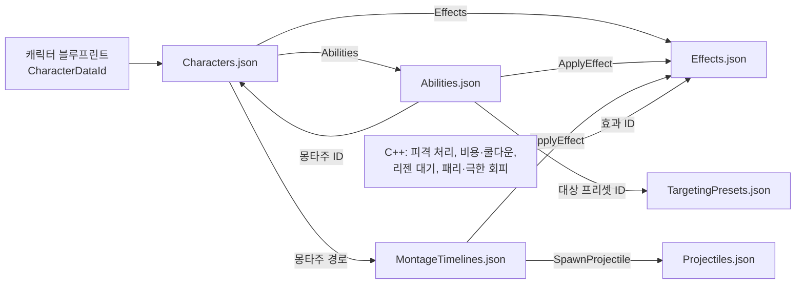
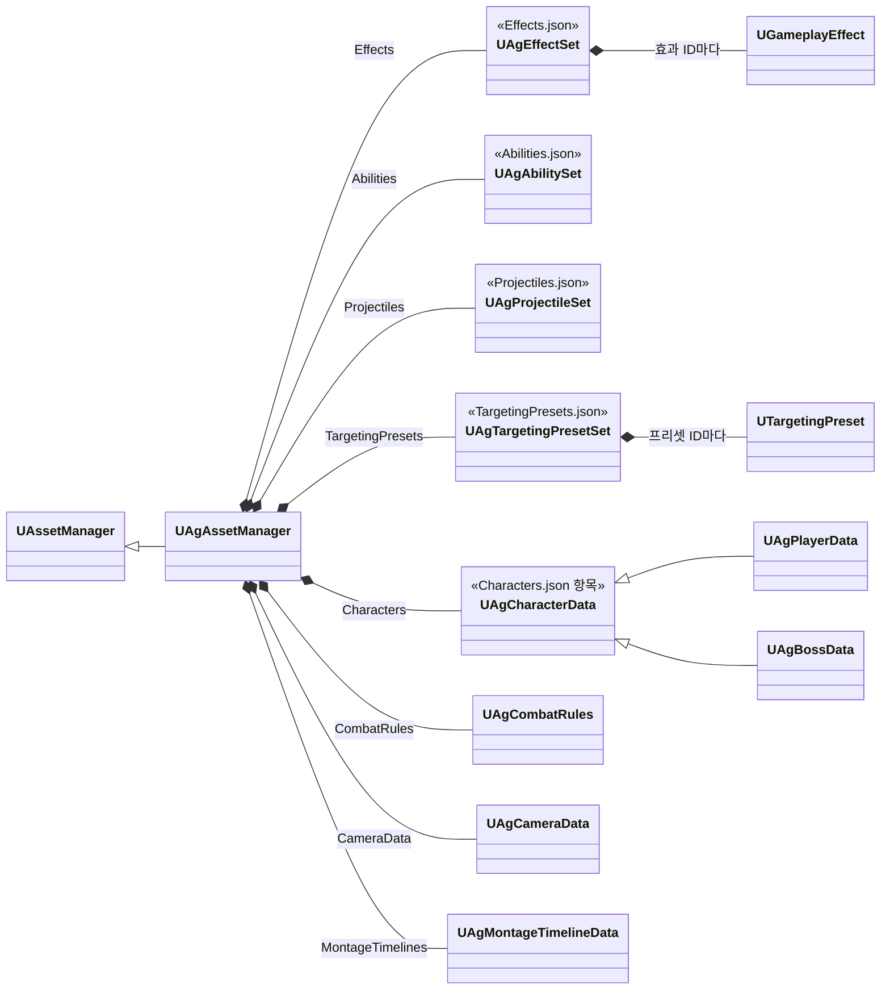

# JSON 데이터

기획서의 데이터(수치, 설정, 쓰는 에셋)는 주인이 분명한 곳에 둡니다. 각 데이터의 위치는 [데이터 위치표](<데이터 위치표.md>)에 정리합니다.

행동 정의의 형식은 아래 '행동'에 둡니다. 행동이 실행되는 구조와 Task 목록은 [어빌리티와 AbilityTask](<어빌리티와 AbilityTask.md>)를, 몽타주 안의 구간과 지점은 [몽타주 시간표](<몽타주 시간표.md>)를 따릅니다.

## 기술 결정

| 항목 | 결정 | 이유 |
| - | - | - |
| 형식 | 전투 데이터의 수치·설정·구현 값·클래스 연결·에셋 경로는 모두 `Data` 폴더의 JSON을 유일한 원본으로 둡니다. 전투 데이터를 담는 UE 에셋(DataAsset, DataTable, GE 블루프린트, TargetingPreset)과 GE C++ 클래스는 두지 않습니다. 엔진 컴포넌트·애님 그래프·몽타주의 연출 노티파이 등 개별 에셋의 제작 데이터와 공통 C++ 구현 상수는 그 에셋과 코드에 둡니다. 이동·가드 이동·공중 반복 모션의 선택은 ABP 멤버 기본값에 둡니다([애니메이션과 이동](<애니메이션과 이동.md>)). | 에셋 선택을 포함한 데이터 변경을 텍스트로 검토하고 병합합니다. |
| 파일 구성 | 종류마다 파일 하나를 둡니다(아래 '파일 구성'). 셰이크 단계별 값과 공통 진동수는 `Camera.json`에, GameplayCue의 모든 제작 설정(베기 선 거리·높이 범위, VFX·효과음·배치·모양과 숫자 위젯)은 JSON에 두지 않고 큐 블루프린트에, 공격 예고가 켜지는 구간은 보스 패턴 몽타주의 노티파이에, 화면의 크기·배치와 위젯 애니메이션의 재생 길이는 위젯에, 글자 크기 단계는 CommonUI 글자 스타일에 둡니다. | 같은 종류의 정의를 한 파일에서 보고, 여러 캐릭터가 같은 어빌리티·효과 정의를 함께 씁니다. |
| 어빌리티 정의 | `Abilities.json`의 항목 하나가 행동 하나의 정의입니다(아래 '행동'). 모든 행동이 단일 Runner(`UAgGameplayAbility`)로 실행되므로 정의에 클래스 경로가 없습니다. Task 항목은 Task 이름(`Task`)과 그 Params의 필드로 적고, 선택 블록·선택 필드는 적었는지로 쓰는지를 구분합니다. | 있는 Task를 조합한 새 행동은 C++ 없이 JSON과 몽타주로 더하고, 클래스·구조체 타입 문자열을 데이터에 중복하지 않습니다. |
| 효과 정의 | `Effects.json`의 항목 하나가 GameplayEffect 하나입니다(아래 '효과'). 에셋 매니저가 읽을 때 GE 객체를 만들고, 코드와 데이터는 효과 ID로 가리킵니다. 대미지·패리 PP 계산과 피격 결과 처리처럼 로직이 있는 클래스는 C++로 두고 효과 정의가 클래스 경로로 가리킵니다. | GE의 지속 방식·주기·태그·값을 텍스트로 고치고, 계산이 같은 새 효과는 C++ 없이 더합니다. |
| 대상 프리셋 | `TargetingPresets.json`의 항목 하나가 TargetingPreset 하나입니다(아래 '대상 프리셋'). 에셋 매니저가 읽을 때 프리셋 객체를 만들고, 행동은 프리셋 ID로 가리킵니다. Task는 클래스 경로와 바꿀 속성만 적고, 적지 않은 속성은 그 클래스의 기본값입니다. | Task 순서와 값을 텍스트로 고치고 검토합니다. 여러 행동이 같은 프리셋을 함께 씁니다. 엔진 Task는 속성이 많아, 모두 적게 하면 바꾼 값이 묻힙니다. |
| 읽는 방법 | `UAgAssetManager`가 엔진 초기화(`StartInitialLoading`) 때 모든 파일을 같은 타입의 새 객체에 한 묶음으로 읽습니다. 파일 사이의 참조까지 검사한 뒤 모두 통과하면 지금 객체에 한꺼번에 복사합니다. 순서는 참조되는 쪽이 먼저입니다: `CombatRules`, `Camera`, `Effects`, `Projectiles`, `MontageTimelines`, `TargetingPresets`, `Abilities`, `Characters`. 효과와 대상 프리셋은 읽을 때마다 ID에 읽은 횟수를 붙인 새 객체(GE, TargetingPreset)로 만듭니다. 원본·임시 객체·실행 사본의 에셋은 GC가 추적합니다. 데이터가 가리키는 에셋(몽타주, 투사체 블루프린트, `ST_Boss`)도 이때 읽혀, 패키지 게임은 타이틀 화면부터 두 캐릭터의 에셋을 메모리에 둡니다. | 잘못된 파일이 기존 정상 값의 일부를 덮지 않습니다. GE를 같은 이름으로 다시 만들면 걸려 있는 효과가 망가집니다(아래 '엔진 제약'). |
| 검증 시점 | JSON 데이터의 검증은 에디터 로딩·재로드와 쿡에서 수행합니다. 쿡에서는 배포할 모든 JSON의 최신 내용을 검증하고, 하나라도 오류가 있으면 쿡과 패키징을 실패시킵니다. 검증한 JSON과 배포하는 JSON은 같아야 합니다. 패키징된 게임은 에디터 에셋 검사를 반복하지 않습니다. 고정 스키마 해석과 파일 사이 참조처럼 실행에 필수인 확인은 로딩 계약으로 유지합니다. 파일 읽기·JSON 파싱·값 변환·고정 스키마 해석·에셋 로딩과 이 과정의 실패 처리는 유지하며, 검증 전용 처리와 분리합니다. | 배포 전에 데이터 오류를 차단하고, 검증이 끝난 데이터를 게임 실행 중 다시 검사하지 않습니다. |
| 오류 검사 | 문법, 모르는 키, 빠진 키, 값 형식, 태그·열거형, 정수의 소수, 숫자의 유한성과 저장 타입 범위, 메타데이터의 허용 범위를 검사합니다. 맵의 빈 이름·중복 이름과 에셋 경로의 형식·존재·타입, 클래스의 부모 타입과 abstract 여부도 검사합니다. 리다이렉터를 거친 경로는 현재 경로로 고치도록 알립니다. 정의 ID의 빈 값·중복을 FName 기준으로 거부합니다. 파일 사이의 참조(캐릭터의 어빌리티·효과 ID, 행동과 사망 모션이 그 캐릭터에서 쓰는 몽타주 ID, 행동의 대상 프리셋 ID, ApplyEffect의 효과 ID, 시간표의 투사체 ID), Task별 필수값, 코드가 직접 재생하는 몽타주의 섹션(점프의 `Start`·`Land`), 코드가 거는 효과의 모양을 검사합니다. 행동 정의의 검사는 [어빌리티와 AbilityTask](<어빌리티와 AbilityTask.md>) '검증'을 따릅니다. 몽타주 시간표의 검사는 [몽타주 시간표](<몽타주 시간표.md>)의 '검증'을 따릅니다. 실패하면 파일명과 필드 경로를 로그·화면에 표시하고 이전 정상 데이터 전체를 유지합니다. 캐릭터 데이터의 최초 로딩에 실패하면 전투를 시작하지 않습니다. | 경로 오타나 잘못된 타입을 재생 시점 이전에 발견하고 부분 반영을 막습니다. 호출 코드가 요구하는 모션 ID의 누락은 아래 몽타주 관리의 조회 오류로도 알립니다. |
| 다시 읽기 | 에디터는 Data 폴더의 JSON 저장을 감지해 모든 파일을 함께 다시 읽고, 모두 통과해야 바꿉니다. 파일 사이에 참조가 있어, 한 파일이라도 오류가 있으면 다른 파일의 변경도 반영되지 않습니다. 행동의 수치·대상·몽타주·Task와 시간표는 다음 발동부터, 행동 태그와 `Activation`(태그 조건, 트리거, 재발동 정책)은 캐릭터를 다시 만든 뒤부터 적용됩니다([어빌리티와 AbilityTask](<어빌리티와 AbilityTask.md>) '실행 사본과 다시 읽기'). 스탯·시작 효과·AI 트리 등 스폰 때 설정하는 값은 다음 플레이부터 적용됩니다. 코드가 거는 효과는 다음에 걸 때부터 새 정의를 쓰고, 걸려 있는 효과는 끝날 때까지 이전 GE로 동작합니다. 이미 재생 중인 몽타주를 강제로 교체하지 않습니다. 패키징 빌드는 파일을 감시하지 않습니다. 배열 원소 포인터·참조는 함수 안에서만 사용하고, 이후에는 ID로 다시 조회합니다. | 에디터 재시작이나 C++ 빌드 없이 JSON을 고쳐 다시 플레이할 수 있습니다. 다시 읽기에 실패하면 기존 정상 값을 유지합니다. |
| 패키징 | JSON 파일은 `RuntimeDependencies`로 UFS에 넣습니다. 전체 JSON의 검증과 실패 처리는 '검증 시점'을 따릅니다. 로더가 읽지 않는 JSON 파일과 쓰는 곳이 없는 정의(캐릭터가 쓰지 않는 어빌리티, 코드·캐릭터·ApplyEffect가 쓰지 않는 효과, 시간표가 쏘지 않는 투사체, 행동이 쓰지 않는 대상 프리셋)는 쿡 오류로 처리합니다. 행동이 재생하지 않는 몽타주의 시간표는 읽을 때의 오류입니다([몽타주 시간표](<몽타주 시간표.md>) '검증'). `UAgAssetManager::ModifyCook`은 같은 묶음 읽기로 모든 파일을 검사하고, 읽은 객체의 참조(Transient 포함)가 속한 패키지를 쿡 목록에 추가합니다. 네이티브 클래스의 /Script 패키지는 제외합니다. 별도의 수동 에셋 목록은 두지 않습니다. | JSON 문자열과 Transient 참조는 저장된 에셋 의존성이 아니므로 쿡 단계에 직접 전달해야 합니다. |
| 데이터를 찾는 방법 | 파일 이름과 그 파일을 읽는 클래스는 에셋 매니저에 정해 둡니다. 캐릭터 블루프린트는 `CharacterDataId`를 목록에서 고르며, 목록에는 그 캐릭터 클래스의 데이터 클래스에 맞는 ID만 나옵니다. 캐릭터는 컴포넌트를 초기화하기 전(`PreInitializeComponents`)에 한 번 확인하고(없거나 맞지 않으면 멈춤), 그 밖의 코드는 있다고 보고 씁니다([캐릭터와 GAS](<캐릭터와 GAS.md>) '데이터 연결'). 캐릭터 블루프린트에는 데이터만 넣고 이벤트 그래프는 쓰지 않습니다. | 코드에 에셋 경로를 쓰지 않습니다. 파일마다 그 파일을 읽는 클래스가 정해져 있어 이름을 바꿀 일이 없습니다. |
| 어빌리티의 데이터 | 캐릭터는 어빌리티 목록의 ID마다 단일 Runner를 독립 스펙으로 부여하고, 각 스펙 인스턴스가 자기 ID의 정의를 씁니다. 발동할 때 정의와 몽타주를, 재생을 시작할 때 그 몽타주의 시간표를 복사하고, 발동 Task와 시간표 Task는 그 사본으로 만듭니다. 부여할 때 연결한 행동 태그와 `Activation`이 바뀌면 캐릭터를 다시 만들 때까지 발동을 거부합니다. | 진행 중인 실행에 새 파일의 일부가 섞이지 않고, 클래스 CDO를 행동별 설정으로 덮지 않습니다. |

## 파일 구성

| 파일 | 내용 | 최상위 키 |
| - | - | - |
| `Characters.json` | 캐릭터마다 스탯, 쓰는 어빌리티 ID 목록(부여 순서), 시작할 때 거는 효과 ID 목록, 몽타주 ID별 에셋, 캐릭터 종류별 값(플레이어의 입력·가드·락온 값, 보스의 AI·페이즈 값) | 캐릭터 ID(`Player`, `Boss`) |
| `Abilities.json` | 행동 정의(아래 '행동'). 두 캐릭터가 함께 쓰는 정의(`KnockBack`, `KnockUp`)는 하나입니다. | 어빌리티 ID |
| `Effects.json` | GameplayEffect 정의 | 효과 ID |
| `Projectiles.json` | 투사체 클래스, 비행 값, 공격 값 | 투사체 ID |
| `MontageTimelines.json` | 몽타주 시간표([몽타주 시간표](<몽타주 시간표.md>)) | 몽타주 경로 |
| `TargetingPresets.json` | 대상 프리셋 정의(아래 '대상 프리셋') | 프리셋 ID |
| `CombatRules.json` | 모든 캐릭터에 공통인 전투 규칙과 HUD 감소 잔상의 대기·감소 시간 | 속성 이름 |
| `Camera.json` | 락온 카메라와 셰이크의 상황별 단계 | 속성 이름 |

- 정의 파일 다섯은 최상위가 ID를 키로 하는 객체입니다. 파일 이름은 첫 글자를 대문자로 씁니다.
- 빠진 키는 오류라, 그 캐릭터가 쓰지 않는 필드도 기본값으로 적습니다(보스의 SP·MP·UP, 플레이어의 PP·MaxPP와 빈 `DeathMotions`). 쓰지 않는 필드 몇 개 때문에 구조체를 나누지 않습니다. 행동 정의의 선택 블록과 Task의 선택 필드는 쓰지 않으면 적지 않습니다(아래 '행동').
- 캐릭터 ID와 데이터 클래스의 짝(`Player`는 `UAgPlayerData`, `Boss`는 `UAgBossData`)은 에셋 매니저 생성자에 적습니다. 항목의 형식을 데이터 클래스가 정하기 때문입니다. 캐릭터를 더할 때는 이 짝을 하나 더합니다.
- 행동의 몽타주 ID(`Montage.MontageId`)는 그 행동을 쓰는 캐릭터의 `Montages`에서 찾습니다. 두 캐릭터가 같은 정의를 쓰면서 각자의 몽타주를 재생합니다.



## 행동

`Abilities.json`의 항목은 `FAgAbilityData`입니다. 각 필드가 실행에서 하는 일은 [어빌리티와 AbilityTask](<어빌리티와 AbilityTask.md>)를 따릅니다.

| 필드 | 뜻 | 엔진 |
| - | - | - |
| `Tags` | 행동 태그. 입력 계층·HUD·취소가 이 태그로 행동을 찾습니다. | 스펙의 `DynamicSpecSourceTags` |
| `Cooldown` | 쿨다운(초). 0이면 쿨다운 효과를 걸지 않습니다. | 쿨다운 효과(`Cooldown`)의 지속 시간 |
| `Activation` | 발동 조건: `RequiredTags`, `BlockedTags`, `OwnedTags`, `BlockTags`, `CancelTags`, `Triggers`, `bAllowRetrigger`. 모두 적습니다. | `ActivationRequiredTags`, `ActivationBlockedTags`, `ActivationOwnedTags`, `BlockAbilitiesWithTag`, `CancelAbilitiesWithTag`, 스펙의 `DynamicAbilityTriggers` |
| `Activation.Triggers` | `{"Tag", "Source"}`의 배열. `Source`는 `GameplayEvent`(그 이벤트를 받으면 발동)나 `OwnedTagPresent`(태그가 붙으면 발동하고, 떨어지면 엔진이 취소)입니다. | `FAbilityTriggerData` |
| `Cost` | `{"Resource", "Amount"}`. `Resource`는 `SP`, `MP`, `UP` 가운데 하나입니다. 비용이 없으면 null을 적습니다. | 자원 효과(`Resource`) |
| `Targeting` | 선택. 대상을 정하는 프리셋의 ID(`Preset`, `TargetingPresets.json`의 ID)와 요청 조건(`Range`, `TargetRequiredTags`, `TargetBlockedTags`, `bRequired`, `StopDistance`). `Preset` 밖의 필드는 선택입니다. | GameplayTargetingSystem |
| `Montage` | 선택. 재생할 몽타주(`MontageId`, 그 캐릭터 `Montages`의 ID) | |
| `End` | 행동이 끝나는 때. `Montage`(재생이 끝날 때)나 `TriggerTag`(`OwnedTagPresent` 트리거의 태그가 사라질 때) | |
| `Tasks` | 발동 동안 실행하는 Task의 배열. 항목은 `{"Task": 이름, Params의 필드}`입니다. | `UAbilityTask` |
| `PatternSelection` | 선택. 보스 AI가 패턴을 고르는 값: `Phases`(1·2), `WeightNear`, `WeightMid`, `WeightFar`, `ResponseRange`, `ResponseChance`([보스](<보스.md>) '패턴 선택') | |

- 선택 블록은 그 행동이 쓸 때만 적습니다. `Targeting`의 `Range`를 적지 않으면 거리 제한이 없고, `StopDistance`를 적지 않으면 캐릭터의 `StopDistance`입니다.
- Task 이름과 Params의 필드, 선택 필드, 둘 수 있는 곳은 [어빌리티와 AbilityTask](<어빌리티와 AbilityTask.md>)의 '스키마와 등록'과 'Task 목록'을 따릅니다. 같은 Task를 시간표에 두는 형식은 [몽타주 시간표](<몽타주 시간표.md>)를 따릅니다.
- 검사는 [어빌리티와 AbilityTask](<어빌리티와 AbilityTask.md>) '검증'을 따릅니다.

## 효과

### 형식

| 필드 | 뜻 | 엔진 |
| - | - | - |
| `DurationPolicy` | `Instant`, `HasDuration`, `Infinite`. 반드시 적습니다. | `DurationPolicy` |
| `Duration` | `HasDuration`의 시간(초). 적지 않으면 거는 코드가 정합니다. | `DurationMagnitude` |
| `Period` | 주기(초) | `Period` |
| `ExecutePeriodicOnApplication` | 걸자마자 한 번 실행하는지 | `bExecutePeriodicEffectOnApplication` |
| `PeriodicInhibitionPolicy` | 꺼졌다 켜질 때 주기를 어떻게 하는지 | `PeriodicInhibitionPolicy` |
| `Modifiers` | `Attribute`, `Op`(`Add`, `Override`)와 크기 하나: `Value`(고정 값), `PerSecond`(초당 값), `SetByCaller`(코드가 넣는 값의 태그), `FromAttribute`(대상의 다른 어트리뷰트) | `Modifiers` |
| `Executions` | 계산 클래스 경로 목록 | `Executions` |
| `AssetTags` | 효과를 알아보는 태그 | 에셋 태그 컴포넌트 |
| `GrantedTags` | 걸려 있는 동안 대상에 붙는 태그 | 대상 태그 컴포넌트 |
| `ApplicationIgnoredTags` | 대상에 있으면 걸지 않는 태그 | 대상 태그 조건 컴포넌트 |
| `OngoingRequiredTags`, `OngoingIgnoredTags` | 걸려 있는 동안 효과가 켜지는 조건 | 대상 태그 조건 컴포넌트 |
| `Components` | 프로젝트 GE 컴포넌트 클래스 경로 목록 | `GEComponents` |

- 적지 않은 필드는 엔진 기본값입니다.
- `PerSecond`는 주기가 있는 효과에만 씁니다. 로더가 `PerSecond × Period`를 한 번에 더할 값으로 넣습니다. 기획서의 초당 값을 그대로 적기 위해서입니다.
- `Instant`에는 `Period`, 주기 설정, `GrantedTags`, 지속 조건을 쓸 수 없습니다. `Duration`은 `HasDuration`에만 씁니다.
- 필드는 지금 효과들이 쓰는 것만 둡니다. 새 효과가 다른 GE 설정을 필요로 하면 그때 필드를 더합니다.
- 엔진의 GE 쪽 GameplayCue(`GameplayCues`)는 두지 않습니다. 큐는 피격 처리와 노티파이가 실행합니다(아래 '엔진 제약').
- 엔진은 컴포넌트 목록을 `AddComponent<T>`로만 열어 두므로, `Components`에 쓸 수 있는 프로젝트 컴포넌트는 로더가 아는 클래스(`UAgHitResultGameplayEffectComponent`)뿐입니다.

### 효과 목록

효과 정의에는 그 효과에서 하나로 정해진 값을 둡니다. 쓰는 곳마다 다른 값은 시간표와 행동 정의에 두고, 적용할 때 SetByCaller와 지속 시간으로 넘깁니다. 쓰는 곳마다 다른 값은 공격 배율과 적중 충전량(시간표의 공격 값), 행동의 비용·쿨다운입니다. 한 행동만 쓰는 시간·보상·소모(패리 구간, 극한 회피, 회피 반격 기회, 그로기 시간, 달리기 소모)는 그 효과의 값이라 효과 정의에 둡니다([어빌리티와 AbilityTask](<어빌리티와 AbilityTask.md>) '결정과 목표').

정의 열은 효과의 모양만 적고, 시간·양 같은 값은 `Effects.json`을 따릅니다.

| 효과 ID | 정의 | 거는 곳 |
| - | - | - |
| `Damage` | `Instant`, 계산 `UAgDamageExecution`, `State.Dead`인 대상 제외, 컴포넌트 `UAgHitResultGameplayEffectComponent`, `AssetTags` `Effect.Damage` | Attack, 투사체(배율·반응 태그·충전량은 Attack 항목과 투사체 정의의 공격 값) |
| `Resource` | `Instant`, SP·MP·UP를 SetByCaller로 더함 | 행동 비용(음수), 극한 회피의 SP 반환, 적중 충전 |
| `Cooldown` | `HasDuration`, `AssetTags` `Effect.Cooldown` | 행동 쿨다운(시간은 행동의 `Cooldown`, 출처는 그 어빌리티 인스턴스) |
| `Hitstop` | `HasDuration`, `State.Hitstop` 부여 | 피격 처리 |
| `SPRegenDelay`, `SPRegenDelayEmpty` | `HasDuration`, `State.Regen.SPDelay` 부여 | 플레이어의 SP 감소 |
| `PPRegenDelay` | `HasDuration`, `State.Regen.PPDelay` 부여 | PP 감소 |
| `Kill` | `Instant`, HP를 0으로 `Override` | 치트 명령, 월드 밖으로 떨어짐 |
| `PPRefill` | `Instant`, PP를 `FromAttribute` MaxPP로 `Override` | 그로기 끝, 페이즈 전환 |
| `ParryPPLoss` | `Instant`, 계산 `UAgParryPPLossExecution` | 패리 |
| `ParryReward` | `Instant`, MP·UP를 더함 | 패리 |
| `PerfectDodgeReward` | `Instant`, MP·UP를 더함 | 극한 회피 |
| `ParryWindow` | `HasDuration`, `State.ParryWindow` 부여 | 가드의 ApplyEffect(가드가 끝나면 지움). 패리가 지웁니다. |
| `PerfectDodgeWindow` | `Infinite`, `State.PerfectDodgeWindow` 부여 | 회피 시간표의 ApplyEffect 구간. 극한 회피가 지웁니다. |
| `DodgeCounterChance` | `HasDuration`, `State.DodgeCounterChance` 부여 | 극한 회피 |
| `GroggyTime` | `HasDuration`, `State.GroggyTime` 부여 | 그로기 시간표의 ApplyEffect 지점. 그로기가 끝나면 보스 캐릭터가 지웁니다. |
| `SprintDrain` | `Infinite`, 주기 실행, 걸 때 실행 안 함, SP를 줄임 | 달리기의 ApplyEffect(달리기가 끝나면 지움) |
| `GroggyImmune` | `Infinite`, `State.GroggyImmune` 부여 | 플레이어 시작 효과 |
| `SPRegen` | `Infinite`, 주기 실행, 걸 때 실행 안 함, 주기 재시작(`ResetPeriod`), SP를 더함, `State.Regen.SPDelay`·`State.Guarding` 동안 꺼짐 | 플레이어 시작 효과 |
| `SPRegenGuarding` | `SPRegen`과 같은 모양, `State.Guarding` 동안만, `State.Regen.SPDelay` 동안 꺼짐 | 플레이어 시작 효과 |
| `PPRegen` | 같은 모양, PP를 더함, `State.Regen.PPDelay` 동안 꺼짐 | 보스 시작 효과 |

### 코드가 효과를 쓰는 방법

- 코드가 거는 효과는 `EAgEffect`의 값이고, 값 이름이 효과 ID입니다. 로더는 이 효과마다 코드가 넘기는 값을 받을 수 있는 모양인지 검사합니다(지속 방식, 지속 시간을 코드가 정하는지, 주기, 코드가 넣는 SetByCaller 태그, 코드가 찾는 에셋 태그, 코드가 기대하는 부여 태그).
- 데이터가 거는 효과(행동 정의와 시간표의 ApplyEffect)는 효과 ID로 적습니다. 로더는 그 ID가 있는지와, 구간에 두면 `Infinite`인지 검사합니다. 구간의 길이는 시간표가 정하기 때문입니다.
- 스펙은 GE 객체로 만들고, 엔진의 클래스 기준 함수와 같은 자리에 둡니다. ASC의 `MakeEffectSpec`은 엔진 `MakeOutgoingSpec`의 객체판입니다. 어빌리티의 `MakeEffectSpec`은 엔진 `MakeOutgoingGameplayEffectSpec`처럼 여기에 어빌리티 컨텍스트, 어빌리티 태그, 스펙의 SetByCaller를 더하며, Task도 소유 어빌리티의 것을 씁니다. ApplyEffect도 Runner의 `MakeEffectSpec`을 써서, 걸린 효과의 컨텍스트에서 그 행동의 인스턴스를 얻을 수 있습니다. 넘길 값이 없는 효과(시작 효과, 히트스톱, 리젠 대기, `Kill`, `PPRefill`, 패리·극한 회피의 보상과 회피 반격 기회)는 ASC의 `ApplyGameplayEffectToSelf`에 GE 객체를 넘깁니다.
- 스펙에 값을 넣는 일은 그 값을 가진 구조체가 맡습니다(`AddToSpec`). 공격 한 타의 값은 `FAgPlayerAttackHit`, 행동의 비용은 `FAgResourceCostParams`입니다. 극한 회피의 SP 반환과 적중 충전은 자원 효과에 `AgResource`의 함수로 양을 넣습니다. 맞은 위치와 시간은 거는 쪽이 엔진 함수(`AddOrigin`, `SetDuration`)로 넣습니다.
- 걸린 효과는 효과의 `AssetTags`나 부여 태그로 알아봅니다: 쿨다운 조회는 `Effect.Cooldown`과 출처 어빌리티로, HUD의 가드 SP 감소 판별은 `Effect.Damage`로 찾습니다. 패리와 극한 회피는 구간 효과를 부여 태그(`State.ParryWindow`, `State.PerfectDodgeWindow`)로 찾아 지우고, 극한 회피는 그 효과의 컨텍스트에 있는 행동의 `Cost`만큼 SP를 돌려줍니다.

### 엔진 제약

UE 5.8 GameplayAbilities 소스로 확인했습니다.

| 동작 | 근거 | 대응 |
| - | - | - |
| 실행 중에 GE를 만들 수 있습니다. | `GameplayEffect.h`가 직접 만드는 GameplayEffect에 `AddComponent`·`FindOrAddComponent`를 쓰라고 안내합니다. 컴포넌트의 태그 캐시는 공개 함수 `OnGameplayEffectChanged`가 만듭니다(에셋은 `PostLoad`가 부름). | 로더가 값과 컴포넌트를 다 넣은 뒤 `OnGameplayEffectChanged`를 부르고, 에디터에서는 엔진 데이터 검사(`IsDataValid`)의 결과도 오류로 알립니다. |
| 어빌리티의 `ApplyGameplayEffectToOwner(const UGameplayEffect*)`는 받은 GE의 클래스 기본 객체로 스펙을 만듭니다. | `GameplayAbility.cpp` 2044줄 | 쓰지 않습니다. |
| ASC의 `ApplyGameplayEffectToSelf(const UGameplayEffect*)`는 받은 객체를 그대로 씁니다. | `AbilitySystemComponent.cpp` 673줄 | 넘길 값이 없는 효과에 씁니다(위 '코드가 효과를 쓰는 방법'). |
| `MakeOutgoingSpec`은 클래스만 받습니다. | `AbilitySystemComponent.cpp` 525줄 | 스펙을 GE 객체로 만듭니다. |
| 스펙의 `Def`는 GC가 따라가는 속성입니다. | `GameplayEffect.h` 1203줄 | 다시 읽은 뒤에도 걸려 있는 효과의 이전 GE가 살아 있습니다. |
| 같은 Outer와 이름으로 객체를 다시 만들면 엔진은 기존 객체를 같은 주소에서 부수고 다시 만듭니다. | `UObjectGlobals.cpp`의 `StaticAllocateObject` 3568줄 | 효과 객체는 읽을 때마다 새 이름으로 만듭니다. |
| `GetGameplayEffectCount`, `RemoveActiveGameplayEffectBySourceEffect`, GE 큐의 '켜짐' 판단은 GE 클래스로 찾습니다. | `AbilitySystemComponent.cpp` 569·1302·1466줄 | 쓰지 않습니다. 걸린 효과는 `AssetTags`나 부여 태그로 찾고, GE 쪽 큐는 두지 않습니다. |

## 몽타주 관리

### 저장과 조회

몽타주 경로의 원본은 `Characters.json` 캐릭터 항목의 `Montages`입니다. 검증·로드한 결과를 `UAgCharacterData::Montages`에 보관하고 조회 함수를 사용합니다.

```cpp
UPROPERTY(Transient, VisibleAnywhere, Category = "Assets")
TMap<FName, TObjectPtr<UAnimMontage>> Montages;

UAnimMontage* FindMontage(FName Id) const;
```

`Montages`에는 ID별 전체 객체 경로(`/Game/폴더/에셋.에셋`)를 적습니다. 클래스는 네이티브 클래스 경로(`/Script/Ag.클래스`) 또는 생성 클래스 경로(`/Game/폴더/BP_Name.BP_Name_C`)를 사용합니다. 에셋 매니저가 데이터를 읽을 때 동기 로드하여 캐릭터 사용 전에 준비합니다. `FindMontage`는 로드된 포인터만 조회합니다.

행동 정의의 `Montage.MontageId`와 사망 모션(`DeathMotions`)의 `Montage`·`Death`는 `Montages`의 ID를 참조하고 에셋 경로를 중복 저장하지 않습니다. 별도의 어빌리티→몽타주 연결표도 두지 않습니다. 에셋을 이동하거나 이름을 바꿀 때는 JSON 경로와 그 몽타주 시간표의 키(몽타주 경로)도 함께 바꿉니다.

Runner와 캐릭터는 필요한 시점에 `FindMontage`로 조회합니다. 한 행동이 쓰는 여러 모션(평타의 타, 회피의 Backstep·Roll, 넉업의 상승·낙하·착지·기상)은 몽타주 하나의 섹션이고, 섹션 사이의 흐름은 Transition이 정합니다(시작 섹션은 행동 정의의 발동 Transition, 그 뒤는 시간표. [어빌리티와 AbilityTask](<어빌리티와 AbilityTask.md>) '몽타주와 섹션'). 캐릭터 데이터는 ID로 에셋을 찾는 역할만 맡습니다. 이동·가드 이동·공중 반복 모션은 [애니메이션과 이동](<애니메이션과 이동.md>)의 ABP 기본값을 사용합니다.

### ID 규칙

| 사용 형태 | 조회 규칙 | 이유 |
| - | - | - |
| 행동이 재생하는 몽타주 | 행동 정의의 `Montage.MontageId` | 행동 ID와 에셋 선택을 분리합니다. |
| 한 행동의 여러 모션 | 그 몽타주의 섹션 이름 | 타 순서와 모션 선택이 섹션과 Transition에 드러나, ID 배열이나 이름 접미사로 추정하지 않습니다. |
| 사망 모션 | `DeathMotions`의 `Montage`·`Death` | 어떤 모션 중에 죽으면 어떤 모션을 잇는지가 데이터라 코드에 ID가 없습니다. |
| 캐릭터가 직접 재생하는 모션 | 호출 코드에 정한 ID(`Jump`, `Flinch`, `GuardFlinch`)와 섹션. ID와 섹션 상수는 공용 선언 하나를 함께 씁니다. | 점프·움찔처럼 행동이 아닌 모션도 저장합니다. 코드가 요구하는 섹션(점프의 `Start`·`Land`)은 로더가 검사합니다. |

실제 ID와 에셋의 연결은 [데이터 위치표](<데이터 위치표.md>)를 따릅니다. ID는 에셋 파일 이름이 아니라 모션을 선택하는 키입니다. 같은 ID에 캐릭터마다 다른 에셋을 지정할 수 있습니다. 어빌리티와 `Montages`는 일대일 대응하지 않으며, 몽타주가 없는 어빌리티를 위해 빈 항목을 만들지 않습니다.

### 누락 처리

`FindMontage`는 키가 없거나 값이 null이면 캐릭터 ID와 요청 ID를 오류 로그에 남기고 null을 반환합니다. 다른 몽타주로 대체하거나 어빌리티 기본값에서 다시 찾지 않습니다. 호출자는 현재의 동작별 실패 처리를 유지합니다. `Montage`가 있는 행동은 발동을 끝내고, 움찔 같은 부가 모션은 재생을 건너뜁니다.

## 투사체 정의

`Projectiles.json`의 항목은 `FAgProjectileDefinition`이고, `ProjectileClass`, `Params`(`FAgProjectileParams`: Speed·Range), `Attack`(`FAgPlayerAttackHit`: DamageMultiplier·PoiseMultiplier·HitReaction·bGuardable·MPCharge·UPCharge)으로 구성합니다. 속도·사거리는 양수입니다. 같은 클래스라도 비행 설정이나 공격 값이 다르면 별도 ID를 사용합니다.

발사 시각·투사체 ID·발사 기준과 소켓은 몽타주 시간표의 SpawnProjectile 항목에 둡니다. 클래스·속도·사거리·공격 값은 투사체가 가지므로 `Projectiles.json`에만 둡니다. 실제 데이터 위치는 [데이터 위치표](<데이터 위치표.md>), 생성 순서와 수명은 [전투 규칙](<전투 규칙.md>)을 따릅니다.

## 대상 프리셋

`TargetingPresets.json`의 항목은 프리셋 ID마다 GameplayTargetingSystem Task의 배열입니다. 로더가 이 순서대로 Task를 넣은 `UTargetingPreset`을 만들고, 행동은 `Targeting.Preset`에 ID를 적습니다. 프리셋마다 하는 일과 Task 순서는 [어빌리티와 AbilityTask](<어빌리티와 AbilityTask.md>) '대상'을 따릅니다.

- Task 항목은 `{"Class": Task 클래스 경로, 바꿀 속성}`입니다. 적지 않은 속성은 그 클래스의 기본값입니다. 에디터의 프리셋에서 고칠 수 있는 속성만 적을 수 있고, 모르는 키는 오류입니다. 구조체 속성도 바꿀 필드만 적습니다(예: `"Radius": {"Value": 5000}`).
- 오브젝트 타입 배열(AOE의 `CollisionObjectTypes`)은 에디터에 보이는 채널 이름(`Pawn`)으로 적습니다. 엔진 값(`ObjectTypeQuery3`)은 프로젝트 충돌 설정의 순서로 정해지기 때문입니다.
- 모든 프리셋에 행동 대상 필터(`UAgTargetingFilterTask_ActionTarget`)가 있어야 합니다. 없으면 행동의 `Range`와 대상 태그가 무시되기 때문입니다.

## 검증 기준

- 에디터에서 올바른 변경은 재읽기에 성공하고, 잘못된 경로·타입·맵 형식과 파일 사이의 잘못된 참조는 전체 반영을 거부해야 합니다.
- Task별 Params 형식과 선택 필드의 유무, 코드가 거는 효과의 모양을 검사해야 합니다. 중복 ID와 숫자 저장 범위 오류는 기존 정상 데이터를 덮어쓰지 않아야 합니다.
- 쿡 목록에 JSON의 모든 Content 에셋 참조가 포함되어야 합니다. 패키지에서도 같은 JSON으로 로드되어야 합니다.
- 동작 확인은 [개발 도구와 검증](<개발 도구와 검증.md>)의 '동작 테스트 실행'을 따릅니다.

## 클래스 구조

| 클래스 | 부모 | 역할 |
| - | - | - |
| `UAgAssetManager` | `UAssetManager` | 프로젝트의 에셋 매니저('읽는 방법'). 데이터 객체를 모두 들고, 모든 파일을 한 묶음으로 새 객체에 읽어 검사한 뒤 복사합니다. 읽은 참조를 쿡에 전달합니다. |
| `UAgCharacterData`, `UAgPlayerData`, `UAgBossData` | `UObject` | `Characters.json` 캐릭터 항목의 값. 어빌리티·효과는 ID 목록이고, 어빌리티 정의 조회(`FindAbility`)는 그 캐릭터의 목록에 있는 ID만 `Abilities.json`에서 찾아 줍니다. |
| `UAgAbilitySet` | `UObject` | `Abilities.json`의 값. ID마다 `FAgAbilityData`(위 '행동') |
| `UAgEffectSet` | `UObject` | `Effects.json`에서 만든 GE 객체. 효과 ID마다 하나입니다. |
| `UAgProjectileSet` | `UObject` | `Projectiles.json`의 값. ID마다 `FAgProjectileDefinition` |
| `UAgTargetingPresetSet` | `UObject` | `TargetingPresets.json`에서 만든 TargetingPreset. 프리셋 ID마다 하나입니다. |
| `UAgMontageTimelineData` | `UObject` | `MontageTimelines.json`의 값([몽타주 시간표](<몽타주 시간표.md>)) |
| `UAgCombatRules` | `UObject` | `CombatRules.json`의 값. 공통 전투 규칙과 HUD 감소 잔상 시간 |
| `UAgCameraData` | `UObject` | `Camera.json`의 값. 셰이크 단계에 해당하는 설정과 공통 진동수 |

행동 정의를 읽고 정의 안의 규칙과 캐릭터별 참조를 검사하는 일은 `AgAbilityData`가 맡습니다. Task의 Params는 각 Task의 헤더에 있고, 공통 부모(`FAgTaskParams`)와 이름 규칙으로 찾기는 `AgTaskParams`가 맡습니다([어빌리티와 AbilityTask](<어빌리티와 AbilityTask.md>) '스키마와 등록'). 효과를 읽고 GE를 만드는 일과 코드가 거는 효과(`EAgEffect`)의 모양 검사는 `AgEffectData`가 맡습니다. 대상 프리셋은 에셋 매니저가 리플렉션으로 Task 속성을 읽어 만듭니다. 스펙을 만들고 값을 넣는 곳은 '코드가 효과를 쓰는 방법'을 따릅니다.


