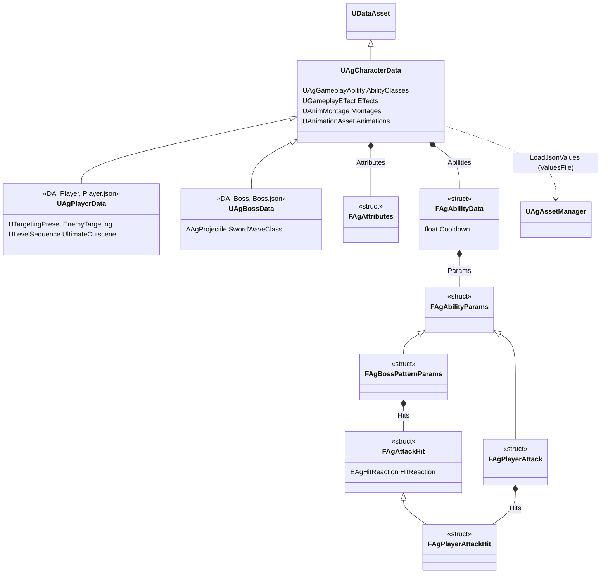
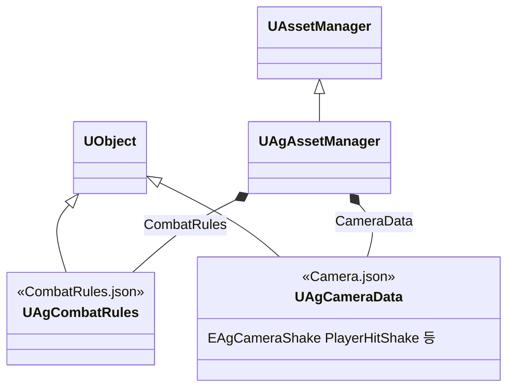

# JSON과 DataAsset

기획서의 데이터(수치, 설정, 쓰는 에셋)는 주인이 분명한 곳에 둡니다. 각 데이터의 위치는 [데이터 위치표](<데이터 위치표.md>)에 정리합니다.

## 기술 결정

| 항목 | 결정 | 이유 |
| - | - | - |
| 형식 | 기획서에 적힌 수치와 설정 가운데 기획자가 밸런싱하고 조절하는 값은 JSON 파일에 둡니다. 기획서에 없는 구현 값과 코드 연결(어빌리티 ID마다 그 클래스, 시작할 때 거는 GameplayEffect, 코드가 읽는 본 이름)은 캐릭터 DataAsset에, 모든 캐릭터에 공통인 구현 값은 그 값을 쓰는 클래스(리젠 GameplayEffect의 주기, 사망 어빌리티의 래그돌 밀림 속도)에 둡니다. 몽타주처럼 Content의 에셋을 가리키는 참조는 DataAsset에 둡니다. 엔진 컴포넌트와 애님 노드의 설정(스프링 암과 카메라, 블렌드 노드의 블렌드 시간, 충돌 상자의 크기, 무기 컴포넌트의 메시와 붙이는 소켓)은 JSON에 두지 않고 그 블루프린트에 직접 적습니다. 데이터 하나는 이 가운데 한 곳에만 있습니다. | 작업은 AI가 하고 사람은 판단하고 리뷰합니다. JSON은 에디터 없이 읽고 고칠 수 있고, 바뀐 수치가 커밋 diff에 보이며, 두 사람이 같은 파일을 고쳐도 병합됩니다. 에셋 참조는 DataAsset에 있어야 에셋 이름을 바꾸거나 옮길 때 엔진이 따라 고치고, 패키징할 때 쿡에서 빠지지 않습니다. 엔진 설정을 JSON에 두면 코드가 그 값을 엔진에 다시 넣어야 하고, 블루프린트에 보이는 값과 실제 값이 달라집니다. JSON은 기획자가 AI를 시켜 값만 고쳐 바로 플레이해 보는 곳이라, 기획서에 있는 값만 둡니다. |
| 묶는 단위 | 캐릭터마다 JSON 하나와 DataAsset 하나(`Player.json`과 `DA_Player`, `Boss.json`과 `DA_Boss`)를 두고, 모든 캐릭터에 공통인 규칙은 `CombatRules.json`에, 락온 카메라와 셰이크의 상황별 단계는 `Camera.json`에 둡니다. 셰이크 단계별 값은 카메라 셰이크 에셋 3개에, VFX와 효과음은 GameplayCue 에셋에, 공격 예고가 켜지는 구간은 보스 패턴 몽타주의 노티파이에, 화면의 크기·배치·표시 시간은 위젯에, 글자 크기 단계는 CommonUI 글자 스타일에 둡니다. | 한 캐릭터의 수치를 파일 하나에서 모두 볼 수 있습니다. |
| JSON 파일 | 프로젝트 폴더의 `Data`에 둡니다. 키는 C++ 필드 이름 그대로 쓰고, 모든 필드를 빠짐없이 적습니다. 게임플레이 태그는 태그 이름으로, 열거형은 값 이름으로 적습니다. MP·UP 충전은 플레이어 공격에만 있고, 그 밖의 공격 데이터는 플레이어와 보스가 같은 필드를 씁니다. 그 캐릭터가 쓰지 않는 필드(보스 공격의 PP 배율, 플레이어 공격의 가드 가능, 플레이어의 PP와 이름)도 기본값으로 적습니다. 캐릭터 JSON의 최상위에는 이름(`DisplayName`), 스탯 초기값(`Attributes`), 어빌리티 목록(`Abilities`)과 캐릭터 전체의 값을 둡니다. 어빌리티 목록에는 캐릭터가 가진 어빌리티(플레이어 행동, 보스 패턴, 피격 반응·사망 같은 상태)마다 ID가 있는 항목(`FAgAbilityData`: ID, 쿨다운, 전용 값 `Params`)을 하나씩 적습니다. 모든 어빌리티에 같은 뜻으로 쓰는 값(쿨다운)은 항목의 공통 필드에 적습니다. 그 어빌리티(보스 패턴은 패턴을 고르는 AI도)만 읽는 값(전용 값: 플레이어 행동의 공격 데이터와 비용, 회피·가드·궁극기의 값, 보스 패턴의 타별 공격 데이터·페이즈·가중치·최대 접근 거리, DashThrust의 돌진 규칙, LeapSlam, SwordWave의 검기, Backstep)은 그 항목의 `Params`에 적습니다. `Params`의 구조체는 그 어빌리티가 정하므로 JSON에는 값만 적고, 전용 값이 없는 항목은 `{}`로 둡니다. 여러 어빌리티가 같은 뜻으로 쓰는 전용 값은 부모 구조체에 둡니다(플레이어 공격의 `FAgPlayerAttack`, 보스 패턴의 `FAgBossPatternParams`). 어빌리티 밖의 코드가 읽는 값(가드로 막을 때의 SP, 가드 중 이동 속도, 패리의 PP 감소, 궁극기 슬로우모션, 락온, 달리기)과 캐릭터 전체의 값은 최상위에 둡니다. | `Content`에 두면 에디터가 JSON을 에셋으로 가져오려 합니다. 코드와 JSON의 이름이 같아 데이터 위치표로 기획서와 대조하기 쉽습니다. 쓰지 않는 필드 몇 개 때문에 구조체를 나누지 않습니다. 전용 값을 항목 안에 두면 한 어빌리티의 값이 한곳에 모이고, 어빌리티가 다른 캐릭터나 적이 늘어도 캐릭터 데이터 클래스가 커지지 않습니다. 플레이어와 보스가 같은 항목 타입을 써서, 어빌리티 구성이 다른 캐릭터는 JSON 항목과 DataAsset 연결만 다릅니다. 엔진도 동작마다 다른 값을 그 동작이 정한 구조체에 둡니다(StateTree 노드의 인스턴스 데이터, GameplayEffect 컴포넌트). 구조체 이름을 JSON에 적으면 어빌리티가 정한 것을 두 곳에 두게 됩니다. |
| 읽는 방법 | JSON은 프로젝트의 에셋 매니저(`UAgAssetManager`)가 읽습니다. 캐릭터 DataAsset은 로드될 때 에셋 매니저에 자기 JSON(`ValuesFile`)을 넘겨 같은 객체의 Transient 필드를 채웁니다. 공통 JSON은 에셋 매니저가 엔진 초기화 때(`StartInitialLoading`) 자기가 가진 공통 데이터 객체(`UAgCombatRules`, `UAgCameraData` 하나씩)에 읽고, 코드는 이 객체를 에셋 매니저에서 받아 씁니다. 대상 찾기 프리셋(`TP_Enemy`)은 `DA_Player`가 가리킵니다. 캐릭터 데이터는 에셋 매니저가 검사하기 전에 어빌리티 항목마다 DataAsset에서 그 클래스(`AbilityClasses`)를 찾아, 어빌리티가 정한 구조체(`GetAbilityParamsType`)로 `Params`를 읽게 합니다(`ResolveJsonStructTypes`). 엔진 JSON 변환기의 인스턴스 구조체 읽기를 그대로 쓰고, 구조체 표시는 메모리에만 적습니다. | 에셋 매니저는 게임 전체가 쓰는 데이터를 엔진 초기화 때 읽도록 엔진이 열어 둔 확장 지점이고(Lyra 샘플도 게임 데이터를 여기서 읽습니다), 에디터·쿡·패키징 빌드에 모두 있습니다. 엔진이 GC 제외 객체 풀을 닫은 뒤에 만들어 엔진 객체의 UPROPERTY로 들고 있으므로, 에셋 매니저가 UPROPERTY로 든 공통 데이터 객체도 GC가 따라갑니다([기본 방침](<기본 방침.md>) '객체 수명'). 값을 쓰는 코드는 값이 어느 파일에서 왔는지 몰라도 됩니다. 게임 중에는 파일을 읽지 않습니다. |
| 오류 검사 | 읽을 때 문법, 모르는 키, 빠진 키, 값의 형식, 없는 태그·열거형 값, 정수 필드의 소수를 검사하고, 에디터에서는 필드의 허용 범위(배열 원소는 배열 필드의 범위)도 검사합니다. 키는 대소문자를 구분하지 않습니다. DataAsset에 클래스가 없는 어빌리티 ID와, 전용 값이 없는 항목의 `Params`에 적은 키도 오류로 알립니다. 그래서 새 어빌리티는 DataAsset에 클래스를 연결해야 JSON이 읽힙니다. `Params`의 오류에는 그 구조체 이름이 붙습니다(예: `Abilities[2].Params (AgBossDashParams).Speed: missing`). 오류가 있으면 그 파일의 값을 하나도 바꾸지 않고 로그와 화면에 띄웁니다. | 엔진의 JSON 변환기는 모르는 키를 무시하고 빠진 키도 다 잡지 못해, 오타가 조용히 기본값이 됩니다. 엔진의 이름(FName)과 JSON 객체도 키의 대소문자를 구분하지 않고, 패키징 빌드의 필드 이름은 대소문자를 보존하지 않습니다(예: `UP`이 `Up`으로 나옴). 어빌리티 ID와 클래스의 연결은 바이너리인 DataAsset에 있고 전용 값의 키는 짧은 이름이라, 오류가 키를 정하는 C++ 구조체를 알려 줘야 에디터 없이 고칠 수 있습니다. |
| 다시 읽기 | 에디터는 `Data` 폴더를 지켜보다가 JSON이 저장되면 그 파일을 다시 읽습니다. 쓸 때마다 읽는 값(리젠 회복량, HUD의 보스 이름 포함)은 다음 동작부터 바뀌고, 스폰할 때 넣는 값인 스탯은 PIE를 다시 시작해야 바뀝니다. DataAsset의 값은 에디터에서 고치면, 쓸 때마다 읽는 값은 바로 바뀌고 스폰할 때 넣는 값은 다음 PIE부터 바뀝니다. DataAsset 편집을 실행 취소하거나 다시 실행하면 그 DataAsset의 JSON을 다시 읽습니다. DataAsset에서 어빌리티 클래스(`AbilityClasses`)를 바꿔도 전용 값의 구조체가 바뀌므로 다시 읽습니다. 패키징 빌드는 `Data` 폴더를 지켜보지 않습니다. 데이터 배열의 원소(어빌리티 항목, 타격 데이터)를 가리키는 포인터나 참조는 그 함수 안에서만 쓰고, 나중에 쓸 값은 복사해 두거나 키(어빌리티 ID, 타 번호)로 다시 찾습니다. | 컴파일 없이 PIE 중에 수치를 바꿔 볼 수 있습니다. 스탯을 다시 넣으면 HP가 처음 값으로 돌아가 싸움이 초기화됩니다. 다시 읽으면 배열의 원소를 새로 만들고 원소 수가 바뀌면 배열이 다른 메모리로 옮겨지므로, 원소를 가리킨 채 다음 프레임까지 들고 있으면 해제된 메모리를 읽어 에디터가 크래시합니다. |
| 패키징 | `Data`의 JSON은 빌드 규칙(`RuntimeDependencies`)으로 pak에 넣습니다. | `Content` 밖의 파일은 쿡이 모릅니다. |
| 데이터를 찾는 방법 | 공통 JSON은 에셋 매니저가 정한 파일 이름(`CombatRules.json`, `Camera.json`)으로 읽고, 캐릭터 DataAsset은 캐릭터 블루프린트에서 가리킵니다. 캐릭터 블루프린트에는 데이터만 넣고 이벤트 그래프는 쓰지 않습니다. 캐릭터 DataAsset은 필수라, 캐릭터가 시작할 때 한 번 확인하고(없으면 멈춤) 그 밖의 코드는 있다고 보고 씁니다. | 코드에 에셋 경로를 쓰지 않습니다. 공통 JSON 파일은 그 파일을 읽는 클래스와 짝이라 이름을 바꿀 일이 없습니다. |
| 어빌리티의 데이터 | 어빌리티는 C++ 클래스만 두고, 수치는 자기 스펙의 어빌리티 항목에서, 몽타주와 애니메이션은 캐릭터 DataAsset의 ID별 맵(`Montages`, `Animations`)에서 읽습니다. 몽타주를 하나만 쓰는 어빌리티는 자기 어빌리티 ID로 찾고, 여러 개를 쓰는 어빌리티와 캐릭터, 애님 인스턴스는 코드에 정한 ID(평타는 `BasicAttack1` ~ `5`, 회피는 `Roll`·`Backstep`, 이동은 `Move` 등. 모든 ID는 [데이터 위치표](<데이터 위치표.md>))로 찾습니다. 찾는 몽타주가 없으면 DataAsset 이름과 ID를 로그에 남깁니다. 어빌리티의 전용 값은 그 어빌리티 헤더에 둔 구조체(`FAgAbilityParams`의 자식)로, `GetAbilityParams<T>()`로만 꺼냅니다. 항목이 없거나 타입이 다르면 null이고, 어빌리티가 정한 구조체와 다른 타입으로 꺼내면 에디터가 알립니다. | 캐릭터의 데이터가 JSON 하나와 DataAsset 하나에 모입니다. 꺼내는 길이 하나라 타입 확인과 '다시 읽기'의 포인터 규칙을 곳마다 되풀이하지 않습니다. 몽타주를 어빌리티 ID로 찾으면, 같은 클래스를 쓰는 어빌리티(보스 공용 패턴)와 다른 캐릭터가 저마다 몽타주를 둡니다. ID는 컴파일러가 확인하지 못해, 없는 ID를 찾는 즉시 로그로 알립니다. |

## 클래스 구조

### 캐릭터 데이터

| 클래스 | 부모 | 역할 |
| - | - | - |
| `UAgCharacterData` | `UDataAsset` | 플레이어·보스 데이터의 공통 부분: 이름, 스탯 초기값, 어빌리티 목록과 ID마다의 어빌리티 클래스, 시작할 때 거는 GameplayEffect, ID마다의 몽타주와 애니메이션. 에셋 참조와 구현 값은 에셋에 저장하고, 기획 값은 로드할 때 `ValuesFile`의 JSON에서 채웁니다. 어빌리티 항목과 몽타주를 ID로 찾고, JSON을 검사하기 전에 항목마다 `Params`의 구조체를 정합니다. |
| `UAgPlayerData` | `UAgCharacterData` | `DA_Player`와 `Player.json`의 클래스. 어빌리티 밖의 코드가 읽는 플레이어 값(선입력, 자원 회복, 가드·패리, 궁극기 슬로우모션, 락온, 달리기)과 궁극기 컷신, 처형 간격, 대상 찾기 프리셋 |
| `UAgBossData` | `UAgCharacterData` | `DA_Boss`와 `Boss.json`의 클래스. 패턴 규칙과 AI 수치(모션 재생 속도, 거리 구간, 패턴 후딜레이 대기, 페이즈), 검기 투사체, 락온 지점과 처형 안내의 본, AI의 StateTree |
| `FAgAbilityData` | - | 어빌리티 하나: ID, 쿨다운, 전용 값 `Params`. 플레이어와 보스가 같은 타입을 씁니다. |
| `FAgAbilityParams` | - | 어빌리티 전용 값의 부모 구조체. 자식 구조체는 그 값을 읽는 어빌리티의 헤더에 둡니다. 플레이어는 `FAgBasicAttackParams`, `FAgJumpAttackParams`, `FAgDodgeParams`, `FAgGuardParams`, `FAgSkillParams`, `FAgUltimateParams`이고, 회피 반격과 처형은 공격 데이터(`FAgPlayerAttack`)를 그대로 씁니다. 보스 패턴은 모두 `FAgBossPatternParams`(타별 공격 데이터, 페이즈, 가중치, 최대 접근 거리)이거나 그 자식입니다([보스](<보스.md>) '보스 패턴'). |

### 공통 데이터

| 클래스 | 부모 | 역할 |
| - | - | - |
| `UAgCombatRules` | `UObject` | `CombatRules.json`의 클래스 |
| `UAgCameraData` | `UObject` | `Camera.json`의 클래스. 셰이크 단계를 그 단계의 셰이크 큐 태그로 바꿉니다. |
| `UAgAssetManager` | `UAssetManager` | 프로젝트의 에셋 매니저('읽는 방법'). JSON 데이터 파일을 읽고 검사해 데이터 객체의 Transient 필드를 채우고, 공통 데이터 객체를 들고 있습니다. 에디터에서는 어느 객체를 어느 파일에서 채웠는지 기억해, 저장된 파일을 다시 읽습니다. |

