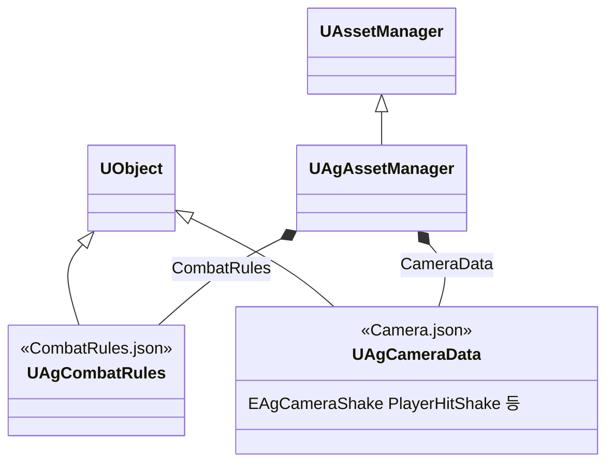

# JSON과 DataAsset

기획서의 데이터(수치, 설정, 쓰는 에셋)는 주인이 분명한 곳에 둡니다. 각 데이터의 위치는 [데이터 위치표](<데이터 위치표.md>)에 정리합니다.

Ability의 고정 Tasks·선택 블록·명시적 null·전체 예시는 [AbilityTask 기반 어빌리티 설계안](<AbilityTask 기반 어빌리티 설계안.md>)을 따릅니다.

## 기술 결정

| 항목 | 결정 | 이유 |
| - | - | - |
| 형식 | 캐릭터 데이터의 수치·설정·구현 값·클래스 연결·에셋 경로는 모두 캐릭터 JSON을 유일한 원본으로 둡니다. DA_Player·DA_Boss에는 `JsonFileName`만 저장하고, `VisibleAnywhere`로 파일 연결을 읽기 전용 표시합니다. 나머지는 `Transient, VisibleAnywhere`로 읽기 전용 표시 및 런타임 보관에 사용합니다. 엔진 컴포넌트·애님 그래프·몽타주 내부 노티파이 등 개별 에셋의 제작 데이터와 공통 C++ 구현 상수는 기존 위치에 둡니다. 이동·가드 이동·공중 반복 모션의 선택은 ABP 멤버 기본값에 둡니다([애니메이션과 이동](<애니메이션과 이동.md>)). | 에셋 선택을 포함한 캐릭터 데이터 변경을 텍스트로 검토하고 병합합니다. DA는 JSON을 읽은 결과이므로 별도 편집 원본이 아닙니다. |
| 묶는 단위 | 캐릭터마다 JSON 하나와 DataAsset 하나(`Player.json`과 `DA_Player`, `Boss.json`과 `DA_Boss`)를 두고, 모든 캐릭터에 공통인 규칙과 HUD 감소 잔상의 대기·감소 시간은 `CombatRules.json`에, 락온 카메라와 셰이크의 상황별 단계는 `Camera.json`에 둡니다. 셰이크 단계별 값과 공통 진동수는 `Camera.json`에, GameplayCue의 VFX·효과음·배치·모양과 숫자 위젯은 큐 블루프린트에, 공격 예고가 켜지는 구간은 보스 패턴 몽타주의 노티파이에, 화면의 크기·배치와 위젯 애니메이션의 재생 길이는 위젯에, 글자 크기 단계는 CommonUI 글자 스타일에 둡니다. | 한 캐릭터의 수치를 파일 하나에서 모두 볼 수 있습니다. |
| JSON 파일 | 원본은 `Data` 폴더에 둡니다. 캐릭터의 `Abilities`에는 `Id`, `Tags`, `Cooldown`, `Activation`, `Cost`, `Tasks`와 보스 선택 정보 `PatternSelection`을 기록합니다. `Tasks`는 기능별 고정 구조체이며 선택 블록의 존재와 0·null을 구분합니다. 이름별 맵·단일 객체 형식과 필수값은 [AbilityTask 기반 어빌리티 설계안](<AbilityTask 기반 어빌리티 설계안.md>)의 데이터 규약을 따릅니다. 리소스 객체 경로는 `Montages`, `Projectiles` 및 필요한 기능 참조에 둡니다. | 설정과 실행 요청을 분리하고 클래스·구조체 타입 문자열을 중복 관리하지 않습니다. |
| 읽는 방법 | `UAgAssetManager`가 같은 타입의 임시 객체에 전체 파일을 읽습니다. `AgAbilityData::Parse`로 고정 Ability 스키마를 변환하고 참조 검사가 성공하면 원본에 한 번에 복사합니다. 공통 JSON은 `StartInitialLoading`, 캐릭터 JSON은 DA의 `PostLoad`에서 읽습니다. 원본·임시 객체·실행 사본의 에셋은 GC가 추적합니다. | 잘못된 파일이 기존 정상 값의 일부를 덮지 않습니다. |
| 검증 시점 | JSON 데이터의 검증은 에디터 로딩·재로드와 쿡에서 수행합니다. 쿡에서는 배포할 모든 공통·캐릭터 JSON의 최신 내용을 검증하고, 하나라도 오류가 있으면 쿡과 패키징을 실패시킵니다. 검증한 JSON과 배포하는 JSON은 같아야 합니다. 패키징된 게임은 에디터 에셋 검사를 반복하지 않습니다. 고정 Ability 스키마 해석과 실행에 필수인 참조 확인은 로딩 계약으로 유지합니다. 파일 읽기·JSON 파싱·값 변환·고정 스키마 해석·에셋 로딩과 이 과정의 실패 처리는 유지하며, 검증 전용 처리와 분리합니다. | 배포 전에 데이터 오류를 차단하고, 검증이 끝난 데이터를 게임 실행 중 다시 검사하지 않습니다. |
| 오류 검사 | 문법, 모르는 키, 빠진 키, 값 형식, 태그·열거형, 정수의 소수, 숫자의 유한성과 저장 타입 범위, 메타데이터의 허용 범위를 검사합니다. 맵의 빈 이름·중복 이름과 에셋 경로의 형식·존재·타입, 클래스의 부모 타입과 abstract 여부도 검사합니다. 리다이렉터를 거친 경로는 현재 경로로 고치도록 알립니다. 어빌리티 ID의 빈 값·중복을 FName 기준으로 거부하고, 기능별 필수값·ANS/워핑/발사 참조와 C++ 사건이 요구하는 이름을 검사합니다. 실패하면 파일명과 필드 경로를 로그·화면에 표시하고 이전 정상 데이터 전체를 유지합니다. 캐릭터 데이터의 최초 로딩에 실패하면 전투를 시작하지 않습니다. | 경로 오타나 잘못된 타입을 재생 시점 이전에 발견하고 부분 반영을 막습니다. 호출 코드가 요구하는 모션 ID의 누락은 아래 몽타주 관리의 조회 오류로도 알립니다. |
| 다시 읽기 | 에디터는 Data 폴더의 JSON 저장을 감지해 이미 로드된 데이터 객체를 다시 채웁니다. Ability의 수치·모션·투사체 설정은 다음 발동부터, 부여 태그·이벤트·재발동 정책은 재부여 또는 캐릭터 재생성 후 적용됩니다. 스탯·시작 효과·AI 트리 등 스폰 때 설정하는 값은 다음 플레이부터 적용됩니다. 이미 재생 중인 몽타주를 강제로 교체하지 않습니다. DA의 실행 취소 때도 JSON을 다시 읽습니다. 패키징 빌드는 파일을 감시하지 않습니다. 배열 원소 포인터·참조는 함수 안에서만 사용하고, 이후에는 ID로 다시 조회합니다. | 에디터 재시작이나 C++ 빌드 없이 JSON을 고쳐 다시 플레이할 수 있습니다. 다시 읽기에 실패하면 기존 정상 값을 유지합니다. |
| 패키징 | JSON 파일은 `RuntimeDependencies`로 UFS에 넣습니다. 전체 JSON의 검증과 실패 처리는 '검증 시점'을 따릅니다. UFS에 포함될 JSON 중 데이터 객체에 연결되지 않아 검증하지 못한 파일도 쿡 오류로 처리합니다. `UAgAssetManager::ModifyCook`은 AssetRegistry에서 캐릭터 DA를 찾고, 공통·캐릭터 JSON을 로드한 메모리의 객체 참조(Transient 포함)가 속한 패키지를 쿡 목록에 추가합니다. 네이티브 클래스의 /Script 패키지는 제외합니다. 별도의 수동 에셋 목록은 두지 않습니다. | JSON 문자열과 Transient 참조는 저장된 에셋 의존성이 아니므로 쿡 단계에 직접 전달해야 합니다. |
| 데이터를 찾는 방법 | 공통 JSON은 에셋 매니저가 정한 파일 이름(`CombatRules.json`, `Camera.json`)으로 읽고, 캐릭터 DataAsset은 캐릭터 블루프린트에서 가리킵니다. 캐릭터 블루프린트에는 데이터만 넣고 이벤트 그래프는 쓰지 않습니다. 캐릭터 DataAsset은 필수라, 캐릭터가 시작할 때 한 번 확인하고(없으면 멈춤) 그 밖의 코드는 있다고 보고 씁니다. | 코드에 에셋 경로를 쓰지 않습니다. 공통 JSON 파일은 그 파일을 읽는 클래스와 짝이라 이름을 바꿀 일이 없습니다. |
| 어빌리티의 데이터 | 단일 Ability의 각 스펙 인스턴스가 자기 ID의 정의를 사용합니다. 발동 시 필요한 정의·몽타주·투사체 설정을 복사하고 구간 기능은 그 사본을 읽습니다. 수치 재로드는 다음 발동부터 적용됩니다. 부여 시 연결한 태그·이벤트·재발동 정책이 바뀌면 캐릭터 재생성 또는 재부여 전 발동을 거부합니다. | 진행 중인 실행에 새 파일의 일부가 섞이지 않고, 클래스 CDO를 행동별 설정으로 덮지 않습니다. |

## 몽타주 관리

### 저장과 조회

몽타주 경로의 원본은 캐릭터 JSON의 `Montages`입니다. 검증·로드한 결과를 `UAgCharacterData::Montages`에 보관하고 기존 조회 함수를 사용합니다.

```cpp
UPROPERTY(Transient, VisibleAnywhere, Category = "Assets")
TMap<FName, TObjectPtr<UAnimMontage>> Montages;

UAnimMontage* FindMontage(FName Id) const;
```

`Player.json`과 `Boss.json`의 `Montages`에 ID별 전체 객체 경로(`/Game/폴더/에셋.에셋`)를 적습니다. 클래스는 네이티브 클래스 경로(`/Script/Ag.클래스`) 또는 생성 클래스 경로(`/Game/폴더/BP_Name.BP_Name_C`)를 사용합니다. AssetManager가 캐릭터 데이터를 읽을 때 동기 로드하여 캐릭터 사용 전에 준비합니다. `FindMontage`는 로드된 포인터만 조회합니다.

`Abilities`는 행동 구성과 기능 설정을 담당합니다. `Tasks.PlayMontageAndWait.MontageId`와 `BasicAttackMontageIds`는 `Montages`의 ID를 참조하고 에셋 경로를 중복 저장하지 않습니다. 별도의 어빌리티→몽타주 연결표도 두지 않습니다. 에셋을 이동하거나 이름을 바꿀 때는 JSON 경로도 함께 바꿉니다.

어빌리티와 캐릭터는 필요한 시점에 `FindMontage`로 조회합니다. 몽타주 선택과 재생 흐름은 호출자가 담당하고, 캐릭터 데이터는 ID로 에셋을 찾는 역할만 맡습니다. 이동·가드 이동·공중 반복 모션은 [애니메이션과 이동](<애니메이션과 이동.md>)의 ABP 기본값을 사용합니다.

### ID 규칙

| 사용 형태 | 조회 규칙 | 이유 |
| - | - | - |
| 몽타주 하나를 쓰는 어빌리티 | `Tasks.PlayMontageAndWait.MontageId` | 행동 ID와 에셋 선택을 분리합니다. |
| 평타 연속 공격 | `BasicAttackMontageIds` 배열 순서 | 맵 순서나 이름 접미사로 타 수·순서를 추정하지 않습니다. |
| 여러 모션을 쓰는 어빌리티 | 호출 코드에 정한 모션별 `FName`으로 찾습니다. | 회피처럼 실행 조건에 따라 모션을 선택합니다. |
| 여러 곳에서 함께 쓰는 모션 | 같은 ID로 조회하며, ID 상수도 기존 공용 선언을 함께 사용합니다. | 점프와 캐릭터가 착지 모션을 함께 사용해도 참조와 ID 정의를 중복하지 않습니다. |
| 어빌리티 밖에서 쓰는 모션 | 호출 코드에 정한 모션별 `FName`으로 찾습니다. | 움찔처럼 어빌리티 항목이 필요하지 않은 모션도 저장할 수 있습니다. |

실제 ID와 에셋의 연결은 [데이터 위치표](<데이터 위치표.md>)를 따릅니다. ID는 에셋 파일 이름이 아니라 모션을 선택하는 키입니다. 같은 ID에 캐릭터마다 다른 에셋을 지정할 수 있습니다. `Abilities`와 `Montages`는 일대일 대응하지 않으며, 몽타주가 없는 어빌리티를 위해 빈 항목을 만들지 않습니다.

### 누락 처리

`FindMontage`는 키가 없거나 값이 null이면 DataAsset 이름과 요청 ID를 오류 로그에 남기고 null을 반환합니다. 다른 몽타주로 대체하거나 어빌리티 기본값에서 다시 찾지 않습니다. 호출자는 현재의 동작별 실패 처리를 유지합니다. 몽타주가 필수인 어빌리티는 실행을 종료하고, 움찔 같은 부가 모션은 재생을 건너뜁니다.

### 검증 기준

- 기존 DA의 값과 JSON으로 옮긴 값이 같고, DA 저장·재로드 뒤에도 JSON에서 복원되어야 합니다.
- 에디터에서 올바른 경로의 변경은 재읽기에 성공하고, 잘못된 경로·타입·맵 형식은 전체 반영을 거부해야 합니다.
- 기능별 Params 형식과 존재 여부를 검사해야 합니다. 중복 ID와 숫자 저장 범위 오류는 기존 정상 데이터를 덮어쓰지 않아야 합니다.
- 쿡 목록에 JSON의 모든 Content 에셋 참조가 포함되어야 합니다. 패키지에서도 같은 JSON으로 로드되어야 합니다.
- 동작 확인은 [개발 도구와 검증](<개발 도구와 검증.md>)의 '동작 테스트 실행'을 따릅니다.

## 클래스 구조

### 캐릭터 데이터

| 타입 | 역할 |
| - | - |
| `UAgCharacterData`, `UAgPlayerData`, `UAgBossData` | 캐릭터 JSON의 로드 결과와 공통·캐릭터별 설정 |
| `FAgAbilityData` | ID, 태그, 활성화 정책, 비용, 쿨다운, 고정 Tasks, 보스 선택 정보 |
| `FAgAbilityTasks` | 기능별 단일 블록·이름별 고정 Params 맵과 설정 여부 |
| `FAgProjectileDefinition` | 발사체 클래스와 비행 Params |

캐릭터 DA에는 원본 파일명만 저작합니다. 값과 리소스 경로는 JSON에서 복원합니다. 고정 Params 타입은 `AgAbilityTaskParams.h`에 있으며 Ability 자식별 Params 다형성이나 클래스 연결표는 없습니다.

### 공통 데이터

| 클래스 | 부모 | 역할 |
| - | - | - |
| `UAgCombatRules` | `UObject` | `CombatRules.json`의 클래스. 공통 전투 규칙과 HUD 감소 잔상 시간을 제공합니다. |
| `UAgCameraData` | `UObject` | `Camera.json`의 클래스. 셰이크 단계에 해당하는 설정과 공통 진동수를 제공합니다. |
| `UAgAssetManager` | `UAssetManager` | 프로젝트의 에셋 매니저('읽는 방법'). '검증 시점'에 따라 JSON을 임시 객체에 로드하고 전체 성공 시 데이터 객체의 Transient 필드를 채웁니다. 공통 데이터 객체와 검증 중인 객체를 들고, 캐릭터 JSON의 에셋 참조를 쿡에 전달합니다. 에디터에서는 어느 객체를 어느 파일에서 채웠는지 기억해, 저장된 파일을 다시 읽습니다. |



## 기능 Params와 모션 연결

설정의 원본은 각 `Abilities` 항목의 `Tasks`입니다. 기능별 JSON 형식과 설정 여부는 [AbilityTask 기반 어빌리티 설계안](<AbilityTask 기반 어빌리티 설계안.md>)을 따릅니다. 공용 ANS는 `Task`, `ParamsId`로 실제 소유 Ability의 설정을 요청합니다. Motion Warping은 엔진 구간의 `UAgRootMotionModifier_MotionWarping.ParamsId`로 독립 설정을 요청합니다. 구간의 시각은 몽타주에만 둡니다.

`AgMontageTaskValidation`은 모든 참조 모션의 Task/ParamsId·워핑·발사 연결과 실제 제어 충돌을 검사합니다. C++ 사건에서 직접 사용하는 필수 이름도 `AgAbilityData::ValidateReferences`로 검사합니다. 검사 실패 시 전체 파일·Ability ID·필드 경로를 진단합니다.

## 투사체 정의

캐릭터 JSON 최상위 `Projectiles`는 `TMap<FName, FAgProjectileDefinition>`입니다. 정의는 `ProjectileClass`와 `Params` (`FAgProjectileParams`: Speed·Range)로 구성합니다. 미사용 캐릭터는 `{}`를 명시하고 속도·사거리는 양수입니다. 같은 클래스라도 다른 비행 설정이면 별도 ID를 사용합니다. 타격 데이터는 `Tasks.Attack`에 둡니다.

발사 시각·ParamsId·발사 기준과 소켓은 몽타주의 AN에 둡니다. `Tasks.SpawnProjectile`은 ProjectileId와 AttackParamsId를 참조합니다. 클래스·속도·사거리·대미지를 AN에 복제하지 않습니다. 실제 데이터 위치는 [데이터 위치표](<데이터 위치표.md>), 생성 순서와 수명은 [전투 규칙](<전투 규칙.md>)을 따릅니다.

`UAgMontageTaskValidator`는 에디터의 몽타주·캐릭터 DA·캐릭터 BP 데이터 검사에 연결됩니다. Task/ParamsId·설정·이동/충돌/시간 정지 제어 중첩과 투사체·공격 연결을 확인하며, 캐릭터 BP에서는 ASC·소켓도 검사합니다. `Ag.Tasks.DataAndAssets`는 같은 검증기를 실제 프로젝트 에셋에 적용합니다.
