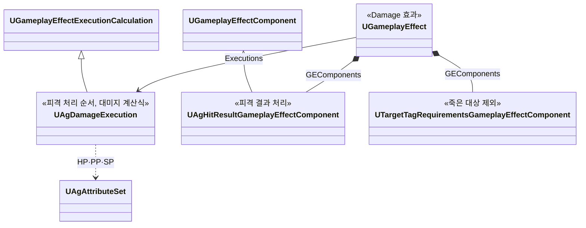
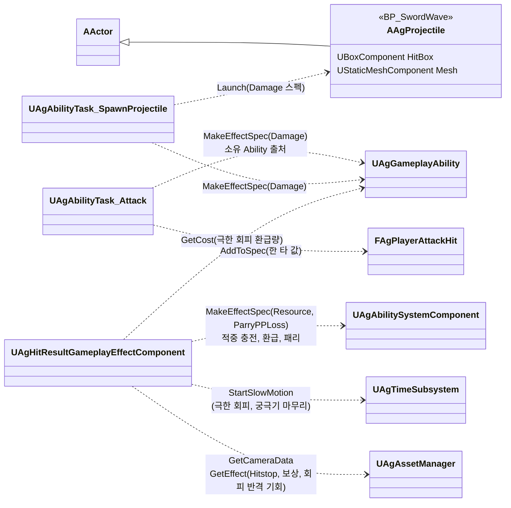
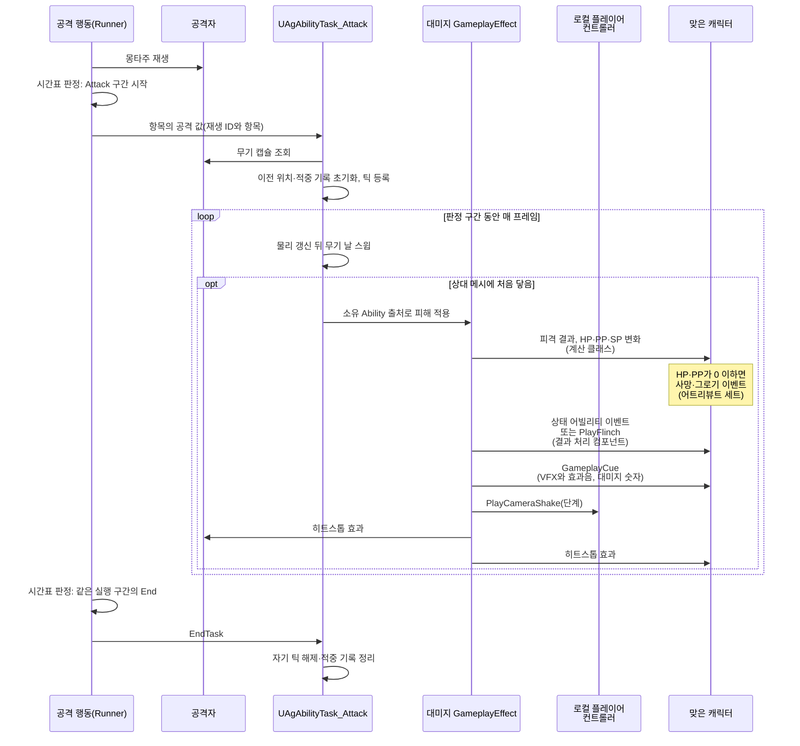

# 대미지와 피격 처리

공격 판정, 피격 처리, 대미지를 어떻게 구현할지 정합니다.

## 기술 결정

| 항목 | 결정 | 이유 |
| - | - | - |
| 피격 처리 | 공격은 대미지 GameplayEffect를 적용하는 것으로 끝나고, 피격 처리는 그 GameplayEffect 안에서 이루어집니다. 피격 처리 순서와 대미지 계산식은 계산 클래스(`UAgDamageExecution`)가, 사망·그로기 판정은 어트리뷰트 세트의 GameplayEffect 실행 뒤 처리(`PostGameplayEffectExecute`)가, 결과에 따른 반응과 적중 후 처리는 GameplayEffect 컴포넌트(`UAgHitResultGameplayEffectComponent`)가 맡습니다. | GAS가 권장하는 구조입니다. 공격 방식(무기 스윕, 공격 범위, 투사체)마다 처리 함수를 부르지 않아도, 대미지 GameplayEffect만 적용하면 피격 처리가 빠짐없이 따라옵니다. |
| 공격 판정 | 근접 공격의 이전 무기 위치와 적중 기록은 각 Attack Task가 소유합니다. Task가 물리 이후에 스윕하고 종료 시 자기 틱과 기록을 정리합니다([어빌리티와 AbilityTask](<어빌리티와 AbilityTask.md>)의 Attack). 근접 공격은 판정 구간 동안 무기 날을 따라 이전 프레임 위치에서 현재 위치까지 스윕하고, 프레임 사이를 잘게 나눠 검사합니다. 나눈 위치는 캐릭터 축을 중심으로 한 호를 따라 잡습니다. 무기 날은 무기 컴포넌트의 자식인 캡슐 컴포넌트(`WeaponCollision`, 충돌 없음)로 정하고, 캡슐 양 끝의 선분을 캡슐 반지름의 구로 스윕합니다. 캡슐의 위치, 회전, 크기는 캐릭터 블루프린트에 적습니다. 맞는 대상은 상대 캐릭터 메시의 피직스 바디입니다. 판정 구간 하나가 1타이고, 이미 맞은 대상은 기록해 다시 맞지 않게 합니다. 공격 범위(Attack의 Radius) 판정은 주인과 대상의 캡슐 중심 사이 수평 거리로 정하고, 피격 위치는 대상의 캡슐 중심입니다. | 할버드에는 한 프레임에 크게 움직이는 스미어 프레임이 있습니다. Sweep 패턴은 한 프레임에 크게 돌아, 직선으로 나누면 옆에 선 상대를 지나칩니다. 캡슐은 블루프린트 뷰포트에서 무기 메시에 겹쳐 보며 맞출 수 있고, 캡슐의 겹침 이벤트를 쓰지 않아 빠른 휘두르기에도 판정을 놓치지 않습니다. |
| 패턴별 공격 판정 | DashThrust는 돌진하는 동안 할버드 날을 스윕합니다. LeapSlam은 착지하는 순간(End 섹션 시작의 Attack 지점) 보스와의 수평 거리가 착지 지점 범위(보스 사양 'LeapSlam') 안에서 땅에 있는 적을 한 번 피격 처리합니다(보스의 적은 플레이어 하나). 검기는 보스 사양 '검기'의 크기만큼 충돌 상자를 가진 투사체 액터로, 매 프레임 그 프레임에 지나간 구간을 상자로 쓸어 처음 닿은 상대를 한 번 피격 처리하고, 결과와 관계없이 그 상대를 뚫고 계속 날아갑니다(그 상대는 다시 판정하지 않음). 벽은 상자 가운데 높이의 선으로 검사합니다. 처형은 찌르기부터 마지막 일격까지의 무기 판정 구간과 마지막 일격 순간의 공격 범위 지점입니다. 칼이 찌르기부터 발차기까지 보스 몸통을 꿰뚫고 있어 찌르기 구간은 시작하는 프레임에 닿고([마일스톤1 구현 계획](<마일스톤1 구현 계획.md>)의 '처형 두 모션의 정렬'), 마지막 일격은 발차기로 칼을 뽑는 순간이라 칼날 스윕 대신 공격 범위로 맞힙니다. 궁극기 마무리는 Draw 섹션 시작의 공격 범위 지점입니다. | 검기 한 발이 같은 상대를 여러 번 때리지 않고, 긴 프레임에도 상대를 건너뛰지 않습니다. 선은 바닥에 닿지 않아, 바닥을 벽으로 잘못 보지 않습니다. |
| 피격 결과 | 대미지 GameplayEffect는 `Effects.json`의 `Damage` 효과입니다. 적용하는 쪽은 공격한 Runner의 `MakeEffectSpec`으로 스펙을 만들고, 공격 데이터 1타가 자기 값을 담습니다(`FAgPlayerAttackHit::AddToSpec`). 배율과 MP·UP 충전량은 SetByCaller로, 피격 반응·가드 불가·마지막 일격은 스펙 태그로, 맞은 위치는 컨텍스트의 Origin으로 넘깁니다. 투사체 공격은 투사체를 반응의 기준으로 넘겨, 넉백 방향은 투사체 위치에서 정합니다. 죽은 대상에는 적용되지 않습니다(엔진의 대상 태그 조건 컴포넌트). 계산 클래스는 대상의 상태 태그로 결과를 정해 HP·PP·SP를 바꾸고 결과를 스펙 태그로 남기며, GameplayEffect 컴포넌트가 그 태그를 보고 처리합니다. 넉업, 넉백, 가드 밀림, 가드 브레이크, 그로기는 이벤트로 상태 어빌리티를 발동하고, 사망 이벤트는 캐릭터가 받아 처리하며([사망 처리](<사망 처리.md>)), 움찔은 덧입힘 몽타주만 재생합니다. 그로기 중에 맞은 넉업, 넉백도 움찔로 재생하고, 이번 타격으로 죽었거나 그로기가 되면 반응하지 않습니다. 사망·그로기 이벤트는 공격 쪽 태그(공격자와 스펙의 태그)를 넘깁니다. 처형 어빌리티가 만든 스펙에는 엔진이 어빌리티 태그를 넣으므로, 처형 사망 모션, 처형의 셰이크, 히트스톱 없음, 대상의 캡슐 중심에 띄우는 대미지 숫자를 그 태그로 구분합니다. | 대미지 효과의 정의는 지속 방식, 계산 클래스, 컴포넌트, 태그뿐이고 1타의 값은 SetByCaller와 스펙 태그로 받아, 공격마다 효과를 따로 두지 않습니다. 결과를 스펙 태그로 남기면 결과 처리가 같은 판정을 다시 하지 않습니다. |
| 패리·극한 회피 결과 | 결과 처리 컴포넌트가 처리합니다. 극한 회피는 극한 회피 구간 효과(`PerfectDodgeWindow`)를 지워 회피마다 한 번만 처리하고, 그 효과를 건 행동(효과 컨텍스트의 어빌리티 인스턴스)의 Cost만큼 자원을 돌려준 뒤 보상(`PerfectDodgeReward`), 회피 반격 기회(`DodgeCounterChance`), 슬로우모션(플레이어 데이터의 값)을 줍니다. 패리는 공격한 쪽의 PP 감소(`ParryPPLoss`), 방어자의 패리 구간(`ParryWindow`) 지우기, 보상(`ParryReward`) 뒤에 패리 모션 이벤트(`Event.Parry`)를 보냅니다. 순서는 전투 시스템 '피격 처리 순서'를 따릅니다. | 결과를 정하는 곳이 보상도 주면, 구간 닫기와 보상이 한 곳에서 같은 순서로 일어나고 회피·가드 행동이 결과 이벤트를 기다리지 않습니다. 환급량을 효과를 건 행동의 Cost에서 읽어 회피의 비용이 한 곳에만 있습니다. |

## 클래스 구조

### 대미지 GameplayEffect

대미지 GameplayEffect는 `Effects.json`의 `Damage` 효과입니다([JSON 데이터](<JSON 데이터.md>) '효과'). 정의가 계산 클래스와 결과 처리 컴포넌트를 클래스 경로로 가리키고, 죽은 대상을 빼는 조건(`ApplicationIgnoredTags`의 `State.Dead`)과 효과를 알아보는 에셋 태그(`Effect.Damage`)를 둡니다. 적용하면 피격 처리가 그 안에서 끝납니다.

| 클래스 | 부모 | 역할 |
| - | - | - |
| `UAgDamageExecution` | `UGameplayEffectExecutionCalculation` | 피격 처리 순서와 대미지 계산식. 대상의 상태 태그로 결과를 정해 HP·PP·SP를 바꾸고, 결과를 스펙 태그로 남깁니다. |
| `UAgHitResultGameplayEffectComponent` | `UGameplayEffectComponent` | 대미지 GameplayEffect의 결과 처리. 극한 회피(구간 지우기, 환급, 보상, 회피 반격 기회, 슬로우모션)와 패리(공격한 쪽의 PP 감소, 패리 구간 지우기, 보상, 패리 모션 이벤트), 피격 반응과 가드 반응, 막힘 알림, 적중 후 처리(VFX와 효과음, 셰이크, 대미지 숫자, 히트스톱, 궁극기 마무리의 슬로우모션, MP·UP 충전) |
| `AAgProjectile` | `AActor` | 투사체(검기). 투사체 발사 태스크([전투 규칙](<전투 규칙.md>) '투사체 발사')가 스폰하고 `Launch`로 공격 데이터, 방향, 속도, 최대 사거리를 넘깁니다. |

대미지 GameplayEffect를 적용하는 쪽과, 결과 처리 컴포넌트가 쓰는 클래스입니다.

### 공격 판정과 피격 처리

