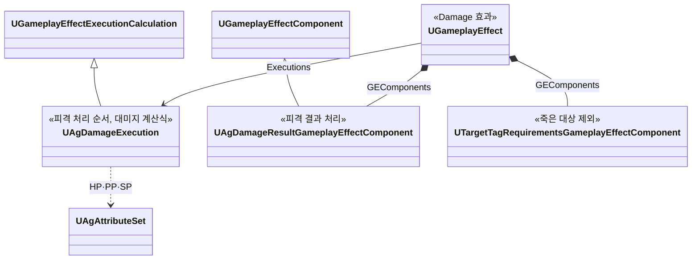
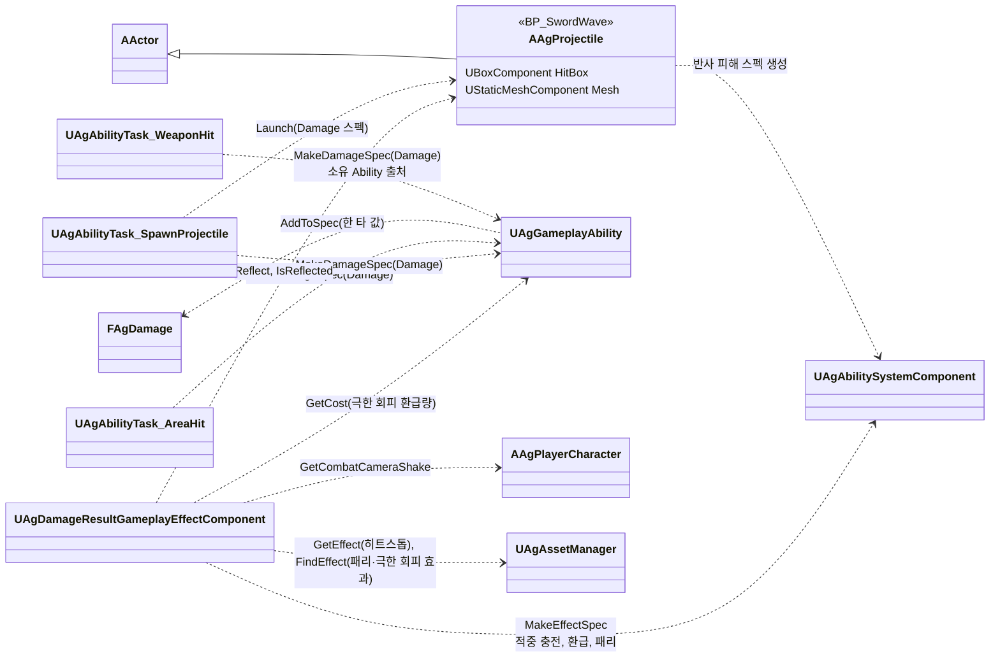
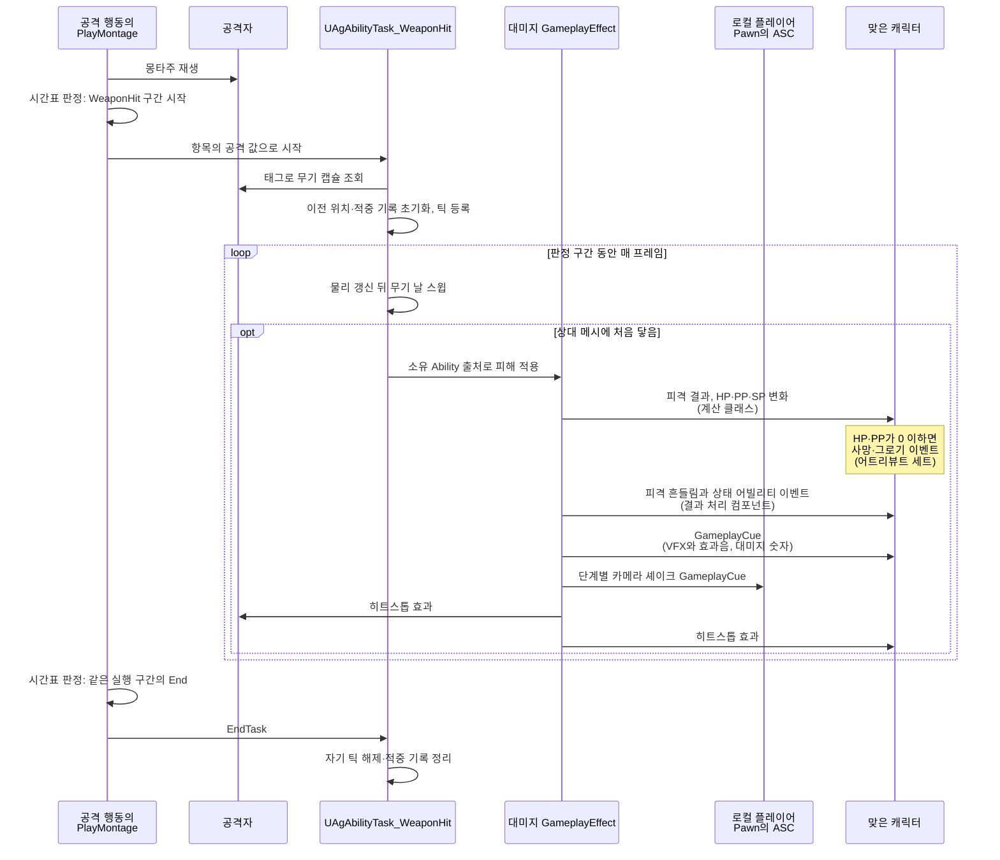

# 대미지와 피격 처리

공격 판정, 피격 처리, 대미지를 어떻게 구현할지 정합니다.

## 기술 결정

| 항목 | 결정 | 이유 |
| - | - | - |
| 피격 처리 | 공격은 대미지 GameplayEffect를 적용하는 것으로 끝나고, 피격 처리는 그 GameplayEffect 안에서 이루어집니다. 피격 처리 순서와 대미지 계산식은 계산 클래스(`UAgDamageExecution`)가, 사망·그로기 판정은 어트리뷰트 세트의 GameplayEffect 실행 뒤 처리(`PostGameplayEffectExecute`)가, 결과에 따른 반응과 적중 후 처리는 GameplayEffect 컴포넌트(`UAgDamageResultGameplayEffectComponent`)가 맡습니다. | GAS가 권장하는 구조입니다. 공격 방식(무기 스윕, 공격 범위, 투사체)마다 처리 함수를 부르지 않아도, 대미지 GameplayEffect만 적용하면 피격 처리가 빠짐없이 따라옵니다. |
| 공격 판정 | 근접 공격은 판정 구간 동안 무기 날을 따라 이전 프레임 위치에서 현재 위치까지 스윕하고, 프레임 사이를 잘게 나눠 검사합니다. 나눈 위치는 캐릭터 축을 중심으로 한 호를 따라 잡습니다. 무기 날은 무기 컴포넌트의 자식인 캡슐 컴포넌트(충돌 없음)로 정하고, 캡슐 양 끝의 선분을 캡슐 반지름의 구로 스윕합니다. 캡슐은 WeaponHit의 ComponentTag(기본 `WeaponCollision`)가 붙은 것을 모두 쓰므로, 두 부위로 치는 1타는 두 캡슐에 같은 태그를 붙입니다. 맞는 대상은 상대 캐릭터 메시의 피직스 바디이고, 극한 회피 구간인 캐릭터는 회피를 시작한 자리의 캡슐도 맞는 대상입니다(아래 '회피를 시작한 자리'). 판정 구간 하나가 1타이고, 이미 맞은 대상은 기록해 다시 맞지 않게 합니다. 공격 범위(AreaHit) 판정은 엔진 Targeting System 프리셋(`Enemy`)으로 대상을 찾고, 주인의 캡슐 중심에서 Range를 반지름으로 한 구에 캡슐이 닿는 대상을 칩니다([대상 찾기와 락온](<대상 찾기와 락온.md>) '대상'). 피격 위치는 대상의 캡슐 중심입니다. | 할버드에는 한 프레임에 크게 움직이는 스미어 프레임이 있습니다. Sweep 패턴은 한 프레임에 크게 돌아, 직선으로 나누면 옆에 선 상대를 지나칩니다. 캡슐의 겹침 이벤트를 쓰지 않아 빠른 휘두르기에도 판정을 놓치지 않습니다. |
| 패턴별 공격 판정 | 검기는 보스 사양 '검기'의 크기만큼 충돌 상자를 가진 투사체 액터로, 보스의 캡슐 중심에서 보스 정면으로 수평으로 날아가며, 매 프레임 그 프레임에 지나간 구간을 상자로 쓸어 처음 닿은 상대를 한 번 피격 처리하고, 패리가 아니면 그 상대를 뚫고 계속 날아갑니다(그 상대는 다시 판정하지 않음). 패리되면 아래 투사체 반사를 따릅니다. 벽은 상자 가운데 높이의 선으로 검사합니다. 처형은 칼이 찌르기부터 발차기까지 보스 몸통을 꿰뚫고 있어 찌르기 구간은 시작하는 프레임에 닿고, 마지막 일격은 발차기로 칼을 뽑는 순간이라 칼날 스윕 대신 공격 범위로 맞힙니다. | 검기 한 발이 같은 상대를 여러 번 때리지 않고, 긴 프레임에도 상대를 건너뛰지 않습니다. 선은 상자 가운데 높이라, 상자가 스치는 바닥이나 낮은 턱을 벽으로 잘못 보지 않습니다. |
| 피격 결과 | 대미지 GameplayEffect는 C++에서 구성하는 `EAgEffect::Damage`입니다. 적용하는 쪽은 공격한 어빌리티의 `MakeDamageSpec`으로 스펙을 만들고, 공격 데이터 1타가 자기 값을 담습니다(`FAgDamage::AddToSpec`). 배율은 SetByCaller로, 적중 충전 단위는 컨텍스트로, 피격 반응·가드 불가·마지막 일격은 스펙 태그로, 맞은 위치는 컨텍스트의 Origin으로 넘깁니다. 무기 공격은 스윕 결과도 컨텍스트의 HitResult로 넘기며, TraceStart·TraceEnd에 날의 맞은 지점이 앞 단계부터 지나온 선(날이 아직 움직이지 않았으면 무기를 쥔 손 바디의 속도로 만든 선)을 담아 피격 흔들림이 미는 방향으로 씁니다. 투사체 공격은 투사체를 반응의 기준으로 넘겨, 넉백 방향은 투사체 위치에서 정합니다. 죽은 대상에는 적용되지 않습니다(엔진의 대상 태그 조건 컴포넌트). 계산 클래스는 대상의 상태 태그로 결과를 정해 HP·PP·SP를 바꾸고 결과를 스펙 태그로 남기며, GameplayEffect 컴포넌트가 그 태그를 보고 처리합니다. 넉업, 넉백, 가드 밀림, 가드 브레이크, 그로기는 이벤트로 상태 어빌리티를 발동하고, 움찔도 `Event.Hit.Flinch`를 보내 공중의 피격 반응 중이면 저글을 발동하며(받는 행동이 없으면 아무 일도 없음), 사망 이벤트는 캐릭터가 받아 처리하며([사망 처리](<사망 처리.md>)), 피격 반응이 없음이 아니면 맞거나 막을 때 캐릭터의 `UAgHitPhysicsComponent`가 피격 흔들림을 재생하고([애니메이션과 이동](<애니메이션과 이동.md>) '피격 흔들림'), 가드 움찔은 결과 처리 컴포넌트가 덧입힘 몽타주(`GuardFlinch`)도 재생합니다. 그로기 중에 맞은 움찔, 넉업, 넉백은 그로기가 되는 타격을 포함해 피격 흔들림만 재생하고, 이번 타격으로 죽었거나 처형 중이면 반응하지 않습니다. 처형 어빌리티가 만든 스펙에는 엔진이 어빌리티 태그를 넣으므로, 처형의 셰이크, 히트스톱 없음, 대상의 캡슐 중심에 띄우는 대미지 숫자를 그 태그로 구분합니다. | 대미지 효과의 정의는 지속 방식, 계산 클래스, 컴포넌트, 태그뿐이고 1타의 값은 SetByCaller와 스펙 태그로 받아, 공격마다 효과를 따로 두지 않습니다. 결과를 스펙 태그로 남기면 결과 처리가 같은 판정을 다시 하지 않습니다. |
| 패리·극한 회피 결과 | 결과 처리 컴포넌트가 처리합니다. 극한 회피는 극한 회피 구간 효과(`PerfectDodgeWindow`)를 지워 회피마다 한 번만 처리하고, 그 효과를 건 행동(효과 컨텍스트의 어빌리티 인스턴스)의 Cost만큼 자원을 돌려준 뒤 극한 회피 효과(플레이어 데이터의 `PerfectDodgeEffects`: 보상, 회피 반격 기회, 슬로우모션)를 줍니다. 성공한 플레이어 ASC에 실행하는 화면 효과 큐는 [카메라와 화면 효과](<카메라와 화면 효과.md>) '화면 후처리'를 따릅니다. 투사체가 아닌 공격의 패리는 공격한 쪽에 거는 효과(플레이어 데이터의 `ParryAttackerEffects`: PP 감소), 방어자의 패리 구간(`ParryWindow`) 지우기 뒤에 패리 모션 이벤트(`Event.Parry`)를 보냅니다. 패리 보상은 그 이벤트로 발동하는 Parry의 `ApplyEffect`가 겁니다. 히트스톱 효과는 `EAgEffect::Hitstop`이고, 시간은 전투 규칙의 `HitstopDuration`입니다. 순서는 전투 시스템 '피격 처리 순서'를 따릅니다. | 결과를 정하는 곳이 보상도 주면, 구간 닫기와 보상이 한 곳에서 같은 순서로 일어나고 회피·가드 행동이 결과 이벤트를 기다리지 않습니다. 환급량을 효과를 건 행동의 Cost에서 읽어 회피의 비용이 한 곳에만 있습니다. |
| 회피를 시작한 자리 | `AAgCharacterBase`가 캡슐 컴포넌트(`PerfectDodgeCapsule`)를 가집니다. 극한 회피 구간 태그(`State.PerfectDodgeWindow`)가 붙으면 캐릭터 캡슐의 지금 자리로 옮겨 쿼리 충돌을 켜고, 태그가 떨어지면 끕니다. 위치와 회전이 절대값이라 캐릭터가 움직여도 그 자리에 남고, 크기는 BeginPlay에서 캐릭터 캡슐의 크기를 가져옵니다. 오브젝트 종류는 Pawn, 응답은 무기 판정 채널(`AgWeapon`)의 겹침뿐입니다. 캡슐에만 닿은 공격도 대미지 효과를 걸고, 대미지 계산이 구간 태그를 보고 극한 회피로 끝냅니다. 극한 회피가 되면 결과 처리가 구간 효과를 지워 캡슐도 꺼집니다. | 무기 판정(`AgWeapon` 채널), 투사체와 공격 범위(Pawn 오브젝트 종류)가 모두 충돌 검사로 대상을 찾으므로, 판정 코드를 고치지 않고 모든 공격에 같은 규칙이 적용됩니다. 오브젝트 종류 검사는 응답을 보지 않아(엔진 Chaos `FQueryFilterData`), 나머지 채널을 무시해도 투사체와 공격 범위가 찾고 이동과 카메라는 막지 않습니다. 캡슐은 구간 동안에만 켜져 캡슐에 닿은 공격은 언제나 극한 회피이고, 결과 처리가 적중 후 처리 전에 끝나 몸에 닿지 않은 공격에 피격 흔들림이 생기지 않습니다. 같은 1타가 몸과 캡슐에 함께 닿아도 맞은 대상 기록으로 한 번만 처리합니다. |

### 투사체 반사

플레이 규칙은 [플레이어 사양](<../Design/플레이어 사양.md>)의 '투사체 반사'를 따릅니다.

- 투사체 패리는 공격자에게 효과를 바로 걸지 않습니다. 결과 처리 컴포넌트가 패리 보상·모션·연출을 처리한 뒤 `AAgProjectile::Reflect`로 되돌리고, 공격자 효과는 반사탄이 맞을 때 겁니다(아래).
- 투사체의 Instigator는 원래 발사자로 유지해 사망 시 소멸을 판단합니다. 별도의 약한 참조 `Reflector`가 반사 후 피해 출처와 적대 관계 판정을 맡아, 반사탄은 원래 발사자도 맞힙니다.
- 반사되면 맞은 지점에서 방향을 바꾸고 그 틱의 남은 충돌은 버리며, 다음 틱부터 새 방향으로 사거리를 다시 셉니다.
- 반사 스펙은 플레이어 ASC에서 새 컨텍스트로 만듭니다. 원래 HP 배율과 피격 반응·가드 가능·마무리 속성만 복원하고, 원래 어빌리티의 태그·출처와 적중 충전은 전달하지 않습니다. 일반 PP 배율은 사용하지 않습니다. 대상별 적용 때 컨텍스트를 복제·설정해 적중 시점 플레이어 ATK를 캡처합니다.
- 반사탄이 유효한 일반 피격을 일으키고 대상이 살아 있으면, 결과 처리 컴포넌트가 플레이어의 `ParryAttackerEffects`를 대상에게 적용합니다. 근접 패리와 같은 효과이며, HP 사망 판정 뒤·피격 반응 전에 적용해 그로기가 넉백보다 우선합니다. PP 면역·반올림·리젠 대기 갱신도 다른 PP 감소와 같습니다.

## 클래스 구조

### 적중 충전

기획 규칙은 [플레이어 사양](<../Design/플레이어 사양.md>)의 '적중에 의한 충전 횟수'(공격의 각 타에서 최초 적중에 1회)를 따릅니다. 충전량은 피해를 주는 Task(WeaponHit, AreaHit, SpawnProjectile)의 `HitReward`에만 둡니다([어빌리티와 AbilityTask](<어빌리티와 AbilityTask.md>) 'Task 목록').

- 충전 단위는 1타입니다. 피해를 주는 Task가 시작할 때 자기 `HitReward`로 새 `FAgHitRewardState`를 만들고, 그 Task가 만드는 모든 대미지 스펙에 담습니다. `HitReward`가 없으면 단위가 없어 충전하지 않습니다(보스·적의 공격, 처형, 궁극기). 단위는 Task마다 따로 만들어지므로, 같은 때에 시작하는 Task 사이의 순서와 관계없고 시간표·섹션·재생과도 관계없습니다.
- 충전하는 행동은 피해를 주는 Task가 하나이거나, 평타처럼 각 Task가 별개의 타여야 합니다. 피해를 주는 Task가 여러 개인 행동은 Task마다 충전합니다.
- `MakeDamageSpec`은 엔진 어빌리티 컨텍스트의 출처를 유지한 `FAgGameplayEffectContext`에 단위를 담습니다.
- 대상별 대미지 스펙은 하나의 단위를 공유합니다. 컨텍스트의 `Duplicate`는 HitResult를 깊은 복사하고 충전 단위는 공유합니다. 투사체는 쏠 때 만든 스펙을 가지고 날아가므로, 쏜 행동이 끝났거나 다음 발동이 시작된 뒤에 맞아도 자기 단위를 씁니다. 투사체·장판이 2차 피해를 줄 때도 원래 스펙의 컨텍스트를 이어 써야 같은 단위입니다. 이 실행 상태는 현재 LocalOnly 전투용이며 네트워크 직렬화 대상이 아닙니다.
- 피격 결과 컴포넌트는 `Effect.Damage.Result.Hit`일 때 미지급 단위의 `Resource` 스펙으로 MP·UP를 함께 적용합니다. 최대 자원이어도 지급 기회를 사용합니다. 무적·패리·가드 등 비적중 결과는 기회를 사용하지 않습니다. 반사탄은 원래 공격의 충전 단위를 이어받지 않습니다(위 '투사체 반사').

### 대미지 GameplayEffect

대미지 GameplayEffect(`EAgEffect::Damage`)의 생성과 구성은 [캐릭터와 GAS](<캐릭터와 GAS.md>) '코드가 효과를 쓰는 방법'을 따릅니다. 적용하면 계산 클래스와 결과 처리 컴포넌트가 피격 처리를 그 안에서 끝냅니다.

| 클래스 | 부모 | 역할 |
| - | - | - |
| `FAgHitReward` | | 피해를 주는 Task의 적중 충전량 데이터(`MP`, `UP`) |
| `FAgHitRewardState` | | 한 충전 단위(1타)의 충전량과 지급 여부. 피해를 주는 Task와 대미지 컨텍스트가 공유 |
| `FAgGameplayEffectContext` | `FGameplayEffectContext` | 대미지 출처와 충전 단위 전달. 복제 시 지급 상태 공유 |
| `UAgDamageExecution` | `UGameplayEffectExecutionCalculation` | 피격 처리 순서와 대미지 계산식. 대상의 상태 태그로 결과를 정해 HP·PP·SP를 바꾸고, 결과를 스펙 태그로 남깁니다. |
| `UAgDamageResultGameplayEffectComponent` | `UGameplayEffectComponent` | 대미지 GameplayEffect의 결과 처리. 극한 회피(구간 지우기, 환급, 극한 회피 효과, 화면 후처리)와 패리(근접 공격자의 PP 감소 또는 투사체 반사, 패리 구간 지우기, 보상, 패리 모션 이벤트), 반사탄 적중의 PP 효과, 피격 반응과 가드 반응, 막힘 알림, 적중 후 처리(VFX와 효과음, 셰이크, 대미지 숫자, 히트스톱, MP·UP 충전) |
| `AAgProjectile` | `AActor` | 투사체(검기). 투사체 발사 태스크([전투 규칙](<전투 규칙.md>) '투사체 발사')가 스폰하고 `Launch`로 대미지 스펙, 방향, 비행 값(속도, 최대 사거리)을 넘깁니다. `Reflect`는 반사 방향·사거리를 초기화하고 플레이어 출처의 피해 스펙을 만듭니다. |

대미지 GameplayEffect를 적용하는 쪽과, 결과 처리 컴포넌트가 쓰는 클래스입니다.

### 공격 판정과 피격 처리

