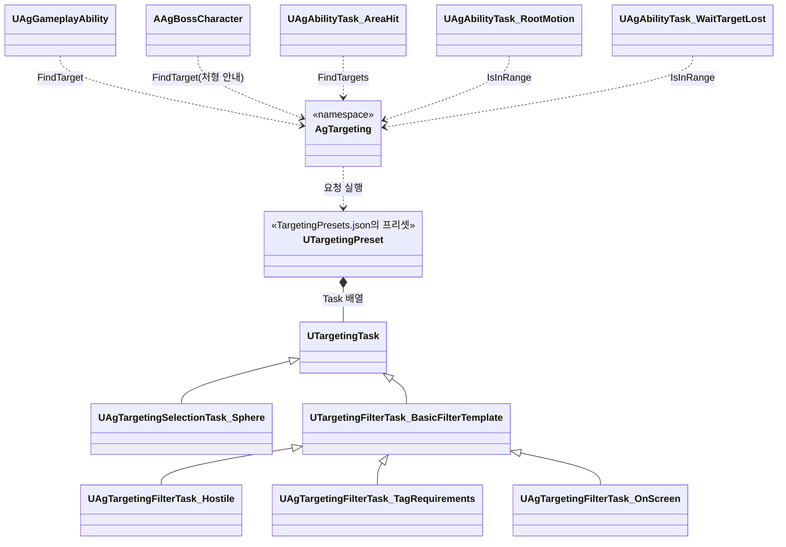

# 대상 찾기와 락온

행동의 대상 찾기(Targeting, 대상 프리셋, 범위 판정)와 대상을 붙잡는 락온 행동을 어떻게 구현할지 정합니다. 행동의 실행 구조와 Task는 [어빌리티와 AbilityTask](<어빌리티와 AbilityTask.md>)를 따릅니다.

## 기술 결정

| 항목 | 결정 | 이유 |
| - | - | - |
| 대상 찾기 | 행동 대상(기본 공격, 점프 공격, 회피 반격, 스킬, 처형, 락온, 보스 공격 패턴)은 행동의 Targeting이 TargetingSystem 프리셋으로 찾습니다. 프리셋은 요청의 Range 안의 후보를 모으고 후보마다 조건을 확인해 거릅니다(아래 '대상'). 처형은 그로기 중이고 처형 중이 아니며 땅에 있는 대상(태그 조건)입니다. 공격 중 위치·회전 보정의 대상은 행동의 Range 안에서 고르고, 추적 구간의 TargetingRange는 그 범위 안에서 회전과 접근 여부를 정합니다([어빌리티와 AbilityTask](<어빌리티와 AbilityTask.md>) 'Task 목록'의 RootMotion). 궁극기 마무리와 GroundSlam 착지는 대상을 고르지 않고 공격 범위 안의 적 모두를 칩니다. | 후보 수집이 요청의 Range로 구의 크기를 정하므로, 프리셋 반경과 행동 범위를 따로 맞출 필요가 없습니다. 조건을 후보마다 확인하므로, 더 가까운 적이 조건에 맞지 않아도 조건에 맞는 적을 찾습니다. 공격 행동의 Range는 락온 해제 거리보다 넓어 락온 중에는 늘 락온 대상이 행동 대상이 되고, 타의 TargetingRange 밖이면 다른 적이 가까이 있어도 락온 대상 쪽으로 돌기만 합니다. |
| 락온 | 락온 키는 락온의 트리거 태그(`Input.LockOn`)를 붙이고 떼어 락온 행동을 시작하고 끝냅니다([입력 처리](<입력 처리.md>) '트리거 태그'). 락온 행동은 행동 상태의 제한을 받지 않고 선입력으로 기억하지 않으며, 다른 행동이 취소하지 않습니다. 대상은 락온 행동의 Targeting(프리셋 `LockOn`, 범위, 필수)이 발동할 때 고르고(없으면 발동하지 않음), 행동이 끝날 때까지 그 대상입니다. 플레이어의 입력·회전·추적 구간의 대체 대상과 보스 마커는 `GetLockOnTarget`으로 실행 중인 락온 행동의 대상을 읽습니다. 대상이 바뀌면 플레이어 회전 모드를 갱신합니다. 대상을 잃으면 락온 행동이 스스로 끝납니다(아래 '락온'). 락온 카메라는 [카메라와 화면 효과](<카메라와 화면 효과.md>) '락온 카메라'를 따릅니다. | 락온도 다른 행동처럼 행동으로 시작하고 끝나며, 대상은 행동의 Targeting이 정합니다. 해제도 행동의 Task가 판단해, 플레이어와 적이 같은 락온 행동을 씁니다. |

## 대상

| 출처 |
| - |
| `Targeting`이 있으면 그 결과 중 주인의 락온 대상, 없으면 첫 후보 |
| 없고 이벤트로 발동했으면 그 이벤트의 Instigator |
| 그 밖에는 없음 |

| Targeting 필드 | 뜻 |
| - | - |
| Preset | `TargetingPresets.json`의 프리셋 ID. 후보를 모으고 거르고 정렬하는 절차입니다(아래 '대상 프리셋'). |
| Range | 후보 수집에 쓰는 구의 반지름(cm). 주인의 캡슐 중심에서 이 반경 안에 캡슐이 닿는 캐릭터가 후보입니다. 기본 0이며, 0 이하이면 검색 결과가 없습니다. |
| TargetRequiredTags, TargetBlockedTags | 대상이 가져야 할 태그와 가지면 안 되는 태그(Activation의 태그 조건은 주인의 태그) |
| bRequired | 대상이 없으면 발동하지 않습니다. |
| TargetSpacing | 대상과 맞출 간격(cm)이고, 기본 0입니다. 추적 구간은 대상 앞 이 간격까지 다가가고, Launch의 Direction Target은 이 간격만큼 떨어져 내립니다. 행동 내내 지키는 최소 간격은 [캐릭터 이동과 모션 제어](<캐릭터 이동과 모션 제어.md>) '대상과의 최소 간격'을 따릅니다. |

- 범위와 태그 조건은 행동 JSON의 요청(`FAgTargetingRequest`)을 그대로 타겟팅 요청 핸들의 데이터로 실어 보냅니다. 후보 수집 Task(`UAgTargetingSelectionTask_Sphere`)가 주인의 캡슐 중심에서 반지름이 요청의 Range인 구로 Pawn 오브젝트 종류의 겹침 검사를 해, 주인을 뺀 캐릭터를 한 번씩 모읍니다. 캐릭터 메시도 Pawn 오브젝트 종류라 캡슐 컴포넌트에 닿은 결과만 씁니다.
- 엔진 AOE Task는 모양의 크기를 Task 속성으로만 받고 크기를 만드는 `GetCollisionShape`가 가상 함수가 아니며 겹침 처리도 private이라 요청마다 반경을 바꿀 수 없어, 같은 겹침 검사를 요청의 Range로 합니다. 엔진 공간 분할이 구 근처만 찾으므로 캐릭터 수와 관계없고, 극한 회피 구간의 회피를 시작한 자리 캡슐([대미지와 피격 처리](<대미지와 피격 처리.md>) '회피를 시작한 자리')도 따로 처리하지 않고 잡힙니다. 구라서 위아래 차이도 반경에 들어가지만, 캡슐이 길어 넉업 최고점에서도 범위 끝이 10cm 남짓 줄어드는 정도입니다.
- 이미 정한 대상이 아직 범위 안인지는 `AgTargeting::IsInRange`가 대상의 루트 충돌(캐릭터 캡슐)에 엔진 `UPrimitiveComponent::OverlapComponent`로 같은 구를 검사해 봅니다(RootMotion의 TargetingRange, WaitTargetLost의 해제 거리). 찾을 때와 기준이 다르면 범위 끝에서 찾자마자 풀리기를 되풀이하므로(보스는 찾는 범위와 해제 범위가 같음), 두 판정을 한 파일에 둡니다.
- 최소 간격, 보스 패턴의 허용 거리, Dash·Launch의 이동 거리는 대상 찾기가 아니라 간격과 이동을 정하는 값이라 캡슐 중심 사이 수평 거리로 잽니다. 프리셋에는 별도의 Radius나 거리 필터를 두지 않습니다.
- 적대 필터(`UAgTargetingFilterTask_Hostile`)는 엔진 팀 태도가 적대인 대상만, 태그 조건 필터(`UAgTargetingFilterTask_TagRequirements`)는 프리셋에 적은 태그 조건과 행동의 대상 태그를 모두 만족하는 대상만 남깁니다. 정렬은 엔진의 거리 정렬(`UTargetingFilterTask_SortByDistance`)입니다.
- 요청은 즉시 실행하고 결과를 읽은 뒤 놓습니다(`AgTargeting::FindTargets`, 행동 대상은 그 가운데 주인의 락온 대상이나 첫 대상을 고르는 `FindTarget`). AreaHit의 `Area`도 같은 네 필드(Preset, Range, TargetRequiredTags, TargetBlockedTags, `FAgTargetingRequest`)로 같은 요청을 만들고 결과를 모두 칩니다.
- 프리셋은 `Enemy`(살아 있는 적: 요청의 Range 안의 캐릭터를 모아 적대·태그 조건 필터로 거르고 거리로 정렬. 사망은 태그 조건 필터가 `State.Dead`로 거름), `LockOn`(Enemy에 화면 안 조건 `UAgTargetingFilterTask_OnScreen`)입니다. 플레이어 락온만 `LockOn`을 쓰고, 그 밖의 플레이어 행동, 보스 공격 패턴, 적 락온은 `Enemy`를 씁니다.
- CanActivateAbility에서 읽기 전용으로, 커밋 직전에 한 번 더 평가합니다. 재생 Task가 다시 재생할 때 다시 평가합니다(`RefreshTarget`, 기본 공격의 타마다 대상). 이벤트 Instigator는 바뀌지 않습니다.
- 추적 구간은 그 재생의 대상을 씁니다. 보스의 대상은 타겟팅 범위 안의 플레이어이고 플레이어 공격은 재생마다 추적 구간이 하나입니다.
- 처형 안내 HUD는 처형 스펙의 Targeting을 읽기 전용으로 평가하고, 락온 대상은 실행 중인 락온 행동의 대상입니다(아래 '락온').

## 대상 프리셋

Task 순서와 값을 텍스트로 검토하고 여러 행동이 같은 프리셋을 함께 씁니다. 엔진 Task의 많은 속성 중 바꾼 값만 드러냅니다.

`TargetingPresets.json`의 항목은 프리셋 ID마다 GameplayTargetingSystem Task의 배열입니다. 로더가 이 순서대로 Task를 넣은 `UTargetingPreset`을 만들고, 행동은 `Targeting.Preset`에 ID를 적습니다. 프리셋마다 하는 일과 Task 순서는 위 '대상'을 따릅니다.

- Task 항목은 `{"Class": Task 클래스 경로, 명시할 속성}`입니다. 적지 않은 속성은 그 클래스의 기본값입니다. 에디터의 프리셋에서 고칠 수 있는 속성만 적을 수 있습니다. 구조체 속성도 명시할 필드를 골라 적습니다(예: `"Requirements": {"IgnoreTags": ["State.Dead"]}`). 기본값의 명시·생략은 [데이터 로딩과 스키마](<데이터 로딩과 스키마.md>) '기본값 작성'을 따릅니다.
- 대상 태그는 태그 조건 필터(`UAgTargetingFilterTask_TagRequirements`)가 적용합니다. 이 필터가 없는 프리셋에서는 대상 태그 조건을 쓰지 않습니다.

## 락온

플레이어와 적은 같은 방식의 락온 행동(행동 태그 `Ability.LockOn`)으로 대상을 붙잡습니다. 그 행동의 대상이 락온 대상이고, 모든 캐릭터는 `AAgCharacterBase::GetLockOnTarget`으로 읽습니다. 대상을 잃으면 WaitTargetLost가 끝나고 `End: Tasks`로 행동이 끝나므로, 어빌리티에도 입력 계층에도 락온 해제 판단이 없습니다.

| | 플레이어 `LockOn` | 적 `EnemyLockOn` |
| - | - | - |
| Targeting | `LockOn` 프리셋, Range(락온 거리), bRequired | `Enemy` 프리셋, Range(보스 타겟팅 범위), bRequired |
| 시작 | 락온 키(트리거 태그 `Input.LockOn`) | 보스 AI 컨트롤러가 매 틱, 락온 행동이 실행 중이 아니면 발동을 시도합니다. 대상이 없으면 발동하지 않습니다. |
| OwnedTags | `State.LockedOn`(회피가 8방향 구르기를 고르는 조건) | 없음 |
| Tasks | WaitTargetLost, ReleaseRange(해제 거리) | WaitTargetLost(해제 거리는 Targeting.Range) |
| End | `Tasks` | `Tasks` |

| 끝나는 때 | 처리 |
| - | - |
| 대상을 잃음(대상 사망, 해제 거리 밖) | WaitTargetLost가 끝나 행동이 끝납니다. 플레이어면 입력 계층이 트리거 태그를 뗍니다([입력 처리](<입력 처리.md>) '트리거 태그'의 규칙 3). |
| 플레이어가 락온 키를 다시 누름 | 트리거 태그가 떨어져 엔진이 취소합니다. |
| 주인이 죽음 | 사망이 모든 행동을 취소합니다. |

- 락온 거리와 해제 거리는 각 락온 행동 정의에 있습니다. 보스는 같은 범위를 쓰므로 ReleaseRange를 중복해 적지 않습니다.
- 보스는 고른 대상을 잃을 때까지 유지합니다. 매 틱 가장 가까운 적을 다시 고르지 않습니다.
- 카메라 추적은 플레이어 캐릭터가 락온 대상을 읽어 합니다.

## 클래스 구조

| 클래스 | 부모 | 역할 |
| - | - | - |
| `AgTargeting` | (네임스페이스) | 요청 실행(`FindTargets`), 행동 대상 고르기(`FindTarget`), 범위 판정(`IsInRange`) |
| `UAgTargetingSelectionTask_Sphere` | `UTargetingTask` | 요청의 Range를 반지름으로 한 구에 닿는 캐릭터 후보 수집(Pawn 겹침 검사) |
| `UAgTargetingFilterTask_Hostile`, `UAgTargetingFilterTask_TagRequirements`, `UAgTargetingFilterTask_OnScreen` | `UTargetingFilterTask_BasicFilterTemplate` | TargetingPreset 안의 필터. 적대, 태그 조건(프리셋과 행동), 화면 안 |

