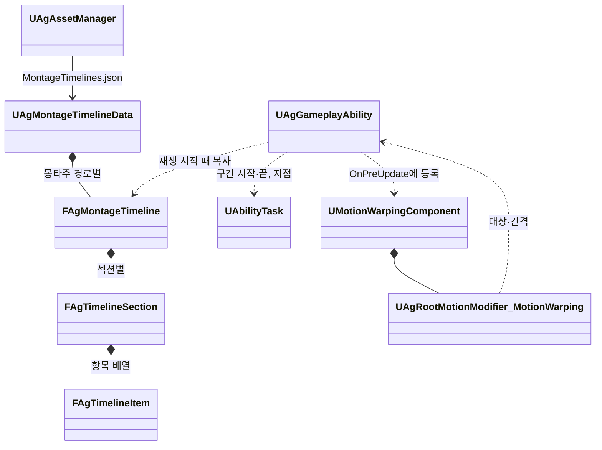

# 몽타주 시간표

몽타주 안에서 Task를 실행하는 시각(판정·보호·이동·전환·추적 구간과 지점)과 그 값을 어떻게 관리하고 실행하는지 정합니다. Task의 종류와 Runner는 [어빌리티와 AbilityTask](<어빌리티와 AbilityTask.md>)를 따릅니다.

## 기술 결정

| 항목 | 결정 | 이유 |
| - | - | - |
| 원본 | 몽타주 안에서 실행하는 Task의 시각과 값은 `Data/MontageTimelines.json`의 몽타주 시간표가 유일한 원본입니다. 항목은 값을 직접 가지며 행동 JSON의 설정을 가리키지 않습니다. 기획서가 정한 연출인 카메라 셰이크(LeapSlam 착지)도 시간표 지점에 둡니다. | 시각과 값을 에디터 없이 텍스트로 고치고 diff로 리뷰합니다. 새 기능은 Task 하나만 더하면 됩니다. |
| 몽타주에 남는 노티파이 | 연출(공격 예고의 엔진 `AnimNotify_GameplayCueState`, 궁극기 베기 선의 엔진 `AnimNotify_GameplayCue`와 `AnimNotify_GameplayCueState`)과 루트 모션 사용 방식(엔진 `AnimNotifyState_DisableRootMotion`)만 몽타주에 둡니다. 게임 규칙을 실행하는 프로젝트 노티파이와 엔진 워핑 노티파이는 두지 않습니다. | 연출과 루트 이동 사용 방식은 기획 데이터가 아니라 모션의 제작 정보입니다. 같은 일을 노티파이와 시간표가 함께 하면 두 번 일어납니다. |
| 판정 | 재생을 시작한 Runner가 몽타주 재생 위치로 판정합니다([기본 방침](<기본 방침.md>) '구조 선택'의 예외). 판정한 뒤에는 Task와 엔진 Motion Warping을 씁니다. | 재생 위치는 히트스톱, 재생 배율, 반복 섹션, 섹션 이동, 몽타주 멈춤을 그대로 반영합니다. |
| 같은 몽타주를 쓰는 행동 | 같은 값을 씁니다. 값이 달라야 하는 행동이 생기면 몽타주를 따로 둡니다. | 시간표는 몽타주 단위입니다. 함께 쓰는 넉업 몽타주에는 행동마다 달라지는 값이 없습니다. |
| 흐름 | 시작 섹션 고르기, 기다림, 다음 동작은 섹션과 Transition으로 적습니다. 기다림은 반복 섹션과 그 섹션을 덮는 기다리는 구간입니다. | 몽타주의 흐름이 데이터에 드러나고, Runner는 Task가 요청한 전환만 합니다. |
| 다시 읽기 | 저장하면 다시 읽고, 재생을 시작할 때의 시간표를 그 재생이 끝날 때까지 씁니다. 잘못된 시간표는 오류를 내고 이전 데이터를 유지합니다. | 진행 중인 구간의 값이 중간에 바뀌지 않습니다. |

## 형식

`Data/MontageTimelines.json`은 몽타주 에셋 경로를 키로 하고, 몽타주마다 섹션 이름을 키로 한 항목 배열을 둡니다(`{"몽타주 경로": {"섹션": [항목, ...]}}`). 경로는 캐릭터 데이터(`Characters.json`) `Montages`의 값과 같습니다. 섹션이 하나인 몽타주는 엔진 기본 섹션 이름(`Default`)을 씁니다. 항목이 없는 섹션은 적지 않고, 항목은 한 줄에 하나씩 적습니다.

| 항목 | 필드 |
| - | - |
| 구간 | `{"Task": 이름, "Start": 초, "End": 끝(선택), Params 필드...}` |
| 지점 | `{"Task": 이름, "Time": 초, Params 필드...}` |

- Task 이름과 Params 필드는 [어빌리티와 AbilityTask](<어빌리티와 AbilityTask.md>)의 'Task 목록'을 따르고, 둘 수 있는 곳(구간·지점)도 그 표를 따릅니다. 추적 구간은 `Track`입니다.
- Start·Time은 그 섹션의 시작 기준 초이며, 몽타주 Rate Scale을 적용하기 전의 값입니다.
- End를 생략하면 그 섹션 끝까지입니다. 같은 섹션 안이면 초로 적고, 섹션을 넘는 구간은 `{"Section": 섹션, "Time": 초}`로 적습니다(Time을 생략하면 그 섹션 끝). 구간은 몽타주 타임라인에서 Start부터 End까지라, 그 사이의 반복이나 섹션 이동도 구간 안이면 한 실행으로 이어집니다.
- 추적 구간의 TargetingRange·MaxWarpDistance는 null이면 제한 없음입니다. 최대 워핑 거리 0은 '위치 보정 없이 회전만'입니다. 회전 방법은 회피 반격과 처형만 Slerp(속도 제한 없이 끝까지 회전)이고 나머지는 ConstantRate입니다. 그 밖의 Modifier 설정은 모든 항목이 같아 Modifier의 기본값으로 둡니다.

```json
{
  "/Game/Animations/AM_Player_Dodge.AM_Player_Dodge": {
    "Backstep": [
      {"Task": "Transition", "Time": 0, "RequiredTags": ["Input.Move"], "Next": {"Section": "Roll"}},
      {"Task": "HoldTag", "Start": 0, "End": 0.4, "Tag": "State.Busy"},
      {"Task": "ApplyEffect", "Start": 0, "End": 0.15, "Effect": "PerfectDodgeWindow"},
      {"Task": "HoldTag", "Start": 0, "End": 0.3, "Tag": "State.Invincible"}
    ]
  },
  "/Game/Animations/AM_Boss_DashThrust.AM_Boss_DashThrust": {
    "Start": [
      {"Task": "Track", "Start": 0, "End": 0.9, "TargetingRange": null, "MaxWarpDistance": 0, "RotationMethod": "ConstantRate"},
      {"Task": "Dash", "Start": 0.9166667, "End": {"Section": "Hold"}, "To": "Target", "Speed": 2000, "HomingTurnRate": 90, "Overshoot": 200, "MaxDistance": 2000, "Next": {"Section": "Recover", "BlendTime": 0.1}}
    ]
  }
}
```

## 판정 규칙

| 규칙 | 내용 |
| - | - |
| 기준 | 몽타주 재생 인스턴스의 재생 위치. 히트스톱이나 반복 섹션으로 위치가 그대로면 아무 일도 일어나지 않습니다. |
| 대상 | Runner가 시작한 재생만 판정합니다. 캐릭터가 직접 재생한 몽타주(점프, 사망, 움찔)는 항목을 실행할 주인이 없으므로 판정하지 않습니다. |
| 사본 | 재생을 시작할 때 시간표를 복사해 섹션 기준 시각을 몽타주 시각으로 바꾸고 UPROPERTY로 보관합니다. 컷신 Sequence 같은 에셋 참조를 GC가 봅니다. |
| 구간 | Start ≤ 위치 < End인 동안 켜집니다. 재생을 시작한 위치에 걸친 구간은 시작과 함께 켜집니다. 한 번의 판정에서 구간 전체를 지나면 열고 바로 닫습니다. |
| 지점 | 앞 판정 위치 < Time ≤ 지금 위치일 때 한 번 실행합니다. 재생 시작과 섹션 이동 직후에는 그 위치의 지점(위치와 같거나 아주 조금 앞, 1e-4초 이내)도 실행합니다. 위치보다 뒤의 지점은 다음 판정이 실행하므로 두 번 실행되지 않습니다. |
| 순서 | 시각 순서입니다. 같은 시각이면 구간 끝, 지점, 구간 시작 순서이고, 그래도 같으면 배열 순서(섹션 순서, 섹션 안의 항목 순서)입니다. |
| 반복 섹션 | 위치가 뒤로 가면 그 사이의 지점을 실행하지 않습니다. 반복 섹션 안에는 지점과 추적 구간을 두지 않습니다(검증). |
| 전환 | 판정 중에 항목이 위치를 바꾸면 그 판정의 남은 항목은 실행하지 않습니다. 같은 시각에 함께 실행할 항목은 배열에서 전환 항목보다 앞에 둡니다. 판정 밖(착지, 컷신 종료, 돌진 종료, 입력 이벤트, 태그 변화, 시간)에서 요청한 전환은 바로 적용합니다. 같은 재생 안에서 섹션을 옮기면 판정 위치를 새 위치로 맞추고, 건너뛴 지점은 실행하지 않습니다. 엔진이 옮기지 않으면(블렌드 아웃 중인 재생) 판정 위치를 그대로 둡니다. 재생을 끝내거나 바꿀 때는 그 재생을 먼저 내려놓은 뒤 구간을 끝내므로, 끝나는 구간이 요청한 전환은 받지 않습니다. |
| 재생 바뀜 | 다시 재생하면 이전 재생의 구간을 끝냅니다. 지점 Task는 재생이 바뀌어도 남습니다. |
| 재생 끝 | 완료, 다른 몽타주에 끊김, 인스턴스가 사라짐, 행동 종료에서 켜진 구간을 모두 끕니다. |
| 판정 시점 | Runner의 틱 함수가 매 프레임 캐릭터 무브먼트와 메시가 갱신된 뒤(TG_PrePhysics, 두 틱을 선행 조건으로) 판정합니다. 재생이 있는 동안만 켭니다. 몽타주는 그 사이에 진행되며(루트 모션 몽타주는 이동 틱 안에서), 같은 프레임의 공격 판정(TG_PostPhysics)보다 먼저 구간을 엽니다. 구간과 지점은 그 시각을 지난 프레임에 실행됩니다. |

## 항목별 실행

| 항목 | 실행 |
| - | - |
| Task 구간 | 구간 시작에 항목의 Params로 Task를 만들어 시작하고, 구간 끝에 그 실행을 끝냅니다. 실행은 재생(몽타주 인스턴스 ID)과 항목 번호로 구분하므로 이전 재생의 구간 끝이 새 실행을 닫지 않습니다. Task가 먼저 끝났으면 뒤의 구간 끝은 아무 일도 하지 않습니다. |
| Task 지점 | 그 시각에 Task를 만들어 시작합니다. 스스로 끝나거나 행동이 끝날 때까지 둡니다. |
| 추적 구간, 몽타주 루트 모션이 있음 | 엔진이 워핑 노티파이를 찾는 때(워핑 컴포넌트의 `OnPreUpdate`)에 같은 조건, 곧 앞 재생 위치가 구간 안이고 같은 구간의 Modifier가 없을 때 Modifier(`UAgRootMotionModifier_MotionWarping`)를 만들어 등록합니다. 구간의 시작·제거와 루트 모션 보정은 엔진이 합니다. Modifier는 항목의 값을 갖고, 대상과 간격만 Runner에게 받습니다. 재생을 시작할 때 모두 등록하지 않는 것은, 끊긴 재생의 대기 Modifier가 같은 몽타주의 다음 재생에서 새 Modifier와 함께 켜져 워핑이 두 번 걸리기 때문입니다. |
| 추적 구간, 몽타주 루트 모션이 없음 | 판정 틱에서 Runner가 캐릭터를 직접 돌립니다. 구간에 처음 든 판정에서 대상을 정하고, ConstantRate는 캐릭터 회전 속도 × 프레임 시간 × 주인의 시간 배율만큼, Slerp는 남은 구간에 맞춰 돌립니다. 다가가지 않습니다(이동은 루트 모션 소스가 맡음). |

## 검증

`UAgAssetManager`가 읽을 때 검사하고, 오류는 파일, 몽타주 경로, 섹션, 항목 번호, 필드 경로로 알립니다. 에디터에서는 몽타주 에셋과 대조합니다.

- 키: 리다이렉터를 거친 경로와 없는 에셋은 오류입니다. 어떤 행동의 Montage가 재생하는 몽타주만 키가 될 수 있습니다. 캐릭터가 직접 재생하는 몽타주(점프, 사망, 움찔)의 시간표는 오류입니다.
- 항목: Start와 Time 중 하나만 있습니다. Task 이름과 Params는 각 Task의 읽기·검증·둘 수 있는 곳을 따릅니다. ApplyEffect의 Effect는 `Effects.json`에 있고 구간이면 무한 효과입니다.
- 시각: 섹션은 그 몽타주에 있고, 0 ≤ Time ≤ 섹션 길이, 0 ≤ Start < 섹션 길이입니다. End는 같은 섹션이면 Start보다 뒤이고 섹션 길이 이하이며, 다른 섹션이면 몽타주 타임라인에서 Start보다 뒤입니다.
- 전환: 전환의 섹션은 그 몽타주에 있고, 전환 지점은 섹션 끝보다 앞입니다(섹션 끝의 지점은 이어지는 섹션의 시작과 같은 시각이라, 그 섹션으로 다시 재생하면 또 실행됩니다). 기다리는 구간(bOptional이 아닌 구간 Transition, PlayCutscene, Next가 있는 Dash)은 반복 섹션을 끝까지 덮습니다.
- 반복 섹션: 반복 섹션 안의 지점과, 반복 섹션과 겹치는 추적 구간은 오류입니다.
- 리소스: SpawnProjectile의 ProjectileId는 `Projectiles.json`에 있어야 합니다. MeshSocket 발사의 소켓은 발사할 때 메시에서 확인하며, 없으면 오류를 남기고 발사하지 않습니다.
- 경쟁: 같은 몽타주에서 Dash끼리 겹치는 구간은 오류입니다. 캐릭터 통과 같은 상태 태그는 겹쳐도 개수로 세므로 검사하지 않습니다.
- 루트 모션 소스: Dash 구간에는 몽타주 루트 모션이 없어야 합니다(구간을 덮는 엔진 `AnimNotifyState_DisableRootMotion`, 또는 루트 모션 시퀀스가 하나도 없는 몽타주). Launch와 Dash를 한 행동에 함께 두는 것은 [어빌리티와 AbilityTask](<어빌리티와 AbilityTask.md>) '검증'이 막습니다. 몽타주 루트 모션이 없는 곳의 추적 구간은 회전만 하므로 MaxWarpDistance가 0입니다. Launch는 시간표와 무관하게 착지할 때까지 움직이므로 실행 중에 확인합니다(몽타주가 루트 모션을 주면 오류를 남김).
- 몽타주의 노티파이: 시간표가 있는 몽타주에 프로젝트 노티파이나 엔진 워핑 노티파이가 있으면 오류입니다. 공격 예고(UnblockableTelegraph, ParryTelegraph Cue)의 끝은 첫 섹션에서 링크로 이어지는 섹션 안의 바로 뒤 타격(Attack 구간이나 지점, SpawnProjectile 지점)의 시각과 같아야 합니다(보스 사양 '공격 예고'). 착지로 넘어가 판정 시각을 몽타주가 정하지 않는 LeapSlam의 착지 타격은 이 검사에서 빠집니다.

## 클래스 구조

| 클래스 | 부모 | 역할 |
| - | - | - |
| `UAgMontageTimelineData` | `UObject` | `MontageTimelines.json`의 값. 키는 몽타주 경로입니다. `UAgAssetManager`가 읽고, 검증하고, 다시 읽습니다. |
| `FAgMontageTimeline`, `FAgTimelineSection`, `FAgTimelineItem` | | 몽타주 하나의 시간표, 섹션 하나의 항목 배열, 항목 하나(구간·지점의 시각과 Task Params) |
| `UAgGameplayAbility` | `UGameplayAbility` | 재생마다 시간표를 복사해 판정하고, 구간·지점 Task를 시작·종료하고, 추적 구간을 워핑에 등록하거나 직접 돌립니다. |
| `UAgRootMotionModifier_MotionWarping` | `URootMotionModifier_SkewWarp` | 추적 구간 하나. 항목의 값과 Runner가 정한 대상으로 엔진 워핑을 합니다([애니메이션과 이동](<애니메이션과 이동.md>) '공격 중 위치·회전 보정'). |


