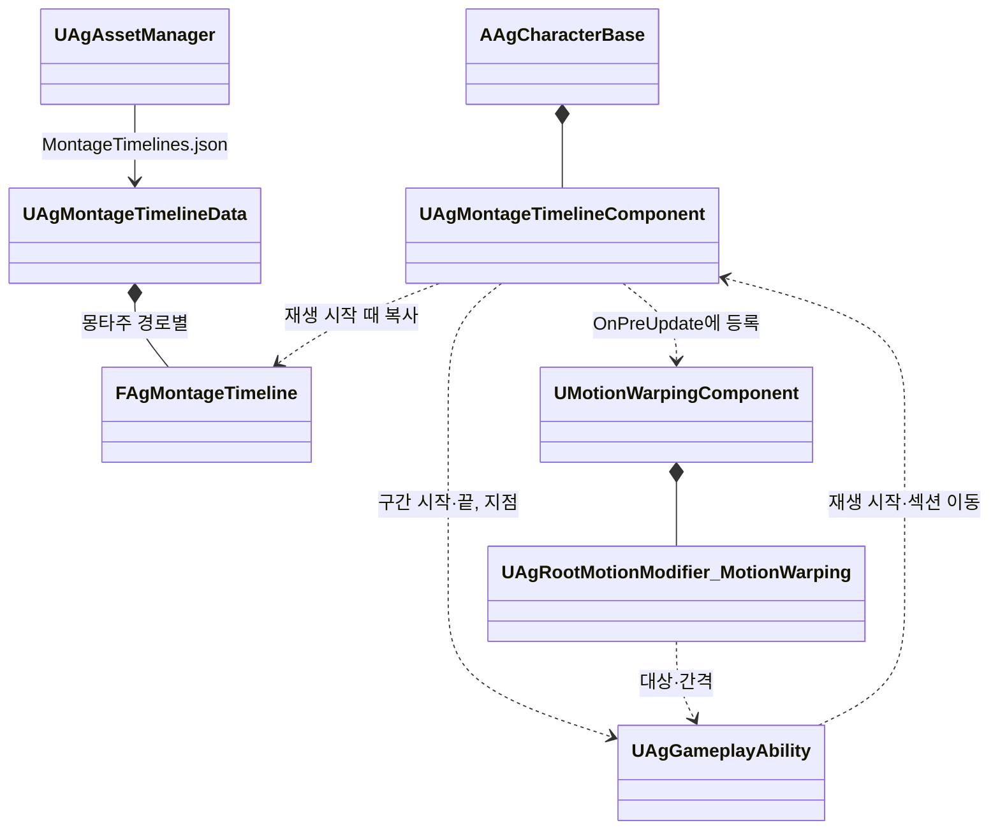

# 몽타주 시간표

몽타주 안에서 게임 규칙이 쓰는 시각(판정·보호·이동·워핑 구간과 후딜 같은 사건)과 그 값을 어떻게 관리하고 실행하는지 정합니다. 행동의 나머지 설정과 기능 Task는 [AbilityTask 기반 어빌리티 설계안](<AbilityTask 기반 어빌리티 설계안.md>)을 따릅니다.

## 기술 결정

| 항목 | 결정 | 이유 |
| - | - | - |
| 원본 | 몽타주 안에서 게임 규칙이 쓰는 시각과 그 값은 `Data/MontageTimelines.json`의 몽타주 시간표가 유일한 원본입니다. 항목은 값을 직접 가지며 행동 JSON의 설정 이름을 가리키지 않습니다. | 시각과 값을 에디터 없이 텍스트로 고치고 diff로 리뷰합니다. 새 기능은 항목 종류와 그 실행 연결만 더하면 됩니다(2026-10-17). |
| 몽타주에 남는 노티파이 | 연출(공격 예고의 엔진 `AnimNotify_GameplayCueState`, 궁극기 베기 선의 엔진 `AnimNotify_GameplayCue`)과 루트 모션 사용 방식(엔진 `AnimNotifyState_DisableRootMotion`)만 몽타주에 둡니다. 게임 규칙을 실행하는 프로젝트 노티파이와 엔진 워핑 노티파이는 두지 않습니다. | 연출과 루트 이동 사용 방식은 기획 데이터가 아니라 모션의 제작 정보입니다. 같은 일을 노티파이와 시간표가 함께 하면 두 번 일어납니다. |
| 판정 | 프로젝트 코드가 몽타주 재생 위치로 판정합니다([기본 방침](<기본 방침.md>) '구조 선택'의 예외). 판정한 뒤에는 기능 AbilityTask와 엔진 Motion Warping을 씁니다. | 재생 위치는 히트스톱, 재생 배율, 반복 섹션, 섹션 이동, 몽타주 멈춤을 그대로 반영합니다. |
| 같은 몽타주를 쓰는 행동 | 같은 값을 씁니다. 값이 달라야 하는 행동이 생기면 몽타주를 따로 둡니다. | 시간표는 몽타주 단위입니다. 함께 쓰는 넉업·낙하·기상 몽타주에는 행동마다 달라지는 값이 없습니다. |
| 다시 읽기 | 저장하면 다시 읽고, 재생을 시작할 때의 시간표를 그 재생이 끝날 때까지 씁니다. 잘못된 시간표는 오류를 내고 이전 데이터를 유지합니다. | 진행 중인 구간의 값이 중간에 바뀌지 않습니다. |

## 형식

`Data/MontageTimelines.json`은 몽타주 에셋 경로를 키로 하는 객체입니다. 경로는 캐릭터 데이터(`Characters.json`) `Montages`의 값과 같습니다. 몽타주마다 기능 이름의 배열을 두고, 배열의 항목은 시각과 그 기능의 값을 직접 가집니다. 항목이 없는 몽타주와 기능은 적지 않고, 항목은 한 줄에 하나씩 적습니다.

| 기능 | 종류 | 필드 |
| - | - | - |
| Attack | 구간 | Start, End, DamageMultiplier, PoiseMultiplier, HitReaction, bGuardable, MPCharge, UPCharge |
| HoldTag | 구간 | Start, End, Tag |
| SetCollisionResponseToChannel | 구간 | Start, End, Channel, Response |
| Dash | 구간 | Start, End, Speed, HomingTurnRate, Overshoot, MaxDistance |
| MotionWarping | 구간 | Start, End, TargetingRange, MaxWarpDistance, RotationMethod(ConstantRate, Slerp) |
| GameplayEvent | 지점 | Time, Event |
| SpawnProjectile | 지점 | Time, ProjectileId, Origin, SocketName(Origin이 MeshSocket일 때만), Attack(Attack 구간과 같은 값 필드) |

- Start·End·Time은 몽타주 타임라인의 초(재생 위치)이며, 몽타주 Rate Scale과 재생 배율을 적용하기 전의 값입니다.
- 값 필드의 뜻은 각 기능의 고정 Params와 같습니다([AbilityTask 기반 어빌리티 설계안](<AbilityTask 기반 어빌리티 설계안.md>)의 '기능별 고정 Params'와 기능별 설명).
- 워핑의 TargetingRange·MaxWarpDistance는 null이면 제한 없음입니다. 최대 워핑 거리 0은 '위치 보정 없이 회전만'이므로 위치 보정 여부 필드는 두지 않습니다. 회전 방법은 회피 반격과 처형만 Slerp(속도 제한 없이 끝까지 회전)이고 나머지는 ConstantRate입니다. 그 밖의 Modifier 설정(회전 종류, Z축 무시, 회전 시간 배율, 이징, 목표 이름)은 모든 항목이 같아 Modifier의 기본값으로 둡니다.
- GameplayEvent의 Event는 `Event.` 아래의 네이티브 태그입니다(후딜 시작, 처형 타격, 넉백·넉업 무적 시작, 돌진 자세 유지, 궁극기 마무리, 점프 공격 내리꽂기).

```json
{
  "/Game/Animations/AM_Boss_DashThrust.AM_Boss_DashThrust": {
    "Attack": [
      {"Start": 0.9166667, "End": 1.8, "DamageMultiplier": 2, "PoiseMultiplier": 1, "HitReaction": "KnockUp", "bGuardable": true, "MPCharge": 0, "UPCharge": 0}
    ],
    "SetCollisionResponseToChannel": [
      {"Start": 0.9166667, "End": 1.8, "Channel": "Pawn", "Response": "Ignore"}
    ],
    "Dash": [
      {"Start": 0.9166667, "End": 1.8, "Speed": 2000, "HomingTurnRate": 90, "Overshoot": 200, "MaxDistance": 2000}
    ],
    "MotionWarping": [
      {"Start": 0, "End": 0.9, "TargetingRange": null, "MaxWarpDistance": 0, "RotationMethod": "ConstantRate"}
    ],
    "GameplayEvent": [
      {"Time": 1.0366666, "Event": "Event.Boss.DashHold"}
    ]
  },
  "/Game/Animations/AM_Boss_SwordWave.AM_Boss_SwordWave": {
    "SpawnProjectile": [
      {"Time": 0.75, "ProjectileId": "SwordWave", "Origin": "CharacterFeetForward", "Attack": {"DamageMultiplier": 1.2, "PoiseMultiplier": 1, "HitReaction": "KnockBack", "bGuardable": true, "MPCharge": 0, "UPCharge": 0}}
    ]
  },
  "/Game/Animations/AM_Player_Roll.AM_Player_Roll": {
    "HoldTag": [
      {"Start": 0, "End": 0.15, "Tag": "State.PerfectDodgeWindow"},
      {"Start": 0, "End": 0.3, "Tag": "State.Invincible"}
    ],
    "GameplayEvent": [
      {"Time": 0.6, "Event": "Event.RecoveryStarted"}
    ]
  }
}
```

## 판정 규칙

| 규칙 | 내용 |
| - | - |
| 기준 | 몽타주 재생 인스턴스의 재생 위치. 히트스톱이나 돌진 자세 유지로 위치가 그대로면 아무 일도 일어나지 않습니다. |
| 대상 | 어빌리티가 시작한 모션의 재생만 판정합니다. 어빌리티 밖에서 재생한 몽타주(움찔 등)는 항목을 실행할 주인이 없으므로 판정하지 않습니다. |
| 구간 | Start ≤ 위치 < End인 동안 켜집니다. 재생을 시작한 위치에 걸친 구간은 시작과 함께 켜집니다. |
| 지점 | 앞 판정 위치 < Time ≤ 지금 위치일 때 한 번 실행합니다. 재생 시작과 섹션 이동 직후에는 그 위치의 지점도 실행합니다. |
| 순서 | 시각 순서입니다. 같은 시각이면 구간 끝, 지점, 구간 시작 순서이고, 그래도 같으면 기능 순서(Attack, HoldTag, SetCollisionResponseToChannel, Dash, GameplayEvent, SpawnProjectile)와 배열 순서입니다. |
| 반복 섹션 | 위치가 뒤로 가면 그 사이의 지점을 실행하지 않습니다. 반복 섹션 안에는 지점과 워핑 구간을 두지 않습니다(검증). |
| 섹션 이동 | 어빌리티가 섹션을 옮기면 판정 위치를 새 위치로 맞춥니다. 건너뛴 지점은 실행하지 않습니다. 항목 처리 안에서 섹션을 옮기면 같은 판정의 남은 항목도 실행하지 않습니다. |
| 재생 끝 | 완료, 중단, 블렌드 아웃이 끝나 인스턴스가 사라지면 켜진 구간을 모두 끕니다. 그 전에 어빌리티가 모션을 정리하면 어빌리티가 자기 실행을 끝냅니다. |
| 판정 시점 | 매 프레임 캐릭터 무브먼트와 메시가 갱신된 뒤(TG_PrePhysics, 두 틱을 선행 조건으로) 판정합니다. 몽타주는 그 사이에 진행되며(루트 모션 몽타주는 이동 틱 안에서), 같은 프레임의 공격 판정(TG_PostPhysics)보다 먼저 구간을 엽니다. 구간과 지점은 그 시각을 지난 프레임에 실행됩니다. |

## 항목별 실행

| 항목 | 실행 |
| - | - |
| Attack, HoldTag, SetCollisionResponseToChannel, Dash | 그 재생을 소유한 어빌리티가 구간 시작에 항목의 값으로 기능 Task를 시작하고, 구간 끝에 그 실행을 끝냅니다. 실행은 재생 ID와 항목(기능과 배열 번호)으로 구분합니다. 돌진 찌르기의 돌진이 막힘·거리 완료로 먼저 끝나면 어빌리티가 남은 판정·이동·충돌 구간을 닫고 다시 열지 않습니다. |
| GameplayEvent | 그 재생을 소유한 어빌리티의 사건 처리로 전달합니다. |
| SpawnProjectile | 그 재생을 소유한 어빌리티가 항목의 값으로 투사체 한 발을 발사합니다. ProjectileId는 `Projectiles.json`의 투사체 ID입니다. |
| MotionWarping | 엔진이 워핑 노티파이를 찾는 때(워핑 컴포넌트의 `OnPreUpdate`)에 같은 조건, 곧 앞 재생 위치가 구간 안이고 같은 구간의 Modifier가 없을 때 Modifier를 만들어 등록합니다. 구간의 시작·제거와 루트 모션 보정은 엔진이 합니다. Modifier는 항목의 값을 갖고, 대상과 간격만 재생을 소유한 어빌리티에게 받습니다. 재생을 시작할 때 모두 등록하지 않는 것은, 끊긴 재생의 대기 Modifier가 같은 몽타주의 다음 재생에서 새 Modifier와 함께 켜져 워핑이 두 번 걸리기 때문입니다. |

## 검증

`UAgAssetManager`가 읽을 때 검사하고, 오류는 파일, 몽타주 경로, 기능 이름과 번호로 알립니다. 에디터에서는 몽타주 에셋과 대조하고, 쿡할 때 키를 확인합니다.

- 키: 리다이렉터를 거친 경로와 없는 에셋은 오류입니다. 캐릭터 데이터의 `Montages`가 쓰지 않는 몽타주의 키는 쿡할 때 오류입니다.
- 시각: 0 ≤ Start < End ≤ 몽타주 길이, 0 ≤ Time ≤ 몽타주 길이입니다. 반복 섹션 안의 지점과 워핑 구간은 오류입니다.
- 값: 기능별 필수 필드, 형식, 열거형, 태그를 고정 Params와 같게 검사합니다. Event는 `Event.` 아래의 네이티브 태그여야 합니다.
- 리소스: SpawnProjectile의 ProjectileId는 그 몽타주를 재생하는 캐릭터의 `Projectiles`에 있어야 합니다. MeshSocket 발사의 소켓은 발사할 때 메시에서 확인하며, 없으면 오류를 남기고 발사하지 않습니다.
- 경쟁: 같은 몽타주에서 Dash끼리, 같은 채널의 충돌 응답끼리 겹치는 구간은 오류입니다.
- 몽타주의 노티파이: 시간표가 있는 몽타주에 프로젝트 노티파이나 엔진 워핑 노티파이가 있으면 오류입니다. 공격 예고의 끝은 바로 뒤 Attack 구간의 시작이나 SpawnProjectile의 시각과 같아야 합니다(보스 사양 '공격 예고', 판정 시각을 몽타주가 정하지 않는 LeapSlam 제외). Dash 구간은 같은 시각에 시작하는 루트 모션 끄기 노티파이가 있어야 합니다.

## 클래스 구조

| 클래스 | 부모 | 역할 |
| - | - | - |
| `UAgMontageTimelineData` | `UObject` | `MontageTimelines.json`의 값. 키는 몽타주 경로입니다. `UAgAssetManager`가 읽고, 검증하고, 다시 읽습니다. |
| `FAgMontageTimeline`, 항목 구조체(`FAgTimelineAttack` 등) | | 몽타주 하나의 시간표. 구간 항목은 기능의 고정 Params 구조체에 Start·End를 더합니다. |
| `UAgMontageTimelineComponent` | `UActorComponent` | 캐릭터에 둡니다. 어빌리티가 시작한 재생마다 시간표를 복사해 재생 위치로 판정하고, 워핑을 등록하고, 재생을 소유한 어빌리티에 항목을 알립니다. |
| `UAgRootMotionModifier_MotionWarping` | `URootMotionModifier_SkewWarp` | 워핑 항목 하나. 항목의 값과 어빌리티가 정한 대상으로 엔진 워핑을 합니다([애니메이션과 이동](<애니메이션과 이동.md>) '공격 중 위치·회전 보정'). |


