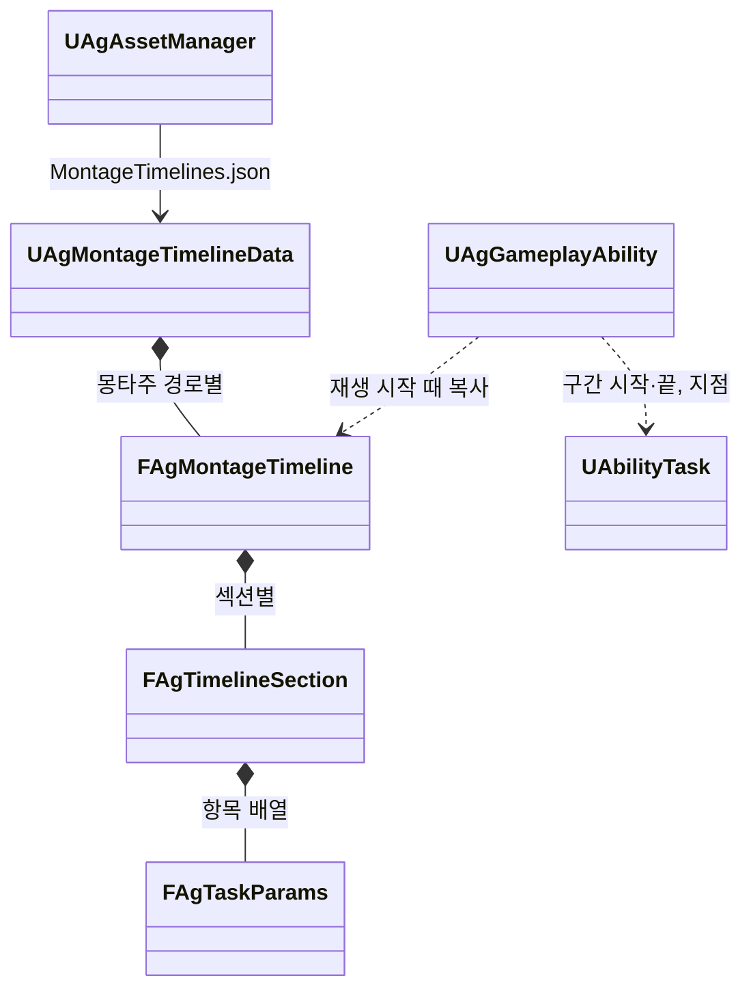

# 몽타주 시간표

몽타주 안에서 Task를 실행하는 시각(판정·보호·이동·전환·추적 구간과 지점)과 그 값을 어떻게 관리하고 실행하는지 정합니다. Task의 종류와 Runner는 [어빌리티와 AbilityTask](<어빌리티와 AbilityTask.md>)를 따릅니다.

## 기술 결정

| 항목 | 결정 | 이유 |
| - | - | - |
| 원본 | 몽타주 안에서 실행하는 Task의 시각과 값은 `Data/MontageTimelines.json`의 몽타주 시간표가 유일한 원본입니다. 항목은 값을 직접 가지며 행동 JSON의 설정을 가리키지 않습니다. 기획서가 정한 연출인 카메라 셰이크(LeapSlam 착지)도 시간표 지점에 둡니다. | 시각과 값을 에디터 없이 텍스트로 고치고 diff로 리뷰합니다. 새 기능은 Task 하나만 더하면 됩니다. |
| 몽타주에 남는 노티파이 | 연출(공격 예고의 엔진 `AnimNotify_GameplayCueState`, 궁극기 베기 선의 엔진 `AnimNotify_GameplayCue`와 `AnimNotify_GameplayCueState`)과 루트 모션 사용 방식(엔진 `AnimNotifyState_DisableRootMotion`)만 몽타주에 둡니다. 게임 규칙을 실행하는 프로젝트 노티파이와 엔진 워핑 노티파이는 두지 않습니다. | 연출과 루트 이동 사용 방식은 기획 데이터가 아니라 모션의 제작 정보입니다. 같은 일을 노티파이와 시간표가 함께 하면 두 번 일어납니다. |
| 판정 | 재생을 시작한 Runner가 몽타주 재생 위치로 판정합니다([기본 방침](<기본 방침.md>) '구조 선택'의 예외). 판정한 뒤에는 Task와 엔진 Motion Warping을 씁니다. Task가 각자 자기 시각을 판정하지 않고, 판정기를 Runner 밖의 객체로 떼지도 않습니다. | 재생 위치는 히트스톱, 재생 배율, 반복 섹션, 섹션 이동, 몽타주 멈춤을 그대로 반영합니다. 판정하는 곳이 하나여야 한 프레임에 지난 항목을 시각 순서대로 실행하고(전환하면 그 뒤 시각의 항목은 실행하지 않음), 몽타주가 진행된 뒤·공격 판정 전이라는 판정 시점을 지킵니다. Task마다 판정하면 결과가 Task의 틱 순서에 달립니다. 판정기를 Runner 밖으로 떼면 코드는 그대로 옮겨지고 Runner와의 연결(재생 바뀜, 섹션 이동 알림)만 늘어, Runner가 아닌 주인(캐릭터가 직접 재생하는 몽타주)도 시간표를 쓸 때만 이점이 있습니다. |
| 같은 몽타주를 쓰는 행동 | 같은 값을 씁니다. 값이 달라야 하는 행동이 생기면 몽타주를 따로 둡니다. | 시간표는 몽타주 단위입니다. 함께 쓰는 넉업 몽타주에는 행동마다 달라지는 값이 없습니다. |
| 흐름 | 시작 섹션 고르기, 기다림, 다음 동작은 섹션과 Transition으로 적습니다. 시작 섹션은 행동 정의의 발동 Transition이 재생 전에 고릅니다([어빌리티와 AbilityTask](<어빌리티와 AbilityTask.md>) '몽타주와 섹션'). 기다림은 반복 섹션과 그 섹션을 덮는 기다리는 구간입니다. | 몽타주의 흐름이 데이터에 드러나고, Runner는 Task가 요청한 전환만 합니다. |
| 다시 읽기 | 저장하면 다시 읽고, 재생을 시작할 때의 시간표를 그 재생이 끝날 때까지 씁니다. 잘못된 시간표는 오류를 내고 이전 데이터를 유지합니다. | 진행 중인 구간의 값이 중간에 바뀌지 않습니다. |

## 형식

`Data/MontageTimelines.json`은 몽타주 에셋 경로를 키로 하고, 몽타주마다 섹션 이름을 키로 한 항목 배열을 둡니다(`{"몽타주 경로": {"섹션": [항목, ...]}}`). 경로는 캐릭터 데이터(`Characters.json`) `Montages`의 값과 같습니다. 섹션이 하나인 몽타주는 엔진 기본 섹션 이름(`Default`)을 씁니다. 항목이 없는 섹션은 적지 않습니다.

| 항목 | 필드 |
| - | - |
| 구간 | `{"Task": 이름, "Start": 초, "End": 초(선택), "EndSection": 섹션(선택), Params 필드...}` |
| 지점 | `{"Task": 이름, "Time": 초, Params 필드...}` |

- Task 이름과 Params 필드는 [어빌리티와 AbilityTask](<어빌리티와 AbilityTask.md>)의 'Task 목록'을 따르고, 둘 수 있는 곳(구간·지점)도 그 표를 따릅니다. 추적 구간은 `Track`입니다.
- Start·Time은 그 섹션의 시작 기준 초이며, 몽타주 Rate Scale을 적용하기 전의 값입니다.
- 구간이 끝나는 섹션은 `EndSection`이고 생략하면 자기 섹션입니다. End는 그 섹션의 시작 기준 초이고, 생략하면 그 섹션 끝까지입니다. 구간은 몽타주 타임라인에서 Start부터 End까지라, 그 사이의 반복이나 섹션 이동도 구간 안이면 한 실행으로 이어집니다.
- 추적 구간의 TargetingRange·MaxWarpDistance는 적지 않거나 null이면 제한 없음입니다. 최대 워핑 거리 0은 '위치 보정 없이 회전만'입니다. 회전 방법은 회피 반격과 처형만 Slerp(속도 제한 없이 끝까지 회전)이고 나머지는 ConstantRate입니다. 그 밖의 Modifier 설정은 모든 항목이 같아 Modifier의 기본값으로 둡니다.

```json
{
  "/Game/Animations/AM_Player_Dodge.AM_Player_Dodge": {
    "Backstep": [
      {"Task": "HoldTag", "Start": 0, "End": 0.4, "Tag": "State.Busy"},
      {"Task": "ApplyEffect", "Start": 0, "End": 0.15, "Effect": "PerfectDodgeWindow"},
      {"Task": "HoldTag", "Start": 0, "End": 0.3, "Tag": "State.Invincible"}
    ]
  },
  "/Game/Animations/AM_Boss_DashThrust.AM_Boss_DashThrust": {
    "Start": [
      {"Task": "Track", "Start": 0, "End": 0.9, "TargetingRange": null, "MaxWarpDistance": 0, "RotationMethod": "ConstantRate"},
      {"Task": "Dash", "Start": 0.9166667, "EndSection": "Hold", "To": "Target", "Speed": 2000, "HomingTurnRate": 90, "Overshoot": 200, "MaxDistance": 2000, "Next": {"Section": "Recover", "BlendTime": 0.1}}
    ]
  }
}
```

## 판정 규칙

| 규칙 | 내용 |
| - | - |
| 기준 | 몽타주 재생 인스턴스의 재생 위치. 히트스톱이나 반복 섹션으로 위치가 그대로면 아무 일도 일어나지 않습니다. |
| 구간 | Start ≤ 위치 < End인 동안 켜집니다. 재생을 시작한 위치에 걸친 구간은 시작과 함께 켜집니다. 한 번의 판정에서 구간 전체를 지나면 열고 바로 닫습니다. |
| 지점 | 앞 판정 위치 < Time ≤ 지금 위치일 때 한 번 실행합니다. 재생 시작과 섹션 이동 직후에는 그 위치의 지점도 실행합니다. |
| 순서 | 시각 순서로만 실행합니다. 같은 시각의 항목 사이에는 순서가 없습니다([어빌리티와 AbilityTask](<어빌리티와 AbilityTask.md>) '결정과 목표'). |
| 반복 섹션 | 위치가 뒤로 가면 그 사이의 지점을 실행하지 않습니다. 반복 섹션 안에는 지점과 추적 구간을 두지 않습니다. |
| 전환 | 판정 중에 항목이 위치를 바꾸면 그 판정의 남은 항목은 실행하지 않습니다(옮긴 위치로 다시 판정). 같은 시각의 순서가 없으므로 전환 지점과 같은 시각에 시작하는 항목은 실행될지 정해지지 않아 두지 않습니다. 전환 지점은 섹션 끝보다 앞에 둡니다. 섹션 끝의 지점은 이어지는 섹션의 시작과 같은 시각이라, 그 섹션으로 다시 재생하면 또 실행되기 때문입니다. 섹션을 옮기면 건너뛴 지점은 실행하지 않습니다. 재생이 끝나며 닫히는 구간이 요청한 전환은 받지 않습니다. |
| 재생 바뀜 | 다시 재생하면 이전 재생의 구간을 끝냅니다. 지점 Task는 재생이 바뀌어도 남습니다. |
| 재생 끝 | 완료, 다른 몽타주에 끊김, 인스턴스가 사라짐, 행동 종료에서 켜진 구간을 모두 끕니다. |

## 클래스 구조

| 클래스 | 부모 | 역할 |
| - | - | - |
| `UAgMontageTimelineData` | `UObject` | `MontageTimelines.json`의 값. 키는 몽타주(JSON에는 경로)입니다. `UAgAssetManager`가 읽고 다시 읽습니다. |
| `FAgMontageTimeline`, `FAgTimelineSection` | | 몽타주 하나의 시간표(섹션 이름별), 섹션 하나의 항목(Task Params) 배열. 항목의 시각은 Params의 공통 부모(`FAgTaskParams`)에 있습니다. |
| `UAgGameplayAbility` | `UGameplayAbility` | 재생마다 시간표를 복사해 판정하고, 구간·지점 Task를 시작·종료합니다. 추적 구간도 다른 구간처럼 Task(Track)로 실행합니다([애니메이션과 이동](<애니메이션과 이동.md>) '추적 구간'). |


