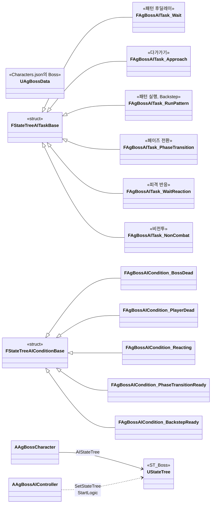
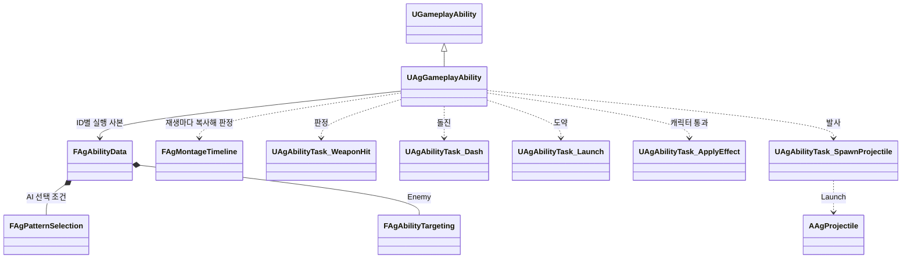
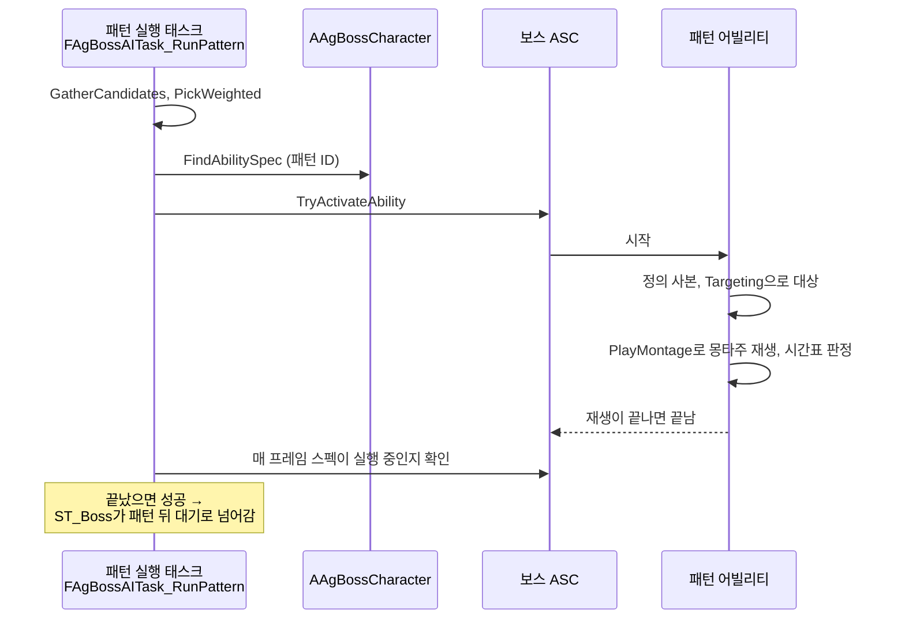

# 보스

보스를 어떻게 구현할지 정합니다.

행동의 실행 구조와 Task는 [어빌리티와 AbilityTask](<어빌리티와 AbilityTask.md>)를 따릅니다.

## 기술 결정

| 항목 | 결정 | 이유 |
| - | - | - |
| 패턴 | 모든 패턴은 어빌리티(`UAgGameplayAbility`)의 독립 스펙으로 실행합니다. 보스 데이터(`Characters.json`의 `Boss`)의 `Abilities`에 적힌 패턴 ID마다 `Abilities.json`의 정의(`Tags`, `Activation`, `Cooldown`, `Targeting`, `End`, `Tasks`, `PatternSelection`)를 사용합니다. AI는 `PatternSelection`이 있는 항목의 페이즈·가중치·거리 조건과 쿨다운으로 후보를 고릅니다. 패턴은 모션과 몽타주 시간표로 실행하고, 돌진(DashThrust)·도약(LeapSlam)은 범용 Task(Dash, Launch)가, Backstep의 물러나는 거리는 범용 Task(RootMotion)가 맡습니다. 공격 패턴의 재생 속도(보스 사양 '모션 재생 속도' 0.8)는 공격 패턴 몽타주 일곱 개(DoubleStrike, Sweep, DashThrust, LeapSlam, QuintupleStrike, SwordWave, JumpSlam)의 Rate Scale에 둡니다. | 패턴별 자식 클래스나 패턴 전용 Task가 필요 없습니다. 부여·실행 사본·쿨다운은 [캐릭터와 GAS](<캐릭터와 GAS.md>), 모션과 이동은 [애니메이션과 이동](<애니메이션과 이동.md>)을 따릅니다. |
| AI | 보스 AI의 흐름은 StateTree 에셋 `ST_Boss`의 상태와 전환으로 짜고, 보스 AI 컨트롤러의 StateTree AI 컴포넌트가 실행합니다. `AAgBossCharacter::AIStateTree`를 `BP_AgBoss`의 기본값에서 지정하고, C++ 컨트롤러가 빙의할 때 보스 캐릭터에서 가져와 적용합니다. 상태는 패턴 후딜레이(레벨 시작·넉업·넉백·그로기·페이즈 전환 뒤의 고정 대기, 패턴 뒤의 대기), 패턴 실행, 다가가기, Backstep, 페이즈 전환, 피격 반응, 비전투, 사망입니다. 태스크와 조건은 C++로 짜고 블루프린트 태스크는 쓰지 않으며, 대기 시간 같은 값은 에셋에 적지 않고 보스 데이터(`Characters.json`의 `Boss`)에서 읽습니다. 보스 사양 '전투 시작과 행동 전환' 표의 전환은 상위 상태에 우선순위가 높은 전환으로 두어, 같은 프레임에 행동이 끝나도 표의 전환이 먼저 적용됩니다. 넉업, 넉백, 그로기, 처형 피격, 페이즈 전환은 상태 어빌리티가, 사망은 캐릭터가 처리합니다. 넉업, 넉백, 그로기나 처형 피격이 시작되면 피격 반응 상태에서 기다리고, 모두 끝나면 패턴 후딜레이로 넘어갑니다. 보스가 사망하면 사망 상태로 넘어가 엔진 Delay 태스크(계속 실행)로 머물며 더 전환하지 않습니다. 사망 전환은 루트가 아니라 전투, 피격 반응, 비전투에 둡니다. 루트에 두면 사망 상태에서도 매 틱 같은 상태로 다시 전환합니다. | 엔진이 권장하는 AI 구조라 상태와 전환을 에디터에서 한눈에 보고, 실행 중에는 StateTree 디버거로 따라갈 수 있습니다. 에셋에는 구조만 두고 계산은 C++에, 값은 JSON에 둡니다. |
| AI 대상 | 보스 AI 컨트롤러가 매 틱, 보스의 락온 행동(`EnemyLockOn`)이 실행 중이 아니면 발동을 시도합니다. 락온 행동은 `Enemy` 프리셋으로 가장 가까운 적을 잡아 잃을 때까지(대상 사망 또는 타겟팅 범위 이탈) 유지하고([어빌리티와 AbilityTask](<어빌리티와 AbilityTask.md>) '락온'), 그 대상(`GetLockOnTarget`)이 AI 대상입니다. AI 태스크와 조건, 보스 회전은 이 대상을 쓰고, 공격 패턴도 같은 프리셋(`Targeting.Preset`이 `Enemy`)과 각 행동의 `Targeting.Range`로 행동 대상을 정합니다(대상과의 최소 간격, 추적 구간, DashThrust의 돌진 방향, LeapSlam의 착지 목표). 락온 마커·처형 안내의 표시와 LeapSlam의 착지 셰이크처럼 플레이어 화면에 관한 것은 로컬 플레이어를 기준으로 합니다. | 플레이어와 같은 락온 행동과 대상 규칙을 씁니다. 락온은 죽거나 범위 밖으로 나간 대상을 놓으므로, 비전투 조건(플레이어 사망)은 대상이 아니라 플레이어 캐릭터를 봅니다. |
| 패턴 선택 | 패턴 실행 상태의 C++ 태스크 하나가 후보를 모으고 가중치로 고른 뒤 그 패턴을 실행합니다. 후보가 없거나 시작하지 못하면 다가가기로 넘어가 재시도 간격 뒤 다시 고릅니다. | 패턴마다 상태를 만들지 않아 패턴 목록이 보스 데이터의 `Abilities` 한 곳에만 있습니다. StateTree의 가중치 선택 기능은 패턴마다 상태가 필요합니다. |
| Backstep | 플레이어의 평타 각 타와 점프 공격의 시간표가 시작 지점에서 플레이어 자신에게 시작 이벤트(`Event.BasicAttackStarted`, SendGameplayEvent)를 보내고, 이벤트의 Target은 그 재생의 행동 대상(평타·점프 공격 Targeting의 첫 후보, 가장 가까운 적)입니다. 컨트롤러는 대상이 자기 보스인 이벤트만 StateTree 이벤트로 넘기고, 패턴 후딜레이 상태의 전환이 발동 조건과 확률을 검사합니다. 발동 조건과 Backstep 상태의 패턴 실행은 다른 패턴처럼 패턴 ID(`Backstep`)로 스펙을 찾으며, ID는 `ST_Boss`에서 파라미터로 넣습니다. 물러나는 거리는 몽타주 전체를 덮는 RootMotion 구간(`To` `Direction`, `Angle`로 후방 지정)이 시작할 때 바라보던 방향 그대로 뒤로 보스 사양 'Backstep'의 거리만큼 가도록 루트 모션을 맞춥니다([어빌리티와 AbilityTask](<어빌리티와 AbilityTask.md>) 'Task 목록'). 공격 패턴이 아니므로 Rate Scale을 바꾸지 않고, 물러나는 동안 돌지 않습니다(행동 중 자동 회전 정지). 끝나면 바로 다음 패턴을 고르되, 페이즈 전환 HP 구간이면 페이즈 전환이 먼저입니다. | 다른 적을 공격할 때는 검사하지 않습니다. Backstep의 플레이어와의 거리(보스 사양 'Backstep')가 평타 타겟팅 범위보다 길어, 타겟팅 범위로 대상을 제한하면 범위 밖에서 Backstep을 쓰지 않게 됩니다. 보스 사양 '모션 재생 속도'는 공격 패턴에만 적용됩니다. 곧게 물러난 뒤에는 바로 이어지는 다음 패턴의 추적 구간이 다시 플레이어 쪽으로 돌립니다. |
| 패턴 전조 동작 (DoubleStrike, Sweep, JumpSlam, QuintupleStrike) | 몽타주에서 패턴 전조 동작 부분을 느린 재생 속도의 별도 구간으로 나누고, 그 뒤의 시간표 시각과 노티파이를 늘어난 만큼 미룹니다. QuintupleStrike는 같은 방법으로 느리거나 빠른 구간을 나눠 리듬을 맞춥니다. | 몽타주 시간 자체가 늘어나므로 판정 구간과 추적 구간이 모두 같은 기준으로 맞습니다. |
| 넉업, 넉백 | 보스도 플레이어와 같은 넉업·넉백 정의를 받고, 몽타주는 각자의 캐릭터 데이터에서 읽습니다. 피격 반응 어빌리티는 진행 중인 보스 패턴도 취소하고, 패턴은 피격 반응 중에 시작하지 못하며, 플레이어와 보스 모두 피격 반응 중에는 회전하지 않습니다. 두 캐릭터의 기본 회전 제한은 [애니메이션과 이동](<애니메이션과 이동.md>)의 캐릭터 회전을 따릅니다. | 넉백 규칙이 캐릭터마다 같아 정의 하나로 처리합니다. |
| 비전투 | 플레이어가 사망하면 AI가 비전투 상태로 넘어가 보스에게 비전투 태그를 붙이고 진행 중인 패턴을 취소합니다. 이 태그는 패턴, 그로기, 페이즈 전환을 막고 보스 회전을 멈춥니다. | 비전투 뒤에는 사망만 적용합니다. |
| 이동 | 다가가기와 좌우 걷기는 AI 태스크가 매 프레임 이동 입력을 직접 줍니다. NavMesh는 쓰지 않습니다. | 아레나가 장애물 없는 평지라 길찾기가 필요 없습니다. |

## 클래스 구조

### 보스 AI

보스 AI의 흐름(상태와 전환)은 StateTree 에셋 `ST_Boss`에 있어 에디터에서 그림으로 봅니다. 아래는 그 에셋을 실행하는 코드입니다. 태스크와 조건은 모두 `Controller`(Context 속성)로 `AAgBossAIController`를 받아 보스, 보스 데이터, 현재 대상(`GetTarget`)을 읽으며, 그 선은 그리지 않습니다.

| 클래스 | 부모 | 역할 |
| - | - | - |
| `AAgBossAIController` | `AAIController` | 보스 AI. 락온 행동을 발동해 현재 대상(보스의 락온 대상)을 잡아 AI 포커스로 지정하고, StateTree AI 컴포넌트로 `ST_Boss`를 실행하고, 이 보스가 대상인 플레이어의 평타 시작을 StateTree 이벤트로 넘깁니다. |
| 보스 AI 태스크 | `FStateTreeAITaskBase` | 패턴 후딜레이 대기, 다가가기, 패턴 실행(선택 포함), 페이즈 전환, 피격 반응 대기, 비전투 |
| 보스 AI 조건 | `FStateTreeAIConditionBase` | 보스 사망, 플레이어 사망, 피격 반응 중, 페이즈 전환 시작 조건, Backstep 발동 조건 |

### 보스 패턴

### 보스 패턴 실행

Backstep은 컨트롤러가 대상(플레이어) ASC의 `Event.BasicAttackStarted` (평타의 각 타와 점프 공격의 시작) 가운데 그 공격의 대상이 자기 보스인 것을 StateTree 이벤트로 넘기면 패턴 후딜레이 상태의 전환이 Backstep 상태로 보내 시작하고, 페이즈 전환은 페이즈 전환 태스크가 보스에게 `Event.PhaseTransition`을 보내 시작합니다. 페이즈 전환이 정상 종료로 끝나면(취소가 아니면) 보스 캐릭터가 자기 ASC의 `OnAbilityEnded`로 받아 PP를 채우고(`PPRefill`) 2페이즈로 넘어갑니다. AI는 페이즈 전환을 시작만 하고, 페이즈와 PP 회복은 그로기·처형 피격 끝과 함께 보스 캐릭터가 맡습니다([어빌리티와 AbilityTask](<어빌리티와 AbilityTask.md>) '주인 객체의 규칙').

SwordWave는 PlayMontage가 몽타주를 재생하고, 세 발은 몽타주 시간표의 `SpawnProjectile` 지점이 실행합니다. 투사체 정의와 발사 처리는 [JSON 데이터](<JSON 데이터.md>)과 [전투 규칙](<전투 규칙.md>)을 따릅니다.
