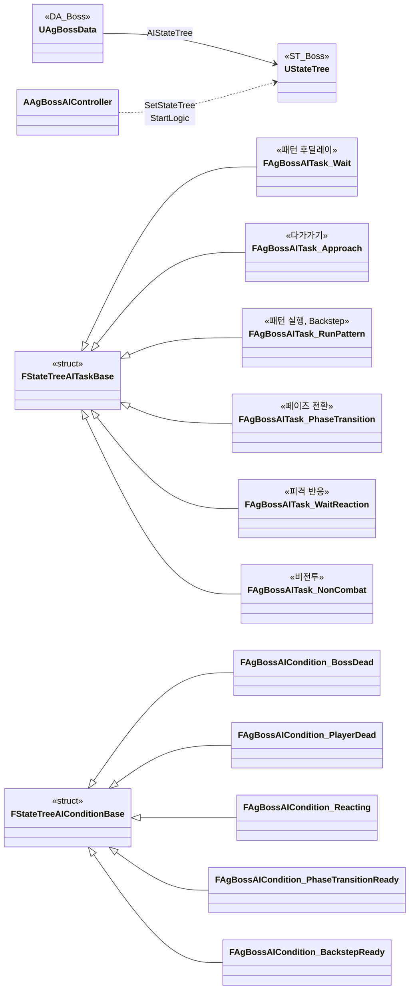
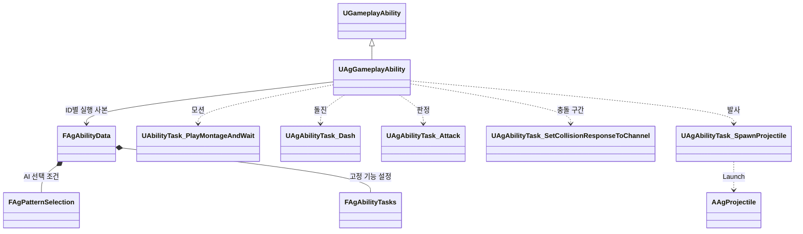
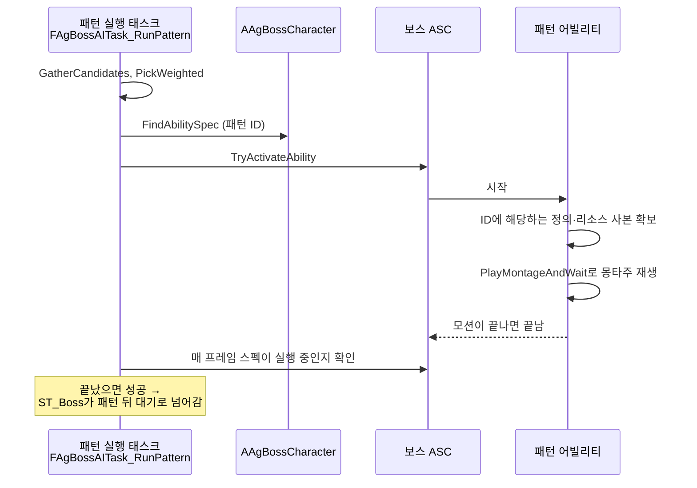

# 보스

보스를 어떻게 구현할지 정합니다.

실행 구조와 기능별 고정 Params는 [AbilityTask 기반 어빌리티 설계안](<AbilityTask 기반 어빌리티 설계안.md>)을 따릅니다.

## 기술 결정

| 항목 | 결정 | 이유 |
| - | - | - |
| 패턴 | 모든 패턴은 `UAgGameplayAbility`의 독립 스펙으로 실행합니다. `Boss.json`의 `Id`, `Tags`, `Activation`, `Cooldown`, `PatternSelection`, 기능별 `Tasks`를 사용합니다. AI는 `PatternSelection`이 있는 항목의 페이즈·가중치·거리 조건과 쿨다운으로 후보를 고릅니다. 일반 패턴은 모션과 ANS로 실행하고 DashThrust·LeapSlam·Backstep은 같은 독립 기능에 돌진 완료·도약·루트 이동 배율 사건을 연결합니다. | 패턴별 자식 클래스나 다형 Params가 필요 없습니다. 부여·실행 사본·쿨다운은 [캐릭터와 GAS](<캐릭터와 GAS.md>), 모션과 이동은 [애니메이션과 이동](<애니메이션과 이동.md>)을 따릅니다. |
| AI | 보스 AI의 흐름은 StateTree 에셋 `ST_Boss`의 상태와 전환으로 짜고, 보스 AI 컨트롤러의 StateTree AI 컴포넌트가 실행합니다. 상태는 패턴 후딜레이(레벨 시작·넉업·넉백·그로기·페이즈 전환 뒤의 고정 대기, 패턴 뒤의 대기), 패턴 실행, 다가가기, Backstep, 페이즈 전환, 피격 반응, 비전투, 사망입니다. 태스크와 조건은 C++로 짜고 블루프린트 태스크는 쓰지 않으며, 대기 시간 같은 값은 에셋에 적지 않고 `Boss.json`에서 읽습니다. 보스 사양 '전투 시작과 행동 전환' 표의 전환은 상위 상태에 우선순위가 높은 전환으로 두어, 같은 프레임에 행동이 끝나도 표의 전환이 먼저 적용됩니다. 넉업, 넉백, 그로기, 처형 피격, 페이즈 전환, 사망은 상태 어빌리티가 처리합니다. 넉업, 넉백이나 그로기가 시작되면 피격 반응 상태에서 기다리고, 둘 다 끝나면 패턴 후딜레이로 넘어갑니다. 보스가 사망하면 사망 상태로 넘어가 엔진 Delay 태스크(계속 실행)로 머물며 더 전환하지 않습니다. 사망 전환은 루트가 아니라 전투, 피격 반응, 비전투에 둡니다. 루트에 두면 사망 상태에서도 매 틱 같은 상태로 다시 전환합니다. | 엔진이 권장하는 AI 구조라 상태와 전환을 에디터에서 한눈에 보고, 실행 중에는 StateTree 디버거로 따라갈 수 있습니다. 바뀐 내용은 에디터의 StateTree 비교 화면으로 리뷰합니다. 에셋에는 구조만 두고 계산은 C++에, 값은 JSON에 둡니다. |
| AI 대상 | 보스 AI 컨트롤러가 현재 대상을 정합니다. 지금은 플레이어입니다. AI 태스크와 조건, 보스 회전, 패턴(대상과의 최소 간격, 접근, DashThrust의 돌진 방향, LeapSlam의 착지 목표와 착지 판정)은 이 대상을 씁니다. 락온 마커·처형 안내의 표시와 LeapSlam의 착지 셰이크처럼 플레이어 화면에 관한 것은 로컬 플레이어를 기준으로 합니다. | 대상을 정하는 곳이 한 곳이라, 대상을 정하는 방식이 바뀌어도 AI와 패턴은 고치지 않습니다. |
| 패턴 선택 | 패턴 실행 상태의 C++ 태스크 하나가 후보를 모으고 가중치로 고른 뒤 그 패턴을 실행합니다. 후보가 없거나 시작하지 못하면 다가가기로 넘어가 재시도 간격 뒤 다시 고릅니다. | 패턴마다 상태를 만들지 않아 패턴 목록이 `Boss.json` 한 곳에만 있습니다. StateTree의 가중치 선택 기능은 패턴마다 상태가 필요합니다. |
| Backstep | 플레이어의 평타 각 타와 점프 공격의 시작 이벤트(`Event.BasicAttackStarted`)에 그 공격의 대상(타를 시작할 때 가장 가까운 적, 대상과의 최소 간격의 대상)을 담습니다. 컨트롤러는 대상이 자기 보스인 이벤트만 StateTree 이벤트로 넘기고, 패턴 후딜레이 상태의 전환이 발동 조건과 확률을 검사합니다. 발동 조건과 Backstep 상태의 패턴 실행은 다른 패턴처럼 패턴 ID(`Backstep`)로 스펙을 찾으며, ID는 `ST_Boss`에서 파라미터로 넣습니다. 공격 패턴이 아니므로 모션 재생 속도는 받지 않습니다. 물러나는 거리는 모션의 루트 모션 전체 이동에 배율을 걸어 보스 사양 'Backstep'의 거리에 맞춥니다. 배율은 엔진 몽타주 태스크(`PlayMontageAndWait`)의 루트 모션 배율 인자로 넘기고, 태스크가 몽타주의 블렌드 아웃이 시작될 때 1로 되돌립니다. 끝나면 바로 다음 패턴을 고르되, 페이즈 전환 HP 구간이면 페이즈 전환이 먼저입니다. | 다른 적을 공격할 때는 검사하지 않습니다. Backstep의 플레이어와의 거리(보스 사양 'Backstep')가 평타 타겟팅 범위보다 길어, 타겟팅 범위로 대상을 제한하면 범위 밖에서 Backstep을 쓰지 않게 됩니다. 보스 사양 '모션 재생 속도'는 공격 패턴에만 적용됩니다. |
| 패턴 전조 동작 (DoubleStrike, Sweep, JumpSlam, QuintupleStrike) | 몽타주에서 패턴 전조 동작 부분(DoubleStrike는 찌르기 전 자세를 잡는 부분과 내려찍기 전 창을 들어 올리는 부분, Sweep은 창을 세워 드는 부분, JumpSlam은 뛰어올라 창을 머리 위로 치켜든 부분)을 느린 재생 속도의 별도 구간으로 나누고, 그 뒤의 노티파이를 늘어난 만큼 미룹니다. QuintupleStrike는 같은 방법으로 리듬을 맞추며, 2타 뒤 창을 돌리는 부분은 빠른 재생 속도의 구간으로 나눠 당깁니다. | 몽타주 시간 자체가 늘어나므로 판정 구간, 회전 정지, 접근(Motion Warping)이 모두 같은 기준으로 맞습니다. |
| 넉업, 넉백 | 보스도 플레이어와 같은 넉업·넉백 어빌리티를 받고, 몽타주는 각자의 캐릭터 데이터에서 읽습니다. 넉업 몽타주는 플레이어와 같은 것을 씁니다([애니메이션과 이동](<애니메이션과 이동.md>) '넉업'). 피격 반응 어빌리티는 진행 중인 보스 패턴도 취소하고, 패턴은 피격 반응 중에 시작하지 못하며, 플레이어와 보스 모두 피격 반응 중에는 회전하지 않습니다. 플레이어는 그동안 캐릭터 무브먼트의 이동 방향·카메라 방향 회전을 끕니다. 넉백 몽타주(`AM_Player_KnockBack`, `AM_Boss_KnockBack`)는 각 팩의 Hit_knockdown 하나로 쓰러짐과 기상을 재생하고, 시퀀스의 루트 모션을 켜 모션대로 물러납니다. 무적 시작 노티파이는 등이 바닥에 닿는 순간에 둡니다. | 넉백 규칙이 캐릭터마다 같아 어빌리티 하나로 처리합니다. 넉백 시퀀스(할버드 Hit_knockdown)는 다른 보스 모션처럼 루트 모션을 켭니다. |
| 비전투 | AI의 대상(플레이어)이 사망하면 AI가 비전투 상태로 넘어가 보스에게 비전투 태그를 붙이고 진행 중인 패턴을 취소합니다. 이 태그는 패턴, 그로기, 페이즈 전환을 막고 보스 회전을 멈춥니다. | 비전투 뒤에는 사망만 적용합니다. |
| 이동 | 다가가기와 좌우 걷기는 AI 태스크가 매 프레임 이동 입력을 직접 줍니다. NavMesh는 쓰지 않습니다. | 아레나가 장애물 없는 평지라 길찾기가 필요 없습니다. |
| 좌우 걷기 방향 | 패턴 후딜레이를 시작할 때마다 왼쪽과 오른쪽 중 무작위로 고릅니다. 패턴 후딜레이 대기 시간을 쓰는 모든 대기(레벨 시작, 넉업·넉백·페이즈 전환·그로기 뒤 포함)에서 걷습니다. | 기획서에 정해져 있지 않아 가장 단순한 방식을 씁니다. |

## 클래스 구조

### 보스 AI

보스 AI의 흐름(상태와 전환)은 StateTree 에셋 `ST_Boss`에 있어 에디터에서 그림으로 봅니다. 아래는 그 에셋을 실행하는 코드입니다. 태스크와 조건은 모두 `Controller`(Context 속성)로 `AAgBossAIController`를 받아 보스, 보스 데이터, 현재 대상(`GetTarget`)을 읽으며, 그 선은 그리지 않습니다.

| 클래스 | 부모 | 역할 |
| - | - | - |
| `AAgBossAIController` | `AAIController` | 보스 AI. 현재 대상을 정하고, StateTree AI 컴포넌트로 `ST_Boss`를 실행하고, 이 보스가 대상인 플레이어의 평타 시작을 StateTree 이벤트로 넘깁니다. |
| 보스 AI 태스크 | `FStateTreeAITaskBase` | 패턴 후딜레이 대기, 다가가기, 패턴 실행(선택 포함), 페이즈 전환, 피격 반응 대기, 비전투 |
| 보스 AI 조건 | `FStateTreeAIConditionBase` | 보스 사망, 플레이어 사망, 피격 반응 중, 페이즈 전환 시작 조건, Backstep 발동 조건 |

### 보스 패턴

### 보스 패턴 실행

Backstep은 컨트롤러가 대상(플레이어) ASC의 `Event.BasicAttackStarted` (평타의 각 타와 점프 공격의 시작) 가운데 그 공격의 대상이 자기 보스인 것을 StateTree 이벤트로 넘기면 패턴 후딜레이 상태의 전환이 Backstep 상태로 보내 시작하고, 페이즈 전환은 페이즈 전환 태스크가 보스에게 `Event.PhaseTransition`을 보내 시작합니다.

컨트롤러의 빙의가 해제되면 대상 ASC의 이벤트 구독과 핸들을 함께 비웁니다. 다시 빙의하면 현재 대상에 새로 구독합니다. 보스의 Ability 부여는 캐릭터 공통 경로를 사용하며, 모션은 Ability ID가 아니라 설정된 MontageId로 선택합니다. 참조 유효성은 공통 JSON 검증에서 확인합니다.

SwordWave는 공통 Ability로 몽타주를 재생하고, 세 발은 몽타주의 발사 AN이 실행합니다. 전용 SwordWave 어빌리티·전용 Params는 두지 않습니다. 투사체 정의와 발사 처리는 [JSON과 DataAsset](<JSON과 DataAsset.md>)과 [전투 규칙](<전투 규칙.md>)을 따릅니다.
