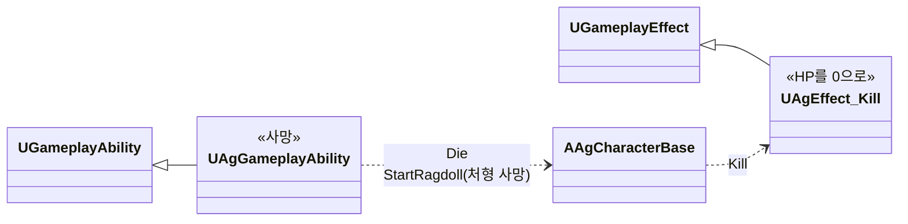
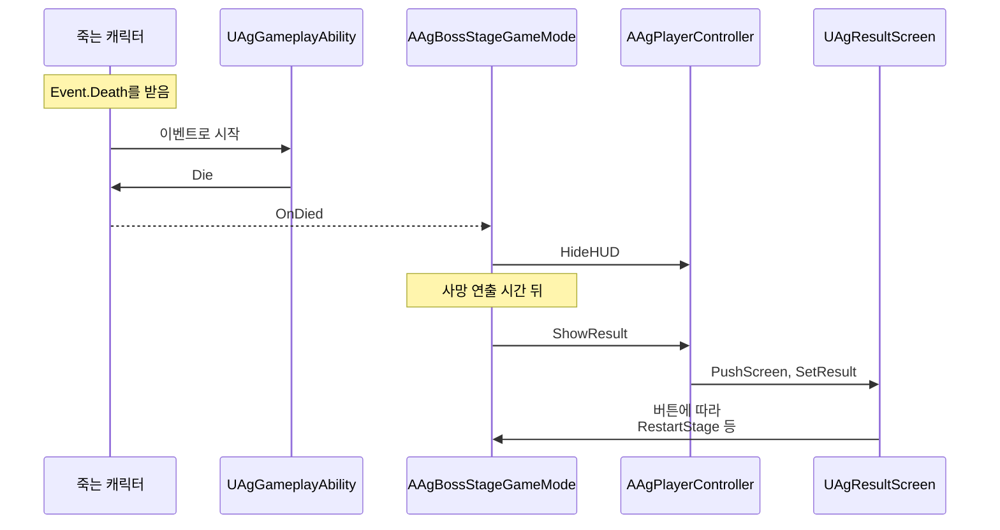

# 사망 처리

캐릭터가 사망해 결과 UI가 나올 때까지를 어떻게 구현할지 정합니다.

## 기술 결정

| 항목 | 결정 | 이유 |
| - | - | - |
| 사망 처리 순서 | 사망 판정([대미지와 피격 처리](<대미지와 피격 처리.md>) '피격 처리')이 보내는 사망 이벤트(`Event.Death`)로 Death ID의 공통 Ability(`UAgGameplayAbility`)가 시작해 캐릭터의 사망 처리(`Die`)를 부릅니다. 캐릭터는 전투 시스템 '사망 처리'의 순서대로 사망 태그(`State.Dead`)를 붙이고, 사망 어빌리티 말고 모든 어빌리티를 취소하고 몽타주를 멈추고, 플레이어의 입력을 끄고 이동을 멈추고, 판정 구간을 없애고, 캡슐이 Pawn 채널을 무시하게 하고, 마지막 공격의 피격 방향으로 밀리는 래그돌로 바꾼 뒤 사망을 알립니다(`OnDied`). 결과는 이 알림을 받은 보스전 게임 모드가 정합니다([카메라, HUD, 화면 UI, 게임 플로우](<카메라, HUD, 화면 UI, 게임 플로우.md>) '결과 처리'). 보스 AI는 보스가 죽으면 사망 상태로, 플레이어가 죽으면 비전투 상태로 넘어갑니다([보스](<보스.md>) 'AI', '비전투'). 쏜 캐릭터가 죽은 검기는 다음 틱에 스스로 사라집니다. | 사망 태그가 붙은 뒤에는 대미지 GameplayEffect가 적용되지 않고(대상 태그 조건) 행동·상태 어빌리티도 시작하지 못해, 기획서의 '이후 닿는 공격은 아무 일도 일으키지 않음'이 태그 하나로 지켜집니다. |
| 처형 사망 | 처형 타격으로 죽은 보스는 다른 Ability를 취소하기 전에 처형 피격 몽타주의 재생 위치를 보관한 뒤 그 위치에서 처형 사망 몽타주를 이어 재생하고, 모션이 끝나면 래그돌로 바꿉니다. 이때 사망 처리는 몽타주를 멈추지 않고 래그돌로 바꾸지도 않습니다. 처형으로 죽었는지는 사망 이벤트에 실린 공격 쪽 태그의 처형 어빌리티 태그로 알고([대미지와 피격 처리](<대미지와 피격 처리.md>) '피격 결과'), 공통 `State.Execution`만으로 공격 역할을 추정하지 않습니다. 처형 피격 중 다른 공격으로 죽으면 일반 사망입니다. | 처형 사망 모션은 마지막 일격 뒤까지 처형 피격 모션과 같아, 같은 재생 위치에서 튀지 않고 이어집니다. |
| Kill Z | 레벨의 Kill Z 아래로 떨어지면(`FellOutOfWorld`) 캐릭터가 HP를 0으로 만드는 GameplayEffect(`UAgEffect_Kill`)를 적용합니다(`Kill`). 테스트용 콘솔 명령([개발 도구와 검증](<개발 도구와 검증.md>) '테스트용 콘솔 명령')도 이 함수를 씁니다. | 대미지와 같은 사망 판정(어트리뷰트 세트)을 거쳐, 사망 이벤트가 한 곳에서만 나옵니다. |

## 클래스 구조

### 사망

| 클래스 | 부모 | 역할 |
| - | - | - |
| `UAgGameplayAbility` (Death) | `UGameplayAbility` | 사망. 사망 이벤트로 시작해 캐릭터의 사망 처리를 부르고, 처형 사망이면 처형 사망 모션이 끝난 뒤 래그돌로 바꿉니다. |
| `UAgEffect_Kill` | `UGameplayEffect` | HP를 0으로 만듭니다(Kill Z 낙하, 테스트용 콘솔 명령). |

### 사망에서 결과 UI까지

