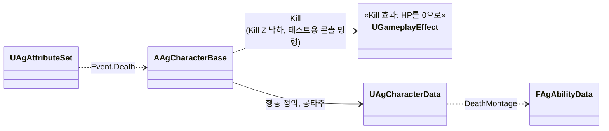
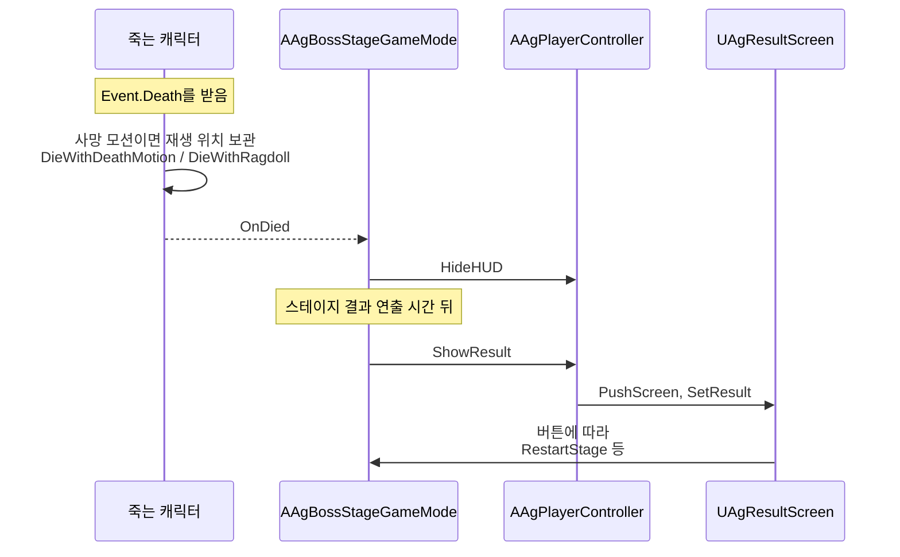

# 사망 처리

캐릭터가 사망해 결과 UI가 나올 때까지를 어떻게 구현할지 정합니다.

## 기술 결정

| 항목 | 결정 | 이유 |
| - | - | - |
| 사망 처리 순서 | 사망 판정([대미지와 피격 처리](<대미지와 피격 처리.md>) '피격 처리')이 보내는 사망 이벤트(`Event.Death`)를 캐릭터가 받아(ASC의 이벤트 콜백) 사망 처리(`DieWithRagdoll` 또는 `DieWithDeathMotion`)를 부릅니다. 캐릭터는 전투 시스템 '사망 처리'의 순서대로 사망 태그(`State.Dead`)를 붙이고, 모든 어빌리티를 취소하고 몽타주를 멈추고, 플레이어의 입력을 끄고 이동을 멈추고, 캡슐이 Pawn 채널을 무시하게 하고, 마지막 공격의 피격 방향(이벤트의 Instigator에서 캐릭터 쪽)으로 밀리는 래그돌로 바꾼 뒤 사망을 알립니다(`OnDied`). 어빌리티를 취소하면 그 행동의 판정 구간도 끝납니다. 결과는 이 알림을 받은 보스전 게임 모드가 정합니다([UI 시스템과 게임 플로우](<UI 시스템과 게임 플로우.md>) '결과 처리'). 보스 AI는 보스가 죽으면 사망 상태로, 플레이어가 죽으면 비전투 상태로 넘어갑니다([보스 AI와 패턴](<보스 AI와 패턴.md>) 'AI', '비전투'). 쏜 캐릭터가 죽은 검기는 다음 틱에 스스로 사라집니다. | 사망 태그가 붙은 뒤에는 대미지 GameplayEffect가 적용되지 않고(대상 태그 조건) 행동·상태 어빌리티도 시작하지 못해, 기획서의 '이후 닿는 공격은 아무 일도 일으키지 않음'이 태그 하나로 지켜집니다. 사망은 행동이 아니라 캐릭터 상태의 끝이라 캐릭터가 맡고, 사망 스펙을 따로 두지 않습니다. |
| 사망 모션 | 사망할 때 몽타주를 재생 중인 행동(ASC의 애니메이팅 어빌리티)의 정의에 `DeathMontage`가 있으면, 다른 어빌리티를 취소하기 전에 지금 몽타주의 재생 위치를 보관하고, `DeathMontage`를 그 위치에서 이어 재생한 뒤 블렌드 아웃이 시작되면 래그돌로 바꿉니다. 이때 사망 처리는 몽타주를 멈추지 않고 래그돌로 바꾸지도 않습니다. 보스의 처형 피격(`Executed`)은 처형 사망(`ExecutedDeath`)을 잇습니다. | 처형 사망 모션은 마지막 일격 뒤까지 처형 피격 모션과 같아, 같은 재생 위치에서 튀지 않고 이어집니다. 이 행동 중에 죽으면 어떤 모션을 잇는지는 그 행동의 성질이라 행동 정의에 두고, 코드에는 행동이나 몽타주 ID가 없습니다. 처형 피격은 처형을 당하는 동안에만 재생되므로 무엇에 죽었는지는 보지 않습니다. |
| Kill Z | 레벨의 Kill Z 아래로 떨어지면(`FellOutOfWorld`) 캐릭터가 HP를 0으로 만드는 효과(코드 전용 효과 `EAgEffect::Kill`)를 적용합니다(캐릭터의 `Kill`). 테스트용 콘솔 명령([개발 도구와 검증](<개발 도구와 검증.md>) '테스트용 콘솔 명령')도 이 함수를 씁니다. | 대미지와 같은 사망 판정(어트리뷰트 세트)을 거쳐, 사망 이벤트가 한 곳에서만 나옵니다. |

## 클래스 구조

### 사망

| 클래스 | 부모 | 역할 |
| - | - | - |
| `AAgCharacterBase` | `ACharacter` | 사망 이벤트를 받아 사망 처리(`DieWithRagdoll`, `DieWithDeathMotion`)와 래그돌(`StartRagdoll`), 사망 알림(`OnDied`) |
| `UAgCharacterData` | `UObject` | 캐릭터의 행동 정의 조회와 몽타주 ID |
| `FAgAbilityData` | - | 행동 정의. 그 행동 중에 사망하면 이어 재생할 몽타주 ID(`DeathMontage`) |

### 사망에서 결과 UI까지

