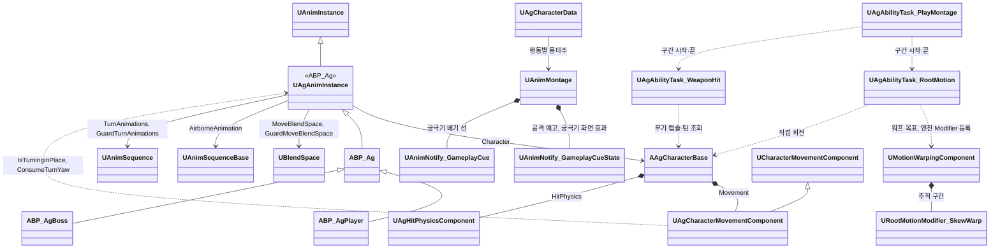

# 애니메이션과 이동

애니메이션과 이동을 어떻게 구현할지 정합니다.

행동의 실행 구조와 Task는 [어빌리티와 AbilityTask](<어빌리티와 AbilityTask.md>)를, 몽타주 안의 구간과 지점은 [몽타주 시간표](<몽타주 시간표.md>)를 따릅니다.

## 기술 결정

Yaw 회전 속도는 플레이어와 보스 모두 각 BP의 캐릭터 무브먼트 `RotationRate.Yaw`입니다.

| 항목 | 결정 | 이유 |
| - | - | - |
| ABP | `ABP_Ag`에 공통 애님 그래프를 두고 자식 `ABP_AgPlayer`·`ABP_AgBoss`를 각 캐릭터 메시의 Anim Class로 지정합니다. 모션은 `UAgAnimInstance`의 `MoveBlendSpace`, `GuardMoveBlendSpace`, `AirborneAnimation` 멤버에 자식 ABP 기본값으로 지정합니다. 속도·방향·가드·공중 상태는 C++ `UAgAnimInstance`에서 계산하고, 애님 그래프에는 이동 블렌드 스페이스 → 가드 이동 블렌드 스페이스 전환 → 제자리 회전 하체 블렌드 → 공중 여부 전환 → 몽타주 슬롯 → 덧입힘 슬롯 → 시네마틱 슬롯만 둡니다. 루트 모션은 몽타주에서만 씁니다. | AI가 BP 그래프를 다루기 어려우므로 그래프를 최소로 둡니다. 제자리 회전의 그래프는 아래 '제자리 회전', 시네마틱 슬롯은 '컷신 자세'를 따릅니다. |
| 블렌드 스페이스 | 플레이어 이동, 플레이어 가드 이동, 보스 이동 블렌드 스페이스 3개를 각 자식 ABP의 모션 멤버 기본값에 지정합니다. 가로축은 캐릭터 정면 기준 이동 방향, 세로축은 이동 속도이고, 샘플은 각 모션의 실제 이동 속도에 둡니다. 팩의 이동 모션은 제자리(`_IPC`) 버전을, 템플릿 이동 모션은 루트 모션을 켠 원본(재생할 때 제자리)을 씁니다. | 세 블렌드 스페이스의 축이 같아 공통 애님 그래프를 상속하여 처리합니다. 템플릿 블렌드 스페이스는 샘플이 모션의 실제 속도(걷기 3m/s, 뛰기 6m/s)에 있어 그대로 씁니다. |
| 메시 갱신 | 캐릭터 메시는 화면에 보이지 않을 때도 포즈와 본을 갱신합니다. | 공격 판정이 메시의 피직스 바디를 쓰고 무기가 손을 따라가므로, 보이지 않을 때도 위치가 맞아야 합니다. |
| 덧입힘 모션 | 가드 움찔의 모션은 덧입힘 모션으로 만들어 쓰고, 덧입힘 모션은 루트 모션을 끕니다. | 루트 모션이 있는 몽타주는 재생하는 동안 이동 입력과 다른 몽타주의 루트 모션을 대신합니다. |
| 컷신 자세 | 궁극기 컷신 동안의 플레이어 자세는 `LS_UltimateCutscene`의 애니메이션 트랙이 정합니다. 트랙은 플레이어 바인딩(엔진 Replaceable Actor 바인딩, 미리 보기 `BP_AgPlayer`, 바인딩 태그 `Owner`)에 두고, 스켈레톤의 슬롯 그룹 `CinematicGroup`에 둔 `CinematicSlot`을 씁니다. 애님 그래프의 시네마틱 슬롯은 덧입힘 슬롯 뒤에 있어 컷신 동안 자세를 덮습니다. 플레이어 바인딩에는 위치 트랙을 두지 않습니다. 궁극기 몽타주의 Start·Hold는 컷신 동안에도 재생되어 시간표의 시각을 정하고, 레벨 시퀀스는 같은 모션을 같은 시각에 두어 마지막 자세가 Hold와 같습니다. 컷신 뒤에 재생하는 Judgment·Draw의 두 시퀀스는 루트 모션을 끄고 루트 뼈를 고정합니다. | 아트가 레벨 시퀀스 하나에서 카메라와 자세를 함께 보고 고칩니다. 미리 보기 액터는 에디터에서만 생기고, 게임에서는 PlayCutscene이 바인딩 덮어쓰기로 실제 플레이어를 붙입니다. 바인딩 태그는 어느 컷신이든 재생하는 캐릭터(주인)를 받는 이름이라 `Owner`로 Task에 고정하고 JSON에 적지 않습니다(무기 컴포넌트 태그처럼 에셋과 코드 사이의 이름). 시퀀서는 다른 몽타주를 멈추지 않고 섹션의 슬롯에 몽타주를 만들어 겹쳐 재생하므로, 기본 슬롯을 쓰면 궁극기 몽타주와 자세가 섞입니다. 슬롯 그룹을 나눈 것은 게임 몽타주가 시작할 때 같은 그룹의 몽타주를 멈추는 규칙에 시네마틱 몽타주가 걸리지 않게 하기 위해서입니다. 섹션의 `Force Custom Mode`는 ABP를 시퀀서 인스턴스로 바꿔 끼워 몽타주가 사라지므로 쓰지 않습니다. 엔진은 루트 모션을 주는 몽타주를 하나만 기억하고, 시퀀서의 몽타주가 그 자리를 가져갔다가 끝날 때 비웁니다. 다시 정하는 길은 몽타주를 새로 재생하는 것뿐인데, Judgment를 다시 재생하면 Start부터 걸친 시간 정지·Busy 구간이 끊깁니다. 그래서 컷신 동안의 루트 이동은 레벨 시퀀스의 모션이 주고, 컷신 뒤의 두 시퀀스는 루트 모션을 꺼 결과를 모션 설정으로 드러냅니다. |
| 점프 | 점프 시작과 착지는 플레이어 캐릭터가 점프 몽타주(`AM_Player_Jump`)의 Start·Land 섹션으로 재생하고, 공중에서는 공중 반복 모션을 재생합니다. 엔진 점프가 실제로 시작될 때(`OnJumped`) `State.Jumping`을 붙이고 Start를 재생합니다. 착지할 때(`Landed`) 태그를 떼고, 점프 행동이 남아 있었으면 이동 입력이 없을 때 Land 섹션부터 다시 재생하고 이동 입력이 있으면 점프 몽타주를 멈춥니다. 점프 공격이나 피격 반응이 점프 행동을 끝냈으면 그 행동의 모션이 착지를 맡습니다. 착지 모션이 끝나기 전에 이동하면 착지 모션을 멈춥니다. 점프 높이와 공중 제어는 캐릭터 BP의 무브먼트 설정을 사용합니다. 설정 위치와 필드는 [데이터 위치표](<데이터 위치표.md>)의 '점프와 공중 이동' 항목을 따릅니다. | 시작과 착지를 C++에서 몽타주로 재생하므로 애님 그래프에는 공중 여부 전환 하나만 늘어납니다. 템플릿 점프 모션은 루트 모션이 꺼져 있어 재생하는 동안에도 이동 입력이 먹힙니다. 착지 모션은 제자리 모션이라 움직이면서 재생하면 미끄러져 보입니다. 점프와 그 모션은 행동이 아니라 공중 상태라 캐릭터가 맡고, 점프 행동은 그 상태 태그로 실행되며 Busy만 갖습니다. |
| 점프 공격 | 점프 행동은 공중에 있는 동안 '점프 중' 태그(`State.Jumping`)로 실행되고 Busy를 갖습니다. 점프 공격은 '행동 중' 대신 '점프 중'을 시작 조건(RequiredTags)으로 삼고, 시작하면 다른 행동처럼 점프 행동을 취소합니다(태그는 착지까지 남음). 몽타주(`AM_Player_JumpAttack`)는 섹션 Start(내려베기) → Fall(떨어지는 자세, 반복) → Land(착지)이고, 세 시퀀스 모두 루트 모션을 쓰지 않습니다(내려베기 시퀀스는 루트 모션을 끄고 루트 뼈를 고정(Force Root Lock)). 시간표의 판정 구간 하나가 Start의 베기부터 Land의 바닥 찍기까지 걸칩니다. 내려베기가 끝나는 시각부터 Fall 끝까지 Plunge가 수평 속도를 그대로 두고 일정 속도로 떨어뜨리고, 착지하면(`Event.Landed`) Transition이 Land 섹션으로 옮깁니다. 공중 회전은 추적 구간이 캐릭터를 직접 돌립니다. 후딜은 Land 섹션 안의 Busy 구간 끝에서 시작합니다. | 점프 행동이 공중 동안 Busy를 들고 있어 다른 행동은 그대로 막히고, 점프 공격만 태그 하나로 예외가 됩니다. `State.Jumping`은 엔진 점프가 시작된 뒤에 붙으므로 점프 공격이 점프 입력을 지우지 않습니다. 판정 구간을 하나로 두어 칼이 보스를 지나는 어느 순간이든 한 번만 맞습니다. 수평 속도를 그대로 두므로 수평 이동은 점프할 때의 이동이 이어지고, 낙하 속도는 기획서 값 그대로입니다(중력으로 빨라지지 않음). |
| 달리기 | 달리기는 회피 후딜에 트리거 태그로 시작하고 끝납니다(조건은 [입력 처리](<입력 처리.md>) '트리거 태그'). 달리기는 다른 행동처럼 회피를 취소하고, 회피 몽타주는 블렌드 아웃으로 달리기 모션에 섞입니다. '달리는 중' 태그가 속도와 방향(락온 중에도 이동 방향)을 바꾸고, SP 소모는 달리기가 거는 주기 효과(`SprintDrain`)가 맡습니다. `SprintDrain`의 SP 변경은 `Input.Move`가 있을 때만 적용합니다. 다른 행동은 달리기를 취소하지만 점프는 취소하지 않습니다. 달리기는 이동이라 어빌리티 태그를 행동 태그(`Ability.Action`) 밖에 둡니다. | 리젠과 같이 주기 GameplayEffect를 사용하므로 자원 변화가 모두 GameplayEffect로 모입니다. 행동 태그 밖에 두면 행동 태그로 정한 규칙(행동끼리의 취소, 회피 반격 기회)에서 달리기를 따로 빼지 않아도 됩니다. 회피 모션이 끝날 때 시작하면, 몽타주가 블렌드 아웃을 시작하는 순간 루트 모션이 끊기고 이동 입력은 모션이 끝날 때까지 막혀 있어 0.25초 멈춰 섰다가 속도 0에서 출발합니다. |
| 몽타주 | 행동마다 하나를 둡니다. 여러 모션을 쓰는 행동(평타, 회피, 넉업, 점프)은 한 몽타주의 섹션으로 합칩니다. 섹션끼리 잇지 않으면 그 섹션 끝에서 몽타주가 끝납니다. 이어지는 모션은 조사 문서의 연결 시점에서 잘라 한 몽타주에 붙입니다. 대기 자세에서 바로 시작하지 않는 모션(Sweep, SwordWave, 회피 반격)은 블렌드로 잇습니다. 넉백은 쓰러짐과 기상이 한 모션(Hit_knockdown)에 들어 있어 몽타주 하나입니다. | 한 행동의 흐름이 한 몽타주의 섹션과 시간표에 모입니다. 다른 동작으로 넘어갈 때는 전환의 BlendTime으로 다시 재생해 자세가 튀지 않습니다. |
| 모션을 따르는 구간 | 공격·보호·돌진·추적·전환 구간과 지점(투사체 발사, 착지 셰이크)은 [몽타주 시간표](<몽타주 시간표.md>)의 항목입니다. 시작 섹션은 PlayMontage의 Section과 조건으로 고릅니다. 재생을 시작한 PlayMontage만 자기 재생의 항목을 실행합니다. 후딜이 없는 처형은 모션이 끝나야 다음 행동을 받습니다. 몽타주에는 연출(공격 예고, 궁극기 베기 선, 궁극기 화면 효과) 노티파이만 둡니다. | 게임 규칙의 시각과 값을 텍스트로 고치고 리뷰합니다. |
| 추적 구간 | 시간표의 추적 구간(RootMotion Task, `Direction` Target)은 구간을 시작할 때 대상과 목표 위치를 정하고, 몽타주에 루트 모션이 있으면 그 목표를 엔진 Motion Warping의 워프 목표로 두고 엔진 `URootMotionModifier_SkewWarp`를 등록합니다. 켜기(앞 재생 위치가 구간 안)·지우기와 루트 이동·회전은 엔진이 재생 위치로 합니다. Task는 매 틱 워프 목표의 회전만 대상 쪽으로 바꾸고, 끝날 때(구간 끝, 재생 바뀜, 행동 종료) 워프 목표를 지우고 Modifier를 지우도록 표시합니다. 따라 돌기를 멈출 때는 Task가 워프 목표를 지워 엔진 Modifier가 꺼지고, 이후에는 원래 루트 모션을 씁니다. 몽타주가 루트 모션을 주지 않으면(루트 모션 소스로 움직이는 공중 동작) 워핑하지 않고 Task가 매 틱 캐릭터를 직접 돌립니다. Back도 같은 엔진 Modifier로 워핑하며 이동만 켭니다. Task가 정하는 대상·목표와 멈추는 조건은 [어빌리티와 AbilityTask](<어빌리티와 AbilityTask.md>) 'Task 목록'의 RootMotion 행을 따릅니다. 시간표에 적지 않는 그 밖의 Modifier 설정은 모든 항목이 같아 엔진 Modifier의 기본값으로 둡니다. | 워핑 구간의 수명은 엔진이 재생 위치로 정하고 Task는 다시 관리하지 않습니다. 목표 위치를 구간 시작에 고정하므로 이동 갱신마다 목표를 계산할 일이 없어, 프로젝트 Modifier 없이 엔진 Modifier와 워프 목표만 씁니다. 재생을 시작할 때 모두 등록하지 않고 구간마다 등록하는 것은, 끊긴 재생의 대기 Modifier가 같은 몽타주의 다음 재생에서 새 Modifier와 함께 켜져 워핑이 두 번 걸리기 때문입니다. 루트 모션 소스가 움직이는 동안에는 워핑이 루트 모션을 받지 못하므로 회전만 직접 합니다. |
| 처형 | 처형 피격·처형 사망 몽타주는 두 모션의 시간 차이(처형 피격이 처형보다 늦게 시작하는 시간)만큼 첫 프레임에 머문 뒤 모션을 시작하고, 그로기 모션에서 머무는 동안 블렌드해 들어갑니다. 보스와 플레이어의 몽타주는 처형을 시작한 프레임에 함께 시작합니다. 처형의 재생 속도(플레이어 사양 '처형')는 세 몽타주의 Rate Scale에 같은 값으로 두고, 어빌리티는 몽타주를 기본 속도로 재생합니다. 블렌드 시간은 재생 속도와 관계없는 실제 시간이라, 블렌드 인 시간은 머무는 시간을 재생 속도로 나눈 값입니다. 플레이어는 찌르기까지 추적 구간(Slerp)으로 보스 정면, 두 모션이 맞물리는 간격(처형 Targeting의 StopDistance)에 붙습니다. 머무는 시간과 간격은 두 모션의 원래 배치를 모션 데이터에서 재어 정합니다(Samurai 애니메이션 조사 'Warrior 팩의 처형'). 처형 피격 중에는 캐릭터 통과 태그(`State.PassThrough`, 처형 피격의 OwnedTags)로 보스 캡슐이 Pawn 채널을 무시해 플레이어를 막지 않습니다. | 처형 피격 모션은 처형 모션보다 늦게 시작하도록 만들어져 있습니다. 두 몽타주가 같은 프레임에 같은 속도로 시작해 재생 위치가 늘 같으므로, 프레임 단위로 맞물립니다. 재생 속도를 몽타주에 두면 코드를 고치지 않고 세 몽타주의 속도를 함께 바꿀 수 있습니다. 순간이동하지 않습니다. 두 모션은 캡슐 반지름보다 가깝게 붙습니다. |
| 대상과의 최소 간격 | 재생 중인 어빌리티에 Targeting으로 정한 대상이 있으면, 캐릭터가 루트 모션 이동이 그 대상에게 그 행동의 간격(Targeting의 StopDistance, 생략하면 캐릭터의 `StopDistance`)보다 가까이 가지 않게 전진량만 자릅니다(`ClampRootMotion`). 행동 내내 적용하며 처형도 같습니다(처형의 간격은 두 모션의 정렬 간격). | 최소 간격의 수명은 추적 구간보다 깁니다. 간격을 행동마다 하나로 두어 추적 구간의 보정 목표와 최소 간격이 어긋나지 않습니다. 처형의 찌르기 순간 간격은 정렬 간격과 몇 cm 차이라 처형에도 그대로 씁니다. |
| DashThrust | 돌진은 Dash가 엔진 루트 모션 소스로 움직입니다(유도, 지속 시간, 막혀서 끝나는 조건은 [어빌리티와 AbilityTask](<어빌리티와 AbilityTask.md>) 'Task 목록'의 Dash 행). 앞 패턴이 쏜 검기가 막혀도 돌진은 멈추지 않습니다. 몽타주는 자세 유지 시각에서 나눈 섹션 Start, Hold(그 자세 한 프레임의 반복), Recover이고, 돌진·판정·캐릭터 통과(`State.PassThrough`) 구간은 돌진 시작부터 Hold 끝까지입니다. 돌진하는 동안 Hold가 찌르는 자세를 유지하고, 돌진이 끝나면(`State.Dashing`이 사라지면) Hold의 Transition이 Recover부터 다시 재생해(BlendTime) 세 구간이 함께 닫힙니다. 돌진하는 동안은 Dash가 몽타주 루트 모션을 끄고, 두 번째 시퀀스(Attack_Heavy1)는 루트 모션을 끄고 루트 뼈를 고정합니다(Force Root Lock). 루트 모션은 첫 시퀀스(뒤로 물러나는 준비 동작)에만 남습니다. 자세 유지 시각 전에 막히거나 거리를 다 가면 남은 찌르는 동작(몽타주 시간 최대 0.12초)을 제자리에서 마저 재생한 뒤 Hold에서 Recover로 넘어갑니다. | 모션 자체의 이동만으로는 돌진 거리에 못 미칩니다. 몽타주가 루트 모션을 주는 동안에는 캐릭터 무브먼트가 루트 모션 소스를 쓰지 않고, 돌진 뒤 창을 거두는 동안 더 나아가지도 않아야 합니다. 두 번째 시퀀스의 루트 모션은 [어빌리티와 AbilityTask](<어빌리티와 AbilityTask.md>) '몽타주와 섹션'의 다시 재생 규칙으로 끕니다. 속도가 일정하고 막히면 바로 멈추므로 거리를 속도로 나눈 시간이 지나면 휘어진 경로로도 그 거리를 간 것이고, 루트 모션 소스의 시간은 이동 틱의 시간이라 히트스톱에도 맞습니다. 엔진은 턱을 오르지 못한 충돌만 이동 막힘으로 알리므로 턱을 가리는 처리가 필요 없습니다. 막힘 이벤트는 돌진 Task가 실행 중일 때만 받으므로, 돌진 전에 받은 막힘(검기를 막음)이 돌진을 멈추지 않습니다. 자세 유지 전의 돌진 거리는 약 3m라 남은 동작을 마저 재생하는 일은 출발할 때 플레이어나 벽이 그보다 가까울 때만 생깁니다. |
| GroundSlam | 도약은 Launch(Direction Target)가 엔진 루트 모션 점프로 대상 앞에 내리는 포물선을 그립니다(착지 위치는 [어빌리티와 AbilityTask](<어빌리티와 AbilityTask.md>) 'Task 목록'의 Launch 행). 최고 높이는 Height로 적습니다. 착지 목표는 도약을 시작할 때 확정하며 공중에서 플레이어의 새 위치로 궤적을 고치지 않습니다. 몽타주의 세 시퀀스는 루트 모션을 끄고 루트 뼈를 고정(Force Root Lock)하며, 공중 회전은 첫 섹션의 추적 구간이 캐릭터를 직접 돌립니다. 착지하면(`Event.Landed`) Transition이 End 섹션으로 옮기고, End의 지점이 카메라 셰이크와 착지 타격(AreaHit, 공중의 대상 제외)을 합니다. | 루트 모션 소스가 궤적을 정하고 몽타주는 모션만 줍니다. 몽타주가 루트 모션을 주면 소스가 먹지 않으므로 끕니다. 체공 시간이 물리 이동을 정하고, 모션의 추적 구간은 추적을 허용하는 시점을 정합니다. 높이를 비우면 캐릭터 무브먼트의 중력으로 정해져 중력 배율을 바꿀 때 함께 바뀌므로, 기획서의 높이를 직접 적습니다. |
| 넉업 | Launch가 엔진 루트 모션 점프로 수직으로 띄웠다가 내리고, 착지하면 끝납니다(높이와 체공 시간은 [어빌리티와 AbilityTask](<어빌리티와 AbilityTask.md>) 'Task 목록'의 Launch 행). 넉업 몽타주(`AM_KnockUp`)는 섹션 Rise(상승 자세, 반복), Fall(낙하 자세, 반복), Land(착지), GetUp(기상)이고, 공중의 두 시퀀스(Hit_Air_Up, Hit_Air_Down)는 루트 모션을 끄고 루트 뼈를 고정(Force Root Lock)하며, 착지와 기상의 두 시퀀스(Hit_knockdown2, Getup2_Idle1)는 루트 모션을 켜 착지부터 뒤로 2.13m, 기상에서 앞으로 0.2m 움직입니다. 공중에 있는 동안은 Launch가 몽타주 루트 모션을 끕니다. 플레이어와 보스가 같은 정의와 몽타주를 씁니다. 캐릭터가 정점(`Event.Apex`, 수직 속도가 오름에서 내림으로 바뀜)을 알리면 Rise에서 Fall로 블렌드해 다시 재생하고, 착지(`Event.Landed`)하면 Land로 넘어갑니다(Rise에서는 블렌드, Fall에서는 같은 재생 안에서). 무적은 Land의 쓰러짐 시각부터 GetUp으로 넘어가는 시각까지입니다(ApplyEffect 구간). Land 끝 직전의 지점에서 GetUp을 블렌드로 다시 재생합니다. 몽타주의 BlendOutTriggerTime은 0이라 Land 중에 자동 블렌드 아웃이 시작되지 않고, 행동은 GetUp이 끝나고 블렌드 아웃까지 마친 뒤 끝납니다. 저글(`Juggle`)은 같은 몽타주를 처음부터 다시 재생하고 Launch로 그 높이에서 공격 반대쪽으로 밀며 다시 띄우는 별도 행동이며, 시작 조건(공중 상태와 피격 반응 중 태그)으로 넉업 중의 공중에서만 발동합니다. | 중력을 바꾸지 않고 정한 궤적을 그대로 따릅니다. 몽타주가 루트 모션을 주는 동안에는 캐릭터 무브먼트가 루트 모션 소스를 쓰지 않으므로 공중에서는 Launch가 몽타주 루트 모션을 끕니다([어빌리티와 AbilityTask](<어빌리티와 AbilityTask.md>) '몽타주와 섹션'). 낙하 자세와 착지 모션의 첫 자세가 같아 Land로 넘어가는 것이 보이지 않습니다. 정점 자세(Hit_Air)는 두 자세를 섞은 모습과 거의 같아 쓰지 않습니다. |
| 피격 흔들림 | 맞거나 막을 때 `UAgHitPhysicsComponent`가 메시 바디를 잠깐 물리로 움직여 애니메이션 위에 섞습니다([ProcHitReact](https://github.com/Vaei/ProcHitReact) 참고). 보이게 움직이는 바디는 `spine_02`부터 머리까지의 몸통이고, 가드로 막았을 때만 양팔(`clavicle_l`·`clavicle_r` 아래)도 보이게 움직입니다. 맞았을 때도 범위 안의 팔은 물리로 돌리되 섞는 비율을 0으로 두어, 보이는 팔과 무기는 몸통을 따라갑니다. 맞았을 때는 맞은 바디(무기 공격은 HitResult의 본, 그 밖에는 맞은 위치에서 가장 가까운 바디. 팔은 어깨 쪽 몸통, 골반·다리는 `spine_02`)의 한 바디 아래부터 머리까지를 움직입니다. 범위 안의 바디를 모두 같은 속도 변화로 밀고, 맞은 바디는 맞은 위치에서 밀어(`AddImpulseAtPosition`, 바디 질량을 곱한 같은 속도 변화) 그 자리를 중심으로 돌게 합니다. 막았을 때는 `spine_03`부터 양팔과 머리까지를 움직이고, 두 손을 함께 맞은 위치에서 밉니다. 가드 움찔의 모션(`AM_GuardFlinch`)은 피격 결과 처리가 덧입힘 슬롯에 따로 재생합니다. 미는 방향은 무기 공격이면 날이 움직인 방향(WeaponHit이 HitResult로 넘김)이고, 날이 아직 움직이지 않은 판정 구간 첫 프레임에는 무기를 쥔 손 바디가 움직이는 방향입니다. 그 밖에는 피격 방향입니다. 섞는 비율을 올렸다 내리고 0이 되면 키네마틱으로 돌리며, 흔들리는 중에 다시 맞거나 막으면 범위와 팔은 넓히기만 하고 비율을 다시 올립니다. 피격 처리가 반응 뒤에 히트스톱을 걸므로 다음 틱부터 히트스톱이 끝나기를 기다려 시작하고, 흔들리는 중에 히트스톱이 걸리면 그동안 바디의 속도를 0으로 두고 중력을 꺼 멈추고, 끝나면 멈추기 전의 속도와 중력을 되돌립니다. 래그돌 전에 멈출 때도 되돌립니다. 캐릭터 메시의 충돌은 QueryAndPhysics이고, 래그돌 전에 컴포넌트를 멈춥니다. 애니메이션 자세로 당기는 모터와 연타의 미는 힘 줄이기는 쓰지 않습니다. 미는 세기(`PushSpeed`)와 섞는 최대 비율(`MaxBlendWeight`)은 BP에서 바꾸는 컴포넌트 속성이고, 나머지 값은 코드 상수입니다([데이터 위치표](<데이터 위치표.md>)). | 피격 흔들림은 한 번 밀렸다 돌아오면 되고 되풀이해 흔들 필요가 없어 당기는 모터를 쓰지 않습니다. 미는 세기와 섞는 비율은 타격감을 맞추며 자주 바꾸는 아트 연출 값이라 BP에 두고, 나머지는 두 캐릭터가 같아 코드에 둡니다. 물리 시뮬레이션은 캐릭터별 시간 배율(히트스톱)을 따르지 않습니다. 바디를 재우는 방법은 쓰지 않습니다. 히트스톱 중에도 애니메이션이 아주 느리게 흘러 키네마틱 바디가 조금씩 움직이고, 엔진은 움직이는 키네마틱 바디에 이어진 바디를 깨워 두므로 재운 바디가 바로 깨어나 중력으로 처집니다(시나리오 테스트에서 0.2초 동안 120cm/s). 속도를 되돌리지 않으면 남은 흔들림이 히트스톱 뒤에 멈춘 채 다시 시작합니다. 물리 자세가 남은 바디를 키네마틱으로 되돌리면 애니메이션 자세로 튑니다. 엔진은 메시 충돌에 물리가 있을 때만 물리 자세를 섞고(`ShouldBlendPhysicsBones`), `SetAllBodiesBelowPhysicsBlendWeight`는 래그돌이 켠 `bBlendPhysics`를 끕니다. 맞는 쪽이 공격하는 중일 수 있어 팔이 보이게 흔들리면 무기와 무기 판정 캡슐도 따로 움직이고, 가드 중에는 공격 판정이 없어 팔도 보이게 움직입니다. 팔을 키네마틱으로 두면 애니메이션 자세에 고정된 팔이 관절로 가슴을 붙잡아, 미는 힘이 거의 흡수됩니다(시나리오 테스트에서 500cm/s를 밀어도 50cm/s 남짓). 대신 흔들리는 동안 팔의 판정 바디는 물리 위치에 있어 보이는 팔과 조금 어긋날 수 있습니다. 판정 구간 첫 프레임에 날이 이미 닿아 있으면 날이 지나온 선이 없지만, 엔진이 애니메이션으로 옮긴 키네마틱 바디에 속도를 계산해 둡니다. 공격자도 흔들리는 중이면 손 바디가 물리로 돌아 보이는 무기와 달라 피격 방향으로 밉니다. 가드는 양손으로 칼을 쥐어 한 손만 밀면 손이 손잡이에서 벌어집니다. 몸통 바디가 한 줄이라 두 범위 중 하나가 늘 다른 하나를 포함하므로, 범위 하나와 비율 하나로 반응이 겹쳐도 튀지 않습니다(ProcHitReact처럼 본마다 섞지 않음). 맞은 바디 하나만 밀면 관절로 이어진 상체 전체가 힘을 나눠 받고(가슴에 맞으면 함께 움직이는 바디가 38kg, 가슴 바디는 9.6kg) 애니메이션에 고정된 바디가 힘을 받아, 500cm/s로 밀어도 가슴은 45cm/s 남짓으로 움직입니다(시나리오 테스트). 위치를 주는 엔진 밀기는 속도 변화를 받지 않아 질량을 곱합니다. 컴포넌트로 둔 것은 피격 흔들림의 코드와 값을 한 곳에 모으고 맡은 일이 많은 캐릭터를 더 키우지 않기 위해서입니다. |
| 캐릭터 회전 | 플레이어와 보스의 기본 회전은 공통 `UAgCharacterMovementComponent`의 `PhysicsRotation`이 맡습니다. 제자리 회전 중에는 아래 '제자리 회전'의 모션 회전량을 액터에 적용하고, 그 밖에는 엔진 `PhysicsRotation`과 `RotationRate.Yaw`로 처리합니다. 플레이어는 락온(달리는 중 제외)·가드 중에는 카메라 방향, 그 밖에는 이동 방향을 향하고, 보스는 AI 컨트롤러가 락온 대상을 Gameplay 포커스로 지정하여 컨트롤러 목표 회전을 제공합니다. 대상이 없거나 빙의를 해제하면 포커스를 지웁니다. 공통 무브먼트는 회전 직전에 사망·`IsFacingFixed()`를 검사하여 자동 회전을 막습니다. 행동 중 회전은 RootMotion·Dash 등 해당 Task가 맡습니다. 피격 흔들림과 가드 움찔은 행동이 아니므로 기본 회전을 막지 않습니다. | 상태 변경과 무브먼트 틱 사이에 자동 회전이 끼어들지 않도록 실제 회전 시점에 검사하며, 행동의 회전과 중복 적용하지 않습니다. |
| 캐릭터 설정 | 기획서에 없는 캐릭터 설정(캡슐, 가속)은 엔진 기본값을 씁니다. | 플레이 전에 임의의 수치를 늘리지 않습니다. |
| 무기 | `SK_Mannequin`의 `hand_r`에 카타나·할버드 소켓을 만듭니다. 소켓 값은 Samurai·Halberd 조사 문서를 따릅니다. 무기는 캐릭터 블루프린트에 더한 메시 컴포넌트(`Weapon`)로 두고, 메시와 Parent Socket을 블루프린트에서 정합니다. 무기 판정 캡슐(`WeaponCollision`)은 그 자식이며 날 전체를 여유 있게 덮습니다. 코드는 두 컴포넌트를 컴포넌트 태그(`Weapon`, 무기 판정은 WeaponHit의 ComponentTag)로 찾습니다. | 팩에 소켓이 없고, 메시에는 `weapon_r` 본이 없습니다. C++에서 만든 컴포넌트는 블루프린트에서 Parent Socket을 바꿀 수 없어 블루프린트 컴포넌트로 둡니다. 무기, 소켓, 날을 블루프린트 뷰포트 한 곳에서 보며 맞춥니다. |

## 제자리 회전

`UAgAnimInstance`가 모션 선택과 진행을, `UAgCharacterMovementComponent`가 액터 회전을 맡습니다. 보스와 락온·가드 중인 플레이어처럼 컨트롤러 목표 회전을 사용하는 캐릭터가 땅에 멈춰 있고, 현재 자세의 회전 모션 목록이 있으며, 사망·`IsFacingFixed()` 상태가 아닐 때 적용합니다.

- 목표 방향은 락온 대상이 있으면 대상의 실제 방향, 없으면 컨트롤러 목표 방향입니다. 차이가 현재 목록의 가장 작은 모션 각도를 넘으면 같은 방향에서 각도가 가장 가까운 모션을 고릅니다. 작은 차이는 엔진 회전으로 맞춥니다.
- 모션의 각도와 회전량은 루트 트랙에서 읽습니다. 시작할 때 목표 방향과의 차이에 맞춰 회전 배율을 한 번 정합니다. 진행 중 가드 여부가 바뀌어도 현재 모션은 마친 뒤 새 목록에서 고릅니다.
- 애님 인스턴스가 쌓은 회전량을 무브먼트가 받아 액터를 돌립니다. 걸음을 시작할 차이가 된 프레임부터 엔진 회전을 막아, 무브먼트가 먼저 차이를 줄여 모션 시작을 놓치지 않게 합니다.
- 목표 방향과의 차이가 `MaxTurnAngle`을 넘으면 넘친 만큼도 즉시 돌립니다. 이 제한에 걸린 회전은 끝날 때까지 `PlayRateAtMaxAngle`로, 목표가 회전 반대쪽으로 넘어가면 `PlayRateOnDirectionChange`로 재생하며 두 조건이 겹치면 큰 배율을 씁니다. 적용 조건이 깨지면 회전을 멈추고 남은 회전량을 버립니다.
- `ABP_Ag`는 가드 전환 뒤의 `Sequence Evaluator`에 `TurnAnimation`·`TurnTime`을 넣고 반복을 끕니다. `Layered blend per bone`으로 골반과 다리만 `TurnWeight`만큼 섞습니다. 가지 필터는 `pelvis`(깊이 0), `spine_01`(깊이 -1, 제외) 순서이며 메시 공간 회전 블렌드를 켭니다. 제외 필터가 뒤에 있어야 상체가 기존 자세를 유지합니다. 멈출 때도 마지막 모션과 시간을 유지한 채 비율을 내려 자세가 튀지 않게 합니다.
- 회전 시퀀스는 Force Root Lock을 켜고 RefPose에 고정합니다. 첫 프레임에 고정하면 루트가 옆을 보고 시작하는 모션에서 몸 방향이 어긋납니다. 일반·가드 모션 목록과 최대 각도·재생 배율·블렌드 시간은 [데이터 위치표](<데이터 위치표.md>)의 제자리 회전 항목에서 관리합니다.

## 클래스 구조

### 애니메이션

`ABP_Ag`의 부모, 몽타주에 넣는 노티파이, 공격 중 워핑(RootMotion Task가 엔진 Motion Warping에 등록), 피격 흔들림입니다. 시간표 판정은 [몽타주 시간표](<몽타주 시간표.md>)의 '클래스 구조'를 따릅니다.

| 클래스 | 부모 | 역할 |
| - | - | - |
| `UAgAnimInstance` | `UAnimInstance` | `ABP_Ag`의 값 계산(속도, 방향, 가드 여부, 공중 여부), 제자리 회전 모션 선택·시간·블렌드·회전량 계산, ABP의 모션 멤버 |
| `UAnimNotify_GameplayCueState`, `UAnimNotify_GameplayCue` | 엔진 노티파이 | 공격 예고 Cue 구간, 궁극기 베기 선 구간(Judgment 섹션)과 선 하나하나, 궁극기 화면 효과 구간(`ScreenEffect` 트랙)을 실행합니다([전투 규칙](<전투 규칙.md>) '연출'·'궁극기', [카메라와 화면 효과](<카메라와 화면 효과.md>)). |
| `UAgHitPhysicsComponent` | `UActorComponent` | 피격 흔들림. 맞거나 막은 순간 캐릭터 메시의 바디를 잠깐 물리로 움직여 애니메이션 위에 섞습니다. |

