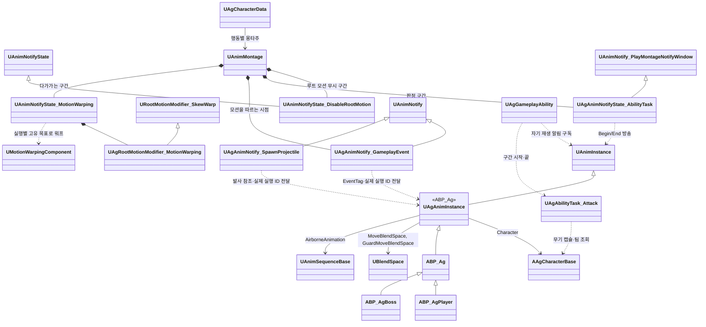

# 애니메이션과 이동

애니메이션과 이동을 어떻게 구현할지 정합니다.

실행 구조와 기능별 고정 Params는 [AbilityTask 기반 어빌리티 설계안](<AbilityTask 기반 어빌리티 설계안.md>)을 따릅니다.

## 기술 결정

| 항목 | 결정 | 이유 |
| - | - | - |
| ABP | `ABP_Ag`에 공통 애님 그래프를 두고 자식 `ABP_AgPlayer`·`ABP_AgBoss`를 각 캐릭터 메시의 Anim Class로 지정합니다. 모션은 `UAgAnimInstance`의 `MoveBlendSpace`, `GuardMoveBlendSpace`, `AirborneAnimation` 멤버에 자식 ABP 기본값으로 지정합니다. 보스의 GuardMoveBlendSpace는 비워 둡니다. 이 참조는 JSON에서 읽지 않습니다. 속도·방향·가드·공중 상태는 C++ `UAgAnimInstance`에서 계산하고, 애님 그래프에는 이동 블렌드 스페이스 → 가드 이동 블렌드 스페이스 전환 → 공중 여부 전환 → 몽타주 슬롯 → 덧입힘 슬롯만 둡니다. 두 전환의 블렌드 시간은 노드 핀에 적고, 공중 전환은 노드의 엔진 기본값(0.1초)을 그대로 씁니다. 루트 모션은 몽타주에서만 씁니다. | AI가 BP 그래프를 다루기 어려우므로 그래프를 최소로 둡니다. 블렌드 시간은 노드의 설정이라 노드에서 고칩니다([JSON과 DataAsset](<JSON과 DataAsset.md>)의 '형식'). |
| 블렌드 스페이스 | 플레이어 이동(템플릿 `BS_Idle_Walk_Run`: MM_Idle, Walk·Jog 8방향), 플레이어 가드 이동(Guard, Guard_Walk 8방향), 보스 이동(Idle1, Walk 8방향) 3개를 각 자식 ABP의 모션 멤버 기본값에 지정합니다. 가로축은 캐릭터 정면 기준 이동 방향, 세로축은 이동 속도이고, 샘플은 각 모션의 실제 이동 속도에 둡니다. 팩의 이동 모션은 제자리(`_IPC`) 버전을, 템플릿 이동 모션은 루트 모션을 켠 원본(재생할 때 제자리)을 씁니다. | 세 블렌드 스페이스의 축이 같아 공통 애님 그래프를 상속하여 처리합니다. 템플릿 블렌드 스페이스는 샘플이 모션의 실제 속도(걷기 3m/s, 뛰기 6m/s)에 있어 그대로 씁니다. |
| 메시 갱신 | 캐릭터 메시는 화면에 보이지 않을 때도 포즈와 본을 갱신합니다. | 공격 판정이 메시의 피직스 바디를 쓰고 무기가 손을 따라가므로, 보이지 않을 때도 위치가 맞아야 합니다. |
| 덧입힘 모션 | 움찔은 플레이어와 보스 모두 사무라이 `Hit14`를, 가드 움찔은 `Guard_Hit1`을 덧입힘 모션으로 만들어 씁니다. 덧입힘 모션은 루트 모션을 끕니다. | 루트 모션이 있는 몽타주는 재생하는 동안 이동 입력과 다른 몽타주의 루트 모션을 대신합니다. |
| 점프 | 점프 시작과 착지는 몽타주로 재생하고, 공중에서는 공중 반복 모션을 재생합니다. 시작 몽타주는 이동 입력과 상관없이 재생하고, 착지 몽타주는 이동 입력이 없을 때만 재생합니다. 이동 중에 착지하면 시작 몽타주를 멈추고, 착지 몽타주가 끝나기 전에 이동하면 착지 몽타주를 멈춥니다. 점프 높이와 공중 제어는 캐릭터 무브먼트의 엔진 기본값이 기획서 값과 같아 그대로 씁니다. | 시작과 착지를 C++에서 몽타주로 재생하므로 애님 그래프에는 공중 여부 전환 하나만 늘어납니다. 템플릿 점프 모션은 루트 모션이 꺼져 있어 재생하는 동안에도 이동 입력이 먹힙니다. 템플릿 ABP도 시작 모션을 이동 여부와 상관없이 재생합니다. 착지 모션은 제자리 모션이라 움직이면서 재생하면 미끄러져 보입니다. |
| 점프 공격 | 점프 어빌리티는 공중에 있는 동안 '행동 중'과 함께 '점프 중' 태그(`State.Jumping`)를 갖습니다. 점프 공격 어빌리티는 '행동 중' 대신 '점프 중'을 시작 조건으로 삼고, 캐릭터가 실제로 떨어지는 중일 때만 시작하며, 시작하면 다른 행동처럼 점프를 취소합니다. 공격 진행은 [전투 규칙](<전투 규칙.md>)의 '공격 진행'을 따릅니다. 몽타주(`AM_Player_JumpAttack`)는 섹션 Start(내려베기) → Fall(떨어지는 자세, 반복) → Land(착지)이고, 판정 구간 노티파이 하나가 Start의 베기부터 Land의 바닥 찍기까지 걸칩니다. 내려베기가 끝날 때의 노티파이(`Event.JumpAttackPlunge`)에서 LaunchCharacter로 수직 속도만 내리꽂는 속도로 바꾸고, 착지하면(이동 모드가 걷기로 바뀜) Land 섹션으로 넘깁니다. 후딜은 Land 섹션 시작에서 데이터의 시간만큼 지난 재생 위치에서 시작합니다. | 점프 어빌리티가 공중 동안 '행동 중'을 들고 있어 다른 행동은 그대로 막히고, 점프 공격만 태그 하나로 예외가 됩니다. 점프한 프레임에는 아직 걷는 중이라, 그때 점프를 취소하면 점프 입력이 지워져 뛰지 않습니다. 판정 구간을 하나로 두어 칼이 보스를 지나는 어느 순간이든 한 번만 맞습니다. 수직 속도만 바꾸므로 수평 이동은 점프할 때의 이동이 이어지고, 그 뒤 낙하와 착지는 엔진 중력과 캐릭터 무브먼트가 정합니다. |
| 달리기 | 회피 후딜 동안 플레이어 캐릭터가 매 프레임 Shift와 이동 입력이 있고 가드 키를 누르지 않았는지 보고, 그러면 달리기 어빌리티를 시작합니다. 달리기는 다른 행동처럼 회피를 취소하고, 회피 몽타주는 블렌드 아웃으로 달리기 모션에 섞입니다. '달리는 중' 태그가 속도와 방향(락온 중에도 이동 방향)을 바꾸고, SP 소모는 Sprint가 소유하는 주기 `UAgEffect_ResourceDrain`이 맡고 종료 시 자기 핸들만 제거합니다. Shift를 떼거나 이동 입력이 없거나 SP가 0이 되면 플레이어 캐릭터가 달리기를 취소합니다. 다른 행동은 달리기를 취소하지만 점프는 취소하지 않습니다. 달리기는 이동이라 어빌리티 태그를 행동 태그(`Ability.Action`) 밖에 둡니다. | 리젠과 같이 주기 GameplayEffect를 사용하므로 자원 변화가 모두 GameplayEffect로 모입니다. 행동 태그 밖에 두면 행동 태그로 정한 규칙(행동끼리의 취소, 회피 반격 기회)에서 달리기를 따로 빼지 않아도 됩니다. 회피 모션이 끝날 때 시작하면, 몽타주가 블렌드 아웃을 시작하는 순간 루트 모션이 끊기고 이동 입력은 모션이 끝날 때까지 막혀 있어 0.25초 멈춰 섰다가 속도 0에서 출발합니다. |
| 몽타주 | 행동마다 하나를 둡니다. 이어지는 모션은 조사 문서의 연결 시점에서 잘라 한 몽타주에 붙입니다. 평타는 타마다 따로 둡니다. 대기 자세에서 바로 시작하지 않는 모션(Sweep, SwordWave, 회피 반격)은 블렌드로 잇습니다. 넉백은 쓰러짐과 기상이 한 모션(Hit_knockdown)에 들어 있어 몽타주 하나입니다. 넉업은 상승 자세, 낙하 자세와 착지, 기상의 세 몽타주로 잇습니다('넉업' 행). 블렌드로 잇는 몽타주는 끝까지 재생한 뒤 다음 몽타주로 넘어가도록 블렌드 아웃을 모션 끝에서 시작합니다. 가드 시작 모션(Guard_Start)은 따로 재생하지 않고 ABP의 가드 전환 블렌드로 대신합니다. | 평타는 타마다 별도 행동입니다. 넉업의 착지와 기상은 누운 자세가 조금 어긋납니다. 가드 시작 모션은 아주 짧아(0.12초) 자세가 갑자기 바뀌어 보이므로, 그보다 긴 블렌드로 부드럽게 바꿉니다. |
| 모션을 따르는 구간 | 공격·회피 보호·돌진·충돌 구간은 공용 AbilityTask ANS의 `Task`·`ParamsId`로 표시합니다. 투사체는 발사 AN을 사용합니다. 후딜·처형 타격·넉백 및 넉업 무적 시작·돌진 자세 유지·궁극기 단계는 GameplayEvent Notify로 전달합니다. 모두 실제 재생 ID와 소유 Ability를 확인합니다. 후딜 Notify가 없는 처형은 모션이 끝나야 다음 행동을 받습니다. | 구간의 Begin/End와 사건의 책임을 구분합니다. 소유권과 종료는 [캐릭터와 GAS](<캐릭터와 GAS.md>)를 따릅니다. |
| 추적 구간 | 엔진 `AnimNotifyState_MotionWarping`에 `UAgRootMotionModifier_MotionWarping`과 `ParamsId`를 배치합니다. Modifier는 소유 Ability의 `Tasks.MotionWarping` 사본으로 대상과 목표를 계산하며, 엔진이 구간 수명과 루트 이동·회전을 처리합니다. 실행마다 고유한 WarpTarget 이름을 사용하고 종료 시 자기 목표만 제거합니다. 범위 이탈 시 해당 구간을 중단합니다. 이후에는 원래 루트 모션을 사용합니다. | 별도 AbilityTask나 Tick 스케줄러로 워핑 구간을 다시 관리하지 않습니다. |
| 공격 중 위치·회전 보정 | Modifier는 워핑 시작 위치를 기록하고 목표를 그 위치 기준 `MaxWarpDistance` 이내로 제한합니다. null은 제한 없음, 0은 시작 위치 고정입니다. `TargetingRange`와 최대 거리 설정은 공격 Params·타격 시각과 독립적입니다. Ability가 처형의 지정 대상·정렬 간격과 재생별 일반 추적 대상을 실행 입력으로 전달합니다. 대상 선택에는 캐릭터의 읽기 전용 조회를 사용합니다. | 모션 구간을 공격 구간에서 역산하지 않습니다. 수치와 참조의 원본은 [AbilityTask 기반 어빌리티 설계안](<AbilityTask 기반 어빌리티 설계안.md>)의 MotionWarping 규약을 따릅니다. |
| 처형 | 처형 피격·처형 사망 몽타주는 두 모션의 시간 차이(처형 피격이 처형보다 늦게 시작하는 시간)만큼 첫 프레임에 머문 뒤 모션을 시작하고, 그로기 모션에서 머무는 동안 블렌드해 들어갑니다. 보스와 플레이어의 몽타주는 처형을 시작한 프레임에 함께 시작합니다. 처형의 재생 속도(플레이어 사양 '처형')는 세 몽타주의 Rate Scale에 같은 값으로 두고, 어빌리티는 몽타주를 기본 속도로 재생합니다. 블렌드 시간은 재생 속도와 관계없는 실제 시간이라, 블렌드 인 시간은 머무는 시간을 재생 속도로 나눈 값입니다. 플레이어는 찌르기까지 Motion Warping으로 보스 정면, 두 모션이 맞물리는 간격에 붙습니다. 머무는 시간과 간격은 두 모션의 원래 배치를 모션 데이터에서 재어 정합니다(Samurai 애니메이션 조사 'Warrior 팩의 처형'). 처형 피격 중에는 충돌 채널 응답 태스크(`UAgAbilityTask_SetCollisionResponseToChannel`)로 보스 캡슐이 Pawn 채널을 무시해 플레이어를 막지 않습니다. | 처형 피격 모션은 처형 모션보다 늦게 시작하도록 만들어져 있습니다. 두 몽타주가 같은 프레임에 같은 속도로 시작해 재생 위치가 늘 같으므로, 프레임 단위로 맞물립니다. 재생 속도를 몽타주에 두면 코드를 고치지 않고 세 몽타주의 속도를 함께 바꿀 수 있습니다. 순간이동하지 않습니다. 두 모션은 캡슐 반지름보다 가깝게 붙습니다. |
| 대상과의 최소 간격 | Ability는 실제 모션에 연결한 대상과 최소 간격을 최종 이동 제약으로 캐릭터에 전달합니다. 캐릭터는 루트 모션의 전진량만 제한합니다. 모션의 종료·중단 때 Ability가 자기 제약을 해제합니다. 워핑이 끝난 뒤에도 제한하며, 처형의 지정 대상 정렬에는 적용하지 않습니다. | 최소 간격의 수명은 추적 구간보다 깁니다. |
| DashThrust | 공용 `UAgAbilityTask_Dash`에 초기 방향·속도·거리·유도 대상·최대 유도 회전 속도(도/초)를 전달합니다. 일정 속도의 루트 모션 소스의 방향을 제한된 각속도로 바꾸며 몸의 Yaw도 맞춥니다. 유도 대상이 없거나 사라지면 현재 방향을 유지하며, 회전 속도 0은 직선 돌진입니다. 이동 거리는 실제 수평 이동량을 누적하고, 벽 막힘은 방향을 갱신하기 전에 이전 이동 구간의 방향으로 검사합니다. 태스크는 보스 클래스나 JSON을 직접 참조하지 않고, 호출한 어빌리티가 자기 JSON 설정을 전달합니다. 몽타주는 자세 유지 구간에서 멈춰 두고, 돌진하는 동안 충돌 채널 응답 태스크로 Pawn 채널을 무시해 플레이어를 뚫고 지나갑니다. 돌진을 시작한 뒤로는 몽타주의 돌진 시작부터 끝까지 배치한 엔진 `AnimNotifyState_DisableRootMotion`으로 루트 모션을 무시하고, 벽에 막혔는지는 돌진 방향으로 실제 나아간 거리로 판단합니다(비스듬히 부딪혀 벽을 따라 미끄러져도 막힘). 가드·가드 브레이크·패리로 막히면 피격 처리가 공격자에게 막힘 이벤트를 보내고, 돌진은 그 이벤트를 받으면 끝납니다. 막힘 이벤트는 실제 돌진 Task가 활성인 동안에만 처리합니다. | 모션 자체의 이동만으로는 돌진 거리에 못 미칩니다. 몽타주가 루트 모션을 주는 동안에는 캐릭터 무브먼트가 루트 모션 소스를 쓰지 않고, 돌진 뒤 창을 거두는 동안 더 나아가지도 않아야 합니다. 검기를 막아도 보스에게 막힘 이벤트가 가므로, 돌진 전에 받은 막힘 이벤트가 돌진의 수신을 소모하지 않게 합니다. |
| LeapSlam | 체공 시간과 엔진 중력으로 초기 속도를 정해 도약합니다. 착지 목표는 도약을 시작할 때 확정하며 공중에서 플레이어의 새 위치로 궤적을 고치지 않습니다. 회전 추적은 다른 공격과 같은 몽타주 워핑 구간을 사용하며 별도 회전 정지 시간·태그 태스크는 두지 않습니다. 도약 시퀀스의 루트 모션을 켜 회전 워핑을 적용하되, 도약 어빌리티 동안 루트 이동량은 공중의 물리 속도로 대체하고 지상에서는 0으로 둡니다. 종료·취소 시 이 처리를 해제합니다. 착지하면 End 구간으로 이동하고 착지 판정을 처리합니다. | 루트 모션을 끄면 회전 워핑도 실행되지 않으므로, 회전 보정은 유지하면서 모션의 이동량이 물리 궤적을 덮지 않게 합니다. 체공 시간은 물리 이동을 정하고, 모션의 추적 구간은 추적을 허용하는 시점을 정합니다. 현재 체공 시간과 재생 속도에 맞춰 구간을 배치합니다. |
| 넉업 | 루트 모션 점프 어빌리티 태스크(`AbilityTask_ApplyRootMotionJumpForce`)로 체공 시간 동안 최고 높이까지 포물선을 그리며 수직으로 띄웠다가 내리고, 착지하면 태스크가 끝납니다. 넉업의 상승·낙하·기상 몽타주 전체 구간에 엔진 `AnimNotifyState_DisableRootMotion`을 배치해, 몽타주의 루트 이동(착지 모션의 뒤로 2.1m)을 쓰지 않습니다. 플레이어와 보스가 같은 어빌리티와 몽타주를 씁니다. 상승 자세 몽타주(`AM_KnockUp`)를 재생하다가, 수직 속도가 경로의 감속(8 × 최고 높이 ÷ 체공 시간²) × 낙하 몽타주(`AM_KnockUpFall`)의 블렌드 인 시간 ÷ 2까지 줄면 낙하 몽타주로 바꿔, 정점에서 두 자세가 반씩 섞이게 합니다. 착지하면 낙하 몽타주의 Land 구간으로 넘어가고, 끝나면 기상 몽타주(`AM_GetUp`)를 재생합니다. 무적은 넉백과 같은 게임플레이 이벤트(Land 구간에서 바닥에 닿는 순간)로 시작하며, 공통 Ability가 실제 모션의 이벤트와 `HoldTag`를 연결합니다. 세 시퀀스(Hit_Air_Up, Hit_Air_Down, Hit_knockdown2) 모두 루트 모션을 켭니다. | 중력을 바꾸지 않고 정한 궤적을 그대로 따릅니다. 점프 첫 틱의 속도는 경로 속도가 아니므로 낙하 확인은 경로대로 오르는 속도를 확인한 뒤에 시작합니다. 점프 태스크는 다음 이동 갱신 때부터 속도를 정하고, 시간 정지와 히트스톱이 겹친 프레임에 맞으면(궁극기 마무리) 프레임 시간이 아주 짧아 루트 모션 점프가 속도를 0으로 덮습니다. 몽타주가 루트 모션을 주는 동안에는 캐릭터 무브먼트가 루트 모션 소스를 쓰지 않으므로 루트 모션을 무시합니다. 낙하 자세와 착지 모션의 첫 자세가 같아 Land 구간으로 넘어가는 것이 보이지 않습니다. 정점 자세(Hit_Air)는 두 자세를 섞은 모습과 거의 같아 쓰지 않습니다. |
| 캐릭터 회전 | 공격 중 회전은 위 추적 구간의 Motion Warping이 담당합니다. Ability가 공격 모션 동안 일반 회전을 제한하므로 캐릭터는 몽타주 알림을 검색하지 않습니다. 공격하지 않을 때 보스가 AI 대상을 바라보는 회전은 `AAgCharacterBase`가 캐릭터 무브먼트의 `RotationRate.Yaw`로 처리하며, 회전하지 않는 상태에서는 멈춥니다. | 공격 중 C++ 회전과 Motion Warping을 중복 적용하지 않습니다. |
| 이동 속도 | MOV 어트리뷰트를 캐릭터 무브먼트의 최대 속도에 반영합니다. | |
| 캐릭터 설정 | 기획서에 없는 캐릭터 설정(캡슐, 가속)은 엔진 기본값을 씁니다. | 플레이 전에 임의의 수치를 늘리지 않습니다. |
| 무기 | `SK_Mannequin`의 `hand_r`에 카타나·할버드 소켓을 만듭니다. 소켓 값은 Samurai·할버드 조사 문서를 따릅니다. 무기는 캐릭터 블루프린트에 더한 메시 컴포넌트(`Weapon`)로 두고, 메시와 Parent Socket을 블루프린트에서 정합니다. 무기 판정 캡슐(`WeaponCollision`)은 그 자식이며 날 전체를 여유 있게 덮습니다. 코드는 두 컴포넌트를 컴포넌트 태그(`Weapon`, `WeaponCollision`)로 찾습니다. | 팩에 소켓이 없고, 메시에는 `weapon_r` 본이 없습니다. C++에서 만든 컴포넌트는 블루프린트에서 Parent Socket을 바꿀 수 없어 블루프린트 컴포넌트로 둡니다. 무기, 소켓, 날을 블루프린트 뷰포트 한 곳에서 보며 맞춥니다. |

## 클래스 구조

### 애니메이션

`ABP_Ag`의 부모와 몽타주에 넣는 노티파이입니다.

| 클래스 | 부모 | 역할 |
| - | - | - |
| `UAgAnimInstance` | `UAnimInstance` | `ABP_Ag`의 값 계산(속도, 방향, 가드 여부, 공중 여부), 자식 ABP의 모션 멤버, 단발 알림의 실제 재생 출처를 자기 몽타주 델리게이트로 전달 |
| `UAgRootMotionModifier_MotionWarping` | `URootMotionModifier_SkewWarp` | 엔진 워핑 구간에서 실행별 대상과 목표를 계산합니다. '공격 중 위치·회전 보정'을 따릅니다. |
| `UAgAnimNotifyState_AbilityTask` | `UAnimNotify_PlayMontageNotifyWindow` | Task·ParamsId 구간을 표시합니다. 진입·종료 방송과 몽타주 배치 제한은 엔진 부모를 사용합니다. |
| `UAgAnimNotify_SpawnProjectile` | `UAnimNotify` | 발사 시점과 ParamsId를 엔진 몽타주 알림으로 방송합니다. |
| `UAnimNotifyState_DisableRootMotion` | `UAnimNotifyState` | 엔진 기본 노티파이. 넉업·돌진의 루트 모션 무시 구간을 표시합니다(위 기술 결정 참고). 몽타주 인스턴스별로 적용되어 전환 중 구간이 겹쳐도 서로의 상태를 복원하지 않습니다. |
| `UAgAnimNotify_GameplayEvent` | `UAnimNotify` | 후딜, 처형 타격, 넉백·넉업 무적 시작, 돌진·궁극기 단계처럼 어빌리티 흐름을 바꾸는 이벤트를 보냅니다. |

### 플레이어 공격 워핑 저작

회피 반격의 회전 예외는 [플레이어 사양](<../Design/플레이어 사양.md>)의 '회피 반격'을 따릅니다. `AM_Player_DodgeCounter`는 `UAgRootMotionModifier_MotionWarping`를 유지하고 `RotationMethod=Slerp`, `WarpRotationTimeMultiplier=1`로 설정합니다. 대상·접근 목표 계산은 공용 코드를 사용하며, 별도 클래스나 어빌리티별 분기를 추가하지 않습니다. 다른 플레이어 공격의 회전 방식은 `ConstantRate`를 유지합니다.

플레이어 사양의 공통 보정 규칙을 따릅니다. 평타 1~5, 스킬, 회피 반격은 준비 중 전진하는 구간에 회전·수평 이동 워핑을 함께 둡니다. 점프 공격은 준비에 회전만 두며 Start 시퀀스의 루트 모션을 켭니다. 점프 공격 어빌리티는 기존 속도로 루트 이동량을 대체해 공중 이동을 보존하고 종료 시 해제합니다. 구간 시각은 몽타주에만 저장하며, 재생 속도 변경 시 함께 재저작합니다. 보스와 처형의 워핑 구간은 각자의 규칙을 유지합니다.

### 보스 공격 워핑 저작

보스 사양의 공통 보정 규칙을 따릅니다. 구간 시각은 몽타주에만 저장합니다. 원본 시퀀스의 루트 이동과 골반·손의 자세, 몽타주의 구간별 재생 속도를 함께 확인해 배치합니다.

| 패턴 | 배치 기준 |
| - | - |
| DoubleStrike | 1타는 낮추며 준비하는 동작에서 이동과 회전을 보정하고, 찌르기에 들어가기 전에 워핑을 끝냅니다. 2타는 무기를 머리 위로 준비하는 동안 회전하고 내려찍기 전에 멈춥니다. |
| Sweep | 휩쓸기를 준비하는 동안 회전하고 무기를 앞으로 휘두르기 전에 멈춥니다. 추가 이동 보정은 하지 않습니다. |
| DashThrust | 몸을 낮추며 준비하는 구간부터 돌진 출발 직전까지 회전합니다. 돌진 이동은 공용 Dash Task가 맡습니다. |
| LeapSlam | 떠오르며 무기를 들어 올리는 초기 동작에서만 회전합니다. 착지 목표와 궤적은 위 LeapSlam 결정을 따릅니다. |
| QuintupleStrike | 각 타의 준비 모션에서 다시 회전하고 베기·찌르기·내려찍기·올려치기·휩쓸기를 시작하기 전에 각각 멈춥니다. 앞 타의 판정 중에는 다음 타의 추적을 시작하지 않습니다. |
| SwordWave | 각 검기의 준비 모션에서 회전하고 해당 휘두르기 전에 멈춥니다. 발사 직후의 후속 동작에는 다음 타의 추적을 겹치지 않습니다. |
| JumpSlam | 느리게 재생하는 공중 준비 동작에서도 추적과 이동 보정을 이어가고, 내려찍기 직전에 워핑을 끝냅니다. |
| Backstep | 대상 쪽으로 접근하는 워핑을 두지 않고 기존 후퇴 루트 모션을 사용합니다. |

## 공용 기능의 몽타주 배치

`UAgAnimNotifyState_AbilityTask`에는 `Task`와 필요한 `ParamsId`만 지정하고 시작·끝은 몽타주 구간으로 정합니다. 정의는 [JSON과 DataAsset](<JSON과 DataAsset.md>)의 기능 Params를 따릅니다. 공격 판정·돌진·보호·충돌에 같은 ANS를 사용하며 MotionWarping은 엔진 전용 ANS와 Modifier를 사용합니다.

`UAgAnimNotify_SpawnProjectile`에는 `ParamsId`, `Origin`, `SocketName`을 지정합니다. 발사 기준은 캡슐 앞 바닥과 수평 정면을 쓰는 `CharacterFeetForward`, 명시한 메시 소켓의 월드 변환을 쓰는 `MeshSocket`입니다. 발사 동작은 [전투 규칙](<전투 규칙.md>)의 투사체 발사를 따릅니다.

공용 Task ANS와 발사 AN은 GAS가 재생한 몽타주에 배치합니다. Notify는 Ability를 조회하지 않고 엔진 델리게이트로 방송합니다. 재생 소유 Ability가 구독하고 실제 메시·몽타주 인스턴스 ID를 확인하며, 모션 교체·종료에서 구독을 해제합니다. 같은 에셋을 다시 재생해도 이전 인스턴스의 늦은 알림을 새 실행으로 처리하지 않습니다.

공용 Task ANS는 엔진 Montage Notify Window의 Begin/End 방송을 그대로 사용하고, 쓰지 않는 NotifyName 편집 항목은 숨깁니다. 단발 AN은 같은 시각의 여러 사건을 유지하기 위해 기존 queued 전달을 사용합니다. `UAgAnimInstance`가 알림 참조에 들어 있는 실제 재생 ID를 자기 델리게이트로 전달하며, 현재 Ability를 검색하지 않습니다. 재생 시작 경계의 ANS 초기화와 공격·워핑 구간 존재 조회는 재생을 소유한 `UAgGameplayAbility`의 내부 처리로 둡니다.
