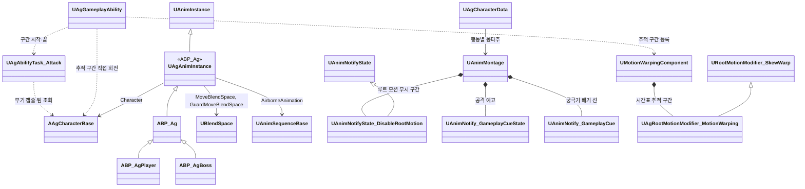

# 애니메이션과 이동

애니메이션과 이동을 어떻게 구현할지 정합니다.

행동의 실행 구조와 Task는 [어빌리티와 AbilityTask](<어빌리티와 AbilityTask.md>)를, 몽타주 안의 구간과 지점은 [몽타주 시간표](<몽타주 시간표.md>)를 따릅니다.

## 기술 결정

| 항목 | 결정 | 이유 |
| - | - | - |
| ABP | `ABP_Ag`에 공통 애님 그래프를 두고 자식 `ABP_AgPlayer`·`ABP_AgBoss`를 각 캐릭터 메시의 Anim Class로 지정합니다. 모션은 `UAgAnimInstance`의 `MoveBlendSpace`, `GuardMoveBlendSpace`, `AirborneAnimation` 멤버에 자식 ABP 기본값으로 지정합니다. 보스의 GuardMoveBlendSpace는 비워 둡니다. 이 참조는 JSON에서 읽지 않습니다. 속도·방향·가드·공중 상태는 C++ `UAgAnimInstance`에서 계산하고, 애님 그래프에는 이동 블렌드 스페이스 → 가드 이동 블렌드 스페이스 전환 → 공중 여부 전환 → 몽타주 슬롯 → 덧입힘 슬롯만 둡니다. 두 전환의 블렌드 시간은 노드 핀에 적고, 공중 전환은 노드의 엔진 기본값(0.1초)을 그대로 씁니다. 루트 모션은 몽타주에서만 씁니다. | AI가 BP 그래프를 다루기 어려우므로 그래프를 최소로 둡니다. 블렌드 시간은 노드의 설정이라 노드에서 고칩니다([JSON 데이터](<JSON 데이터.md>)의 '형식'). |
| 블렌드 스페이스 | 플레이어 이동(템플릿 `BS_Idle_Walk_Run`: MM_Idle, Walk·Jog 8방향), 플레이어 가드 이동(Guard, Guard_Walk 8방향), 보스 이동(Idle1, Walk 8방향) 3개를 각 자식 ABP의 모션 멤버 기본값에 지정합니다. 가로축은 캐릭터 정면 기준 이동 방향, 세로축은 이동 속도이고, 샘플은 각 모션의 실제 이동 속도에 둡니다. 팩의 이동 모션은 제자리(`_IPC`) 버전을, 템플릿 이동 모션은 루트 모션을 켠 원본(재생할 때 제자리)을 씁니다. | 세 블렌드 스페이스의 축이 같아 공통 애님 그래프를 상속하여 처리합니다. 템플릿 블렌드 스페이스는 샘플이 모션의 실제 속도(걷기 3m/s, 뛰기 6m/s)에 있어 그대로 씁니다. |
| 메시 갱신 | 캐릭터 메시는 화면에 보이지 않을 때도 포즈와 본을 갱신합니다. | 공격 판정이 메시의 피직스 바디를 쓰고 무기가 손을 따라가므로, 보이지 않을 때도 위치가 맞아야 합니다. |
| 덧입힘 모션 | 움찔은 플레이어와 보스 모두 사무라이 `Hit14`를, 가드 움찔은 `Guard_Hit1`을 덧입힘 모션으로 만들어 씁니다. 덧입힘 모션은 루트 모션을 끕니다. | 루트 모션이 있는 몽타주는 재생하는 동안 이동 입력과 다른 몽타주의 루트 모션을 대신합니다. |
| 점프 | 점프 시작과 착지는 플레이어 캐릭터가 점프 몽타주(`AM_Player_Jump`)의 Start·Land 섹션으로 재생하고, 공중에서는 공중 반복 모션을 재생합니다. 엔진 점프가 실제로 시작될 때(`OnJumped`) `State.Jumping`을 붙이고 Start를 재생합니다. 착지할 때(`Landed`) 태그를 떼고, 점프 행동이 남아 있었으면 이동 입력이 없을 때 Land 섹션부터 다시 재생하고 이동 입력이 있으면 점프 몽타주를 멈춥니다. 점프 공격이나 피격 반응이 점프 행동을 끝냈으면 그 행동의 모션이 착지를 맡습니다. 착지 모션이 끝나기 전에 이동하면 착지 모션을 멈춥니다. 점프 높이와 공중 제어는 캐릭터 무브먼트의 엔진 기본값이 기획서 값과 같아 그대로 씁니다. | 시작과 착지를 C++에서 몽타주로 재생하므로 애님 그래프에는 공중 여부 전환 하나만 늘어납니다. 템플릿 점프 모션은 루트 모션이 꺼져 있어 재생하는 동안에도 이동 입력이 먹힙니다. 템플릿 ABP도 시작 모션을 이동 여부와 상관없이 재생합니다. 착지 모션은 제자리 모션이라 움직이면서 재생하면 미끄러져 보입니다. 점프와 그 모션은 행동이 아니라 공중 상태라 캐릭터가 맡고, 점프 행동은 그 상태 태그로 실행되며 Busy만 갖습니다. |
| 점프 공격 | 점프 행동은 공중에 있는 동안 '점프 중' 태그(`State.Jumping`)로 실행되고 Busy를 갖습니다. 점프 공격은 '행동 중' 대신 '점프 중'을 시작 조건(RequiredTags)으로 삼고, 시작하면 다른 행동처럼 점프 행동을 취소합니다(태그는 착지까지 남음). 공격 진행은 [전투 규칙](<전투 규칙.md>)의 '공격 진행'을 따릅니다. 몽타주(`AM_Player_JumpAttack`)는 섹션 Start(내려베기) → Fall(떨어지는 자세, 반복) → Land(착지)이고, Start·Fall의 루트 모션은 끕니다. 시간표의 판정 구간 하나가 Start의 베기부터 Land의 바닥 찍기까지 걸칩니다. 내려베기가 끝나는 시각부터 Fall 끝까지 Dash(To Down, 초속 10m)가 수평 속도를 그대로 두고 일정 속도로 떨어뜨리고, 착지하면(`Event.Landed`) Transition이 Land 섹션으로 옮깁니다. 공중 회전은 추적 구간이 캐릭터를 직접 돌립니다. 후딜은 Land 섹션 안의 Busy 구간 끝에서 시작합니다. | 점프 행동이 공중 동안 Busy를 들고 있어 다른 행동은 그대로 막히고, 점프 공격만 태그 하나로 예외가 됩니다. `State.Jumping`은 엔진 점프가 시작된 뒤에 붙으므로 점프 공격이 점프 입력을 지우지 않습니다. 판정 구간을 하나로 두어 칼이 보스를 지나는 어느 순간이든 한 번만 맞습니다. 수평 속도를 그대로 두므로 수평 이동은 점프할 때의 이동이 이어지고, 낙하 속도는 기획서의 초속 10m 그대로입니다(중력으로 빨라지지 않음). |
| 달리기 | 회피 후딜 동안 플레이어 캐릭터가 매 프레임 Shift와 이동 입력이 있고 가드 키를 누르지 않았고 SP가 0보다 큰지 보고, 그러면 달리기의 트리거 태그(`Input.Sprint`)를 붙입니다. 달리기는 다른 행동처럼 회피를 취소하고, 회피 몽타주는 블렌드 아웃으로 달리기 모션에 섞입니다. '달리는 중' 태그가 속도와 방향(락온 중에도 이동 방향)을 바꾸고, SP 소모는 달리기가 거는 주기 효과(`SprintDrain`)가 맡습니다. Shift를 떼거나 이동 입력이 없거나 SP가 0이 되면 트리거 태그를 떼어 달리기를 끝냅니다. 다른 행동은 달리기를 취소하지만 점프는 취소하지 않습니다. 달리기는 이동이라 어빌리티 태그를 행동 태그(`Ability.Action`) 밖에 둡니다. | 리젠과 같이 주기 GameplayEffect를 사용하므로 자원 변화가 모두 GameplayEffect로 모입니다. 행동 태그 밖에 두면 행동 태그로 정한 규칙(행동끼리의 취소, 회피 반격 기회)에서 달리기를 따로 빼지 않아도 됩니다. 회피 모션이 끝날 때 시작하면, 몽타주가 블렌드 아웃을 시작하는 순간 루트 모션이 끊기고 이동 입력은 모션이 끝날 때까지 막혀 있어 0.25초 멈춰 섰다가 속도 0에서 출발합니다. |
| 몽타주 | 행동마다 하나를 둡니다. 여러 모션을 쓰는 행동은 한 몽타주의 섹션으로 합칩니다: 평타(`AM_Player_BasicAttack`, Attack1~5), 회피(`AM_Player_Dodge`, Backstep·Roll), 넉업(`AM_KnockUp`, Rise·Fall·Land·GetUp), 점프(`AM_Player_Jump`, Start·Land). 섹션끼리 잇지 않으면 그 섹션 끝에서 몽타주가 끝납니다. 이어지는 모션은 조사 문서의 연결 시점에서 잘라 한 몽타주에 붙입니다. 대기 자세에서 바로 시작하지 않는 모션(Sweep, SwordWave, 회피 반격)은 블렌드로 잇습니다. 넉백은 쓰러짐과 기상이 한 모션(Hit_knockdown)에 들어 있어 몽타주 하나입니다. 가드 시작 모션(Guard_Start)은 따로 재생하지 않고 ABP의 가드 전환 블렌드로 대신합니다. | 한 행동의 흐름이 한 몽타주의 섹션과 시간표에 모입니다. 다른 동작으로 넘어갈 때는 전환의 BlendTime으로 다시 재생해 자세가 튀지 않습니다. 넉업의 착지와 기상은 누운 자세가 조금 어긋납니다. 가드 시작 모션은 아주 짧아(0.12초) 자세가 갑자기 바뀌어 보이므로, 그보다 긴 블렌드로 부드럽게 바꿉니다. |
| 모션을 따르는 구간 | 공격·보호·돌진·추적·전환 구간과 지점(투사체 발사, 무적 시작, 시작 섹션 고르기, 착지 셰이크)은 [몽타주 시간표](<몽타주 시간표.md>)의 항목입니다. 재생을 시작한 Runner만 자기 재생의 항목을 실행합니다. 후딜이 없는 처형은 모션이 끝나야 다음 행동을 받습니다. 몽타주에는 연출(공격 예고, 궁극기 베기 선)과 루트 모션 끄기 노티파이만 둡니다. | 게임 규칙의 시각과 값을 텍스트로 고치고 리뷰합니다. |
| 추적 구간 | 시간표의 추적 구간(Track)은 몽타주가 그 위치에서 루트 모션을 주면, 엔진이 워핑 노티파이를 찾는 때와 조건으로 `UAgRootMotionModifier_MotionWarping`을 엔진 Motion Warping에 등록합니다([몽타주 시간표](<몽타주 시간표.md>) '항목별 실행'). Modifier는 항목의 값으로 대상과 목표를 계산하며, 엔진이 구간 수명과 루트 이동·회전을 처리합니다. 실행마다 고유한 WarpTarget 이름을 쓰고 종료 시 자기 목표만 제거합니다. 대상이 TargetingRange 밖으로 나가면 해당 구간을 중단하고, 이후에는 원래 루트 모션을 씁니다. 몽타주가 루트 모션을 주지 않으면(루트 모션 소스로 움직이는 공중 동작) Runner가 판정 틱에서 캐릭터를 직접 돌리며 다가가지 않고, 대상이 TargetingRange 밖으로 나가면 멈춥니다. | 별도 AbilityTask로 워핑 구간을 다시 관리하지 않습니다. 루트 모션 소스가 움직이는 동안에는 워핑이 루트 모션을 받지 못하므로 회전만 직접 합니다. |
| 공격 중 위치·회전 보정 | Modifier는 워핑 시작 위치를 기록하고 목표를 그 위치 기준 `MaxWarpDistance` 이내로 제한합니다. null은 제한 없음, 0은 시작 위치 고정입니다. `TargetingRange`와 최대 거리 설정은 공격 값·타격 시각과 독립적입니다. 대상은 그 재생의 행동 대상이고, 목표는 대상 앞 그 행동의 간격(Targeting의 StopDistance)입니다. 대상이 없거나 TargetingRange 밖이면 캐릭터의 대체 대상(플레이어는 락온 대상) 쪽으로 돌기만 합니다. 회전 속도는 실제 시간 초당 캐릭터 회전 속도(360°)이며 재생 배율로 보정하지 않습니다(엔진 ConstantRate 워핑이 이동 틱의 실제 시간으로 돌림). | 모션 구간을 공격 구간에서 역산하지 않습니다. 처형도 같은 대상과 간격을 쓰므로 처형 전용 워핑 입력이 없습니다. |
| 처형 | 처형 피격·처형 사망 몽타주는 두 모션의 시간 차이(처형 피격이 처형보다 늦게 시작하는 시간)만큼 첫 프레임에 머문 뒤 모션을 시작하고, 그로기 모션에서 머무는 동안 블렌드해 들어갑니다. 보스와 플레이어의 몽타주는 처형을 시작한 프레임에 함께 시작합니다. 처형의 재생 속도(플레이어 사양 '처형')는 세 몽타주의 Rate Scale에 같은 값으로 두고, 어빌리티는 몽타주를 기본 속도로 재생합니다. 블렌드 시간은 재생 속도와 관계없는 실제 시간이라, 블렌드 인 시간은 머무는 시간을 재생 속도로 나눈 값입니다. 플레이어는 찌르기까지 추적 구간(Slerp)으로 보스 정면, 두 모션이 맞물리는 간격(처형 Targeting의 StopDistance 95cm)에 붙습니다. 머무는 시간과 간격은 두 모션의 원래 배치를 모션 데이터에서 재어 정합니다(Samurai 애니메이션 조사 'Warrior 팩의 처형'). 처형 피격 중에는 캐릭터 통과 태그(`State.PassThrough`, 처형 피격의 OwnedTags)로 보스 캡슐이 Pawn 채널을 무시해 플레이어를 막지 않습니다. | 처형 피격 모션은 처형 모션보다 늦게 시작하도록 만들어져 있습니다. 두 몽타주가 같은 프레임에 같은 속도로 시작해 재생 위치가 늘 같으므로, 프레임 단위로 맞물립니다. 재생 속도를 몽타주에 두면 코드를 고치지 않고 세 몽타주의 속도를 함께 바꿀 수 있습니다. 순간이동하지 않습니다. 두 모션은 캡슐 반지름보다 가깝게 붙습니다. |
| 대상과의 최소 간격 | 재생 중인 Runner에 Targeting으로 정한 대상이 있으면, 캐릭터가 루트 모션 이동이 그 대상에게 그 행동의 간격(Targeting의 StopDistance, 생략하면 캐릭터의 `StopDistance`)보다 가까이 가지 않게 전진량만 자릅니다(`ClampRootMotion`). 행동 내내 적용하며 처형도 같습니다(정렬 간격 95cm). | 최소 간격의 수명은 추적 구간보다 깁니다. 간격을 행동마다 하나로 두어 추적 구간의 접근 목표와 최소 간격이 어긋나지 않습니다. 처형의 찌르기 순간 간격은 정렬 간격과 몇 cm 차이라 처형에도 그대로 씁니다. |
| DashThrust | 돌진은 Dash(To Target)가 엔진 루트 모션 소스로 일정 속도로 움직이며, 방향을 초당 HomingTurnRate까지 대상 쪽으로 바꾸고 몸의 Yaw도 맞춥니다. 대상이 없으면 현재 방향을 유지하며, 회전 속도 0은 직선 돌진입니다. 이동 거리는 실제 수평 이동량을 누적하고, 벽 막힘은 돌진 방향으로 실제 나아간 거리로 판단합니다(비스듬히 부딪혀 벽을 따라 미끄러져도 막힘). 가드·가드 브레이크·패리로 막히면 피격 처리가 공격자에게 막힘 이벤트(`Event.AttackBlocked`)를 보내고, 돌진은 그 이벤트를 받으면 끝납니다. 몽타주는 자세 유지 시각에서 나눈 섹션 Start, Hold(그 자세 한 프레임의 반복), Recover이고, 돌진·판정·캐릭터 통과(`State.PassThrough`) 구간은 돌진 시작부터 Hold 끝까지입니다. 돌진하는 동안 Hold가 찌르는 자세를 유지하고, 돌진이 끝나면 Dash가 Recover부터 다시 재생해(BlendTime) 세 구간이 함께 닫힙니다. 돌진 시작부터 몽타주 끝까지(Hold, Recover 포함) 엔진 `AnimNotifyState_DisableRootMotion`으로 루트 모션을 끕니다. 자세 유지 시각 전에 막히거나 거리를 다 가면 남은 찌르는 동작(몽타주 시간 최대 0.12초)을 건너뛰고 Recover로 블렌드합니다. | 모션 자체의 이동만으로는 돌진 거리에 못 미칩니다. 몽타주가 루트 모션을 주는 동안에는 캐릭터 무브먼트가 루트 모션 소스를 쓰지 않고, 돌진 뒤 창을 거두는 동안 더 나아가지도 않아야 합니다. 막힘 이벤트는 돌진 Task가 실행 중일 때만 받으므로, 돌진 전에 받은 막힘(검기를 막음)이 돌진을 멈추지 않습니다. 자세 유지 전의 돌진 거리는 약 3m라 남은 동작을 건너뛰는 일은 출발할 때 플레이어나 벽이 그보다 가까울 때만 생기고, 블렌드로 자세가 튀지 않습니다. |
| LeapSlam | 도약은 Launch(To Target)가 엔진 루트 모션 점프로 체공 시간 동안 포물선을 그리며, 대상 위치에서 보스 쪽으로 그 행동의 간격(캐릭터의 `StopDistance`, 보스 사양 '패턴 공통 규칙'의 최소 간격)만큼 떨어진 곳으로 보냅니다(수평 거리 최대 12m). 최고 높이를 적지 않아 엔진 중력의 포물선과 같습니다. 착지 목표는 도약을 시작할 때 확정하며 공중에서 플레이어의 새 위치로 궤적을 고치지 않습니다. 몽타주의 모든 섹션은 루트 모션을 끄고, 공중 회전은 첫 섹션의 추적 구간이 캐릭터를 직접 돌립니다. 착지하면(`Event.Landed`) Transition이 End 섹션으로 옮기고, End의 지점이 카메라 셰이크와 착지 타격(공격 범위 3.5m, 공중의 대상 제외)을 합니다. | 루트 모션 소스가 궤적을 정하고 몽타주는 모션만 줍니다. 몽타주가 루트 모션을 주면 소스가 먹지 않으므로 끕니다. 체공 시간이 물리 이동을 정하고, 모션의 추적 구간은 추적을 허용하는 시점을 정합니다. |
| 넉업 | Launch(AirTime 0.6, Height 120)가 엔진 루트 모션 점프로 체공 시간 동안 최고 높이까지 포물선을 그리며 수직으로 띄웠다가 내리고, 착지하면 끝납니다. 넉업 몽타주(`AM_KnockUp`)는 섹션 Rise(상승 자세, 반복), Fall(낙하 자세, 반복), Land(착지), GetUp(기상)이고, 몽타주 전체에 엔진 `AnimNotifyState_DisableRootMotion`을 배치해 몽타주의 루트 이동(착지 모션의 뒤로 2.1m)을 쓰지 않습니다. 플레이어와 보스가 같은 정의와 몽타주를 씁니다. 캐릭터가 정점(`Event.Apex`, 수직 속도가 오름에서 내림으로 바뀜)을 알리면 Rise에서 Fall로 블렌드해 다시 재생하고, 착지(`Event.Landed`)하면 Land로 넘어갑니다(Rise에서는 블렌드, Fall에서는 같은 재생 안에서). 무적은 Land의 쓰러짐 시각(HoldTag 지점)부터입니다. Land 끝 직전의 지점에서 GetUp을 블렌드로 다시 재생합니다. 몽타주의 BlendOutTriggerTime은 0이라 Land 중에 자동 블렌드 아웃이 시작되지 않고, 행동은 GetUp이 끝나고 블렌드 아웃까지 마친 뒤 끝납니다. 세 시퀀스(Hit_Air_Up, Hit_Air_Down, Hit_knockdown2)와 기상 모션은 루트 모션을 켜 둡니다. | 중력을 바꾸지 않고 정한 궤적을 그대로 따릅니다. 몽타주가 루트 모션을 주는 동안에는 캐릭터 무브먼트가 루트 모션 소스를 쓰지 않으므로 노티파이로 끕니다. 낙하 자세와 착지 모션의 첫 자세가 같아 Land로 넘어가는 것이 보이지 않습니다. 정점 자세(Hit_Air)는 두 자세를 섞은 모습과 거의 같아 쓰지 않습니다. 낙하 자세 전환은 정점에서 시작해 블렌드 시간의 절반 뒤에 반씩 섞입니다. 기상으로 넘어가는 지점을 섹션 끝에 두면 그 시각이 GetUp의 시작과 같아 GetUp부터 다시 재생할 때 또 실행되므로 끝 직전에 둡니다. |
| 캐릭터 회전 | 행동 중의 회전은 Face(재생할 때 몸 돌리기)와 추적 구간이 맡습니다. 행동하지 않을 때 보스가 AI 대상을 바라보는 회전은 `AAgCharacterBase`가 캐릭터 무브먼트의 `RotationRate.Yaw`로 처리하며, 행동이 실행 중이거나(재생 중인 Runner가 있음) 비전투 상태면 멈춥니다. 움찔은 행동이 아니라 캐릭터가 덧입혀 재생하므로 그동안에도 돕니다. | 행동 중 C++ 회전과 Motion Warping을 중복 적용하지 않습니다. 행동마다 회전 고정 태그를 두지 않습니다. |
| 이동 속도 | MOV 어트리뷰트를 캐릭터 무브먼트의 최대 속도에 반영합니다. | |
| 캐릭터 설정 | 기획서에 없는 캐릭터 설정(캡슐, 가속)은 엔진 기본값을 씁니다. | 플레이 전에 임의의 수치를 늘리지 않습니다. |
| 무기 | `SK_Mannequin`의 `hand_r`에 카타나·할버드 소켓을 만듭니다. 소켓 값은 Samurai·할버드 조사 문서를 따릅니다. 무기는 캐릭터 블루프린트에 더한 메시 컴포넌트(`Weapon`)로 두고, 메시와 Parent Socket을 블루프린트에서 정합니다. 무기 판정 캡슐(`WeaponCollision`)은 그 자식이며 날 전체를 여유 있게 덮습니다. 코드는 두 컴포넌트를 컴포넌트 태그(`Weapon`, `WeaponCollision`)로 찾습니다. | 팩에 소켓이 없고, 메시에는 `weapon_r` 본이 없습니다. C++에서 만든 컴포넌트는 블루프린트에서 Parent Socket을 바꿀 수 없어 블루프린트 컴포넌트로 둡니다. 무기, 소켓, 날을 블루프린트 뷰포트 한 곳에서 보며 맞춥니다. |

## 클래스 구조

### 애니메이션

`ABP_Ag`의 부모, 공격 중 워핑, 몽타주에 넣는 노티파이입니다. 시간표 판정은 [몽타주 시간표](<몽타주 시간표.md>)의 '클래스 구조'를 따릅니다.

| 클래스 | 부모 | 역할 |
| - | - | - |
| `UAgAnimInstance` | `UAnimInstance` | `ABP_Ag`의 값 계산(속도, 방향, 가드 여부, 공중 여부), 자식 ABP의 모션 멤버 |
| `UAgRootMotionModifier_MotionWarping` | `URootMotionModifier_SkewWarp` | 시간표의 추적 구간 하나. 실행별 대상과 목표를 계산합니다. '공격 중 위치·회전 보정'을 따릅니다. |
| `UAnimNotifyState_DisableRootMotion` | `UAnimNotifyState` | 엔진 기본 노티파이. 루트 모션 소스가 움직이는 구간(넉업, 돌진 찌르기, 점프 공격, LeapSlam)의 루트 모션 무시를 표시합니다(위 기술 결정 참고). 몽타주 인스턴스별로 적용되어 전환 중 구간이 겹쳐도 서로의 상태를 복원하지 않습니다. |
| `UAnimNotify_GameplayCueState`, `UAnimNotify_GameplayCue` | 엔진 노티파이 | 공격 예고 Cue 구간, 궁극기 베기 선 구간(Judgment 섹션)과 선 하나하나를 실행합니다([전투 규칙](<전투 규칙.md>) '연출'·'궁극기'). |

### 플레이어 공격 워핑 저작

회피 반격의 회전 예외는 [플레이어 사양](<../Design/플레이어 사양.md>)의 '회피 반격'을 따릅니다. `AM_Player_DodgeCounter`의 워핑 항목은 `RotationMethod`를 `Slerp`로 둡니다. 대상·접근 목표 계산은 공용 코드를 사용하며, 별도 클래스나 어빌리티별 분기를 추가하지 않습니다. 다른 플레이어 공격의 회전 방식은 `ConstantRate`입니다.

플레이어 사양의 공통 보정 규칙을 따릅니다. 평타 1~5, 스킬, 회피 반격은 준비 중 전진하는 구간에 회전·수평 이동 워핑을 함께 둡니다. 점프 공격은 Start에 회전만 하는 추적 구간(MaxWarpDistance 0)을 두고, Start·Fall의 루트 모션을 꺼 추적 구간이 캐릭터를 직접 돌립니다. 공중 이동은 점프할 때의 수평 속도가 이어집니다. 구간 시각은 몽타주 시간표에 두며, 모션의 재생 속도를 바꾸면 함께 고칩니다. 보스와 처형의 워핑 구간은 각자의 규칙을 유지합니다.

### 보스 공격 워핑 저작

보스 사양의 공통 보정 규칙을 따릅니다. 구간 시각은 몽타주 시간표에 둡니다. 원본 시퀀스의 루트 이동과 골반·손의 자세, 몽타주의 구간별 재생 속도를 함께 확인해 배치합니다.

| 패턴 | 배치 기준 |
| - | - |
| DoubleStrike | 1타는 낮추며 준비하는 동작에서 이동과 회전을 보정하고, 찌르기에 들어가기 전에 워핑을 끝냅니다. 2타는 무기를 머리 위로 준비하는 동안 회전하고 내려찍기 전에 멈춥니다. |
| Sweep | 휩쓸기를 준비하는 동안 회전하고 무기를 앞으로 휘두르기 전에 멈춥니다. 추가 이동 보정은 하지 않습니다. |
| DashThrust | 몸을 낮추며 준비하는 구간부터 돌진 출발 직전까지 회전합니다. 돌진 이동은 공용 Dash Task가 맡습니다. |
| LeapSlam | 떠오르며 무기를 들어 올리는 초기 동작에서만 회전합니다(루트 모션이 꺼져 직접 회전). 착지 목표와 궤적은 위 LeapSlam 결정을 따릅니다. |
| QuintupleStrike | 각 타의 준비 모션에서 다시 회전하고 베기·찌르기·내려찍기·올려치기·휩쓸기를 시작하기 전에 각각 멈춥니다. 앞 타의 판정 중에는 다음 타의 추적을 시작하지 않습니다. |
| SwordWave | 각 검기의 준비 모션에서 회전하고 해당 휘두르기 전에 멈춥니다. 발사 직후의 후속 동작에는 다음 타의 추적을 겹치지 않습니다. |
| JumpSlam | 느리게 재생하는 공중 준비 동작에서도 추적과 이동 보정을 이어가고, 내려찍기 직전에 워핑을 끝냅니다. |
| Backstep | 추적 구간을 두지 않고 후퇴 루트 모션(RootMotionDistance로 5m)을 그대로 씁니다. 물러나는 동안 돌지 않습니다. |
