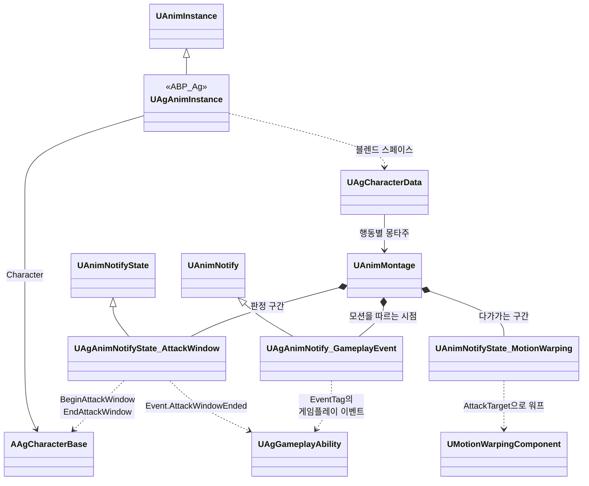

# 애니메이션과 이동

애니메이션과 이동을 어떻게 구현할지 정합니다.

## 기술 결정

| 항목 | 결정 | 이유 |
| - | - | - |
| ABP | `ABP_Ag` 하나를 플레이어와 보스가 같이 씁니다. 값은 C++ `UAgAnimInstance`에서 계산하고, 애님 그래프에는 이동 블렌드 스페이스 → 가드 이동 블렌드 스페이스 전환 → 공중 여부 전환 → 몽타주 슬롯 → 덧입힘 슬롯만 둡니다. 두 전환의 블렌드 시간은 노드 핀에 적고, 공중 전환은 노드의 엔진 기본값(0.1초)을 그대로 씁니다. 루트 모션은 몽타주에서만 씁니다. | AI가 BP 그래프를 다루기 어려우므로 그래프를 최소로 둡니다. 블렌드 시간은 노드의 설정이라 노드에서 고칩니다([JSON과 DataAsset](<JSON과 DataAsset.md>)의 '형식'). |
| 블렌드 스페이스 | 플레이어 이동(템플릿 `BS_Idle_Walk_Run`: MM_Idle, Walk·Jog 8방향), 플레이어 가드 이동(Guard, Guard_Walk 8방향), 보스 이동(Idle1, Walk 8방향) 3개를 캐릭터 데이터에 넣어 바꿔 끼웁니다. 가로축은 캐릭터 정면 기준 이동 방향, 세로축은 이동 속도이고, 샘플은 각 모션의 실제 이동 속도에 둡니다. 팩의 이동 모션은 제자리(`_IPC`) 버전을, 템플릿 이동 모션은 루트 모션을 켠 원본(재생할 때 제자리)을 씁니다. | 세 블렌드 스페이스의 축이 같아 ABP 하나로 처리됩니다. 템플릿 블렌드 스페이스는 샘플이 모션의 실제 속도(걷기 3m/s, 뛰기 6m/s)에 있어 그대로 씁니다. |
| 메시 갱신 | 캐릭터 메시는 화면에 보이지 않을 때도 포즈와 본을 갱신합니다. | 공격 판정이 메시의 피직스 바디를 쓰고 무기가 손을 따라가므로, 보이지 않을 때도 위치가 맞아야 합니다. |
| 덧입힘 모션 | 움찔은 플레이어와 보스 모두 사무라이 `Hit14`를, 가드 움찔은 `Guard_Hit1`을 덧입힘 모션으로 만들어 씁니다. 덧입힘 모션은 루트 모션을 끕니다. | 루트 모션이 있는 몽타주는 재생하는 동안 이동 입력과 다른 몽타주의 루트 모션을 대신합니다. |
| 점프 | 점프 시작과 착지는 몽타주로 재생하고, 공중에서는 공중 반복 모션을 재생합니다. 시작 몽타주는 이동 입력과 상관없이 재생하고, 착지 몽타주는 이동 입력이 없을 때만 재생합니다. 이동 중에 착지하면 시작 몽타주를 멈추고, 착지 몽타주가 끝나기 전에 이동하면 착지 몽타주를 멈춥니다. 점프 높이와 공중 제어는 캐릭터 무브먼트의 엔진 기본값이 기획서 값과 같아 그대로 씁니다. | 시작과 착지를 C++에서 몽타주로 재생하므로 애님 그래프에는 공중 여부 전환 하나만 늘어납니다. 템플릿 점프 모션은 루트 모션이 꺼져 있어 재생하는 동안에도 이동 입력이 먹힙니다. 템플릿 ABP도 시작 모션을 이동 여부와 상관없이 재생합니다. 착지 모션은 제자리 모션이라 움직이면서 재생하면 미끄러져 보입니다. |
| 점프 공격 | 점프 어빌리티는 공중에 있는 동안 '행동 중'과 함께 '점프 중' 태그(`State.Jumping`)를 갖습니다. 점프 공격 어빌리티는 '행동 중' 대신 '점프 중'을 시작 조건으로 삼고, 캐릭터가 실제로 떨어지는 중일 때만 시작하며, 시작하면 다른 행동처럼 점프를 취소합니다. 공격 진행은 공격 태스크([전투 규칙](<전투 규칙.md>) '공격 진행')를 그대로 씁니다. 몽타주(`AM_Player_JumpAttack`)는 섹션 Start(내려베기) → Fall(떨어지는 자세, 반복) → Land(착지)이고, 판정 구간 노티파이 하나가 Start의 베기부터 Land의 바닥 찍기까지 걸칩니다. 내려베기가 끝날 때의 노티파이(`Event.JumpAttackPlunge`)에서 LaunchCharacter로 수직 속도만 내리꽂는 속도로 바꾸고, 착지하면(이동 모드가 걷기로 바뀜) Land 섹션으로 넘깁니다. 후딜은 Land 섹션 시작에서 데이터의 시간만큼 지난 재생 위치에서 시작합니다. | 점프 어빌리티가 공중 동안 '행동 중'을 들고 있어 다른 행동은 그대로 막히고, 점프 공격만 태그 하나로 예외가 됩니다. 점프한 프레임에는 아직 걷는 중이라, 그때 점프를 취소하면 점프 입력이 지워져 뛰지 않습니다. 판정 구간을 하나로 두어 칼이 보스를 지나는 어느 순간이든 한 번만 맞습니다. 수직 속도만 바꾸므로 수평 이동은 점프할 때의 이동이 이어지고, 그 뒤 낙하와 착지는 엔진 중력과 캐릭터 무브먼트가 정합니다. |
| 달리기 | 회피 후딜 동안 플레이어 캐릭터가 매 프레임 Shift와 이동 입력이 있고 가드 키를 누르지 않았는지 보고, 그러면 달리기 어빌리티를 시작합니다. 달리기는 다른 행동처럼 회피를 취소하고, 회피 몽타주는 블렌드 아웃으로 달리기 모션에 섞입니다. '달리는 중' 태그가 속도와 방향(락온 중에도 이동 방향)을 바꾸고, SP 소모는 이 태그가 있을 때만 도는 주기 GameplayEffect가 맡습니다. Shift를 떼거나 이동 입력이 없거나 SP가 0이 되면 플레이어 캐릭터가 달리기를 취소합니다. 다른 행동은 달리기를 취소하지만 점프는 취소하지 않습니다. 달리기는 이동이라 어빌리티 태그를 행동 태그(`Ability.Action`) 밖에 둡니다. | 리젠과 같은 방식(태그 조건의 주기 GameplayEffect)이라 자원 변화가 모두 GameplayEffect로 모입니다. 행동 태그 밖에 두면 행동 태그로 정한 규칙(행동끼리의 취소, 회피 반격 기회)에서 달리기를 따로 빼지 않아도 됩니다. 회피 모션이 끝날 때 시작하면, 몽타주가 블렌드 아웃을 시작하는 순간 루트 모션이 끊기고 이동 입력은 모션이 끝날 때까지 막혀 있어 0.25초 멈춰 섰다가 속도 0에서 출발합니다. |
| 몽타주 | 행동마다 하나를 둡니다. 이어지는 모션은 조사 문서의 연결 시점에서 잘라 한 몽타주에 붙입니다. 평타는 타마다 따로 둡니다. 대기 자세에서 바로 시작하지 않는 모션(휩쓸기, 검기 발사, 회피 반격)은 블렌드로 잇습니다. 넉백은 쓰러짐과 기상이 한 모션(Hit_knockdown)에 들어 있어 몽타주 하나입니다. 넉업은 상승 자세, 낙하 자세와 착지, 기상의 세 몽타주로 잇습니다('넉업' 행). 블렌드로 잇는 몽타주는 끝까지 재생한 뒤 다음 몽타주로 넘어가도록 블렌드 아웃을 모션 끝에서 시작합니다. 가드 시작 모션(Guard_Start)은 따로 재생하지 않고 ABP의 가드 전환 블렌드로 대신합니다. | 평타는 타마다 별도 행동입니다. 넉업의 착지와 기상은 누운 자세가 조금 어긋납니다. 가드 시작 모션은 아주 짧아(0.12초) 자세가 갑자기 바뀌어 보이므로, 그보다 긴 블렌드로 부드럽게 바꿉니다. |
| 모션을 따르는 구간 | 판정 구간(몇 번째 타인지 포함), 처형 타격(베기 2번, 마지막 일격), 넉백·넉업 무적 시작, 돌진 찌르기의 돌진 시작·자세 유지, 검기 발사의 발사 시점은 몽타주 노티파이로 표시합니다. 판정 구간 외의 시점은 게임플레이 이벤트를 보내는 노티파이 하나로 표시하고, 이벤트 태그로 구분합니다. 연속 공격의 후딜 시작은 마지막 판정 구간의 끝으로 정합니다. | 시점마다 노티파이 클래스를 만들지 않고, 어빌리티가 이벤트를 기다립니다. |
| 기획서에 초로 적힌 구간 | 회피 무적·극한 회피 구간·후딜 시작, 회전 정지 같은 수치는 캐릭터 데이터에 두고, 코드가 몽타주 재생 위치로 판정합니다. 회전 정지는 판정 구간 노티파이 위치에서 거꾸로 계산합니다(도약 내려찍기는 '도약 내려찍기', 검기 발사는 [보스](<보스.md>) '검기 발사 회전 정지'). 가드 불가 예고와 패리 예고는 연출이라 몽타주 노티파이로 둡니다([전투 규칙](<전투 규칙.md>) '연출'). 패리 구간, 회피 반격 기회, 쿨다운, 그로기 지속 시간처럼 히트스톱 중에도 흐르는 시간은 타이머로 셉니다. | 히트스톱으로 몽타주가 멈추면 구간도 함께 멈추고, 보스의 재생 속도 배율도 자동으로 반영됩니다. |
| 공격 중 이동 | 전투 시스템 '공격 중 이동'은 공격 중 이동 태스크(`UAgAbilityTask_AttackMovement`) 하나가 플레이어와 보스 모두를 처리합니다. 공격 태스크([전투 규칙](<전투 규칙.md>) '공격 진행')와 검기 발사 어빌리티는 공격 몽타주를 재생한 뒤 이 태스크를 시작하고, 처형 어빌리티는 간격 맞춤으로 시작합니다. 태스크는 타를 시작할 때마다(첫 타, 앞 판정 구간이 끝날 때) 캐릭터가 정하는 대상(플레이어는 가장 가까운 적([전투 규칙](<전투 규칙.md>) '대상 찾기'), 보스는 AI 대상)에 정지 간격을 걸고, 대상이 그 타의 타겟팅 범위 안(보스는 범위 없음)이면 캐릭터의 회전 대상으로 정하고 매 프레임 워프 목표(`AttackTarget`)를 대상 쪽으로 정지 간격만큼 앞 지점(이미 더 가까우면 제자리, 처형은 그 간격까지 물러남)에 둡니다. 캐릭터가 바라보는 방향이 고정되는 순간(판정 구간과 그 앞의 회전 정지 구간) 목표도 고정하고, 마지막 타의 판정 구간이 끝나면 회전 대상을 지웁니다. 언제 다가갈지는 몽타주의 Motion Warping 구간이 정합니다. 구간은 다가가는 동안(플레이어 공격은 각 타의 선딜, 보스는 2연격·3연격 1타의 선딜과 뛰어 내려찍기의 뛰어오른 순간부터 판정 구간 시작까지, 처형은 첫 베기까지)에 둡니다. 방향 워프는 처형과 회피 반격 몽타주만 켜고, 그 밖의 공격의 방향은 '캐릭터 회전'이 정합니다. 회피 반격은 캐릭터 회전과 방향 워프가 함께 대상 쪽으로 돌고, 워핑 구간이 끝날 때(판정 구간 시작) 대상을 바라봅니다. 다가가는 거리의 상한은 타를 시작한 위치에서, 다음 판정 구간 시작까지 몽타주 자체의 루트 모션 전진에 그 공격의 최대 접근 거리를 더한 만큼이고, 처형은 없습니다. 선딜 중 대상이 범위를 벗어나면 그 타의 추적을 멈추고 회전 대상과 워프 목표를 지웁니다. 범위 안에 대상이 없는 타는 캐릭터가 정하는 대체 대상(`GetFallbackFacingTarget`, 플레이어는 락온 대상, 보스는 없음)을 회전 대상으로 정합니다(플레이어 사양 '공격 방향'). | 다가가는지와 그 구간이 몽타주 한 곳에서 보이므로, 코드와 JSON에 다가가는 공격인지를 따로 두지 않습니다. 새 공격은 몽타주에 워핑 구간을 두고 JSON에 최대 접근 거리를 적으면 같은 규칙을 따릅니다. 워프 목표, 정지 간격, 회전 대상은 태스크가 들고 있어, 행동이 어떻게 끝나도 남지 않습니다. 방향 워프는 회전 속도가 몽타주 재생 속도에 비례하고 몽타주 밖에서는 돌지 않아 공격의 회전에 쓰지 않으며, 두 모션을 맞물려야 하는 처형과, 선딜(0.15초)이 짧아 회전 속도로는 다 돌지 못하는 회피 반격만 방향까지 워프합니다. |
| 처형 | 처형 피격·처형 사망 몽타주는 처형 몽타주의 첫 베기 시각만큼 첫 프레임에 머문 뒤 모션을 시작하고, 그로기 모션에서 이 시간 동안 블렌드해 들어갑니다. 보스와 플레이어의 몽타주는 처형을 시작한 프레임에 함께 시작합니다. 플레이어는 첫 베기까지 Motion Warping으로 보스 정면, 두 모션이 맞물리는 간격에 붙습니다. 머무는 시간과 간격은 두 모션의 원래 배치를 모션 데이터에서 재어 정합니다(Samurai 애니메이션 조사 '처형'). 처형 피격 중에는 충돌 무시 태스크(`UAgAbilityTask_IgnoreCollision`)로 보스 캡슐이 Pawn 채널을 무시해 플레이어를 막지 않습니다. | 처형 피격 모션은 첫 베기를 맞는 순간부터 시작하도록 만들어져 있습니다. 두 몽타주가 같은 프레임에 시작해 재생 위치가 늘 같으므로, 프레임 단위로 맞물립니다. 순간이동하지 않습니다. 두 모션은 캡슐 반지름보다 가깝게 붙습니다. |
| 정지 간격 | 공격 중 이동 태스크가 도는 동안, 대상과의 간격이 정지 간격(전투 시스템 '공격 중 이동')이 되면 루트 모션의 전진량을 C++에서 잘라냅니다. 처형은 자르지 않습니다. | |
| 돌진 찌르기 | 일정 속도의 루트 모션 소스로 움직입니다. 몽타주는 자세 유지 구간에서 멈춰 두고, 돌진하는 동안 충돌 무시 태스크로 Pawn 채널을 무시해 플레이어를 뚫고 지나갑니다. 돌진을 시작한 뒤로는 루트 모션 무시 태스크(`UAgAbilityTask_IgnoreRootMotion`)로 몽타주의 루트 모션을 무시하고, 벽에 막혔는지는 돌진 방향으로 실제 나아간 거리로 판단합니다(비스듬히 부딪혀 벽을 따라 미끄러져도 막힘). 가드·가드 브레이크·패리로 막히면 피격 처리가 공격자에게 막힘 이벤트를 보내고, 돌진은 그 이벤트를 받으면 끝납니다. 막힘 이벤트는 돌진을 시작할 때부터 기다립니다. | 모션 자체의 이동만으로는 돌진 거리에 못 미칩니다. 몽타주가 루트 모션을 주는 동안에는 캐릭터 무브먼트가 루트 모션 소스를 쓰지 않고, 돌진 뒤 창을 거두는 동안 더 나아가지도 않아야 합니다. 검기를 막아도 보스에게 막힘 이벤트가 가므로, 패턴을 시작할 때부터 기다리면 돌진 전에 검기가 막힌 이벤트로 대기가 끝나 돌진이 가드·패리에 멈추지 않습니다. |
| 도약 내려찍기 | 체공 시간으로 초기 속도를 계산해 LaunchCharacter로 띄우고, 엔진 기본 중력으로 포물선을 그립니다. 최고점에서 한 번, 남은 체공 시간 안에 착지 목표(그때의 플레이어 위치 기준)에 닿는 수평 속도를 LaunchCharacter로 다시 주고 수직 속도는 그대로 둡니다. 착지하는 순간 End 구간을 재생하고, 착지 지점 반경 안에서 낙하 중이 아닌 대상만 판정합니다(점프로 피함). 공중에서도 플레이어를 향해 회전하고, 착지 시각(체공 시간)보다 회전 정지 시간만큼 앞서 회전을 멈춥니다. 공중의 시각은 시간이 아니라 보스의 수직 속도로 정합니다. 떠오른 뒤 엔진 태스크 `UAbilityTask_WaitVelocityChange`로, 최고점은 내려가기 시작할 때를, 회전 정지는 남은 체공 시간이 회전 정지 시간이 되는 하강 속도(중력 × (체공 시간 / 2 − 회전 정지 시간))를 넘을 때를 기다리고, 최고점의 남은 체공 시간도 체공 시간 / 2 + 수직 속도 / 중력으로 계산합니다. 가드 불가 예고는 몽타주 노티파이가 켭니다([전투 규칙](<전투 규칙.md>) '연출'). 공중에서 PP가 0이 되면 패턴을 취소하고, 그로기 어빌리티가 착지를 기다렸다가 그로기 모션과 시간을 시작합니다. 착지 전에는 처형할 수 없습니다. | 수평 속도만 다시 주므로 체공 시간과 최고 높이는 처음 정한 대로입니다. 히트스톱은 보스의 이동만 멈추므로, 월드 타이머로 재면 공중에서 맞았을 때 최고점과 회전 정지가 실제보다 일찍 옵니다(전투 시스템 '히트스톱 중의 시간'). 보스의 속도는 비행과 함께 멈추므로 착지와 어긋나지 않고, 따로 시계를 두지 않아도 됩니다. |
| 넉업 | 루트 모션 점프 어빌리티 태스크(`AbilityTask_ApplyRootMotionJumpForce`)로 체공 시간 동안 최고 높이까지 포물선을 그리며 수직으로 띄웠다가 내리고, 착지하면 태스크가 끝납니다. 넉업 동안은 돌진 찌르기의 돌진과 같은 루트 모션 무시 태스크로 애님 인스턴스의 루트 모션을 무시해, 몽타주의 루트 이동(착지 모션의 뒤로 2.1m)을 쓰지 않습니다. 상승 자세 몽타주(`AM_Player_KnockUp`)를 재생하다가, 수직 속도가 경로의 감속(8 × 최고 높이 ÷ 체공 시간²) × 낙하 몽타주(`AM_Player_KnockUpFall`)의 블렌드 인 시간 ÷ 2까지 줄면 낙하 몽타주로 바꿔, 정점에서 두 자세가 반씩 섞이게 합니다. 착지하면 낙하 몽타주의 Land 구간으로 넘어가고, 끝나면 기상 몽타주(`AM_Player_GetUp`)를 재생합니다. 무적은 넉백과 같은 게임플레이 이벤트(Land 구간에서 바닥에 닿는 순간)로 시작하며, 피격 반응 모션 태스크(`UAgAbilityTask_PlayReaction`)가 처리합니다. 세 시퀀스(Hit_Air_Up, Hit_Air_Down, Hit_knockdown2) 모두 루트 모션을 켭니다. | 중력을 바꾸지 않고 정한 궤적을 그대로 따릅니다. 점프 태스크는 다음 이동 갱신 때부터 속도를 정하므로, 시작할 때 경로의 첫 속도로 낙하 상태를 만들어 낙하 확인이 맞기 전의 속도를 보지 않게 합니다. 몽타주가 루트 모션을 주는 동안에는 캐릭터 무브먼트가 루트 모션 소스를 쓰지 않으므로 루트 모션을 무시합니다. 낙하 자세와 착지 모션의 첫 자세가 같아 Land 구간으로 넘어가는 것이 보이지 않습니다. 정점 자세(Hit_Air)는 두 자세를 섞은 모습과 거의 같아 쓰지 않습니다. |
| 캐릭터 회전 | 전투 시스템 '공격 중 이동'의 회전과 보스 사양 '회전'은 `AAgCharacterBase`가 매 틱 회전 대상 쪽으로 캐릭터 무브먼트의 회전 속도(`RotationRate`의 Yaw, 엔진 기본값)만큼 돌리고, 바라보는 방향이 고정된 동안(판정 구간과 그 앞의 회전 정지 구간, 보스는 회전하지 않는 상태도)에는 멈춥니다. 회전 대상은 플레이어는 공격 중 이동 태스크가 정하고, 보스는 늘 AI 대상입니다. | 공격 몽타주는 루트 모션이라 캐릭터 무브먼트가 캐릭터를 돌리지 않으므로 C++에서 돌립니다. 속도는 캐릭터 무브먼트의 값을 써서 이동할 때와 같습니다. |
| 이동 속도 | MOV 어트리뷰트를 캐릭터 무브먼트의 최대 속도에 반영합니다. | |
| 캐릭터 설정 | 기획서에 없는 캐릭터 설정(캡슐, 가속, 점프, 공중 제어)은 엔진 기본값을 씁니다. | 플레이 전에 임의의 수치를 늘리지 않습니다. |
| 무기 | `SK_Mannequin`의 `hand_r`에 카타나·할버드 소켓을 만듭니다. 소켓 값은 Samurai·할버드 조사 문서를 따릅니다. 무기는 캐릭터 블루프린트에 더한 메시 컴포넌트(`Weapon`)로 두고, 메시와 Parent Socket을 블루프린트에서 정합니다. 무기 판정 캡슐(`WeaponCollision`)은 그 자식이며 날 전체를 여유 있게 덮습니다. 코드는 두 컴포넌트를 컴포넌트 태그(`Weapon`, `WeaponCollision`)로 찾습니다. | 팩에 소켓이 없고, 메시에는 `weapon_r` 본이 없습니다. C++에서 만든 컴포넌트는 블루프린트에서 Parent Socket을 바꿀 수 없어 블루프린트 컴포넌트로 둡니다. 무기, 소켓, 날을 블루프린트 뷰포트 한 곳에서 보며 맞춥니다. |

## 클래스 구조

### 애니메이션

`ABP_Ag`의 부모와 몽타주에 넣는 노티파이입니다.

| 클래스 | 부모 | 역할 |
| - | - | - |
| `UAgAnimInstance` | `UAnimInstance` | `ABP_Ag`의 값 계산(속도, 방향, 가드 여부, 공중 여부) |
| `UAgAnimNotifyState_AttackWindow` | `UAnimNotifyState` | 판정 구간. 몇 번째 타인지 지정합니다. |
| `UAgAnimNotify_GameplayEvent` | `UAnimNotify` | 모션을 따르는 시점(처형 타격, 넉백·넉업 무적 시작, 돌진 찌르기의 돌진 시작·자세 유지, 검기 발사의 발사 시점)에 게임플레이 이벤트를 보냅니다. |

