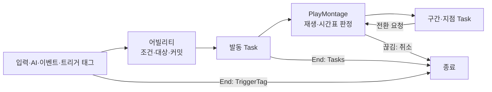

# 어빌리티와 AbilityTask

모든 행동이 어빌리티 클래스 하나(`UAgGameplayAbility`)와 범용 기능 Task로 실행되는 구조의 규칙입니다. 몽타주 안의 구간과 지점은 [몽타주 시간표](<몽타주 시간표.md>)를, 행동 정의의 JSON 형식은 [JSON 데이터](<JSON 데이터.md>) '행동'을 따릅니다.

## 결정과 목표

**`UAgGameplayAbility`는 엔진 어빌리티 기능과 발동 Task를 시작하고 끝내는 일만 맡고, 몽타주 재생과 시간표 판정은 범용 Task PlayMontage가 맡습니다. Task는 여러 행동이 함께 쓰는 범용 기능만 둡니다. Task 사이에는 순서가 없고, 서로의 결과에 기대지 않습니다. 행동 고유의 규칙은 효과 데이터(`Effects.json`)와 그 규칙의 주인 객체에 둡니다.**

| 둔 곳 | 담는 것 |
| - | - |
| 어빌리티(`UAgGameplayAbility`) | 엔진 어빌리티 기능(태그 조건, 트리거, 비용·쿨다운, 재발동, 취소), 대상 선정, 발동 Task 시작, 정한 방식의 종료 |
| 재생 Task(PlayMontage) | 몽타주 재생과 Transition이 요청한 전환, 시간표의 시각에 맞춘 구간·지점 Task 시작·종료 |
| Task | 범용 기능 하나와 그 Params의 스키마, 도는 동안의 처리와 끝날 때의 정리. 다른 Task의 결과나 실행 순서에 기대지 않습니다. |
| 행동 정의(`Abilities.json`) | 발동 조건과 트리거, 대상 선정, 종료 방식, 발동 동안 실행하는 Task(몽타주 재생 포함) |
| 몽타주 시간표(`MontageTimelines.json`) | 섹션 안의 시각에 실행하는 Task(구간·지점) |
| 효과 데이터(`Effects.json`) | 계속 흐르는 시간(패리 구간, 회피 반격 기회, 그로기 시간), 보상(패리, 극한 회피), 지속 소모(달리기)의 값. 모션을 따르는 시간은 시간표에 둡니다(아래 '시간 기준'). |
| 주인 객체 | 행동이 아닌 규칙(아래 '주인 객체의 규칙'): 입력 계층, 캐릭터, 보스 캐릭터, 피격 처리, 보스 AI, HUD |

- 행동 하나는 `Abilities.json`의 항목과 그 몽타주의 시간표만 읽으면 파악됩니다.
- 있는 Task를 조합한 새 행동·패턴은 JSON과 몽타주만으로 더합니다. 새로운 종류의 기능만 Task 파일 하나(Task와 그 Params)로 더하고 어빌리티는 고치지 않습니다.
- Task는 한 가지 일만 하고 다른 Task를 모릅니다. 어빌리티와 재생 Task는 Task 종류, 행동 ID, 몽타주 ID로 분기하지 않습니다. 행동 전체를 맡는 흐름 Task와 자식 Ability는 만들지 않습니다.
- 몽타주도 Task 하나(PlayMontage)로 재생합니다. 어떤 몽타주든 재생해 그 시간표를 판정할 뿐 행동의 흐름을 코드로 갖지 않으므로 흐름 Task가 아니고(엔진 `PlayMontageAndWait`과 같은 자리), 흐름은 시간표의 Transition에 있습니다. 재생과 판정을 한 Task에 두어 재생 바뀜과 섹션 이동이 그 안에서 일어나므로, 어빌리티는 몽타주·섹션·시간표를 모릅니다. 엔진 `PlayMontageAndWait`을 상속하지 않는 것은, 엔진 Task에 블렌드 인 시간을 정하는 길이 없고 섹션 이동과 다시 재생을 한 Task로 이어 갈 수 없기 때문입니다.
- 섹션을 바꾸는 Task는 Transition 하나입니다. 다른 Task가 끝나기를 기다려 넘어갈 때는, 그 Task가 도는 동안 붙이는 상태 태그(Dash의 `State.Dashing`, PlayCutscene의 `State.Cutscene`)가 사라질 때 Transition이 넘어갑니다. 갈 섹션을 몽타주의 섹션 순서로 정하지 않고 Transition에 적는 것은, 흐름이 JSON에 보이고 갈래(넉업 Rise에서 Fall이나 Land)와 되돌아감(평타 5타에서 1타)도 적을 수 있기 때문입니다.
- 어빌리티(발동 Task)와 재생 Task(구간·지점 Task)가 정하는 것은 Task가 언제 시작하고 끝나는지뿐입니다. 같은 때에 시작하는 Task(PlayMontage를 포함한 발동 Task끼리, 같은 시각의 구간·지점) 사이의 순서와, Task끼리 함께 둘 수 있는지는 정하지 않습니다. 그래서 같은 때에 시작한 Task는 어떤 순서로 돌아도 결과가 같아야 하고, 주인의 상태를 함께 쓸 때의 처리는 각 Task와 엔진 규칙이 맡습니다(태그는 개수로 세고, 효과는 적용마다 따로이며, 루트 모션 소스는 우선순위가 높은 하나가 움직임). 여러 Task의 결과가 한 주인 상태에 모일 때 같은 프레임의 처리 순서에 따라 결과가 달라지면 그 상태의 주인이 합칩니다(게임 전체 시간 배율: [전투 규칙](<전투 규칙.md>) '시간 정지').
- 회전처럼 엔진이 합치지 않는 주인 상태를 여러 Task가 같은 때에 쓰면 결과가 그 프레임의 실행 순서에 따라 달라집니다. 회전을 직접 쓰는 Task(즉시 회전 또는 몽타주 루트 모션이 없을 때의 RootMotion, Dash의 유도)는 같은 때에 겹치지 않게 두며, 어빌리티와 재생 Task는 이를 검사하지 않습니다. 회전을 루트 모션 소스로 돌리지 않는 것은, 엔진이 우선순위가 가장 높은 Override 소스 하나의 회전만 그 속도와 함께 적용해 Launch·Dash의 이동과 부딪히기 때문입니다.
- 한 행동만 쓰는 규칙은 Task로 만들지 않습니다. 값은 효과 데이터에, 규칙은 그 규칙의 주인 객체에 둡니다. 새 Task는 둘 이상의 행동이 쓰거나 쓸 수 있는 기능일 때만 더합니다.
- 애니메이션이 만든 이동은 몽타주 루트 모션과 Motion Warping이, 그 밖의 이동(띄우기, 도약, 돌진, 내리꽂기)은 엔진 루트 모션 소스(Launch, Dash, Plunge)가 맡습니다. 캐릭터 무브먼트는 몽타주가 루트 모션을 주면 루트 모션 소스를 쓰지 않으므로, 소스로 움직이는 동안은 몽타주 루트 모션을 끄고, 그동안의 RootMotion은 캐릭터를 직접 돌립니다. 몽타주의 이동 보정과 행동 중 회전은 RootMotion, 몽타주 밖의 이동은 Launch, Dash, Plunge입니다. Launch와 Dash·Plunge는 서로 다른 엔진 루트 모션 Task(점프, 일정 힘)를 쓰므로 합치지 않습니다.
- 행동 정의와 시간표의 항목은 네 가지입니다. 행동 내내 붙는 값 없는 상태는 태그(Activation의 OwnedTags)로, 그 밖에 주인에게 주는 상태는 효과(ApplyEffect)로, 다른 액터·시스템에 알릴 것은 이벤트(SendGameplayEvent)로 적고 받는 주인이 처리합니다. 값·대상·어빌리티 문맥이 필요하거나 결과를 돌려주는 것만 기능 Task입니다. 값 없는 상태도 엔진처럼 효과가 주는 태그(GrantedTags)로 두어, 데이터가 주인에게 상태를 주는 방법은 효과 하나입니다.
- 필드로 두 가지 일 중 하나를 고르는 Task는 만들지 않습니다. 무기 판정(WeaponHit, 물리 스윕)과 범위 판정(AreaHit, Targeting System), 투사체(SpawnProjectile), 셰이크(CameraShake, 로컬 플레이어와의 거리와 두 값)와 이벤트(SendGameplayEvent)는 각각 다른 엔진 기능이라 나눠 둡니다. 같은 엔진 기능이라도 쓰는 Params와 끝나는 때가 서로 겹치지 않으면 나눕니다. 대상까지 돌진하다 막히면 서는 Dash와 구간 끝까지 떨어지는 Plunge가 그렇습니다. 한 Task에 두면 필드마다 쓰는 쪽이 갈리고 시작과 틱이 그 필드로 분기합니다.

## 어빌리티

### 맡는 일

| 일 | 내용 |
| - | - |
| 정의 연결 | ID별 스펙을 만들고 `OnGiveAbility`에서 태그 조건을 초기화합니다. `Activation.Triggers`는 스펙의 `DynamicAbilityTriggers`에 넣습니다. |
| 발동 검사 | 엔진 태그 검사, 비용, 재발동 허용, Targeting의 필수 대상. CanActivateAbility가 모두 검사하고, 커밋 직전에는 필수 대상을 다시 찾으며 엔진 커밋이 쿨다운과 비용을 다시 확인합니다. |
| 대상 | 아래 '대상' |
| 발동 Task | 커밋한 뒤 행동 정의의 `Tasks`를 시작합니다. 같은 때에 시작하는 Task 사이의 순서는 정하지 않습니다. |
| 종료 | `End`가 정한 때 끝냅니다. 남은 Task는 엔진이 끝냅니다. |

`UAgGameplayAbility`는 InstancedPerActor·LocalOnly입니다. Task는 엔진 `UAbilityTask`를 상속하고 엔진의 Task 수명(소유 어빌리티가 끝나면 함께 끝남)을 그대로 씁니다.

### 어빌리티와 Task 사이

어빌리티가 Task에 여는 것은 아래뿐입니다. 다른 Task와 몽타주 ID는 열지 않고, 행동 ID는 로그에만 엽니다. Task 하나만 쓰는 값은 어빌리티에 두지 않고 Task가 엔진에서 읽습니다.

| 이름 | 뜻 |
| - | - |
| 행동 대상 | 아래 '대상'의 결과. 없을 수 있고, 다시 재생하면 바뀔 수 있습니다. |
| 간격 | 그 행동의 간격(Targeting의 StopDistance, 없으면 캐릭터의 `StopDistance`). 캐릭터의 최소 간격, 추적 구간, Launch가 씁니다. |
| 대상 다시 정하기 | `RefreshTarget`. 재생 Task가 다시 재생하기 직전에 부릅니다(아래 '대상'). |
| 효과 스펙 | 효과 데이터의 효과로 만든 스펙(`MakeEffectSpec`). 효과 컨텍스트에 이 어빌리티 인스턴스가 들어갑니다. |

캐릭터는 재생 중인 어빌리티(ASC의 애니메이팅 어빌리티)에서 Targeting 대상과 간격을 읽어 최소 간격을 지킵니다. 추적 구간과 Launch도 같은 대상과 간격을 씁니다.

### 종료

| End | 끝나는 때 | 필요한 것 |
| - | - | - |
| Tasks(기본) | 행동의 Task가 모두 끝날 때(정상 종료). 발동 Task를 모두 시작한 뒤부터 봅니다. 몽타주 행동은 PlayMontage가 재생을 마치고 시간표 Task를 끝낸 뒤입니다. | 스스로 끝나는 Task |
| TriggerTag | 트리거 태그가 사라질 때(엔진이 취소) | `OwnedTagPresent` 트리거 하나 |

- `Tasks`는 블루프린트 어빌리티에서 Task의 끝 알림을 EndAbility에 잇는 것을 데이터로 적은 것입니다. 어빌리티는 엔진의 Task 종료 알림(`OnGameplayTaskDeactivated`)에서 엔진이 관리하는 실행 중 Task 목록(`ActiveTasks`)이 비었는지만 봅니다.
- 몽타주가 다른 몽타주에 끊기면 PlayMontage가 행동을 취소합니다(엔진 `CancelAbility`). 블루프린트에서 `PlayMontageAndWait`의 OnInterrupted를 CancelAbility에 잇는 것과 같고, 보스 캐릭터가 이것으로 페이즈 전환의 정상 종료와 취소를 가립니다. 몽타주를 재생하지 못해도 취소합니다.
- 그 밖에 끝나는 길은 엔진의 취소(CancelTags, 트리거 태그, 사망, 스펙 제거)와 발동 중 실패뿐입니다. `Tasks`가 아니면 Task가 끝났다는 이유로 행동이 끝나지 않습니다.
- 가드, 달리기, 점프는 `TriggerTag`입니다. 점프는 Task가 없어 `Tasks`면 시작하자마자 끝나고, 가드와 달리기는 Task(ApplyEffect)가 스스로 끝나지 않지만 트리거 태그로 끝나는 행동임을 정의에 드러냅니다.
- 끝나지 않은 재생은 PlayMontage가 블렌드 아웃으로 멈춥니다. 중복 종료 요청과 남은 Task는 엔진의 `EndAbility`가 처리하며, 각 Task는 자기 태그·효과·루트 모션 소스·워핑·구독·타이머·재생만 되돌립니다.

### 대상

| 출처 | 쓰는 행동 |
| - | - |
| `Targeting`이 있으면 그 결과 중 첫 후보 | 평타, 점프 공격, 회피 반격, 스킬, 처형, 락온, 보스 공격 패턴 |
| 없고 이벤트로 발동했으면 그 이벤트의 Instigator | 피격 반응, 패리, 처형 피격 |
| 그 밖 | 없음 |

| Targeting 필드 | 뜻 |
| - | - |
| Preset | `TargetingPresets.json`의 프리셋 ID. 후보를 모으고 거르고 정렬하는 절차입니다. |
| Range | 후보 수집에 쓰는 캡슐 중심 사이 수평 거리(cm) 상한. 기본 0이며, 0 이하이면 검색 결과가 없습니다. |
| TargetRequiredTags, TargetBlockedTags | 대상이 가져야 할 태그와 가지면 안 되는 태그(Activation의 태그 조건은 주인의 태그) |
| bRequired | 대상이 없으면 발동하지 않습니다. |
| StopDistance | 선택. 대상과 맞출 간격(cm)이고, 생략하면 캐릭터의 `StopDistance`입니다. 추적 구간은 대상 앞 이 간격까지 다가가고, Launch의 To Target은 이 간격만큼 떨어져 내립니다. 행동 내내 몽타주 이동은 이 간격 안으로 들어가지 않습니다(최소 간격, 캐릭터가 자름). |

- 범위와 태그 조건은 행동 JSON의 값을 타겟팅 요청 핸들의 데이터(`FAgTargetingConditions`)로 실어 보냅니다. 후보 수집 Task(`UAgTargetingSelectionTask_Range`)가 월드의 `AAgCharacterBase`를 순회해 주인을 제외하고 요청의 Range 이내인 캐릭터만 모읍니다. 엔진 AOE Task는 요청별 반경을 받는 확장 지점이 없고 구체 판정에는 높이 차이도 섞이므로, Targeting Task의 Execute 확장 지점에서 수평 거리로 직접 모읍니다. 프리셋에는 별도의 Radius나 거리 필터를 두지 않습니다. 적대 필터(`UAgTargetingFilterTask_Hostile`)는 엔진 팀 태도가 적대인 대상만, 태그 조건 필터(`UAgTargetingFilterTask_TagRequirements`)는 프리셋에 적은 태그 조건과 행동의 대상 태그를 모두 만족하는 대상만 남깁니다. 정렬은 엔진의 거리 정렬(`UTargetingFilterTask_SortByDistance`)입니다. 요청은 즉시 실행하고 결과를 읽은 뒤 놓습니다(`AgTargeting::FindTargets`, 행동 대상은 그 첫 대상인 `FindTarget`). AreaHit의 `Area`도 같은 네 필드(Preset, Range, TargetRequiredTags, TargetBlockedTags, `FAgTargetingRequest`)로 같은 요청을 만들고 결과를 모두 칩니다.
- 프리셋은 `Enemy`(살아 있는 적: 요청의 Range 안의 캐릭터를 모아 적대·태그 조건 필터로 거르고 거리로 정렬. 사망은 태그 조건 필터가 `State.Dead`로 거름), `LockOn`(Enemy에 화면 안 조건 `UAgTargetingFilterTask_OnScreen`)입니다. 플레이어 락온만 `LockOn`을 쓰고, 그 밖의 플레이어 행동, 보스 공격 패턴, 적 락온은 `Enemy`를 씁니다.
- CanActivateAbility에서 읽기 전용으로, 커밋 직전에 한 번 더 평가합니다. 재생 Task가 다시 재생할 때 다시 평가합니다(`RefreshTarget`, 평타의 타마다 대상). 이벤트 Instigator는 바뀌지 않습니다.
- 추적 구간은 그 재생의 대상을 씁니다. 보스의 대상은 타겟팅 범위 안의 플레이어이고 플레이어 공격은 재생마다 추적 구간이 하나입니다.
- 처형 안내 HUD는 처형 스펙의 Targeting을 읽기 전용으로 평가하고, 락온 대상은 실행 중인 락온 행동의 대상입니다(아래 '락온').

## 몽타주 재생

### PlayMontage

| 일 | 내용 |
| - | - |
| 재생 | 시작할 때 주인이 RequiredTags를 모두 갖고 BlockedTags를 하나도 갖지 않으면 캐릭터 `Montages`의 몽타주를 Section(없으면 처음)부터 재생하고, 아니면 바로 끝납니다. 재생은 ASC의 `PlayMontageWithBlendIn`에 어빌리티를 넘겨 해서, 캐릭터와 Task가 애니메이팅 어빌리티로 재생 중인 행동을 찾습니다. |
| 시간표 판정 | 재생 위치로 시간표를 판정해 구간·지점 Task를 시작하고, 구간이 끝나거나(End, 섹션 이동) 재생이 바뀌면 구간 Task를 끝냅니다([몽타주 시간표](<몽타주 시간표.md>) '판정 규칙'). |
| 전환 | Transition이 요청하는 섹션과 BlendTime(선택). BlendTime이 없으면 같은 재생 안에서 그 섹션으로 옮기고(블렌드 없음), 있으면 어빌리티에 대상을 다시 정하게 한 뒤 그 섹션부터 다시 재생합니다(새 재생, 그 시간의 블렌드 인). 재생이 끝난 뒤에 온 요청은 쓰이지 않습니다. |
| 끝 | 재생이 끝나면 시작한 구간·지점 Task를 모두 끝내고 끝납니다. 다른 몽타주에 끊기면 행동을 취소합니다(위 '종료'). 행동이 끝나 엔진이 끝내면 재생을 블렌드 아웃으로 멈춥니다. |

PlayMontage가 시간표 Task에 여는 것은 아래뿐입니다.

| 이름 | 뜻 |
| - | - |
| 시각 | Task를 만들 때 넘기는 시간표 항목의 시각(구간이면 Start·End, 지점이면 그 시각). RootMotion이 워핑 구간으로 씁니다. 그 재생의 몽타주, 재생 위치, 섹션 길이는 Task가 행동의 지금 몽타주(`GetCurrentMontage`)에서 읽습니다. |
| 재생 | Task 문맥의 `Playback`. Transition이 이 재생에 전환을 요청합니다. 발동 Task에는 없습니다. |

- 구간 Task를 끝내는 일은 그 Task에 맡기지 않고 재생 Task가 합니다. 다시 재생할 때는 재생 Task가 이전 재생의 구간 Task를 끝내야 하므로, End에서 끝내는 일까지 Task에 맡기면 끝내는 곳이 둘이 되고 구간에 놓이는 Task마다 재생 위치를 End와 비교하는 같은 코드가 들어갑니다(Dash는 엔진 Task를 상속해 공통 부모로 묶을 수도 없습니다).
- Task는 재생 ID와 자기가 둔 곳을 받지 않습니다. 기다리는 Transition(Event·Tag)은 구간에 두고, 구간 Task는 구간이 끝나거나 재생이 바뀌면 재생 Task가 끝내므로, 들어오는 전환 요청과 Task가 읽는 지금 몽타주는 늘 그 Task의 재생입니다. 재생 ID는 재생 Task 안에서 지금 재생의 몽타주 콜백만 받는 데 씁니다(다시 재생하면 이전 재생의 끝 알림이 나중에 옵니다).
- 전환 요청은 온 순서대로 적용하고, 어느 요청이 먼저인지는 그 요청을 일으킨 사건(입력, 착지, 태그, 시간)의 순서입니다. 같은 재생 안의 섹션 이동 뒤에는 옮긴 위치에 걸치지 않는 구간의 Task가 끝나므로, 옮긴 위치에서도 유효한 Task의 요청만 남습니다.
- 대상은 발동 Task(LeapSlam의 Launch, 처형의 SendGameplayEvent, 락온의 WaitTargetLost), 캐릭터의 최소 간격, 발동 검사의 필수 대상이 함께 쓰므로 재생 Task가 아니라 어빌리티가 갖습니다.
- PlayMontage는 다른 발동 Task와 같은 때에 시작하고 순서가 없습니다. 재생에 기대는 일은 발동이 아니라 첫 섹션 0초의 지점에 둡니다. 첫 판정은 재생을 시작한 프레임 안, 몽타주가 움직이기 전이라 같은 프레임에 실행됩니다. 지금 함께 시작하는 Launch(넉업, LeapSlam)와 SendGameplayEvent(처형)는 순서에 기대지 않습니다.

### 몽타주와 섹션

재생 옵션은 두지 않습니다. 재생할 때 함께 하던 일은 아래가 맡습니다.

| 일 | 맡는 것 |
| - | - |
| 자동 회전 정지 | 캐릭터. 행동이 실행 중이면(재생 중인 어빌리티가 있음) 자동으로 돌지 않습니다. 자동으로 도는 것은 보스뿐입니다. |
| 공중 이동 | 도약은 Launch, 내리꽂기는 Plunge가 움직이고, 공중 회전은 추적 구간이 캐릭터를 직접 돌립니다. 두 몽타주는 그 섹션의 루트 모션을 끕니다. |
| 최소 간격 | Targeting으로 정한 대상이 있으면 그 행동의 간격으로 늘 지킵니다(처형 포함). |
| 첫 화면부터 몸 돌리기 | 첫 섹션 0초의 RootMotion 지점. 피격 반응·패리·처형 피격은 공격 쪽으로(Target), 회피의 Roll은 이동 입력 방향으로(MoveInput) 돕니다. 첫 판정은 재생을 시작한 프레임 안, 몽타주가 움직이기 전에 하므로 첫 화면과 첫 루트 모션이 돈 뒤의 방향입니다. |
| 시작 섹션 고르기 | PlayMontage의 Section과 조건. 회피는 이동 입력이 있으면 Roll, 없으면 첫 섹션(Backstep)부터 재생합니다. |
| 착지 뒤 시작 | 맨 앞 반복 섹션 Fall의 Transition(공중에서 시작한 그로기) |
| 루트 이동 거리 | RootMotion(Direction) 구간의 Angle·Distance. 보스 Backstep의 '후방으로 5m' |

- 몽타주 루트 모션과 루트 모션 소스(Launch, Dash, Plunge)는 같은 순간에 함께 쓰지 않습니다. 그래서 Dash는 도는 동안 자기 몽타주 재생의 루트 모션을 끄고(엔진 `FAnimMontageInstance::PushDisableRootMotion`), 그 섹션의 추적 구간은 워핑 대신 캐릭터를 직접 돌립니다. 루트 모션이 있는 시퀀스가 하나라도 든 몽타주는 엔진이 몽타주 전체를 루트 모션 몽타주로 다루므로, 시퀀스 설정만으로는 끌 수 없습니다. 끄는 일을 몽타주 노티파이가 아니라 Dash가 맡는 것은, 그 필요가 그 Task의 이동 방식에서 나오고 노티파이로 두면 시간표의 그 시각을 몽타주에 한 번 더 적게 되기 때문입니다. 몽타주 전체가 루트 모션을 쓰지 않는 행동(넉업, 점프 공격, LeapSlam)은 시퀀스의 루트 모션을 끄고 루트 뼈를 고정합니다(Force Root Lock). 이 몽타주는 루트 모션 몽타주가 아니므로, 재생과 함께 시작하는 발동 Task(Launch)도 첫 프레임부터 움직이고, 이런 몽타주에서만 쓰는 Launch와 Plunge는 루트 모션을 끄지 않습니다. Dash가 끝나 다시 재생하는 몽타주(BlendTime 전환)는 새 재생이라 끈 상태를 받지 않고 첫 프레임의 루트 모션을 먼저 뽑으므로, 그 뒤에 쓰는 시퀀스는 루트 모션을 끕니다(DashThrust의 두 번째 시퀀스).
- 재생 배율은 몽타주의 Rate Scale 그대로입니다. 보스 공격 패턴의 재생 속도(보스 사양 '모션 재생 속도')는 패턴 몽타주의 Rate Scale에 둡니다.
- 바로 이어지는 동작은 섹션 링크로 잇습니다. 다른 동작으로 넘어갈 때는 전환에 BlendTime을 적어 그 섹션부터 다시 재생합니다. 같은 재생 안의 섹션 이동에는 블렌드가 없어 자세가 튀기 때문입니다. BlendTime은 섹션으로 합치기 전 각 몽타주의 Blend In 시간입니다. 블렌드 없는 섹션 이동을 남기는 것은 여러 섹션에 걸친 구간을 끊지 않기 위해서입니다. 점프 공격의 판정 구간은 Start에서 Land까지 이어지는데, 다시 재생하면 구간이 새로 열려 같은 대상을 두 번 칠 수 있습니다.
- 시작 섹션을 고르는 행동은 행동 정의의 `Tasks`에 서로 배타적인 조건의 PlayMontage를 둘 둡니다. 회피는 이동 입력(`Input.Move`)이 있으면 Roll부터, 없으면 첫 섹션 Backstep부터 재생합니다. 재생 전에 고르므로 Backstep의 구간은 열리지 않고, 첫 화면과 첫 루트 모션은 Roll입니다. 첫 섹션 0초의 Transition 지점으로 고르지 않는 것은, 같은 시각의 항목 사이에 순서가 없어 Backstep 0초의 구간(Busy, 극한 회피 구간, 무적)이 한 프레임 안에 열렸다 닫힐 수 있기 때문입니다. 두 조건이 함께 맞으면 두 번째 재생이 첫 재생을 끊어 행동이 취소됩니다.
- 그로기는 맨 앞에 낙하 자세의 반복 섹션 Fall을 두고, `State.Airborne`이 사라지면(Transition의 Tag) Start로 전환합니다. 땅에서 발동하면 시작할 때 태그가 없어 바로 넘어갑니다. 착지는 지상 모션의 시작만 정하며, 그로기 효과는 행동 발동 즉시 시작합니다(아래 '그로기 효과와 상태의 수명').
- 기다리는 동안 몽타주가 끝나지 않도록, 반드시 넘어가야 하는 기다림(넉업·LeapSlam·점프 공격의 착지, 그로기, 돌진, 컷신)은 반복 섹션에서 기다리고, 그 Transition은 반복 섹션을 끝까지 덮습니다. 평타의 다음 타처럼 이벤트가 오지 않으면 그대로 끝나는 전환은 따로 표시하지 않습니다.
- 돌진·컷신 뒤로 넘어가는 행동(DashThrust, 궁극기)은 Start 섹션에서 Dash·PlayCutscene을 시작하고, 반복 섹션 Hold의 0초부터 끝까지 Transition(Tag `State.Dashing`, `State.Cutscene`)을 둡니다. 같은 시각에 두지 않는 것은, 같은 시각의 항목 사이에 순서가 없어 태그가 붙기 전에 Transition이 '태그 없음'으로 보고 바로 넘어갈 수 있기 때문입니다.

## Task

### 스키마와 등록

- Task의 Params는 공통 부모 `FAgTaskParams`(USTRUCT)를 상속하고 그 Task의 헤더에 둡니다. Task 이름 `X`의 Params는 `FAgXParams`이며, 읽을 때 JSON의 `Task` 값으로 이 구조체를 찾아 `FInstancedStruct`에 담습니다. 구조체 메타데이터는 에디터 전용이라 이름 규칙으로 찾습니다. 엔진 Task에 더할 동작이 없으면 Task 클래스를 두지 않고, Params의 `MakeTask`가 엔진 Task를 바로 만듭니다(Plunge).
- 선택 필드는 엔진 `TOptional` 속성이라 적었는지로 쓰는지가 정해집니다(null은 적지 않은 것과 같습니다). Params는 Task를 만드는 가상 함수(`MakeTask`) 하나만 갖고, 읽기와 검사는 에셋 매니저가 리플렉션으로 하므로([JSON 데이터](<JSON 데이터.md>) '오류 검사'), 새 Task는 Task 파일 하나로 더합니다.
- 시간표 항목의 시각 필드(`Start`, `End`, `EndSection`, `Time`)는 공통 부모에 있습니다. 시간표는 시각과 Params를 한 JSON 객체에 적기 때문입니다([몽타주 시간표](<몽타주 시간표.md>) '형식'). 발동 Task는 이 필드를 쓰지 않습니다.

### 둘 수 있는 곳

| 둔 곳 | 시작 | 끝 |
| - | - | - |
| 발동 Task(행동 정의 `Tasks`) | 커밋한 뒤 | 행동 종료, 또는 스스로 끝날 때 |
| 구간(시간표 Start·End) | 재생 위치가 Start에 이를 때 | End, 재생 바뀜, 재생 끝, 또는 스스로 끝날 때 |
| 지점(시간표 Time) | 재생 위치가 Time에 이를 때 | 재생 끝, 또는 스스로 끝날 때 |

같은 때에 시작하는 Task(PlayMontage를 포함한 발동 Task끼리, 같은 시각의 구간·지점) 사이에는 순서가 없습니다(위 '결정과 목표'). 구간·지점 Task는 재생 Task가 시작하고 끝냅니다.

둔 곳은 언제 시작하고 끝나는지를 정합니다. Task는 자기가 어디에 놓였는지 모르고, Params와 전달받은 구간 시각으로 동작합니다. 발동·지점은 시작과 종료 시각이 같고, RootMotion은 이 길이가 0이면 즉시 회전하고 끝납니다. 길이가 있는 구간은 기존 회전 방식으로 보정합니다. 그 밖에 서로 다른 동작은 필드로 정합니다(ApplyEffect의 bRemoveOnEnd, Transition의 Event·Tag).

### 시간 기준

Task가 시작하고 끝나는 때는 둔 곳이 정하고, 도는 동안의 시간은 Task가 쓰는 엔진 기능이 정합니다. 히트스톱은 두 캐릭터의 시간 배율(`CustomTimeDilation`)만 낮추고, 슬로우모션과 시간 정지는 게임 전체 배율을 바꿉니다.

| 시간 | 따르는 것 | 히트스톱 중 | 쓰는 곳(전투 시스템 '히트스톱 중의 시간') |
| - | - | - | - |
| 모션 시간 | 시간표 구간·지점(몽타주 재생 위치), 캐릭터 무브먼트의 이동(Dash와 그 지속 시간, Plunge, Launch, 워핑), RootMotion의 직접 회전 | 멈춤 | 선딜, 판정 구간, 후딜(Busy), 무적 구간, 극한 회피 구간, 보스 패턴 안의 모든 시간 |
| 월드 시간 | 효과의 지속 시간(지속 시간이 있는 효과의 ApplyEffect), 월드 타이머(Transition의 bSectionEndsWithTag) | 계속 흐름 | 쿨다운, 패리 구간, 회피 반격 기회, 그로기 지속 시간, 리젠과 소모 |
| 주인의 시간 | PlayCutscene(매 프레임 주인의 시간 배율을 재생 속도로) | 멈춤 | 궁극기 컷신 |

- 기획서가 모션을 따른다고 정한 시간은 시간표 구간에, 계속 흐른다고 정한 시간은 효과의 지속 시간에 둡니다. 모션 시간 동안의 상태는 무한 효과를 거는 ApplyEffect 구간(길이는 시간표, 태그는 효과)으로 둡니다.
- 슬로우모션과 시간 정지에는 둘 다 함께 느려집니다. 시간 정지에서 빠진 주인은 시간 배율 보정을 받으므로 주인의 모션 시간은 그대로 흐르고, 효과의 지속 시간은 멈춘 것처럼 흐릅니다.

### Task 목록

| Task | 둘 수 있는 곳 | Params | 하는 일 |
| - | - | - | - |
| PlayMontage | 발동 | Montage. 선택: Section, RequiredTags, BlockedTags | 몽타주를 재생하고 그 시간표를 판정합니다(위 '몽타주 재생'). |
| WeaponHit | 구간 | Damage(HPMultiplier, PPMultiplier, HitReaction, bGuardable, MPCharge, UPCharge, bFinisher). 선택: ComponentTag(기본 `WeaponCollision`) | 무기로 치는 1타입니다. 주인에게서 ComponentTag가 붙은 캡슐을 모두 찾아, 켜진 동안 매 프레임 각 캡슐의 날을 스윕하고([대미지와 피격 처리](<대미지와 피격 처리.md>) '공격 판정') 닿은 적을 대상마다 한 번 칩니다. 캡슐이 여럿이어도 1타라 같은 대상은 한 번만 맞습니다. 그 태그의 캡슐이 없으면 오류를 남기고 끝납니다. 피격 위치는 무기가 닿은 곳입니다. bFinisher면 마지막 일격(`Effect.Damage.Finisher`)입니다. |
| AreaHit | 지점 | Damage(WeaponHit과 같음), Area(Preset, Range. 선택: TargetRequiredTags, TargetBlockedTags) | 범위로 치는 1타입니다. 시작할 때 Area로 Targeting System 프리셋을 실행해(위 '대상') 나온 대상을 모두 한 번 치고 끝납니다. 피격 위치는 대상의 캡슐 중심입니다. 공중의 대상을 빼려면 TargetBlockedTags에 `State.Airborne`을 적습니다(LeapSlam). |
| ApplyEffect | 발동, 구간, 지점 | Effect. 선택: bRemoveOnEnd(기본 true) | `Effects.json`의 효과를 주인에게 걸고, Task가 끝날 때(구간이면 구간 끝, 지점이면 재생 끝, 발동이면 행동 끝) 지웁니다. bRemoveOnEnd가 false면 지우지 않고 효과의 지속 시간(월드 시간)을 따릅니다. 효과는 걸 때마다 따로 지워지므로 같은 태그를 주는 구간이 겹쳐도 됩니다. |
| RootMotion | 발동, 구간, 지점 | To(Target, MoveInput, Direction). 선택: bWarpTranslation(기본 true), RotationMethod(기본 ConstantRate). Target의 구간만(선택): TargetingRange, MaxDistance. Direction만: Angle(기본 0), Distance | 구간 길이가 0이면 Target·MoveInput 쪽으로 즉시 한 번 회전하고 끝납니다. 몽타주 없이도 동작하며 이동은 하지 않습니다. 즉시 회전의 Target은 행동 대상(없으면 캐릭터의 대체 대상)이고 추적 거리로 제한하지 않습니다. 길이가 있으면 몽타주 루트 모션을 엔진 Motion Warping과 SkewWarp Modifier로 보정하고, 몽타주가 루트 모션을 주지 않으면 캐릭터를 직접 돌리며 다가가지 않습니다([애니메이션과 이동](<애니메이션과 이동.md>) '추적 구간'). Target은 행동 대상 쪽으로 돌고, 구간을 시작할 때 정한 대상 앞 그 행동의 간격(Targeting의 StopDistance) 위치로 MaxDistance 안에서 다가갑니다. bWarpTranslation이 false면 이동은 모션 그대로 두고 회전만 맞춥니다. 대상이 없거나 TargetingRange 밖이면 캐릭터의 대체 대상(플레이어는 락온 대상) 쪽으로 돌기만 하고, 따라 돌다가 대상이 TargetingRange 밖으로 나가면 멈춥니다. MoveInput은 시작 시 이동 입력 방향으로 회전만 하며, 시작 시 입력이 없으면 돌지 않습니다. 구간의 회전은 ConstantRate면 재생 배율과 관계없이 초당 캐릭터 회전 속도로 돌고, Slerp면 구간 끝까지 다 돕니다. Direction은 시작 시 전방에서 Angle(도, 오른쪽이 양수)만큼 돌린 수평 방향으로 Distance(cm) 떨어진 고정 위치에 이동만 맞춥니다. 몸 방향은 유지하며, Angle 0은 전방, 180은 후방입니다. |
| Dash | 구간 | Speed. 선택: HomingTurnRate, Overshoot, MaxDistance | 엔진 일정 힘 루트 모션 Task(`UAbilityTask_ApplyRootMotionConstantForce`)를 상속해 Speed의 일정 속도로 수평으로 돌진하고, 도는 동안 `State.Dashing`을 붙이고 자기 몽타주 재생의 루트 모션을 끄며('몽타주와 섹션'), 끝나면 속도를 0으로 둡니다. 주인이 바라보는 방향으로 출발하고(앞의 추적 구간이 대상 쪽으로 돌려 둠), 방향을 초당 HomingTurnRate까지 대상 쪽으로 바꿉니다(없으면 직선). 출발할 때 대상까지의 수평 거리에 Overshoot를 더한 거리(MaxDistance까지, 대상이 없으면 MaxDistance)를 Speed로 나눈 시간이 엔진 Task의 지속 시간이고, 그 시간이 지나거나 벽에 막히거나(`Event.MoveBlocked`) 공격이 막히면(`Event.AttackBlocked`) 그 자리에서 끝납니다. 돌진하는 동안의 자세는 구간이 덮는 반복 섹션이 유지합니다. |
| Plunge | 구간 | Speed | 엔진 일정 힘 루트 모션 Task(`UAbilityTask_ApplyRootMotionConstantForce`)를 그대로 만들어, 수평 속도는 그대로 두고 Speed로 떨어지며 구간이 끝날 때 끝나고 속도를 0으로 둡니다. 몽타주 루트 모션을 끄지 않으므로 그 몽타주는 루트 모션을 쓰지 않습니다('몽타주와 섹션'). 착지는 같은 구간의 Transition(`Event.Landed`)이 Land로 넘어가 구간을 끝냅니다(점프 공격). |
| Launch | 발동, 지점 | AirTime. 선택: Height, To(Target), MaxDistance | 엔진 루트 모션 점프 Task(`UAbilityTask_ApplyRootMotionJumpForce`)를 상속해 체공 시간이 AirTime인 포물선을 그리며 띄우고, 착지하면 끝내며 속도를 0으로 둡니다. 최고 높이는 Height이고, 없으면 엔진 중력으로 정해지는 높이(중력 × AirTime² ÷ 8)라 엔진 중력의 포물선과 같습니다. To가 Target이면 행동 대상 위치에서 주인 쪽으로 그 행동의 간격(Targeting의 StopDistance)만큼 떨어진 곳에 내리도록 수평으로도 보내고(수평 거리는 MaxDistance까지), 없으면 제자리에서 수직으로 띄웁니다. 체공 시간의 앞 절반(엔진 Task의 `MinimumLandedTriggerTime`, 월드 시간)에 닿은 땅은 착지로 보지 않고 계속 띄우며, 그 착지는 캐릭터도 알리지 않습니다(`Event.Landed`). 그 뒤에도 땅에 있으면(떠오르지 못함) Task와 소스를 끝내고 캐릭터의 공통 착지 알림(`NotifyLanded`)을 호출해 착지를 기다리는 몽타주도 전환합니다. 조기 착지 뒤 다시 공중에 있으면 엔진이 기억한 착지를 버려 도약을 계속합니다. 정상 착지는 기존 `Landed`에서 같은 공통 알림을 호출하므로 중복해서 알리지 않습니다. 도는 동안 몽타주가 루트 모션을 주면 오류를 남깁니다. |
| SpawnProjectile | 지점 | ProjectileId. 선택: SocketName | 투사체 한 발을 SocketName의 메시 소켓(없으면 주인의 위치, 캡슐 중심)에서 주인의 정면으로 수평으로 쏩니다. 공격 값은 투사체 정의(`Projectiles.json`의 Damage)가 갖습니다. |
| SendGameplayEvent | 발동, 지점 | Event, Recipient(Owner, Target) | Instigator가 주인, Target이 행동 대상인 게임플레이 이벤트를 받는 쪽에 보냅니다. |
| Transition | 구간, 지점 | Section. 선택: BlendTime, Event 또는 Tag(선택: bSectionEndsWithTag), RequiredTags, BlockedTags | 정한 때에 주인이 RequiredTags를 모두 갖고 BlockedTags를 하나도 갖지 않으면 자기를 시작한 재생에 전환(위 '몽타주 재생')을 요청합니다. 맞지 않으면 넘어가지 않고, Event면 다음 이벤트를 기다립니다. 그때는 Event면 주인이 그 이벤트를 받을 때입니다. Tag면 주인에게서 그 태그가 사라질 때이고 시작할 때 이미 없으면 바로입니다. bSectionEndsWithTag면 그 태그를 준 지속 시간이 있는 효과가 끝날 때 갈 섹션도 끝나도록, 그 섹션 길이만큼 먼저입니다(시작할 때 남은 시간으로 정하고 월드 타이머로 기다림. 그로기). 둘 다 없으면 시작할 때입니다. |
| PlayCutscene | 구간 | Sequence | 구간이 시작되면 주인을 기준 위치로 컷신을 재생하고, 재생하는 동안 `State.Cutscene`을 붙입니다. 재생하기 전에 주인을 레벨 시퀀스의 `Owner` 태그 바인딩에 붙입니다([애니메이션과 이동](<애니메이션과 이동.md>) '컷신 자세'). 재생 속도는 매 프레임 주인의 시간 배율(`CustomTimeDilation`)을 따르므로 시간 정지와의 시작 순서에 기대지 않습니다. |
| CameraShake | 지점 | Shake, Range | 로컬 플레이어마다 그 폰과 주인의 수평 거리가 Range 이내면 셰이크를 재생합니다. |
| WaitTargetLost | 발동 | 선택: ReleaseRange | 행동 대상을 잃을 때까지 기다리다가, 대상이 없거나 죽었거나 수평 거리가 해제 거리(cm) 밖이면 끝납니다. 해제 거리는 ReleaseRange를 적으면 그 값, 생략하면 행동의 Targeting.Range입니다. 락온 행동이 씁니다(아래 '락온'). |

## 트리거

엔진 트리거(`FAbilityTriggerData`)를 `Activation.Triggers`에 둡니다. 항목은 `{"Tag": 태그, "Source": "GameplayEvent" | "OwnedTagPresent"}`입니다.

| Source | 엔진 동작 | 쓰는 행동 |
| - | - | - |
| GameplayEvent | 그 이벤트를 받으면 발동하고, 이벤트가 실행 정보로 옵니다. | 피격 반응, 패리, 처형 피격, 그로기, 페이즈 전환 |
| OwnedTagPresent | 태그가 0에서 1이 될 때 발동하고, 0이 되면 엔진이 취소합니다. | 가드, 달리기, 락온, 점프 |

엔진은 태그로 발동할 때도 실행 정보를 넘기므로, 어빌리티는 그 태그가 행동 정의의 GameplayEvent 트리거일 때만 이벤트의 Instigator를 대상으로 씁니다.

OwnedTagPresent는 태그가 붙는 순간에만 발동을 시도하고, 막혀서 실패하면 태그가 붙어 있는 동안 다시 시도하지 않습니다. 그래서 입력 계층은 자기가 붙이는 요청 태그(`Input.Guard`, `Input.Sprint`, `Input.LockOn`)에 다음을 지킵니다. 세 규칙은 요청 태그를 관리하는 함수 하나(`SetTriggerTag`)로 구현하고 가드·달리기·락온이 함께 씁니다.

1. 행동을 시작할 수 있을 때만(그 스펙의 CanActivateAbility) 태그를 붙입니다. 막혀 있으면 붙이지 않고 기다립니다.
2. 붙였는데 행동이 실행되지 않았으면 바로 뗍니다.
3. 태그가 남아 있는데 행동이 다른 이유(CancelTags 등)로 끝나면 태그를 뗍니다. 다시 시작할 때 다시 붙입니다.

| 행동 | 트리거 태그 | 주인과 규칙 |
| - | - | - |
| 가드 | `Input.Guard` | 입력 계층. 가드 키를 누르고 있고 가드를 시작할 수 있을 때 붙이고, 키를 떼면 뗍니다. 막혀 있으면 선입력, 후딜 시작, 행동 종료에서 다시 붙입니다. |
| 달리기 | `Input.Sprint` | 입력 계층. 회피 후딜에 Shift와 이동 입력이 있고 가드 키를 누르지 않았고 SP가 0보다 크면 붙이고, Shift를 떼거나 이동 입력이 없거나 SP가 0이면 뗍니다. |
| 락온 | `Input.LockOn` | 입력 계층. 락온 키로 붙이고 뗍니다(토글). 락온 대상이 없으면 시작할 수 없어 붙이지 않고(규칙 1), 대상을 잃어 행동이 끝나면 뗍니다(규칙 3, 아래 '락온'). |
| 점프 | `State.Jumping` | 캐릭터. 점프가 실제로 시작될 때(`OnJumped`) 붙이고 착지할 때(`Landed`) 뗍니다. 요청이 아니라 공중 상태라 위 규칙 대신, 입력 계층이 점프 행동을 시작할 수 있을 때만 엔진 `Jump`를 불러 막힌 발동을 피하고, 키를 떼면 `StopJumping`을 부릅니다. 행동이 다른 이유로 끝나도 떼지 않습니다(점프 공격의 시작 조건). |

### 그로기 효과와 상태의 수명

그로기는 이벤트로 발동하며, 발동 Task의 첫 항목인 ApplyEffect가 `Groggy` 효과를 겁니다. 지속 시간은 `Effects.json`에 있고 효과가 `State.Groggy`를 부여합니다. OwnedTags에는 같은 태그를 넣지 않습니다. ApplyEffect는 행동 끝까지 남아 자기 효과를 소유하므로, 몽타주가 먼저 끝나도 효과의 지속 시간까지 행동이 유지됩니다.

보스 캐릭터는 `State.Groggy`가 사라지면 살아 있는 동안 PP를 회복하고 그로기 어빌리티를 취소합니다. 효과 만료가 모션과 시간표 Task도 끝내므로 히트스톱이나 공중 상태가 종료를 늦추지 않습니다. 그로기 행동이 처형이나 사망으로 먼저 취소되면 ApplyEffect가 효과를 제거합니다. 사망 시에는 PP를 회복하지 않습니다.

처형 피격은 `State.Execution`을 소유하고 그로기 행동을 취소합니다. 그로기 상태를 이어 받지 않습니다. 처형 중 PP 감소 방지는 CanLosePP가, AI 대기는 IsBossReacting이 `State.Execution`을 함께 검사합니다. 복귀 모션은 Loop의 Transition이 `State.Groggy` 효과의 종료 예정 시점에 맞춰 먼저 시작하지만, 모션 완료가 상태 종료를 결정하지 않습니다.

## 락온

플레이어와 적은 같은 방식의 락온 행동(행동 태그 `Ability.LockOn`)으로 대상을 붙잡습니다. 그 행동의 대상이 락온 대상이고, 모든 캐릭터는 `AAgCharacterBase::GetLockOnTarget`으로 읽습니다. 대상을 잃으면 WaitTargetLost가 끝나고 `End: Tasks`로 행동이 끝나므로, 어빌리티에도 입력 계층에도 락온 해제 판단이 없습니다.

| | 플레이어 `LockOn` | 적 `EnemyLockOn` |
| - | - | - |
| Targeting | `LockOn` 프리셋, Range(락온 거리), bRequired | `Enemy` 프리셋, Range(보스 타겟팅 범위), bRequired |
| 시작 | 락온 키(트리거 태그 `Input.LockOn`) | 보스 AI 컨트롤러가 매 틱, 락온 행동이 실행 중이 아니면 발동을 시도합니다. 대상이 없으면 발동하지 않습니다. |
| Tasks | WaitTargetLost, ReleaseRange(해제 거리) | WaitTargetLost(해제 거리는 Targeting.Range) |
| End | `Tasks` | `Tasks` |

| 끝나는 때 | 처리 |
| - | - |
| 대상을 잃음 | WaitTargetLost가 끝나 행동이 끝납니다. 플레이어면 입력 계층이 트리거 태그를 뗍니다(트리거 태그 규칙 3). |
| 플레이어가 락온 키를 다시 누름 | 트리거 태그가 떨어져 엔진이 취소합니다. |
| 주인이 죽음 | 사망이 모든 행동을 취소합니다. |

- 락온 거리와 해제 거리는 각 락온 행동 정의에 있습니다. 보스는 같은 범위를 쓰므로 ReleaseRange를 중복해 적지 않습니다.
- 보스는 고른 대상을 잃을 때까지 유지합니다. 매 틱 가장 가까운 적을 다시 고르지 않습니다.
- 카메라 추적은 플레이어 캐릭터가 락온 대상을 읽어 합니다.

## 주인 객체의 규칙

| 주인 | 맡는 것 |
| - | - |
| 플레이어 캐릭터(입력 계층) | 키에 맞는 행동을 행동 태그로 찾습니다(아래 '입력 계층의 행동 찾기'). 위 트리거 태그, 이동 입력이 있는 동안의 `Input.Move`. 평타 키는 평타가 실행 중이면 `Input.Attack` 이벤트를 보내고, 아니면 발동합니다(평타 키의 점프 공격·회피 반격 우선순위는 [입력 처리](<입력 처리.md>)). 가드 키를 누른 채 후딜이 시작될 때 가드가 실행 중이면 후딜에 든 패리 모션(`Ability.Action.Parry`)을 취소합니다. 락온 중 카메라 추적. 이동 입력 제한은 `State.Acting`과 상태 태그로 봅니다. |
| 캐릭터 | `State.Airborne`(이동 모드가 떨어지는 중인 동안). 이동 사건: 착지하면 `Event.Landed`(Launch가 착지로 보지 않는 체공 시간 앞 절반의 착지는 빼고), 공중에서 수직 속도가 오름에서 내림으로 바뀌면 `Event.Apex`, 엔진의 이동 막힘 알림(`MoveBlockedBy`, 턱을 오르지 못한 충돌만)을 받으면 `Event.MoveBlocked`를 자기에게 보냅니다. 락온 대상: 실행 중인 락온 행동의 대상(`GetLockOnTarget`, 위 '락온'). 자동 회전: 행동이 실행 중이거나(재생 중인 어빌리티가 있음) 비전투면 돌지 않습니다(자동으로 도는 것은 보스뿐). 최소 간격: 재생 중인 어빌리티에 Targeting 대상이 있으면, 루트 모션 이동이 그 대상에게 그 행동의 간격보다 가까이 가지 않게 자릅니다(`ClampRootMotion`). 캐릭터 통과: `State.PassThrough`가 있으면 캡슐이 Pawn 채널을 무시합니다. 시간 정지: `State.TimeStop`이 있는 동안 시간 서브시스템에 자기를 뺀 시간 정지를 요청합니다. 점프의 `State.Jumping`과 점프 모션: 플레이어는 [애니메이션과 이동](<애니메이션과 이동.md>) '점프'의 규칙대로 `Jump` 몽타주의 Start·Land 섹션을 재생합니다. 사망은 `Event.Death`를 받아 처리합니다([사망 처리](<사망 처리.md>)). |
| 보스 캐릭터 | 그로기 종료의 PP 회복과 행동 취소는 위 '그로기 효과와 상태의 수명'을 따릅니다. 페이즈 전환이 정상 종료로 끝나면(`OnAbilityEnded`) PP를 채우고 2페이즈로 넘어갑니다([보스](<보스.md>)). |
| 피격 처리(`UAgDamageResultGameplayEffectComponent`) | 패리·극한 회피의 결과와 보상([대미지와 피격 처리](<대미지와 피격 처리.md>) '피격 결과') |
| 보스 AI | 락온 행동을 발동하고 그 대상을 AI 대상으로 씁니다([보스](<보스.md>) 'AI 대상'). 평타 시작 알림(`Event.BasicAttackStarted`, 평타·점프 공격 시간표의 SendGameplayEvent 지점)을 받습니다. |
| HUD | 그로기 중 PP 바([카메라, HUD, 화면 UI, 게임 플로우](<카메라, HUD, 화면 UI, 게임 플로우.md>)) |

캐릭터가 직접 재생하는 몽타주(점프, 사망, 움찔)에는 시간표를 판정할 재생 Task가 없으므로 시간표를 두지 않습니다.

### 입력 계층의 행동 찾기

입력 계층은 행동 ID 대신 행동 태그로 스펙을 찾습니다. 키와 행동 태그의 대응은 입력 규칙이라 입력 계층(C++의 `AAgPlayerCharacter::GetInputAbilityTags`)에 두고, 그 태그를 가진 정의가 무엇인지는 캐릭터의 행동 목록이 정합니다. 그래서 같은 키를 쓰는 새 캐릭터의 행동은 다른 ID로 정의하고 Tags만 맞추면 데이터만으로 붙습니다.

| 키·처리 | 찾는 행동 태그 |
| - | - |
| 평타 키 | 공중이면 `Ability.Action.JumpAttack`, 회피 반격 기회가 있으면 `Ability.Action.DodgeCounter`, 그 밖에는 `Ability.Action.BasicAttack`(실행 중이면 `Input.Attack` 이벤트) |
| 가드 키 | `Ability.Action.Guard`(트리거 태그를 붙여도 되는지 확인) |
| 회피·달리기 키 | `Ability.Action.Dodge`, 회피 후딜의 달리기는 `Ability.Sprint` |
| 점프 키 | `Ability.Action.Jump`(엔진 Jump를 불러도 되는지 확인) |
| 스킬, 궁극기, 처형 키 | `Ability.Action.Skill`, `Ability.Action.Ultimate`, `Ability.Action.Execution` |
| 락온 키 | `Ability.LockOn` |
| 패리 후딜 복귀(취소) | `Ability.Action.Parry` |
| 처형 안내 HUD(Targeting 평가) | `Ability.Action.Execution` |

- 스펙 태그(`GetDynamicSpecSourceTags`)가 그 태그와 정확히 같은 스펙을 `UAgAbilitySystemComponent::FindSpecByTag`로 찾습니다. 엔진 `TryActivateAbilitiesByTag`는 클래스 태그를 보므로 쓰지 않습니다. HUD도 같은 함수를 씁니다.
- 한 캐릭터에서 위 태그를 정확히 가진 행동은 태그마다 하나 이하입니다. 없으면 그 키는 아무것도 하지 않습니다.
- 새 키를 더할 때(입력 태그, Enhanced Input 에셋)만 이 표와 C++가 바뀝니다.
- 보스 AI는 캐릭터의 행동 목록과 StateTree 에셋에 적힌 ID를 씁니다. ID가 데이터에서 오므로 코드에는 행동 ID가 없습니다. 락온 행동과 락온 대상은 플레이어와 같이 `Ability.LockOn`으로 찾습니다.

## 클래스 구조

| 클래스 | 부모 | 역할 |
| - | - | - |
| `UAgGameplayAbility` | `UGameplayAbility` | 모든 행동의 어빌리티. ID별 정의·실행 사본, 태그 조건·트리거·비용·쿨다운·재발동, 대상(Targeting, 다시 재생할 때 다시 정하기), 발동 Task 시작, Task 종료 알림에서 `End: Tasks` 판단, 효과 스펙(`MakeEffectSpec`) |
| `UAgAbilitySystemComponent` | `UAbilitySystemComponent` | 스펙 동적 태그에 따른 차단·취소 보완, 행동 태그로 스펙 찾기(`FindSpecByTag`), 애니메이팅 어빌리티를 기록하는 몽타주 재생(`PlayMontageWithBlendIn`), 효과 스펙(`MakeEffectSpec`) |
| `UAgAbilityTask_PlayMontage` | `UAbilityTask` | 몽타주 재생(시작 조건·섹션), 섹션 이동과 다시 재생, 재생 콜백, 시간표 복사·판정, 시간표 Task의 시작·종료, 끊기면 행동 취소 |
| `UAgAbilityTask_WeaponHit` | `UAbilityTask` | 태그로 찾은 무기 캡슐들의 날 스윕. 캡슐마다 이전 날 위치, 적중 기록, 물리 이후 틱을 직접 소유하고 종료 시 정리 |
| `UAgAbilityTask_AreaHit` | `UAbilityTask` | Targeting System 프리셋으로 찾은 대상을 모두 한 번 침 |
| `UAgAbilityTask_ApplyEffect` | `UAbilityTask` | 효과 데이터의 효과를 걸고, 끝날 때(bRemoveOnEnd) 자기 효과만 지움 |
| `UAgAbilityTask_RootMotion` | `UAbilityTask` | 구간 길이가 0이면 대상·입력 방향으로 즉시 회전. 길이가 있으면 대상 또는 각도로 목표를 정해 워핑 Modifier를 등록하거나, 몽타주 루트 모션이 없으면 캐릭터를 직접 돌림 |
| `UAgAbilityTask_Dash` | `UAbilityTask_ApplyRootMotionConstantForce` | 엔진 일정 힘 Task로 대상 쪽 돌진과 유도, 거리를 지속 시간으로, 막힘 이벤트에 멈춤, 도는 동안 `State.Dashing`과 몽타주 루트 모션 끄기 |
| `FAgPlungeParams` | `FAgTaskParams` | Task 클래스 없이 엔진 일정 힘 Task를 바로 만들어 아래로 떨어뜨림 |
| `UAgAbilityTask_Launch` | `UAbilityTask_ApplyRootMotionJumpForce` | 엔진 루트 모션 점프 Task로 띄우기·도약(대상까지의 거리와 높이), 착지 종료를 캐릭터의 공통 착지 알림에 연결 |
| `UAgAbilityTask_SpawnProjectile` | `UAbilityTask_SpawnActor` | 소켓이나 주인 위치에서 정면으로 한 발 생성·초기화 |
| `UAgAbilityTask_SendGameplayEvent` | `UAbilityTask` | 주인이나 행동 대상에게 게임플레이 이벤트 보내기 |
| `UAgAbilityTask_Transition` | `UAbilityTask` | 정한 때(시작, 이벤트, 태그가 사라짐)에 태그 조건이 맞으면 자기를 시작한 재생에 전환 요청 |
| `UAgAbilityTask_PlayCutscene` | `UAbilityTask` | 주인 기준으로 시퀀스 재생, `Owner` 태그 바인딩에 주인 연결, 주인의 시간 배율로 재생 속도, 재생하는 동안 `State.Cutscene` |
| `UAgAbilityTask_CameraShake` | `UAbilityTask` | 범위 안의 로컬 플레이어마다 카메라 셰이크 |
| `UAgAbilityTask_WaitTargetLost` | `UAbilityTask` | 행동 대상을 잃으면(없음, 사망, 해제 거리 밖) 끝남 |
| `UAgTargetingSelectionTask_Range` | `UTargetingTask` | 요청의 Range 안에 있는 캐릭터 후보 수집(수평 거리) |
| `UAgTargetingFilterTask_Hostile`, `UAgTargetingFilterTask_TagRequirements`, `UAgTargetingFilterTask_OnScreen` | 엔진 타겟팅 Task | TargetingPreset 안의 필터. 적대, 태그 조건(프리셋과 행동), 화면 안 |

발사 후 투사체의 수명은 투사체가 맡습니다. 처형은 양쪽에 `State.Execution`을 사용하며 역할은 자기 행동과 전달된 사건으로 구분합니다.
