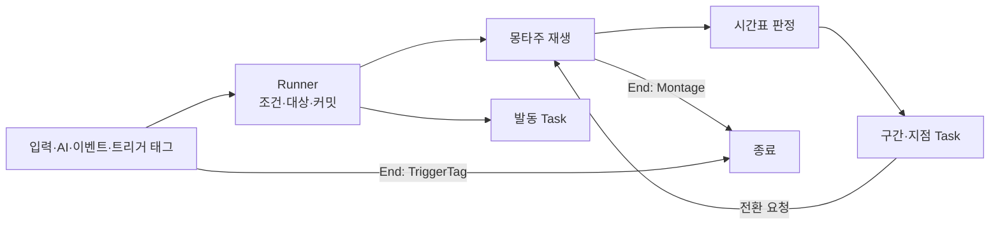

# 어빌리티와 AbilityTask

모든 행동이 단일 Runner(`UAgGameplayAbility`)와 범용 기능 Task로 실행되는 구조의 규칙입니다. 몽타주 안의 구간과 지점은 [몽타주 시간표](<몽타주 시간표.md>)를, 행동 정의의 JSON 형식은 [JSON 데이터](<JSON 데이터.md>) '행동'을 따릅니다.

## 결정과 목표

**`UAgGameplayAbility`는 엔진 어빌리티 기능과 단순한 시간표 Runner만 맡고, Task는 여러 행동이 함께 쓰는 범용 기능 13개만 둡니다. 행동 고유의 규칙은 효과 데이터(`Effects.json`)와 그 규칙의 주인 객체에 둡니다.**

| 둔 곳 | 담는 것 |
| - | - |
| Runner(`UAgGameplayAbility`) | 엔진 어빌리티 기능(태그 조건, 트리거, 비용·쿨다운, 재발동, 취소), 대상 선정, 몽타주 재생과 Task가 요청한 전환, 시간표 판정, Task 시작·종료, 정한 방식의 종료 |
| Task | 범용 기능 하나와 그 Params의 스키마·검증 |
| 행동 정의(`Abilities.json`) | 발동 조건과 트리거, 대상 선정, 재생할 몽타주, 종료 방식, 발동 동안 실행하는 Task |
| 몽타주 시간표(`MontageTimelines.json`) | 섹션 안의 시각에 실행하는 Task(구간·지점) |
| 효과 데이터(`Effects.json`) | 계속 흐르는 시간(패리 구간, 회피 반격 기회, 그로기 시간), 보상(패리, 극한 회피), 지속 소모(달리기)의 값. 모션을 따르는 시간은 시간표에 둡니다(아래 '시간 기준'). |
| 주인 객체 | 행동이 아닌 규칙(아래 '주인 객체의 규칙'): 입력 계층, 캐릭터, 보스 캐릭터, 피격 처리, 보스 AI, HUD |

- 있는 Task를 조합한 새 행동·패턴은 JSON과 몽타주만으로 더합니다. 새로운 종류의 기능만 Task 파일 하나(Task와 그 Params)로 더하고 Runner는 고치지 않습니다.
- Task는 자기 일만 하고 다른 Task를 모릅니다. Runner는 Task 종류, 행동 ID, 몽타주 ID로 분기하지 않습니다. 행동 전체를 맡는 흐름 Task와 자식 Ability는 만들지 않습니다.
- 한 행동만 쓰는 규칙은 Task로 만들지 않습니다. 값은 효과 데이터에, 규칙은 그 규칙의 주인 객체에 둡니다. 새 Task는 둘 이상의 행동이 쓰거나 쓸 수 있는 기능일 때만 더합니다.
- Runner는 몽타주를 처음부터 재생하고 Task가 요청한 전환만 합니다. 재생 옵션은 두지 않습니다. 캐릭터 통과·시간 정지처럼 값 없는 상태는 행동이 갖는 상태 태그를 캐릭터가 읽어 처리합니다. 대상과의 간격은 행동의 Targeting에 하나만 두고, 추적 구간의 접근과 행동 내내의 최소 간격이 함께 씁니다. 보스는 행동하지 않을 때만 자동으로 돌고, 재생할 때의 몸 돌리기는 Face가 맡습니다.
- 애니메이션이 만든 이동은 몽타주 루트 모션과 Motion Warping이, 그 밖의 이동(띄우기, 도약, 돌진, 내리꽂기)은 엔진 루트 모션 소스(Launch, Dash)가 맡습니다. 캐릭터 무브먼트는 몽타주가 루트 모션을 주면 루트 모션 소스를 쓰지 않으므로, 소스로 움직이는 동안은 몽타주 루트 모션을 끄고, 그동안의 추적 구간(Track)은 캐릭터를 직접 돌립니다.
- 행동 정의와 시간표의 항목은 네 가지입니다. 값 없는 상태는 태그(Activation의 OwnedTags, 시간표의 HoldTag)로, 값이나 월드 시간이 있거나 다른 주인이 지워야 하는 상태는 효과(ApplyEffect)로, 다른 액터·시스템에 알릴 것은 이벤트(SendGameplayEvent)로 적고 받는 주인이 처리합니다. 값·대상·어빌리티 문맥이 필요하거나 결과를 돌려주는 것만 기능 Task입니다.
- 몽타주의 흐름(시작 섹션 고르기, 기다림, 다음 동작)은 섹션과 Transition으로 적습니다. 기다림은 언제나 반복 섹션과 그 섹션을 덮는 전환입니다. 여러 모션을 쓰는 행동(평타, 회피, 넉업, 점프)은 한 몽타주의 섹션으로 합칩니다.
- Attack은 맞을 대상을 고르지 않습니다. 켜진 동안 판정 범위(무기, 또는 주인 둘레의 공격 범위)에 닿는 적을 모두 칩니다.
- 입력 계층과 HUD는 행동 ID 대신 행동 태그로 스펙을 찾습니다. 같은 키를 쓰는 새 캐릭터의 행동도 데이터만으로 붙습니다.
- 행동이 끝나는 방식은 행동 정의에 적고 추측하지 않습니다. 대부분은 몽타주가 끝날 때, 토글형(가드, 달리기, 락온, 점프)은 트리거 태그가 사라질 때 끝납니다.
- 대상이 필요한 행동은 발동할 때 TargetingPreset(GameplayTargetingSystem)으로 대상을 정합니다. 프리셋은 `TargetingPresets.json`에서 만듭니다([JSON 데이터](<JSON 데이터.md>) '대상 프리셋').

## Runner

### 맡는 일

| 일 | 내용 |
| - | - |
| 정의 연결 | ID별 스펙을 만들고 `OnGiveAbility`에서 태그 조건을 초기화합니다. `Activation.Triggers`는 스펙의 `DynamicAbilityTriggers`에 넣습니다(아래 'GAS 연결'). |
| 발동 검사 | 엔진 태그 검사, 비용, 재발동 허용, Targeting의 필수 대상. CanActivateAbility와 커밋 직전에 같은 검사를 합니다. |
| 대상 | 아래 '대상' |
| 몽타주 | 처음부터 재생하고, Task가 요청한 전환을 적용합니다. |
| 시간표 판정 | 재생 위치로 시간표를 판정합니다([몽타주 시간표](<몽타주 시간표.md>) '판정 규칙'). |
| Task 실행 | 발동 Task와 구간·지점 Task의 시작, 재생이 바뀔 때 구간 Task의 종료 |
| 종료 | `End`가 정한 때 끝내고, 판정과 재생을 내려놓습니다. 남은 Task는 엔진이 끝냅니다. |

`UAgGameplayAbility`는 InstancedPerActor·LocalOnly입니다. Task는 엔진 `UAbilityTask`를 상속하고 엔진의 Task 수명(소유 어빌리티가 끝나면 함께 끝남)을 그대로 씁니다.

### 발동 순서

1. 검사를 통과하면 대상을 정하고 커밋합니다. 필수 대상이 없거나 커밋에 실패하면 Task를 실행하지 않고 끝냅니다.
2. `Montage`가 있으면 처음부터 재생하고 시작 위치의 구간·지점을 판정합니다. 시작 섹션 고르기와 그로기의 착지 대기도 이 판정에서 시작하는 Transition입니다(아래 '몽타주와 섹션').
3. 발동 Task를 배열 순서대로 시작합니다. 재생과 같은 프레임이라, Face가 재생 뒤에 돌아도 첫 화면과 첫 루트 모션보다 먼저입니다.
4. 중간에 행동이 끝나면 남은 단계를 실행하지 않습니다. 재생에 실패하면 취소로 끝나므로, Launch처럼 되돌릴 수 없는 발동 Task는 실행되지 않습니다.

### Runner와 Task 사이

Runner가 Task에 여는 것은 아래뿐입니다. 다른 Task와 몽타주 ID는 열지 않고, 행동 ID는 로그에만 엽니다. Task 하나만 쓰는 값은 Runner에 두지 않고 Task가 엔진에서 읽습니다.

| 이름 | 뜻 |
| - | - |
| 행동 대상 | 아래 '대상'의 결과. 없을 수 있고, 다시 재생하면 바뀔 수 있습니다. |
| 전환 | `{"Section": 섹션, "BlendTime": 초(선택)}`. BlendTime이 없으면 같은 재생 안에서 그 섹션으로 옮기고(블렌드 없음), 있으면 그 섹션부터 다시 재생합니다(새 재생, 그 시간의 블렌드 인). |
| 재생 | Task를 만들 때 넘기는 그 재생의 몽타주 인스턴스 ID와 시간표 항목의 시각(몽타주 시각). 그 재생의 몽타주, 재생 위치, 섹션 길이는 Task가 이 ID로 엔진에서 읽습니다. 전환 요청은 이 ID가 지금 재생일 때만 적용되므로, 끝난 재생의 Task가 늦게 요청해도 새 재생을 옮기지 않습니다. |
| 효과 스펙 | 효과 데이터의 효과로 만든 스펙(`MakeEffectSpec`). 효과 컨텍스트에 이 어빌리티 인스턴스가 들어갑니다. |

캐릭터는 재생 중인 Runner(ASC의 애니메이팅 어빌리티)에서 Targeting 대상과 간격을 읽어 최소 간격을 지킵니다. 추적 구간과 Launch도 같은 대상과 간격을 씁니다.

### 종료

| End | 끝나는 때 | 필요한 것 |
| - | - | - |
| Montage | 행동의 재생이 끝날 때. 완료면 정상 종료, 다른 몽타주에 끊기면 취소입니다. Task가 요청한 다시 재생은 끝이 아닙니다. | `Montage` |
| TriggerTag | 트리거 태그가 사라질 때(엔진이 취소) | `OwnedTagPresent` 트리거 하나 |

- 그 밖에 끝나는 길은 엔진의 취소(CancelTags, 사망, 스펙 제거)와 발동 중 실패뿐입니다. Task가 끝났거나 실행 중인 Task가 없다는 이유로 행동이 끝나지 않습니다.
- 모션이 없는 행동은 모두 TriggerTag입니다. 시작하자마자 끝나는 행동은 없습니다.
- 끝날 때 판정을 멈추고, 끝나지 않은 재생은 몽타주의 블렌드 아웃으로 멈춥니다. 중복 종료 요청과 남은 Task(발동·구간·지점)는 엔진의 `EndAbility`가 처리하며, 각 Task는 자기 태그·효과·루트 모션 소스·워핑·구독·타이머만 되돌립니다.

### 대상

| 출처 | 쓰는 행동 |
| - | - |
| `Targeting`이 있으면 그 결과 중 첫 후보 | 평타, 점프 공격, 회피 반격, 스킬, 처형, 락온, 보스 공격 패턴 |
| 없고 이벤트로 발동했으면 그 이벤트의 Instigator | 피격 반응, 패리, 처형 피격 |
| 그 밖 | 없음 |

| Targeting 필드 | 뜻 |
| - | - |
| Preset | `TargetingPresets.json`의 프리셋 ID. 후보를 모으고 거르고 정렬하는 절차입니다. |
| Range | 수평 거리(cm) 상한. 생략하면 제한 없음 |
| TargetRequiredTags, TargetBlockedTags | 대상이 가져야 할 태그와 가지면 안 되는 태그(Activation의 태그 조건은 주인의 태그) |
| bRequired | 대상이 없으면 발동하지 않습니다. |
| StopDistance | 선택. 대상과 맞출 간격(cm)이고, 생략하면 캐릭터의 `StopDistance`입니다. 추적 구간은 대상 앞 이 간격까지 다가가고, Launch의 To Target은 이 간격만큼 떨어져 내립니다. 행동 내내 몽타주 이동은 이 간격 안으로 들어가지 않습니다(최소 간격, 캐릭터가 자름). |

- 범위와 태그 조건은 행동 JSON의 값을 타겟팅 요청 핸들의 데이터(`FAgTargetingConditions`)로 실어 보내고, 프리셋 안의 프로젝트 필터 Task(`UAgTargetingFilterTask_ActionTarget`)가 적대하는 살아 있는 캐릭터만 남긴 뒤 그 조건으로 거릅니다. 정렬은 캡슐 중심 사이 수평 거리(`UAgTargetingSortTask_HorizontalDistance`)입니다. 요청은 즉시 실행하고 결과를 읽은 뒤 놓습니다(`AgTargeting::FindTarget`).
- 프리셋은 `Enemy`(살아 있는 적: 반경 50m 구 안의 캐릭터를 모아 ActionTarget 필터로 거르고 수평 거리로 정렬), `LockOn`(Enemy에 화면 안 조건 `UAgTargetingFilterTask_OnScreen`), `AITarget`(보스 AI의 대상, `UAgTargetingSelectionTask_AITarget`)입니다. 필터가 없으면 Range와 대상 태그가 모두 무시되므로, 모든 프리셋이 ActionTarget 필터를 가져야 합니다(검증).
- CanActivateAbility에서 읽기 전용으로, 커밋 직전에 한 번 더 평가합니다. Task가 다시 재생을 요청하면 다시 평가합니다(평타의 타마다 대상). 이벤트 Instigator는 바뀌지 않습니다.
- 추적 구간은 그 재생의 대상을 씁니다. 보스의 대상은 늘 플레이어이고 플레이어 공격은 재생마다 추적 구간이 하나입니다.
- 처형 안내 HUD는 처형 스펙의 Targeting을 읽기 전용으로 평가하고, 락온 대상은 실행 중인 락온 행동의 대상입니다.

### 몽타주와 섹션

| Montage 필드 | 뜻 |
| - | - |
| MontageId | 캐릭터 데이터 `Montages`의 ID |

재생 옵션은 두지 않습니다. 재생할 때 함께 하던 일은 아래가 맡습니다.

| 일 | 맡는 것 |
| - | - |
| 자동 회전 정지 | 캐릭터. 행동이 실행 중이면(재생 중인 Runner가 있음) 자동으로 돌지 않습니다. 자동으로 도는 것은 보스뿐입니다. |
| 공중 이동 | 도약은 Launch, 내리꽂기는 Dash가 움직이고, 공중 회전은 추적 구간이 캐릭터를 직접 돌립니다. 두 몽타주는 그 섹션의 루트 모션을 끕니다. |
| 최소 간격 | Targeting으로 정한 대상이 있으면 그 행동의 간격으로 늘 지킵니다(처형 포함). |
| 재생 전 몸 돌리기 | Face(발동 Task). 피격 반응·패리·처형 피격은 공격 쪽으로, 회피는 이동 입력 방향으로 돕니다. |
| 시작 섹션 고르기 | 첫 섹션 0초의 Transition 지점(회피의 Roll·Backstep) |
| 착지 뒤 시작 | 맨 앞 반복 섹션 Fall의 Transition(공중에서 시작한 그로기) |
| 루트 이동 거리 | ScaleRootMotion(발동 Task). 보스 Backstep의 '후방으로 5m' |

- 몽타주 루트 모션과 루트 모션 소스(Launch, Dash)는 같은 순간에 함께 쓰지 않습니다. 그래서 소스가 움직이는 섹션은 엔진 `AnimNotifyState_DisableRootMotion`으로 몽타주 루트 모션을 끄고, 그 섹션의 추적 구간은 워핑 대신 캐릭터를 직접 돌립니다. 루트 모션이 있는 시퀀스가 하나라도 든 몽타주는 엔진이 몽타주 전체를 루트 모션 몽타주로 다루므로, 시퀀스 설정만으로는 끌 수 없습니다. Dash 구간은 이 노티파이가 덮는지 검사합니다([몽타주 시간표](<몽타주 시간표.md>) '검증'). 몽타주 전체가 루트 모션을 쓰지 않는 행동(넉업, 점프 공격, LeapSlam)은 노티파이 대신 시퀀스의 루트 모션을 끄고 루트 뼈를 고정합니다(Force Root Lock). 몽타주 시작(0초)에 둔 노티파이는 엔진이 0.0001초 뒤에 켜므로, 첫 프레임에 그 앞 조각의 몽타주 루트 모션이 행동과 함께 시작한 소스(Launch)나 공중의 수평 속도를 덮어씁니다. 노티파이 구간 안에서 다시 재생하는 몽타주(BlendTime 전환)도 첫 프레임의 루트 모션을 먼저 뽑으므로, 그 구간의 시퀀스는 루트 모션을 끕니다(DashThrust의 두 번째 시퀀스).
- 재생 배율은 몽타주의 Rate Scale 그대로입니다. 보스 공격 패턴의 0.8은 패턴 몽타주의 Rate Scale에 둡니다.
- 바로 이어지는 동작은 섹션 링크로 잇습니다. 다른 동작으로 넘어갈 때는 전환에 BlendTime을 적어 그 섹션부터 다시 재생합니다. 같은 재생 안의 섹션 이동에는 블렌드가 없어 자세가 튀기 때문입니다. BlendTime은 섹션으로 합치기 전 각 몽타주의 Blend In 시간입니다.
- 시작 섹션을 고르는 행동은 후보 하나를 첫 섹션에 두고, 그 0초에 조건이 있는 Transition 지점을 둡니다. 회피는 Backstep이 첫 섹션이고 이동 입력(`Input.Move`)이 있으면 Roll로 옮깁니다. 같은 판정 안에서 옮기므로 Backstep의 0초 구간은 열리지 않고([몽타주 시간표](<몽타주 시간표.md>) '판정 규칙'의 순서와 전환), 첫 화면과 첫 루트 모션은 Roll입니다.
- 그로기는 맨 앞에 낙하 자세의 반복 섹션 Fall을 두고, 공중이 아니게 되면 Start로 전환합니다. 땅에서 발동하면 첫 판정에서 바로 넘어갑니다. 그로기 시간(GroggyTime)은 Start의 첫 지점에서 걸어 착지한 순간부터 셉니다(보스 사양 '그로기').
- 기다리는 구간(bOptional이 아닌 구간 Transition, PlayCutscene, Next가 있는 Dash)이 있는 동안 몽타주가 끝나지 않도록, 그 구간은 반복 섹션을 끝까지 덮습니다(검증). 평타의 다음 타 입력처럼 이벤트가 오지 않으면 그대로 끝나는 것이 규칙인 전환은 `bOptional`로 표시해 이 검사에서 뺍니다.
- 재생은 ASC의 `PlayMontageWithBlendIn`이 엔진 `PlayMontage`처럼 애니메이팅 어빌리티와 재생 기록을 남기며 합니다. Runner는 재생 인스턴스마다 블렌드 아웃 시작·종료 콜백을 그 인스턴스 ID와 함께 걸어, 다시 재생해 끝나는 이전 인스턴스의 콜백을 무시합니다. 재생하는 동안 끊긴 다른 재생의 콜백이 이 행동을 끝내면, ASC가 새 재생을 멈추고 재생 기록을 남기지 않습니다.

## Task

### 스키마와 등록

- Task의 Params는 공통 부모 `FAgTaskParams`(USTRUCT)를 상속하고 그 Task의 헤더에 둡니다. Task 이름 `X`의 Params는 `FAgXParams`이며, 읽을 때 JSON의 `Task` 값으로 이 구조체를 찾아 `FInstancedStruct`에 담습니다. 구조체 메타데이터는 에디터 전용이라 이름 규칙으로 찾습니다.
- 필드는 범용 리플렉션 읽기(`AgJsonRead::ReadStruct`)가 읽고 모르는 필드·형식 오류·필수 누락을 오류로 냅니다. 선택 필드는 적지 않거나 값을 적고, null은 null을 쓸 수 있다고 정한 필드(추적 구간의 TargetingRange·MaxWarpDistance)에만 씁니다. 그래서 선택 필드는 적었는지로 쓰는지가 정해집니다. Params의 가상 함수는 둘 수 있는 곳(`GetPlacements`), 선택·null·음수를 쓸 수 있는 필드(`GetFieldRules`, 구조체 필드 안쪽은 `Next.BlendTime`처럼 적음), 값·참조 검증과 선택 필드의 유무(`Validate`), 행동 대상이 필요한지(`NeedsTarget`), 요청할 수 있는 전환과 그 전환을 기다리는지(`GetTransition`, `WaitsForTransition`), 속도를 덮어쓰는지(`OverridesVelocity`), 판정을 시작하는지(`StartsHit`), 가리키는 다른 데이터 파일의 ID(`GetReferences`), 다른 데이터와 몽타주가 있어야 검사할 수 있는 규칙(`ValidateLinks`), 자기 Task 만들기(`MakeTask`)를 맡습니다. 데이터를 읽는 쪽(`UAgAssetManager`, 행동 정의와 시간표의 검사)은 이 함수만 부르고 Task 종류로 분기하지 않으므로, 새 Task는 Task 파일 하나로 더합니다.

### 둘 수 있는 곳

| 둔 곳 | 시작 | 끝 |
| - | - | - |
| 발동 Task(행동 정의 `Tasks`) | 발동 순서 3 | 행동 종료, 또는 스스로 끝날 때 |
| 구간(시간표 Start·End) | 재생 위치가 Start에 이를 때 | End, 재생 바뀜, 행동 종료, 또는 스스로 끝날 때 |
| 지점(시간표 Time) | 재생 위치가 Time에 이를 때 | 행동 종료, 또는 스스로 끝날 때 |

### 시간 기준

Task가 시작하고 끝나는 때는 둔 곳이 정하고, 도는 동안의 시간은 Task가 쓰는 엔진 기능이 정합니다. 히트스톱은 두 캐릭터의 시간 배율(`CustomTimeDilation`)만 낮추고, 슬로우모션과 시간 정지는 게임 전체 배율을 바꿉니다.

| 시간 | 따르는 것 | 히트스톱 중 | 쓰는 곳(전투 시스템 '히트스톱 중의 시간') |
| - | - | - | - |
| 모션 시간 | 시간표 구간·지점(몽타주 재생 위치), 캐릭터 무브먼트의 이동(Dash, Launch, 워핑), 추적 구간의 직접 회전 | 멈춤 | 선딜, 판정 구간, 후딜(Busy), 무적 구간, 극한 회피 구간, 보스 패턴 안의 모든 시간 |
| 월드 시간 | 효과의 지속 시간(발동·지점의 ApplyEffect), 월드 타이머 | 계속 흐름 | 쿨다운, 패리 구간, 회피 반격 기회, 그로기 지속 시간, 리젠과 소모 |
| 주인의 시간 | PlayCutscene(매 프레임 주인의 시간 배율을 재생 속도로) | 멈춤 | 궁극기 컷신 |

- 기획서가 모션을 따른다고 정한 시간은 시간표 구간에, 계속 흐른다고 정한 시간은 효과의 지속 시간에 둡니다. 극한 회피 구간처럼 모션 시간이면서 피격 처리가 지워야 하는 것은 ApplyEffect 구간(길이는 시간표, 태그는 효과)으로 둡니다.
- 슬로우모션과 시간 정지에는 둘 다 함께 느려집니다. 시간 정지에서 빠진 주인은 시간 배율 보정을 받으므로 주인의 모션 시간은 그대로 흐르고, 효과의 지속 시간은 멈춘 것처럼 흐릅니다.

### Task 목록

`Next`는 위 '전환' 값입니다.

| Task | 둘 수 있는 곳 | Params | 하는 일 |
| - | - | - | - |
| Attack | 구간, 지점 | DamageMultiplier, PoiseMultiplier, HitReaction, bGuardable, MPCharge, UPCharge. 선택: bFinisher, Radius, bGroundOnly | 켜진 동안 판정 범위에 닿는 적을 대상마다 한 번 칩니다. 지점이면 그 시각에 닿아 있는 적입니다. 판정 범위는 무기(캐릭터의 무기 충돌 스윕)이고, Radius가 있으면 주인 둘레의 공격 범위(캡슐 중심 사이 수평 거리)입니다. bGroundOnly면 공중의 대상(`State.Airborne`)은 맞지 않습니다. bFinisher면 마지막 일격(`Effect.Damage.Finisher`)입니다. 피격 위치는 무기가 닿은 곳이고, 공격 범위면 대상의 캡슐 중심입니다. |
| HoldTag | 구간, 지점 | Tag | 값 없는 상태 태그를 유지합니다. 지점이면 그 시각부터 행동이 끝날 때까지입니다. 행동 내내 필요한 태그는 Activation의 OwnedTags에 둡니다. |
| ApplyEffect | 발동, 구간, 지점 | Effect. 발동·지점만: bRemoveOnEnd | `Effects.json`의 효과를 주인에게 겁니다. 구간이면 구간 시작에 걸고 구간 끝에 지웁니다(모션 시간, 무한 효과만). 발동·지점이면 효과의 지속 시간(월드 시간)을 따르고, bRemoveOnEnd면 행동이 끝날 때 지웁니다. |
| Face | 발동, 지점 | To(Target, MoveInput) | 몸을 바로 돌립니다. Target이면 행동 대상 쪽, MoveInput이면 이동 입력 방향이고 입력이 없으면 돌지 않습니다. |
| Dash | 구간 | Speed, To(Target, Down). 선택: Next. Target만(선택): HomingTurnRate, Overshoot, MaxDistance | 엔진 일정 힘 루트 모션 Task(`UAbilityTask_ApplyRootMotionConstantForce`, 끝없는 지속 시간)를 상속해 Speed의 일정 속도로 움직이고, 끝나면 속도를 0으로 둡니다. Target이면 주인이 바라보는 방향으로 출발하고(앞의 추적 구간이 대상 쪽으로 돌려 둠), 방향을 초당 HomingTurnRate까지 대상 쪽으로 바꿉니다(없으면 직선). 출발할 때 대상까지의 수평 거리에 Overshoot를 더한 거리(MaxDistance까지, 대상이 없으면 MaxDistance)를 실제 경로로 가거나, 벽에 막히거나, 공격이 막히면(`Event.AttackBlocked`) 그 자리에서 멈춥니다. Down이면 수평 속도는 그대로 두고 Speed로 떨어지며, 공중이 아니게 되면 멈춥니다. 스스로 멈추면 Next로 전환하고, 구간이 끝나면 멈춥니다. 돌진하는 동안의 자세는 구간이 덮는 반복 섹션이 유지합니다. |
| Launch | 발동, 지점 | AirTime. 선택: Height, To(Target), MaxDistance | 엔진 루트 모션 점프 Task(`UAbilityTask_ApplyRootMotionJumpForce`)를 상속해 체공 시간이 AirTime인 포물선을 그리며 띄우고, 착지하면 끝내며 속도를 0으로 둡니다. 최고 높이는 Height이고, 없으면 엔진 중력으로 정해지는 높이(중력 × AirTime² ÷ 8)라 엔진 중력의 포물선과 같습니다. To가 Target이면 행동 대상 위치에서 주인 쪽으로 그 행동의 간격(Targeting의 StopDistance)만큼 떨어진 곳에 내리도록 수평으로도 보내고(수평 거리는 MaxDistance까지), 없으면 제자리에서 수직으로 띄웁니다. 체공 시간의 앞 절반(엔진 Task의 `MinimumLandedTriggerTime`, 월드 시간)에 닿은 땅은 착지로 보지 않고 계속 띄우며, 그 착지는 캐릭터도 알리지 않습니다(`Event.Landed`). 그 뒤에도 땅에 있으면(떠오르지 못함) 끝냅니다. 도는 동안 몽타주가 루트 모션을 주면 오류를 남깁니다. |
| ScaleRootMotion | 발동 | Distance | 행동 몽타주 전체 루트 모션의 수평 이동 거리(cm)가 Distance가 되도록 캐릭터의 루트 모션 이동 배율을 정합니다. 몽타주를 재생한 같은 프레임에 걸어 첫 루트 모션부터 적용하고, 행동이 끝날 때 건 배율이 그대로면 되돌립니다(다른 행동이 바꾼 배율은 두고). |
| SpawnProjectile | 지점 | ProjectileId, Origin. 선택: SocketName(Origin이 MeshSocket일 때만) | 투사체 한 발. 공격 값은 투사체 정의(`Projectiles.json`의 Attack)가 갖습니다. |
| SendGameplayEvent | 발동, 지점 | Event, Recipient(Owner, Target) | Instigator가 주인, Target이 행동 대상인 게임플레이 이벤트를 받는 쪽에 보냅니다. |
| Transition | 구간, 지점 | Next. 선택: RequiredTags, BlockedTags. 구간만(선택): Event 또는 BeforeTagEnds, bOptional | 정한 때에 주인이 RequiredTags를 모두 갖고 BlockedTags를 하나도 갖지 않으면 전환합니다. 그때는 지점이면 그 시각이고, 구간이면 주인이 Event를 받을 때나 BeforeTagEnds의 태그를 주는 효과가 끝나기 Next 섹션 길이만큼 전(이미 지났거나 효과가 먼저 지워지면 바로, 끝나는 때를 모르는 태그(무한 효과 등)면 사라질 때. 그때 조건이 맞지 않으면 맞게 될 때)이며, 둘 다 없으면 구간 안에서 조건이 맞게 되는 때입니다. bOptional은 전환하지 않고 구간이 끝나도 되는 전환입니다. |
| PlayCutscene | 구간 | Sequence, Next | 구간이 시작되면 주인을 기준 위치로 컷신을 재생하고 끝나면 전환합니다. 재생 속도는 매 프레임 주인의 시간 배율(`CustomTimeDilation`)을 따르므로 시간 정지와의 시작 순서에 기대지 않습니다. |
| CameraShake | 지점 | Shake, Range | 로컬 플레이어와의 수평 거리가 Range 이내면 셰이크를 재생합니다. |
| Track(추적 구간) | 구간 | TargetingRange, MaxWarpDistance, RotationMethod | 기획서의 추적 구간입니다. 그동안 행동 대상 쪽으로 돌고, MaxWarpDistance 안에서 대상 앞 그 행동의 간격(Targeting의 StopDistance)까지 다가갑니다. 몽타주가 루트 모션을 주면 구간을 시작할 때 엔진 Motion Warping에 Modifier를 등록하고([애니메이션과 이동](<애니메이션과 이동.md>) '추적 구간'), 주지 않으면(루트 모션 소스로 움직이는 공중 동작) 캐릭터를 직접 돌리며 다가가지 않습니다. ConstantRate는 실제 시간 초당 360°(캐릭터 회전 속도)로 돌고, Slerp는 구간 끝까지 다 돕니다. 대상이 없거나 TargetingRange 밖이면 캐릭터의 대체 대상(플레이어는 락온 대상) 쪽으로 돌기만 하고, 따라 돌다가 대상이 TargetingRange 밖으로 나가면 멈춥니다. |

## 트리거

엔진 트리거(`FAbilityTriggerData`)를 `Activation.Triggers`에 둡니다. 항목은 `{"Tag": 태그, "Source": "GameplayEvent" | "OwnedTagPresent"}`입니다.

| Source | 엔진 동작 | 쓰는 행동 |
| - | - | - |
| GameplayEvent | 그 이벤트를 받으면 발동하고, 이벤트가 실행 정보로 옵니다. | 피격 반응, 패리, 처형 피격, 그로기, 페이즈 전환 |
| OwnedTagPresent | 태그가 0에서 1이 될 때 발동하고, 0이 되면 엔진이 취소합니다. | 가드, 달리기, 락온, 점프 |

엔진은 태그로 발동할 때도 실행 정보를 넘기므로, Runner는 그 태그가 행동 정의의 GameplayEvent 트리거일 때만 이벤트의 Instigator를 대상으로 씁니다.

OwnedTagPresent는 태그가 붙는 순간에만 발동을 시도하고, 막혀서 실패하면 태그가 붙어 있는 동안 다시 시도하지 않습니다. 그래서 입력 계층은 자기가 붙이는 요청 태그(`Input.Guard`, `Input.Sprint`, `Input.LockOn`)에 다음을 지킵니다. 세 규칙은 요청 태그를 관리하는 함수 하나(`SetTriggerTag`)로 구현하고 가드·달리기·락온이 함께 씁니다.

1. 행동을 시작할 수 있을 때만(그 스펙의 CanActivateAbility) 태그를 붙입니다. 막혀 있으면 붙이지 않고 기다립니다.
2. 붙였는데 행동이 실행되지 않았으면 바로 뗍니다.
3. 태그가 남아 있는데 행동이 다른 이유(CancelTags 등)로 끝나면 태그를 뗍니다. 다시 시작할 때 다시 붙입니다.

| 행동 | 트리거 태그 | 주인과 규칙 |
| - | - | - |
| 가드 | `Input.Guard` | 입력 계층. 가드 키를 누르고 있고 가드를 시작할 수 있을 때 붙이고, 키를 떼면 뗍니다. 막혀 있으면 선입력, 후딜 시작, 행동 종료에서 다시 붙입니다. |
| 달리기 | `Input.Sprint` | 입력 계층. 회피 후딜에 Shift와 이동 입력이 있고 가드 키를 누르지 않았고 SP가 0보다 크면 붙이고, Shift를 떼거나 이동 입력이 없거나 SP가 0이면 뗍니다. |
| 락온 | `Input.LockOn` | 입력 계층. 락온 키로 붙이고 뗍니다(토글). 대상이 죽거나 락온 해제 거리(`LockOnReleaseRange`) 밖으로 나가면 뗍니다. 락온 대상이 없으면 시작할 수 없어 붙이지 않습니다(규칙 1). |
| 점프 | `State.Jumping` | 캐릭터. 점프가 실제로 시작될 때(`OnJumped`) 붙이고 착지할 때(`Landed`) 뗍니다. 요청이 아니라 공중 상태라 위 규칙 대신, 입력 계층이 점프 행동을 시작할 수 있을 때만 엔진 `Jump`를 불러 막힌 발동을 피하고, 키를 떼면 `StopJumping`을 부릅니다. 행동이 다른 이유로 끝나도 떼지 않습니다(점프 공격의 시작 조건). |

락온의 대상 상실은 태그 주인이 판단해야 행동이 끝나므로, 해제 조건(대상 사망, 해제 거리)은 입력 계층이 봅니다. 락온 행동은 대상만 갖고, 카메라 추적은 플레이어 캐릭터가 락온 대상을 읽어 합니다.

### 그로기는 트리거 태그로 끝내지 않음

그로기는 몽타주 종료형입니다. 그로기 시간은 효과(GroggyTime, 월드 시간 5초)로 두고 착지한 뒤의 Start 섹션 첫 지점에서 겁니다. 그로기 몽타주의 반복 섹션에 둔 Transition이 이 효과가 끝나기 복귀 섹션 길이만큼 전에 복귀를 시작합니다. 전투 시스템 '그로기'는 '히트스톱은 복귀 시작 예정 시점을 늦추지 않고, 복귀 모션 중 히트스톱만큼 그로기 종료가 늦어진다'고 정하는데, 다른 두 방법은 이를 지키지 못합니다.

| 방법 | 문제 |
| - | - |
| 그로기 몽타주를 5초로 늘림 | 히트스톱(타격마다 0.12초)이 몽타주를 멈춰 복귀 시작이 맞은 횟수만큼 늦어집니다. |
| 5초 태그 효과의 OwnedTagPresent | 효과는 월드 시간으로 5초에 끝나 히트스톱으로 늦어진 복귀 모션을 자릅니다. 처형 피격이 그로기를 늘리면 효과도 늘려야 합니다. |

## 주인 객체의 규칙

| 주인 | 맡는 것 |
| - | - |
| 플레이어 캐릭터(입력 계층) | 키에 맞는 행동을 행동 태그로 찾습니다(아래 '입력 계층의 행동 찾기'). 위 트리거 태그, 이동 입력이 있는 동안의 `Input.Move`. 평타 키는 평타가 실행 중이면 `Input.Attack` 이벤트를 보내고, 아니면 발동합니다(평타 키의 점프 공격·회피 반격 우선순위는 [입력 처리](<입력 처리.md>)). 가드 키를 누른 채 후딜이 시작될 때 가드가 실행 중이면 후딜에 든 패리 모션(`Ability.Action.Parry`)을 취소합니다. 락온 중 카메라 추적. 이동 입력 제한은 `State.Acting`과 상태 태그로 봅니다. |
| 캐릭터 | `State.Airborne`(이동 모드가 떨어지는 중인 동안). 이동 사건: 착지하면 `Event.Landed`(Launch가 착지로 보지 않는 체공 시간 앞 절반의 착지는 빼고), 공중에서 수직 속도가 오름에서 내림으로 바뀌면 `Event.Apex`를 자기에게 보냅니다. 자동 회전: 행동이 실행 중이거나(재생 중인 Runner가 있음) 비전투면 돌지 않습니다(자동으로 도는 것은 보스뿐). 최소 간격: 재생 중인 Runner에 Targeting 대상이 있으면, 루트 모션 이동이 그 대상에게 그 행동의 간격보다 가까이 가지 않게 자릅니다(`ClampRootMotion`). 캐릭터 통과: `State.PassThrough`가 있으면 캡슐이 Pawn 채널을 무시합니다. 시간 정지: `State.TimeStop`이 있는 동안 시간 서브시스템에 자기를 뺀 시간 정지를 요청합니다. 점프의 `State.Jumping`과 점프 모션: 플레이어는 [애니메이션과 이동](<애니메이션과 이동.md>) '점프'의 규칙대로 `Jump` 몽타주의 Start·Land 섹션을 재생합니다. 사망은 `Event.Death`를 받아 처리합니다([사망 처리](<사망 처리.md>)). |
| 보스 캐릭터 | 그로기가 끝나면(State.Groggy가 사라졌고 살아 있으면) PP를 MaxPP로 채우고(`PPRefill`), 다음 그로기와 섞이지 않게 남은 GroggyTime 효과를 지웁니다. 처형 피격이 State.Groggy를 이어 받으므로, 처형 피격이 끝날 때 한 번 채웁니다. |
| 피격 처리(`UAgHitResultGameplayEffectComponent`) | 패리·극한 회피의 결과와 보상([대미지와 피격 처리](<대미지와 피격 처리.md>) '피격 결과') |
| 보스 AI | 평타 시작 알림(`Event.BasicAttackStarted`, 평타·점프 공격 시간표의 SendGameplayEvent 지점)을 받습니다. 페이즈 전환이 정상 종료로 끝나면(`OnAbilityEnded`) PP를 채우고 2페이즈로 넘어갑니다([보스](<보스.md>)). |
| HUD | 그로기 중 PP 바([카메라, HUD, 화면 UI, 게임 플로우](<카메라, HUD, 화면 UI, 게임 플로우.md>)) |

캐릭터가 직접 재생하는 몽타주(점프, 사망, 움찔)에는 판정할 Runner가 없으므로 시간표를 두지 않습니다(검증).

### 입력 계층의 행동 찾기

입력 계층은 행동 ID 대신 행동 태그로 스펙을 찾습니다. 키와 행동 태그의 대응은 입력 규칙이라 입력 계층(C++의 `AAgPlayerCharacter::GetInputAbilityTags`)에 두고, 그 태그를 가진 정의가 무엇인지는 캐릭터의 행동 목록이 정합니다. 그래서 같은 키를 쓰는 새 캐릭터의 행동은 다른 ID로 정의하고 Tags만 맞추면 데이터만으로 붙습니다.

| 키·처리 | 찾는 행동 태그 |
| - | - |
| 평타 키 | 공중이면 `Ability.Action.JumpAttack`, 회피 반격 기회가 있으면 `Ability.Action.DodgeCounter`, 그 밖에는 `Ability.Action.BasicAttack`(실행 중이면 `Input.Attack` 이벤트) |
| 가드 키 | `Ability.Action.Guard`(트리거 태그를 붙여도 되는지 확인) |
| 회피·달리기 키 | `Ability.Action.Dodge`, 회피 후딜의 달리기는 `Ability.Sprint` |
| 점프 키 | `Ability.Action.Jump`(엔진 Jump를 불러도 되는지 확인) |
| 스킬, 궁극기, 처형 키 | `Ability.Action.Skill`, `Ability.Action.Ultimate`, `Ability.Action.Execution` |
| 락온 키, 락온 대상 조회 | `Ability.LockOn` |
| 패리 후딜 복귀(취소) | `Ability.Action.Parry` |
| 처형 안내 HUD(Targeting 평가) | `Ability.Action.Execution` |

- 스펙 태그(`GetDynamicSpecSourceTags`)가 그 태그와 정확히 같은 스펙을 `UAgAbilitySystemComponent::FindSpecByTag`로 찾습니다. 엔진 `TryActivateAbilitiesByTag`는 클래스 태그를 보므로 쓰지 않습니다. HUD도 같은 함수를 씁니다.
- 한 캐릭터에서 위 태그를 정확히 가진 행동은 태그마다 하나 이하입니다(검증). 없으면 그 키는 아무것도 하지 않습니다.
- 새 키를 더할 때(입력 태그, Enhanced Input 에셋)만 이 표와 C++가 바뀝니다.
- 보스 AI는 캐릭터의 행동 목록과 StateTree 에셋에 적힌 ID를 씁니다. ID가 데이터에서 오므로 코드에는 행동 ID가 없습니다.

## 행동별 구성

실제 값은 `Data/Abilities.json`과 `Data/MontageTimelines.json`에 있습니다. 모션이 있는 플레이어 행동(평타, 점프 공격, 회피, 회피 반격, 스킬, 궁극기, 처형, 패리)은 OwnedTags에 `State.Acting`을 둡니다. Busy는 시간표의 HoldTag 구간(시작부터 후딜 시작까지)으로 두고, 후딜이 없는 처형과 점프는 OwnedTags에 `State.Busy`를 둡니다.

| 행동 | 구성 |
| - | - |
| 평타 | Targeting(Enemy), `BasicAttack` 몽타주(섹션 Attack1~5). 섹션마다 Busy 구간, 시작의 SendGameplayEvent(평타 시작 알림), 추적 구간, Attack 구간, 후딜부터 섹션 끝까지 Transition(`Input.Attack`, 다음 섹션을 BlendTime으로 다시 재생, Attack5 다음은 Attack1, bOptional). 입력 없이 섹션이 끝나면 몽타주가 끝나 콤보가 초기화됩니다. |
| 점프 | 트리거 `State.Jumping`, End TriggerTag, OwnedTags State.Busy. 점프와 모션은 캐릭터 |
| 점프 공격 | RequiredTags State.Jumping, Targeting(Enemy). 시간표: Start의 추적 구간(루트 모션 없이 직접 회전), Start·Fall의 Transition(`Event.Landed` → Land), 내리꽂기 시각부터 Fall 끝까지의 Dash 구간(Down, 초속 10m), SendGameplayEvent 지점, Start에서 Land로 넘어가는 Attack·Busy 구간 |
| 회피 | Face(MoveInput), `Dodge` 몽타주(첫 섹션 Backstep, 그다음 Roll). 시간표: Backstep 0초의 Transition 지점(`Input.Move`가 있으면 Roll), 두 섹션의 ApplyEffect 구간(PerfectDodgeWindow), 무적·Busy 구간. 보상과 한 번만 주는 규칙은 피격 처리 |
| 회피 반격, 스킬 | Targeting(Enemy), 시간표의 추적·Attack·Busy 구간 |
| 가드 | 트리거 `Input.Guard`, End TriggerTag, OwnedTags State.Guarding, ApplyEffect(ParryWindow, bRemoveOnEnd). 패리 모션은 Parry 스펙, 패리 후딜 복귀는 입력 계층, 패리 결과와 보상은 피격 처리 |
| 패리 | 트리거 `Event.Parry`, Face(Target), Parry 몽타주, Busy 구간. CancelTags에 가드가 없어 가드를 끝내지 않습니다. |
| 궁극기 | `Ultimate` 몽타주(섹션 Start, Hold(반복), Judgment, Draw). 시간표: Start부터 Hold 끝까지의 PlayCutscene(Judgment로 전환), Start에서 Judgment로 넘어가는 HoldTag 구간(State.TimeStop은 Judgment 끝까지, State.Busy는 Judgment의 후딜 시작까지), Draw 시작의 마무리 Attack 지점(Radius 10m, bFinisher). 같은 시각이면 구간 끝이 먼저라 시간 정지가 풀린 뒤 칩니다. 베기 선은 Judgment 섹션의 엔진 상태 노티파이(`UAnimNotify_GameplayCueState`)가 켜고 끕니다. |
| 처형 | Targeting(범위 3m, 대상 State.Groggy, State.Execution·State.Airborne 제외, 필수, StopDistance 95cm), SendGameplayEvent(`Event.Executed`, Target), 추적 구간(Slerp), 찌르기부터 마지막 일격까지의 무기 판정 Attack 구간, 마지막 일격의 범위 판정 Attack 지점(Radius 1.5m, bFinisher. 발차기로 칼을 뽑는 순간이라 칼날 스윕은 몸에 닿지 않을 수 있어, 처형 간격 95cm를 덮는 범위로 맞힘) |
| 달리기 | 트리거 `Input.Sprint`, End TriggerTag, ApplyEffect(SprintDrain, bRemoveOnEnd) |
| 락온 | 트리거 `Input.LockOn`, End TriggerTag, Targeting(LockOn, 범위 20m, 필수). 해제 조건과 카메라는 플레이어 캐릭터 |
| 넉백, 가드 브레이크 | Face(Target). 넉백은 시간표의 HoldTag 지점(무적) |
| 가드 밀림 | Face(Target). CancelTags가 행동 전체가 아니라 `Ability.Action.Parry`라 가드를 끝내지 않습니다. |
| 넉업 | Face(Target), Launch(AirTime 0.6, Height 120), `KnockUp` 몽타주(섹션 Rise, Fall, Land, GetUp). 시간표: Rise의 Transition(`Event.Apex` → Fall, `Event.Landed` → Land), Fall(반복)의 Transition(`Event.Landed` → Land), Land의 HoldTag 지점(무적)과 Transition 지점(GetUp) |
| 그로기 | `Groggy` 몽타주(첫 섹션 Fall). 시간표: Fall의 Transition(공중이 아니면 Start), Start 첫 지점의 ApplyEffect(GroggyTime), 반복 섹션의 Transition(BeforeTagEnds `State.GroggyTime` → End). 처형 피격은 Executed 스펙, PP 회복은 보스 캐릭터 |
| 처형 피격 | 트리거 `Event.Executed`, RequiredTags State.Groggy, OwnedTags State.Groggy·State.Execution·State.PassThrough, CancelTags 그로기. Face(Target), Executed 몽타주 |
| 페이즈 전환 | 몽타주와 OwnedTags State.Invincible. PP 회복과 2페이즈는 보스 AI |
| DoubleStrike, Sweep, QuintupleStrike, SwordWave, JumpSlam | Targeting(AITarget), 몽타주 Rate Scale 0.8, 시간표의 추적·Attack 구간(SwordWave는 SpawnProjectile 지점) |
| 도약(LeapSlam) | Targeting(AITarget, 필수), Launch(AirTime 1.35, To Target, MaxDistance 12m), Rate Scale 0.8. 시간표: 첫 섹션의 추적 구간(직접 회전), End 앞 섹션들의 Transition(`Event.Landed` → End), End의 CameraShake 지점과 Attack 지점(Radius 3.5m, bGroundOnly) |
| 돌진 찌르기(DashThrust) | Targeting(AITarget), Rate Scale 0.8, 몽타주 섹션 Start·Hold(찌르는 자세의 반복)·Recover. 시간표: 추적 구간, 돌진 시작부터 Hold 끝까지의 Dash(막힘 정지, 끝나면 Recover)·Attack·HoldTag(State.PassThrough) 구간 |
| Backstep(보스) | ScaleRootMotion(Distance 5m). Rate Scale을 바꾸지 않습니다. 물러나는 동안 돌지 않습니다. |

## 검증

`UAgAssetManager`가 읽을 때 검사하고, 오류에는 파일, 행동 ID나 몽타주 경로·섹션, 항목 번호, 필드 경로를 붙입니다. 시간표 항목의 검사는 [몽타주 시간표](<몽타주 시간표.md>) '검증'을 따릅니다.

- 행동 정의: Task 이름은 등록된 Task이고, 각 Params가 읽기·검증·둘 수 있는 곳을 검사합니다. End가 Montage면 Montage가, TriggerTag면 OwnedTagPresent 트리거가 정확히 하나 있습니다. Triggers의 Source는 GameplayEvent나 OwnedTagPresent입니다. Targeting의 Preset은 `TargetingPresets.json`에 있는 ID이고(프리셋의 필터 검사는 [JSON 데이터](<JSON 데이터.md>) '대상 프리셋'), Range는 0 이상, StopDistance는 0보다 큰 유한한 수입니다.
- Task 값: Task가 가리키는 효과와 투사체(`GetReferences`)는 `Effects.json`과 `Projectiles.json`에 있습니다. ApplyEffect를 구간에 두면 무한 효과입니다. Attack의 Radius는 0보다 큰 유한한 수입니다. Launch의 MaxDistance는 To와 함께 씁니다. Dash의 HomingTurnRate·Overshoot·MaxDistance는 To Target에만 씁니다. Transition은 지점이면 Event·BeforeTagEnds·bOptional이 없고, 구간이면 Event와 BeforeTagEnds 중 하나 이하이며 둘 다 없으면 RequiredTags나 BlockedTags가 있습니다. SendGameplayEvent의 Event는 `Event.` 아래의 태그입니다. ScaleRootMotion의 Distance는 0보다 크고, 그 행동의 몽타주에 수평 루트 이동이 있어야 합니다.
- 행동 대상: 행동 대상이 필요한 것(Face의 To Target, Launch와 Dash의 To Target, Recipient가 Target인 SendGameplayEvent)이 행동 정의나 그 몽타주의 시간표에 있으면, 그 행동은 Targeting이나 GameplayEvent 트리거를 가집니다.
- 루트 모션 소스: 속도를 덮어쓰는 Task(`OverridesVelocity`: Launch, Dash)는 한 행동(발동 Task와 그 몽타주의 시간표)에 한 종류만 둡니다. 두 종류를 함께 쓰면 우선순위가 높은 쪽(엔진 JumpForce Task)만 움직이기 때문입니다.
- 캐릭터 데이터: 행동 ID와 그 Montage의 몽타주 ID, DeathMotions의 몽타주 ID. 플레이어는 '입력 계층의 행동 찾기' 표의 태그를 정확히 가진 행동이 태그마다 하나 이하이고, 플레이어가 직접 재생하는 점프 몽타주에 Start·Land 섹션이 있습니다. 두 검사는 플레이어 캐릭터와 같은 C++ 표·상수(`GetInputAbilityTags`, `JumpMontageId`·`JumpStartSection`·`JumpLandSection`)를 읽습니다.
- 행동 ID별 필수 항목이나 행동 ID로 고른 검사는 두지 않습니다. 몽타주 ID와 섹션 이름을 쓰는 검사는 캐릭터가 직접 재생하는 몽타주(점프)의 것뿐입니다.

## GAS 연결

### 스펙별 부여와 초기화

UE 5.8 소스를 기준으로 다음 경로를 씁니다.

1. ID마다 `FGameplayAbilitySpec(UAgGameplayAbility::StaticClass())`을 만듭니다. 같은 클래스여도 서로 다른 스펙과 `InstancedPerActor` 인스턴스를 씁니다.
2. **GiveAbility 전에** 생성된 Spec.Handle과 ID를 연결하고, `GetDynamicSpecSourceTags()`에 정의의 Tags를, `DynamicAbilityTriggers`에 Triggers(태그와 Source)를 넣습니다. 엔진은 부여할 때 스펙의 동적 트리거를 이벤트·태그 감시에 등록하고 제거할 때 해제합니다. GiveAbility 반환 뒤에 처음 ID를 기록하면 OnGiveAbility에서 정의를 읽을 수 없습니다. 부여 실패 시 사전 연결을 정리합니다.
3. 인스턴스의 `OnGiveAbility`에서 정의를 찾아 ActivationRequired/Blocked/OwnedTags, Block/Cancel 태그를 초기화합니다. CDO는 수정하지 않습니다.
4. 입력은 태그로 찾은 핸들에, AI는 ID로 찾은 핸들에 `TryActivateAbility`를 호출합니다.
5. 스펙은 캐릭터가 사라질 때 ASC가 함께 제거합니다. 그래서 ID 연결과 부여 당시 설정은 따로 정리하지 않습니다.

행동별 설정은 PreActivate보다 먼저 준비되어야 합니다. ActivateAbility 안에서 뒤늦게 OwnedTags나 CancelTags를 설정하지 않습니다. PreActivate는 ActivationOwnedTags를 CancelTags 적용보다 먼저 붙이므로, 처형 피격이 그로기를 취소해도 State.Groggy가 끊기지 않습니다.

### 태그 검색과 취소

엔진의 `GetAssetTags`·`SetAssetTags`를 런타임 데이터용 가상 접근자처럼 쓸 수는 없습니다. 특히 `TryActivateAbilitiesByTag`, `CancelAbilities`는 클래스 태그를 검색하므로, DynamicSpecSourceTags만 설정해서 엔진 호출부가 동작한다고 가정하지 않습니다.

- 행동 태그로 스펙 하나를 찾을 때는 `UAgAbilitySystemComponent::FindSpecByTag`(정확히 일치)를, ID로 찾을 때는 캐릭터의 ID→스펙 핸들 연결을 씁니다.
- `DoesAbilitySatisfyTagRequirements`는 초기화된 인스턴스의 엔진 Required/Blocked 검사에 더해, **스펙 Tags에 대한 ASC의 어빌리티 차단 상태**를 확인합니다.
- `UAgAbilitySystemComponent::ApplyAbilityBlockAndCancelTags`를 재정의합니다. Block 태그의 횟수 관리는 부모 GAS에 맡기고, Cancel 대상 선택만 활성 스펙의 Tags 기준(`CancelAbilitiesWithSpecTags`)으로 수행한 뒤 엔진의 핸들 취소 함수를 부릅니다.
- 프로젝트의 직접 취소(패리 후딜 복귀, 보스 패턴 취소)도 같은 스펙 검색 함수를 씁니다. 무조건 전체 취소 등 태그 검색과 관계없는 엔진 기능은 그대로 씁니다.
- GE 출처 태그는 엔진 `ApplyAbilityTagsToGameplayEffectSpec`가 DynamicSpecSourceTags를 포함하는 경로를 씁니다. 궁극기·처형의 피해 식별을 보존합니다.

### 재발동

UE 5.8의 재발동 판단은 CDO의 `bRetriggerInstancedAbility`를 읽습니다. 공통 클래스는 엔진 재발동을 허용하고, 실제 `CanActivateAbility(Handle, ...)`에서 활성 스펙의 정의가 재발동을 허용하는지(`bAllowRetrigger`) 검사합니다. 허용하지 않는 행동은 실행 중인 활성화를 끝내기 전에 거부합니다. 재발동은 회피와 피격 반응만 쓰며, 엔진은 실행 중인 인스턴스를 취소가 아닌 종료로 끝낸 뒤 다시 발동합니다. 콤보는 평타 몽타주의 Transition 구간이, 가드는 트리거 태그가 맡습니다.

### 비용과 쿨다운

- 모든 행동은 공통 CommitAbility 경로를 발동당 한 번 씁니다. 커밋에 실패하면 Task를 실행하지 않고 끝냅니다. 같은 발동 안의 다시 재생에서 다시 커밋하지 않습니다.
- Cost는 Resource·Amount만 갖는 시작 비용입니다. 공통 CheckCost가 현재 자원이 Amount 이상인지 확인하고(활성 스펙의 재발동 사전 검사에도 쓰이므로 현재 정의를 봄), ApplyCost가 실행 사본의 Cost를 자원 효과(`Resource`)의 SetByCaller에 음수로 넣어 한 번 적용합니다. Cost가 null이거나 Amount가 0이면 비용 효과를 생략합니다.
- Cooldown이 0이면 쿨다운 효과를 생략하고, 양수이면 그 시간으로 겁니다. 쿨다운 효과의 출처는 그 스펙의 어빌리티 인스턴스라 같은 클래스여도 행동마다 구분됩니다([캐릭터와 GAS](<캐릭터와 GAS.md>) '쿨다운').
- 달리기는 Cost가 null이고, SP가 0보다 커야 한다는 조건은 입력 계층이 트리거 태그를 붙일 때 봅니다. 지속 소모는 ApplyEffect(SprintDrain)입니다.
- 극한 회피의 SP 환급은 피격 처리가 극한 회피 구간 효과를 건 행동(효과 컨텍스트의 어빌리티 인스턴스)의 Cost만큼 돌려줍니다.

## 실행 사본과 다시 읽기

발동할 때 정의를 복사해 그 실행이 끝날 때까지 쓰고, 에셋 참조(몽타주)는 UPROPERTY로 보관해 GC가 추적하게 합니다. 다시 읽기는 실행 중인 사본에 섞지 않고 다음 발동부터 적용합니다. 몽타주 시간표는 재생을 시작할 때 복사하므로 다시 읽어도 진행 중인 재생의 값은 바뀌지 않습니다. Task가 ID로 찾는 데이터(효과, 투사체 정의)는 그 Task가 시작할 때 읽습니다.

ID·Tags·Triggers·Required/Blocked/Owned/Block/Cancel·재발동 정책처럼 부여 시 연결된 값은 캐릭터를 다시 만든 뒤 적용합니다. 다시 만들기 전의 새 발동은 거부하고 이유를 남깁니다. 로드는 임시 객체 변환·검증 성공 후 한 번에 교체합니다.

보스 AI는 스펙 분류와 PatternSelection을 씁니다. Backstep의 반응 선택 값은 PatternSelection에 둡니다. 패턴 후보 목록을 별도 배열로 복제하지 않습니다.

## 클래스 구조

| 클래스 | 부모 | 역할 |
| - | - | - |
| `UAgGameplayAbility` | `UGameplayAbility` | 모든 행동의 Runner. ID별 정의·실행 사본, 태그 조건·트리거·비용·쿨다운·재발동, 대상(Targeting), 몽타주 재생과 Task가 요청한 전환, 시간표 판정, 발동·구간·지점 Task의 시작·종료, 효과 스펙(`MakeEffectSpec`) |
| `UAgAbilitySystemComponent` | `UAbilitySystemComponent` | 스펙 동적 태그에 따른 차단·취소 보완, 행동 태그로 스펙 찾기(`FindSpecByTag`), 애니메이팅 어빌리티를 기록하는 몽타주 재생(`PlayMontageWithBlendIn`), 효과 스펙(`MakeEffectSpec`) |
| `UAgAbilityTask_Attack` | `UAbilityTask` | 판정 범위(무기 스윕이나 공격 범위)에 닿는 적을 대상마다 한 번 칩니다. 이전 무기 위치·적중 기록·물리 이후 틱을 직접 소유하고 종료 시 정리 |
| `UAgAbilityTask_HoldTag` | `UAbilityTask` | 자기 태그 횟수 획득·해제 |
| `UAgAbilityTask_ApplyEffect` | `UAbilityTask` | 효과 데이터의 효과를 걸고, 구간 끝이나 행동 끝(bRemoveOnEnd)에 자기 효과만 지움 |
| `UAgAbilityTask_Face` | `UAbilityTask` | 행동 대상이나 이동 입력 방향으로 몸을 바로 돌림 |
| `UAgAbilityTask_Dash` | `UAbilityTask_ApplyRootMotionConstantForce` | 엔진 일정 힘 Task로 이동(대상 쪽 돌진과 유도, 아래로 떨어짐), 막힘·거리 검사, 멈추면 전환 요청 |
| `UAgAbilityTask_Launch` | `UAbilityTask_ApplyRootMotionJumpForce` | 엔진 루트 모션 점프 Task로 띄우기·도약(대상까지의 거리와 높이), 착지하면 끝, 떠오르지 못하면 끝 |
| `UAgAbilityTask_ScaleRootMotion` | `UAbilityTask` | 몽타주 전체 루트 이동이 정한 거리가 되도록 캐릭터의 루트 모션 이동 배율을 걸고, 끝날 때 자기 배율이 그대로면 되돌림 |
| `UAgAbilityTask_SpawnProjectile` | `UAbilityTask_SpawnActor` | 발사 설정 사본과 실행 입력으로 한 발 생성·초기화 |
| `UAgAbilityTask_SendGameplayEvent` | `UAbilityTask` | 주인이나 행동 대상에게 게임플레이 이벤트 보내기 |
| `UAgAbilityTask_Transition` | `UAbilityTask` | 조건(태그, 이벤트, 효과가 끝나기 전)이 맞으면 Runner에 전환 요청 |
| `UAgAbilityTask_PlayCutscene` | `UAbilityTask` | 주인 기준으로 시퀀스 재생, 주인의 시간 배율로 재생 속도, 끝나면 전환 요청 |
| `UAgAbilityTask_CameraShake` | `UAbilityTask` | 로컬 플레이어가 범위 안이면 카메라 셰이크 |
| `UAgAbilityTask_Track` | `UAbilityTask` | 추적 구간 하나. 시작할 때 대상을 정하고 워핑 Modifier를 등록하거나, 몽타주 루트 모션이 없으면 캐릭터를 직접 돌림 |
| `UAgTargetingFilterTask_ActionTarget`, `UAgTargetingFilterTask_OnScreen`, `UAgTargetingSortTask_HorizontalDistance`, `UAgTargetingSelectionTask_AITarget` | 엔진 타겟팅 Task | TargetingPreset 안의 행동 대상 조건(적대·생존·범위·태그), 화면 안 조건, 수평 거리 정렬, 보스 AI 대상 선택 |

발사 후 투사체의 수명은 투사체가 맡습니다. 처형은 양쪽에 `State.Execution`을 사용하며 역할은 자기 행동과 전달된 사건으로 구분합니다.

## 엔진 동작 근거

이 구조가 기대는 엔진 동작입니다. 소스로 확인한 것은 그 위치를 적고, 플레이로 확인할 것은 시나리오 테스트에서 봅니다.

| 동작 | 근거 | 확인 |
| - | - | - |
| 스펙별 `DynamicAbilityTriggers`가 이벤트와 OwnedTagPresent를 등록하고, 태그가 0이 되면 취소하며, 실패한 발동을 다시 시도하지 않음 | `AbilitySystemComponent_Abilities.cpp`의 `RegisterAbilityTriggers`, `MonitoredTagChanged` | 소스 |
| PreActivate가 ActivationOwnedTags를 CancelTags 적용보다 먼저 붙임 | `GameplayAbility.cpp`의 PreActivate | 소스 |
| 어빌리티가 끝나면 ASC의 애니메이팅 어빌리티 기록을 지움 | `NotifyAbilityEnded`의 `ClearAnimatingAbility` | 소스 |
| 효과 컨텍스트에서 그 효과를 건 어빌리티 인스턴스를 찾을 수 있음 | `GameplayEffectTypes.h`의 `GetAbilityInstance_NotReplicated` | 소스 |
| 효과 쿼리의 OwningTags가 효과의 에셋 태그와 부여 태그를 함께 봄 | `GameplayEffect.cpp`의 `FGameplayEffectQuery::Matches` | 소스 |
| 타겟팅 요청 핸들에 프로젝트 데이터를 붙여 프리셋의 Task가 읽고, 핸들을 놓으면 지워짐 | TargetingSystem의 `TTargetingDataStore` | 소스 |
| 같은 몽타주를 다시 재생하면 새 인스턴스가 블렌드 인하고 이전 인스턴스는 그 시간으로 블렌드 아웃함 | `AnimInstance.cpp`의 Montage_Play | 테스트(평타 다음 타, 넉업 낙하·기상, 그로기 착지의 블렌드) |
| 재생 직후 같은 프레임에 섹션을 옮기면 첫 화면과 첫 루트 모션이 옮긴 섹션의 것임 | `Montage_JumpToSection`, `FAnimMontageInstance::Advance` | 테스트(회피 Roll 시작) |
| 다음 섹션을 잇지 않은 섹션이 끝나면 몽타주가 끝남 | `FAnimMontageInstance::Advance`의 섹션 끝 처리 | 테스트(평타 각 타와 회피 Backstep의 끝) |
| 한 프레임을 자기에게 잇는 반복 섹션이 자세를 유지하고, 그동안 루트 모션 끄기 노티파이가 켜진 채로 있음 | `FAnimMontageInstance`의 섹션 반복, `AnimNotifyState_DisableRootMotion` | 테스트(돌진 찌르기 Hold의 자세와 위치) |
| 몽타주가 루트 모션을 주는 동안 캐릭터 무브먼트가 루트 모션 소스를 쓰지 않음. 노티파이로 끈 동안에는 소스를 씀 | `CharacterMovementComponent.cpp`, 몽타주 인스턴스의 `IsRootMotionDisabled` | 테스트(도약·내리꽂기·돌진·넉업) |
| 루트 모션 점프 중 캐릭터 무브먼트의 수직 속도가 경로를 따르고, 높이 경로가 포물선이며 수평이 등속임 | `FRootMotionSource_JumpForce` | 테스트(넉업의 `Event.Apex` 시점, LeapSlam의 궤적과 착지) |
| 엔진 루트 모션 점프 Task는 시작부터 `MinimumLandedTriggerTime`(월드 시간) 전의 착지를 무시하고, `bFinishOnLanded`면 소스의 타임아웃을 끄고 그 뒤의 착지에서 끝남. 엔진 일정 힘 Task는 지속 시간이 음수면 스스로 끝나지 않음. 두 Task는 끝날 때 소스를 지움 | `AbilityTask_ApplyRootMotionJumpForce.cpp`, `AbilityTask_ApplyRootMotionConstantForce.cpp` | 소스 |
| 지운 루트 모션 소스의 FinishVelocity(속도 0)는 다음 이동 갱신에서 적용됨 | `RootMotionSource.cpp`의 `CleanUpInvalidRootMotion` | 소스 |
| ConstantRate 워핑의 프레임당 회전 한도는 이동 틱의 실제 시간 × `WarpMaxRotationRate`이고 재생 배율이 들어가지 않음 | `URootMotionModifier_Warp`의 `WarpRotation` | 테스트(배율 0.8 보스 패턴의 회전 속도) |
| 레벨 시퀀스 재생 속도를 재생 중에 바꿀 수 있음 | `MovieSceneSequencePlayer`의 SetPlayRate | 테스트(시간 정지가 시작·끝나는 프레임의 컷신 속도) |
| 착지할 때 Landed가 이동 모드 변경보다 먼저 불림 | `CharacterMovementComponent.cpp`의 ProcessLanded | 테스트(착지 모션을 고를 때 점프 행동이 남아 있는지) |
| 엔진 GameplayCue 상태 노티파이가 메시 주인을 대상으로 Cue를 켜고 끔 | `AnimNotify_GameplayCueState.cpp` | 테스트(베기 선이 Judgment에서 켜지고 마무리에서 꺼지는지) |
| Rate Scale은 재생 배율처럼 위치·루트 모션·노티파이에 적용됨 | `FAnimMontageInstance`의 Advance | 테스트(보스 패턴의 속도와 이동 거리) |
