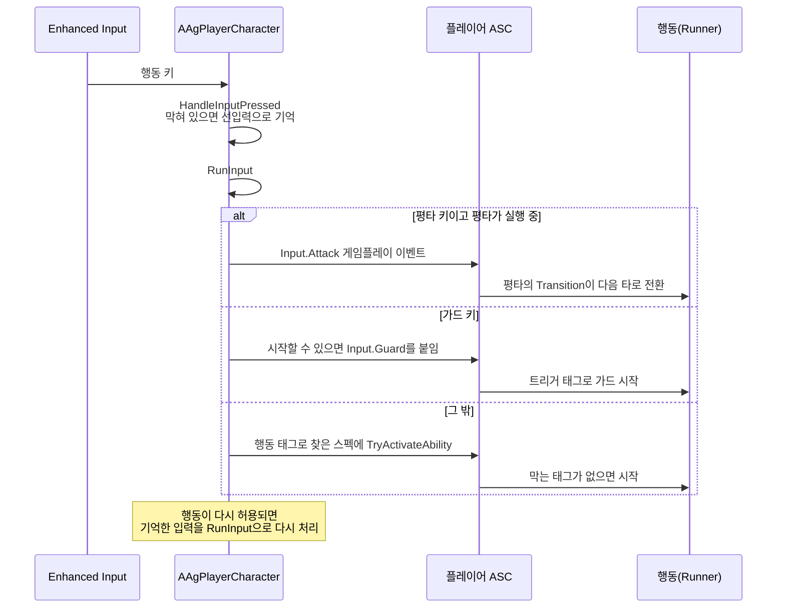

# 입력 처리

행동의 실행 구조는 [어빌리티와 AbilityTask](<어빌리티와 AbilityTask.md>)를 따릅니다.

플레이어 입력(키 배치, 상태별 허용 입력, 선입력, 모션 캔슬)을 어떻게 구현할지 정합니다.

## 기술 결정

| 항목 | 결정 | 이유 |
| - | - | - |
| 입력 | Enhanced Input 입력 에셋 10개(이동, 시야, 평타, 가드, 회피·달리기, 점프, 스킬, 궁극기, 처형, 락온)를 둡니다. 행동 키는 입력 바인딩이 입력 태그를 함께 넘겨 함수 하나가 처리합니다(바인딩하는 때는 [캐릭터와 GAS](<캐릭터와 GAS.md>) '입력 연결'). 키에 맞는 행동은 행동 태그로 찾습니다([어빌리티와 AbilityTask](<어빌리티와 AbilityTask.md>) '입력 계층의 행동 찾기'). 평타 키 처리 순서(공중이면 점프 공격, 회피 반격 기회가 있으면 회피 반격, 평타가 실행 중이면 `Input.Attack` 이벤트, 그 밖에는 평타), 트리거 태그(`Input.Guard`, `Input.Sprint`, `Input.LockOn`)와 이동 입력 태그(`Input.Move`), 자동 가드, 이동 입력 제한은 플레이어 캐릭터의 C++ 입력 처리에서 합니다. | 키와 행동 태그의 대응이 입력 규칙이라 C++ 한 곳에 있고, 그 태그를 가진 행동은 데이터가 정합니다. |
| 토글형 행동 | 가드·달리기·락온은 입력 처리가 트리거 태그를 붙이고 떼어 시작하고 끝냅니다. 붙이기 전에 그 행동을 시작할 수 있는지 확인하고, 붙였는데 시작하지 않았거나 행동이 다른 이유로 끝나면 뗍니다([어빌리티와 AbilityTask](<어빌리티와 AbilityTask.md>) '트리거'). 점프는 점프 행동을 시작할 수 있을 때만 엔진 `Jump`를 부르고, 키를 떼면 `StopJumping`을 부릅니다. | 엔진은 트리거 태그가 붙는 순간에만 발동을 시도하므로, 막힌 채로 붙은 태그가 남지 않게 합니다. |
| 자동 가드 | 가드 키를 누른 채 후딜이 시작되거나(`State.Busy`가 풀림) 행동·피격 반응이 끝나면 다음 프레임에 가드로 돌아옵니다. 가드가 실행 중이면(패리 모션은 가드를 끝내지 않음) 후딜에 든 패리 모션(`Ability.Action.Parry`)을 취소하고, 아니면 가드의 트리거 태그를 붙입니다. 가드 밀림은 가드를 끝내지 않으므로 가드가 그대로 이어집니다. 가드를 새로 시작할 때마다 패리 구간이 열립니다(플레이어 사양 '패리 구간'). 패리 모션의 후딜 전에 가드 키를 떼었다가 다시 누르면, 그 입력은 선입력으로 기억했다가 후딜이 시작될 때 가드를 새로 시작합니다(패리 구간이 열림). 후딜 전에는 가드 입력이 허용되지 않기 때문입니다(플레이어 입력 '상태별 허용 입력'). | 가드 밀림 뒤에는 가드가 끝나지 않아 패리 구간이 다시 열리지 않고, 가드 어빌리티에 시작 방법을 전하는 이벤트가 필요 없습니다. |
| 모션 캔슬 | 행동은 후딜 전까지 `State.Busy`(시간표 HoldTag)를 갖고, 모션이 있는 플레이어 행동은 행동 내내 `State.Acting`(OwnedTags)을 갖습니다. 새 행동은 Busy가 없을 때 발동해 진행 중인 행동을 취소합니다. 회피 후딜의 재입력은 회피를 다시 시작합니다. 이동 입력은 `State.Acting`, 패리 구간(`State.ParryWindow`), 피격 반응, 그로기, 처형, 사망 태그가 있으면 적용하지 않습니다. 이동 입력 방향과 `Input.Move`는 이동을 막는 동안에도 갱신합니다(회피의 Roll 선택). | Busy와 행동의 수명이 다르므로 태그 두 개로 나눕니다. 이동 제한이 행동 정의에 드러나고, 일반 점프·가드 유지·달리기에는 `State.Acting`이 없어 새 제한이 걸리지 않습니다. |
| 선입력 | 플레이어 캐릭터가 입력을 받을 때 '행동 중'이나 피격 반응 태그가 있으면, 그 입력 하나와 누른 시각(월드 시간)을 기억합니다. 점프 중의 평타 키는 점프 공격으로 허용되므로 기억하지 않습니다([애니메이션과 이동](<애니메이션과 이동.md>) '점프 공격'). 입력은 그때도 그대로 처리하므로 허용되지 않은 행동은 시작하지 않고, 실행 중인 평타는 다음 타 입력(`Input.Attack`)을 그대로 받습니다. 두 태그가 풀리면 다음 프레임에 기억한 입력을 다시 처리하고, 기억하는 시간이 지났거나 가드 키를 뗐으면 버립니다. 자동 가드를 시작할 때도 기억한 입력을 먼저 처리합니다. | 입력이 한 함수로 모이고 허용되는 순간이 태그 두 개로 드러나, 행동 정의를 고치지 않아도 됩니다. 다음 프레임에 처리해야 같은 프레임에 이어지는 상태(평타의 후딜 표시, 행동을 끊은 피격 반응)가 반영됩니다. 월드 시간은 히트스톱 중에도 흐릅니다. |

## 클래스 구조

### 입력에서 행동까지

이동은 캐릭터 무브먼트로 갑니다. 락온 키는 선입력과 행동 제한을 거치지 않고 바로 락온의 트리거 태그를 붙이거나 뗍니다. 나머지 행동 키는 아래처럼 행동으로 갑니다.

