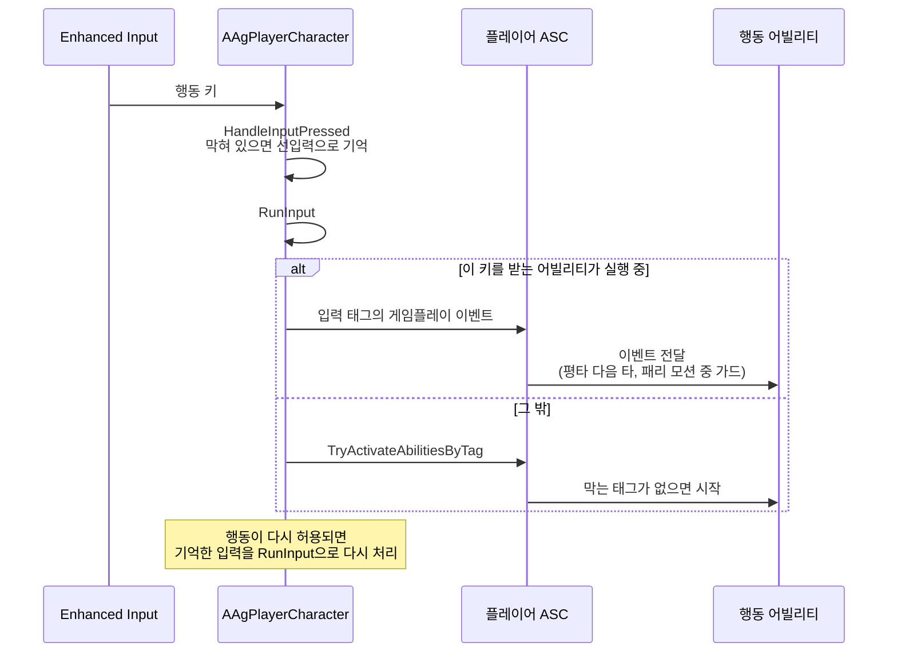

# 입력 처리

플레이어 입력(키 배치, 상태별 허용 입력, 선입력, 모션 캔슬)을 어떻게 구현할지 정합니다.

## 기술 결정

| 항목 | 결정 | 이유 |
| - | - | - |
| 입력 | Enhanced Input 입력 에셋 10개(이동, 시야, 평타, 가드, 회피·달리기, 점프, 스킬, 궁극기, 처형, 락온)를 둡니다. 행동 키는 입력 바인딩이 입력 태그를 함께 넘겨 함수 하나가 처리합니다(바인딩하는 때는 [캐릭터 초기화](<캐릭터 초기화.md>) '입력 연결'). 평타 키 처리 순서, 가드 키를 누른 채 후딜이 시작되거나('행동 중' 태그가 풀림) 행동이 끝났을 때의 자동 가드, '행동 모션'과 가드 시작 후 이동할 수 없는 시간의 이동 입력 무시는 플레이어 캐릭터의 C++ 입력 처리에서 합니다. 가드 밀림 뒤의 자동 가드는 게임플레이 이벤트(`Event.Guard.Resume`)로 가드 어빌리티를 시작하고, 가드 어빌리티는 이 이벤트로 시작했을 때 패리 구간을 열지 않습니다. | 패리 구간을 열지 말지가 시작하는 방법에 실려 와서, 캐릭터에 일회용 상태를 두지 않습니다. |
| 모션 캔슬 | 행동 어빌리티는 후딜 전까지 '행동 중' 태그를, 모션이 끝날 때까지 '행동 모션' 태그를 갖습니다. 후딜 시작은 [애니메이션과 이동](<애니메이션과 이동.md>)의 '모션을 따르는 구간'을 따릅니다. 새 행동은 '행동 중' 태그가 없을 때만 시작하고, 시작하면 진행 중인 행동을 취소합니다. 회피 후딜에 회피를 누르면 회피를 처음부터 다시 시작합니다. 이동 입력은 '행동 모션' 태그가 있는 동안 무시합니다. 플레이어 행동, 보스 패턴, 피격 반응, 그로기(처형 피격 포함), 페이즈 전환은 블렌드 아웃이 시작될 때가 아니라 모션이 끝날 때 끝납니다. 피격 반응에 이어지는 모션(넉업의 기상)은 앞 모션이 블렌드 아웃을 시작할 때 잇습니다. | 상태별 허용 입력 표를 그대로 옮길 수 있습니다. 이동만 후딜에도 막히므로 태그를 따로 둡니다. 블렌드 아웃은 모션 끝보다 먼저 시작해, 그때 끝내면 후딜과 피격 반응(기상 무적 포함)이 모션보다 짧아지고 그로기가 지속 시간보다 짧아지며, 페이즈 전환의 무적이 포효가 끝나기 전에 풀립니다. |
| 선입력 | 플레이어 캐릭터가 입력을 받을 때 '행동 중'이나 피격 반응 태그가 있으면, 그 입력 하나와 누른 시각(월드 시간)을 기억합니다. 점프 중의 평타 키는 점프 공격으로 허용되므로 기억하지 않습니다([애니메이션과 이동](<애니메이션과 이동.md>) '점프 공격'). 입력은 그때도 그대로 처리하므로 허용되지 않은 행동은 시작하지 않고, 진행 중인 어빌리티가 받는 입력(패리 모션 중의 가드)은 그대로 받습니다. 두 태그가 풀리면 다음 프레임에 기억한 입력을 다시 처리하고, 기억하는 시간이 지났거나 가드 키를 뗐으면 버립니다. 가드 키를 누른 채 후딜이 시작되거나 행동이 끝나 가드를 시작할 때도 기억한 입력을 먼저 처리합니다. | 입력이 한 함수로 모이고 허용되는 순간이 태그 두 개로 드러나, 행동 어빌리티를 고치지 않아도 됩니다. 다음 프레임에 처리해야 같은 프레임에 이어지는 상태(평타의 후딜 표시, 행동을 끊은 피격 반응)가 반영됩니다. 월드 시간은 히트스톱 중에도 흐릅니다. |

## 클래스 구조

### 입력에서 행동까지

이동은 캐릭터 무브먼트로 갑니다. 락온 키는 선입력과 행동 제한을 거치지 않고 바로 `RunInput`으로 가서 락온 어빌리티를 시작하거나 끝냅니다. 나머지 행동 키는 아래처럼 어빌리티로 갑니다.

