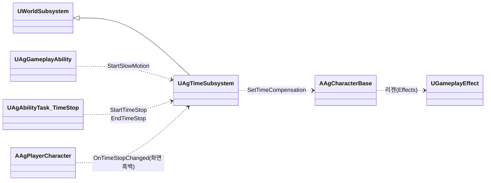
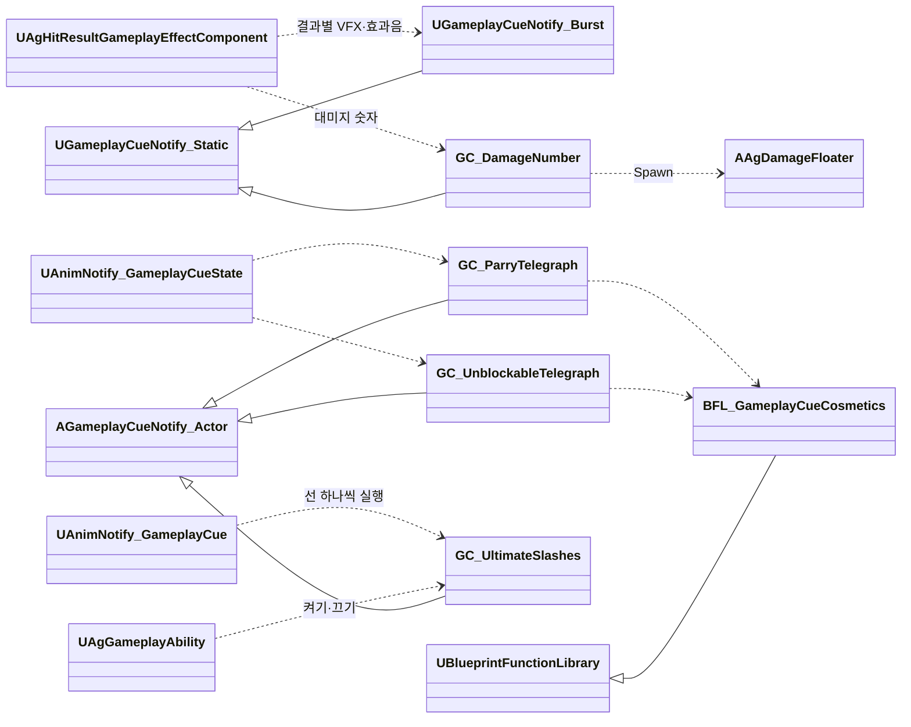

# 전투 규칙

전투 규칙을 어떻게 구현할지 정합니다.

실행 구조와 기능별 고정 Params는 [어빌리티와 AbilityTask](<어빌리티와 AbilityTask.md>)를 따릅니다.

## 기술 결정

| 항목 | 결정 | 이유 |
| - | - | - |
| 공격 진행 | 공통 Ability가 ID로 모션을 선택해 엔진 `PlayMontageAndWait`로 재생합니다. 몽타주 시간표의 Attack 구간이 시작되면 재생을 소유한 Ability가 항목의 공격 값으로 Attack Task를 시작합니다([몽타주 시간표](<몽타주 시간표.md>)). Task는 무기 캡슐을 조회하고 자기 적중 대상과 이전 무기 위치를 보관합니다. 궁극기·착지·처형은 명시적 대상 목록으로 단발 Attack을 실행합니다. | Attack은 모션이나 이동을 시작하지 않습니다. 구간 끝·재생 중단·Ability 취소 모두 같은 자기 자원 정리로 이어집니다. |
| 투사체 발사 | 몽타주 시간표의 SpawnProjectile 지점에 이르면 재생을 소유한 Ability가 항목의 `ProjectileId`로 `Projectiles.json`의 발사 정의를 찾고, 항목의 공격 값과 `Origin`·`SocketName`을 Task에 전달합니다. Task는 엔진 `UAbilityTask_SpawnActor`로 지연 생성하고 Owner·Instigator·변환을 설정합니다. 발사 Ability의 `MakeEffectSpec`으로 만든 대미지 효과 Spec을 투사체가 보관하므로 스펙 태그와 Ability 출처도 유지됩니다. 적중마다 Spec과 Context를 복사해 투사체 Causer·적중 위치를 넣고, `SetContext`로 적중 시점의 출처 상태와 ATK를 재캡처합니다. 대상별 피격 결과는 서로 섞이지 않습니다. 생성 도중 취소되면 미발사 액터를 제거하며 이미 발사한 액터는 독립 수명을 유지합니다. 비행·판정은 `AAgProjectile`, 외형은 BP가 담당합니다. | 발사 순번으로 데이터를 추정하지 않습니다. 섹션 점프로 건너뛴 발사를 보충하지 않습니다. |
| 연출 | VFX(피격, 패리, 궁극기 마무리, 궁극기 베기 선, 가드 불가 예고, 패리 예고), 효과음은 GameplayCue로 재생합니다. 큐는 `/Game/GameplayCues`의 큐 블루프린트(Cosmetic 연출 그래프 허용)이고, 피격·가드·패리·궁극기 마무리 큐는 엔진의 Burst 큐(`UGameplayCueNotify_Burst`)로 만듭니다. 카메라 셰이크는 플레이어 컨트롤러의 일반 C++ 함수로 직접 재생합니다([카메라 구현](<카메라, HUD, 화면 UI, 게임 플로우.md>)의 카메라 셰이크). 피격·가드·패리 큐는 피격 결과마다 하나씩(가드 브레이크는 가드 큐) 두고, 그 결과의 VFX와 효과음을 큐 위치에 한 번 재생합니다. 가드 큐의 VFX는 피격 VFX입니다. 가드 불가 예고와 패리 예고는 같은 VFX를 큐마다 다른 색(VFX의 색 사용자 파라미터)으로 재생합니다. 두 예고는 보스 패턴 몽타주의 'Telegraph' 트랙에 둔 엔진 노티파이 GameplayCue (Looping)(`UAnimNotify_GameplayCueState`)이 켜고 끄며, 큐는 대상 캐릭터의 무기에 VFX를 붙이고 켜질 때 효과음을 한 번 재생합니다. 노티파이는 판정 구간(DashThrust는 돌진 시작, SwordWave는 검기를 쏘는 순간)이 시작할 때 끝나고, 보스 사양 '공격 예고'의 앞서는 시간에 '모션 재생 속도'를 곱한 몽타주 시간만큼 앞서 시작합니다. LeapSlam의 가드 불가 예고는 떠오르는 모션(Start 구간)에 둡니다. 호출부는 상황별 단계(`EAgCameraShake`)를 `Camera.json`에서 읽어 로컬 플레이어 컨트롤러에 전달합니다. LeapSlam 착지의 범위 판정은 그 컨트롤러의 Pawn 위치를 사용합니다. 처형의 마지막 일격과 궁극기 마무리는 그 어빌리티가 정합니다. 궁극기 마무리 VFX(`GC_UltimateFinish`)는 패리 VFX처럼 피격 VFX를 더 크게 재생하는 Burst 큐이고(효과음은 피격 효과음), 대미지 GE가 일반 피격일 때 스펙의 어빌리티 태그(`Ability.Action.Ultimate`)를 보고 피격 큐 대신 고릅니다. | 연출과 게임 로직을 나눕니다. 공격 예고는 연출이라 코드가 시점을 계산하지 않고 몽타주에서 배치합니다. 노티파이는 몽타주와 함께 멈추므로 히트스톱도 따릅니다. 한 번 재생하는 VFX와 효과음은 엔진 큐로 충분해 프로젝트 클래스를 두지 않습니다. VFX·효과음·배치·모양은 제작 정보라 큐 블루프린트에 둡니다(AGENTS.md 코딩 규칙). 셰이크는 JSON 수치를 공통 C++ 클래스로 재생해 단계별 에셋을 두지 않습니다. 셰이크 단계는 열거형으로 적어 JSON이 읽기 쉽고, 없는 단계는 불러올 때 오류가 됩니다. 효과음이 결과마다 달라 VFX와 함께 결과마다 큐 하나에 두면, 결과 하나가 큐 하나만 실행합니다. |
| 검기 모습 | 검기 블루프린트의 메시 컴포넌트가 템플릿 프로토타입 메시(`SM_Cube`)에 반투명 머티리얼 인스턴스(`MI_SwordWave`)를 씌워 그리고, 색과 불투명도는 이 컴포넌트의 커스텀 프리미티브 데이터에 둡니다. 이 컴포넌트는 'Disallow Nanite'를 켜 Nanite를 쓰지 않고, 'Cast Shadow'를 꺼 그림자를 드리우지 않습니다. | 템플릿 머티리얼(`M_SimpleGlow`)은 색과 색 스위치를 커스텀 프리미티브 데이터에서 읽어, 머티리얼 인스턴스의 파라미터로는 바뀌지 않습니다. Nanite는 불투명·마스크드 머티리얼만 그립니다. `SM_Cube`는 레벨의 바닥과 벽도 Nanite로 쓰므로, 메시 에셋은 그대로 두고 검기 컴포넌트에서만 끕니다. 엔진 경고가 권하는 방법입니다. |
| 태그 | 상태, 입력, 이벤트, GameplayCue 태그를 모두 `AgGameplayTags`에 네이티브로 선언합니다. | AGENTS.md 코딩 규칙 |
| 히트스톱 | 적중하면 두 캐릭터에 히트스톱 태그(`State.Hitstop`)를 히트스톱 효과(`Hitstop`)로 그 효과의 `Duration` 동안 줍니다. 캐릭터는 이 태그가 있는 동안 자기 시간 배율(CustomTimeDilation)을 거의 0으로 낮춥니다. 캐릭터의 시간 배율은 이 히트스톱 배율에 시간 정지 보정('시간 정지')을 곱한 값입니다. 시간은 게임 시간으로 재고, 멈춘 캐릭터가 다시 적중에 걸리면 태그가 하나 더 붙어 마지막 것이 끝날 때 풀리므로 그 캐릭터만 처음부터 다시 잽니다. 투사체에 맞으면 맞은 쪽만 멈춥니다. | 히트스톱은 캐릭터의 상태라 패리 구간처럼 ASC의 태그로 둡니다. 태그는 GAS가 복제하므로 멀티플레이에서도 구조를 바꾸지 않습니다. 슬로우모션 중에는 자연히 길어져 기획서와 맞습니다. 다른 캐릭터의 적중이 이미 멈춘 캐릭터의 히트스톱을 늘리지 않습니다. |
| 슬로우모션 | 시간 서브시스템(`UAgTimeSubsystem`)이 게임 전체 시간 배율을 슬로우모션 속도로 바꾸고, 지속 시간(실제 시간)이 지나면 되돌립니다. 되돌리는 타이머는 게임 시간으로 흐르므로 '지속 시간 × 배율'로 겁니다. 다시 발동하면 처음부터 셉니다. 속도와 지속 시간은 발동하는 쪽이 넘깁니다: 극한 회피는 회피 어빌리티, 궁극기 마무리 적중은 대미지 GE의 적중 후 처리입니다. | 게임 전체의 시간은 캐릭터가 아니라 월드의 상태라 월드 서브시스템이 맡습니다. 엔진 타이머에는 실제 시간으로 세는 방법이 없지만, 슬로우모션 동안에는 배율이 일정해 곱하면 실제 시간과 같습니다. |
| 시간 정지 | 시간 서브시스템이 게임 전체 시간 배율을 0.001로 낮추고, 시간을 멈춘 캐릭터에는 그 역수(1000)를 시간 정지 보정으로 줘 정상 속도로 돌립니다. 시작하면 도는 슬로우모션을 끝냅니다. 시간 정지의 요청 소유권은 [캐릭터와 GAS](<캐릭터와 GAS.md>)의 공용 몽타주 Task를 따릅니다. 시간 정지가 시작·끝날 때 서브시스템이 알리면, 플레이어 블루프린트의 후처리 컴포넌트(`TimeStopScreen`, 범위 없음)가 가중치를 1·0으로 바꿔 화면을 흑백으로 합니다. 흑백 설정은 그 컴포넌트에 둡니다. 플레이어 컨트롤러와 카메라 매니저는 보정하지 않습니다. | 캐릭터만 멈추면 엔진·GAS 타이머(그로기 시간, 쿨다운, 리젠)는 계속 흘러, 멈춘 동안 그로기가 줄어드는 등 어긋납니다. 게임 전체를 멈추면 이들도 함께 멈춥니다. 액터의 시간 배율은 그 액터의 컴포넌트 틱(메시, 무브먼트, ASC)에 곱해지므로 보정 하나로 플레이어 전체가 정상 속도로 돕니다. 0.001은 엔진의 최솟값(0.0001)보다 크고, 약 4초 동안 멈춘 쪽이 0.004초만큼 움직이는 정도라 보이지 않습니다. 시간 정지 동안 플레이어의 GAS 타이머(SP 리젠, 쿨다운, 선입력)도 멈춥니다. 컨트롤러와 카메라 매니저는 시간 정지 동안 시간에 따라 바뀌는 것이 없습니다(시야 입력은 시간과 무관하고 셰이크가 없음). |
| 궁극기 | 궁극기 어빌리티가 시간 정지 태스크(`UAgAbilityTask_TimeStop`)로 시간을 멈추고, 몽타주(`AM_Player_Ultimate`)와 컷신 태스크(`UAgAbilityTask_PlayCutscene`)를 함께 시작합니다. 몽타주는 섹션 Start(발도 자세) → Hold(기다림, 반복) → Judgment(칼 넣기) → Draw(칼 뽑기)이고, 컷신이 끝나면 Judgment로 넘깁니다. 베기 선은 큐(`GC_UltimateSlashes`)입니다. Judgment가 시작되면 어빌리티가 큐를 켜고(어빌리티가 끝나면 함께 꺼짐), 몽타주 'Slash' 트랙의 엔진 GameplayCue 노티파이(`AnimNotify_GameplayCue`)가 베기 선마다 큐를 실행하며, 큐는 큐 BP의 거리·높이 설정과 실행 시점의 캐릭터·카메라로 위치·방향을 계산하고, 블루프린트의 Add Static Mesh Component 노드에 설정한 메시 컴포넌트를 생성해 그 자리에 놓습니다. 위치의 좌우 폭은 카메라 방향에서 ±35°(시야각 90°의 안쪽)이고, 방향은 카메라를 마주 보는 면 안의 무작위 방향입니다. Judgment 끝(칼집에 들어가는 순간)의 시간표 사건(`Event.UltimateFinish`)에서 베기 선 큐를 끄고(모두 지워짐) 시간 정지 태스크를 끝낸 뒤, TargetQuery로 범위 안의 적을 모아 단발 Attack을 실행합니다. 이때부터 후딜입니다. 적중 후 처리(VFX, 셰이크, 히트스톱, 슬로우모션)는 대미지 GE가 맡습니다. | 연출(카메라)은 시퀀스 에셋이, 모션과 판정은 어빌리티가 맡습니다. 베기 선은 판정이 없는 연출이라 큐로 두고(구현 계획서 '연출'), 하나씩 나타났다가 함께 사라져야 해서 켜고 끄는 액터 큐에 실행을 보냅니다. 켜진 액터 큐에 보낸 실행은 엔진이 같은 큐 액터로 전달합니다. 거리·높이·모양은 모두 아트 제작 정보로 큐 블루프린트가 정하고, 배치도 Cue가 계산합니다. 모션을 몽타주로 두면 다른 행동과 같은 방식(GAS 몽타주, 루트 모션)으로 이어지고, 컷신이 끝날 때 애니메이션을 넘겨받을 일이 없습니다. 시간 정지를 끈 뒤에 대미지를 적용해야 히트스톱과 슬로우모션이 정상 시간 위에서 시작합니다. 시간 정지는 게임 전체의 상태라 태스크가 들고 있어, 마무리 전에 궁극기가 끝나도(레벨 종료 등) 함께 풀립니다. 베기 선은 판정이 없는 연출이라 몽타주 노티파이로 두고([몽타주 시간표](<몽타주 시간표.md>) '기술 결정'), 노티파이는 플레이어의 몽타주를 따르므로 플레이어의 시간(시간 정지 보정, 히트스톱)을 따릅니다. |
| 컷신 | 컷신 태스크가 레벨 시퀀스를 기준 액터의 위치·방향(Transform Origin)으로 재생합니다. 재생 설정으로 시네마틱 모드(시야·이동 입력 무시, HUD 숨김)를 켭니다. 그동안 HUD와 보스의 월드 위젯이 숨는 것은 [카메라, HUD, 화면 UI, 게임 플로우](<카메라, HUD, 화면 UI, 게임 플로우.md>)의 'HUD'와 '월드 위치 HUD'를 따릅니다. 시퀀스는 카메라(카메라 컷)만 담습니다. 시간 정지 중이면 재생 속도에 시간 정지 보정을 곱합니다. 어빌리티가 먼저 끝나면 태스크가 시퀀스를 멈춥니다. | 컷신은 다른 어빌리티(보스 패턴 등)도 쓸 수 있는 동작이라 태스크로 둡니다([캐릭터와 GAS](<캐릭터와 GAS.md>) '어빌리티 구조'). 시퀀스 플레이어는 액터의 시간 배율이 아니라 게임 전체 시간 배율을 재생 속도에 곱합니다. 시네마틱 모드는 엔진 기능이라 입력을 막는 코드가 따로 필요 없습니다. 시퀀스가 끝나거나 멈추면 카메라와 시네마틱 모드를 되돌립니다. |
| 회피 반격 기회 | 극한 회피 때 시간 태그 효과(`TimedTag`)로 기회 태그를 줍니다. 평타 키는 기회 태그가 있으면 회피 반격을 시작하고, 지금 시작할 수 없으면 무시합니다. 행동 태그(`Ability.Action`, 이동 외의 행동이며 회피 반격도 포함)나 넉업·넉백 어빌리티가 시작되면 플레이어 캐릭터가 기회를 지웁니다. | 기회도 쿨다운처럼 히트스톱 중에 흐르는 시간입니다. 기회를 지우는 곳이 한곳이라, 회피 반격도 기회를 따로 지우지 않습니다. |
| 대상 찾기 | 락온, 공격 중 위치·회전 보정, 처형의 대상은 TargetingSystem으로 찾습니다. 프리셋(`TP_Enemy`)이 플레이어 주변의 캐릭터를 후보로 모으면, C++에서 적대 관계이고 살아 있는 후보 가운데 수평 거리가 가장 가까운 적 하나를 고릅니다. 락온과 처형은 타겟팅 범위 안(캡슐 중심 사이 수평 거리)이고 그 기능의 조건(락온은 화면 안, 처형은 그로기 중이고 이번 그로기에 아직 처형되지 않았고 땅에 있음)을 만족하는 후보만 봅니다. 공격 중 위치·회전 보정은 타겟팅 범위를 보지 않고 고르고, 범위는 회전과 접근 여부만 정합니다([애니메이션과 이동](<애니메이션과 이동.md>) '공격 중 위치·회전 보정'). 궁극기 마무리는 범위 안의 적 모두입니다. | 기획서의 거리는 캡슐 중심 사이 수평 거리이고, 프리셋의 검색 반경은 타마다 바꿀 수 없습니다. 조건을 후보마다 확인하므로, 더 가까운 적이 조건에 맞지 않아도 조건에 맞는 적을 찾습니다. |

## 클래스 구조

### 시간

| 클래스 | 부모 | 역할 |
| - | - | - |
| `UAgTimeSubsystem` | `UWorldSubsystem` | 게임 전체 시간 배율(슬로우모션, 시간 정지) |

### GameplayCue

큐는 GameplayCue 태그로 실행합니다. 큐 블루프린트는 `/Game/GameplayCues`에 두며 엔진 GameplayCue 클래스를 직접 상속합니다. 프로젝트 전용 GameplayCue C++ 클래스는 두지 않습니다. Cosmetic 그래프의 허용 범위는 AGENTS.md를 따릅니다. 엔진 GameplayCue 매니저가 `Config/DefaultGame.ini`의 검색 경로(`GameplayCueNotifyPaths`)에서 블루프린트를 찾아 태그와 잇습니다. 같은 폴더를 '항상 쿡할 디렉터리'에 넣어 패키지에 포함합니다.

| BP 에셋 | 부모 | 역할 |
| - | - | - |
| `GC_Hit`, `GC_Guard`, `GC_Parry`, `GC_UltimateFinish` | `UGameplayCueNotify_Burst` | 엔진 Burst 데이터로 결과별 VFX와 효과음을 한 번 재생합니다. |
| `GC_UnblockableTelegraph`, `GC_ParryTelegraph` | `AGameplayCueNotify_Actor` | 활성화 시 공통 BP 함수 라이브러리 `BFL_GameplayCueCosmetics`를 호출해 무기 소켓에 VFX를 붙이고 색을 적용하며 효과음을 재생합니다. 캐릭터 무기가 없으면 전달된 부착 컴포넌트, 대상 루트 순서로 사용합니다. VFX·소켓·색 파라미터·색·효과음은 각 큐의 기본값입니다. |
| `GC_UltimateSlashes` | `AGameplayCueNotify_Actor` | 실행마다 Add Static Mesh Component 노드의 제작 설정으로 선을 생성합니다. BP 기본값의 거리·높이 범위와 캐릭터·카메라를 사용해 BP에서 위치·방향을 계산합니다. 메시·머티리얼·크기·커스텀 프리미티브 데이터·그림자·Nanite 설정은 BP가 소유하며, 선은 충돌 없이 생성 위치에 고정됩니다. |
| `GC_DamageNumber` | `UGameplayCueNotify_Static` | Instigator가 로컬 플레이어인지 확인하고 맞은 위치에 RawMagnitude를 반올림해 표시합니다. 기존 UI 함수 `AAgDamageFloater::Spawn`을 호출하며 위젯 클래스는 큐 기본값입니다. |
| `BFL_GameplayCueCosmetics` | `UBlueprintFunctionLibrary` | BP 함수 `ResolveAttachment`와 `SpawnTelegraph`로 두 공격 예고의 부착 대상 선택과 VFX·효과음 재생을 공유합니다. |

예고와 베기 선은 생성한 컴포넌트를 BP 변수에 보관하고 OnRemove·EndPlay에서 정리합니다. OnRemove 뒤 엔진이 큐를 재사용하므로 제거 시 참조와 배열도 비우며, OnActive에서도 남은 컴포넌트를 정리합니다. WhileActive는 추가 재생 없이 성공을 반환합니다. 예고 효과음은 큐가 제거돼도 끝까지 재생합니다. 예고 구간과 베기 선 시점은 몽타주에 둡니다.

GameplayCue의 제작 설정은 JSON에 두지 않습니다. 베기 선의 거리·높이 범위도 `GC_UltimateSlashes`의 BP 기본값(`SlashDistanceMin`, `SlashDistanceMax`, `SlashHeightMin`, `SlashHeightMax`)으로 관리합니다. 예고 BP는 `AAgCharacterBase`의 읽기 전용 함수로 무기 컴포넌트를 조회합니다. 판정·대미지·자원 변경·어빌리티 진행은 C++ 호출부가 담당합니다. 대미지 숫자의 떠오름·위젯 애니메이션은 기존 UI 구현을 사용합니다([카메라, HUD, 화면 UI, 게임 플로우](<카메라, HUD, 화면 UI, 게임 플로우.md>)).

