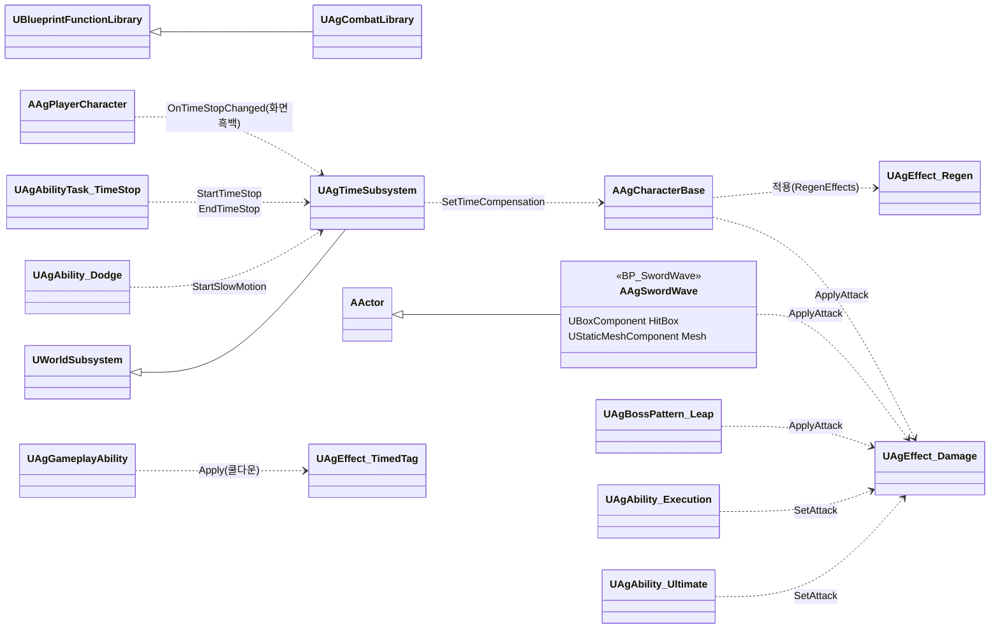
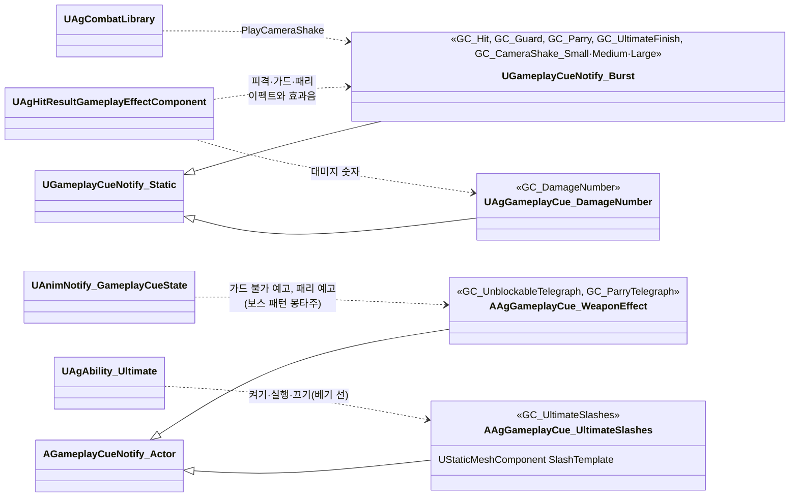
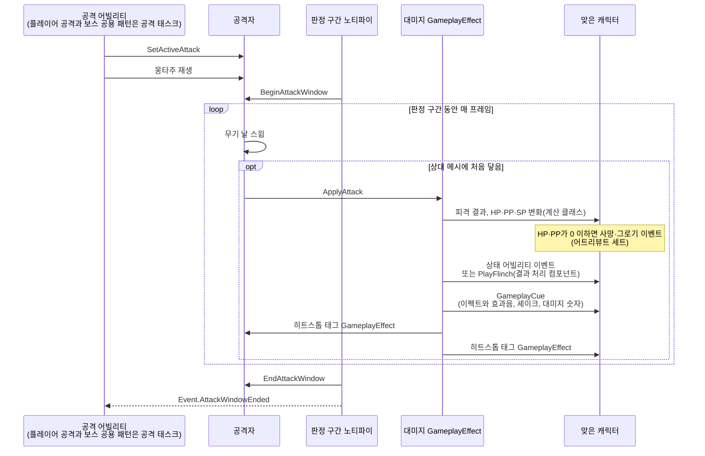

# 전투 규칙

전투 규칙을 어떻게 구현할지 정합니다.

## 기술 결정

| 항목 | 결정 | 이유 |
| - | - | - |
| 공격 판정 | 근접 공격은 판정 구간 동안 무기 날을 따라 이전 프레임 위치에서 현재 위치까지 스윕하고, 프레임 사이를 잘게 나눠 검사합니다. 나눈 위치는 캐릭터 축을 중심으로 한 호를 따라 잡습니다. 무기 날은 무기 컴포넌트의 자식인 캡슐 컴포넌트(`WeaponCollision`, 충돌 없음)로 정하고, 캡슐 양 끝의 선분을 캡슐 반지름의 구로 스윕합니다. 캡슐의 위치, 회전, 크기는 캐릭터 블루프린트에 적습니다. 맞는 대상은 상대 캐릭터 메시의 피직스 바디입니다. 판정 구간 하나가 1타이고, 이미 맞은 대상은 기록해 다시 맞지 않게 합니다. | 할버드에는 한 프레임에 크게 움직이는 스미어 프레임이 있습니다. 휩쓸기 패턴은 한 프레임에 크게 돌아, 직선으로 나누면 옆에 선 상대를 지나칩니다. 캡슐은 블루프린트 뷰포트에서 무기 메시에 겹쳐 보며 맞출 수 있고, 캡슐의 겹침 이벤트를 쓰지 않아 빠른 휘두르기에도 판정을 놓치지 않습니다. |
| 공격 진행 | 판정 구간이 있는 공격(평타 한 타, 점프 공격, 회피 반격, 스킬, 보스 공용 패턴)은 공격 태스크(`UAgAbilityTask_Attack`) 하나로 진행합니다. 태스크는 공격 데이터를 판정 구간에 걸고, 몽타주를 재생하고, 공격 중 이동 태스크를 시작합니다. 마지막 판정 구간의 끝(후딜 시작), 모션의 끝, 끊김을 어빌리티에 알리고, 끝나면 공격 데이터를 지웁니다. 플레이어 공격 데이터(`FAgPlayerAttack`)와 보스 패턴 데이터(`FAgBossPattern`)는 구조체를 따로 두고, 태스크가 두 형식을 받아 같은 형태로 담습니다. | 플레이어와 보스의 공격이 같은 규칙(전투 시스템 '공격 데이터', '공격 중 이동')을 따르므로 같은 코드로 처리합니다. 두 구조체는 기획서의 다른 표(플레이어 행동, 보스 패턴 목록)를 옮긴 것이고, 합치면 보스에게 없는 값(타겟팅 범위, MP·UP 충전)을 `Boss.json`에 적어야 합니다. |
| 패턴별 공격 판정 | 돌진 찌르기는 돌진하는 동안 할버드 날을 스윕합니다. 도약 내려찍기는 착지하는 순간 AI 대상([보스](<보스.md>) 'AI 대상')이 땅에 있고 보스와의 수평 거리가 착지 지점 범위(보스 사양 '도약 내려찍기') 안이면 한 번 피격 처리합니다. 검기는 보스 사양 '검기'의 크기만큼 충돌 상자를 가진 투사체 액터로, 매 프레임 그 프레임에 지나간 구간을 상자로 쓸어 처음 닿은 상대를 한 번 피격 처리하고, 결과와 관계없이 그 상대를 뚫고 계속 날아갑니다(그 상대는 다시 판정하지 않음). 벽은 상자 가운데 높이의 선으로 검사합니다. 처형은 타격 노티파이(베기 2번, 마지막 일격)마다 처형 대상에게 대미지 GameplayEffect를 적용합니다. | 검기 한 발이 같은 상대를 여러 번 때리지 않고, 긴 프레임에도 상대를 건너뛰지 않습니다. 선은 바닥에 닿지 않아, 바닥을 벽으로 잘못 보지 않습니다. |
| 피격 결과 | 대미지 GameplayEffect는 C++ 클래스로 둡니다. 적용하는 쪽은 공격 데이터 1타를 스펙에 담습니다. 배율과 MP·UP 충전량은 SetByCaller로, 피격 반응·가드 불가·패리 불가·마지막 일격은 스펙 태그로, 맞은 위치는 컨텍스트의 Origin으로 넘깁니다. 죽은 대상에는 적용되지 않습니다(엔진의 대상 태그 조건 컴포넌트). 계산 클래스는 대상의 상태 태그로 결과를 정해 HP·PP·SP를 바꾸고 결과를 스펙 태그로 남기며, GameplayEffect 컴포넌트가 그 태그를 보고 처리합니다. 넉업, 넉백, 가드 밀림, 가드 브레이크, 그로기, 사망은 이벤트로 상태 어빌리티를 발동하고, 움찔은 덧입힘 몽타주만 재생합니다. 그로기 중에 맞은 넉업, 넉백도 움찔로 재생하고, 이번 타격으로 죽었거나 그로기가 되면 반응하지 않습니다. 사망·그로기 이벤트는 공격 쪽 태그(공격자와 스펙의 태그)를 넘깁니다. 처형 어빌리티가 만든 스펙에는 엔진이 어빌리티 태그를 넣으므로, 처형 사망 모션, 처형의 셰이크, 히트스톱 없음을 그 태그로 구분합니다. `Kill`은 HP를 0으로 만드는 GameplayEffect를 적용합니다. | 대미지 GameplayEffect는 계산 클래스, 컴포넌트, SetByCaller로 동작해 에셋에 담을 데이터가 없습니다. 결과를 스펙 태그로 남기면 결과 처리가 같은 판정을 다시 하지 않습니다. |
| 연출 | 이펙트(피격, 패리, 궁극기 마무리, 궁극기 베기 선, 가드 불가 예고, 패리 예고), 효과음, 카메라 셰이크는 GameplayCue로 재생합니다. 피격·가드·패리 큐와 셰이크 큐는 엔진의 Burst 큐(`UGameplayCueNotify_Burst`)로 만듭니다. 피격·가드·패리 큐는 피격 결과마다 하나씩(가드 브레이크는 가드 큐) 두고, 그 결과의 이펙트와 효과음을 큐 위치에 한 번 재생합니다. 가드 큐의 이펙트는 피격 이펙트입니다. 가드 불가 예고와 패리 예고는 같은 이펙트를 큐마다 다른 색(이펙트의 색 사용자 파라미터)으로 재생합니다. 두 예고는 보스 패턴 몽타주의 'Telegraph' 트랙에 둔 엔진 노티파이 GameplayCue (Looping)(`UAnimNotify_GameplayCueState`)이 켜고 끄며, 큐는 대상 캐릭터의 무기에 이펙트를 붙이고 켜질 때 효과음을 한 번 재생합니다. 노티파이는 판정 구간(돌진 찌르기는 돌진 시작, 검기 발사는 검기를 쏘는 순간)이 시작할 때 끝나고, 보스 사양 '공격 예고'의 앞서는 시간에 '모션 재생 속도'를 곱한 몽타주 시간만큼 앞서 시작합니다. 도약 내려찍기의 가드 불가 예고는 떠오르는 모션(Start 구간)에 둡니다. 셰이크 큐는 로컬 플레이어 캐릭터에서 실행해 그 카메라를 흔들고, 상황별 단계는 `Camera.json`에 둡니다. 처형의 마지막 일격과 궁극기 마무리는 그 어빌리티가 정합니다. 궁극기 마무리 이펙트(`GC_UltimateFinish`)는 패리 이펙트처럼 피격 이펙트를 더 크게 재생하는 Burst 큐이고(효과음은 피격 효과음), 대미지 GE가 일반 피격일 때 스펙의 어빌리티 태그(`Ability.Action.Ultimate`)를 보고 피격 큐 대신 고릅니다. 투사체 공격은 투사체를 반응의 기준으로 넘겨, 넉백 방향은 투사체 위치에서 정합니다. | 연출과 게임 로직을 나눕니다. 공격 예고는 연출이라 코드가 시점을 계산하지 않고 몽타주에서 배치합니다. 노티파이는 몽타주와 함께 멈추므로 히트스톱과 2페이즈 재생 속도도 따릅니다. 한 번 재생하는 이펙트, 효과음, 셰이크는 엔진 큐로 충분해 프로젝트 클래스를 두지 않습니다. 효과음이 결과마다 달라 이펙트와 함께 결과마다 큐 하나에 두면, 결과 하나가 큐 하나만 실행합니다. |
| 검기 모습 | 검기 블루프린트의 메시 컴포넌트가 템플릿 프로토타입 메시(`SM_Cube`)에 반투명 머티리얼 인스턴스(`MI_SwordWave`)를 씌워 그리고, 색과 불투명도는 이 컴포넌트의 커스텀 프리미티브 데이터에 둡니다. 이 컴포넌트는 'Disallow Nanite'를 켜 Nanite를 쓰지 않고, 'Cast Shadow'를 꺼 그림자를 드리우지 않습니다. | 템플릿 머티리얼(`M_SimpleGlow`)은 색과 색 스위치를 커스텀 프리미티브 데이터에서 읽어, 머티리얼 인스턴스의 파라미터로는 바뀌지 않습니다. Nanite는 불투명·마스크드 머티리얼만 그립니다. `SM_Cube`는 레벨의 바닥과 벽도 Nanite로 쓰므로, 메시 에셋은 그대로 두고 검기 컴포넌트에서만 끕니다. 엔진 경고가 권하는 방법입니다. |
| 태그 | 상태, 입력, 이벤트, 쿨다운, GameplayCue 태그를 모두 `AgGameplayTags`에 네이티브로 선언합니다. | AGENTS.md 코딩 규칙 |
| 입력 | Enhanced Input 입력 에셋 10개(이동, 시야, 평타, 가드, 회피·달리기, 점프, 스킬, 궁극기, 처형, 락온)를 둡니다. 행동 키는 입력 바인딩이 입력 태그를 함께 넘겨 함수 하나가 처리합니다. 평타 키 처리 순서, 가드 키를 누른 채 행동이 끝났을 때의 자동 가드, 행동 중과 패리 구간의 이동 입력 무시는 플레이어 캐릭터의 C++ 입력 처리에서 합니다. 가드 밀림 뒤의 자동 가드는 게임플레이 이벤트(`Event.Guard.Resume`)로 가드 어빌리티를 시작하고, 가드 어빌리티는 이 이벤트로 시작했을 때 패리 구간을 열지 않습니다. | 패리 구간을 열지 말지가 시작하는 방법에 실려 와서, 캐릭터에 일회용 상태를 두지 않습니다. |
| 히트스톱 | 적중하면 두 캐릭터에 히트스톱 태그(`State.Hitstop`)를 시간 태그 GameplayEffect로 히트스톱 시간 동안 줍니다. 캐릭터는 이 태그가 있는 동안 자기 시간 배율(CustomTimeDilation)을 거의 0으로 낮춥니다. 캐릭터의 시간 배율은 이 히트스톱 배율에 시간 정지 보정('시간 정지')을 곱한 값입니다. 시간은 게임 시간으로 재고, 멈춘 캐릭터가 다시 적중에 걸리면 태그가 하나 더 붙어 마지막 것이 끝날 때 풀리므로 그 캐릭터만 처음부터 다시 잽니다. 투사체에 맞으면 맞은 쪽만 멈춥니다. | 히트스톱은 캐릭터의 상태라 패리 구간·쿨다운처럼 ASC의 태그로 둡니다. 태그는 GAS가 복제하므로 멀티플레이에서도 구조를 바꾸지 않습니다. 슬로우모션 중에는 자연히 길어져 기획서와 맞습니다. 다른 캐릭터의 적중이 이미 멈춘 캐릭터의 히트스톱을 늘리지 않습니다. |
| 슬로우모션 | 시간 서브시스템(`UAgTimeSubsystem`)이 게임 전체 시간 배율을 슬로우모션 속도로 바꾸고, 지속 시간(실제 시간)이 지나면 되돌립니다. 되돌리는 타이머는 게임 시간으로 흐르므로 '지속 시간 × 배율'로 겁니다. 다시 발동하면 처음부터 셉니다. 속도와 지속 시간은 발동하는 쪽이 넘깁니다: 극한 회피는 회피 어빌리티, 궁극기 마무리 적중은 대미지 GE의 적중 후 처리입니다. | 게임 전체의 시간은 캐릭터가 아니라 월드의 상태라 월드 서브시스템이 맡습니다. 엔진 타이머에는 실제 시간으로 세는 방법이 없지만, 슬로우모션 동안에는 배율이 일정해 곱하면 실제 시간과 같습니다. |
| 시간 정지 | 시간 서브시스템이 게임 전체 시간 배율을 0.001로 낮추고, 시간을 멈춘 캐릭터에는 그 역수(1000)를 시간 정지 보정으로 줘 정상 속도로 돌립니다. 시작하면 도는 슬로우모션을 끝냅니다. 시간 정지가 시작·끝날 때 서브시스템이 알리면, 플레이어 블루프린트의 후처리 컴포넌트(`TimeStopScreen`, 범위 없음)가 가중치를 1·0으로 바꿔 화면을 흑백으로 합니다. 흑백 설정은 그 컴포넌트에 둡니다. 플레이어 컨트롤러와 카메라 매니저는 보정하지 않습니다. | 캐릭터만 멈추면 엔진·GAS 타이머(그로기 시간, 쿨다운, 리젠)는 계속 흘러, 멈춘 동안 그로기가 줄어드는 등 어긋납니다. 게임 전체를 멈추면 이들도 함께 멈춥니다. 액터의 시간 배율은 그 액터의 컴포넌트 틱(메시, 무브먼트, ASC)에 곱해지므로 보정 하나로 플레이어 전체가 정상 속도로 돕니다. 0.001은 엔진의 최솟값(0.0001)보다 크고, 약 4초 동안 멈춘 쪽이 0.004초만큼 움직이는 정도라 보이지 않습니다. 시간 정지 동안 플레이어의 GAS 타이머(SP 리젠, 쿨다운, 선입력)도 멈춥니다. 컨트롤러와 카메라 매니저는 시간 정지 동안 시간에 따라 바뀌는 것이 없습니다(시야 입력은 시간과 무관하고 셰이크가 없음). |
| 궁극기 | 궁극기 어빌리티가 시간 정지 태스크(`UAgAbilityTask_TimeStop`)로 시간을 멈추고, 몽타주(`AM_Player_Ultimate`)와 컷신 태스크(`UAgAbilityTask_PlayCutscene`)를 함께 시작합니다. 몽타주는 섹션 Start(발도 자세) → Hold(기다림, 반복) → Judgment(칼 넣기) → Draw(칼 뽑기)이고, 컷신이 끝나면 Judgment로 넘깁니다. 베기 선은 큐(`GC_UltimateSlashes`)입니다. Judgment가 시작되면 어빌리티가 큐를 켜고(어빌리티가 끝나면 함께 꺼짐), 일정한 몽타주 위치마다 위치와 방향을 넘겨 큐를 실행하며, 큐는 실행마다 블루프린트의 견본 메시 컴포넌트를 복제해 그 자리에 놓습니다. 위치의 좌우 폭은 카메라 방향에서 ±35°(시야각 90°의 안쪽)이고, 방향은 카메라를 마주 보는 면 안의 무작위 방향입니다. Judgment 끝(칼집에 들어가는 순간)의 노티파이(`Event.UltimateFinish`)에서 베기 선 큐를 끄고(모두 지워짐) 시간 정지 태스크를 끝낸 뒤, 범위 안의 적마다 대미지 GE를 적용합니다. 이때부터 후딜입니다. 적중 후 처리(이펙트, 셰이크, 히트스톱, 슬로우모션)는 대미지 GE가 맡습니다. | 연출(카메라)은 시퀀스 에셋이, 모션과 판정은 어빌리티가 맡습니다. 베기 선은 판정이 없는 연출이라 큐로 두고(구현 계획서 '연출'), 하나씩 나타났다가 함께 사라져야 해서 켜고 끄는 액터 큐에 실행을 보냅니다. 켜진 액터 큐에 보낸 실행은 엔진이 같은 큐 액터로 전달합니다. 놓을 자리는 기획 값이라 어빌리티가, 모양은 큐 블루프린트가 정합니다. 모션을 몽타주로 두면 다른 행동과 같은 방식(GAS 몽타주, 루트 모션)으로 이어지고, 컷신이 끝날 때 애니메이션을 넘겨받을 일이 없습니다. 시간 정지를 끈 뒤에 대미지를 적용해야 히트스톱과 슬로우모션이 정상 시간 위에서 시작합니다. 시간 정지는 게임 전체의 상태라 태스크가 들고 있어, 마무리 전에 궁극기가 끝나도(레벨 종료 등) 함께 풀립니다. 시간은 몽타주 위치로 세므로 플레이어의 시간(시간 정지 보정, 히트스톱)을 따릅니다. |
| 컷신 | 컷신 태스크가 레벨 시퀀스를 기준 액터의 위치·방향(Transform Origin)으로 재생합니다. 재생 설정으로 시네마틱 모드(시야·이동 입력 무시, HUD 숨김)를 켜고, HUD와 보스의 월드 위젯은 플레이어 컨트롤러의 시네마틱 모드를 보고 숨습니다. 시퀀스는 카메라(카메라 컷)만 담습니다. 시간 정지 중이면 재생 속도에 시간 정지 보정을 곱합니다. 어빌리티가 먼저 끝나면 태스크가 시퀀스를 멈춥니다. | 컷신은 다른 어빌리티(보스 패턴 등)도 쓸 수 있는 동작이라 태스크로 둡니다([캐릭터와 GAS](<캐릭터와 GAS.md>) '어빌리티 구조'). 시퀀스 플레이어는 액터의 시간 배율이 아니라 게임 전체 시간 배율을 재생 속도에 곱합니다. 시네마틱 모드는 엔진 기능이라 입력을 막는 코드가 따로 필요 없습니다. 시퀀스가 끝나거나 멈추면 카메라와 시네마틱 모드를 되돌립니다. |
| 회피 반격 기회 | 극한 회피 때 시간 태그 GameplayEffect로 기회 태그를 줍니다. 평타 키는 기회 태그가 있으면 회피 반격을 시작하고, 지금 시작할 수 없으면 무시합니다. 행동 태그(`Ability.Action`, 이동 외의 행동이며 회피 반격도 포함)나 넉업·넉백 어빌리티가 시작되면 플레이어 캐릭터가 기회를 지웁니다. | 기회도 쿨다운처럼 히트스톱 중에 흐르는 시간입니다. 기회를 지우는 곳이 한곳이라, 회피 반격도 기회를 따로 지우지 않습니다. |
| 대상 찾기 | 락온, 공격 중 이동, 처형의 대상은 TargetingSystem으로 찾습니다. 프리셋(`TP_Enemy`)이 플레이어 주변의 캐릭터를 후보로 모으면, C++에서 적대 관계이고 살아 있고 타겟팅 범위 안(캡슐 중심 사이 수평 거리)이며 그 기능의 조건(락온은 화면 안, 처형은 그로기 중이고 이번 그로기에 아직 처형되지 않았고 땅에 있음)을 만족하는 후보 가운데 수평 거리가 가장 가까운 적 하나를 고릅니다. 궁극기 마무리는 범위 안의 적 모두입니다. | 기획서의 거리는 캡슐 중심 사이 수평 거리이고, 프리셋의 검색 반경은 타마다 바꿀 수 없습니다. 조건을 후보마다 확인하므로, 더 가까운 적이 조건에 맞지 않아도 조건에 맞는 적을 찾습니다. |

## 클래스 구조

### 피격 처리와 시간

| 클래스 | 부모 | 역할 |
| - | - | - |
| `UAgCombatLibrary` | `UBlueprintFunctionLibrary` | 여러 곳이 쓰는 전투 함수(적대 판정, 수평 방향과 거리, 카메라 셰이크) |
| `UAgTimeSubsystem` | `UWorldSubsystem` | 게임 전체 시간 배율(슬로우모션, 시간 정지) |
| `AAgSwordWave` | `AActor` | 검기 투사체 |

### GameplayCue

큐는 GameplayCue 태그로 실행합니다.

| 클래스 | 부모 | 역할 |
| - | - | - |
| `AAgGameplayCue_WeaponEffect` | `AGameplayCueNotify_Actor` | 큐가 켜진 동안 대상 캐릭터의 무기에 이펙트를 붙이고, 켜질 때 효과음을 한 번 재생합니다(가드 불가 예고, 패리 예고). 이펙트, 색, 효과음은 큐 블루프린트의 데이터입니다. |
| `AAgGameplayCue_UltimateSlashes` | `AGameplayCueNotify_Actor` | 궁극기 베기 선. 켜진 동안 실행마다 견본 메시를 복제해 넘어온 자리에 놓고, 꺼지면 모두 지웁니다. |
| `UAgGameplayCue_DamageNumber` | `UGameplayCueNotify_Static` | 플레이어가 준 HP 감소량을 맞은 위치에 띄웁니다. 위젯은 큐 블루프린트의 데이터입니다. |

### 공격 판정과 피격 처리

검기는 `AAgSwordWave`가, 도약 내려찍기의 착지는 `UAgBossPattern_Leap`이 같은 함수(`ApplyAttack`)로 대미지 GameplayEffect를 적용합니다. 처형의 타격은 `UAgAbility_Execution`이 스펙을 만들어 공격을 담고(`SetAttack`) 적용하며, 엔진이 스펙에 넣는 처형 어빌리티 태그로 처형의 셰이크와 히트스톱 없음이 정해집니다.
