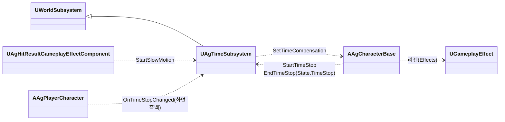
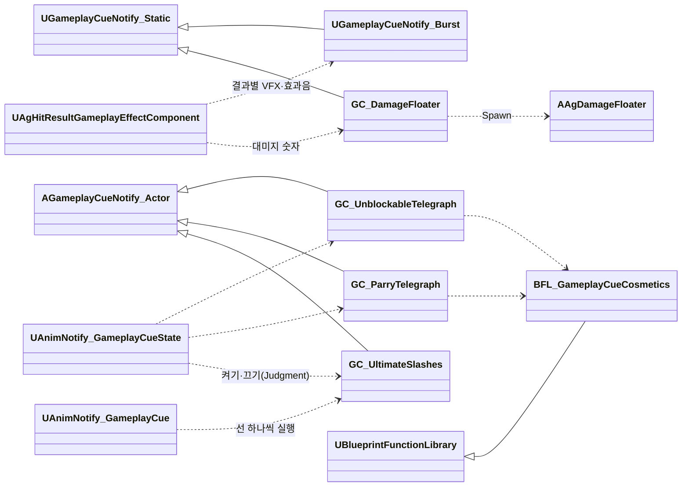

# 전투 규칙

전투 규칙을 어떻게 구현할지 정합니다.

행동의 실행 구조와 Task는 [어빌리티와 AbilityTask](<어빌리티와 AbilityTask.md>)를 따릅니다.

## 기술 결정

| 항목 | 결정 | 이유 |
| - | - | - |
| 투사체 발사 | 몽타주 시간표의 SpawnProjectile 지점이 `Projectiles.json`의 투사체 정의(클래스, 비행 값, 공격 값)로 한 발을 쏩니다. 투사체는 발사한 Runner의 `MakeEffectSpec`으로 만든 대미지 효과 스펙을 들고 있다가 적중마다 복사해 적용하므로, 스펙 태그와 Ability 출처가 유지되고 대상별 피격 결과는 섞이지 않습니다. 발사한 투사체는 행동과 따로 수명을 가집니다. 비행·판정은 `AAgProjectile`, 외형은 BP가 맡습니다. 섹션 이동으로 건너뛴 발사는 보충하지 않습니다. | |
| 연출 | VFX(피격, 패리, 궁극기 마무리, 궁극기 베기 선, 가드 불가 예고, 패리 예고), 효과음은 GameplayCue로 재생합니다. 큐는 `/Game/GameplayCues`의 큐 블루프린트(Cosmetic 연출 그래프 허용)이고, 피격·가드·패리·궁극기 마무리 큐는 엔진의 Burst 큐(`UGameplayCueNotify_Burst`)로 만듭니다. 카메라 셰이크는 플레이어 컨트롤러의 일반 C++ 함수로 직접 재생합니다([카메라 구현](<카메라, HUD, 화면 UI, 게임 플로우.md>)의 카메라 셰이크). 피격·가드·패리 큐는 피격 결과마다 하나씩(가드 브레이크는 가드 큐) 두고, 그 결과의 VFX와 효과음을 큐 위치에 한 번 재생합니다. 두 예고는 보스 패턴 몽타주의 'Telegraph' 트랙에 둔 엔진 노티파이 GameplayCue (Looping)(`UAnimNotify_GameplayCueState`)이 켜고 끕니다. 노티파이는 판정 구간(DashThrust는 돌진 시작, SwordWave는 검기를 쏘는 순간)이 시작할 때 끝나고, 보스 사양 '공격 예고'의 앞서는 시간에 '모션 재생 속도'를 곱한 몽타주 시간만큼 앞서 시작합니다. LeapSlam의 가드 불가 예고는 떠오르는 모션(Start 구간)에 둡니다. 처형의 마지막 일격과 궁극기 마무리는 시간표 Attack 항목의 bFinisher가 정합니다. 궁극기 마무리 큐(`GC_UltimateFinish`)는 대미지 GE가 일반 피격일 때 스펙의 어빌리티 태그(`Ability.Action.Ultimate`)를 보고 피격 큐 대신 고릅니다. | 연출과 게임 로직을 나눕니다. 공격 예고는 연출이라 코드가 시점을 계산하지 않고 몽타주에서 배치합니다. 노티파이는 몽타주와 함께 멈추므로 히트스톱도 따릅니다. 한 번 재생하는 VFX와 효과음은 엔진 큐로 충분해 프로젝트 클래스를 두지 않습니다. VFX·효과음·배치·모양은 제작 정보라 큐 블루프린트에 둡니다(AGENTS.md 코딩 규칙). 효과음이 결과마다 달라 VFX와 함께 결과마다 큐 하나에 두면, 결과 하나가 큐 하나만 실행합니다. |
| 히트스톱 | 적중하면 두 캐릭터에 히트스톱 태그(`State.Hitstop`)를 히트스톱 효과(`Hitstop`)로 그 효과의 `Duration` 동안 줍니다. 캐릭터는 이 태그가 있는 동안 자기 시간 배율(CustomTimeDilation)을 거의 0으로 낮춥니다. 캐릭터의 시간 배율은 이 히트스톱 배율에 시간 정지 보정('시간 정지')을 곱한 값입니다. 시간은 게임 시간으로 재고, 멈춘 캐릭터가 다시 적중에 걸리면 태그가 하나 더 붙어 마지막 것이 끝날 때 풀리므로 그 캐릭터만 처음부터 다시 잽니다. 투사체에 맞으면 맞은 쪽만 멈춥니다. | 히트스톱은 캐릭터의 상태라 패리 구간처럼 ASC의 태그로 둡니다. 슬로우모션 중에는 자연히 길어져 기획서와 맞습니다. 다른 캐릭터의 적중이 이미 멈춘 캐릭터의 히트스톱을 늘리지 않습니다. |
| 슬로우모션 | 시간 서브시스템(`UAgTimeSubsystem`)이 게임 전체 시간 배율을 슬로우모션 속도로 바꾸고, 지속 시간(실제 시간)이 지나면 되돌립니다. 되돌리는 타이머는 게임 시간으로 흐르므로 '지속 시간 × 배율'로 겁니다. 다시 발동하면 처음부터 셉니다. 속도와 지속 시간은 발동하는 쪽이 넘깁니다: 극한 회피와 궁극기 마무리 적중 모두 대미지 GE의 피격 처리이고, 값은 플레이어 데이터(`PerfectDodgeSlowMotionSpeed`·`Duration`, `UltimateSlowMotionSpeed`·`Duration`)입니다. | 게임 전체의 시간은 캐릭터가 아니라 월드의 상태라 월드 서브시스템이 맡습니다. 엔진 타이머에는 실제 시간으로 세는 방법이 없지만, 슬로우모션 동안에는 배율이 일정해 곱하면 실제 시간과 같습니다. |
| 시간 정지 | 시간 서브시스템이 게임 전체 시간 배율을 0.001로 낮추고, 시간을 멈춘 캐릭터에는 그 역수(1000)를 시간 정지 보정으로 줘 정상 속도로 돌립니다. 시작하면 도는 슬로우모션을 끝냅니다. 시간 정지 중에 시작한 슬로우모션은 배율과 길이만 기억했다가 시간 정지가 끝나는 순간 그 배율로 시작하고(없으면 1로 되돌림), 새 시간 정지가 시작되면 지웁니다. 시간 정지는 상태 태그 `State.TimeStop`이고, 그 태그를 가진 캐릭터가 태그가 붙을 때 자기를 뺀 시간 정지를 요청하고(요청의 주인) 떨어질 때 끝냅니다. 행동은 이 태그를 시간표 HoldTag로 줍니다. 시간 정지가 시작·끝날 때 서브시스템이 알리면, 플레이어 블루프린트의 후처리 컴포넌트(`TimeStopScreen`, 범위 없음)가 가중치를 1·0으로 바꿔 화면을 흑백으로 합니다. 흑백 설정은 그 컴포넌트에 둡니다. 플레이어 컨트롤러와 카메라 매니저는 보정하지 않습니다. | 캐릭터만 멈추면 엔진·GAS 타이머(그로기 시간, 쿨다운, 리젠)는 계속 흘러, 멈춘 동안 그로기가 줄어드는 등 어긋납니다. 게임 전체를 멈추면 이들도 함께 멈춥니다. 액터의 시간 배율은 그 액터의 컴포넌트 틱(메시, 무브먼트, ASC)에 곱해지므로 보정 하나로 플레이어 전체가 정상 속도로 돕니다. 궁극기의 시간 정지 끝과 마무리 적중은 같은 프레임이고 그 처리 순서는 정하지 않으므로(Task 사이에 순서가 없음), 게임 시간의 주인인 서브시스템이 둘을 합쳐 플레이어 사양 '마무리'의 순서(시간 정지가 끝나고 슬로우모션)를 지킵니다. 시간 정지 중에 배율을 바꾸면 시간 정지가 깨지고, 끝날 때 1로 되돌리면 그 슬로우모션이 지워지기 때문입니다. 시간 정지 동안 플레이어의 GAS 타이머(SP 리젠, 쿨다운, 선입력)도 멈춥니다. 컨트롤러와 카메라 매니저는 시간 정지 동안 시간에 따라 바뀌는 것이 없습니다(시야 입력은 시간과 무관하고 셰이크가 없음). |
| 궁극기 | 궁극기 몽타주(`AM_Player_Ultimate`)는 섹션 Start(발도 자세) → Hold(기다림, 반복) → Judgment(칼 넣기) → Draw(칼 뽑기)입니다. 시간표의 HoldTag 구간이 Start부터 Judgment 끝까지 `State.TimeStop`을 주어 캐릭터가 시간을 멈추고, PlayCutscene 구간이 Start부터 Hold 끝까지 컷신을 재생하며 컷신이 끝나면 Judgment로 넘깁니다. 베기 선은 큐(`GC_UltimateSlashes`)입니다. Judgment 섹션을 덮는 엔진 GameplayCue 상태 노티파이(`AnimNotify_GameplayCueState`)가 큐를 켜고 끄며(섹션 시작보다 0.0001초 뒤에서 시작합니다. 섹션 시작에 정확히 두면 엔진이 앞 섹션 끝에서 켜서 반복하는 Hold마다 켜졌다 꺼집니다), 몽타주 'Slash' 트랙의 엔진 GameplayCue 노티파이(`AnimNotify_GameplayCue`)가 베기 선마다 큐를 실행합니다. Judgment 끝(칼집에 들어가는 순간, Draw 시작)에 시간 정지 구간과 베기 선 구간이 끝나고, 같은 시각의 Attack 지점이 공격 범위 안의 적을 칩니다(같은 시각의 항목 사이에는 순서가 없습니다). 이때부터 후딜입니다. 적중 후 처리(VFX, 셰이크, 히트스톱, 슬로우모션)는 대미지 GE가 맡습니다. | 연출(카메라)은 시퀀스 에셋이, 모션과 판정은 몽타주와 시간표가 맡습니다. 베기 선은 판정이 없는 연출이라 큐로 두고(구현 문서 '연출'), 하나씩 나타났다가 함께 사라져야 해서 켜고 끄는 액터 큐에 실행을 보냅니다. 켜진 액터 큐에 보낸 실행은 엔진이 같은 큐 액터로 전달합니다. 모션을 몽타주로 두면 다른 행동과 같은 방식(GAS 몽타주, 루트 모션)으로 이어지고, 컷신이 끝날 때 애니메이션을 넘겨받을 일이 없습니다. 시간 정지 끝과 마무리 적중은 같은 프레임이라 어느 쪽이 먼저 처리되어도 히트스톱은 정상 시간 위에서 흐르고(캐릭터가 시간 정지 보정이 바뀔 때 시간 배율을 다시 정함), 슬로우모션은 시간 정지가 끝날 때 시작합니다('시간 정지'). 시간 정지는 행동이 주는 상태 태그라, 마무리 전에 궁극기가 끝나도(레벨 종료 등) 태그와 함께 풀립니다. 베기 선은 몽타주 노티파이라 플레이어의 몽타주를 따르므로 플레이어의 시간(시간 정지 보정, 히트스톱)을 따릅니다. |
| 컷신 | 컷신 Task(PlayCutscene)가 레벨 시퀀스를 행동의 주인을 기준 액터로 하는 위치·방향(Transform Origin)으로 재생합니다. 재생 설정으로 시네마틱 모드(시야·이동 입력 무시, HUD 숨김)를 켭니다. 그동안 HUD와 보스의 월드 위젯이 숨는 것은 [카메라, HUD, 화면 UI, 게임 플로우](<카메라, HUD, 화면 UI, 게임 플로우.md>)의 'HUD'와 '월드 위치 HUD'를 따릅니다. 시퀀스는 카메라(카메라 컷)만 담습니다. 재생 속도는 매 프레임 주인의 시간 배율(`CustomTimeDilation`)이라, 시간 정지 중에는 시간 정지 보정이 곱해지고 히트스톱 중에는 멈춥니다. 행동이 먼저 끝나면 Task가 시퀀스를 멈춥니다. | 컷신은 다른 행동(보스 패턴 등)도 쓸 수 있는 범용 기능이라 Task로 둡니다. 시퀀스 플레이어는 액터의 시간 배율이 아니라 게임 전체 시간 배율을 재생 속도에 곱하므로, 주인의 시간 배율을 재생 속도로 주면 주인의 모션과 같은 속도로 흐릅니다. 매 프레임 맞추므로 시간 정지와 컷신의 시작 순서에 기대지 않습니다. 시네마틱 모드는 엔진 기능이라 입력을 막는 코드가 따로 필요 없습니다. 시퀀스가 끝나거나 멈추면 카메라와 시네마틱 모드를 되돌립니다. |
| 회피 반격 기회 | 극한 회피 때 피격 처리가 회피 반격 기회 효과(`DodgeCounterChance`)로 기회 태그를 줍니다. 평타 키는 기회 태그가 있으면 회피 반격을 시작하고, 지금 시작할 수 없으면 무시합니다. 행동 태그(`Ability.Action`, 이동 외의 행동이며 회피 반격도 포함)나 넉업·넉백 어빌리티가 시작되면 플레이어 캐릭터가 기회를 지웁니다. | 기회도 쿨다운처럼 히트스톱 중에 흐르는 시간입니다. 기회를 지우는 곳이 한곳이라, 회피 반격도 기회를 따로 지우지 않습니다. |
| 대상 찾기 | 행동 대상(평타, 점프 공격, 회피 반격, 스킬, 처형, 락온, 보스 공격 패턴)은 행동의 Targeting이 TargetingSystem 프리셋으로 찾습니다([어빌리티와 AbilityTask](<어빌리티와 AbilityTask.md>) '대상'). 프리셋(`Enemy`)이 요청한 캐릭터 주변의 캐릭터를 후보로 모으고, 프로젝트 필터 Task가 적대 관계이고 살아 있는 후보 가운데 행동 JSON의 범위(캡슐 중심 사이 수평 거리)와 태그 조건에 맞는 것만 남기며, 엔진 정렬 Task가 가까운 순서로 둡니다. 첫 후보가 행동 대상입니다. 보스 공격 패턴과 보스 AI의 대상도 같은 프리셋(`Enemy`)으로 찾습니다([보스](<보스.md>) 'AI 대상'). 락온은 화면 안 조건을 더한 프리셋(`LockOn`), 처형은 그로기 중이고 처형 중이 아니며 땅에 있는 대상(태그 조건)입니다. 공격 중 위치·회전 보정은 타겟팅 범위를 보지 않고 고르고, 추적 구간의 TargetingRange는 회전과 접근 여부만 정합니다([애니메이션과 이동](<애니메이션과 이동.md>) '공격 중 위치·회전 보정'). 궁극기 마무리와 LeapSlam 착지는 대상을 고르지 않고 공격 범위 안의 적 모두를 칩니다. | 기획서의 거리는 캡슐 중심 사이 수평 거리이고, 프리셋의 검색 반경은 행동마다 바꿀 수 없어 요청에 범위를 실어 필터가 거릅니다. 조건을 후보마다 확인하므로, 더 가까운 적이 조건에 맞지 않아도 조건에 맞는 적을 찾습니다. |

## 클래스 구조

### 시간

| 클래스 | 부모 | 역할 |
| - | - | - |
| `UAgTimeSubsystem` | `UWorldSubsystem` | 게임 전체 시간 배율(슬로우모션, 시간 정지) |

### GameplayCue

큐는 GameplayCue 태그로 실행합니다. 큐 블루프린트는 `/Game/GameplayCues`에 두며 엔진 GameplayCue 클래스를 직접 상속합니다. 프로젝트 전용 GameplayCue C++ 클래스는 두지 않습니다. Cosmetic 그래프의 허용 범위는 AGENTS.md를 따릅니다. 엔진 GameplayCue 매니저가 `Config/DefaultGame.ini`의 검색 경로(`GameplayCueNotifyPaths`)에서 블루프린트를 찾아 태그와 잇습니다. 같은 폴더를 '항상 쿡할 디렉터리'에 넣어 패키지에 포함합니다.

| BP 에셋 | 부모 | 역할 |
| - | - | - |
| `GC_Hit`, `GC_Guard`, `GC_Parry`, `GC_UltimateFinish` | `UGameplayCueNotify_Burst` | 엔진 Burst 데이터로 결과별 VFX와 효과음을 한 번 재생합니다. |
| `GC_UnblockableTelegraph`, `GC_ParryTelegraph` | `AGameplayCueNotify_Actor` | 활성화 시 공통 BP 함수 라이브러리 `BFL_GameplayCueCosmetics`를 호출해 무기 소켓에 VFX를 붙이고 색을 적용하며 효과음을 재생합니다. 캐릭터 무기가 없으면 전달된 부착 컴포넌트, 대상 루트 순서로 사용합니다. VFX·소켓·색 파라미터·색·효과음은 각 큐의 기본값입니다. |
| `GC_UltimateSlashes` | `AGameplayCueNotify_Actor` | 실행마다 Add Static Mesh Component 노드의 제작 설정으로 선을 생성합니다. BP 기본값의 거리·높이 범위와 캐릭터·카메라를 사용해 BP에서 위치·방향을 계산합니다. 메시·머티리얼·크기·커스텀 프리미티브 데이터·그림자·Nanite 설정은 BP가 소유하며, 선은 충돌 없이 생성 위치에 고정됩니다. |
| `GC_DamageFloater` | `UGameplayCueNotify_Static` | Instigator가 로컬 플레이어인지 확인하고 맞은 위치에 RawMagnitude를 반올림해 표시합니다. `AAgDamageFloater::Spawn`을 호출하며 위젯 클래스는 큐 기본값입니다. |
| `BFL_GameplayCueCosmetics` | `UBlueprintFunctionLibrary` | BP 함수 `ResolveAttachment`와 `SpawnTelegraph`로 두 공격 예고의 부착 대상 선택과 VFX·효과음 재생을 공유합니다. |

엔진은 OnRemove 뒤 큐 액터를 재사용하므로, 예고와 베기 선 큐는 만든 컴포넌트를 OnRemove·EndPlay에서 정리하며 참조와 배열도 비웁니다.

베기 선의 거리·높이 범위는 `GC_UltimateSlashes`의 BP 기본값(`SlashDistanceMin`, `SlashDistanceMax`, `SlashHeightMin`, `SlashHeightMax`)입니다. 예고 BP는 `AAgCharacterBase`의 읽기 전용 함수로 무기 컴포넌트를 조회합니다. 대미지 숫자의 떠오름·위젯 애니메이션은 [카메라, HUD, 화면 UI, 게임 플로우](<카메라, HUD, 화면 UI, 게임 플로우.md>) '월드 위치 HUD'를 따릅니다.

