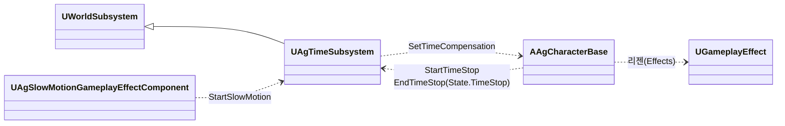
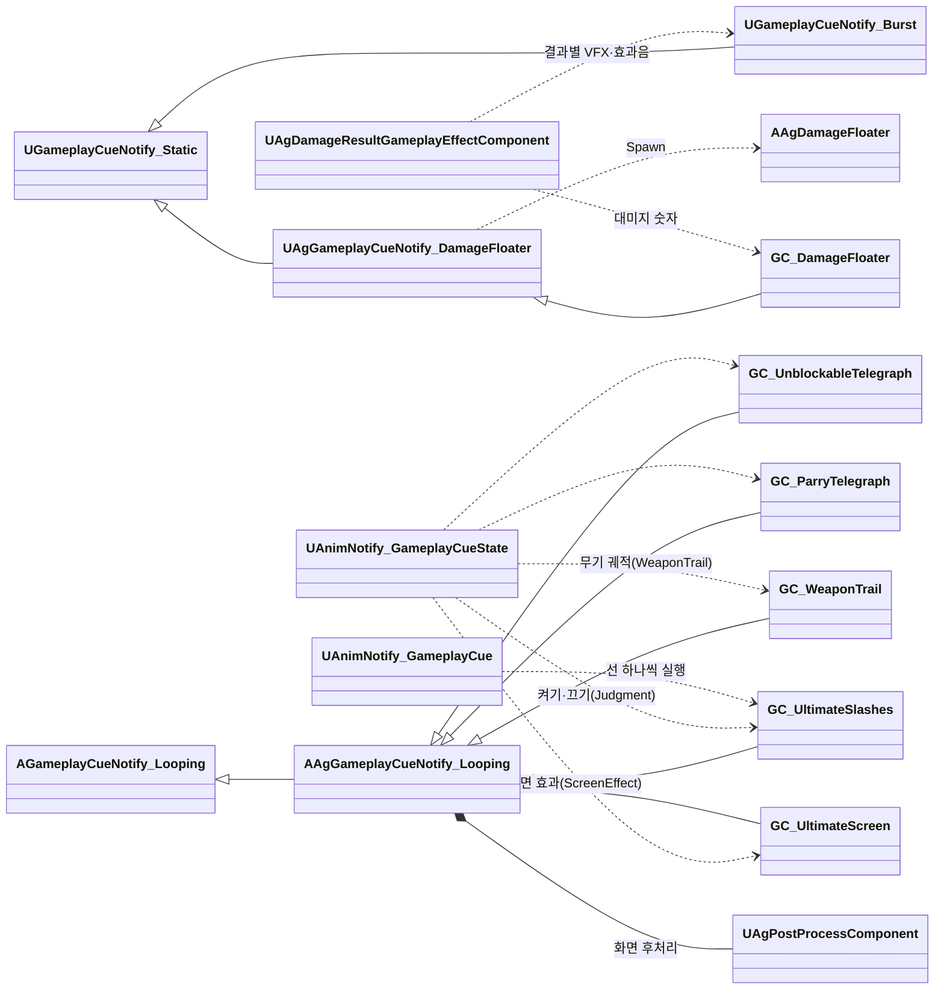

# 전투 연출과 시간 제어

전투 규칙을 어떻게 구현할지 정합니다. 시간 연출의 기획 기준은 [시간 규칙](<../Design/시간 규칙.md>)을 따릅니다.

행동의 실행 구조와 Task는 [어빌리티와 AbilityTask](<어빌리티와 AbilityTask.md>)를 따릅니다.

## 기술 결정

| 항목 | 결정 | 이유 |
| - | - | - |
| 투사체 발사 | 몽타주 시간표의 SpawnProjectile 항목이 `Projectiles.json`의 투사체 정의(클래스, 비행 값, 공격 값)로 한 발을 쏩니다. 투사체는 발사한 어빌리티의 `MakeDamageSpec`으로 만든 대미지 효과 스펙을 들고 있다가 적중마다 복사해 적용하므로, 스펙 태그와 Ability 출처가 유지되고 대상별 피격 결과는 섞이지 않습니다. 반사 시에는 플레이어 출처의 스펙으로 교체합니다([대미지와 피격 처리](<대미지와 피격 처리.md>)의 투사체 반사). 발사한 투사체는 행동과 따로 수명을 가집니다. 비행·판정은 `AAgProjectile`, 외형은 BP가 맡습니다. 섹션 이동으로 건너뛴 발사는 보충하지 않습니다. | |
| 연출 | VFX(피격, 패리, 궁극기 마무리, 궁극기 베기 선, 가드 불가 예고, 패리 예고, 무기 궤적), 효과음, 카메라 셰이크와 화면 후처리는 GameplayCue로 재생합니다. 큐는 `/Game/GameplayCues`의 큐 블루프린트이고, 피격·가드·패리 큐는 엔진의 Burst 큐(`UGameplayCueNotify_Burst`)로 만듭니다. 엔진 큐 데이터로 안 되는 기능(무기에 붙이기, 두 소켓 사이에 놓기, 나이아가라 사용자 파라미터, 대상의 시간 따르기, 메시 놓기와 놓은 자리마다 꺼질 때 효과, 대미지 숫자)은 엔진 큐 클래스에 그 기능만 더한 C++ 클래스에 두고, 새 연출에 필요한 기능은 먼저 그 클래스에 칸으로 더합니다. 연출마다 C++ 클래스를 만들지 않습니다. 셰이크와 화면 후처리의 큐·에셋 구성은 [카메라와 화면 효과](<카메라와 화면 효과.md>)를 따릅니다. 피격·가드·패리 큐는 피격 결과마다 하나씩(가드 브레이크는 가드 큐) 두고, 그 결과의 VFX와 효과음을 큐 위치에 한 번 재생합니다. 두 예고는 보스 패턴 몽타주의 'Telegraph' 트랙에 둔 엔진 노티파이 GameplayCue (Looping)(`UAnimNotify_GameplayCueState`)이 켜고 끕니다. 노티파이는 판정 구간(DashThrust는 돌진 시작, SwordWave는 검기를 쏘는 순간)이 시작할 때 끝나고, 보스 사양 '공격 예고'의 앞서는 시간에 '모션 재생 속도'를 곱한 몽타주 시간만큼 앞서 시작합니다. GroundSlam의 가드 불가 예고는 떠오르는 모션(Start 구간)에 둡니다. 두 예고는 같은 섬광(`NS_Telegraph`)을 나이아가라 사용자 파라미터 `Color`와 `Duration`만 바꿔 재생합니다. 섬광은 카메라 평면을 향한 큰 스프라이트 하나이고, 머티리얼(`M_Telegraph`)이 공격 지점을 지나는 가로·세로 선을 1080p 화면 픽셀 기준 굵기와 길이로 그리며 깊이 검사를 하지 않습니다. 시간에 따른 모양 변화도 머티리얼이 그리고, 나이아가라는 수명에 대한 입자 나이(0 ~ 1)를 Dynamic Material Parameter로 넘깁니다. 입자 수명과 이미터 루프 길이가 `Duration`이고, 그보다 먼저 큐가 꺼지면 남은 빛도 바로 지웁니다(이미터의 InactiveResponse Kill). 처형의 마지막 일격과 궁극기 마무리는 시간표 AreaHit 항목 `Damage`의 `bFinisher`가 정합니다. | 연출과 게임 로직을 나눕니다. 공격 예고는 연출이라 코드가 시점을 계산하지 않고 몽타주에서 배치합니다. 노티파이는 몽타주와 함께 멈추므로 히트스톱도 따릅니다. 한 번 재생하는 VFX와 효과음은 엔진 큐로 충분해 프로젝트 클래스를 두지 않습니다. VFX·효과음·배치·모양은 제작 정보라 큐 블루프린트에 둡니다. 클래스는 연출 수가 아니라 엔진에 없는 기능 수만큼만 늘어납니다. 효과음이 결과마다 달라 VFX와 함께 결과마다 큐 하나에 두면, 결과 하나가 큐 하나만 실행합니다. 예고 섬광의 길이와 사라지는 때는 [아트 표현 사양](<../Art/아트 표현 사양.md>) '가드 불가 예고'를 따르고, 보스와의 거리나 해상도와 상관없이 화면에서 같은 굵기로 보이며 몸에 가려지지 않아야 합니다. |
| 무기 궤적 | 공격 몽타주의 'WeaponTrail' 트랙에 둔 엔진 GameplayCue 상태 노티파이(`UAnimNotify_GameplayCueState`)가 `GameplayCue.WeaponTrail`(`GC_WeaponTrail`)을 켜고 끕니다. 노티파이는 판정 구간(SwordWave는 검기를 쏘는 순간)보다 0.1초 앞에서 시작해 판정이 끝나고 0.05초 뒤에 끝납니다(점프 공격은 공중에서 베는 Start 섹션 끝까지). 큐는 리본 나이아가라(`NS_WeaponTrail`)를 무기 컴포넌트의 날 시작 소켓(`TrailStart`)에 붙인 뒤, 날 끝 소켓(`TrailEnd`)과의 가운데로 옮겨 X축을 날 방향으로 돌리고 두 소켓 사이 거리를 사용자 파라미터 `TrailWidth`로 넘깁니다. 리본은 월드 공간에 남고, 입자마다 생길 때의 시스템 X축(`Engine.Owner.SystemXAxis`)을 면 방향(Custom Side Vector)으로, `TrailWidth`를 폭으로 씁니다. 머티리얼(`M_WeaponTrail`)은 반투명·Unlit에 굴절 방식 2D Offset으로 뒤 화면을 비틉니다. 리본 렌더러의 UV0 U는 리본 한쪽 끝에서 잰 거리(cm. `TiledOverRibbonLength`에 `TilingLength` 1)라, 머티리얼은 V를 따라 도는 사인 물결을 U·V에서 뽑은 노이즈(엔진 `GradientNoise3D_ALU`)로 휘게 해, 궤적을 따라 길게 이어진 물결 줄을 만듭니다. 화면에서 V와 U가 변하는 방향(`ddx`·`ddy`)을 구해 폭 방향으로는 그 물결만큼 밀고 휘두른 방향으로는 노이즈만큼 조금 밀며, 입자 나이(Particle Relative Time)로 꼬리를 지웁니다. 생길 때 자리에 고정되는 U(`TiledFromStartOverRibbonLength`)는 입자 속성 `RibbonUVDistance`가 필요한데 이미터가 그 값을 만들지 않아 쓰지 않으므로, 물결은 궤적을 따라 흐릅니다. 리본의 V는 칼끝 쪽이 0이라(Custom Side Vector에서 엔진이 오른쪽 축을 면 방향의 반대로 둠), V가 0에 가까운 곳에만 흰빛과 불투명도를 줍니다. 큐가 켜진 동안 나이아가라의 시간 배율을 대상 캐릭터의 시간 배율로 맞추고(`bUseTargetTimeDilation`), 꺼질 때 1로 되돌립니다. | 날의 범위는 무기 메시의 정보라 메시 소켓에 두면, 무기를 바꿔 끼워도 큐와 나이아가라를 고치지 않습니다. 소켓 위치는 정적·스켈레탈 메시가 함께 쓰는 엔진 함수(`USceneComponent::GetSocketLocation`)로 읽어 무기 종류를 가리지 않습니다. 휘두른 면을 그리려면 리본 면을 날 방향으로 세워야 하는데, 나이아가라 모듈은 시스템의 축은 읽어도 붙은 메시의 소켓은 읽지 못해 큐가 시스템을 날에 맞춰 놓습니다. 엔진 나이아가라는 월드 시간으로 한꺼번에 진행하고, 큐가 만든 나이아가라는 풀에서 와 소유자도 캐릭터가 아닙니다. 그래서 맞추지 않으면 히트스톱 동안 칼은 멈추는데 궤적만 사라지고, 궁극기 시간 정지 중에는 플레이어의 궤적이 생기지 않습니다. 풀로 돌아간 나이아가라가 멈춘 배율을 가져가지 않도록 꺼질 때 되돌립니다. 판정 구간보다 앞서 켜는 것은 휘두르기 시작하는 모습부터 그리기 위해서입니다. |
| 히트스톱 | 적중하면 두 캐릭터에 히트스톱 태그(`State.Hitstop`)를 히트스톱 효과(`EAgEffect::Hitstop`)로 전투 규칙의 `HitstopDuration` 동안 줍니다. 캐릭터는 이 태그가 있는 동안 자기 시간 배율(CustomTimeDilation)을 `HitstopTimeDilation`(0.0001배)로 낮춥니다. 정지의 허용 오차는 [시간 규칙](<../Design/시간 규칙.md>)의 같은 이름 절을 따릅니다. 캐릭터의 시간 배율은 이 히트스톱 배율에 시간 정지 보정('시간 정지')을 곱한 값입니다. 시간은 게임 시간으로 재고, 멈춘 캐릭터가 다시 적중에 걸리면 태그가 하나 더 붙어 마지막 것이 끝날 때 풀리므로 그 캐릭터만 처음부터 다시 잽니다. 투사체에 맞으면 맞은 쪽만 멈춥니다. | 히트스톱은 캐릭터의 상태라 패리 구간처럼 ASC의 태그로 둡니다. 슬로우모션 중에는 자연히 길어져 기획서와 맞습니다. 다른 캐릭터의 적중이 이미 멈춘 캐릭터의 히트스톱을 늘리지 않습니다. |
| 슬로우모션 | 시간 서브시스템(`UAgTimeSubsystem`)이 게임 전체 시간 배율을 슬로우모션 속도로 바꾸고, 지속 시간(실제 시간)이 지나면 되돌립니다. 되돌리는 타이머는 게임 시간으로 흐르므로 '지속 시간 × 배율'로 겁니다. 다시 발동하면 처음부터 셉니다. 발동은 즉시 효과입니다. 효과 정의에 `SlowMotionDuration`(실제 시간)과 `SlowMotionSpeed`가 있으면 슬로우모션 컴포넌트(`UAgSlowMotionGameplayEffectComponent`)가 붙어, 효과가 실행될 때 시간 서브시스템에 그 값을 넘깁니다. 극한 회피는 PerfectDodge의 발동 ApplyEffect가 거는 `PerfectDodgeSlowMotion`, 궁극기 마무리는 `Draw` 섹션 0초의 ApplyEffect가 거는 `UltimateSlowMotion`입니다(적중과 관계없음). 시간 정지 중에 걸리면 시간 정지가 끝날 때 시작합니다(아래 '시간 정지'). | 게임 전체의 시간은 캐릭터가 아니라 월드의 상태라 월드 서브시스템이 맡습니다. 슬로우모션은 걸고 나면 어빌리티나 효과의 수명과 관계없이 시간 서브시스템이 끝내므로, 남지 않는 즉시 효과로 겁니다. 엔진 타이머에는 실제 시간으로 세는 방법이 없지만, 슬로우모션 동안에는 배율이 일정해 곱하면 실제 시간과 같습니다. |
| 시간 정지 | 시간 서브시스템이 게임 전체 시간 배율을 `TimeStopDilation`(0.001배)으로 낮추고, 시간 정지를 요청한 캐릭터에는 적용된 전체 배율의 역수를 시간 정지 보정으로 줘 정상 속도로 돌립니다. 시작하면 도는 슬로우모션을 끝냅니다. 시간 정지 중에 시작한 슬로우모션은 배율과 길이만 기억했다가 시간 정지가 끝나는 순간 그 배율로 시작하고(없으면 1로 되돌림), 새 시간 정지가 시작되면 지웁니다. 시간 정지는 상태 태그 `State.TimeStop`이고, 그 태그를 가진 캐릭터가 태그가 붙을 때 자기를 뺀 시간 정지를 요청하고(요청의 주인) 떨어질 때 끝냅니다. 행동은 이 태그를 시간표의 ApplyEffect 구간(`TimeStop` 효과)으로 줍니다. Task는 효과의 수명을 관리하고, 캐릭터는 태그 변경을 시간 정지 요청으로 연결하며, 실제 배율과 슬로우모션 전환은 시간 서브시스템이 관리합니다. 구간 종료나 행동 취소로 효과가 제거되면 태그도 제거되어 시간 정지를 해제합니다. 플레이어 컨트롤러와 카메라 매니저는 보정하지 않습니다. | 캐릭터만 멈추면 엔진·GAS 타이머(그로기 시간, 쿨다운, 리젠)는 계속 흘러, 멈춘 동안 그로기가 줄어드는 등 어긋납니다. 전체 배율을 낮춰 이들도 함께 느리게 합니다. 약 4초의 정지 동안 게임 시간은 약 0.004초 진행하므로, 종료 직전의 타이머가 만료될 수 있습니다. 이 동작은 [시간 규칙](<../Design/시간 규칙.md>)의 '정지의 허용 오차'를 따릅니다. 액터의 시간 배율은 그 액터의 컴포넌트 틱(메시, 무브먼트, ASC)에 곱해지므로 보정 하나로 플레이어 전체가 정상 속도로 돕니다. 궁극기의 시간 정지 끝과 마무리 적중은 같은 프레임이고 그 처리 순서는 정하지 않으므로(Task 사이에 순서가 없음), 게임 시간의 주인인 서브시스템이 둘을 합쳐 플레이어 사양 '마무리'의 순서(시간 정지가 끝나고 슬로우모션)를 지킵니다. 시간 정지 중에 배율을 바꾸면 시간 정지가 깨지고, 끝날 때 1로 되돌리면 그 슬로우모션이 지워지기 때문입니다. 플레이어의 GAS 타이머(SP 리젠, 쿨다운)와 월드 시각으로 계산하는 선입력 유지 시간에도 전체 배율이 적용됩니다. 컨트롤러의 시야 입력은 시간 배율과 무관하며, 화면 후처리는 별도의 실제 시간으로 갱신합니다. |
| 궁극기 | 궁극기 몽타주(`AM_Player_Ultimate`)는 섹션 Start(발도 자세) → Hold(기다림, 반복) → Judgment(칼 넣기) → Draw(칼 뽑기)입니다. 시간표의 ApplyEffect 구간이 Start부터 Judgment 끝까지 `State.TimeStop`을 주어 캐릭터가 시간을 멈추고, PlayCutscene 구간이 Start부터 Hold 끝까지 컷신을 재생하며, Hold의 Transition이 컷신이 끝나면(`State.Cutscene`이 사라지면) Judgment로 넘깁니다. 궁극기 화면 효과는 [카메라와 화면 효과](<카메라와 화면 효과.md>) '화면 후처리'를 따릅니다. 베기 선은 큐(`GC_UltimateSlashes`)입니다. Judgment 섹션을 덮는 엔진 GameplayCue 상태 노티파이(`AnimNotify_GameplayCueState`)가 큐를 켜고 끄며(섹션 시작보다 0.0001초 뒤에서 시작합니다. 섹션 시작에 정확히 두면 엔진이 앞 섹션 끝에서 켜서 반복하는 Hold마다 켜졌다 꺼집니다), 몽타주 'Slash' 트랙의 엔진 GameplayCue 노티파이(`AnimNotify_GameplayCue`)가 베기 선마다 큐를 실행합니다. 베기 선 큐는 꺼질 때 놓았던 선 자리마다 꺼질 때 효과(궁극기 마무리 VFX)를 재생해 선을 터뜨립니다. Judgment 끝(칼집에 들어가는 순간, Draw 시작)에 시간 정지 구간과 베기 선 구간이 끝나고, 같은 시각의 AreaHit 항목이 공격 범위 안의 적을 칩니다(같은 시각의 항목 사이에는 순서가 없습니다). 이때부터 후딜입니다. 적중 후 처리(VFX, 셰이크, 히트스톱)는 대미지 GE가 맡고, 슬로우모션은 위 '슬로우모션' 행을 따릅니다. | 컷신의 카메라와 플레이어 자세는 시퀀스 에셋이, 행동의 진행과 판정은 몽타주와 시간표가 맡습니다. 베기 선은 판정이 없는 연출이라 큐로 두고(구현 문서 '연출'), 하나씩 나타났다가 함께 사라져야 해서 켜고 끄는 액터 큐에 실행을 보냅니다. 켜진 액터 큐에 보낸 실행은 엔진이 같은 큐 액터로 전달합니다. 마무리 VFX는 선 자리에서 터져야 해서 선을 놓은 베기 선 큐가 꺼질 때 재생하므로, 적중과 관계없이 나옵니다. 컷신 동안에도 몽타주와 시간표는 진행하며, 컷신 자세와 이후 모션의 연결은 [캐릭터 이동과 모션 제어](<캐릭터 이동과 모션 제어.md>)의 '컷신 자세'를 따릅니다. 시간 정지 끝과 마무리 적중은 같은 프레임이라 어느 쪽이 먼저 처리되어도 히트스톱은 정상 시간 위에서 흐르고(캐릭터가 시간 정지 보정이 바뀔 때 시간 배율을 다시 정함), 슬로우모션은 시간 정지가 끝날 때 시작합니다('시간 정지'). 시간 정지는 행동이 주는 상태 태그라, 마무리 전에 궁극기가 끝나도(레벨 종료 등) 태그와 함께 풀립니다. 베기 선은 몽타주 노티파이라 플레이어의 몽타주를 따르므로 플레이어의 시간(시간 정지 보정, 히트스톱)을 따릅니다. |
| 컷신 | 컷신 Task(PlayCutscene)가 레벨 시퀀스를 행동의 주인을 기준 액터로 하는 위치·방향(Transform Origin)으로 재생합니다. 재생 설정으로 시네마틱 모드(시야·이동 입력 무시, HUD 숨김)를 켭니다. 그동안 HUD와 보스의 월드 위젯이 숨는 것은 [UI 시스템과 게임 플로우](<UI 시스템과 게임 플로우.md>)의 'HUD'와 '월드 위치 HUD'를 따릅니다. 시퀀스는 카메라 컷과 플레이어 자세의 애니메이션 트랙을 담습니다. `Owner` 태그 바인딩과 재생 속도는 [어빌리티와 AbilityTask](<어빌리티와 AbilityTask.md>) 'Task 목록'의 PlayCutscene 행을, 슬롯과 자세 연결은 [캐릭터 이동과 모션 제어](<캐릭터 이동과 모션 제어.md>)의 '컷신 자세'를 따릅니다. 행동이 먼저 끝나면 Task가 시퀀스를 멈춥니다. | 컷신은 다른 행동(보스 패턴 등)도 쓸 수 있는 범용 기능이라 Task로 둡니다. 시퀀스 플레이어는 액터의 시간 배율이 아니라 게임 전체 시간 배율을 재생 속도에 곱하므로, 주인의 시간 배율을 재생 속도로 주면 주인의 모션과 같은 속도로 흐릅니다. 시네마틱 모드는 엔진 기능이라 입력을 막는 코드가 따로 필요 없습니다. 시퀀스가 끝나거나 멈추면 카메라와 시네마틱 모드를 되돌립니다. |
| 회피 반격 기회 | 극한 회피 모션(PerfectDodge)의 발동 ApplyEffect가 회피 반격 기회 효과(`DodgeCounterChance`)로 기회 태그를 줍니다. 평타 키는 기회 태그가 있으면 회피 반격을 시작하고, 지금 시작할 수 없으면 무시합니다. 행동 태그(`Ability.Action`, 기획서의 전투 행동이며 회피 반격과 극한 회피 모션도 포함)나 넉업·넉백 어빌리티가 시작되면 플레이어 캐릭터가 기회를 지웁니다. | 기회도 쿨다운처럼 히트스톱 중에 흐르는 시간입니다. 기회를 지우는 곳이 한곳이라, 회피 반격도 기회를 따로 지우지 않습니다. 플레이어 캐릭터는 엔진이 어빌리티를 시작하기 직전의 알림(`AbilityActivatedCallbacks`, 엔진 `PreActivate`)에서 지우므로, 극한 회피 모션이 자기 발동 Task로 준 기회는 지워지지 않습니다. |

## 클래스 구조

### 시간

| 클래스 | 부모 | 역할 |
| - | - | - |
| `UAgTimeSubsystem` | `UWorldSubsystem` | 게임 전체 시간 배율(슬로우모션, 시간 정지) |

### GameplayCue

큐는 GameplayCue 태그로 실행합니다. 큐 블루프린트는 `/Game/GameplayCues`에 둡니다. 엔진 GameplayCue 매니저가 `Config/DefaultGame.ini`의 검색 경로(`GameplayCueNotifyPaths`)에서 블루프린트를 찾아 태그와 잇습니다. 같은 폴더를 '항상 쿡할 디렉터리'에 넣어 패키지에 포함합니다.

| BP 에셋 | 부모 | 역할 |
| - | - | - |
| `GC_Hit`, `GC_Guard`, `GC_Parry` | `UGameplayCueNotify_Burst` | 엔진 Burst 데이터로 결과별 VFX와 효과음을 한 번 재생합니다. |
| `GC_UnblockableTelegraph`, `GC_ParryTelegraph` | `AAgGameplayCueNotify_Looping` | 켜질 때의 효과음(엔진 Application 효과), 켜진 동안의 VFX(엔진 Looping 효과), 무기에 붙이기(`bAttachToWeapon`)와 섬광의 색(`NiagaraColorParameters`)·사라지는 시간(`NiagaraFloatParameters`)을 정합니다. |
| `GC_UltimateSlashes` | `AAgGameplayCueNotify_Looping` | 선 메시(`RecurringMesh`)와 배치 범위, 선 자리마다 재생할 꺼질 때 효과(엔진 `RemovalEffects`, `bRemovalEffectsAtRecurringMeshes`)를 정합니다. |
| `GC_WeaponTrail` | `AAgGameplayCueNotify_Looping` | 켜진 동안의 리본(엔진 Looping 효과), 무기의 날 시작 소켓에 붙이기(`bAttachToWeapon`, `DefaultPlacementInfo`의 `SocketName`), 날 끝 소켓(`PlacementEndSocketName`)과 폭 파라미터(`NiagaraSocketDistanceParameter`), 캐릭터의 시간 따르기(`bUseTargetTimeDilation`)를 정합니다. |
| `GC_DamageFloater` | `UAgGameplayCueNotify_DamageFloater` | 대미지 숫자 위젯 클래스(`FloaterWidget`)를 정합니다. |

| C++ 클래스 | 엔진 부모 | 더하는 기능 |
| - | - | - |
| `AAgGameplayCueNotify_Looping` | `AGameplayCueNotify_Looping` | 엔진은 캐릭터의 몸 메시에 붙이므로, `bAttachToWeapon`을 켜면 무기 컴포넌트에 붙입니다. 엔진 효과가 만든 나이아가라에 `NiagaraColorParameters`의 색과 `NiagaraFloatParameters`의 실수를 사용자 파라미터로 넣습니다. `PlacementEndSocketName`을 정하면 붙인 소켓과 그 소켓의 가운데로 나이아가라를 옮겨 X축을 그 소켓 쪽으로 돌리고, 두 소켓 사이 거리를 `NiagaraSocketDistanceParameter`에 넣습니다. `bUseTargetTimeDilation`을 켜면 켜진 동안 매 틱 나이아가라의 시간 배율을 대상의 시간 배율로 맞추고, 꺼질 때 1로 되돌립니다. 엔진 효과에는 정적 메시와 무작위 배치가 없어, 실행마다 `RecurringMesh`를 복제해 배치 범위 안의 무작위 자리에 놓고 큐가 꺼지면 지웁니다. 엔진은 꺼질 때 효과를 큐 위치 한 곳에만 재생하므로, `bRemovalEffectsAtRecurringMeshes`를 켜면 메시를 지우기 전에 놓았던 메시 자리마다 재생합니다. |
| `UAgGameplayCueNotify_DamageFloater` | `UGameplayCueNotify_Static` | Instigator가 이 기기의 플레이어일 때만 맞은 위치에 대미지 숫자를 띄웁니다(`AAgDamageFloater`). |

엔진 큐의 배치 설정(`DefaultPlacementInfo`)에서 붙이는 효과의 `AttachmentRule`은 `KeepWorld`로 둡니다. 엔진은 월드 위치를 계산해 넘기는데 `SnapToTarget`은 그 값을 상대 위치로 써서 효과가 붙일 대상에서 멀리 생깁니다.

대미지 숫자의 떠오름·위젯 애니메이션은 [UI 시스템과 게임 플로우](<UI 시스템과 게임 플로우.md>) '월드 위치 HUD'를 따릅니다.

