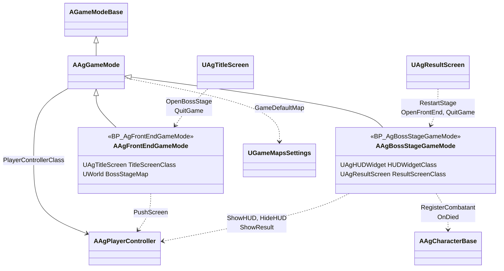
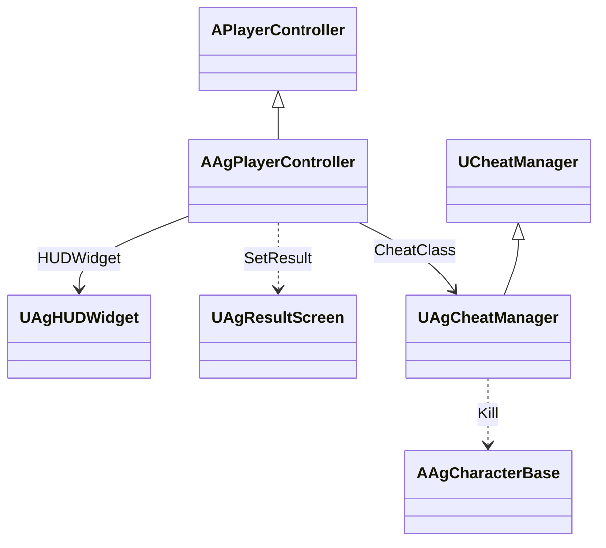
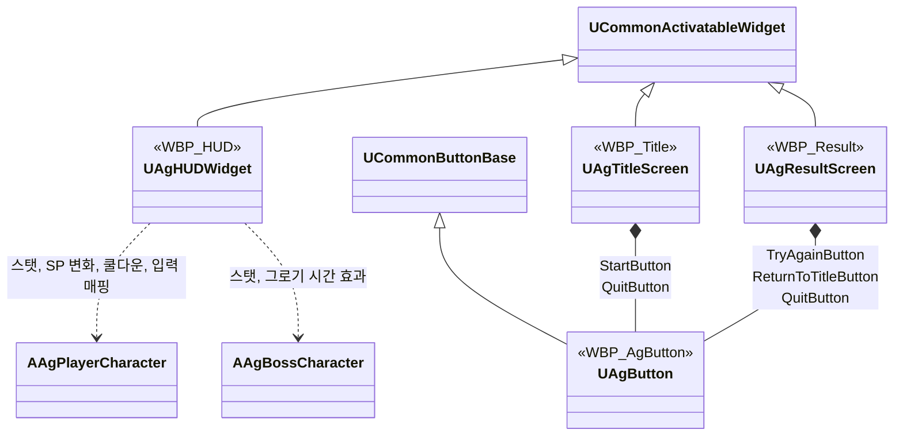
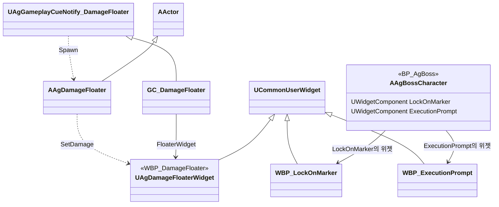

# 카메라, HUD, 화면 UI, 게임 플로우

카메라, HUD, 화면 UI, 게임 플로우를 어떻게 구현할지 정합니다.

## 기술 결정

| 항목 | 결정 | 이유 |
| - | - | - |
| 자유 시점 | 스프링 암과 카메라로 만듭니다. 거리, 회전 중심 높이, 위치 추적 지연, FOV는 `BP_AgPlayer`의 스프링 암과 카메라에 적고, 회전 지연은 두지 않습니다. 스프링 암은 캐릭터의 회전을 물려받지 않습니다(절대 회전). 락온 카메라도 스프링 암의 위치를 회전 중심으로 씁니다. | 회피 방향처럼 행동이 캐릭터를 한 번에 돌리는 일이 스프링 암이 그 프레임의 카메라 자리를 정한 뒤에도 일어납니다(선입력은 타이머로 실행). 회전을 물려받으면 그 한 프레임 동안 카메라가 캐릭터와 함께 돌아 화면이 튑니다. |
| 락온 | 락온 키는 락온의 트리거 태그(`Input.LockOn`)를 붙이고 떼어 락온 행동을 시작하고 끝냅니다([입력 처리](<입력 처리.md>)). 락온 행동은 행동 상태의 제한을 받지 않고 선입력으로 기억하지 않으며, 다른 행동이 취소하지 않습니다. 대상은 락온 행동의 Targeting(프리셋 `LockOn`, 범위, 필수)이 발동할 때 고르고([전투 규칙](<전투 규칙.md>) '대상 찾기', 없으면 발동하지 않음), 행동이 끝날 때까지 그 대상입니다. 플레이어의 입력·회전·추적 구간의 대체 대상과 보스 마커는 `GetLockOnTarget`으로 실행 중인 락온 행동의 대상을 읽습니다. 대상이 바뀌면 플레이어 회전 모드를 갱신합니다. 실행 중에는 플레이어 캐릭터가 매 프레임 카메라를 대상 쪽으로 돌립니다. 대상을 잃으면(대상 사망, 해제 거리 밖) 락온 행동이 스스로 끝나고([어빌리티와 AbilityTask](<어빌리티와 AbilityTask.md>) '락온'), 입력 계층이 트리거 태그를 뗍니다. 락온 지점은 `AAgBossCharacter::GetLockOnLocation`으로 얻습니다. 락온 마커와 카메라가 사용하는 본(`LockOnBone`), 처형 안내를 붙이는 본(`ExecutionPromptBone`)은 `AgBossCharacter.cpp`의 상수로만 관리합니다. 락온 본이 없으면 보스의 액터 위치를 사용합니다. | 락온도 다른 행동처럼 행동으로 시작하고 끝나며, 대상은 행동의 Targeting이 정합니다. 해제도 행동의 Task가 판단해, 플레이어와 적이 같은 락온 행동을 씁니다. |
| 카메라 셰이크 | 상황별 단계와 단계별 지속 시간·회전 진폭·위치 진폭은 `Camera.json`이 원본입니다. 공통 축별 진동수는 `AgCameraShake.cpp`의 구현 상수로 둡니다. 호출부가 `AAgPlayerController::PlayCameraShake(EAgCameraShake)`를 직접 부르고, 컨트롤러가 그 단계의 설정(`UAgCameraData::FindShakeSettings`)으로 공통 `UAgCameraShake`(`UWaveOscillatorCameraShakePattern`)를 재생합니다. 재생 전 인스턴스 초기화에서 JSON 값을 복사하므로 이미 재생 중인 셰이크는 그대로이고 다음 재생부터 고친 값을 씁니다. 셰이크에는 GameplayCue나 단계별 BP 에셋을 쓰지 않습니다. | 단계별 에셋 없이 JSON 수치만 고쳐 셰이크를 조정합니다. 단계를 열거형으로 적어 JSON이 읽기 쉽고, 없는 단계는 불러올 때 오류가 됩니다. |
| HUD | `WBP_HUD`의 배치는 디자이너에서, 동작은 C++ 부모 클래스(BindWidget)에서 처리합니다. 감소 잔상은 HP 바, 플레이어 SP 바, 보스 PP 바 뒤의 잔상 바이고, 대기·줄어드는 시간은 `CombatRules.json`에서 읽습니다([데이터 위치표](<데이터 위치표.md>)). 위젯에는 같은 값을 저장하지 않고, 잔상을 갱신할 때 공통 데이터 객체를 조회해 JSON 재로드를 반영합니다. SP 잔상은 HUD가 플레이어 ASC의 SP 변화 델리게이트를 듣다가 대미지 GE가 줄인 SP(가드·가드 브레이크)에만 세우고, 다른 감소는 잔상이 바를 바로 따라갑니다. 잔상은 게임 시간으로 흘러 슬로우모션에 맞춰 느려집니다. 조작 안내는 HUD가 만들어질 때 플레이어의 입력 매핑(`IMC_Ag`)을 읽어, 매핑 순서대로 행동마다 한 줄씩 채웁니다. 행동 이름은 입력 액션의 설명(`ActionDescription`)이고, 키는 엔진의 키 이름을 쓰되 마우스 입력처럼 다르게 부르는 키만 위젯의 표시 이름 표로 바꿉니다. 플레이어나 보스의 사망 연출에는 상태 요소(플레이어 상태, 슬롯, 보스 상태)와 조작 안내를 담은 패널을 숨기고, 궁극기 컷신 동안(플레이어 컨트롤러의 시네마틱 모드)에도 숨겼다가 끝나면 되돌립니다. | 모양은 에셋이 정하고 코드는 값만 맡습니다. SP는 회피·달리기로도 줄어 바 값만으로는 가드 피격을 가릴 수 없고, 델리게이트가 넘기는 GE 정보로 가립니다. 조작 안내를 매핑에서 읽으므로 키를 바꿔도 안내를 따로 고치지 않습니다. 엔진의 키 이름은 언어에 따라 번역되므로(한국어에서 Left Shift는 '왼쪽 Shift') 기획서 표기와 다른 키는 표시 이름 표에 넣습니다. |
| 슬롯 흐림, 쿨다운 표시 | 슬롯 흐림은 행동 태그(`Ability.Action.Skill`, `Ability.Action.Ultimate`)로 찾은 스펙의 독립 인스턴스에서 공통 비용 확인을 불러 정하고, 스킬 슬롯의 비용 숫자도 어빌리티의 비용(`GetCost`)을 씁니다. 스펙은 입력 계층과 같은 함수(`UAgAbilitySystemComponent::FindSpecByTag`)로 찾습니다. 쿨다운 표시는 해당 스펙 인스턴스가 출처인 쿨다운 GameplayEffect에서 남은 시간과 전체 시간을 읽어, 숫자는 위젯에 쓰고 원형 표시 머티리얼에는 남은 비율만 넘깁니다. | 사용 조건과 쿨다운을 어빌리티 한 곳에만 둡니다. 덮는 모양은 머티리얼이 정합니다. |
| 그로기 중 PP 바 | `State.Groggy`를 주는 효과의 지난 시간 ÷ 지속 시간만큼 채웁니다. 공중에서도 같은 효과의 시간을 쓰며, 그로기가 끝나면 실제 PP 표시로 돌아갑니다. PP 바의 감소 잔상도 이 채운 값을 따라갑니다. | 상태와 표시가 같은 효과의 월드 시간을 따릅니다. |
| 월드 위치 HUD | 락온 마커, 처형 안내, 대미지 숫자는 화면 공간 위젯 컴포넌트로 표시합니다. 락온 마커와 처형 안내는 보스의 락온 지점과 머리 본에 붙이고, 보스가 매 프레임 표시 여부를 정하며, 플레이어 컨트롤러가 시네마틱 모드(궁극기 컷신)이면 숨깁니다. 처형 안내는 보스가 그로기 중일 때 플레이어 처형 행동의 Targeting을 읽기 전용으로 평가해 이 보스가 그 대상이면 표시합니다. 대미지 숫자는 대미지 GameplayEffect가 실행하는 큐(`GC_DamageFloater`)가 플레이어가 준 대미지일 때 맞은 위치(처형 타격은 대상의 캡슐 중심)에 액터를 생성하고, 액터가 떠오르는 동안 투명해지는 것은 위젯 애니메이션이 맡습니다. 표시 시간(애니메이션 길이)과 떠오르는 높이는 위젯에 둡니다. 대미지 숫자는 실제 시간으로 흘러 슬로우모션의 영향을 받지 않습니다. | 대미지 숫자는 HUD가 숨은 뒤에도 끝까지 재생해야 해 HUD와 따로 둡니다. 위젯 애니메이션은 실제 시간으로 재생되므로, 떠오르는 것도 실제 시간으로 세면 둘을 맞추려고 게임 속도를 넘길 필요가 없습니다. |
| UP 게이지 | 텍스처 없는 기능용 UI 머티리얼로 슬롯 테두리를 채웁니다. 채우는 모양은 머티리얼이 정하고, 코드는 UP 비율만 머티리얼 파라미터로 넘깁니다. 채우는 수식은 머티리얼의 Custom 노드(HLSL) 하나에 넣어 그래프를 작게 둡니다. | 코드가 아트를 직접 그리지 않고 모양은 에셋이 맡습니다. 수식이 텍스트라 AI도 고칠 수 있습니다. |
| 화면 UI | 타이틀과 결과 UI는 CommonUI 화면으로 만듭니다. 화면마다 입력 모드(화면 UI는 UI 전용 입력과 커서 표시, HUD는 게임 입력과 커서 숨김)와 첫 선택 버튼을 정합니다. 화면의 버튼은 모두 공용 버튼 `WBP_AgButton`을 쓰고, 상태별 모양과 효과음은 표준 버튼 스타일 `ButtonStyle_Ag`가 정합니다. 실행 키(좌클릭, Enter, Space)는 Slate 버튼의 기본 처리로 동작하므로 CommonUI 입력 데이터(확인·뒤로 액션)는 만들지 않고, CommonUI 설정 `CommonButtonAcceptKeyHandling`을 `TriggerClick`으로 둡니다. 결과 UI가 화면을 어둡게 하며 나타나는 페이드 인은 위젯 애니메이션(`FadeInAnimation`)이 맡고, 코드는 그것을 재생하고 끝나면 버튼을 켭니다. | 새 화면의 버튼도 같은 모양이 되도록 모양을 한 에셋에서 관리합니다. 페이드의 길이와 모양은 대미지 숫자처럼 위젯에서 바꿉니다. CommonUI 입력 데이터는 입력 아이콘 표시와 뒤로 가기 처리에만 쓰이는데, 기획서에는 둘 다 없습니다. 이 설정의 기본값(`Ignore`)은 Enter와 Space를 버튼에 넘기지 않습니다. |
| 결과 처리 | 보스전 게임 모드가 플레이어와 보스의 사망 가운데 먼저 처리된 것으로 결과(보스는 Stage Clear, 플레이어는 Game Over)를 정하고, 사망 연출 시간이 지나면 결과 UI를 띄웁니다([사망 처리](<사망 처리.md>) '사망에서 결과 UI까지'). 그 밖의 캐릭터가 사망해도 결과와 HUD는 바뀌지 않습니다. Try Again은 레벨을 다시 로드합니다. | 게임 플로우의 Stage Clear와 Game Over는 보스와 플레이어의 사망으로만 정해집니다. |

## 클래스 구조

### 카메라 셰이크

| 클래스 | 부모 | 역할 |
| - | - | - |
| `UAgCameraShake` | `UCameraShakeBase` | JSON에서 읽은 값을 파형에 적용해 셰이크를 재생 |
| `AAgPlayerController` | `APlayerController` | 호출부가 전달한 단계의 JSON 설정을 조회해 로컬 플레이어 카메라에서 재생 |
| `FAgCameraShakeSettings` | - | 단계별 지속 시간·회전 진폭·위치 진폭. `UAgCameraData`가 보관 |

### 게임 모드

레벨마다 하나씩 있습니다. 타이틀로 돌아가기와 게임 종료는 부모 `AAgGameMode`가, 보스전 열기는 타이틀용이, 다시 시작은 보스전용이 맡습니다.

| 클래스 | 부모 | 역할 |
| - | - | - |
| `AAgGameMode` | `AGameModeBase` | 타이틀로 돌아가기와 게임 종료. 타이틀용·보스전용 게임 모드의 부모 |
| `AAgFrontEndGameMode` | `AAgGameMode` | 타이틀 레벨의 흐름, 보스전 열기 |
| `AAgBossStageGameMode` | `AAgGameMode` | 보스전 레벨의 흐름, 결과 판정, 다시 시작(레벨 다시 열기) |

### 플레이어 컨트롤러

화면 UI를 만들고, 테스트용 콘솔 명령을 붙입니다.

| 클래스 | 부모 | 역할 |
| - | - | - |
| `AAgPlayerController` | `APlayerController` | HUD와 화면 UI 생성, 테스트용 콘솔 명령 연결 |
| `UAgCheatManager` | `UCheatManager` | 테스트용 콘솔 명령 (개발 빌드) |

### 화면 UI와 HUD

| 클래스 | 부모 | 역할 |
| - | - | - |
| `UAgHUDWidget` | `UCommonActivatableWidget` | `WBP_HUD`의 부모. 플레이어 상태, 슬롯, 보스 상태, 조작 안내. 보스전의 게임 입력 모드를 정합니다. |
| `UAgTitleScreen` | `UCommonActivatableWidget` | 타이틀 화면 |
| `UAgResultScreen` | `UCommonActivatableWidget` | Stage Clear UI, Game Over UI |
| `UAgButton` | `UCommonButtonBase` | 화면 UI 버튼 |

### 월드 위치 HUD

보스에 붙어 월드 위치에 표시하는 위젯과, 대미지 숫자 큐가 맞은 위치에 띄우는 대미지 숫자입니다.

| 클래스 | 부모 | 역할 |
| - | - | - |
| 락온 마커·처형 안내 위젯 | `UCommonUserWidget` | 배치만 있어 C++ 부모 없이 바로 상속합니다. |
| `UAgDamageFloaterWidget` | `UCommonUserWidget` | `WBP_DamageFloater`의 부모. 숫자, 표시 시간과 떠오르는 높이 |
| `AAgDamageFloater` | `AActor` | 대미지 숫자를 맞은 위치에 띄우고, 떠오르며 투명해진 뒤 사라집니다. |

