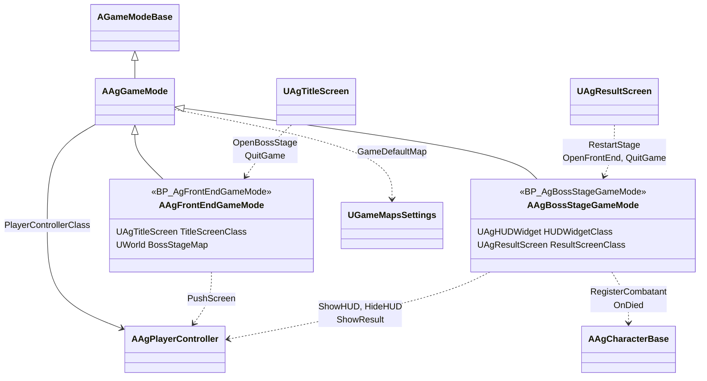
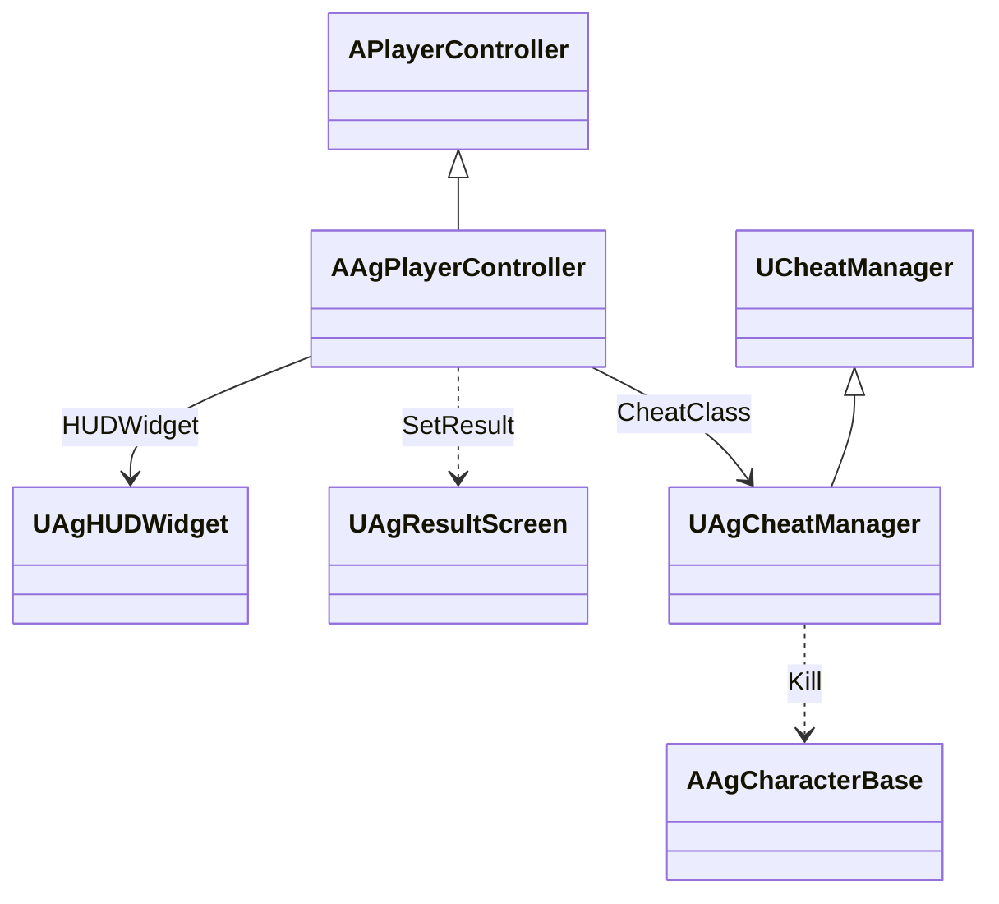
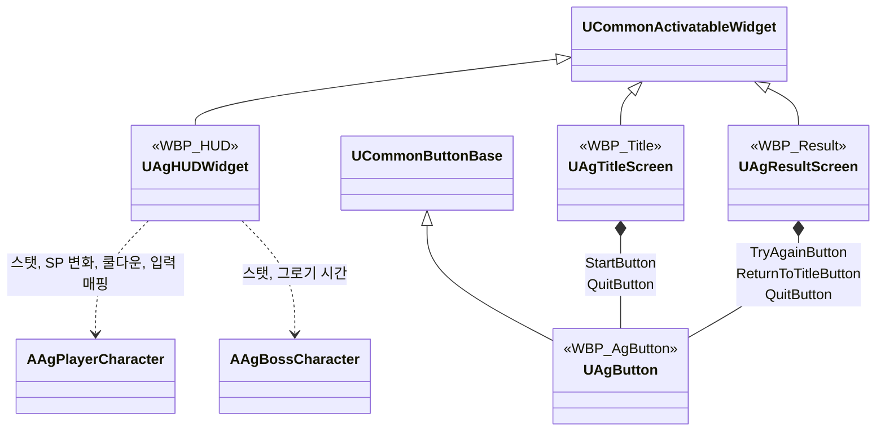
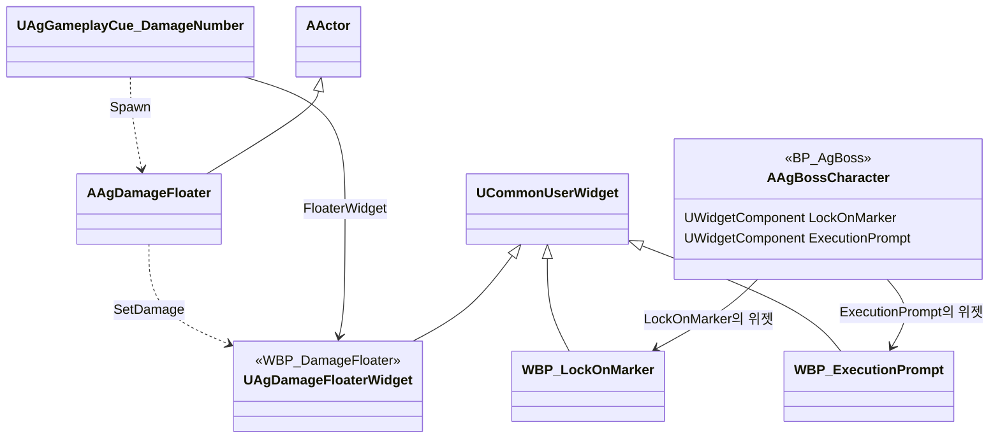

# 카메라, HUD, 화면 UI, 게임 플로우

카메라, HUD, 화면 UI, 게임 플로우를 어떻게 구현할지 정합니다.

## 기술 결정

### 카메라 셰이크

- 상황별 단계와 단계별 지속 시간·회전 진폭·위치 진폭, 공통 축별 진동수는 `Camera.json`을 단일 원본으로 둡니다. `UAgCameraData`가 기존 JSON 검사·재읽기 경로로 로드합니다.
- 호출부가 기존 `AAgPlayerController::PlayCameraShake(EAgCameraShake)`를 직접 호출합니다. 컨트롤러는 로컬 여부와 카메라 매니저를 확인하고, `UAgCameraData::FindShakeSettings(EAgCameraShake)`로 설정을 조회해 재생합니다. None은 재생하지 않습니다. 셰이크에는 GameplayCue나 단계별 BP 에셋을 사용하지 않습니다.
- 공통 `UAgCameraShake`는 `UWaveOscillatorCameraShakePattern`을 사용합니다. 재생 전 인스턴스 초기화에서 JSON 값을 복사하므로 이미 재생 중인 셰이크는 유지되고 다음 재생부터 수정값을 사용합니다.
- 기존과 같이 카메라 로컬 공간에서 Y·Z 위치와 Pitch·Yaw 회전을 흔들며, 무작위 초기 위상과 중첩 재생을 유지합니다. 블렌드 인은 없고 블렌드 아웃은 지속 시간과 같습니다.
- `CS_ShakeSmall/Medium/Large`와 `GC_CameraShake_Small/Medium/Large`는 C++ 처리로 대체하여 제거합니다. VFX·효과음은 큐 블루프린트로 재생합니다([전투 규칙](<전투 규칙.md>) 'GameplayCue').
- 검증은 기존 에셋 값과 JSON의 대조, 에디터 타깃 빌드, JSON 로드와 에셋 참조 검사로 진행합니다. 실제 재생 확인은 '동작 테스트 실행' 절차를 따릅니다.

### 그 밖의 구성

| 항목 | 결정 | 이유 |
| - | - | - |
| 자유 시점 | 스프링 암과 카메라로 만듭니다. 거리, 회전 중심 높이, 위치 추적 지연, FOV는 `BP_AgPlayer`의 스프링 암과 카메라에 적고, 회전 지연은 두지 않습니다. 스프링 암은 캐릭터의 회전을 물려받지 않습니다(절대 회전). 락온 카메라도 스프링 암의 위치를 회전 중심으로 씁니다. | 회피 방향처럼 행동이 캐릭터를 한 번에 돌리는 일이 스프링 암이 그 프레임의 카메라 자리를 정한 뒤에도 일어납니다(선입력은 타이머로 실행). 회전을 물려받으면 그 한 프레임 동안 카메라가 캐릭터와 함께 돌아 화면이 튑니다. |
| 카메라 충돌 | 스프링 암의 충돌 검사를 씁니다. 플레이어, 보스, 투사체, 보이지 않는 벽은 카메라 채널을 무시합니다. | |
| 락온 | 락온 키는 락온 어빌리티를 시작하고, 어빌리티가 실행 중이면 게임플레이 이벤트로 끝냅니다. 락온 어빌리티는 행동 상태의 제한을 받지 않고 선입력으로 기억하지 않으며, 다른 어빌리티가 취소하지 않습니다. 락온 Task의 읽기 전용 조회로 대상을 고르고([전투 규칙](<전투 규칙.md>) '대상 찾기', 없으면 발동하지 않음), 실행 Task가 끝날 때까지 대상을 보관합니다. 플레이어의 입력·회전·공격 보조 방향과 보스 마커는 GetLockOnTarget으로 현재 Task의 대상을 읽습니다. Task의 시작·종료 시 플레이어 회전 모드를 갱신합니다. 실행 중에는 락온 어빌리티 태스크가 매 프레임 카메라를 대상 쪽으로 돌리고, 해제 조건(대상 사망, 해제 거리)이 되면 어빌리티를 끝냅니다. 락온 지점이 되는 보스의 본 이름은 보스 데이터(`Characters.json`의 `Boss`)의 `LockOnBone`을 사용합니다. 카메라 회전은 위아래·좌우 각도마다 임계 감쇠 스프링(`FMath::CriticallyDampedSmoothing`)으로 목표를 따라가고, 회전 속도를 최대 속도로 자릅니다. 락온할 때마다 회전 속도 0에서 시작하고, 히트스톱(캐릭터의 시간 배율)과 관계없이 월드 시간으로 돕니다. | 락온도 다른 행동처럼 어빌리티로 시작하고 끝나며, 매 프레임 회전은 락온 중에만 도는 태스크가 맡습니다. 일정한 속도로 돌면 출발과 멈춤이 갑작스러워 기계적으로 보입니다. 스프링은 출발과 멈춤이 부드럽고, 움직이는 대상을 따라잡는 시간이 스프링의 시간 값과 같습니다. |
| 셰이크 | 위 '카메라 셰이크'를 따릅니다. | |
| HUD | `WBP_HUD`의 배치는 디자이너에서, 동작은 C++ 부모 클래스(BindWidget)에서 처리합니다. 바는 텍스처 없는 단색으로 그립니다. 스킬·궁극기 아이콘은 이미지 위젯의 브러시에 넣은 텍스처나 머티리얼로 표시하고, 브러시가 비어 있으면 숨깁니다. 감소 잔상은 HP 바, 플레이어 SP 바, 보스 PP 바 뒤의 잔상 바이고, 대기·줄어드는 시간은 `CombatRules.json`에서 읽습니다([데이터 위치표](<데이터 위치표.md>)). 위젯에는 같은 값을 저장하지 않고, 잔상을 갱신할 때 공통 데이터 객체를 조회해 JSON 재로드를 반영합니다. SP 잔상은 HUD가 플레이어 ASC의 SP 변화 델리게이트를 듣다가 대미지 GE가 줄인 SP(가드·가드 브레이크)에만 세우고, 다른 감소는 잔상이 바를 바로 따라갑니다. 잔상은 게임 시간으로 흘러 슬로우모션에 맞춰 느려집니다. 조작 안내는 HUD가 만들어질 때 플레이어의 입력 매핑(`IMC_Ag`)을 읽어, 매핑 순서대로 행동마다 한 줄씩 키 열과 행동 이름 열의 두 글자 위젯에 채웁니다. 행동 이름은 입력 액션의 설명(`ActionDescription`)이고, 키는 엔진의 키 이름을 쓰되 마우스 입력처럼 다르게 부르는 키만 위젯의 표시 이름 표로 바꿉니다. 플레이어나 보스의 사망 연출에는 상태 요소(플레이어 상태, 슬롯, 보스 상태)와 조작 안내를 담은 패널을 숨기고, 궁극기 컷신 동안(플레이어 컨트롤러의 시네마틱 모드)에도 숨겼다가 끝나면 되돌립니다. | 모양은 에셋이 정하고 코드는 값만 맡습니다. SP는 회피·달리기로도 줄어 바 값만으로는 가드 피격을 가릴 수 없고, 델리게이트가 넘기는 GE 정보로 가립니다. 조작 안내를 매핑에서 읽으므로 키를 바꿔도 안내를 따로 고치지 않습니다. 엔진의 키 이름은 언어에 따라 번역되므로(한국어에서 Left Shift는 '왼쪽 Shift') 기획서 표기와 다른 키는 표시 이름 표에 넣습니다. 글자 줄 높이는 글자가 아니라 글꼴로 정해져 두 열의 줄이 맞습니다. 엔진 기본 진행 바 텍스처는 끝이 흐려, 가득 찬 바도 끝이 비어 보입니다. 빈 브러시는 단색 사각형으로 그려집니다. 위젯 애니메이션(대미지 숫자)은 엔진 MCP 도구로 만들 수 없어 프로젝트 MCP 도구로 만듭니다. |
| 슬롯 흐림, 쿨다운 표시 | 슬롯 흐림은 ID로 찾은 스킬·궁극기 스펙의 독립 인스턴스에서 공통 비용 확인을 불러 정하고, 스킬 슬롯의 비용 숫자도 어빌리티의 비용(`GetCost`)을 씁니다. 쿨다운 표시는 해당 스펙 인스턴스가 출처인 쿨다운 GameplayEffect에서 남은 시간과 전체 시간을 읽어, 숫자는 위젯에 쓰고 원형 표시 머티리얼에는 남은 비율만 넘깁니다. 둘 다 흐려지는 슬롯 위젯 바깥에 둡니다. | 사용 조건과 쿨다운을 어빌리티 한 곳에만 둡니다. 덮는 모양은 머티리얼이 정합니다. |
| 그로기 중 PP 바 | 보스가 그로기 시간을 세기 시작한 시각(공중에서 그로기가 되면 착지한 때)을 기록하고, HUD는 지난 시간을 그로기 지속 시간으로 나눈 만큼 채웁니다. PP 바의 감소 잔상도 이 채운 값을 따라갑니다. | 그로기 시간과 같은 기준으로 채웁니다. |
| 월드 위치 HUD | 락온 마커, 처형 안내, 대미지 숫자는 화면 공간 위젯 컴포넌트로 표시합니다. 락온 마커와 처형 안내는 보스의 락온 지점과 머리 본에 붙이고, 보스가 매 프레임 표시 여부를 정하며, 플레이어 컨트롤러가 시네마틱 모드(궁극기 컷신)이면 숨깁니다. 대미지 숫자는 대미지 GameplayEffect가 실행하는 큐(`UAgGameplayCue_DamageNumber`)가 플레이어가 준 대미지일 때 맞은 위치에 액터를 생성하고, 액터가 떠오르는 동안 투명해지는 것은 위젯 애니메이션이 맡습니다. 표시 시간(애니메이션 길이)과 떠오르는 높이는 위젯에 둡니다. 대미지 숫자는 실제 시간으로 흘러 슬로우모션의 영향을 받지 않습니다. 상황별 표시 규칙은 HUD와 이 위젯들이 각각 따릅니다. | 대미지 숫자는 HUD가 숨은 뒤에도 끝까지 재생해야 해 HUD와 따로 둡니다. 위젯 애니메이션은 실제 시간으로 재생되므로, 떠오르는 것도 실제 시간으로 세면 둘을 맞추려고 게임 속도를 넘길 필요가 없습니다. |
| UP 게이지 | 텍스처 없는 기능용 UI 머티리얼로 슬롯 테두리를 채웁니다. 채우는 모양은 머티리얼이 정하고, 코드는 UP 비율만 머티리얼 파라미터로 넘깁니다. 채우는 수식은 머티리얼의 Custom 노드(HLSL) 하나에 넣어 그래프를 작게 둡니다. | 코드가 아트를 직접 그리지 않고 모양은 에셋이 맡습니다. 수식이 텍스트라 AI도 고칠 수 있습니다. |
| 화면 UI | 타이틀과 결과 UI는 CommonUI 화면으로 만듭니다. 화면마다 입력 모드(화면 UI는 UI 전용 입력과 커서 표시, HUD는 게임 입력과 커서 숨김)와 첫 선택 버튼을 정합니다. 화면의 버튼은 모두 공용 버튼 `WBP_AgButton`을 쓰고, 상태별 모양과 효과음은 표준 버튼 스타일 `ButtonStyle_Ag`가 정합니다. 효과음은 스타일의 `Hovered Sound`와 `Clicked Sound`를 쓰며, 재생은 Slate 버튼이 맡으므로 코드는 없습니다. 버튼은 포커스를 받으면 선택되고 포커스를 잃으면 선택이 풀리므로, 선택된 모양은 포커스를 가진 버튼 하나에만 남습니다. 마우스를 올리면 포커스를 가져옵니다. ↑·↓ 이동은 Slate의 기본 내비게이션입니다. 실행 키(좌클릭, Enter, Space)는 Slate 버튼의 기본 처리로 동작하므로 CommonUI 입력 데이터(확인·뒤로 액션)는 만들지 않고, CommonUI 설정 `CommonButtonAcceptKeyHandling`을 `TriggerClick`으로 둡니다. 결과 UI가 화면을 어둡게 하며 나타나는 페이드 인은 위젯 애니메이션(`FadeInAnimation`)이 맡고, 코드는 그것을 재생하고 끝나면 버튼을 켭니다. | 새 화면의 버튼도 같은 모양이 되도록 모양을 한 에셋에서 관리합니다. `Pressed Sound`는 누르는 순간 재생되어, 누른 채 버튼 밖으로 끌어내 실행을 취소해도 소리가 납니다. 스타일 사운드는 마우스 호버와 버튼 입력에 재생되고, ↑·↓로 포커스를 옮길 때는 재생되지 않습니다. Lyra 샘플처럼 포커스 이동에 소리를 내는 코드는 두지 않습니다(게임패드 이동은 CommonUI가 커서를 포커스된 버튼으로 옮기므로 호버음이 납니다). 페이드의 길이와 모양은 대미지 숫자처럼 위젯에서 바꿉니다. CommonUI의 `SetIsSelected(false)`는 토글 버튼만 선택을 풀어 주므로, 선택 해제는 `ClearSelection`으로 합니다. CommonUI 입력 데이터는 입력 아이콘 표시와 뒤로 가기 처리에만 쓰이는데, 기획서에는 둘 다 없습니다. 이 설정의 기본값(`Ignore`)은 Enter와 Space를 버튼에 넘기지 않습니다. |
| 게임 모드 | 레벨마다 하나씩, 타이틀용과 보스전용을 `AAgGameMode`를 상속해 둡니다. | |
| 결과 처리 | 보스전 게임 모드가 플레이어와 보스의 사망 가운데 먼저 처리된 것으로 결과(보스는 Stage Clear, 플레이어는 Game Over)를 정하고, 사망 연출 시간이 지나면 결과 UI를 띄웁니다([사망 처리](<사망 처리.md>) '사망에서 결과 UI까지'). 그 밖의 캐릭터가 사망해도 결과와 HUD는 바뀌지 않습니다. Try Again은 레벨을 다시 로드합니다. | 게임 플로우의 Stage Clear와 Game Over는 보스와 플레이어의 사망으로만 정해집니다. |

## 클래스 구조

### 카메라 셰이크

| 클래스 | 부모 | 역할 |
| - | - | - |
| `UAgCameraShake` | `UCameraShakeBase` | JSON에서 읽은 값을 파형에 적용해 셰이크를 재생 |
| `AAgPlayerController` | `APlayerController` | 호출부가 전달한 단계의 JSON 설정을 조회해 로컬 플레이어 카메라에서 재생 |
| `FAgCameraShakeSettings` | - | 단계별 지속 시간·회전 진폭·위치 진폭. `UAgCameraData`가 보관 |

### 게임 모드

레벨마다 하나씩 있습니다. 타이틀로 돌아가기와 게임 종료는 부모 `AAgGameMode`가, 보스전 열기는 타이틀용이, 다시 시작은 보스전용이 맡습니다.

| 클래스 | 부모 | 역할 |
| - | - | - |
| `AAgGameMode` | `AGameModeBase` | 타이틀로 돌아가기와 게임 종료. 타이틀용·보스전용 게임 모드의 부모 |
| `AAgFrontEndGameMode` | `AAgGameMode` | 타이틀 레벨의 흐름, 보스전 열기 |
| `AAgBossStageGameMode` | `AAgGameMode` | 보스전 레벨의 흐름, 결과 판정, 다시 시작(레벨 다시 열기) |

### 플레이어 컨트롤러

화면 UI를 만들고, 테스트용 콘솔 명령을 붙입니다.

| 클래스 | 부모 | 역할 |
| - | - | - |
| `AAgPlayerController` | `APlayerController` | HUD와 화면 UI 생성, 테스트용 콘솔 명령 연결 |
| `UAgCheatManager` | `UCheatManager` | 테스트용 콘솔 명령 (개발 빌드) |

### 화면 UI와 HUD

| 클래스 | 부모 | 역할 |
| - | - | - |
| `UAgHUDWidget` | `UCommonActivatableWidget` | `WBP_HUD`의 부모. 플레이어 상태, 슬롯, 보스 상태, 조작 안내. 보스전의 게임 입력 모드를 정합니다. |
| `UAgTitleScreen` | `UCommonActivatableWidget` | 타이틀 화면 |
| `UAgResultScreen` | `UCommonActivatableWidget` | Stage Clear UI, Game Over UI |
| `UAgButton` | `UCommonButtonBase` | 화면 UI 버튼 |

### 월드 위치 HUD

보스에 붙어 월드 위치에 표시하는 위젯과, 대미지 숫자 큐가 맞은 위치에 띄우는 대미지 숫자입니다.

| 클래스 | 부모 | 역할 |
| - | - | - |
| 락온 마커·처형 안내 위젯 | `UCommonUserWidget` | 배치만 있어 C++ 부모 없이 바로 상속합니다. |
| `UAgDamageFloaterWidget` | `UCommonUserWidget` | `WBP_DamageFloater`의 부모. 숫자, 표시 시간과 떠오르는 높이 |
| `AAgDamageFloater` | `AActor` | 대미지 숫자를 맞은 위치에 띄우고, 떠오르며 투명해진 뒤 사라집니다. |

