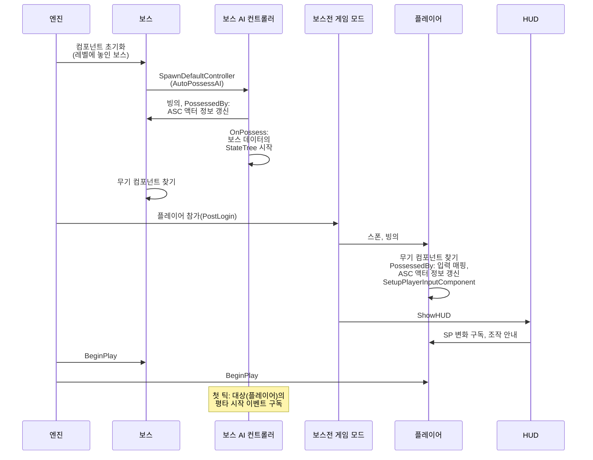
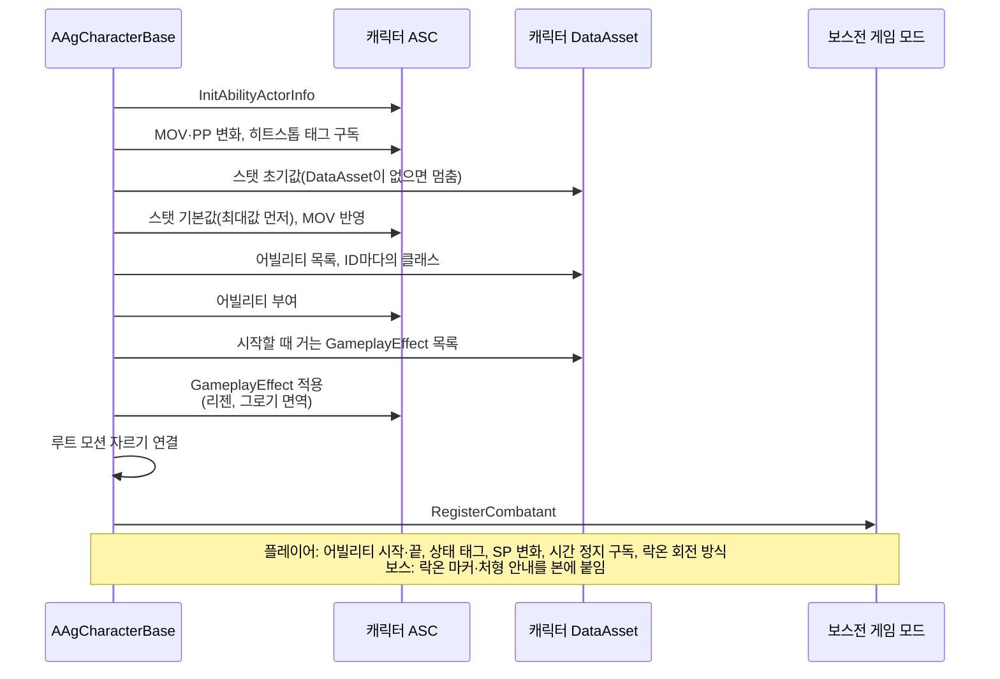

# 캐릭터 초기화

캐릭터가 레벨에 나타나 싸울 준비를 마치기까지(데이터, 빙의, 어빌리티 시스템, AI, 입력, HUD 연결)를 어떻게 구현할지 정합니다.

## 기술 결정

| 항목 | 결정 | 이유 |
| - | - | - |
| 준비하는 곳 | ASC 액터 정보, 스탯, 어빌리티, 시작할 때 거는 GameplayEffect는 캐릭터(`AAgCharacterBase`)의 BeginPlay에서 준비하고('캐릭터 BeginPlay'), 플레이어와 보스는 이 공통 처리 뒤에 각자의 준비를 합니다. 데이터는 그보다 먼저 읽혀 있습니다(공통 JSON은 엔진 초기화 때, 캐릭터 JSON은 캐릭터 DataAsset이 로드될 때, [JSON과 DataAsset](<JSON과 DataAsset.md>) '읽는 방법'). | 레벨에 놓인 캐릭터와 스폰된 캐릭터 모두 BeginPlay를 한 번 거치고, 그때는 컴포넌트 초기화와 빙의가 끝나 있습니다. |
| 빙의 | 레벨에 놓인 보스는 컴포넌트를 초기화할 때 엔진이 AI 컨트롤러를 만들어 빙의시키고(`AutoPossessAI`), 플레이어는 플레이어가 참가할 때(`PostLogin`) 게임 모드가 기본 폰(`BP_AgPlayer`)으로 스폰해 빙의시킵니다. 둘 다 월드의 BeginPlay보다 먼저입니다. 캐릭터는 빙의될 때(`PossessedBy`) ASC의 액터 정보를 다시 읽습니다. | ASC는 캐릭터에 있어([캐릭터와 GAS](<캐릭터와 GAS.md>) 'ASC 위치') 액터 정보의 주인과 아바타는 바뀌지 않지만, 컨트롤러는 빙의할 때 바뀝니다. |
| 스탯 초기값 | 캐릭터 데이터의 초기값(`Attributes`)을 ASC의 기본값으로 바로 넣습니다. 최대값을 먼저 넣고 현재 값을 넣은 뒤 MOV를 한 번 이동 속도에 반영합니다. 그로기 면역은 스탯이 아니라 시작할 때 거는 GameplayEffect가 정합니다([캐릭터와 GAS](<캐릭터와 GAS.md>) '그로기 면역'). | 현재 값은 최대값까지로 잘리므로 최대값이 먼저 있어야 합니다. 어트리뷰트 변화 델리게이트는 값이 바뀔 때만 불려, 처음 값은 직접 반영합니다. |
| 어빌리티 부여 | 캐릭터 JSON의 `Abilities` 항목마다 `UAgGameplayAbility` 스펙을 만듭니다. `GiveAbility` 전에 핸들과 ID를 연결하고 동적 태그·이벤트를 설정합니다. 모든 항목은 독립 인스턴스와 정의를 사용합니다. 로딩 시 고정 스키마와 필수 참조를 검사합니다. | 같은 클래스의 여러 스펙이 있어도 ID·발동 조건·이벤트·비용·쿨다운이 섞이지 않습니다. [캐릭터와 GAS](<캐릭터와 GAS.md>)를 따릅니다. |
| 보스 AI 시작 | 보스 AI 컨트롤러(`AAgBossAIController`)는 빙의할 때 보스 데이터의 StateTree(`AIStateTree`)를 StateTree AI 컴포넌트에 넣고 시작합니다. 컴포넌트는 BeginPlay에 스스로 시작하지 않습니다. 대상(플레이어)의 평타 시작 이벤트([보스](<보스.md>) 'Backstep')는 대상이 생긴 뒤 컨트롤러의 틱에서 한 번 구독합니다. | 실행할 StateTree가 보스 데이터에 있어 빙의한 뒤에야 정해집니다. 보스는 플레이어가 스폰되기 전에 빙의되므로, 빙의할 때는 대상이 아직 없습니다. |
| 입력 연결 | 플레이어 캐릭터(`AAgPlayerCharacter`)는 컨트롤러가 바뀔 때(`NotifyControllerChanged`) 입력 매핑(`IMC_Ag`)을 로컬 플레이어의 Enhanced Input 서브시스템에 넣고, 엔진이 입력 컴포넌트를 만들 때(`SetupPlayerInputComponent`) 입력 액션을 바인딩합니다([입력 처리](<입력 처리.md>) '입력'). 둘 다 빙의할 때 일어납니다. | 입력 매핑은 로컬 플레이어에 넣으므로, 플레이어 컨트롤러가 빙의한 뒤에 넣습니다. |
| HUD 연결 | 보스전 게임 모드(`AAgBossStageGameMode`)는 플레이어의 폰을 스폰해 빙의시킨 직후(`HandleStartingNewPlayer`) HUD(`UAgHUDWidget`)를 띄웁니다. HUD는 만들어질 때 플레이어 폰에서 SP 변화를 구독하고 입력 매핑으로 조작 안내를 채우며([카메라, HUD, 화면 UI, 게임 플로우](<카메라, HUD, 화면 UI, 게임 플로우.md>) 'HUD'), 보스는 처음 틱할 때 월드에서 찾아 둡니다. 표시하는 값은 매 틱 어트리뷰트에서 읽습니다. | HUD를 띄울 때 플레이어 폰이 이미 있어 바로 구독할 수 있습니다. 보스는 레벨에 놓여 있어 언제 찾아도 있습니다. |
| 전투 참가자 등록 | 캐릭터는 BeginPlay에서 보스전 게임 모드에 스스로 등록하고(`RegisterCombatant`), 게임 모드는 그 캐릭터의 사망 알림(`OnDied`)을 구독합니다([카메라, HUD, 화면 UI, 게임 플로우](<카메라, HUD, 화면 UI, 게임 플로우.md>) '결과 처리'). | 레벨에 놓인 보스와 게임 모드가 스폰하는 플레이어가 같은 방법으로 등록되고, 게임 모드가 캐릭터를 찾지 않아도 됩니다. |

## 클래스 구조

### 레벨 시작에서 BeginPlay까지

### 캐릭터 BeginPlay

