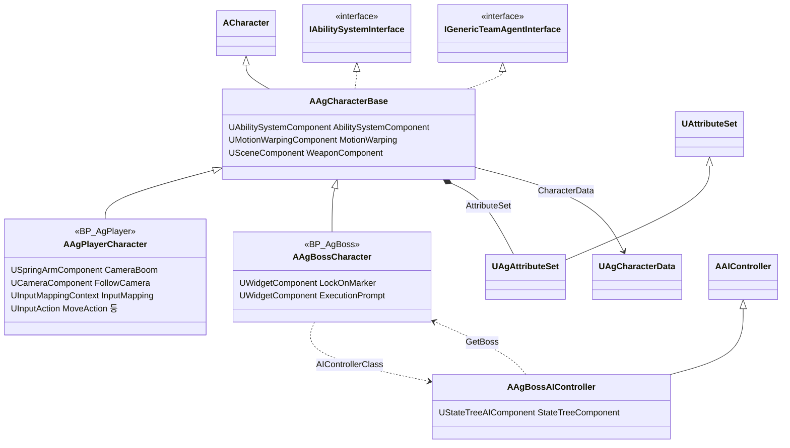
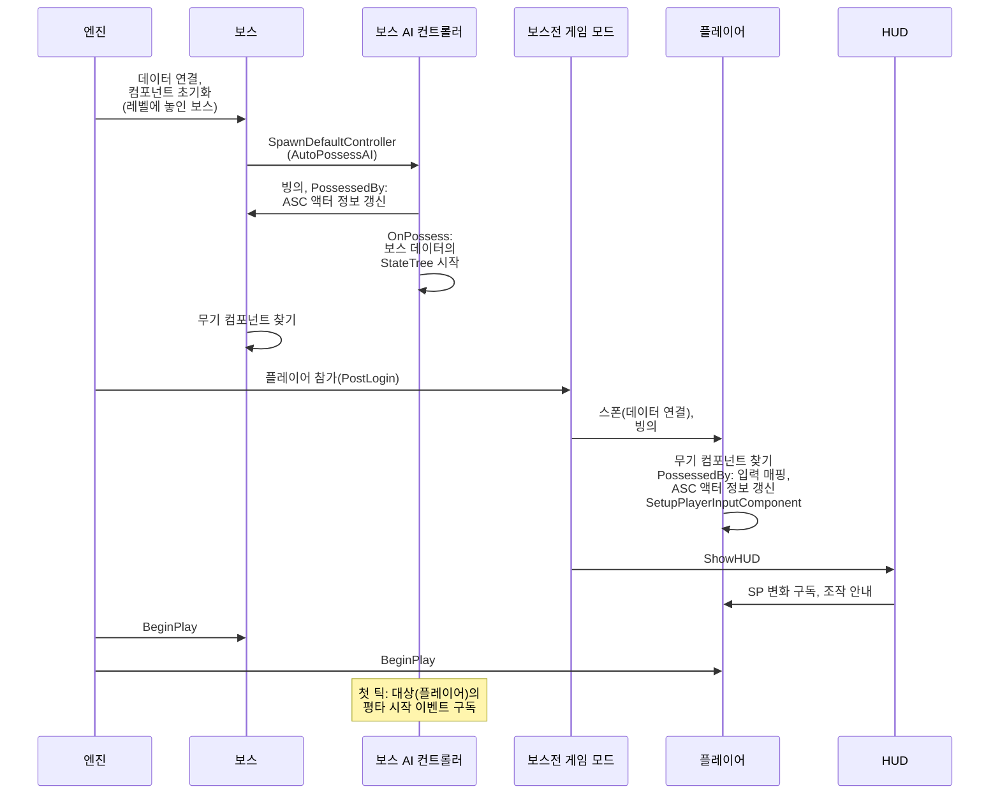
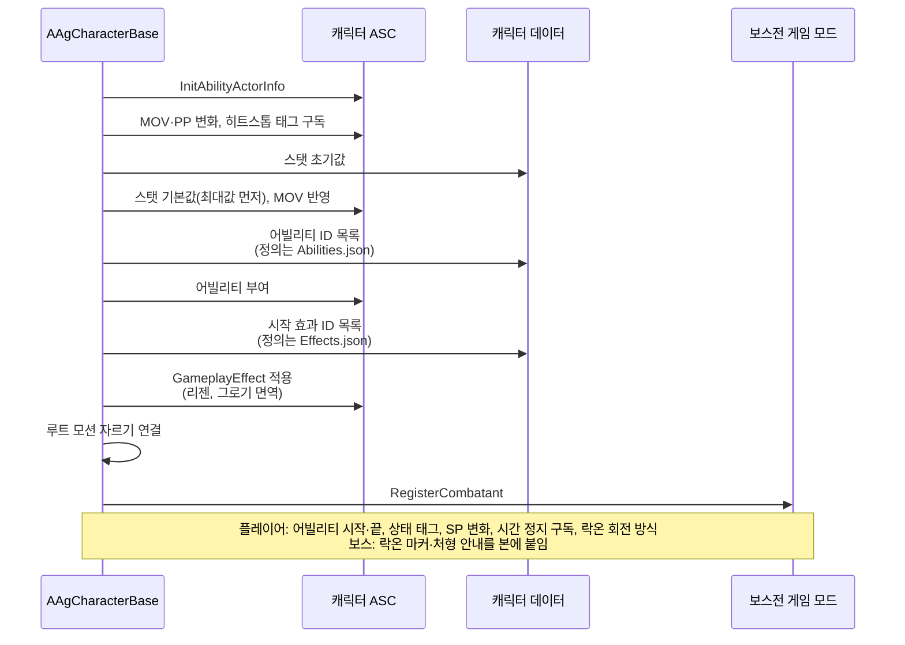
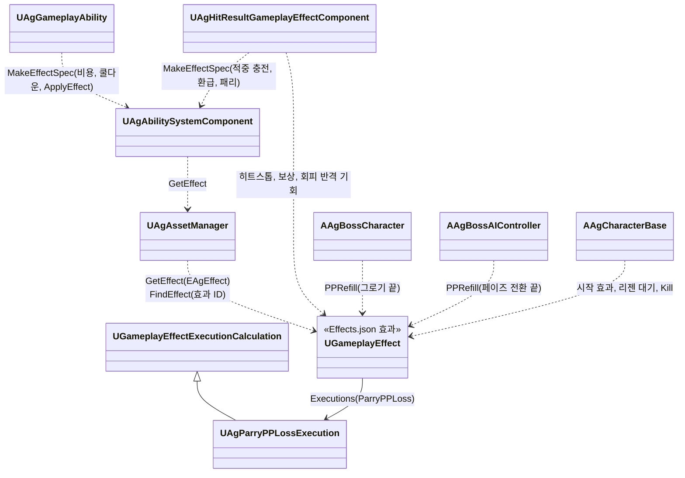

# 캐릭터와 GAS

캐릭터와 GAS, 그리고 캐릭터가 레벨에 나타나 싸울 준비를 마치기까지(데이터, 빙의, 어빌리티 시스템, AI, 입력, HUD 연결)를 어떻게 구현할지 정합니다.

## 기술 결정

| 항목 | 결정 | 이유 |
| - | - | - |
| ASC 위치 | 캐릭터에 둡니다. | 싱글플레이라 PlayerState에 둘 이유가 없습니다. |
| 어트리뷰트 | 세트 하나에 기획서 스탯을 기획서 이름 그대로 둡니다. HP, MaxHP, SP, MaxSP, MP, MaxMP, UP, MaxUP, PP, MaxPP, ATK, DEF, MOV. 보스가 쓰지 않는 SP·MP·UP는 0입니다. 기본값이 바뀌기 전에 범위(0 ~ 최대값)로 고정합니다. | 기획서, 데이터 위치표, 코드의 이름이 같아 대조하기 쉽습니다. 최대값에서 리젠이 더해져도 기본값이 넘치지 않아야 다음 감소가 바로 보입니다. |
| 어빌리티 목록 | 캐릭터 데이터(`Characters.json`)의 `Abilities`에 적힌 어빌리티 ID마다 단일 `UAgGameplayAbility`를 독립 스펙으로 부여합니다. 정의는 `Abilities.json`에 있습니다. `GiveAbility` 전에 핸들과 ID를 연결하고 스펙의 동적 태그·트리거를 설정합니다. `InstancedPerActor` 인스턴스는 자기 ID의 정의와 실행 사본을 사용합니다. | 같은 클래스라도 조건·이벤트·재발동·쿨다운·GE 출처가 행동마다 구분됩니다. |
| 어빌리티 구조 | 행동 전체를 나타내는 자식 Ability나 흐름 Task는 두지 않습니다. Runner(`UAgGameplayAbility`)가 엔진 어빌리티 기능과 시간표를 맡고, 범용 Task가 기능 하나씩을 수행하며, 행동이 아닌 규칙은 주인 객체(캐릭터, 입력 계층, 피격 처리, 보스 AI)가 맡습니다([어빌리티와 AbilityTask](<어빌리티와 AbilityTask.md>)). EndPlay에서는 메시 해제 전에 모든 Ability를 취소합니다. | 기능별 획득과 복원이 함께 있고, 한 기능의 완료가 다른 기능이나 전체 Ability를 임의로 종료하지 않습니다. |
| 상태 | 4순위 상태(넉업, 넉백, 가드 밀림, 가드 브레이크), 그로기, 처형 피격, 페이즈 전환은 이벤트로 발동하는 행동(GameplayEvent 트리거)으로 만들고, 상태 우선순위는 태그로 나타냅니다. 높은 상태는 낮은 상태를 취소하고, 낮은 상태는 높은 상태 중에 시작하지 못합니다. 4순위 상태의 어빌리티 태그는 한 부모 태그(`Ability.Reaction.HitReaction`) 아래에 두어, 높은 상태가 부모 태그 하나로 취소합니다. 사망은 행동이 아니라 캐릭터가 사망 이벤트를 받아 처리합니다([사망 처리](<사망 처리.md>)). 행동이 붙이는 상태 태그는, 행동 내내 붙으면 ActivationOwnedTags에 두고, 일부 구간에만 붙으면(회피의 무적 구간, 후딜 전의 Busy 등) 시간표의 HoldTag로 붙입니다. | 행동과 같은 방식이라 규칙이 한곳에 모입니다. 두 방식 모두 행동이 끝나면 태그가 떨어지므로, 행동마다 태그를 떼는 코드를 두지 않습니다. |
| 쿨다운 | 어빌리티(플레이어 행동, 보스 패턴)의 쿨다운은 쿨다운 효과(`Cooldown`) 하나로 셉니다. 어빌리티마다 태그를 두지 않고, 효과의 에셋 태그(`Effect.Cooldown`)와 걸 때 넣은 출처(그 스펙의 어빌리티 인스턴스)로 어빌리티를 구분합니다. 시간은 어빌리티 항목의 `Cooldown`이며 0이면 쿨다운이 없습니다. 플레이어와 보스가 이 길 하나를 씁니다. 패리 구간, 회피 반격 기회, 그로기 시간처럼 계속 흐르는 시간과 태그는 그 효과(`ParryWindow`, `DodgeCounterChance`, `GroggyTime`)가 정합니다. 비용(SP·MP·UP)은 '자원 변화'를 따릅니다. | 엔진의 쿨다운 GE는 클래스(`CooldownGameplayEffectClass`)로만 받아, JSON에서 만든 효과로 쿨다운을 확인·적용하는 함수를 재정의합니다. 시간은 어빌리티 정의에 두고 효과 정의에는 모든 어빌리티가 같은 지속 방식과 태그만 둡니다. 어빌리티마다 태그를 두지 않아 어빌리티를 더해도 태그가 늘지 않습니다. 쿨다운 유무를 시간 하나로 정해, 쿨다운 효과가 있는지와 시간이 어긋나지 않습니다. |
| 자원 변화 | 자원이 바뀌는 일마다 그 규칙을 가진 효과를 적용합니다. 행동 비용은 엔진이 커밋할 때 부르는 `ApplyCost`에서, 공통 Ability가 실행 사본의 Resource·Amount를 자원 효과(`Resource`)의 SetByCaller에 음수로 넣어 치릅니다. 치를 수 있는지(`CheckCost`)는 같은 고정 비용으로 확인합니다. 적중의 MP·UP 충전과 극한 회피의 SP 환급은 같은 자원 효과에 얻는 양을 넣어, 달리기의 지속 소모는 주기 효과(`SprintDrain`)로, PP 회복(그로기가 끝날 때, 페이즈 전환)은 PP를 최대로 덮어쓰는 효과(`PPRefill`)로, 패리로 공격자가 잃는 PP는 계산 클래스가 양을 정하는 효과(`ParryPPLoss`)로 처리합니다. 극한 회피와 패리의 보상은 피격 처리가 보상 효과(`PerfectDodgeReward`, `ParryReward`)로 줍니다. | 자원 변경은 GameplayEffect로 적용하고 고정 기획 값은 JSON을 사용합니다. 비용은 GAS의 CheckCost·ApplyCost 흐름을 따릅니다. 엔진의 비용 GE는 클래스(`CostGameplayEffectClass`)로만 받아 쓰지 않고, 비용과 얻기가 자원 효과 하나를 함께 씁니다. 결과를 정하는 피격 처리가 보상도 주면, 구간 닫기와 보상이 한 곳에서 전투 시스템의 순서대로 일어납니다. |
| 리젠 | SP·PP 리젠은 효과로 처리합니다. 리젠 대기는 태그를 주는 지속 효과(`SPRegenDelay`, `PPRegenDelay`)로, 자원이 줄 때마다 다시 걸어 처음부터 다시 셉니다. SP가 0이 될 때는 더 긴 대기 효과(`SPRegenDelayEmpty`)를 겁니다. 회복은 주기 효과로 하고, 대기 태그가 있는 동안에는 멈춥니다. SP는 평소용(`SPRegen`)과 가드 중용(`SPRegenGuarding`) 효과를 가드 태그 조건으로 바꿔 씁니다. 회복량은 효과 정의의 초당 값(`PerSecond`)이고, 로더가 주기(`Period`)를 곱해 한 주기 양으로 넣습니다. 회복 효과는 캐릭터 데이터의 시작 효과 목록(`Effects`)에 두어 캐릭터가 시작할 때 겁니다. | 자원 변화를 모두 GameplayEffect로 처리하는 GAS 표준 방식입니다. 초당 회복량과 대기 시간이 그 효과 정의에 있어 한곳에서 고칩니다. GameplayEffect 타이머는 게임 시간으로 흘러, 히트스톱 중에도 리젠이 계속되는 기획서 규칙과 맞습니다. |
| 그로기 면역 | 그로기 대상이 아닌 캐릭터(플레이어)는 시작 효과 목록(`Effects`)에 그로기 면역 효과(`GroggyImmune`)를 둡니다. 이 효과는 무한 지속으로 `State.GroggyImmune` 태그를 주고, PP가 줄어드는 곳(대미지 계산, 패리로 잃는 PP, 그로기 판정)은 캐릭터가 PP를 잃을 수 있는지(`CanLosePP`: 이 태그나 그로기 태그가 없음)를 봅니다. 그로기 어빌리티의 `ActivationBlockedTags`에도 이 태그를 넣어 직접 이벤트나 활성화 요청을 차단합니다. 플레이어의 PP·MaxPP는 미사용 값으로 0을 둡니다. | 상태를 태그로 나타내는 GAS 방식이라, 그로기 중에 PP를 잃지 않는 규칙과 같은 곳에서 확인합니다. 스탯에는 어트리뷰트 초기값만 둡니다. |
| 준비하는 곳 | ASC 액터 정보, 스탯, 어빌리티, 시작할 때 거는 GameplayEffect는 캐릭터(`AAgCharacterBase`)의 BeginPlay에서 준비하고('캐릭터 BeginPlay'), 플레이어와 보스는 이 공통 처리 뒤에 각자의 준비를 합니다. 데이터는 엔진 초기화 때 모든 JSON이 읽혀 있고([JSON 데이터](<JSON 데이터.md>) '읽는 방법'), 캐릭터는 그보다 앞서 컴포넌트를 초기화하기 전에 자기 데이터를 연결합니다('데이터 연결'). | 레벨에 놓인 캐릭터와 스폰된 캐릭터 모두 BeginPlay를 한 번 거치고, 그때는 컴포넌트 초기화와 빙의가 끝나 있습니다. |
| 데이터 연결 | 캐릭터 블루프린트는 쓸 캐릭터 데이터의 ID(`CharacterDataId`: `Player`, `Boss`)를 고릅니다. 캐릭터는 컴포넌트를 초기화하기 전(`PreInitializeComponents`)에 에셋 매니저에서 그 ID의 데이터를 찾아 연결합니다. 데이터가 없거나, 그 캐릭터 클래스의 데이터 클래스(`UAgPlayerData`, `UAgBossData`)가 아니거나, 처음 읽기에 실패했으면 멈춥니다. 그 밖의 코드는 데이터가 있다고 보고 씁니다. | 보스 AI 컨트롤러는 컴포넌트 초기화(`APawn::PostInitializeComponents`) 안에서 빙의하며 보스 데이터의 StateTree를 읽으므로, 그보다 먼저 연결합니다. 확인을 한 곳에서 해, 쓰는 곳마다 데이터가 있는지 묻지 않습니다. |
| 빙의 | 레벨에 놓인 보스는 컴포넌트를 초기화할 때 엔진이 AI 컨트롤러를 만들어 빙의시키고(`AutoPossessAI`), 플레이어는 플레이어가 참가할 때(`PostLogin`) 게임 모드가 기본 폰(`BP_AgPlayer`)으로 스폰해 빙의시킵니다. 둘 다 월드의 BeginPlay보다 먼저입니다. 캐릭터는 빙의될 때(`PossessedBy`) ASC의 액터 정보를 다시 읽습니다. | ASC는 캐릭터에 있어('ASC 위치') 액터 정보의 주인과 아바타는 바뀌지 않지만, 컨트롤러는 빙의할 때 바뀝니다. |
| 스탯 초기값 | 캐릭터 데이터의 초기값(`Attributes`)을 ASC의 기본값으로 바로 넣습니다. 최대값을 먼저 넣고 현재 값을 넣은 뒤 MOV를 한 번 이동 속도에 반영합니다. 그로기 면역은 스탯이 아니라 시작할 때 거는 GameplayEffect가 정합니다('그로기 면역'). | 현재 값은 최대값까지로 잘리므로 최대값이 먼저 있어야 합니다. 어트리뷰트 변화 델리게이트는 값이 바뀔 때만 불려, 처음 값은 직접 반영합니다. |
| 보스 AI 시작 | 보스 AI 컨트롤러(`AAgBossAIController`)는 빙의할 때 보스 데이터의 StateTree(`AIStateTree`)를 StateTree AI 컴포넌트에 넣고 시작합니다. 컴포넌트는 BeginPlay에 스스로 시작하지 않습니다. 대상(플레이어)의 평타 시작 이벤트([보스](<보스.md>) 'Backstep')는 대상이 생긴 뒤 컨트롤러의 틱에서 한 번 구독합니다. | 실행할 StateTree가 보스 데이터에 있어 빙의한 뒤에야 정해집니다. 보스는 플레이어가 스폰되기 전에 빙의되므로, 빙의할 때는 대상이 아직 없습니다. |
| 입력 연결 | 플레이어 캐릭터(`AAgPlayerCharacter`)는 컨트롤러가 바뀔 때(`NotifyControllerChanged`) 입력 매핑(`IMC_Ag`)을 로컬 플레이어의 Enhanced Input 서브시스템에 넣고, 엔진이 입력 컴포넌트를 만들 때(`SetupPlayerInputComponent`) 입력 액션을 바인딩합니다([입력 처리](<입력 처리.md>) '입력'). 둘 다 빙의할 때 일어납니다. | 입력 매핑은 로컬 플레이어에 넣으므로, 플레이어 컨트롤러가 빙의한 뒤에 넣습니다. |
| HUD 연결 | 보스전 게임 모드(`AAgBossStageGameMode`)는 플레이어의 폰을 스폰해 빙의시킨 직후(`HandleStartingNewPlayer`) HUD(`UAgHUDWidget`)를 띄웁니다. HUD는 만들어질 때 플레이어 폰에서 SP 변화를 구독하고 입력 매핑으로 조작 안내를 채우며([카메라, HUD, 화면 UI, 게임 플로우](<카메라, HUD, 화면 UI, 게임 플로우.md>) 'HUD'), 보스는 처음 틱할 때 월드에서 찾아 둡니다. 표시하는 값은 매 틱 어트리뷰트에서 읽습니다. | HUD를 띄울 때 플레이어 폰이 이미 있어 바로 구독할 수 있습니다. 보스는 레벨에 놓여 있어 언제 찾아도 있습니다. |
| 전투 참가자 등록 | 캐릭터는 BeginPlay에서 보스전 게임 모드에 스스로 등록하고(`RegisterCombatant`), 게임 모드는 그 캐릭터의 사망 알림(`OnDied`)을 구독합니다([카메라, HUD, 화면 UI, 게임 플로우](<카메라, HUD, 화면 UI, 게임 플로우.md>) '결과 처리'). | 레벨에 놓인 보스와 게임 모드가 스폰하는 플레이어가 같은 방법으로 등록되고, 게임 모드가 캐릭터를 찾지 않아도 됩니다. |

피격 반응은 Runner가 몽타주를 재생하고 그 재생이 끝날 때 끝납니다. 넉업의 상승·낙하·착지·기상은 넉업 몽타주의 섹션과 Transition이 잇습니다. 넉백·넉업의 무적은 시간표의 HoldTag 지점(쓰러짐 시각)부터 행동이 끝날 때까지입니다.

## 클래스 구조

### 캐릭터

플레이어·보스 캐릭터와 컴포넌트, 보스를 움직이는 AI 컨트롤러입니다.

| 클래스 | 부모 | 역할 |
| - | - | - |
| `AAgCharacterBase` | `ACharacter`, `IAbilitySystemInterface`, `IGenericTeamAgentInterface` | 플레이어·보스 공통. ASC, 어트리뷰트, 팀(적대 판정), 어빌리티 부여와 스펙의 어빌리티 항목 찾기(`FindAbility`, `FindAbilitySpec`), 무기 리소스, 공중 상태(`State.Airborne`)와 이동 사건(`Event.Landed`, `Event.Apex`), 행동하지 않을 때의 자동 회전, 재생 중인 Runner의 대상과 간격으로 루트 모션 자르기(최소 간격), 상태 태그 처리(캐릭터 통과, 시간 정지 요청), 추적 구간의 대체 대상(`GetFallbackFacingTarget`), 이동 입력 방향(`GetMoveInputDirection`), 움찔, 히트스톱 중의 시간 배율, 사망 처리와 사망 모션 |
| `AAgPlayerCharacter` | `AAgCharacterBase` | 카메라와 락온 카메라, 입력 매핑, 입력 계층(행동 태그로 스펙 찾기, 트리거 태그, 이동 입력 태그, 선입력, 점프와 점프 모션) |
| `AAgBossCharacter` | `AAgCharacterBase` | 페이즈 같은 보스 상태, 자동 회전 대상(AI 대상), 그로기가 끝날 때의 PP 회복. 보스에 표시하는 월드 위치 HUD(락온 마커, 처형 안내) |
| `UAgAttributeSet` | `UAttributeSet` | 기획서 스탯 13개, 사망·그로기 판정 |

### 레벨 시작에서 BeginPlay까지

### 캐릭터 BeginPlay

### GameplayEffect

GameplayEffect는 `Effects.json`의 효과 정의이고, 에셋 매니저가 읽을 때 GE 객체로 만듭니다. GE C++ 클래스는 두지 않습니다. 형식, 효과 목록과 거는 곳, 코드가 효과를 거는 방법은 [JSON 데이터](<JSON 데이터.md>) '효과'를 따릅니다. 대미지 효과는 [대미지와 피격 처리](<대미지와 피격 처리.md>)에 있습니다. 행동 비용·쿨다운은 Runner가, 행동이 거는 효과(패리 구간, 극한 회피 구간, 그로기 시간, 달리기 소모)는 ApplyEffect가, 패리·극한 회피의 결과와 보상(패리로 잃는 PP, 보상, 환급, 회피 반격 기회)·히트스톱·적중 충전은 피격 결과 처리 컴포넌트가, PP 회복은 보스 캐릭터(그로기가 끝날 때)와 보스 AI(페이즈 전환이 끝날 때)가, 리젠 대기와 시작 효과는 캐릭터가 겁니다. 로직이 있는 계산만 C++ 클래스로 두고, 효과 정의가 클래스 경로로 가리킵니다.

| 클래스 | 부모 | 역할 |
| - | - | - |
| `UAgParryPPLossExecution` | `UGameplayEffectExecutionCalculation` | `ParryPPLoss` 효과의 계산. 공격한 쪽의 MaxPP × 막은 쪽의 패리 PP 비율(PP를 잃지 않는 대상은 그대로) |

