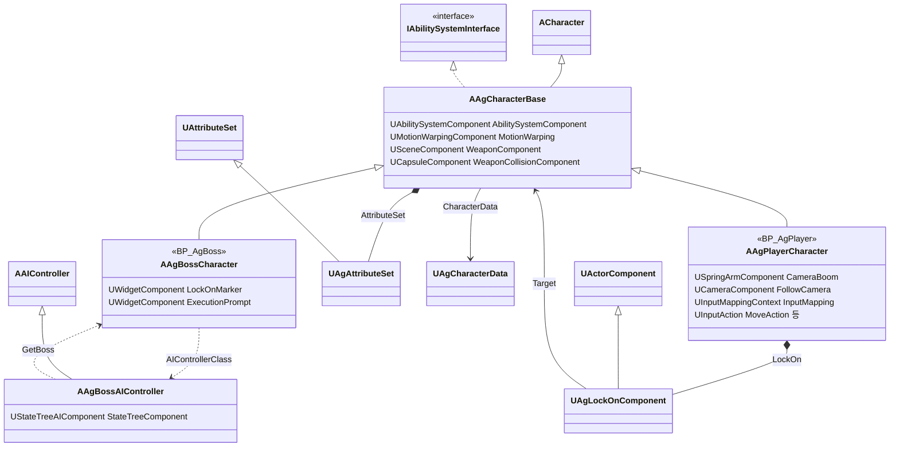
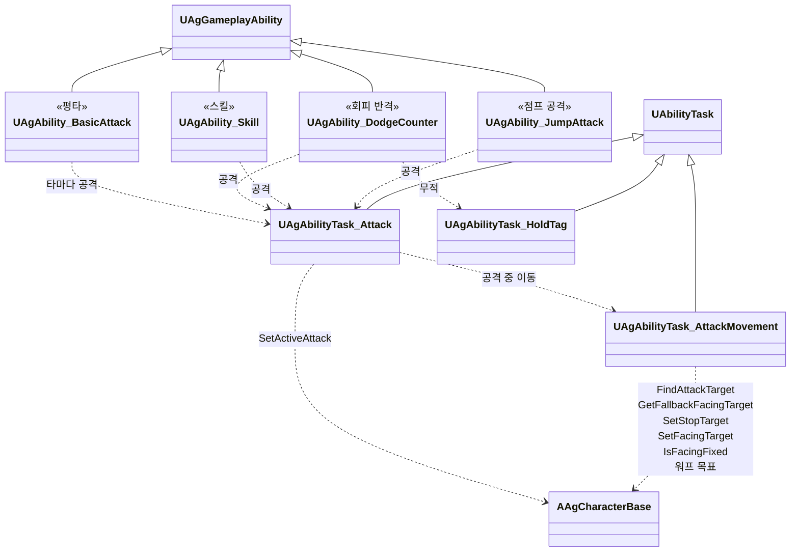
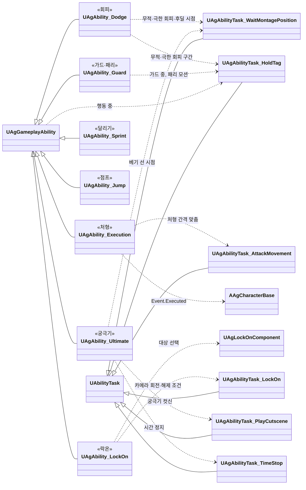
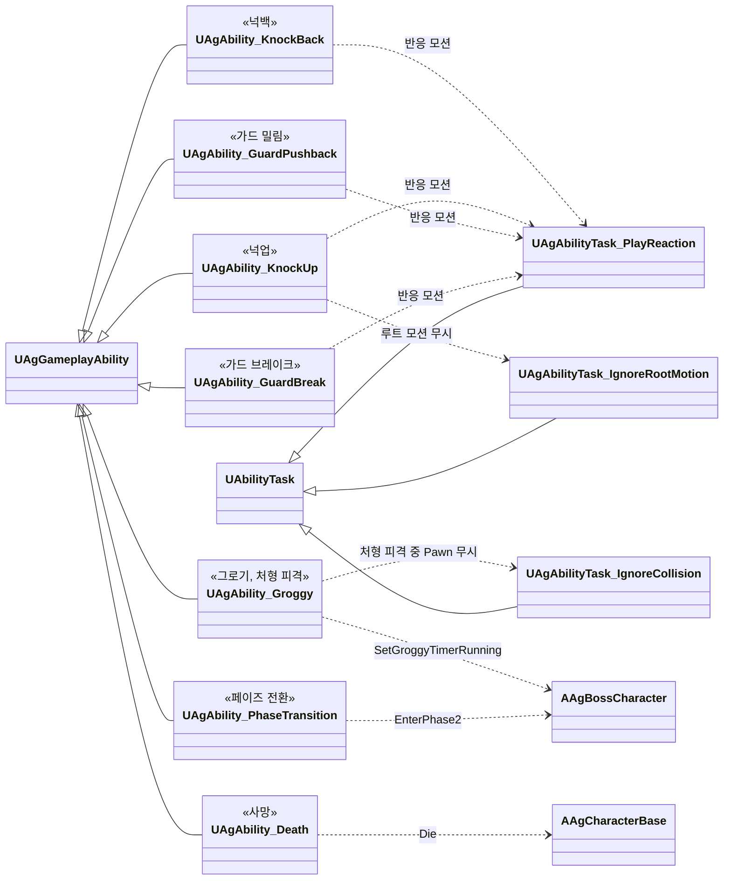
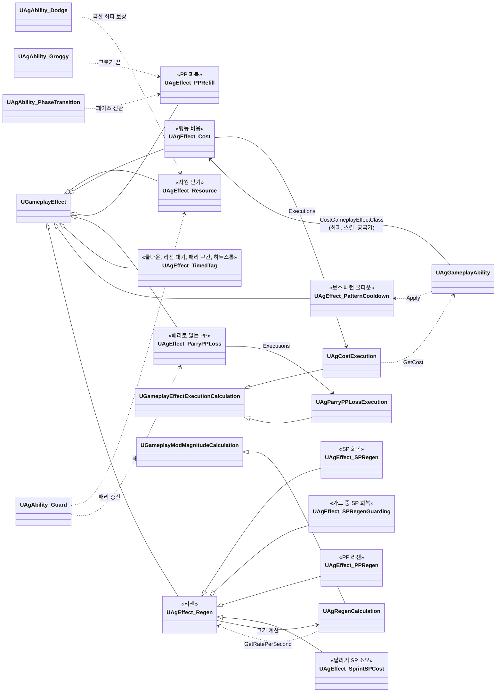
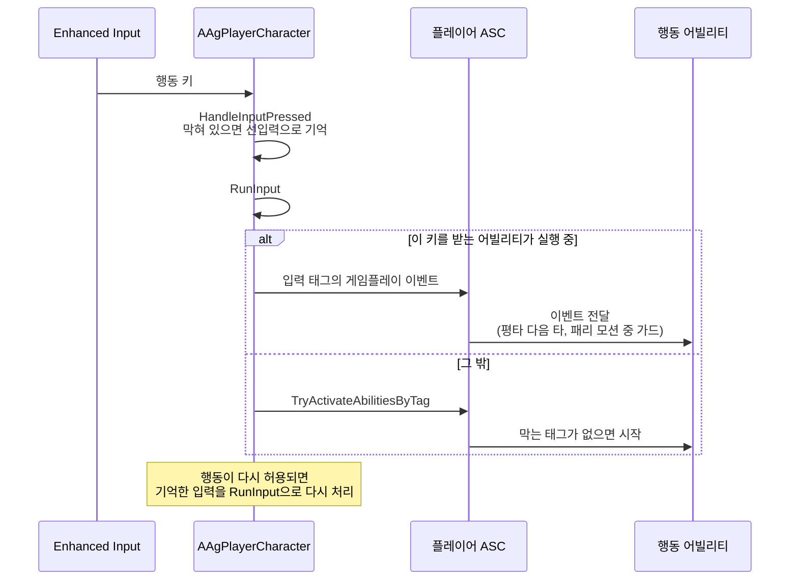

# 캐릭터와 GAS

캐릭터와 GAS를 어떻게 구현할지 정합니다.

## 기술 결정

| 항목 | 결정 | 이유 |
| - | - | - |
| ASC 위치 | 캐릭터에 둡니다. | 싱글플레이라 PlayerState에 둘 이유가 없습니다. |
| 어트리뷰트 | 세트 하나에 기획서 스탯을 기획서 이름 그대로 둡니다. HP, MaxHP, SP, MaxSP, MP, MaxMP, UP, MaxUP, PP, MaxPP, ATK, DEF, MOV. 보스가 쓰지 않는 SP·MP·UP는 0입니다. 기본값이 바뀌기 전에 범위(0 ~ 최대값)로 고정합니다. | 기획서, 데이터 위치표, 코드의 이름이 같아 대조하기 쉽습니다. 최대값에서 리젠이 더해져도 기본값이 넘치지 않아야 다음 감소가 바로 보입니다. |
| 행동 | 플레이어 행동(평타, 회피, 회피 반격, 가드·패리, 스킬, 궁극기, 처형, 달리기, 점프, 점프 공격)과 보스 패턴은 어빌리티로 만듭니다. | 행동, 쿨다운, 자원을 어빌리티·GameplayEffect·태그 한 방식으로 처리합니다. |
| 어빌리티 구조 | 어빌리티는 모두 `UAgGameplayAbility`를 바로 상속하고, 그 사이에 중간 클래스를 두지 않습니다. 여러 어빌리티가 함께 쓰는, 시간에 걸친 동작은 AbilityTask로 만듭니다(판정 구간이 있는 공격([전투 규칙](<전투 규칙.md>) '공격 진행'), 피격 반응 모션과 쓰러진 뒤의 무적, 루트 모션 무시, 충돌 무시, 공격 중 이동, 컷신 재생, 시간 정지). 한 번에 끝나는 조회(패턴 데이터 찾기, 첫 판정 구간 전의 이동 거리)는 함수로 둡니다. GAS가 정한 확장 지점(비용, 쿨다운(보스 패턴은 패턴별), 종료)과 여러 어빌리티가 같이 쓰는 생성자의 태그 설정은 `UAgGameplayAbility`에 둡니다. 태스크는 델리게이트로 알리기만 하고, 행동 중·후딜과 어빌리티를 끝낼지는 어빌리티가 정합니다. 캐릭터는 플레이가 끝날 때(EndPlay) 어빌리티를 모두 취소합니다. | 한 어빌리티의 흐름이 부모와 자식 파일로 나뉘지 않고, 부모가 다른 어빌리티끼리도 같은 동작을 나눠 쓸 수 있습니다(넉업과 돌진 찌르기의 루트 모션 무시, 돌진 찌르기와 처형 피격의 충돌 무시). 태스크는 어빌리티가 끝나면 엔진이 함께 끝내므로, 켜 둔 상태를 되돌리는 코드가 그 기능 옆에 있습니다. ASC는 자기가 등록 해제될 때에야 어빌리티를 취소하는데, 그보다 먼저 메시가 등록 해제되며 몽타주를 끊으면 살아 있는 어빌리티가 그 콜백에서 메시를 바꿉니다(PIE 종료 때 처형 사망의 래그돌이 등록 해제 중인 메시에 물리 상태를 다시 만들어 엔진 ensure). |
| 상태 | 4순위 상태(넉업, 넉백, 가드 밀림, 가드 브레이크), 그로기, 처형 피격, 페이즈 전환, 사망은 이벤트로 발동하는 어빌리티로 만들고, 상태 우선순위는 태그로 나타냅니다. 높은 상태는 낮은 상태를 취소하고, 낮은 상태는 높은 상태 중에 시작하지 못합니다. 4순위 상태의 어빌리티 태그는 한 부모 태그(`Ability.Reaction.HitReaction`) 아래에 두어, 높은 상태가 부모 태그 하나로 취소합니다. 어빌리티가 붙이는 상태 태그는, 어빌리티가 도는 내내 붙으면 ActivationOwnedTags에 두고, 일부 구간에만 붙으면(회피의 무적 구간, 가드 중 등) 태그 유지 태스크(`UAgAbilityTask_HoldTag`)로 붙입니다. | 행동과 같은 방식이라 규칙이 한곳에 모입니다. 두 방식 모두 어빌리티가 끝나면 엔진이 태그를 떼므로, 어빌리티마다 태그를 떼는 코드를 두지 않습니다. |
| 쿨다운 | 쿨다운용 GameplayEffect로 처리합니다. 쿨다운(보스 패턴은 [보스](<보스.md>) '패턴'), 리젠 대기, 패리 구간, 가드 시작 후 이동할 수 없는 시간은 시간과 태그를 적용할 때 정하는 GameplayEffect 하나를 같이 씁니다. 비용(SP·MP·UP)은 '자원 변화'를 따릅니다. | GAS 기본 방식입니다. 값이 캐릭터·공통 데이터에 있어 GameplayEffect 에셋에 따로 둘 데이터가 없습니다. |
| 자원 변화 | 자원이 바뀌는 일마다 그 규칙을 가진 GameplayEffect를 적용합니다. 행동 비용은 어빌리티의 비용 GameplayEffect(`CostGameplayEffectClass`)로 엔진이 커밋할 때 치르고, 줄이는 양은 비용 GameplayEffect의 계산 클래스가 어빌리티에서 읽습니다. 치를 수 있는지는 어빌리티가 플레이어 사양의 행동별 조건으로 확인합니다. MP·UP 충전과 극한 회피의 SP 반환은 얻는 양을 SetByCaller로 받는 자원 GameplayEffect로, PP 회복(그로기가 끝날 때, 페이즈 전환)은 PP를 최대로 덮어쓰는 GameplayEffect로, 패리로 공격자가 잃는 PP는 계산 클래스가 양을 정하는 GameplayEffect로 처리합니다. 극한 회피와 패리의 보상은 그 구간을 연 회피·가드 어빌리티가 그 이벤트를 받아 줍니다. | 양을 정하는 규칙이 GameplayEffect에 있어, 적용하는 쪽이 양을 계산하지 않습니다. 비용은 GAS가 정한 자리(비용 GameplayEffect)로 치릅니다. 보상을 구간을 연 어빌리티가 주면 극한 회피와 패리가 같은 방식이 됩니다. |
| 모션 캔슬 | 행동 어빌리티는 후딜 전까지 '행동 중' 태그를, 모션이 끝날 때까지 '행동 모션' 태그를 갖습니다. 후딜 시작은 [애니메이션과 이동](<애니메이션과 이동.md>)의 '모션을 따르는 구간'과 '기획서에 초로 적힌 구간'을 따릅니다. 새 행동은 '행동 중' 태그가 없을 때만 시작하고, 시작하면 진행 중인 행동을 취소합니다. 회피 후딜에 회피를 누르면 회피를 처음부터 다시 시작합니다. 이동 입력은 '행동 모션' 태그가 있는 동안 무시합니다. 플레이어 행동, 보스 패턴, 피격 반응, 그로기(처형 피격 포함), 페이즈 전환은 블렌드 아웃이 시작될 때가 아니라 모션이 끝날 때 끝납니다. 피격 반응에 이어지는 모션(넉업의 기상)은 앞 모션이 블렌드 아웃을 시작할 때 잇습니다. | 상태별 허용 입력 표를 그대로 옮길 수 있습니다. 이동만 후딜에도 막히므로 태그를 따로 둡니다. 블렌드 아웃은 모션 끝보다 먼저 시작해, 그때 끝내면 후딜과 피격 반응(기상 무적 포함)이 모션보다 짧아지고 그로기가 지속 시간보다 짧아지며, 페이즈 전환의 무적이 포효가 끝나기 전에 풀립니다. |
| 선입력 | 플레이어 캐릭터가 입력을 받을 때 '행동 중'이나 피격 반응 태그가 있으면, 그 입력 하나와 누른 시각(월드 시간)을 기억합니다. 점프 중의 평타 키는 점프 공격으로 허용되므로 기억하지 않습니다([애니메이션과 이동](<애니메이션과 이동.md>) '점프 공격'). 입력은 그때도 그대로 처리하므로 허용되지 않은 행동은 시작하지 않고, 진행 중인 어빌리티가 받는 입력(패리 모션 중의 가드)은 그대로 받습니다. 두 태그가 풀리면 다음 프레임에 기억한 입력을 다시 처리하고, 기억하는 시간이 지났거나 가드 키를 뗐으면 버립니다. 가드 키를 누른 채 행동이 끝나 가드를 다시 시작할 때도 기억한 입력을 먼저 처리합니다. | 입력이 한 함수로 모이고 허용되는 순간이 태그 두 개로 드러나, 행동 어빌리티를 고치지 않아도 됩니다. 다음 프레임에 처리해야 같은 프레임에 이어지는 상태(평타의 후딜 표시, 행동을 끊은 피격 반응)가 반영됩니다. 월드 시간은 히트스톱 중에도 흐릅니다. |
| 리젠 | SP·PP 리젠은 GameplayEffect로 처리합니다. 리젠 대기는 태그를 주는 지속 GameplayEffect로, 자원이 줄 때마다 다시 적용해 처음부터 다시 셉니다. SP가 0이 될 때는 더 긴 대기용 GameplayEffect를 적용합니다. 회복은 주기 GameplayEffect로 하고, 대기 태그가 있는 동안에는 멈춥니다. SP는 평소용과 가드 중용 주기 GameplayEffect를 가드 태그 조건으로 바꿔 씁니다. 회복 GameplayEffect의 크기 계산 클래스(`UAgRegenCalculation`)가 주기마다 주인의 캐릭터 데이터에서 초당 회복량을 읽어 주기를 곱하고, 주기는 회복 GameplayEffect의 `Period`입니다. 캐릭터마다 거는 회복 GameplayEffect는 캐릭터 DataAsset의 목록(`RegenEffects`)에 두고, 캐릭터가 시작할 때 겁니다. 대기 시간은 캐릭터·공통 데이터에서 읽어 적용합니다. | 자원 변화를 모두 GameplayEffect로 처리하는 GAS 표준 방식입니다. 회복량을 GameplayEffect가 주기마다 읽으므로, 데이터 파일을 다시 읽어도 효과를 다시 걸 필요가 없습니다. GameplayEffect 타이머는 게임 시간으로 흘러, 히트스톱 중에도 리젠이 계속되는 기획서 규칙과 맞습니다. |

## 클래스 구조

### 캐릭터

플레이어·보스 캐릭터와 컴포넌트, 보스를 움직이는 AI 컨트롤러입니다.

| 클래스 | 부모 | 역할 |
| - | - | - |
| `AAgCharacterBase` | `ACharacter`, `IAbilitySystemInterface` | 플레이어·보스 공통. ASC, 어트리뷰트, 무기와 공격 판정(무기 스윕), 정지 간격(루트 모션 자르기), 회전과 바라보는 방향이 고정되는 때, 공격 중 이동의 대상(`FindAttackTarget`)과 범위 밖 타의 회전 대상(`GetFallbackFacingTarget`), 움찔, 히트스톱 중의 시간 배율, 사망 처리 |
| `AAgPlayerCharacter` | `AAgCharacterBase` | 카메라, 락온, 대상 찾기, 입력 매핑, 입력을 어빌리티로 연결 |
| `AAgBossCharacter` | `AAgCharacterBase` | 페이즈 같은 보스 상태, 회전 대상(AI 대상)과 회전하지 않는 상태. 보스에 표시하는 월드 위치 HUD(락온 마커, 처형 안내) |
| `UAgAttributeSet` | `UAttributeSet` | 기획서 스탯 13개, 사망·그로기 판정 |
| `UAgLockOnComponent` | `UActorComponent` | 락온 대상 선택과 해제 조건 검사. 락온 중의 대상을 들고 있습니다. |

### 어빌리티

모든 어빌리티는 `UGameplayAbility`를 상속한 `UAgGameplayAbility`를 바로 상속하고, 여러 어빌리티가 함께 쓰는 동작은 어빌리티 태스크로 씁니다('어빌리티 구조'). 플레이어 행동과 상태로 나눠 그리고, 보스 패턴은 [보스](<보스.md>)에 있습니다.

| 클래스 | 부모 | 역할 |
| - | - | - |
| `UAgGameplayAbility` | `UGameplayAbility` | 모든 어빌리티의 부모('어빌리티 구조'). 캐릭터 데이터 읽기, 쿨다운과 비용(보스 패턴은 패턴별), 플레이어 행동·피격 반응·보스 패턴의 태그(상태별 허용 입력, 모션 캔슬, 상태 우선순위) |
| `UAgAbilityTask_WaitMontagePosition` | `UAbilityTask` | 몽타주 재생 위치가 정한 시간에 닿을 때까지 기다립니다(기획서에 초로 적힌 구간). |
| `UAgAbilityTask_HoldTag` | `UAbilityTask` | 도는 동안 상태 태그 하나를 붙여 둡니다(행동 중, 무적·극한 회피 구간, 가드 중, 패리 모션, 처형 피격, 보스의 회전 정지). 어빌리티가 끝내거나 어빌리티가 끝나면 뗍니다. |
| `UAgAbilityTask_Dash` | `UAbilityTask` | 일정 속도로 직선 이동하고, 거리를 다 가거나 벽에 막히거나 어빌리티가 멈추면 끝납니다(돌진 찌르기의 돌진). |
| `UAgAbilityTask_LockOn` | `UAbilityTask` | 락온 중 매 프레임 카메라를 대상의 락온 지점 쪽으로 돌리고, 해제 조건이 되면 끝납니다. |
| `UAgAbilityTask_AttackMovement` | `UAbilityTask` | 공격 중 이동. 타를 시작할 때마다 대상을 다시 정해 정지 간격과 회전 대상(범위 밖이면 캐릭터가 정한 대체 대상)을 걸고, 매 프레임 워프 목표를 대상 앞 간격 지점에 두다가 바라보는 방향이 고정되면 함께 고정합니다. 끝나면 모두 지웁니다([애니메이션과 이동](<애니메이션과 이동.md>) '공격 중 이동'). |
| `UAgAbilityTask_Attack` | `UAbilityTask` | 판정 구간이 있는 공격 하나(평타 한 타, 점프 공격, 회피 반격, 스킬, 보스 공용 패턴). 공격 데이터를 판정 구간에 걸고 몽타주를 재생하며 공격 중 이동 태스크를 시작합니다. 마지막 판정 구간의 끝(후딜 시작), 모션의 끝, 끊김을 어빌리티에 알립니다([전투 규칙](<전투 규칙.md>) '공격 진행'). |
| `UAgAbilityTask_PlayReaction` | `UAbilityTask` | 피격 반응 모션. 반응 몽타주와 이어지는 몽타주(넉업의 기상)를 재생하고, 마지막 모션의 끝과 끊김을 어빌리티에 알립니다. 바닥에 쓰러진 순간부터 끝날 때까지 무적입니다. |
| `UAgAbilityTask_IgnoreRootMotion` | `UAbilityTask` | 도는 동안 몽타주의 루트 모션을 무시합니다. 루트 모션 소스로 옮기는 동안 씁니다(돌진 찌르기의 돌진, 넉업). |
| `UAgAbilityTask_IgnoreCollision` | `UAbilityTask` | 도는 동안 주인의 루트 충돌 컴포넌트(캐릭터는 캡슐)가 인자로 받은 충돌 채널을 무시합니다(돌진 찌르기의 돌진과 처형 피격은 Pawn 채널을 무시해 플레이어를 막지 않음). 끝나면 원래 응답으로 되돌리고, 그사이 죽었으면 사망 처리가 정한 대로 둡니다. |
| `UAgAbilityTask_PlayCutscene` | `UAbilityTask` | 컷신(레벨 시퀀스) 하나를 기준 액터의 위치·방향으로, 시네마틱 모드로 재생합니다. 시간 정지 중에는 정상 속도로 재생하고, 끝나면 알립니다. |
| `UAgAbilityTask_TimeStop` | `UAbilityTask` | 도는 동안 주인만 빼고 시간을 멈춥니다(궁극기, [전투 규칙](<전투 규칙.md>) '시간 정지'). 끝나면 시간 정지를 끕니다. |

#### 플레이어 행동

판정 구간이 있는 공격 행동(평타, 점프 공격, 회피 반격, 스킬)은 공격 태스크로 공격 데이터, 몽타주, 공격 중 이동을 처리합니다. 보스 공용 패턴도 같은 태스크를 씁니다.

| 클래스 | 부모 | 역할 |
| - | - | - |
| 플레이어 행동 어빌리티 | `UAgGameplayAbility` | 평타, 회피, 회피 반격, 가드·패리, 스킬, 궁극기, 처형, 달리기, 점프, 점프 공격 |
| `UAgAbility_LockOn` | `UAgGameplayAbility` | 락온. 락온 키로 시작하고 끝나며, 실행 중에는 락온 태스크를 돌립니다. 행동이 아니라서 행동 상태의 제한과 취소를 받지 않습니다. |

그 밖의 행동입니다.

#### 상태

상태 어빌리티는 게임플레이 이벤트로 시작합니다([대미지와 피격 처리](<대미지와 피격 처리.md>) '공격 판정과 피격 처리').

| 클래스 | 부모 | 역할 |
| - | - | - |
| 상태 어빌리티 | `UAgGameplayAbility` | 넉업, 넉백, 가드 밀림, 가드 브레이크, 그로기(처형 피격 포함), 페이즈 전환, 사망 |

### GameplayEffect

GameplayEffect는 모두 C++ 클래스입니다. 대미지 GameplayEffect는 [대미지와 피격 처리](<대미지와 피격 처리.md>)에 있습니다. 행동 비용은 어빌리티의 비용 GameplayEffect로 엔진이 치르고, 자원 얻기, PP 회복, 패리로 잃는 PP는 그 일을 하는 어빌리티나 결과 처리 컴포넌트가 적용합니다. 시간 태그 GameplayEffect는 그 클래스의 함수(`Apply`)로 적용하고, 리젠 GameplayEffect는 캐릭터가 시작할 때 캐릭터 데이터의 목록(`RegenEffects`)대로 겁니다. 리젠의 회복량은 크기 계산 클래스가 주기마다 캐릭터 데이터에서 읽습니다.

| 클래스 | 부모 | 역할 |
| - | - | - |
| `UAgEffect_Resource` | `UGameplayEffect` | 자원 얻기(MP·UP 충전, 극한 회피의 SP 반환). 얻는 양을 SetByCaller로 받습니다. |
| `UAgEffect_Cost` | `UGameplayEffect` | 행동 비용. 비용을 치르는 어빌리티의 비용 GameplayEffect입니다. |
| `UAgCostExecution` | `UGameplayEffectExecutionCalculation` | 비용 GameplayEffect의 계산. 어빌리티의 비용만큼 SP·MP·UP를 줄입니다. |
| `UAgEffect_PPRefill` | `UGameplayEffect` | PP를 최대로 채웁니다(그로기가 끝날 때, 페이즈 전환). |
| `UAgEffect_ParryPPLoss` | `UGameplayEffect` | 패리로 공격한 쪽이 잃는 PP. 막은 쪽의 가드 어빌리티가 공격한 쪽에 적용합니다. |
| `UAgParryPPLossExecution` | `UGameplayEffectExecutionCalculation` | 패리로 잃는 PP의 계산. 공격한 쪽의 MaxPP × 막은 쪽의 패리 PP 비율(PP를 잃지 않는 대상은 그대로) |
| `UAgEffect_TimedTag` | `UGameplayEffect` | 적용할 때 정한 시간 동안 태그를 줍니다(보스 패턴이 아닌 쿨다운, 리젠 대기, 패리 구간, 가드 시작 후 이동 불가, 회피 반격 기회, 히트스톱). 거는 함수가 시간과 태그를 정합니다. |
| `UAgEffect_PatternCooldown` | `UGameplayEffect` | 보스 패턴의 쿨다운. 태그 없이, 걸 때 넣은 출처(그 패턴 스펙의 어빌리티 인스턴스)로 패턴을 구분합니다. |
| `UAgEffect_Regen` | `UGameplayEffect` | 리젠 주기 GameplayEffect의 부모. SP 평소용, SP 가드 중용, PP용, 달리기 SP 소모용이 태그 조건과 읽는 초당 회복량만 다릅니다. 주기는 이 클래스의 `Period`입니다. |
| `UAgRegenCalculation` | `UGameplayModMagnitudeCalculation` | 리젠의 한 주기 양. 주인의 캐릭터 데이터에서 읽은 초당 회복량 × 주기 |

### 입력에서 행동까지

이동은 캐릭터 무브먼트로 갑니다. 락온 키는 선입력과 행동 제한을 거치지 않고 바로 `RunInput`으로 가서 락온 어빌리티를 시작하거나 끝냅니다. 나머지 행동 키는 아래처럼 어빌리티로 갑니다.

