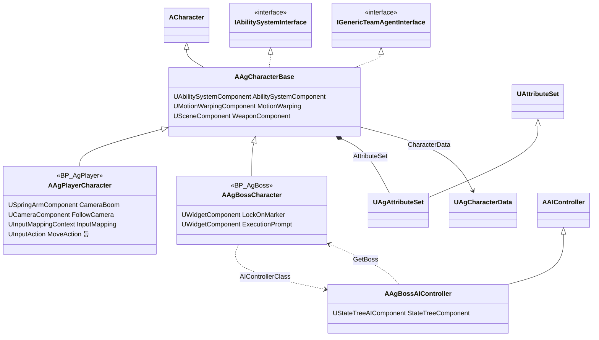
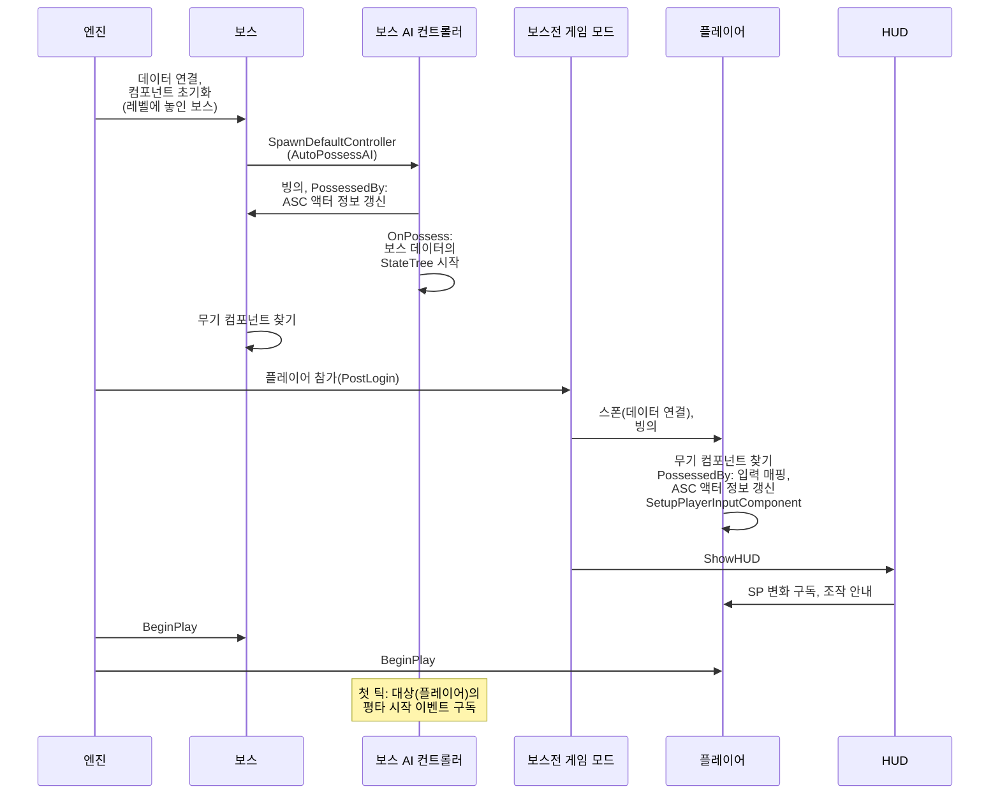
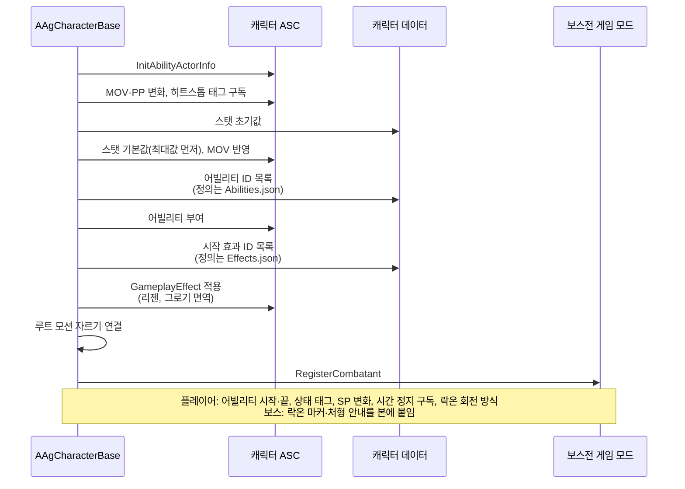
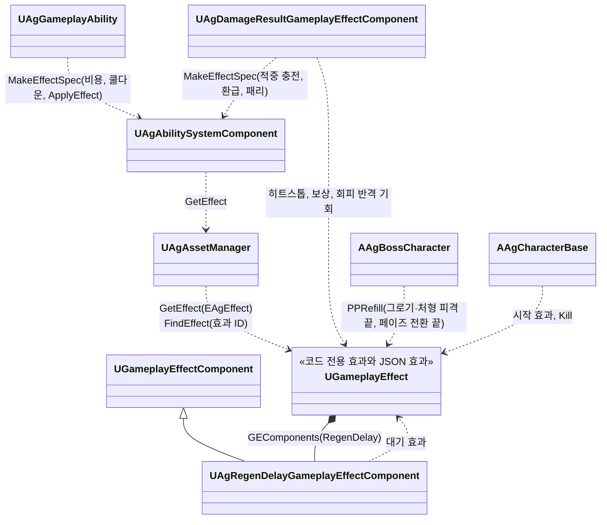

# 캐릭터와 GAS

캐릭터와 GAS, 그리고 캐릭터가 레벨에 나타나 싸울 준비를 마치기까지(데이터, 빙의, 어빌리티 시스템, AI, 입력, HUD 연결)를 어떻게 구현할지 정합니다.

## 기술 결정

| 항목 | 결정 | 이유 |
| - | - | - |
| ASC 위치 | 캐릭터에 둡니다. | 싱글플레이라 PlayerState에 둘 이유가 없습니다. |
| 어트리뷰트 | 세트 하나에 기획서 스탯을 기획서 이름 그대로 둡니다. HP, MaxHP, SP, MaxSP, MP, MaxMP, UP, MaxUP, PP, MaxPP, ATK, DEF, MOV. 보스가 쓰지 않는 SP·MP·UP는 0입니다. 기본값이 바뀌기 전에 범위(0 ~ 최대값)로 고정합니다. PP를 더하기 모디파이어로 줄일 때는 `PreGameplayEffectExecute`에서 감소량의 절댓값을 반올림한 뒤 음수로 적용합니다. 반올림 규칙은 [전투 시스템](<../Design/전투 시스템.md>) '대미지'를 따릅니다. | 기획서, 데이터 위치표, 코드의 이름이 같아 대조하기 쉽습니다. 최대값에서 리젠이 더해져도 기본값이 넘치지 않아야 다음 감소가 바로 보입니다. PP 감소량을 적용 직전에 반올림하면 패리도 같은 규칙을 따르고, 리젠으로 생긴 남은 PP의 소수부는 보존됩니다. |
| 어빌리티 목록 | 캐릭터 데이터(`Characters.json`)의 `Abilities`에 적힌 어빌리티 ID마다 단일 `UAgGameplayAbility`를 독립 스펙으로 부여합니다. 정의는 `Abilities.json`에 있고, 행동 태그와 트리거는 스펙에 넣습니다. | 같은 클래스라도 조건·이벤트·재발동·쿨다운·GE 출처가 행동마다 구분됩니다. |
| 어빌리티 구조 | 행동 전체를 나타내는 자식 Ability나 흐름 Task는 두지 않습니다. 어빌리티 클래스 하나(`UAgGameplayAbility`)가 엔진 어빌리티 기능을, 범용 Task가 기능 하나씩(몽타주 재생과 시간표는 PlayMontage)을 맡으며, 행동이 아닌 규칙은 주인 객체(캐릭터, 입력 계층, 피격 처리, 보스 AI)가 맡습니다([어빌리티와 AbilityTask](<어빌리티와 AbilityTask.md>)). | 기능별 획득과 복원이 함께 있고, 한 기능의 완료가 다른 기능이나 전체 Ability를 임의로 종료하지 않습니다. |
| 상태 | 4순위 상태(넉업, 넉백, 가드 밀림, 가드 브레이크), 그로기, 처형 피격, 페이즈 전환은 이벤트로 발동하는 행동(GameplayEvent 트리거)으로 만들고, 상태 우선순위는 태그로 나타냅니다. 높은 상태는 낮은 상태를 취소하고, 낮은 상태는 높은 상태 중에 시작하지 못합니다. 4순위 상태의 어빌리티 태그는 한 부모 태그(`Ability.Reaction.HitReaction`) 아래에 두어, 높은 상태가 부모 태그 하나로 취소합니다. 사망은 행동이 아니라 캐릭터가 사망 이벤트를 받아 처리합니다([사망 처리](<사망 처리.md>)). 그로기는 지속 효과가 상태 태그를 부여하며 효과 만료가 행동도 끝냅니다([어빌리티와 AbilityTask](<어빌리티와 AbilityTask.md>) '그로기 효과와 상태의 수명'). 그 밖에 행동이 붙이는 상태 태그는, 행동 내내 붙으면 ActivationOwnedTags에 두고, 일부 구간에만 붙으면(회피의 무적 구간, 후딜 전의 Busy 등) 시간표의 ApplyEffect 구간으로 그 태그를 주는 효과를 겁니다. | 행동과 같은 방식이라 규칙이 한곳에 모입니다. 두 방식 모두 행동이 끝나면 태그가 떨어지므로, 행동마다 태그를 떼는 코드를 두지 않습니다. |
| 쿨다운 | 어빌리티(플레이어 행동, 보스 패턴)의 쿨다운은 쿨다운 효과(`Cooldown`) 하나로 셉니다. 어빌리티마다 태그를 두지 않고, 효과의 에셋 태그(`Effect.Cooldown`)와 걸 때 넣은 출처(그 스펙의 어빌리티 인스턴스)로 어빌리티를 구분합니다. 시간은 어빌리티 항목의 `Cooldown`이며 0이면 쿨다운이 없습니다. 플레이어와 보스가 이 길 하나를 씁니다. | 엔진의 쿨다운 GE는 클래스(`CooldownGameplayEffectClass`)로만 받아, 코드에서 만든 GE 객체로 쿨다운을 확인·적용하는 함수를 재정의합니다. 시간은 어빌리티 정의에 두고, 공통 효과의 구성은 [JSON 데이터](<JSON 데이터.md>) '코드가 효과를 쓰는 방법'을 따릅니다. 어빌리티마다 태그를 두지 않아 어빌리티를 더해도 태그가 늘지 않습니다. 쿨다운 유무를 시간 하나로 정해, 쿨다운 효과가 있는지와 시간이 어긋나지 않습니다. |
| 자원 변화 | 자원이 바뀌는 일마다 그 규칙을 가진 효과를 적용합니다. 행동 비용은 GAS의 비용 흐름(`CheckCost`·`ApplyCost`)에서 자원 효과(`Resource`)를 음수로 걸어 치르고, 적중의 MP·UP 충전과 극한 회피의 SP 환급도 같은 자원 효과에 얻는 양을 넣습니다. 달리기의 지속 소모는 주기 효과(`SprintDrain`)로, PP 회복(그로기·처형 피격이 끝날 때, 페이즈 전환)은 PP를 최대로 덮어쓰는 효과(`PPRefill`)로, 패리로 공격자가 잃는 PP는 공격자의 MaxPP에 비율을 곱하는 효과(`ParryPPLoss`)로 처리합니다. | 자원 변경은 GameplayEffect로 적용하고 고정 기획 값은 JSON을 사용합니다. 엔진의 비용 GE는 클래스(`CostGameplayEffectClass`)로만 받아 쓰지 않고, 비용과 얻기가 자원 효과 하나를 함께 씁니다. |
| 리젠 | SP·PP 리젠은 자원마다 회복 효과 하나(`SPRegen`, `PPRegen`)로 처리합니다. 회복은 주기 효과이고, 가드 중 SP 회복량은 모디파이어의 태그 조건으로 나눕니다. 리젠 대기는 태그를 주는 지속 효과(`SPRegenDelay`, `SPRegenDelayAtZero`, `PPRegenDelay`)이고, 회복 효과는 대기 태그가 있는 동안 멈춥니다. 회복 효과의 `RegenDelay`가 자원이 줄 때마다 대기 효과를 다시 걸어 처음부터 다시 세고, SP가 0이 되면 더 긴 대기 효과를 겁니다. 회복 효과는 캐릭터 데이터의 시작 효과 목록(`Effects`)에 두어 캐릭터가 시작할 때 겁니다. | 자원 변화를 모두 GameplayEffect로 처리하는 GAS 표준 방식입니다. 회복량, 대기 시간, 대기를 다시 거는 규칙이 효과 정의에 있어 한곳에서 고칩니다. GameplayEffect 타이머는 게임 시간으로 흘러, 히트스톱 중에도 리젠이 계속되는 기획서 규칙과 맞습니다. |
| 그로기 면역 | 그로기 대상이 아닌 캐릭터(플레이어)는 시작 효과 목록(`Effects`)에 그로기 면역 효과(`GroggyImmune`)를 둡니다. 이 효과는 무한 지속으로 `State.GroggyImmune` 태그를 줍니다. PP를 잃을 수 없는 캐릭터(`CanLosePP`가 거짓: `State.GroggyImmune`, `State.Groggy`, `State.Execution`, `State.Invincible` 중 하나가 있음)의 PP 감소는 어트리뷰트 세트가 기본값이 바뀌기 전에 막고, 그로기 판정도 같은 조건을 봅니다. 그로기 어빌리티의 `ActivationBlockedTags`에도 그로기 면역 태그를 넣어 직접 이벤트나 활성화 요청을 차단합니다. | 상태를 태그로 나타내는 GAS 방식이라, 그로기·처형·무적 중에 PP를 잃지 않는 규칙을 같은 곳에서 확인합니다. PP를 줄이는 효과(대미지, 패리로 잃는 PP)마다 조건을 두지 않아, 새 효과도 이 규칙을 따릅니다. 스탯에는 어트리뷰트 초기값만 둡니다. |

## 클래스 구조

### 캐릭터

플레이어·보스 캐릭터와 컴포넌트, 보스를 움직이는 AI 컨트롤러입니다.

| 클래스 | 부모 | 역할 |
| - | - | - |
| `AAgCharacterBase` | `ACharacter`, `IAbilitySystemInterface`, `IGenericTeamAgentInterface` | 플레이어·보스 공통. ASC, 어트리뷰트, 팀(적대 판정), 어빌리티 부여와 스펙의 어빌리티 항목 찾기(`FindAbility`, `FindAbilitySpec`), 무기 리소스, 공중 상태(`State.Airborne`)와 이동 사건(`Event.Landed`, `Event.Apex`), 재생 중인 어빌리티의 대상과 간격으로 루트 모션 자르기(최소 간격), 상태 태그 처리(캐릭터 통과, 시간 정지 요청), 락온 대상 조회(`GetLockOnTarget`), 이동 입력 방향(`GetMoveInputDirection`), 피격 흔들림 컴포넌트(`UAgHitPhysicsComponent`, 래그돌 전에 멈춤), 히트스톱 중의 시간 배율, 사망 처리와 사망 모션 |
| `UAgCharacterMovementComponent` | `UCharacterMovementComponent` | 플레이어와 보스의 기본 회전. 회전 제한과 방향 제공 방식은 [애니메이션과 이동](<애니메이션과 이동.md>)의 캐릭터 회전을 따릅니다. |
| `AAgPlayerCharacter` | `AAgCharacterBase` | 카메라와 락온 카메라, 입력 매핑, 입력 계층(행동 태그로 스펙 찾기, 트리거 태그, 이동 입력 태그, 선입력, 점프와 점프 모션) |
| `AAgBossCharacter` | `AAgCharacterBase` | 페이즈 같은 보스 상태, 자동 회전 대상(AI 대상), 그로기·처형 피격·페이즈 전환이 끝날 때의 PP 회복과 2페이즈 진입. 보스에 표시하는 월드 위치 HUD(락온 마커, 처형 안내) |
| `UAgAttributeSet` | `UAttributeSet` | 기획서 스탯 13개, PP 감소량 반올림과 감소 허용 조건 적용, 사망·그로기 판정 |

### 레벨 시작에서 BeginPlay까지

### 캐릭터 BeginPlay

### GameplayEffect

GameplayEffect는 코드 전용 효과와 JSON 효과로 나눠 생성·보관합니다. 코드 전용 효과는 초기화 때 한 번 만들고, `Effects.json`의 효과는 데이터를 읽을 때 만듭니다. 효과별 GE C++ 클래스는 두지 않습니다. 형식과 코드가 효과를 거는 방법은 [JSON 데이터](<JSON 데이터.md>) '효과'를 따릅니다. 대미지 효과는 [대미지와 피격 처리](<대미지와 피격 처리.md>)에 있습니다. 행동 비용·쿨다운은 어빌리티가, 행동이 거는 효과(패리 구간, 극한 회피 구간, 그로기 시간, 달리기 소모)는 ApplyEffect가, 패리·극한 회피의 결과와 보상(패리로 잃는 PP, 보상, 환급, 회피 반격 기회)·히트스톱·적중 충전은 피격 결과 처리 컴포넌트가, PP 회복(그로기·처형 피격·페이즈 전환이 끝날 때)은 보스 캐릭터가, 시작 효과와 Kill은 캐릭터가, 리젠 대기는 회복 효과의 리젠 대기 컴포넌트가 겁니다.

| 클래스 | 부모 | 역할 |
| - | - | - |
| `UAgRegenDelayGameplayEffectComponent` | `UGameplayEffectComponent` | 회복 효과의 `RegenDelay`([JSON 데이터](<JSON 데이터.md>) '효과'). 효과가 걸릴 때 회복하는 어트리뷰트의 변경을 구독하고 지워질 때 풉니다(엔진의 대상 태그 조건 컴포넌트가 태그 변경을 구독하는 방식). 값이 줄면 걸린 대기 효과를 태그로 지우고 대기 효과를 다시 겁니다. |

